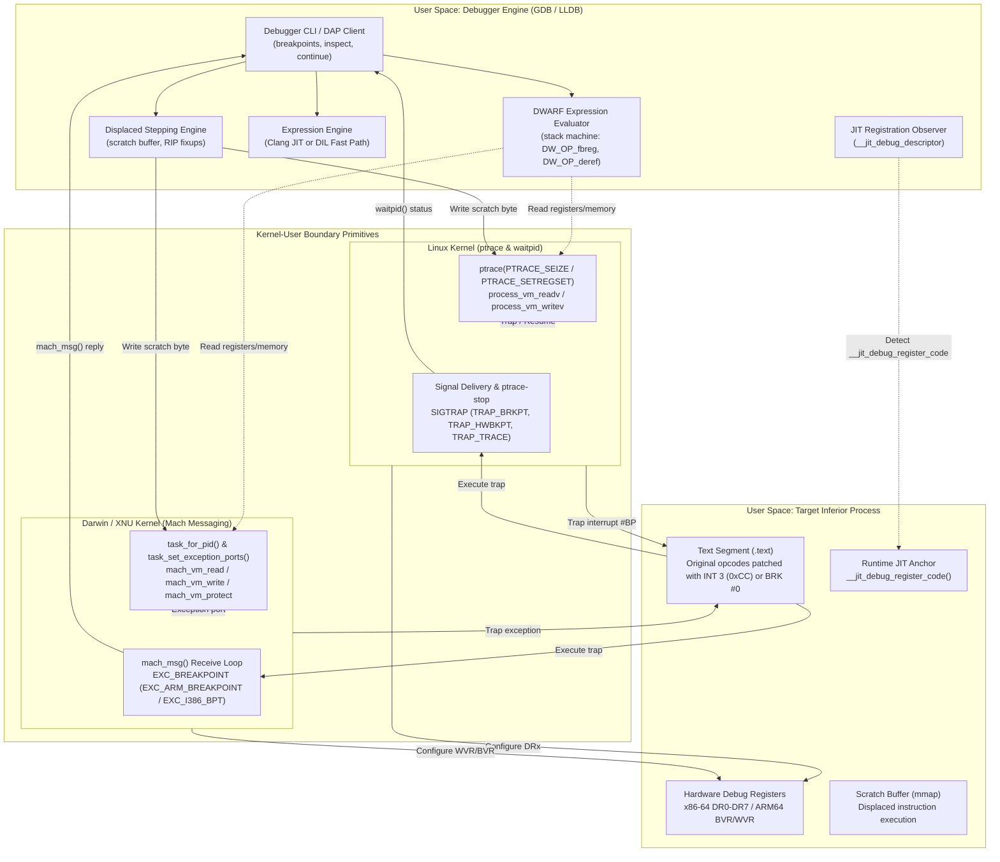
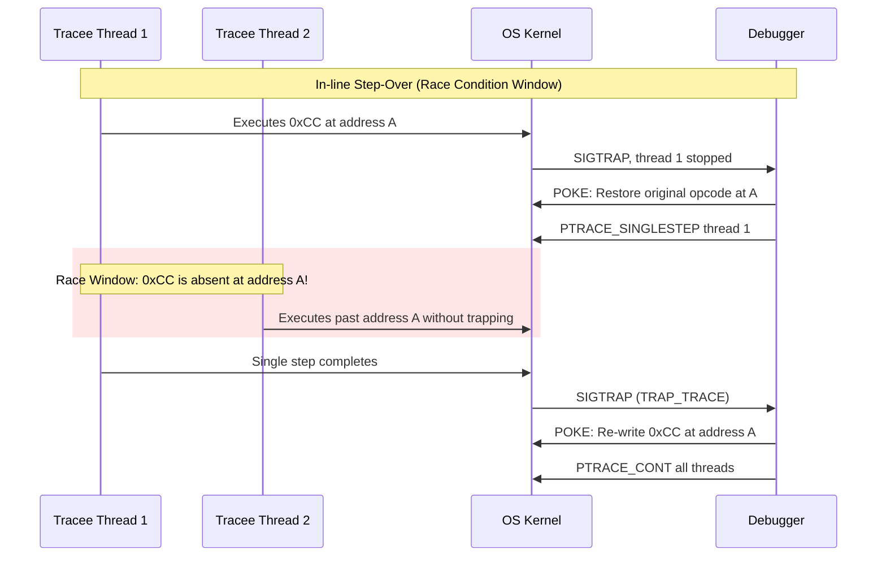
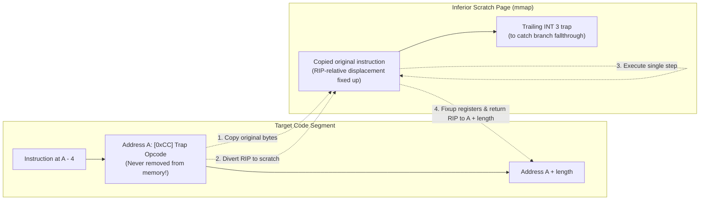
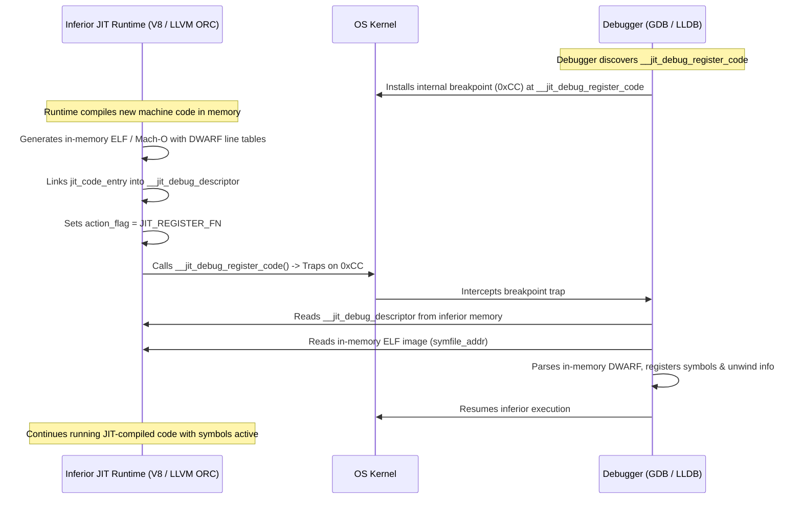
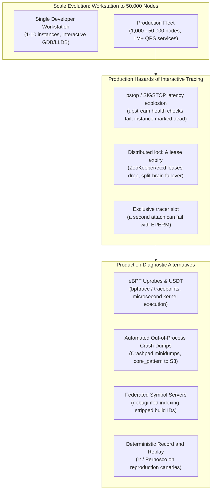

# How Debuggers Work: ptrace, Mach Exception Ports, and Breakpoints

> [!summary] Claim:
> Native debuggers control target processes through operating system kernel primitives: Linux provides the `ptrace` system call with per-thread tracee attachments, while macOS routes kernel exceptions to debugger-allocated Mach receive ports via `task_set_exception_ports`.
> Software breakpoints patch code pages with architecture-specific trap opcodes (`0xCC` / `INT 3` on x86-64, `0xd4200000` / `BRK #0` on ARM64), requiring instruction-pointer rewind on x86-64 and displaced out-of-line stepping to avoid multi-threaded race conditions during resumption.
> Hardware breakpoints and watchpoints program dedicated CPU debug registers (`DR0`-`DR7` on x86-64, `DBGBVR`/`DBGWVR` on ARM64) to trap instruction fetch or memory access with zero code patching, while DWARF location expressions and JIT symbol tables are resolved strictly in user space by the debugger engine.



## The Mechanism

Every source-level debugger relies on a layered division of labor between hardware execution units, operating system kernel traps, and user-space symbolic engines.
The operating system exposes low-level control interfaces that suspend threads and read or write machine state.
The CPU provides trap vectors, hardware debug registers, and single-step flags.
The debugger operates in user space as a controlling process, converting raw memory addresses and register bitfields into source lines, stack frames, and variable trees.

### 1. The Kernel Tracing Boundary: Linux ptrace and Darwin Mach Exception Ports

On Linux, process inspection and control center on the `ptrace(2)` system call.
The tracing relationship operates strictly per-thread: in a multi-threaded application, each task or lightweight process (LWP) is an independent tracee identified by its thread ID (`tid`).
Traditional debugging attached via `PTRACE_ATTACH`, which sends a disruptive `SIGSTOP` signal to the target process.
`PTRACE_SEIZE` (since Linux 3.4, per ptrace(2)) attaches to a thread without stopping it or injecting asynchronous signals, and tools such as strace use it.
The mainstream interactive debuggers still attach with `PTRACE_ATTACH`: lldb-server's `NativeProcessLinux::Attach` calls `PtraceWrapper(PTRACE_ATTACH, tid)` per thread and never uses `PTRACE_SEIZE` (LLVM main, as of 2026-11, Linux), and an strace of GDB 15.1 attaching on Ubuntu 24.04 shows `ptrace(PTRACE_ATTACH, pid)` (run for this note, as of 2026-11, Linux; GDB 18.1 not traced).
Once attached or seized, the tracer configures tracing options via `PTRACE_SETOPTIONS`:

- `PTRACE_O_TRACESYSGOOD`: Sets bit 7 in the stop signal (`SIGTRAP | 0x80`) on system call entry and exit, allowing the debugger to distinguish system call stops from real signal delivery.
- `PTRACE_O_TRACECLONE`: Automatically attaches to newly spawned threads created via `clone(2)` with `CLONE_THREAD`.
- `PTRACE_O_TRACEEXEC`: Intercepts `execve(2)` boundaries before the new image starts executing.
- `PTRACE_O_TRACEFORK` and `PTRACE_O_TRACEVFORK`: Intercepts process creation.
- `PTRACE_O_EXITKILL` (since Linux 3.8): Sends `SIGKILL` to the tracee if the tracer exits, so that a tracee can never escape the tracer's control.
  Without it, ptrace(2) specifies that when the tracer dies all tracees are automatically detached and restarted, unless they were in group-stop; so `EXITKILL` kills rather than rescues the target, and GDB 15.1 sets it only on its own feature-probe child, not on an attached process (strace run for this note, as of 2026-11, Linux).

When a tracee stops, the Linux kernel places it into a `ptrace-stop` state and wakes the tracer's blocking `waitpid(pid, &status, __WALL)` call.
The integer `status` encodes the stop cause:
`WIFSTOPPED(status)` evaluates to true, and `WSTOPSIG(status)` reports the signal.
If an extended ptrace event occurred, the upper byte `status >> 16` holds the event constant (such as `PTRACE_EVENT_CLONE` or `PTRACE_EVENT_STOP`).

```text
status word bit layout on Linux ptrace stop:
+------------------------+-------------------+-------------------+
| bits 31..16: Event ID  | bits 15..8: Signal| bits 7..0: 0x7f   |
| (PTRACE_EVENT_*)       | (WSTOPSIG)        | (WIFSTOPPED mask) |
+------------------------+-------------------+-------------------+
```

To pause a running thread attached via `PTRACE_SEIZE`, the debugger issues `ptrace(PTRACE_INTERRUPT, pid, 0, 0)`.
This forces the tracee into `PTRACE_EVENT_STOP` without corrupting pending application signals.
Register inspection uses `PTRACE_GETREGSET` and `PTRACE_SETREGSET` (introduced in Linux 2.6.34), passing `(void *)NT_PRSTATUS` and a `struct iovec` pointing to `struct user_regs_struct`.
Bulk memory reads and writes bypass single-word `PTRACE_PEEKTEXT` and `PTRACE_POKETEXT` round-trips by calling `process_vm_readv(2)` and `process_vm_writev(2)` (introduced in Linux 3.2).
These cross-process system calls walk the target's page tables directly in the kernel, copying data between virtual address spaces without context-switching the tracee or requiring it to be in a stopped state.

Access permissions on Linux are governed by the Yama Linux Security Module (`/proc/sys/kernel/yama/ptrace_scope`).
Under `ptrace_scope = 1` (the upstream Yama default and the Ubuntu default), a process can only `PTRACE_ATTACH` to its descendants unless the target process invokes `prctl(PR_SET_PTRACER, debugger_pid, 0, 0, 0)`; `PTRACE_TRACEME` is unchanged.
Debian's kernel packaging applies a "yama: Disable by default" patch that sets the default to 0: `debian/patches/debian/yama-disable-by-default.patch` is still listed in `debian/patches/series` on the `debian/latest` branch (linux 7.3.3-1), so merge request 1507, which proposes dropping it, had not taken effect there (as of 2026-11, Linux).
Under `ptrace_scope = 2`, only processes possessing `CAP_SYS_PTRACE` may use ptrace, through either `PTRACE_ATTACH` or a child's `PTRACE_TRACEME`.
Under `ptrace_scope = 3`, neither `PTRACE_ATTACH` nor `PTRACE_TRACEME` is allowed, and the value cannot be changed once set, so it holds until reboot (Yama documentation).

```text
ptrace_scope levels:
0: Classic Unix DAC (attach allowed to any process with matching UID)
1: Restricted attach (descendants only, or explicit PR_SET_PTRACER)
2: Admin-only attach (requires CAP_SYS_PTRACE or root)
3: No attach (PTRACE_ATTACH, PTRACE_SEIZE, and PTRACE_TRACEME refused; cannot be lowered)
```

macOS (Darwin / XNU) departs entirely from Unix `ptrace` conventions for breakpoint debugging.
Although Darwin retains a legacy `ptrace(2)`, it does not implement memory or register access: `<sys/ptrace.h>` still defines `PT_READ_I` and friends, but `bsd/kern/mach_process.c` has no case for them and they fall to the `default:` branch returning `EINVAL`; what remains is attach and lifecycle control, and the SDK header marks `PT_ATTACH` deprecated in favor of `PT_ATTACHEXC` (attach with signals delivered as Mach exceptions) (as of 2026-11, macOS).
Instead, LLDB on macOS operates through Mach IPC primitives, task ports, and Mach exception ports.
The debugger obtains a control handle to the target process by calling `task_for_pid(mach_task_self(), target_pid, &task_port)`.
This call requires authorization through Apple's `taskgated` daemon: the target binary must have the `com.apple.security.get-task-allow` entitlement (standard on development builds), or the debugger must run as root with code-signing entitlements matching System Integrity Protection (SIP) rules.

Once LLDB holds the `task_port`, it allocates a Mach receive port using `mach_port_allocate(mach_task_self(), MACH_PORT_RIGHT_RECEIVE, &exc_port)`.
It registers this port to intercept process exceptions via `task_set_exception_ports`:

```c
kern_return_t kr = task_set_exception_ports(
    task_port,
    EXC_MASK_BREAKPOINT | EXC_MASK_BAD_ACCESS,
    exc_port,
    EXCEPTION_DEFAULT | MACH_EXCEPTION_CODES,
    ARM_THREAD_STATE64
);
```

The debugger launches a dedicated exception listener thread that blocks inside `mach_msg()` waiting for exception messages.
When a thread in the target task triggers a breakpoint or memory violation, the XNU kernel suspends the faulting thread, packages the exception into a Mach message (type `EXC_BREAKPOINT`), and queues it to `exc_port`.
Memory read and write operations execute via `mach_vm_read_overwrite()` and `mach_vm_write()`.
Because code segments on Darwin are mapped with read and execute permissions (`VM_PROT_READ | VM_PROT_EXECUTE`), writing a breakpoint opcode requires temporarily modifying page protection via `mach_vm_protect`; debugserver's `MachVMRegion::SetProtections` first requests the new protection as is and retries with `prot | VM_PROT_COPY` (copy-on-write a private page) only if that fails, then restores the original protection afterwards (LLVM main, as of 2026-11, macOS).
Thread registers are queried and mutated using `thread_get_state()` and `thread_set_state()` with architecture flavors like `ARM_THREAD_STATE64` or `x86_THREAD_STATE64`.
Resuming the thread requires the debugger to transmit a Mach reply message containing `KERN_SUCCESS`, signaling the XNU kernel to clear the exception state and unblock the thread.

### 2. Software Breakpoints: INT 3, BRK #0, and Trap State Machines

Software breakpoints operate by modifying executable code in the target's memory.
When a developer sets a breakpoint at address $A$, the debugger executes the following sequence:

1. Reads the original instruction bytes at address $A$ using `ptrace(PTRACE_PEEKTEXT)` or `mach_vm_read_overwrite()`.
2. Stores the original bytes in an internal breakpoint lookup table indexed by address $A$.
3. Overwrites the first byte or word at address $A$ with the target architecture's trap instruction.
4. Flushes instruction caches if required by the CPU architecture.

On x86 and x86-64, the trap instruction is `INT 3`, encoded as the single byte `0xCC`.
The single-byte encoding is critical to x86 debugger correctness.
Because x86 instructions are variable-length (ranging from 1 to 15 bytes), a multi-byte interrupt instruction like `INT n` (`0xCD 0x03`) would overwrite two bytes.
If another thread or a jump target branched to the second byte, the processor would decode corrupted instruction fragments, resulting in unpredictable crashes or invalid opcode exceptions (`#UD`).
The single byte `0xCC` guarantees atomic instruction replacement on any byte boundary.

When the CPU executes `0xCC`, it initiates the interrupt 3 (`#BP`) exception handler.
Under the x86 architecture specification (Intel SDM Vol 3A, Chapter 7, "Event 3 - Breakpoint Exception (#BP)", Order Number 325462-093US, September 2026), `#BP` has exception class Trap and the saved instruction pointer points to the instruction following the `INT3`.
The same section tells a debugger to resume by restoring the original opcode and decrementing the saved instruction pointer.
During trap delivery, the CPU pushes the return instruction pointer (`RIP`) onto the interrupt stack frame.
Crucially, the CPU pushes the address of the *next* instruction: $A + 1$.
This note's lab did not observe that value: its x86-64 branch has not been run on x86-64 hardware (see the Worked Lab Example).
The kernel receives `#BP`, halts the thread, and notifies the debugger via `SIGTRAP` (Linux) or `EXC_BREAKPOINT` (Darwin).
When the debugger inspects registers, it observes `RIP == A + 1`.
Because the original instruction at address $A$ has not yet executed, the debugger *must* decrement `RIP` by 1 (`RIP = A`) before the user can resume or inspect the current line state.

On ARM64 (AArch64), instructions are strictly 32-bit (4-byte) aligned.
The software breakpoint instruction is `BRK #0`, encoded in little-endian as `0x00, 0x00, 0x20, 0xd4` (binary word `0xd4200000`).
GDB and LLDB plant `BRK #0`; `BRK #0xf000` is what Clang emits for `__builtin_debugtrap()` on AArch64 and `BRK #0x1` is what it emits for `__builtin_trap()` (Apple clang on arm64, compiled for this note, as of 2026-11, macOS).
Unlike x86-64, the ARM64 architecture (ARM DDI 0487) specifies that a Breakpoint Instruction exception leaves the Program Counter (`PC`) pointing directly to the `BRK` instruction itself; the lab below observes this from user space on Linux aarch64.
The kernel saves `PC = A` into the register context.
Therefore, on ARM64, the debugger does *not* decrement the program counter when a software breakpoint fires.
The lab `code/03-Debugging/ptrace_breakpoints/` poked `0xd4200000` over a function entry on Linux aarch64 (Ubuntu 24.04 container), resumed, and observed `SIGTRAP` with `si_code = TRAP_BRKPT` and `pc - A = 0` (as of 2026-11, Linux).

Furthermore, ARM64 features a Harvard cache architecture with separate instruction (I-cache) and data (D-cache) pipelines that do not maintain hardware coherency on memory writes.
When the debugger writes `0xd4200000` via a data write path (`ptrace(PTRACE_POKETEXT)` or `mach_vm_write`), the trap bytes sit in the data cache or physical memory.
If the processor has already cached the original instructions in the instruction cache, the CPU pipeline will execute the stale instruction from the I-cache and miss the breakpoint entirely.
On Linux arm64, a ptrace write reaches `copy_to_user_page()`, which calls `flush_ptrace_access()`; for a `VM_EXEC` mapping that runs `sync_icache_aliases()`, which cleans the D-cache and invalidates the I-cache to the Point of Unification (PoU), not the Point of Coherency (`arch/arm64/mm/flush.c`, as of 2026-11, Linux).
On Darwin, `sys_icache_invalidate(void *start, size_t len)` in `<libkern/OSCacheControl.h>` operates on the caller's own address space, so a debugger cannot use it on another task's pages.
debugserver instead follows each `mach_vm_write` on non-x86 hosts with `vm_machine_attribute(task, addr, size, MATTR_CACHE, &MATTR_VAL_CACHE_FLUSH)` (`MachVMMemory::WriteRegion`, LLVM main, as of 2026-11, macOS).

### 3. Step-Over Concurrency and Displaced Stepping

Once execution halts at address $A$, the user inspects variables and commands the debugger to continue (`continue` or `step`).
The debugger cannot simply resume execution with `PTRACE_CONT`:
The trap opcode `0xCC` is still present at address $A$.
Resuming would immediately re-execute `0xCC`, generating an infinite trap loop.
The debugger must execute the original instruction that was replaced.

Historically, debuggers resolved this through an in-line step-over sequence:

1. Restore the original instruction byte at address $A$ using `PTRACE_POKETEXT`.
2. Issue a single-step request (`PTRACE_SINGLESTEP`).
3. Wait for the CPU to execute that single instruction and trap back via `waitpid()`.
4. Re-insert the `0xCC` trap byte at address $A$.
5. Resume normal execution with `PTRACE_CONT`.



In multi-threaded programs, in-line step-over introduces a severe race condition.
During the window between step 1 (restoring the original byte) and step 4 (re-writing `0xCC`), address $A$ contains normal, un-trapped code.
If Thread 2 is scheduled by the kernel and executes through address $A$ during this window, Thread 2 completely misses the breakpoint.
Keeping every other thread stopped while the one thread steps over the breakpoint prevents Thread 2 from missing it, at the cost of freezing the whole process; stepping a whole source line with peers frozen (GDB's scheduler-locking) can additionally deadlock if the stepping thread needs a lock held by a paused thread.
LLDB takes this approach: `ThreadPlanStepOverBreakpoint` disables the breakpoint site in `DoWillResume`, single-steps, and re-enables the site in `WillStop`; `StopOthers()` returns true and `SupportsResumeOthers()` returns false, and a source comment explains that resuming all threads before the re-enable "can miss breakpoints on other threads" (`lldb/source/Target/ThreadPlanStepOverBreakpoint.cpp`, LLVM main, as of 2026-11, Both).

To eliminate this race condition without freezing peers, GDB implements *displaced stepping* (also known as out-of-line stepping); `set displaced-stepping auto`, the default, uses it only when non-stop mode is active and the architecture supports it (GDB manual, Maintenance Commands, as of 2026-11, Both).
Displaced stepping executes the replaced instruction outside the executable stream without removing the trap opcode from address $A$:



1. The debugger reserves a small scratch buffer in the inferior process's address space; GNU/Linux GDB's `linux_displaced_step_location` (`gdb/linux-tdep.c`) reads `AT_ENTRY` from the auxiliary vector and returns the entry point plus two breakpoint lengths, leaving room for the breakpoint that inferior calls place at the entry point, and `gdb/displaced-stepping.c` records the assumption that no thread executes the code in that range after initial startup (GDB source, as of 2026-11, Linux).
   The lab's tracer instead uses an anonymous RWX `mmap` page created before the fork, which the tracee inherits.
2. When Thread 1 hits the breakpoint at address $A$, the debugger leaves `0xCC` intact at address $A$.
3. The debugger copies the original instruction bytes from its internal lookup table into the scratch buffer at address $S$.
4. If the instruction uses instruction-pointer-relative addressing (such as x86-64 RIP-relative addressing `mov 0x20(%rip), %rax`), executing it at address $S$ would reference incorrect memory offsets.
   The debugger parses the instruction using a disassembler engine and patches the displacement field so that $(S + \text{offset}')$ resolves to the exact same effective address as $(A + \text{offset})$.
5. The debugger sets Thread 1's `RIP` to address $S$ and issues `PTRACE_SINGLESTEP`.
6. Once the single step completes in the scratch buffer, the debugger inspects the resulting state:
   - If the instruction was a non-branching instruction, the debugger updates `RIP` to $A + \text{instruction\_length}$.
   - If the instruction was a conditional branch whose condition evaluated to true, the debugger sets `RIP` to the branch target address.
   - If the instruction pushed a return address onto the stack (such as `call`), the debugger patches the pushed stack value so the return target points to $A + \text{instruction\_length}$ rather than $S + \text{instruction\_length}$.
7. The trap opcode `0xCC` at address $A$ is never removed.
   Other threads running concurrently can never slip past the breakpoint.

### 4. Hardware Debug Registers: Watchpoints and Execution Breakpoints

When software breakpoints cannot be used (such as debugging read-only memory, flash memory, or monitoring data memory reads and writes), debuggers employ hardware debug registers built directly into the processor core.

On x86-64 processors, debugging facilities are controlled by eight debug registers: `DR0` through `DR7`:

- `DR0`, `DR1`, `DR2`, `DR3`: 64-bit linear address registers holding the target virtual addresses for up to four simultaneous hardware breakpoints or watchpoints.
- `DR6`: Debug Status Register.
  When a debug exception occurs, the CPU sets bits in `DR6` indicating which condition fired:
  Bits `B0`..`B3` correspond to `DR0`..`DR3`.
  Bit `BS` (bit 14) indicates that the exception was triggered by the single-step execution flag.
- `DR7`: Debug Control Register.
  Configures the activation, memory access condition, and watched byte size for each debug slot:
  - `L0`..`L3` (bits 0, 2, 4, 6): Local breakpoint enable flags.
    Enables the corresponding breakpoint within the current task context.
  - `G0`..`G3` (bits 1, 3, 5, 7): Global breakpoint enable flags.
  - `R/W0`..`R/W3` (2-bit fields at bits 16-17, 20-21, 24-25, 28-29):
    - `00`: Break on instruction execution only.
    - `01`: Break on data writes only.
    - `10`: Break on I/O port read/write (requires `CR4.DE = 1`).
    - `11`: Break on data reads or writes (read/write watchpoint).
  - `LEN0`..`LEN3` (2-bit fields at bits 18-19, 22-23, 26-27, 30-31):
    - `00`: 1-byte length.
    - `01`: 2-byte length.
    - `10`: 8-byte length on processors that support it, undefined otherwise (SDM Section 20.2.4 note).
    - `11`: 4-byte length.

```text
x86-64 DR7 Control Register Bit Allocation:
 31 30 29 28 27 26 25 24 23 22 21 20 19 18 17 16 15 14 13 12 11 10  9  8  7  6  5  4  3  2  1  0
+-----+-----+-----+-----+-----+-----+-----+-----+--+--+--+--+--+--+--+--+--+--+--+--+--+--+--+--+
|LEN3 |R/W3 |LEN2 |R/W2 |LEN1 |R/W1 |LEN0 |R/W0 |0 |0 |GD|0 |RT|1 |GE|LE|G3|L3|G2|L2|G1|L1|G0|L0|
+-----+-----+-----+-----+-----+-----+-----+-----+--+--+--+--+--+--+--+--+--+--+--+--+--+--+--+--+
```

Bits 15..8 are not all zero: bit 8 is `LE` and bit 9 is `GE` (exact breakpoint enables, not supported on Intel 64 processors but recommended to be set to 1), bit 10 is reserved and always 1 (`DR7_FIXED_1 = 0x400` in the Linux kernel), bit 11 is `RTM` (advanced debugging of transactional regions, shown as `RT` in the figure), and bit 13 is `GD` (general detect) (Intel SDM Vol 3B, Section 20.2.4; `arch/x86/include/asm/debugreg.h`, as of 2026-11, Both).

An essential architectural distinction on x86-64 is how execution breakpoints differ from data watchpoints:
- Hardware *execution breakpoints* (`R/W = 00`) are reported as **faults**.
  The processor triggers the `#DB` exception *before* the instruction executes.
  `RIP` points directly to the instruction.
  To resume execution without triggering an immediate re-fault, the debugger sets the Resume Flag (`RF`, bit 16) in `RFLAGS`.
  When `RF = 1`, the CPU suppresses instruction breakpoint faults for exactly one instruction cycle.
  Upon successful execution of that instruction, the processor automatically clears `RF` to 0.
- Hardware *data watchpoints* (`R/W = 01` or `11`) are reported as **traps**.
  The processor triggers `#DB` *after* the instruction that performed the memory access has fully retired.
  `RIP` points to the *subsequent* instruction.

On ARM64, hardware debugging is governed by Coprocessor registers exposed through the Debug architecture:
- `DBGBVR0_EL1`..`DBGBVR15_EL1`: Breakpoint Value Registers (virtual addresses).
- `DBGBCR0_EL1`..`DBGBCR15_EL1`: Breakpoint Control Registers (privilege level, byte address match).
- `DBGWVR0_EL1`..`DBGWVR15_EL1`: Watchpoint Value Registers.
- `DBGWCR0_EL1`..`DBGWCR15_EL1`: Watchpoint Control Registers.
  Control bits include `LSC` (Load/Store Control: `01` = load, `10` = store, `11` = both), `PAC` (privilege access control), and `BAS` (Byte Address Select, an 8-bit mask mapping bytes within an aligned 8-byte doubleword).

The number of hardware breakpoints and watchpoints is implementation-defined, and the Linux ptrace interface allows up to 16 of each (`ARM_MAX_BRP` and `ARM_MAX_WRP` in `arch/arm64/include/asm/hw_breakpoint.h`).
A Linux VM on an Apple-silicon host (OrbStack, kernel 7.2.12) reported 6 breakpoints and 4 watchpoints in the low byte of `dbg_info` returned by `PTRACE_GETREGSET` with `NT_ARM_HW_BREAK` and `NT_ARM_HW_WATCH` (measured for this note on 2026-11-08); other cores can differ, so a tool should read the count at run time instead of hard-coding it.
On Linux ARM64, debuggers configure these registers using `ptrace(PTRACE_SETREGSET)` with note types `NT_ARM_HW_BREAK` and `NT_ARM_HW_WATCH`, passing a `struct user_hwdebug_state`.
On Darwin ARM64, LLDB mutates them via `thread_set_state()` using the `ARM_DEBUG_STATE64` flavor (`struct __darwin_arm_debug_state64`), which directly exposes the `__bvr`, `__bcr`, `__wvr`, and `__wcr` arrays.

When an ARM64 watchpoint fires, the CPU generates a synchronous Watchpoint exception, a debug exception with its own exception class rather than a Data Abort (`0x24`).
The Fault Address Register (`FAR_EL1`) holds a data address of the access that triggered the watchpoint, and the Exception Syndrome Register (`ESR_EL1`) records exception class `0x34` (Watchpoint from a lower Exception Level; `0x35` from the current level); `0x32` is Software Step from a lower level and `0x3C` is `BRK` (Linux `arch/arm64/include/asm/esr.h`, as of 2026-11, Linux).
Unlike x86 data traps, on ARM64 the program counter reported to user space points to the instruction that executed the access.
The debugger steps over it by setting the Software Step bit (`SS`, bit 0) in `MDSCR_EL1` or mutating `PSTATE.SS`.

### 5. Single-Stepping and Signal Routing

Single-stepping instructs the processor to execute exactly one machine instruction and instantly halt.
On x86-64, hardware single-stepping is controlled by the Trap Flag (`TF`, bit 8) in the `RFLAGS` register:

1. When the debugger invokes `ptrace(PTRACE_SINGLESTEP, pid, 0, signal)`, the Linux kernel accesses the saved register frame of the stopped tracee and sets `RFLAGS.TF = 1`.
2. The kernel returns the tracee to user-mode execution.
3. The processor executes exactly one instruction.
4. Immediately following instruction retirement, the processor detects `TF = 1`, generates a `#DB` (Vector 1) exception, clears `TF` internally, and transfers control to the kernel `#DB` handler.
5. The kernel saves thread context and delivers a `SIGTRAP` with `si_code = TRAP_TRACE` to the debugger.

When single-stepping across signal-heavy workloads, signal routing requires precise debugger handling.
If an application signal (such as `SIGALRM` or `SIGINT`) arrives while a tracee is stopped or single-stepping, the kernel intercepts the delivery and presents the signal to the tracer during `waitpid()`:
`WSTOPSIG(status)` equals the arriving signal number.
The debugger decides whether to swallow the signal or forward it:
- To suppress the signal, the debugger passes 0 as the data argument: `ptrace(PTRACE_CONT, pid, 0, 0)`.
- To inject the signal into the tracee's normal signal-handling mechanism, the debugger forwards the signal number: `ptrace(PTRACE_CONT, pid, 0, signum)`.
Failure to forward signals breaks timer mechanisms, user aborts, and inter-thread notifications.

### 6. User-Space DWARF Expression Evaluation

Once the operating system halts the target and reads memory or register blocks, variable evaluation shifts entirely into user space inside the debugger engine.
Compilers describe variable storage locations using DWARF Location Descriptions stored in `.debug_info` and `.debug_loclists` sections.
A DWARF location expression is a program written for an internal stack machine whose elements are generic machine words (typically 64-bit unsigned integers).

The DWARF stack machine executes a compact bytecode:

- `DW_OP_reg0`..`DW_OP_reg31`: Specifies that the variable resides in the designated processor register.
- `DW_OP_regx <uleb128>`: Specifies arbitrary register numbers (such as vector or floating-point registers).
- `DW_OP_fbreg <sleb128>`: Pushes the base address of the current stack frame (computed via the function's `DW_AT_frame_base` attribute) plus a signed LEB128 offset.
- `DW_OP_addr <address>`: Pushes an absolute relocated virtual address onto the stack.
- `DW_OP_plus_uconst <uleb128>`: Pops the top value, adds an unsigned constant, and pushes the result.
- `DW_OP_deref`: Pops the top stack value, treats it as an inferior virtual memory address, reads a machine word from the tracee (via `process_vm_readv` or `mach_vm_read`), and pushes the retrieved word.
- `DW_OP_piece <uleb128>`: Assembles split variables where sub-fields reside across disjoint registers and stack slots.
- `DW_OP_stack_value`: Informs the evaluator that the value on the top of the stack is the *actual value* of the object itself, rather than its memory address.
  This opcode is extensively generated in optimized code where variables are computed into registers and never spilled to RAM.

The debugger executes this bytecode step by step.
When the expression terminates, the top of the stack yields either a target memory address or a direct value.
The debugger then traverses the DWARF type tree (`DW_TAG_structure_type`, `DW_TAG_member`, `DW_TAG_base_type`), reading size and field offset attributes to format the final user-facing representation.

### 7. Dynamic Code Registration: The GDB JIT Interface

Static DWARF files on disk cannot describe Just-In-Time (JIT) compiled code emitted at runtime by runtimes such as the V8 JavaScript engine, the Java Virtual Machine (JVM), Julia, or WebAssembly engines.
To enable source-level debugging, function name resolution, and unwinding through dynamically generated memory regions, GDB and LLDB implement the standard **GDB JIT Compilation Interface** (GDB Manual Chapter 30).

The interface operates through a cooperative protocol anchored on an agreed-upon symbol name and data structure:

```c
typedef enum {
    JIT_NOACTION = 0,
    JIT_REGISTER_FN,
    JIT_UNREGISTER_FN
} jit_actions_t;

struct jit_code_entry {
    struct jit_code_entry *next_entry;
    struct jit_code_entry *prev_entry;
    const char *symfile_addr;
    uint64_t symfile_size;
};

struct jit_descriptor {
    uint32_t version;
    uint32_t action_flag;
    struct jit_code_entry *relevant_entry;
    struct jit_code_entry *first_entry;
};

// Global interface symbols in inferior:
struct jit_descriptor __jit_debug_descriptor = { 1, JIT_NOACTION, NULL, NULL };

void __attribute__((noinline)) __jit_debug_register_code(void) {
    // Empty body: acts as a trap hook for the debugger
}
```

The synchronization sequence proceeds as follows:



1. Upon startup or attach, the debugger scans the inferior's dynamic symbol table for `__jit_debug_register_code`.
2. The debugger sets an *internal, invisible* breakpoint on `__jit_debug_register_code`.
3. When the JIT compiler emits a new function into executable memory, it synthesizes an in-memory object file (ELF or Mach-O format) containing `.text`, `.debug_line`, and `.debug_frame` sections.
4. The runtime allocates a `struct jit_code_entry`, points `symfile_addr` to the in-memory object file, updates `__jit_debug_descriptor`, and invokes `__jit_debug_register_code()`.
5. The CPU hits the internal breakpoint.
6. The debugger catches the trap, reads the `__jit_debug_descriptor` struct from inferior memory, downloads the in-memory object file, parses the DWARF metadata, registers the address ranges in its symbol table, and immediately resumes the inferior without exposing the pause to the user.

### 8. LLDB Expression Parsing: Clang JIT versus Data Inspection Language (DIL)

When a developer evaluates an expression in LLDB (such as `p my_vector.size()` or `p node->val`), the debugger must translate user-supplied text into values.
LLDB provides two distinct evaluation architectures:

#### Clang JIT Expression Parser
Historically, LLDB routes expressions through an embedded instance of the Clang compiler.
The evaluator synthesizes a full C++ wrapper function in memory:
`void $__lldb_expr(void *$__lldb_arg) { ... }`.
Using the DWARF type information extracted from the binary, LLDB's `ClangASTImporter` dynamically injects declarations, types, and methods into Clang's Abstract Syntax Tree.
Clang compiles the wrapper function into machine code.
LLDB allocates scratch memory inside the inferior (via `mmap` or `mach_vm_allocate`), writes the compiled instructions into the inferior's memory, configures an argument structure containing pointers to local variables and the `this` pointer, and sets up an inferior function call.
The debugger rewires the thread's stack pointer and instruction pointer to execute the injected code, planting a breakpoint at the return address.
When the injected code hits the return breakpoint, LLDB extracts the return value, restores the original register state, and frees scratch allocations.

While immensely powerful (supporting arbitrary C++ method calls, template instantiations, and lambdas), the Clang JIT engine has severe downsides:
Every expression pays for AST reconstruction and a compiler run before any inferior memory is read.
More dangerously, if the injected expression triggers a segmentation fault, memory leak, or undefined behavior, it corrupts or terminates the inferior process.

#### Data Inspection Language (DIL)
To support responsive IDE integrations (such as hover tooltips and watch windows displaying dozens of variables) without compiler overhead, LLDB incorporates the **Data Inspection Language (DIL)** engine.
DIL replaces Clang AST compilation with its own grammar, lexer, parser, and interpreter that operates directly on LLDB's core `ValueObject` data model and DWARF debug info.
DIL is the default implementation of `frame variable` (`v`), controlled by `target.experimental.use-DIL`, which defaults to `true` (LLDB DIL documentation, as of 2026-11, Both).
Its syntax covers member access (`a.b`, `ptr->field`), array indexing (`arr[i]`), dereference and address-of, C-style casts, arithmetic, logical, bitwise, relational, and shift operators, the ternary operator, `sizeof()`, and a single assignment per expression; because assignment is accepted, DIL is not purely read-only.
Because DIL never compiles machine code or runs inferior function calls, it avoids the injected-code failure modes and the compile step; on Linux, lldb-server reads inferior memory with `process_vm_readv` and falls back to `PTRACE_PEEKDATA` (`NativeProcessLinux.cpp`, LLVM main, as of 2026-11, Linux).
No latency figure is given for either engine because none was measured for this note.
There is no general DIL-then-Clang pipeline for `expression`: `dwim-print` (`p`) dispatches expressions made only of identifiers and `.` to `frame variable` and sends everything else to the full evaluator, while `expr` always uses the full evaluator; DIL-first-with-fallback applies to lldb-dap, `dwim` breakpoint-condition mode, and `SBValue::CreateValueFromExpression` (LLDB DIL documentation, as of 2026-11, Both).

## Commands and Numbers to Know

The ptrace constants and the aarch64 `process_vm_readv` number below were checked against Ubuntu 24.04 aarch64 glibc and kernel headers, and the Mach constants against the macOS SDK headers, both on 2026-11-08; the x86-64 entries were not executed on x86-64 hardware.

| Parameter / Register / Opcode | Value / Default | Platform | Mechanism and Operational Role |
| :--- | :--- | :--- | :--- |
| `0xCC` (`INT 3`) | `0xCC` (1 byte) | Linux / macOS (x86-64) | Software breakpoint opcode on x86-64; advances RIP to $A + 1$ upon trap (as of 2026-11, Both). |
| `BRK #0` | `0xd4200000` (4 bytes) | Linux / macOS (ARM64) | Software breakpoint opcode on ARM64; leaves PC at $A$ upon trap (as of 2026-11, Both). |
| `PTRACE_SEIZE` | `0x4206` | Linux | Attaches to a tracee without stopping it or injecting `SIGSTOP`; requires Linux 3.4+ (as of 2026-11, Linux). |
| `PTRACE_INTERRUPT` | `0x4207` | Linux | Asynchronously halts a seized tracee, reporting `PTRACE_EVENT_STOP` via waitpid (as of 2026-11, Linux). |
| `PTRACE_O_EXITKILL` | `0x00100000` (bit 20) | Linux | Kernel option (since Linux 3.8) sending `SIGKILL` to the tracee if the tracer exits; without it tracees are detached and restarted (as of 2026-11, Linux). |
| `PTRACE_O_TRACESYSGOOD` | `0x00000001` (bit 0) | Linux | Delivers `SIGTRAP \| 0x80` on syscall entry/exit to distinguish from signal traps (as of 2026-11, Linux). |
| `NT_PRSTATUS` | `1` | Linux | Register set type for `PTRACE_GETREGSET` / `SETREGSET` reading general-purpose registers (as of 2026-11, Linux). |
| `process_vm_readv` syscall | `310` (x86-64) / `270` (ARM64) | Linux | Cross-process memory copy bypassing context switches; introduced in Linux 3.2 (as of 2026-11, Linux). |
| `/proc/sys/kernel/yama/ptrace_scope` | `1` (upstream and Ubuntu default; Debian packaging patches it to `0`) | Linux | Yama LSM scope: 0=classic, 1=descendants/PR_SET_PTRACER, 2=admin, 3=no attach (as of 2026-11, Linux). |
| `task_for_pid()` | Mach API | macOS | Obtains task port; gated by `taskgated`, SIP, and `get-task-allow` entitlement (as of 2026-11, macOS). |
| `EXC_BREAKPOINT` | `6` (`EXC_MASK_BREAKPOINT = 0x40`) | macOS | Mach exception type for breakpoint traps; routed to port via `task_set_exception_ports` (as of 2026-11, macOS). |
| `PT_DENY_ATTACH` | `31` | macOS | Darwin `ptrace` request; sets `P_LNOATTACH`, after which a refused `PT_ATTACH` sends `SIGSEGV` to the would-be debugger; called while already traced, it exits the caller with `ENOTSUP` (as of 2026-11, macOS). |
| `x86-64 DR0`-`DR3` | 4 registers (64-bit addresses) | Linux / macOS (x86-64) | Hardware linear address breakpoint registers (as of 2026-11, Both). |
| `x86-64 DR7` watch sizes | `00`=1B, `01`=2B, `10`=8B, `11`=4B | Linux / macOS (x86-64) | LEN bits in DR7 defining watched byte range; requires natural alignment (as of 2026-11, Both). |
| ARM64 Hardware Breakpoints | Implementation-defined; 6 measured on an Apple-silicon Linux VM; Linux caps at 16 | Linux / macOS (ARM64) | Number of hardware breakpoint registers (`DBGBVR`/`DBGBCR`); read it from `dbg_info` of `NT_ARM_HW_BREAK` (as of 2026-11, Both). |
| ARM64 Hardware Watchpoints | Implementation-defined; 4 measured on an Apple-silicon Linux VM; Linux caps at 16 | Linux / macOS (ARM64) | Number of hardware watchpoint registers (`DBGWVR`/`DBGWCR`); read it from `dbg_info` of `NT_ARM_HW_WATCH` (as of 2026-11, Both). |
| `RFLAGS.TF` (Trap Flag) | Bit 8 (`0x100`) | Linux / macOS (x86-64) | Single-step execution flag; CPU generates `#DB` after one instruction retires (as of 2026-11, Both). |
| `__jit_debug_descriptor` | Version 1 | Linux / macOS | Anchor structure for JIT runtime symbol registration in GDB and LLDB (as of 2026-11, Both). |

## Multi-Language Comparison: Breakpoints and Runtime Inspection Across C++, Python, and Rust

The table below contrasts how execution interception, breakpoint mechanics, and runtime state inspection operate across compiled and interpreted languages.

| Dimension | C++ (Native Binary) | Python (CPython Interpreter) | Rust (Native Binary) |
| :--- | :--- | :--- | :--- |
| Primary Debugging Primitives | OS kernel traps (`ptrace`, Mach task ports, Mach exception ports) | Bytecode VM hooks (`sys.monitoring` in 3.12+, legacy `sys.settrace`, PEP 768) | OS kernel traps (`ptrace`, Mach task ports, Mach exception ports) |
| Breakpoint Injection Mechanism | Physical code patching (`0xCC` / `BRK #0`) or hardware debug registers | VM bytecode opcode replacement (`INSTRUMENTED_LINE`, `INSTRUMENTED_INSTRUCTION`) | Physical code patching (`0xCC` / `BRK #0`) or hardware debug registers |
| Stepping Mechanics | CPU trap flag (`RFLAGS.TF`), hardware step (`MDSCR_EL1.SS`), or displaced stepping | VM dispatch loop single-step evaluation via bytecode evaluator callbacks | CPU trap flag (`RFLAGS.TF`), hardware step (`MDSCR_EL1.SS`), or displaced stepping |
| Unwinding & Stack Inspection | DWARF Call Frame Information (`.eh_frame`, `.debug_frame`) via DWARF CFA expressions | Linked-list traversal of interpreter frames (`_PyInterpreterFrame` since 3.11; `PyFrameObject` and `f_back` are a lazily created view) | DWARF Call Frame Information (`.eh_frame`, `.debug_frame`) with Rust v0 demangling |
| Expression Evaluation | Injected Clang JIT compilation or lightweight user-space DIL AST evaluation | In-process Python `eval()` / `exec()` executed directly in frame context | LLDB/GDB Rust expression parser, or C++ expression fallback on demangled symbols |
| Runtime Overhead When Not Attached | None until attach: breakpoints are written into the target only when a debugger attaches | A `sys.monitoring` `LINE` callback that returns `DISABLE` fired 5 times over a 1000-iteration loop, one that returns `None` fired 2003 times, and `sys.settrace` delivered 2003 line events to its trace function (CPython 3.15.2, macOS arm64, run for this note on 2026-11-08, counts not timings) | None until attach: breakpoints are written into the target only when a debugger attaches |
| Dynamic / JIT Code Handling | GDB JIT Interface (`__jit_debug_descriptor` / `__jit_debug_register_code`) | `-X perf` (3.12+) writes `/tmp/perf-<pid>.map` for profilers (run on Python 3.12.3, Linux aarch64, 2026-11-08) | JIT runtimes (Cranelift, Wasmtime) implement GDB JIT interface |
| Native Debugger Tooling | GDB, LLDB; see [[Cpp-GDB-and-LLDB-Expert-Guide]] and [[Cpp-Debugging-Optimized-Code]] | pdb, debugpy; see [[Python-pdb-debugpy-and-Remote-Attach]] and [[Python-sys-monitoring-and-Tracing]] | rust-gdb, rust-lldb; see [[Rust-GDB-LLDB-Panics-and-Backtraces]] |

## Worked Lab Example

The lab `code/03-Debugging/ptrace_breakpoints/` (requires: linux) runs the sequence below against a forked tracee and exits non-zero if any step behaves differently: it plants a trap, catches it, rewinds the program counter, steps over the breakpoint in-line and out of line, and checks the attach and tracer-exit semantics described in this note.
[[Rebuild-Lab-ptrace-Debugger-with-DWARF-Backtrace]] is the separate seed that will grow this into a debugger with DWARF backtraces.
The walkthrough below traces the system call sequence, byte patches, and register transformations in their x86-64 form with illustrative addresses; `tracer.c` in the lab is the executed version, and its trap, register structure, and replaced instruction are chosen per architecture.
The recorded output below comes from Linux aarch64 (Ubuntu 24.04 container on an Apple-silicon host).
The x86-64 branch of `tracer.c` compiles in but has not been run on x86-64 hardware: an emulated amd64 container on that host failed the `pc - A == 1` check, so it is no evidence either way.

### Step 1: Tracee Process Initialization

The target inferior binary `target.c` defines a simple target function `target_function()`:

```c
// target.c
#include <stdio.h>

void target_function(int x) {
    printf("Inside target_function: arg = %d\n", x);
}

int main(void) {
    target_function(42);
    return 0;
}
```

The tracer program spawns the target child using `fork()`.
In the child process before calling `execve()`, it grants permission to be traced:

```c
// Child process
if (ptrace(PTRACE_TRACEME, 0, NULL, NULL) < 0) {
    perror("PTRACE_TRACEME");
    exit(1);
}
// Stop itself so parent can configure options before execve
raise(SIGSTOP);
execv("./target", argv);
```

The parent debugger waits for the child's `SIGSTOP` via `waitpid(child_pid, &status, 0)` and configures modern event-tracing options:

```c
// Parent process
ptrace(PTRACE_SETOPTIONS, child_pid, 0,
       PTRACE_O_TRACESYSGOOD | PTRACE_O_TRACECLONE | PTRACE_O_EXITKILL);
```

### Step 2: Injecting the Software Breakpoint

The debugger resolves the address of `target_function` from the ELF symbol table (e.g., `0x401126`).
To install the breakpoint on x86-64, it reads the original 8-byte word at `0x401126`:

```c
uint64_t addr = 0x401126;
errno = 0;
long orig_data = ptrace(PTRACE_PEEKTEXT, child_pid, (void *)addr, NULL);

// Save the original lowest byte (e.g., 0x55 for 'push %rbp')
uint8_t orig_byte = (uint8_t)(orig_data & 0xFF);

// Overwrite the lowest byte with 0xCC (INT 3)
long patched_data = (orig_data & ~0xFFULL) | 0xCC;
ptrace(PTRACE_POKETEXT, child_pid, (void *)addr, (void *)patched_data);
```

Memory at `0x401126` now begins with `0xCC`.
The debugger resumes the child:

```c
ptrace(PTRACE_CONT, child_pid, 0, 0);
```

### Step 3: Catching the Trap and Rewinding RIP

The child runs, calls `target_function(42)`, and executes the `0xCC` instruction at `0x401126`.
The CPU triggers `#BP`, pushes `RIP = 0x401127` ($A + 1$) to the kernel stack, and halts.
The parent's `waitpid()` returns:

```c
int status;
waitpid(child_pid, &status, 0);

if (WIFSTOPPED(status) && WSTOPSIG(status) == SIGTRAP) {
    struct user_regs_struct regs;
    struct iovec iov = {
        .iov_base = &regs,
        .iov_len = sizeof(regs)
    };
    ptrace(PTRACE_GETREGSET, child_pid, (void *)NT_PRSTATUS, &iov);

    // On x86-64, regs.rip equals 0x401127 (address + 1)
    printf("Trapped at RIP: 0x%llx\n", (unsigned long long)regs.rip);

    // Rewind RIP by 1 byte to point back to the original function entry
    regs.rip -= 1;
    ptrace(PTRACE_SETREGSET, child_pid, (void *)NT_PRSTATUS, &iov);
}
```

### Step 4: Displaced Stepping Execution

To step past the breakpoint without opening a multi-threaded race window, the tracer copies the original instruction to a scratch buffer at `0x7ffff7ff9000`.
The address is illustrative: `PTRACE_POKETEXT` fails with `EIO` or `EFAULT` on an unmapped address (ptrace(2) ERRORS), so a real tool must first map the page in the inferior (for example by injecting an `mmap` system call) or reuse the entry-point area as GDB does:

```c
uint64_t scratch_addr = 0x7ffff7ff9000;

// Write original instruction bytes into scratch buffer
ptrace(PTRACE_POKETEXT, child_pid, (void *)scratch_addr, (void *)orig_data);

// Divert RIP to scratch buffer
regs.rip = scratch_addr;
ptrace(PTRACE_SETREGSET, child_pid, (void *)NT_PRSTATUS, &iov);

// Execute single-step in scratch buffer
ptrace(PTRACE_SINGLESTEP, child_pid, 0, 0);
waitpid(child_pid, &status, 0);

// Single step complete: update RIP to target_addr + instruction_length (0x401127)
ptrace(PTRACE_GETREGSET, child_pid, (void *)NT_PRSTATUS, &iov);
regs.rip = addr + 1; // Assuming a 1-byte instruction like push %rbp
ptrace(PTRACE_SETREGSET, child_pid, (void *)NT_PRSTATUS, &iov);

// Resume normal execution: 0xCC was NEVER removed from 0x401126!
ptrace(PTRACE_CONT, child_pid, 0, 0);
```

In the lab's executed version the trap stays at the function entry through the whole displaced step and is removed only after the second hit, and both calls into the function return the value the replaced instruction produces.

### Recorded output (Linux aarch64)

The block below is `expected/linux-aarch64.txt`, byte for byte (Linux aarch64, Ubuntu 24.04 container; as of 2026-11, Linux):

```text
arch: aarch64, trap = 4 bytes, replaced instruction = 4 bytes
[1] software breakpoint trap
  original bytes at A: e0008052
  process_vm_readv matches PEEKTEXT: yes
  process_vm_writev into r-x text: fails (EFAULT)
  PTRACE_POKETEXT planted trap 000020d4
  hit 1: status=0x057f SIGTRAP si_code=TRAP_BRKPT pc-A=0
  hit 2: status=0x057f SIGTRAP si_code=TRAP_BRKPT pc-A=0
  continue without stepping over: trapped again at the same address
[2] in-line step-over
  single step: SIGTRAP si_code=TRAP_TRACE, replaced instruction executed (ret reg = 7)
  trap present at A while the instruction ran: no
  second call into the function trapped again: yes
  tracee exited 0 and both calls returned 7
[3] displaced step-over
  single step: SIGTRAP si_code=TRAP_TRACE, replaced instruction executed (ret reg = 7)
  trap present at A while the instruction ran: yes
  second call into the function trapped again: yes
  tracee exited 0 and both calls returned 7
[4] PTRACE_ATTACH versus PTRACE_SEIZE
  PTRACE_ATTACH: tracee stops with SIGSTOP (status=0x137f)
  /proc/<pid>/status: State t (tracing stop), TracerPid is the tracer: yes
  PTRACE_SEIZE: tracee keeps running, no stop reported
  PTRACE_INTERRUPT: PTRACE_EVENT_STOP (status=0x80057f)
[5] tracer exits while the tracee is attached
  without PTRACE_O_EXITKILL: tracee killed: no
  with PTRACE_O_EXITKILL: tracee killed by SIGKILL: yes
done
[6] practice drill (ctypes)
[+] arch aarch64, trap 000020d4, tracee stopped after execve
[+] trap planted at test_fn
[+] SIGTRAP caught, pc - test_fn = 0
[+] stepped over the original instruction
PASS: inside test_fn
[+] tracee exited with status 0
```

How to read it:

- `[1]`: `process_vm_writev` cannot write the read-only text page (`EFAULT`) while `PTRACE_POKETEXT` can; the trap stops the tracee with raw wait status `0x057f` (signal 5 in bits 15..8, `0x7f` in bits 7..0, no event bits), `si_code = TRAP_BRKPT`, and `pc - A = 0`; continuing without stepping over traps again at the same address.
- `[2]` and `[3]`: during the in-line step the trap is absent from the code (`no`), which is the window in which a peer thread would run past the breakpoint; during the displaced step it is present (`yes`) because the original instruction ran from the scratch page.
- `[4]`: `PTRACE_ATTACH` stops the tracee with `SIGSTOP` (`0x137f`), `PTRACE_SEIZE` does not stop it, and `PTRACE_INTERRUPT` produces `PTRACE_EVENT_STOP` (`0x80057f`, event 128 in bits 31..16); a traced thread shows `State: t (tracing stop)` and the tracer's PID in `/proc/<pid>/status`.
- `[5]`: when the tracer exits, a tracee seized without `PTRACE_O_EXITKILL` keeps running, and one seized with it is killed by `SIGKILL`.
- `[6]`: the Practice Drill script, run unmodified.
- The x86-64 differences are `pc - A = 1`, `si_code = SI_KERNEL` for the `INT 3` trap on hardware, and a 1-byte trap over a 5-byte replaced instruction; none of that was observed here.
- The rewind step is a no-op on aarch64, so the lab does not exercise the x86-64 `PC -= 1` path.

## Pitfalls

> [!warning] Pitfall: Forgetting to rewind RIP after an x86-64 software breakpoint trap
> When an x86-64 CPU executes `0xCC`, it pushes `RIP = A + 1` as part of the `#BP` trap semantics.
> If a custom debugger or diagnostic tool restores the original byte at address $A$ and calls `PTRACE_SINGLESTEP` or `PTRACE_CONT` without first decrementing `regs.rip -= 1`, the processor resumes execution at $A + 1$.
> If the original instruction was a multi-byte opcode (such as a 5-byte `call` or 3-byte `mov`), jumping to $A + 1$ executes invalid operand bytes as instructions, instantly crashing the process with `SIGILL` (Illegal Instruction) or `SIGSEGV`.
> On ARM64, program counter rewind is unnecessary because `BRK #0` leaves `PC = A`.

> [!warning] Pitfall: Multi-threaded race conditions during in-line step-over
> Unpatching `0xCC` so a thread can execute the original instruction in-place creates an unmonitored execution window.
> In a service with 64 worker threads passing through a hot function, concurrent threads will routinely traverse address $A$ while `0xCC` is absent, completely missing the breakpoint.
> Production debuggers must use displaced stepping (out-of-line scratch execution) or freeze all peer threads using thread group stops before executing an in-line step.

> [!warning] Pitfall: Harvard cache incoherency on ARM64
> Writing software breakpoint instructions into memory modifies the processor's data cache.
> Because ARM64 cores feature separate, non-coherent instruction and data caches, writing `0xd4200000` via data stores leaves the instruction cache populated with old code bytes.
> Unless cache maintenance runs after the write, the CPU pipeline can execute stale instructions from the I-cache and miss the breakpoint.
> A ptrace or `mach_vm_write` path gets this from the kernel (on Linux arm64, `flush_ptrace_access()` for `VM_EXEC` mappings); the trap is a tool that patches its own code with plain stores, such as an in-process JIT or hot-patcher, which must call `sys_icache_invalidate()` (macOS) or `__builtin___clear_cache()` itself.

> [!warning] Pitfall: Attaching via PTRACE_ATTACH instead of PTRACE_SEIZE
> Legacy `PTRACE_ATTACH` forcibly delivers a `SIGSTOP` signal to the tracee.
> On Linux, a stop followed by resumption makes some blocking calls fail with `EINTR` even with no signal handler installed: `epoll_wait`, `semop` and `semtimedop`, `sigtimedwait`, and socket send and receive calls that have a timeout set (signal(7), "Interruption of system calls and library functions by stop signals").
> Code that treats `EINTR` from these calls as fatal, or that retries without recomputing a deadline, misbehaves after an attach.
> A custom tracer should prefer `PTRACE_SEIZE` plus `PTRACE_INTERRUPT`; note that GDB and LLDB themselves still attach with `PTRACE_ATTACH` (as of 2026-11, Linux).

> [!warning] Pitfall: Misaligned hardware debug addresses
> Hardware watchpoints programmed into x86 `DR0`-`DR3` or ARM64 `WVR` require natural memory alignment.
> Monitoring a 4-byte integer requires the address to be 4-byte aligned (`addr % 4 == 0`); an 8-byte watchpoint requires 8-byte alignment (`addr % 8 == 0`).
> Programming an unaligned address into debug registers causes undefined hardware behavior, false watchpoint firings on adjacent struct fields, or rejection by the kernel (`EINVAL`).

> [!warning] Pitfall: Confusing ptrace event stops with signals in waitpid
> When tracing with `PTRACE_O_TRACE*` options enabled, `waitpid()` returns whenever an internal ptrace event occurs (such as thread cloning, forking, or execve).
> In all these cases, `WSTOPSIG(status)` evaluates to `SIGTRAP`.
> A naive tracer that assumes every `SIGTRAP` is a breakpoint trap will corrupt process execution by attempting to rewind `RIP` or remove nonexistent breakpoints.
> The debugger must check `status >> 16`: if the upper word is non-zero, it indicates an internal `PTRACE_EVENT_*` rather than a user breakpoint trap.

> [!warning] Pitfall: Crashing processes protected by macOS PT_DENY_ATTACH
> On macOS, security-sensitive binaries (such as banking software, DRM engines, and anti-cheat modules) invoke `ptrace(PT_DENY_ATTACH, 0, 0, 0)` upon startup.
> This call sets the `P_LNOATTACH` flag in the target process structure inside the XNU kernel.
> If a `PT_ATTACH` or `PT_ATTACHEXC` to such a process is refused, XNU sends `SIGSEGV` to the caller, so the debugger (or a naive attach tool) is the process that dies; the target keeps running.
> If the process calls `PT_DENY_ATTACH` while it is already being traced, XNU exits that process with `W_EXITCODE(ENOTSUP, 0)`, so launching such a binary under a debugger makes the target exit immediately (`bsd/kern/mach_process.c`, as of 2026-11, macOS).

## At Scale

The trade-offs of process tracing undergo a radical shift as engineering operations scale from a single developer's workstation to a distributed production fleet.



On a developer workstation, interactive debugging with GDB or LLDB is the standard workflow.
Developers set arbitrary software breakpoints, pause processes for minutes while inspecting memory, and step through code instruction by instruction.
The performance penalty of stopping threads, rewinding registers, and invalidating caches is irrelevant.

In large engineering organizations operating thousands of production nodes, **attaching an interactive debugger (`ptrace` or `task_for_pid`) to a live production service is strictly prohibited**.
The architectural reasons are absolute:

1. **Cascading Tail-Latency Outages:**
   An all-stop debugger attaches to every thread with `PTRACE_ATTACH`, which stops each one.
   In a microservice handling 50,000 requests per second, pausing a service for even 200 milliseconds causes socket receive queues (`backlog`) to overflow.
   Upstream load balancers detect health-check timeouts, classify the node as dead, and redirect traffic to peer nodes.
   This sudden load spike cascades across the fleet, inducing a cluster-wide denial of service.
2. **Distributed Lease and Lock Invalidation:**
   Production distributed systems rely on consensus leases (such as etcd, ZooKeeper, or Redis heartbeats) to maintain leader election and distributed locks.
   Freezing a thread holding a distributed lock while it is paused in GDB prevents the process from sending renewal heartbeats.
   The cluster assumes the node has crashed, elects a new leader, and reassigns workloads.
   When the engineer eventually resumes the process in GDB, the stale instance awakens and attempts to commit transactions, triggering split-brain anomalies and data corruption.
3. **Exclusive, Visible Tracer Slot:**
   A traced thread shows `State: t (tracing stop)` and a non-zero `TracerPid` in `/proc/<pid>/status` (lab section `[4]`), so fleet agents can detect it.
   ptrace(2) lists "the process may already be being traced" among the causes of `EPERM`, so a debugger attached to a thread can also block other tools, such as `strace` or a ptrace-based crash handler, from attaching to it.

### Fleet Architectural Decision Rules

To diagnose complex bugs at scale without destabilizing production workloads, distinguished engineering organizations enforce strict diagnostic tiers:

- **Tier 1 (Non-Invasive Live Tracing via eBPF):**
  When investigating live performance anomalies or error distributions, engineers use eBPF uprobes (`bpftrace`) or Userland Statically Defined Tracing (USDT) probes.
  Uprobes dynamically insert the architecture's breakpoint instruction (`UPROBE_SWBP_INSN` in `kernel/events/uprobes.c`: `INT3` on x86, `BRK` on arm64) into memory, but the trap handler executes entirely inside the Linux kernel within a sandboxed BPF virtual machine.
  The kernel runs the tracing probe and resumes the user thread without context-switching to a user-space debugger process, though each hit still costs a trap into the kernel; measure the per-hit cost on the target hardware before probing a hot path, because this note measured none.
- **Tier 2 (Asynchronous Crash Capture):**
  Production crashes are captured asynchronously without interactive human intervention.
  Processes run with stripped binaries and rely on Google Crashpad or Linux `/proc/sys/kernel/core_pattern` piping directly to an ingestion daemon.
  The daemon extracts registers, memory mappings, and stack memory into a compact minidump or core dump and uploads it to an object store; see [[Core-Dumps-Minidumps-and-Crash-Reporting]].
- **Tier 3 (Federated Symbol Resolution):**
  Production binaries are stripped of DWARF symbols to conserve image sizes and disk footprints.
  When an engineer triages a core dump, the debugger queries centralized `debuginfod` servers using the binary's ELF `.note.gnu.build-id`.
  The symbol server streams the exact DWARF debuginfo package matching that build SHA on demand; see [[Symbol-Servers-and-debuginfod]].
- **Tier 4 (Canary Record and Replay):**
  Non-deterministic concurrency bugs, memory corruption, and Heisenbugs that evade standard logging are routed to isolated canary environments instrumented with `rr` or Pernosco.
  The recording harness captures all non-deterministic inputs (system call returns, signals, thread schedules), producing a deterministic execution trace that engineers can step through backward and forward offline; see [[Record-and-Replay-rr-UDB-and-Pernosco]].

## Practice Drill

> [!tip] Practice Drill: Software Breakpoint Injection and Register Rewind in Python
> This hands-on drill is a pure-Python debugger built on `ctypes`: it compiles a small C target, plants a software breakpoint, catches the resulting `SIGTRAP` with `waitpid`, reads the program counter through `PTRACE_GETREGSET`, checks the trap offset, and steps over the breakpoint.
> It is `drill.py` in the lab directory and runs as section `[6]` of the recorded output above.
> It supports x86-64 (`INT 3`, expects `rip = A + 1`) and aarch64 (`BRK #0`, expects `pc = A`); only the aarch64 branch has been executed.
> Run it on Linux with `gcc` and `nm`; try changing the trap bytes, then explain which assertion fails and why.

```python
#!/usr/bin/env python3
"""Software breakpoint injection with ctypes: plant a trap, catch SIGTRAP, check the PC, step over it."""
import ctypes
import os
import platform
import signal
import subprocess
import sys
import tempfile

PTRACE_TRACEME = 0
PTRACE_PEEKTEXT = 1
PTRACE_POKETEXT = 4
PTRACE_CONT = 7
PTRACE_SINGLESTEP = 9
PTRACE_GETREGSET = 0x4204
PTRACE_SETREGSET = 0x4205
NT_PRSTATUS = 1

libc = ctypes.CDLL("libc.so.6", use_errno=True)
libc.ptrace.restype = ctypes.c_long
libc.ptrace.argtypes = [ctypes.c_long, ctypes.c_long, ctypes.c_void_p, ctypes.c_void_p]

U64 = ctypes.c_uint64
if platform.machine() == "x86_64":
    TRAP, PC_FIELD, PC_AT_TRAP = b"\xcc", "rip", 1  # INT 3: the CPU reports RIP = A + 1
    REG_NAMES = ("r15 r14 r13 r12 rbp rbx r11 r10 r9 r8 rax rcx rdx rsi rdi orig_rax rip cs eflags rsp ss "
                 "fs_base gs_base ds es fs gs").split()

    class Regs(ctypes.Structure):  # struct user_regs_struct, 27 x 8 bytes
        _fields_ = [(name, U64) for name in REG_NAMES]
elif platform.machine() == "aarch64":
    TRAP, PC_FIELD, PC_AT_TRAP = bytes([0x00, 0x00, 0x20, 0xD4]), "pc", 0  # BRK #0: the CPU reports PC = A

    class Regs(ctypes.Structure):  # struct user_pt_regs
        _fields_ = [("regs", U64 * 31), ("sp", U64), ("pc", U64), ("pstate", U64)]
else:
    sys.exit("x86-64 or aarch64 only")


class IOVec(ctypes.Structure):
    _fields_ = [("iov_base", ctypes.c_void_p), ("iov_len", ctypes.c_size_t)]


def ptrace(request, pid, addr=0, data=0):
    ctypes.set_errno(0)
    result = libc.ptrace(request, pid, addr, data)
    if result == -1 and ctypes.get_errno() != 0:
        raise OSError(ctypes.get_errno(), f"ptrace request {request}")
    return result


def get_regs(pid):
    regs = Regs()
    iov = IOVec(ctypes.cast(ctypes.byref(regs), ctypes.c_void_p), ctypes.sizeof(regs))
    ptrace(PTRACE_GETREGSET, pid, NT_PRSTATUS, ctypes.addressof(iov))
    return regs


def set_regs(pid, regs):
    iov = IOVec(ctypes.cast(ctypes.byref(regs), ctypes.c_void_p), ctypes.sizeof(regs))
    ptrace(PTRACE_SETREGSET, pid, NT_PRSTATUS, ctypes.addressof(iov))


def symbol_address(binary, name):
    for line in subprocess.check_output(["nm", binary], text=True).splitlines():
        parts = line.split()
        if len(parts) == 3 and parts[2] == name:
            return int(parts[0], 16)
    raise ValueError(f"symbol {name} not found in {binary}")


def wait_stopped(pid, expected_signal):
    _, status = os.waitpid(pid, 0)
    assert os.WIFSTOPPED(status) and os.WSTOPSIG(status) == expected_signal, hex(status)


def main():
    c_source = (
        "#include <stdio.h>\n"
        'void test_fn(void) { puts("PASS: inside test_fn"); }\n'
        "int main(void) { test_fn(); return 0; }\n"
    )
    with tempfile.TemporaryDirectory() as work:
        source, binary = os.path.join(work, "drill_target.c"), os.path.join(work, "drill_target")
        with open(source, "w") as f:
            f.write(c_source)
        subprocess.check_call(["gcc", "-no-pie", "-g", source, "-o", binary])
        address = symbol_address(binary, "test_fn")

        pid = os.fork()
        if pid == 0:
            ptrace(PTRACE_TRACEME, 0)
            os.execv(binary, [binary])
        wait_stopped(pid, signal.SIGTRAP)  # the stop after execve
        print(f"[+] arch {platform.machine()}, trap {TRAP.hex()}, tracee stopped after execve", flush=True)

        original = ptrace(PTRACE_PEEKTEXT, pid, address) & 0xFFFFFFFFFFFFFFFF
        mask = (1 << (8 * len(TRAP))) - 1
        patched = (original & ~mask) | int.from_bytes(TRAP, "little")
        assert patched != original
        ptrace(PTRACE_POKETEXT, pid, address, patched)
        print("[+] trap planted at test_fn", flush=True)

        ptrace(PTRACE_CONT, pid)
        wait_stopped(pid, signal.SIGTRAP)
        regs = get_regs(pid)
        offset = getattr(regs, PC_FIELD) - address
        print(f"[+] SIGTRAP caught, pc - test_fn = {offset}", flush=True)
        assert offset == PC_AT_TRAP, offset

        setattr(regs, PC_FIELD, address)  # rewind (a no-op on aarch64)
        set_regs(pid, regs)
        ptrace(PTRACE_POKETEXT, pid, address, original)  # in-line step-over: restore, step, continue
        ptrace(PTRACE_SINGLESTEP, pid)
        wait_stopped(pid, signal.SIGTRAP)
        print("[+] stepped over the original instruction", flush=True)

        ptrace(PTRACE_CONT, pid)
        _, status = os.waitpid(pid, 0)
        assert os.WIFEXITED(status)
        print(f"[+] tracee exited with status {os.WEXITSTATUS(status)}", flush=True)
        assert os.WEXITSTATUS(status) == 0


if __name__ == "__main__":
    main()
```

## Interview Questions

> [!question] L5: Explain what the CPU and kernel do when executing an `INT 3` instruction on x86-64 versus a `BRK #0` instruction on ARM64.
> What is the value of the instruction pointer upon entering the debugger trap handler?
>
> > [!success]- Answer
> > On x86-64, `INT 3` (`0xCC`) is a 1-byte trap instruction.
> > When the CPU executes `0xCC`, it initiates the interrupt 3 (`#BP`) trap handler, pushing the return `RIP` onto the kernel stack.
> > Under x86 trap architecture semantics, the CPU pushes the address of the *following* instruction ($A + 1$).
> > The Linux or Darwin kernel suspends the thread and delivers a trap event (`SIGTRAP` or `EXC_BREAKPOINT`).
> > When the debugger inspects the register context, `RIP` equals $A + 1$.
> > To resume or inspect the current instruction, the debugger must explicitly decrement `RIP` by 1 ($RIP = A$).
> > On ARM64, `BRK #0` (`0xd4200000`) is a 4-byte instruction that generates a synchronous Breakpoint exception.
> > Under the ARM architecture specification (ARM DDI 0487), the CPU saves the Program Counter pointing directly to the `BRK` instruction itself ($PC = A$) in `ELR_EL1`.
> > The kernel passes `PC = A` to user space.
> > Therefore, on ARM64 the debugger does not decrement the program counter.

> [!question] L5: Predict the output: A minimal C tracer attaches to an x86-64 process via `PTRACE_ATTACH`, installs a software breakpoint by writing `0xCC` at `main()`, catches `SIGTRAP`, and immediately issues `ptrace(PTRACE_CONT, pid, 0, 0)` without modifying registers or restoring memory.
> What happens to the tracee?
>
> > [!success]- Answer
> > The outcome depends on the first instruction of `main()`, and the usual result is a crash.
> > When `0xCC` executes, the CPU advances `RIP` to $\text{main} + 1$.
> > If the tracer calls `PTRACE_CONT` without rewinding `RIP` and without restoring the original instruction byte:
> > 1. If the original instruction was multi-byte (such as a 5-byte `call` or a 3-byte `mov`), the CPU resumes at $\text{main} + 1$, in the middle of an instruction, and decodes operand bytes as opcodes, which typically raises `SIGILL` or `SIGSEGV`.
> > 2. If it was the 1-byte `push %rbp`, execution continues at the next instruction with the push skipped, so the frame is unbalanced and the function's eventual `ret` pops the wrong return address, crashing later rather than at once.
> > 3. If it was `endbr64` (`f3 0f 1e fa`), resuming at $\text{main} + 1$ executes `0f 1e fa`, which is a "Reserved NOP" encoding: the SDM says opcodes `0F18H` through `0F1FH` that are not otherwise defined decode with a ModR/M byte and behave as `NOP` (Intel SDM Vol 3B, Section 25.15 Undefined Opcodes), so the program continues as if `endbr64` had executed (not run on x86-64 hardware).
> > In every case the original first instruction was skipped, so even a surviving process has run something other than the program.

> [!question] L6: Walk through the race condition that occurs during multi-threaded software breakpoint step-over, and explain how displaced stepping eliminates it.
>
> > [!success]- Answer
> > In standard in-line step-over, the debugger handles a breakpoint at address $A$ by:
> > 1. Writing back the original instruction byte at address $A$ to remove `0xCC`.
> > 2. Single-stepping the halted thread (`PTRACE_SINGLESTEP`).
> > 3. Re-writing `0xCC` at address $A$.
> > 4. Continuing execution (`PTRACE_CONT`).
> > In a multi-threaded application, during the window between step 1 and step 3, address $A$ contains normal executable code without a trap opcode.
> > If any peer thread is scheduled by the kernel and executes through address $A$ during this window, it slips past the breakpoint completely unobserved.
> > Displaced stepping eliminates this race condition by never removing `0xCC` from address $A$.
> > Instead, the debugger copies the original instruction bytes into an out-of-line scratch buffer in the inferior's address space.
> > It adjusts any instruction-pointer-relative displacement offsets (such as x86 RIP-relative addressing) so memory references resolve correctly from the scratch location.
> > The debugger temporarily sets the thread's instruction pointer to the scratch buffer, single-steps the thread there, and finally adjusts the thread's instruction pointer to the instruction following address $A$.
> > Because `0xCC` remains in memory at address $A$ throughout the entire operation, peer threads cannot slip past the breakpoint.

> [!question] L6: Debug this: An engineer configures a hardware write watchpoint on a 4-byte integer variable located at memory address `0x7fff5fbff002` on an x86-64 machine.
> The debugger writes `0x7fff5fbff002` into `DR0` and sets `DR7` with `LEN0 = 11` (4 bytes) and `R/W0 = 01` (data write).
> The watchpoint triggers sporadically when adjacent struct members are modified, but misses legitimate writes to the target variable.
> What is the bug?
>
> > [!success]- Answer
> > The bug is a hardware debug register alignment violation.
> > Under the Intel x86 architecture specification (Intel SDM Vol 3B, Section 20.2.5 "Breakpoint Field Recognition"), 2-byte ranges must be word aligned, 4-byte ranges doubleword aligned, and 8-byte ranges quadword aligned; the processor enforces this by using the `LENn` bits to mask the lower address bits in the debug register, and unaligned data breakpoint addresses "do not yield valid results":
> > A 1-byte watchpoint has no alignment constraint (`addr % 1 == 0`).
> > A 2-byte watchpoint must be 2-byte aligned (`addr % 2 == 0`).
> > A 4-byte watchpoint must be 4-byte aligned (`addr % 4 == 0`).
> > An 8-byte watchpoint must be 8-byte aligned (`addr % 8 == 0`).
> > Here, the target address `0x7fff5fbff002` has `0x7fff5fbff002 % 4 == 2`, violating the 4-byte natural alignment requirement.
> > When an unaligned address is programmed into `DR0` with `LEN0 = 11`, the lowest two bits are masked (`0x7fff5fbff000`), so accesses are evaluated over the aligned 4-byte window `0x7fff5fbff000`..`0x7fff5fbff003`; the SDM gives no guarantee beyond "not valid", and this window is the consequence of the masking rule.
> > Writes to adjacent bytes at `0x7fff5fbff000` and `0x7fff5fbff001` trigger false watchpoints, while writes to the upper 2 bytes of the variable at `0x7fff5fbff004` and `0x7fff5fbff005` fall outside the watched window and are completely missed.
> > To fix this, the variable must be declared with `alignas(4)` in the source, or the debugger must cover the unaligned range with several aligned breakpoints; the SDM describes building an unaligned operand breakpoint from two byte-aligned breakpoints that together cover the operand.

> [!question] L6: Why did Linux 3.4 introduce `PTRACE_SEIZE` and `PTRACE_INTERRUPT` to replace `PTRACE_ATTACH`, and how does this change thread group handling in high-throughput applications?
>
> > [!success]- Answer
> > `PTRACE_ATTACH` suffers from architectural flaws rooted in legacy Unix design:
> > 1. `PTRACE_ATTACH` forces an immediate `SIGSTOP` signal delivery to the tracee.
> > If the tracee thread is blocked in one of the calls signal(7) lists (`epoll_wait`, `semop`, socket I/O with a timeout), the stop and resume makes it return `EINTR` even with no handler installed.
> > 2. The debugger cannot cleanly distinguish the initial `SIGSTOP` generated by `PTRACE_ATTACH` from a legitimate `SIGSTOP` sent by an external application or process group.
> > 3. Group-stop handling is ambiguous under `PTRACE_ATTACH`, which is why ptrace(2) added `PTRACE_LISTEN` for seized tracees only.
> > `PTRACE_SEIZE` resolves the first two:
> > It attaches to the target thread without stopping it and without injecting any signals.
> > The tracee continues running uninterrupted until the debugger explicitly calls `ptrace(PTRACE_INTERRUPT)`, which stops the tracee with `PTRACE_EVENT_STOP` rather than an application signal.
> > When combined with `PTRACE_O_TRACECLONE`, auto-attached children inherit the seized behavior and start with `PTRACE_EVENT_STOP` instead of `SIGSTOP` (ptrace(2)).
> > It does not remove per-thread attachment: seizing an existing multi-threaded process still takes one `PTRACE_SEIZE` per thread ID, racing thread creation and exit.
> > Adoption is uneven: GDB and LLDB still attach with `PTRACE_ATTACH` (as of 2026-11, Linux).

> [!question] L7: Contrast Linux `ptrace` architecture with macOS Mach exception ports.
> Why does LLDB on macOS use `task_set_exception_ports` and Mach messages instead of `ptrace`, and how does macOS enforce security boundaries via `taskgated` and entitlements?
>
> > [!success]- Answer
> > Linux `ptrace` is an imperative, synchronous system call interface where a parent or tracer process issues commands (`PTRACE_PEEKTEXT`, `PTRACE_SETREGSET`, `PTRACE_SINGLESTEP`) targeting a specific thread ID, relying on POSIX signal delivery and `waitpid()` status words for notification.
> > macOS (Darwin / XNU) is built on a Mach microkernel core where hardware and software exceptions are modeled as asynchronous Mach messages sent over IPC channels called Mach ports.
> > LLDB on macOS uses Mach exception ports because Darwin's legacy `ptrace(2)` implementation is deliberately crippled: it does not support register access or memory inspection.
> > Instead, LLDB allocates a Mach receive port and registers it on the target process via `task_set_exception_ports(task_port, EXC_MASK_BREAKPOINT, ...)`.
> > When an inferior thread executes a breakpoint (`BRK #0`), the XNU kernel suspends the thread, formats an `EXC_BREAKPOINT` message, and queues it to the debugger's port.
> > LLDB receives the message via `mach_msg()`, inspects or mutates memory via `mach_vm_read` and `mach_vm_write`, adjusts registers via `thread_set_state()`, and replies with `KERN_SUCCESS` to resume the thread.
> > Security is enforced through Mach task ports:
> > To inspect a process, the debugger must obtain its `task_port` via `task_for_pid()`.
> > The XNU kernel intercepts `task_for_pid()` and queries the `taskgated` security daemon.
> > The target has to opt in: a binary built for debugging carries `com.apple.security.get-task-allow` (Xcode adds it to debug builds), and a process that lacks it is protected by System Integrity Protection (SIP) and out of reach of an ordinary debugger.
> > The debugger side is covered by the Hardened Runtime debugging tool entitlement `com.apple.security.cs.debugger`: with it, a debugger can obtain task ports for unsigned and third-party apps that carry `get-task-allow`, but still not for SIP-protected processes that lack it; when a non-root user runs such a debugger, the system asks for administrator credentials and the authorization lasts 10 hours (Apple Developer Documentation, "Debugging tool entitlement", as of 2026-11, macOS).
> > This note did not read the XNU and AMFI code that orders these checks, so the answer states no check order.

> [!question] L7: How does GDB/LLDB discover and symbolicate dynamically generated machine code produced by JIT runtimes (such as V8, LLVM ORC-based runtimes like Julia, or Wasmtime) using `struct jit_descriptor` and `__jit_debug_register_code`?
>
> > [!success]- Answer
> > The GDB JIT compilation interface establishes a shared memory protocol between dynamic runtimes and debuggers:
> > 1. The JIT runtime defines a global anchor structure `struct jit_descriptor __jit_debug_descriptor` and an empty hook function `void __jit_debug_register_code(void)`.
> > 2. When GDB or LLDB attaches to or starts the target, it looks up `__jit_debug_register_code` in the dynamic symbol table and places an internal, invisible breakpoint (`0xCC` / `BRK #0`) on it.
> > 3. When the JIT runtime compiles a new function into executable memory, it synthesizes an in-memory object file (ELF or Mach-O format) containing `.text` machine code along with DWARF `.debug_line`, `.debug_info`, and `.debug_frame` sections.
> > 4. The runtime allocates a `struct jit_code_entry`, points its `symfile_addr` and `symfile_size` fields to the in-memory object file, links the entry into `__jit_debug_descriptor.first_entry`, sets `action_flag = JIT_REGISTER_FN`, and calls `__jit_debug_register_code()`.
> > 5. The CPU hits the internal breakpoint.
> > 6. The debugger catches the trap, reads `__jit_debug_descriptor` from inferior memory, reads the in-memory object file, parses its DWARF symbols and line numbers into the debugger's symbol table, and immediately resumes the inferior.
> > The user experiences seamless stepping and backtraces through JIT-generated functions without knowing an internal breakpoint was triggered.

> [!question] L8+: Your team runs a latency-critical C++ trading engine processing 500,000 orders/sec.
> An engineer proposes attaching GDB in non-stop mode to a running production instance to debug a live state anomaly.
> Formulate the technical rebuttal detailing kernel and architecture hazards, and prescribe the production-safe diagnostic alternative.
>
> > [!success]- Answer
> > **Rebuttal and Hazards:**
> > 1. *Every Thread Stops:*
> > Even in non-stop mode, GDB attaches with `PTRACE_ATTACH` to every thread, and each attach stops that thread at least briefly (lab section `[4]` shows the `SIGSTOP` stop).
> > Most ptrace requests, including register and `PEEKTEXT` access, need the tracee stopped (ptrace(2)), so inspecting a thread means holding it.
> > 2. *Stop-the-World Breakpoint Skew:*
> > If a breakpoint is placed on a worker thread, that thread halts.
> > In high-frequency trading, order books and market feeds require sub-microsecond state synchronization.
> > If Thread A stops while Thread B continues running, ring buffers, lock-free queues, and sequence numbers desynchronize, causing packet drops, queue overflows, and corrupted trading state.
> > 3. *Network Socket and Lease Dropping:*
> > Exchange order-entry sessions enforce heartbeat timeouts; in FIX the interval in seconds is negotiated per session in the Logon message as `HeartBtInt` (tag 108), and the value is venue-specific.
> > Pausing threads prevents timely transmission of heartbeat responses, causing exchange gateways to terminate trading sessions, cancel open orders, and initiate emergency disconnect procedures.
> > 4. *Debugger Crash Orphan Hazard:*
> > If GDB crashes, ptrace(2) detaches and restarts every tracee except those in group-stop, and the initial `SIGSTOP` from `PTRACE_ATTACH` can leave threads in exactly that state, stopped until someone sends `SIGCONT`; had `PTRACE_O_EXITKILL` been set, the kernel would instead kill the trading process outright.
> >
> > **Production-Safe Alternative:**
> > 1. *Zero-Perturbation eBPF Uprobes:*
> > Deploy non-invasive eBPF uprobes (`bpftrace`) or USDT tracepoints at the target function.
> > The probe records arguments and execution timestamps entirely in kernel space without stopping threads, at the cost of one kernel trap per hit (no per-hit latency was measured for this note; benchmark it on the target hardware before probing a hot path).
> > 2. *Controlled Re-route to a Replay Canary:*
> > Mirror or replay the problematic network packets into a non-production canary instance instrumented with `rr` or Pernosco; see [[Record-and-Replay-rr-UDB-and-Pernosco]].
> > 3. *Targeted In-Process Crash / State Snapshotting:*
> > If deep memory inspection is mandatory, prefer an in-process, fork-based snapshot (the process forks and the copy-on-write child writes the dump) so the active trading engine keeps running while the dump is analyzed offline; see [[Core-Dumps-Minidumps-and-Crash-Reporting]].
> > Do not reach for `gcore` here: it is a GDB front end that attaches with `PTRACE_ATTACH` and reads memory with every thread stopped for the whole dump (strace of GDB 15.1 `gcore` run for this note, as of 2026-11, Linux).

> [!question] L8+: Compare LLDB's Clang JIT expression evaluator with the Data Inspection Language (DIL).
> Under what conditions does Clang JIT cause production-style crashes or memory leaks in the inferior, and what does DIL avoid?
>
> > [!success]- Answer
> > **Clang JIT Evaluator Architecture and Failure Modes:**
> > When evaluating an expression via Clang JIT, LLDB synthesizes a C++ wrapper function, compiles it into machine code using Clang ASTs populated from DWARF, allocates scratch memory in the inferior process, injects the code, and sets up an inferior function call.
> > This architecture has severe failure modes:
> > 1. *Inferior Crash on Side Effects:* If the evaluated expression invokes a function containing a null pointer dereference, an assertion failure, an uncaught C++ exception, or undefined behavior, the exception executes inside the inferior process.
> > Unless protected by an injected signal handler, the inferior crashes immediately, killing the debugging session.
> > 2. *Heap and Lock Leakage:* If the expression calls methods that allocate memory (`new`, `malloc`) or acquire mutexes, and the expression aborts or encounters a timeout trap, allocated heap blocks leak into the inferior's address space, and partially acquired locks remain deadlocked.
> > 3. *Compilation Cost:* Every expression is compiled against Clang AST contexts rebuilt from DWARF, work that an IDE watch window or variable tooltip repeats on each refresh; this note measured no timing for it.
> >
> > **Data Inspection Language (DIL) Engine:**
> > DIL bypasses compiler AST construction entirely.
> > It implements its own lexer, parser, and interpreter that evaluates member access (`a.b`, `ptr->val`), array indexing, casts, arithmetic, and a single assignment directly in the debugger's process, and it is the default engine for `frame variable` (LLDB DIL documentation, as of 2026-11, Both).
> > Variable values come through LLDB's `ValueObject` layer, which reads memory with `process_vm_readv` on Linux (falling back to `PTRACE_PEEKDATA`) or the Mach VM calls on macOS, with field offsets from DWARF type DIEs.
> > Because no code is injected into the inferior and no inferior function calls are executed:
> > - No compiler runs, so the per-expression compile step disappears; the size of the saving is not measured here.
> > - The inferior's heap, locks, and instruction pointers are not touched by running code, so DIL cannot crash it; an explicit assignment can still change its memory.

## Further Reading

- Michael Kerrisk, *Linux Programmer's Manual: ptrace(2)*: The normative reference for Linux process tracing, seized execution, options, and event decoding.
- Free Software Foundation, *Debugging with GDB (GDB 18.1), Chapter 5 & Chapter 30*: Details breakpoint management, displaced stepping, and the GDB JIT compilation interface.
- LLVM Project, *LLDB Architecture and Expression Parsing*: Explains LLDB's process plugins, Clang JIT expression evaluation, and the Data Inspection Language (DIL).
- Apple Inc., *Darwin XNU Kernel Source*: The primary implementation of Mach messaging, `task_for_pid`, `task_set_exception_ports`, and `mach_vm_*` memory control primitives.
- Intel Corporation, *Intel 64 and IA-32 Architectures Software Developer's Manual* (Order Number 325462-093US, September 2026; Vol 3B Chapter 20 "Debug, Branch Profile, TSC, and Intel RDT Features" and Vol 3A Chapter 7 "Event 3 - Breakpoint Exception (#BP)"): The authoritative hardware specification for `DR0`-`DR7` debug registers, `#BP` trap semantics, and `#DB` debug exceptions; chapter numbers change between revisions.
- ARM Limited, *Arm Architecture Reference Manual for A-profile Architecture (DDI 0487), debug chapters*: Normative specification for AArch64 self-hosted debug, `BRK #0`, and `DBGBVR`/`DBGWVR` register sets.
- DWARF Standards Committee, *DWARF Debugging Information Format Standard, Version 5, Section 2.5*: The formal grammar and stack machine specification for DWARF location expressions.
- Jonathan B. Rosenberg, *How Debuggers Work: Algorithms, Data Structures, and Architecture* (Wiley, 1996): Foundational architectural guide to debugger architecture, hardware debug facilities, breakpoints, single stepping, and multithreaded debugging.

## Related

- Prerequisites: none
- Next: [[Remote-Debugging-gdbserver-lldb-server-and-RSP]]
- Lab: `code/03-Debugging/ptrace_breakpoints/` (requires: linux)
- See also: [[01-CS-Foundations/Operating-Systems/GIOS/Part-2-Process-Thread-Management/P2L1-Processes-and-Process-Management|P2L1 Processes and Process Management]], [[19-Shell-and-Unix-Engineering/12-Linux-System-Interfaces/System-Calls-and-strace|System Calls and strace]], [[Rebuild-Lab-ptrace-Debugger-with-DWARF-Backtrace]], [[Cpp-GDB-and-LLDB-Expert-Guide]], [[Cpp-Debugging-Optimized-Code]]
