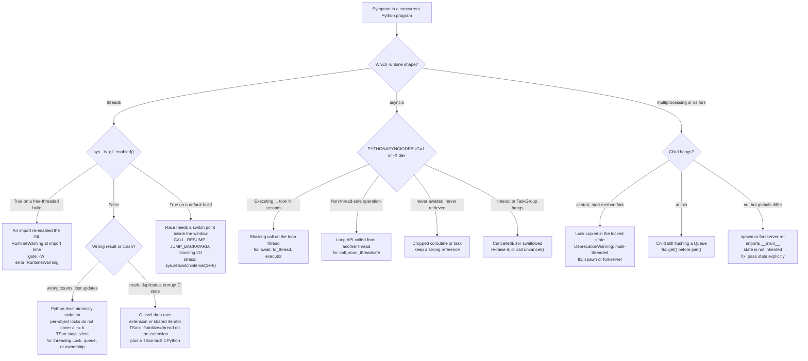

# Python Concurrency: Asyncio, Multiprocessing, and Free-Threading Bugs

> [!summary] Claim:
> The GIL never made Python code atomic; it only limited thread switches to eval-breaker check points, so a read-modify-write with no check point inside happened to be safe and one with a call inside was not.
> The free-threaded build (PEP 703) removes that accident: per-object locks keep each `dict` or `list` operation intact, but every compound operation on shared state now loses updates in practice, and one import of an undeclared C extension silently puts the GIL back.
> asyncio bugs are the opposite case, one thread that never yields, and they stay invisible until debug mode times every callback, checks the calling thread, and records where each coroutine was created.
> `fork()` copies only the calling thread, so any lock another thread held is held forever in the child, which is why 3.12 warns and 3.14 stopped defaulting to `fork` on Linux.
> ThreadSanitizer finds C-level data races in extensions and the interpreter, never Python-level atomicity violations, and it needs a TSan-built CPython to see the interpreter's own synchronization.



## The Mechanism

### Five runtime shapes, five failure models

A Python process can run concurrent work five ways, and each fails differently:
1. Threads on a GIL build share one interpreter lock, so only one thread runs bytecode at a time, and races appear only where a thread can lose the lock.
2. Threads on a free-threaded build run bytecode in parallel, so races appear wherever two threads touch shared state without a lock that covers the whole operation.
3. asyncio runs many coroutines on one thread, so a race needs an `await` between the read and the write, and the common bug is not a race at all but a coroutine that never yields.
4. multiprocessing runs separate interpreters in separate processes, so state is not shared at all unless it is copied by `fork()` or sent through a pipe, and the common bug is what `fork()` copies.
5. Subinterpreters (PEP 734, the `concurrent.interpreters` module and `concurrent.futures.InterpreterPoolExecutor`, both new in 3.14) run isolated interpreters in one process, each with its own GIL since 3.12 (PEP 684), so the failure model is that of processes with the cost of threads; the 3.14 What's New lists as a current limitation that "many third-party extension modules on PyPI are not yet compatible with multiple interpreters".

The diagnosis starts by knowing which model you are in.
`sys._is_gil_enabled()` (added in 3.13) reports whether the GIL is on in the running process, and `sysconfig.get_config_var("Py_GIL_DISABLED")` reports whether the binary was built free-threaded; the free-threading HOWTO calls the second the recommended check for build decisions.
They differ, because a free-threaded binary can run with the GIL on.

### Why the GIL made some races disappear: the eval breaker

A thread holding the GIL gives it up only when it checks the eval breaker, a per-thread word of event bits.
In CPython 3.14, `Include/internal/pycore_ceval.h` defines `_PY_GIL_DROP_REQUEST_BIT` as bit 0 and `_PY_EVAL_EVENTS_MASK` as the low 8 bits.
In `Python/ceval_gil.c`, `take_gil` waits on the GIL's condition variable for the switch interval, 5 ms by default (`DEFAULT_INTERVAL 5000` microseconds; `sys.getswitchinterval()` returns `0.005` in the lab), and on timeout sets `_PY_GIL_DROP_REQUEST_BIT` in the holder's eval breaker.
The holder sees the bit at its next check; the interval is kept in whole microseconds with a floor of 1, so `sys.setswitchinterval(1e-6)` is the most aggressive setting.

The check is the micro-op `_CHECK_PERIODIC` in `Python/bytecodes.c`, which loads `tstate->eval_breaker` and calls `_Py_HandlePending` when an event bit is set.
In the 3.14 source it is part of these instructions:
- `JUMP_BACKWARD`, `JUMP_BACKWARD_NO_JIT`, and `JUMP_BACKWARD_JIT`, so every loop iteration has one check.
- `CALL` and the specialized C-call forms such as `CALL_BUILTIN_O`, after the call returns.
- `RESUME`, through `_CHECK_PERIODIC_IF_NOT_YIELD_FROM`, so every Python function entry has one; the quickened `RESUME_CHECK` deoptimizes back to `RESUME` when the eval-breaker word has changed.

Arithmetic, attribute loads, and attribute stores have no check.
The lab prints the opcodes between the read and the write of `box.n` on CPython 3.14:
- `box.n += 1` compiles to `LOAD_ATTR LOAD_SMALL_INT BINARY_OP SWAP STORE_ATTR`, which has no check point, so with the GIL on no thread can lose the lock between the load and the store.
- `v = box.n; touch(); box.n = v + 1` puts a `CALL` (and the callee's `RESUME`) inside the window.

With the GIL forced on and the switch interval set to 1 microsecond, the first loop lost no updates in 5 trials of 8 threads by 200,000 iterations, and the second lost updates.
That is an implementation detail, not a guarantee: a `BINARY_OP` on objects whose `__add__` is written in Python, a property, or a `__setattr__` would add a `RESUME` inside the window.
The 1 microsecond interval is a stress setting: at the default 5 ms, few handoff requests land inside a short window, so a test of the second loop can pass by luck.
`sys.setswitchinterval()` is documented as the ideal timeslice length, with the actual choice of the next thread left to the operating system.

### What the free-threaded build changes (PEP 703, PEP 779)

PEP 703 removes the GIL by replacing what it protected:
- Biased reference counting: `ob_tid` names the owning thread, which updates `ob_ref_local` without atomics, while other threads update `ob_ref_shared` atomically.
- Immortal objects skip reference counting; as of 3.14 the HOWTO limits immortalization to code constants and strings interned with `sys.intern()`.
- Deferred reference counting for objects such as top-level functions and modules, reclaimed only by the cyclic collector.
- mimalloc replaces pymalloc, and the collector finds objects through mimalloc's heaps; collection stops the world.
- Every object header carries a one-byte per-object lock, `ob_mutex`; `list`, `dict`, and `set` operations take it through the critical-section API, and a few `list` and `dict` reads try a lock-free path first.
- Memory behind lock-free readers (the HOWTO names the list object and the dictionary keys object) is freed through quiescent-state-based reclamation (QSBR), which defers the free until every thread has passed a quiescent point.

3.13 shipped the build with the specializing adaptive interpreter (PEP 659) turned off (`Include/internal/pycore_code.h` on the 3.13 branch defines `ENABLE_SPECIALIZATION 0` under `Py_GIL_DISABLED`, tracked as gh-115999); the 3.14 What's New says it "is now enabled in free-threaded mode", so 3.13t and 3.14t execute different instruction paths for the same bytecode, and a race found on one is not automatically present on the other.

The per-object lock covers one operation, not a sequence.
`items.append(i)` from 8 threads kept all 1,600,000 items in the lab, while `box.n += 1` lost updates as soon as the GIL was off.
The attribute access is synchronized one instruction at a time: in the 3.14 `bytecodes.c`, the specialized `STORE_ATTR_INSTANCE_VALUE` takes the object's lock with a try-lock (`_GUARD_TYPE_VERSION_AND_LOCK`, whose `LOCK_OBJECT` is `PyMutex_LockFast` in `Python/ceval_macros.h`, and which falls back to the unspecialized `STORE_ATTR` when the lock is already held), does a release store, and unlocks with `UNLOCK_OBJECT`, and `LOAD_ATTR_INSTANCE_VALUE` reads with an acquire load and no lock.
Nothing holds across the load, the add, and the store, so two threads can read the same value and both write value plus one.
The HOWTO's guidance follows from that: use `threading.Lock` or another explicit primitive rather than relying on built-in types' internal locks, which it calls "a description of the current implementation, not a guarantee of current or future behavior".
It also warns that threads sharing one iterator "may see duplicate or missing elements", and that reading `frame.f_locals` of a frame executing in another thread "may crash the interpreter".

### Per-operation guarantees of the built-in containers

The 3.14.6 documentation has a page, Thread Safety Guarantees (`Doc/library/threadsafety.rst`), that grades each built-in operation for the GIL-disabled build.
It is the reference to check before deciding whether a shared container needs a lock:

| Operation | Free-threaded guarantee (as of 2026-11, CPython 3.14.6) | Platform |
|---|---|---|
| `lst[i]`, `d[key]`, `d.get(key)`, `key in d`, `len(d)` | Lock-free and atomic | Both |
| `item in lst`, `lst.index(x)`, `lst.count(x)` | Lock-free traversal of atomic item reads; may see concurrent changes | Both |
| `lst.append(x)`, `lst.pop()`, `lst.clear()`, `lst.copy()` | Atomic, under the per-object lock | Both |
| `lst.insert(i, x)`, `lst.pop(i)`, `lst *= n` | Locked, but lock-free readers may see intermediate states | Both |
| `lst.sort()` | Not atomic; the list appears empty to other threads during the sort | Both |
| `d[key] = v`, `del d[key]`, `d.pop(key)`, `d.setdefault(key, v)` | Safe, under the per-object lock; `__eq__` written in Python may let another thread modify `d` mid-operation | Both |
| `d.update(other)`, `d \|= other` | Locks both only when `other` is a `dict` that does not override iteration; any other iterable is not locked | Both |
| `lst[i] = lst[i] + 1`, `d[key] = d[key] + 1` | "NOT atomic: read-modify-write" | Both |
| `if key in d: del d[key]`, `if lst: lst.pop()` | "NOT atomic: check-then-act"; use `d.pop(key, None)` or catch `KeyError` | Both |
| `for k, v in d.items(): ...` while another thread writes | "NOT thread-safe" | Both |

Two consequences matter for debugging.
First, a check-then-act bug has a one-call fix whenever the container offers a single locked operation that does both halves, such as `d.setdefault`, `d.pop(key, None)`, or `lst.pop()` inside `try`.
Second, operations that compare keys can run Python code, so a dictionary keyed by user objects with a Python `__eq__` can lose the per-operation guarantee, while the page says that for built-in types such as `str`, `int`, and `float`, whose `__eq__` is implemented in C, the lock is not released during comparisons.

Status and cost (as of 2026-11):
- 3.13 shipped the build as experimental (PEP 779 phase I); 3.14 made it officially supported but optional (phase II); PEP 779 leaves phase III, the default build, to a future PEP.
- PEP 779 set a 15 percent single-threaded slowdown and a 20 percent memory overhead as phase II targets.
- The 3.14 What's New quotes a single-threaded penalty of roughly 5 to 10 percent; the 3.14.6 and 3.15.2 HOWTO quotes a pyperformance average from about 1 percent on macOS aarch64 to 8 percent on x86-64 Linux.
- Memory is higher by design: the HOWTO says `None` takes 32 bytes on the free-threaded build against 16 on the default build on AMD64, every interned string is immortal, mimalloc keeps separate heaps (currently four), and QSBR delays freeing, so RSS can stay high after objects die; `gc.collect()` releases what QSBR holds, and `MIMALLOC_PURGE_DELAY=0` shortens mimalloc's own delay at some speed cost.
- Two context defaults differ by build in 3.14: `-X context_aware_warnings` and `sys.flags.thread_inherit_context` are true on the free-threaded build and false on the GIL build, so `warnings.catch_warnings()` is per-context and threads inherit the starter's context.
- The 3.15 What's New lists PEP 803, a stable ABI for free-threaded builds (`abi3t`); [[Python-Wheels-Platform-Tags-Manylinux-and-ABI3]] owns that ABI.

A memory "leak" that appears only on `python3.14t` is therefore often deferred reclamation, not a leak; [[Python-tracemalloc-gc-and-Memory-Leaks]] owns the leak-hunting workflow.

### The silent GIL: Py_mod_gil

A C extension that was written for the GIL may keep shared state in C globals, so the free-threaded interpreter assumes it is unsafe unless it says otherwise.
A multi-phase module declares safety with the slot `{Py_mod_gil, Py_MOD_GIL_NOT_USED}`, guarded by `PY_VERSION_HEX >= 0x030D0000`; a single-phase module calls `PyUnstable_Module_SetGIL(m, Py_MOD_GIL_NOT_USED)` under `#ifdef Py_GIL_DISABLED`.
Importing a module without the declaration enables the GIL for the whole process and emits a `RuntimeWarning`, which the lab captured on CPython 3.14:

```text
RuntimeWarning: The global interpreter lock (GIL) has been enabled to load module 'legacy', which has not declared that it can run safely without the GIL. To override this behavior and keep the GIL disabled (at your own risk), run with PYTHON_GIL=0 or -Xgil=0.
```

After that import, workload A lost no updates in 5 trials, which is the symptom in production: the code is correct again and the parallel speedup is gone.
`PYTHON_GIL=0` or `-X gil=0` keeps the GIL off and imports the module without a warning; `PYTHON_GIL=1` forces it on.
PEP 703 spelled the variable `PYTHONGIL`; the shipped interpreter and its warning use `PYTHON_GIL`.
Because the signal is a warning, `-W error::RuntimeWarning` turns it into an import failure (exit 1 in the lab), which is the cheapest CI gate there is.

The extension HOWTO lists the rest of the C-side contract:
- Replace borrowed-reference APIs on mutable containers with strong-reference ones: `PyList_GetItemRef` for `PyList_GetItem`, `PyDict_GetItemRef` for `PyDict_GetItem`, `PyWeakref_GetRef` for `PyWeakref_GetObject`.
- Wrap `PyDict_Next` loops in `Py_BEGIN_CRITICAL_SECTION(dict)`, because `PyDict_Next` does not lock.
- Use `Py_BEGIN_CRITICAL_SECTION2` to lock two objects; nested critical sections may suspend the outer one when the inner one blocks, so they cannot hold several locks at once.
- Never lock `ob_mutex` directly; give your type its own `PyMutex` field.
- Allocate only Python objects in the object domain (`PyObject_Malloc`), and buffers with `PyMem_Malloc`; the free-threaded build makes that a requirement.

### ThreadSanitizer: what it can see in a Python process

TSan instruments memory accesses and synchronization in the code it compiles, keeps a vector clock per thread, and reports two accesses to one address, at least one a write, with no happens-before edge between them; [[Cpp-ThreadSanitizer-and-MemorySanitizer-Internals]] owns the shadow-memory and vector-clock mechanism.
In a Python process that means three things:
1. TSan reports C-level data races in instrumented code: an extension's globals, its object fields, or the interpreter itself.
2. TSan does not report a Python-level lost update such as `box.n += 1` or `d["k"] += 1`, because each C-level access on those paths is synchronized: the specialized attribute load is an acquire load and the store a release store under the object's lock, and the threadsafety page documents `d[key]` as a lock-free atomic read and `d[key] = v` as a write under the per-object lock.
   The bug is an atomicity violation, a non-atomic sequence of individually synchronized operations, which a happens-before race detector does not model.
3. An atomic operation executed inside uninstrumented code is invisible, so instrumenting only the extension produces false positives wherever the order of two accesses depends on an atomic operation inside the interpreter.

The second point is measured, not inferred: the lab's opt-in companion script `tsan_cpython.sh` builds CPython 3.14.6 with `--disable-gil --with-thread-sanitizer`, runs both lost-update workloads from 4 threads without any suppressions file, and records exit 0, zero data race reports, and lost updates for each.
Its positive control proves TSan is live in that interpreter: 4 threads draining one shared `range` iterator produce three reports, at `rangeobject.c:834`, `:836`, and `:837`, all in `rangeiter_next`, and exit 66.
Those are the three plain accesses of the C function in `Objects/rangeobject.c` (v3.14.6):

```c
static PyObject *
rangeiter_next(PyObject *op)
{
    _PyRangeIterObject *r = (_PyRangeIterObject*)op;
    if (r->len > 0) {
        long result = r->start;
        r->start = result + r->step;
        r->len--;
        return PyLong_FromLong(result);
    }
    return NULL;
}
```

Two threads that read the same `r->start` return the same number, and two that read the same `r->len` both store one less, so decrements are lost and the iterator yields more items than the range holds; the companion prints `duplicates` for the item count, which is the HOWTO's "duplicate or missing elements" made concrete.
With the upstream suppressions file, which carries `race_top:rangeiter_next` for gh-129068, the same run prints zero reports and exit 0 while still yielding duplicates.
A suppression hides a known report; it does not make the code safe.

The lab's main `run.sh` shows the first and third points on an uninstrumented CPython 3.14t with the runtime injected through `DYLD_INSERT_LIBRARIES`, under three thread schedules.
With 4 threads released together by a `threading.Barrier`, so the counter is contended:
- `bump_plain`, an unprotected `counter++`, gives one report at `racy.c:27` and exit status 66.
- `bump_atomic`, using `__atomic_fetch_add`, gives no report and an exact count.
- `bump_mutex`, protected by a `PyMutex`, gives an exact count and still one report at `racy.c:50`: a false positive.

With 2 threads taking strict turns through a relaxed atomic flag, so no two increments overlap in time and the mutex is never contended:
- `bump_turns` on the plain counter is still reported, at `racy.c:90`, because nothing TSan can see orders the increments; that is a true positive, since relaxed atomics create no happens-before edge in the C memory model either.
- `bump_turns` under the `PyMutex` gives no report and an exact count.

With one thread holding the `PyMutex` until the other has parked on it, the pair `hold_then_bump` and `block_then_bump` gives no report, and the holder saw the mutex's "has parked threads" bit set before it unlocked.

So the false positive is not a property of `PyMutex` but of one path through it, and the 3.14 source says which.
In `Include/cpython/lock.h`, `PyMutex_Lock` and `PyMutex_Unlock` are macros for inline compare-and-swap fast paths, which TSan instruments in the extension; in compiler-rt's `tsan_interface_atomic.cpp` (LLVM release/21.x; the lab runs Apple clang 21's build of the runtime) a successful sequentially consistent compare-and-swap releases and acquires the clock kept for that address, which is why the uncontended turn-taking run is clean.
A failed compare-and-swap falls through to the exported `PyMutex_Lock` and `PyMutex_Unlock` functions in libpython, and the second calls `_PyMutex_TryUnlock`.
In `Python/lock.c`, `_PyMutex_LockTimed` retries the compare-and-swap while it spins (`MAX_SPIN_COUNT` is 40 on free-threaded builds and 0 otherwise), then sets the parked bit and parks the thread, and after a waiter has waited longer than `TIME_TO_BE_FAIR_NS` (1 ms) `mutex_unpark` hands ownership straight to it.
A thread that takes the mutex with one of those uninstrumented compare-and-swaps has acquired nothing as far as TSan knows, so its increment looks unordered against the previous owner's; that is the contended report.
A thread that parked is different on macOS: `Include/internal/pycore_semaphore.h` defines `_Py_USE_SEMAPHORES` only with `HAVE_SEM_TIMEDWAIT`, which the lab's interpreter reports as 0, so the parking lot's semaphore there is a pthread mutex and condition variable (`Python/parking_lot.c`), and TSan intercepts `pthread_mutex_lock`, `pthread_mutex_unlock`, and `pthread_cond_wait` even when uninstrumented code calls them, so the wake-up itself orders the two threads.
The three outcomes are measured; attributing them to these source paths is an inference from the source, not something TSan printed.
The practical consequence is a flaky signal: an earlier version of this lab started its 4 threads without a barrier, and some runs then printed no `PyMutex` report and failed `make verify` (observed on the lab host, 2026-11-11).

The fix is to instrument the interpreter.
`--with-thread-sanitizer` has been a configure option since 3.13, and CPython's own CI job (`.github/workflows/reusable-san.yml` on the 3.14 branch) does this:
1. It runs `sudo sysctl -w vm.mmap_rnd_bits=28` on the Linux runner to reduce ASLR, with the comment "to avoid TSan crashing".
2. It configures with `--with-thread-sanitizer --with-pydebug`, adding `--disable-gil` for the free-threaded job.
3. It sets `TSAN_OPTIONS` to `log_path=... suppressions=Tools/tsan/suppressions_free_threading.txt handle_segv=0` for that job.
4. It runs `./python -m test --tsan`, and in the free-threaded job also `--tsan-parallel --parallel-threads=4`.

The companion script builds only the `python.exe` target on macOS, without `--with-pydebug`, and runs it with `-I -S`, which is enough for workloads that import nothing beyond `threading`.

The suppressions file lists known interpreter races, mostly as `race_top:` entries such as `race_top:rangeiter_next` for gh-129068, `race_top:mi_block_set_nextx` for gh-129748, and `race_top:update_one_slot` for gh-127266, with a few `race:` entries and one `thread:pthread_create`; an extension's own suppressions belong in its own file, as NumPy and CFFI keep, according to the Python Free-Threading Guide.
The guide also recommends `pytest -s` so TSan output is not captured, and says some of its authors have seen pytest hang with `halt_on_error=1`, with `halt_on_error=0` as the thing to try.

On macOS the TSan runtime's `abort_on_error` defaults to true, which the lab reads from `TSAN_OPTIONS=help=1`; the runtime's help text says it then "calls abort() instead of _exit()" after a report.
A script that checks for exit status 66 therefore needs `abort_on_error=0` on macOS, which the lab sets.

### asyncio: one thread, no preemption

An event loop runs ready callbacks one at a time in `BaseEventLoop._run_once`, and a coroutine step is one callback, so a step that does not `await` holds the whole loop.
Every other task, timer, and socket waits; the symptom is latency spikes and timeouts with idle CPUs, not wrong data.
The documentation puts a number on it: a function that computes for 1 second delays "all concurrent asyncio Tasks and IO operations" by 1 second.
Production mode measures nothing; debug mode wraps each callback in a timer (`Lib/asyncio/base_events.py`, 3.14):

```python
t0 = self.time()
handle._run()
dt = self.time() - t0
if dt >= self.slow_callback_duration:
    logger.warning('Executing %s took %.3f seconds',
                   _format_handle(handle), dt)
```

`slow_callback_duration` is set to `0.1` in the loop's constructor, and the lab reads `0.1` in both modes.
Debug mode turns on four ways: `PYTHONASYNCIODEBUG=1`, Python Development Mode (`-X dev`), `asyncio.run(..., debug=True)`, or `loop.set_debug(True)`.
The asyncio-dev page also recommends setting the `asyncio` logger to `logging.DEBUG` and showing `ResourceWarning` with `-W default`, which reports transports and sockets that were never closed.
Debug mode also does the following:
- `_check_thread` makes non-thread-safe APIs such as `loop.call_soon()` raise `RuntimeError: Non-thread-safe operation invoked on an event loop other than the current one` when called from another thread; in production mode the lab's cross-thread `call_soon` was accepted silently.
  The method's docstring says it "Should only be called when (self._debug == True)" for performance reasons, which is why production mode cannot catch this.
- It calls `sys.set_coroutine_origin_tracking_depth(10)` (`constants.DEBUG_STACK_DEPTH`), so every coroutine records 10 frames of its creation stack, and the "coroutine ... was never awaited" `RuntimeWarning` carries a `Coroutine created at` traceback (present in debug mode in the lab, absent otherwise).
- It adds the creation site to "Task exception was never retrieved" reports and logs slow I/O selector calls.

Five rules from the documentation prevent the other common bugs:
- From another thread, schedule a callback with `loop.call_soon_threadsafe()` and a coroutine with `asyncio.run_coroutine_threadsafe()`, because "Almost all asyncio objects are not thread safe".
- asyncio primitives (`asyncio.Lock`, `Event`, `Condition`, `Semaphore`) "are not thread-safe, therefore they should not be used for OS thread synchronization"; the reverse mistake also fails, because a coroutine that blocks in `threading.Lock.acquire()` stalls the loop thread, and deadlocks it outright when the holder is another task on the same loop that is suspended at an `await`.
- The loop keeps only weak references to tasks, so a task created with `create_task()` and not referenced elsewhere "may get garbage collected at any time, even before it's done"; keep tasks in a set or a `TaskGroup`.
- `asyncio.TaskGroup` and `asyncio.timeout()` are built on cancellation and "might misbehave if a coroutine swallows `asyncio.CancelledError`"; a broad `except BaseException:` that does not re-raise turns a timeout into a hang, and code that truly must suppress cancellation has to call `uncancel()` as well.
- `asyncio.to_thread()` runs the function in the loop's default executor through `loop.run_in_executor(None, ...)`, a `ThreadPoolExecutor` whose default size is `min(32, (os.process_cpu_count() or 1) + 4)` (`Lib/concurrent/futures/thread.py`, 3.14.6), so a burst of slow blocking calls queues behind a few dozen threads and looks like a loop stall that debug mode does not attribute to any one callback.

Two behavior changes move bugs between versions:
- `eager_task_factory` (3.12) makes a coroutine "begin execution synchronously during Task construction", so code that assumed `create_task()` returns before the coroutine body runs can reorder under an eager factory.
- In 3.14 `asyncio.get_event_loop()` raises `RuntimeError` when there is no current loop instead of creating one, and the 3.14 What's New says asyncio now has "first class support for free-threading builds", with "parallel execution of multiple event loops across different threads"; a free-threaded process can therefore run several loops in parallel threads, and the one-loop-per-thread rule becomes the only thing keeping their state apart.

For a process that is already stuck, 3.14 added `python -m asyncio ps PID` and `python -m asyncio pstree PID`, which inspect a running process by PID and show every task, its coroutine stack, and which tasks await it, as a flat table or as a tree; `pstree` prints `ERROR: await-graph contains cycles - cannot print a tree!` and the cycle when two tasks await each other, which is an asyncio deadlock named directly.
The same release added `asyncio.capture_call_graph()` and `asyncio.print_call_graph()` for in-process use.
[[Python-Debugging-Hung-Processes-and-C-Extensions]] owns attaching to a hung process with py-spy and gdb, and [[Drill-Debugging-Asyncio-and-Tokio-Deadlock]] is the timed exercise.

### multiprocessing and fork(): what the child inherits

`fork()` duplicates the address space and only the calling thread.
Every lock that another thread held at that instant is copied in the locked state, and the thread that would release it does not exist in the child, so the first `acquire()` in the child blocks forever.
The `os.fork()` documentation states the runtime's own exposure: "The CPython runtime itself has always made API calls that are not safe for use in the child process when threads existed in the parent (such as `malloc` and `free`)", and it adds that users of macOS or of libc or malloc implementations other than glibc's "are among those already more likely to experience deadlocks running such code".
Since 3.12, `os.fork()` raises a `DeprecationWarning` when it can detect other threads; the lab captured `This process (pid=N) is multi-threaded, use of fork() may lead to deadlocks in the child.` with the PID scrubbed.
On macOS the same page warns that `fork()` "is unsafe when mixed with using higher-level system APIs, and that includes using `urllib.request`", and since 3.8 calling `fork()` in a subinterpreter raises `RuntimeError`.

The standard library repairs its own locks with `os.register_at_fork()` hooks (v3.14.6 source):
- `logging` acquires its module lock in the parent before the fork (`before=_prepareFork`) and calls `_at_fork_reinit()` on that lock and on every registered `Handler` lock in the child.
- `threading` runs `_after_fork` in the child, which replaces `_active_limbo_lock` with a new lock, reinitializes the locks of every known thread object, and rebuilds `_active` with only the calling thread.
- `random` reseeds its global generator in the child, so forked workers do not draw identical sequences.
- `concurrent.futures.thread` holds its global shutdown lock across the fork and clears its thread-queue table in the child.
- `asyncio` resets the event loop policy's thread-local state, the running loop, and the signal wake-up fd in the child.
- `multiprocessing.resource_tracker` clears the tracker's PID in the child, because the tracker is a child of the parent and cannot be waited on (gh-146313).

Those hooks fix only stdlib-owned locks.
A lock inside a C library (a database driver, an OpenSSL or gRPC thread pool, a BLAS thread pool) or inside your own module stays copied in whatever state it had, which is why the hazard survives every stdlib fix.

In the lab a helper thread holds a module-level `threading.Lock` while the main thread creates children four ways, and each child calls `acquire(timeout=2.0)`:
- `os.fork()` and the `fork` start method: the child timed out, and the parent saw the warning.
- `spawn` and `forkserver`: the child acquired the lock, because neither copies the parent's memory: `spawn` starts a fresh interpreter, `forkserver` forks from a server process that was itself spawned fresh, and either way the child imports the module again and builds a new, unlocked lock.

Start method defaults (as of 2026-11, from the 3.14.6 and 3.15.2 `multiprocessing` documentation and the 3.14 What's New):
- macOS has defaulted to `spawn` since 3.8, because "macOS system libraries may start threads" (bpo-33725), and the lab prints `default start method = spawn`.
- Linux and other POSIX platforms except macOS switched from `fork` to `forkserver` in 3.14 (gh-84559), for both `multiprocessing` and `concurrent.futures.ProcessPoolExecutor`; code that needs `fork` must ask for it with `get_context("fork")` or an `mp_context`.
- 3.15.1 falls back to `spawn` when there is no writable temporary directory, which `forkserver` needs (gh-155717); before that, starting a process on a read-only file system failed with `OSError`.
- Windows has only `spawn`.

`forkserver` is safe only while its server stays single-threaded: the documentation says it is "single threaded unless system libraries or preloaded imports spawn threads as a side-effect".
`set_forkserver_preload(module_names)` imports modules into the server so children inherit them, silently ignores `ImportError` (3.15 adds an `on_error` parameter whose default, `"ignore"`, keeps that behavior), and must run before the server starts; preloading a module that starts a thread at import brings the `fork` hazard back into every child.

The fix side has costs.
`spawn` and `forkserver` re-import `__main__`, so the start code must sit under `if __name__ == "__main__":`, arguments must be picklable, and module globals set at runtime in the parent are not inherited.
The documentation also notes that locks created in a `fork` context cannot be passed to `spawn` or `forkserver` processes, that libraries should let callers supply a context rather than pick one, and that `spawn` and `forkserver` "generally cannot be used with frozen executables" built by PyInstaller or cx_Freeze on POSIX.
`spawn` and `forkserver` also start a resource tracker process that unlinks named semaphores and `SharedMemory` segments left behind; a process killed by a signal can still leak them, and the documentation warns that neither is unlinked "until the next reboot".

Three hangs are not fork hangs at all:
- A child that has put items on a `multiprocessing.Queue` does not exit until its feeder thread has flushed them to the pipe, so `p.join()` before `q.get()` deadlocks once the item is large; the documentation's own example puts a 1,000,000-character string and joins first, and the fix is to drain the queue before joining.
- `ProcessPoolExecutor` raises `BrokenProcessPool` on every pending future when a worker dies abruptly (since 3.3; before that it "would often freeze or deadlock") or when its initializer raises.
- `ProcessPoolExecutor(max_tasks_per_child=...)` switches the default start method to `spawn`, is incompatible with `fork`, and carries a documented note that it can hang "in some circumstances" (gh-115634, as of 3.14.6).

## Commands and Numbers to Know

| Item | Value | Platform | Notes |
|---|---|---|---|
| `sys._is_gil_enabled()` | `True` or `False` for this process (as of 2026-11) | Both | Added in 3.13; a free-threaded binary can report `True`. |
| `sysconfig.get_config_var("Py_GIL_DISABLED")` | `1` on a free-threaded build (as of 2026-11) | Both | Recommended build check in the free-threading HOWTO. |
| `PYTHON_GIL=0` / `-X gil=0` | force the GIL off, even for undeclared extensions (as of 2026-11) | Both | `PYTHON_GIL=1` forces it on; PEP 703's `PYTHONGIL` spelling is not what shipped. |
| `{Py_mod_gil, Py_MOD_GIL_NOT_USED}` | module slot that declares free-threading support (as of 2026-11) | Both | Single-phase modules call `PyUnstable_Module_SetGIL`. |
| `python -W error::RuntimeWarning -c "import pkg"` | exit 1 if `pkg` would re-enable the GIL (as of 2026-11) | Both | Verified in the lab on CPython 3.14t. |
| `sys.getswitchinterval()` | `0.005` s default (as of 2026-11) | Both | `sys.setswitchinterval(1e-6)` is a race-stress setting; 1 microsecond is the floor. |
| Eval-breaker check points | `JUMP_BACKWARD`, `CALL`, `RESUME` (as of 2026-11) | Both | `_CHECK_PERIODIC` in `Python/bytecodes.c`, 3.14 branch. |
| Specialization in the free-threaded build | off in 3.13t, on in 3.14t (as of 2026-11) | Both | 3.14 What's New; changes which instruction paths run. |
| Free-threaded single-thread cost | about 1 percent macOS aarch64 to 8 percent x86-64 Linux (as of 2026-11) | Both | 3.14.6 HOWTO, pyperformance average; 3.14 What's New says 5 to 10 percent. |
| `None` object size | 32 bytes free-threaded vs 16 default on AMD64 (as of 2026-11) | Both | HOWTO; GC objects are the same size on both builds. |
| `MIMALLOC_PURGE_DELAY=0` | return freed memory to the OS sooner (as of 2026-11) | Both | HOWTO: "will likely reduce the performance of the allocator". |
| `PYTHONASYNCIODEBUG=1` / `-X dev` | asyncio debug mode (as of 2026-11) | Both | Also `asyncio.run(debug=True)` and `loop.set_debug(True)`. |
| `loop.slow_callback_duration` | `0.1` s (as of 2026-11) | Both | Logged only in debug mode as `Executing ... took N seconds`. |
| Coroutine origin tracking depth | `10` frames in debug mode (as of 2026-11) | Both | `asyncio.constants.DEBUG_STACK_DEPTH`. |
| Default executor size | `min(32, (os.process_cpu_count() or 1) + 4)` threads (as of 2026-11) | Both | Used by `asyncio.to_thread()` and `run_in_executor(None, ...)`. |
| `python -m asyncio ps PID` / `pstree PID` | task table or await tree of a live process (as of 2026-11) | Both | New in 3.14; `pstree` reports await cycles. |
| Default start method | `spawn` on macOS and Windows, `forkserver` on other POSIX since 3.14 (as of 2026-11) | Both | `spawn` fallback without a writable temp dir since 3.15.1. |
| `os.fork()` with threads | `DeprecationWarning` since 3.12 (as of 2026-11) | Both | "use of fork() may lead to deadlocks in the child." |
| `./configure --with-thread-sanitizer --disable-gil` | TSan-instrumented free-threaded CPython (as of 2026-11) | Both | Option added in 3.13; CPython CI adds `--with-pydebug`. |
| `TSAN_OPTIONS` | `suppressions=Tools/tsan/suppressions_free_threading.txt handle_segv=0` (as of 2026-11) | Linux | CPython CI job; also `vm.mmap_rnd_bits=28`. |
| TSan `exitcode` / `abort_on_error` | `66` / `true` on this macOS host (as of 2026-11) | macOS | Set `abort_on_error=0` to get exit 66 instead of `abort()`. |
| TSan runtime path | `cc -print-file-name=libclang_rt.tsan_osx_dynamic.dylib` (as of 2026-11) | macOS | Inject with `DYLD_INSERT_LIBRARIES` into a non-TSan interpreter. |

## Multi-Language Comparison

| Concern | C++ | Python | Rust |
|---|---|---|---|
| What a data race is | Undefined behavior under the C++ memory model | Built-in types keep their own state intact on both builds, with documented exceptions such as shared iterators and `frame.f_locals` of a frame running in another thread; compound operations still lose updates | Rejected at compile time in safe code by `Send` and `Sync`; possible only in `unsafe` code |
| Atomic unit you can rely on | `std::atomic<T>` operations | One built-in container operation, through per-object locks on the free-threaded build, graded per operation in the threadsafety page; nothing longer | `std::sync::atomic` operations; a `Mutex<T>` guard for longer sequences |
| Race detector | TSan, see [[Cpp-ThreadSanitizer-and-MemorySanitizer-Internals]] | TSan for C extensions and the interpreter, needs a TSan-built CPython to avoid false positives; blind to Python-level atomicity bugs | TSan on nightly and Miri, see [[Rust-Miri-Sanitizers-Loom-and-Cargo-Fuzz]] |
| Async stall detection | No standard runtime; per-library | asyncio debug mode slow-callback log, `python -m asyncio ps` and `pstree` | tokio-console and tracing, see [[Rust-Async-Debugging-tokio-console-and-tracing]] |
| Forking a threaded process | `fork()` then only async-signal-safe calls until `exec`; `pthread_atfork` for cleanup | `DeprecationWarning`; use `spawn` or `forkserver`; `os.register_at_fork` | The standard library has no `fork` function; `libc::fork` is `unsafe` |
| Typical hidden serializer | A global mutex in a library | An extension without `Py_mod_gil` re-enabling the GIL | A `Mutex` held across an `.await` |

## Worked Lab Example

The lab lives at `code/03-Debugging/free_threaded_race/`; `run.sh` is tagged `# requires: macos`, because it injects the Xcode clang TSan runtime with `DYLD_INSERT_LIBRARIES` and links extensions with `-undefined dynamic_lookup`.
It also needs a free-threaded CPython 3.14, which it finds through `FT_PYTHON`, `python3.14t` on `PATH`, or `uv python find --no-python-downloads 3.14t`, and it fails with an install hint if none is present.
Every step uses that one interpreter binary, so the GIL is switched with `PYTHON_GIL`, not by changing interpreters.

`run.sh` does the following:
1. It clears `PYTHON_GIL`, `PYTHONASYNCIODEBUG`, `PYTHONDEVMODE`, `PYTHONWARNINGS`, `TSAN_OPTIONS`, and `PYTHONPATH`, because each one changes what the lab measures.
2. It compiles three extensions into a temporary directory: `ready.c` with the `Py_mod_gil` slot, `legacy.c` without it, and `racy.c` with `-fsanitize=thread`.
3. `race.py` prints the opcodes between the read and the write of `box.n`, then runs four workloads from 8 threads that start together at a `threading.Barrier`, once with `PYTHON_GIL=1` and a 1 microsecond switch interval and once with `PYTHON_GIL=0`; workloads A, B, and C run up to 5 trials and stop at the first trial that loses an update, and workload D runs one trial.
4. `gil_guard.py` imports `ready` and then `legacy` with the GIL unset, then with `PYTHON_GIL=0`, and reruns workload A after the imports; a third run imports `legacy` under `-W error::RuntimeWarning`.
5. `tsan_driver.py` runs under TSan with `halt_on_error=0 abort_on_error=0` in three schedules: `bump_plain`, `bump_atomic`, or `bump_mutex` from 4 threads released together by a barrier, `bump_turns` from 2 threads in strict turns with and without the mutex, and `hold_then_bump` with `block_then_bump`, where one thread holds the mutex until the other has parked; `run.sh` counts `WARNING: ThreadSanitizer: data race` lines and prints the unique `SUMMARY` lines and the exit status.
6. `asyncio_debug.py` runs a 0.25 s `time.sleep` inside a task, a cross-thread `call_soon`, and a never-awaited coroutine, first in production mode and then with `PYTHONASYNCIODEBUG=1`.
7. `fork_deadlock.py` holds a lock in a helper thread and creates children with `os.fork()` and the `spawn`, `forkserver`, and `fork` start methods.

The opt-in companion `tsan_cpython.sh` is tagged `# requires: macos network` and is not run by `make verify`, because the harness runs only `run.sh`:
8. It downloads the CPython 3.14.6 source tarball, checks its SHA-256, configures it with `--disable-gil --with-thread-sanitizer`, builds `python.exe`, and runs `tsan_cpython.py` four times: `box.n += 1` and `d["k"] += 1` from 4 threads without suppressions, then 4 threads sharing one `range` iterator without and with the upstream suppressions file.
   Setting `TSAN_PYTHON` to an existing TSan build skips the download and the build.

Every check has a control that would print something else if the mechanism were absent: workload A with the GIL off, the `PYTHON_GIL=0` import run, the atomic TSan variant, the plain counter in the turn-taking schedule, production-mode asyncio, the `spawn` child, and the shared-iterator run that proves the TSan-built interpreter does report races.
The schedule flags in `racy.c` are relaxed atomics on purpose, because TSan gives a relaxed load or store no happens-before edge, and the reported plain counter in the turn-taking run is the check that they add none.

### Verified output

Recorded by `python3 -m _harness.verify --record` on darwin-arm64 (macOS 27.2, CPython 3.14.6 free-threading build from uv, Apple clang 21.0.0) on 2026-11-11; a second recording that day was byte-identical, and repeated `python3 -m _harness.verify` runs passed; the file is `code/03-Debugging/free_threaded_race/expected/darwin-arm64.txt`.
The lab is `# requires: macos`, so there is no Linux recording, and every Linux statement in this note comes from the cited documentation, not from a run.

```text
== Interpreter ==
CPython 3.14 free-threading build, Py_GIL_DISABLED=1, extension suffix .cpython-314t-darwin.so
sys.getswitchinterval() = 0.005

== 1. Lost updates: same binary, GIL forced on (1 us switch interval), then forced off ==
Opcodes between the read and the write of box.n (dis, unspecialized names):
  A  LOAD_ATTR LOAD_SMALL_INT BINARY_OP SWAP STORE_ATTR
  B  LOAD_ATTR STORE_FAST LOAD_GLOBAL CALL POP_TOP LOAD_FAST_BORROW LOAD_SMALL_INT BINARY_OP LOAD_FAST_BORROW STORE_ATTR
PYTHON_GIL=1: sys._is_gil_enabled() = True, switch interval 1e-06 s, 8 threads x 200000 iterations
  A  box.n += 1                         lost updates: none in 5 trials
  B  v = box.n; touch(); box.n = v + 1  lost updates: yes
  C  with lock: box.n += 1              lost updates: none in 5 trials
  D  items.append(i)                    items kept: 1600000 of 1600000
PYTHON_GIL=0: sys._is_gil_enabled() = False, switch interval 0.005 s, 8 threads x 200000 iterations
  A  box.n += 1                         lost updates: yes
  B  v = box.n; touch(); box.n = v + 1  lost updates: yes
  C  with lock: box.n += 1              lost updates: none in 5 trials
  D  items.append(i)                    items kept: 1600000 of 1600000

== 2. One import re-enables the GIL ==
PYTHON_GIL=(unset): GIL at startup disabled
  import ready  (declares Py_MOD_GIL_NOT_USED): GIL disabled, warnings: 0
  import legacy (no Py_mod_gil slot): GIL enabled, warnings: 1
    RuntimeWarning: The global interpreter lock (GIL) has been enabled to load module 'legacy', which has not declared that it can run safely without the GIL. To override this behavior and keep the GIL disabled (at your own risk), run with PYTHON_GIL=0 or -Xgil=0.
  workload A after both imports, lost updates: none in 5 trials
PYTHON_GIL=0: GIL at startup disabled
  import ready  (declares Py_MOD_GIL_NOT_USED): GIL disabled, warnings: 0
  import legacy (no Py_mod_gil slot): GIL disabled, warnings: 0
  workload A after both imports, lost updates: yes
-W error::RuntimeWarning -c 'import legacy': exit 1, RuntimeWarning: The global interpreter lock (GIL) has been enabled to load module 'legacy'

== 3. ThreadSanitizer on a C extension (interpreter not instrumented) ==
TSan runtime defaults on this host: halt_on_error=false exitcode=66 abort_on_error=true
Parking-lot semaphore in this interpreter: pthread mutex and condition variable (HAVE_SEM_TIMEDWAIT=0)
Threads released together by a barrier, so the counter is contended:
racy.bump_plain: exit 66, data race reports 1, data race racy.c:27 in bump_plain
  final counter exact: not checked (racy by design)
racy.bump_atomic: exit 0, data race reports 0
  final counter exact: yes (1000000)
racy.bump_mutex: exit 66, data race reports 1, data race racy.c:50 in bump_mutex
  final counter exact: yes (1000000)
Two threads in strict turns, so the increments never overlap and a PyMutex is never contended:
racy.bump_turns, plain counter: exit 66, data race reports 1, data race racy.c:90 in bump_turns
  final counter exact: not checked (racy by design)
racy.bump_turns, PyMutex: exit 0, data race reports 0
  final counter exact: yes (4000)
One thread holds the PyMutex until the other has parked on it, then unlocks:
racy.hold_then_bump and racy.block_then_bump: exit 0, data race reports 0
  final counter exact: yes (2); waiter had parked before the unlock: yes

== 4. asyncio: production mode, then debug mode ==
PYTHONASYNCIODEBUG=(unset): loop.get_debug() = False, slow_callback_duration = 0.1
  1 blocking time.sleep(0.25): slow-callback warnings = 0
  2 call_soon from another thread: accepted silently
  3 never-awaited coroutine: coroutine 'never_awaited' was never awaited
    creation traceback attached: False
PYTHONASYNCIODEBUG=1: loop.get_debug() = True, slow_callback_duration = 0.1
  1 blocking time.sleep(0.25): slow-callback warnings = 1
    Executing <Task ... coro=<blocker()> ...> took >= 0.25 s: True
  2 call_soon from another thread: RuntimeError: Non-thread-safe operation invoked on an event loop other than the current one
  3 never-awaited coroutine: coroutine 'never_awaited' was never awaited
    creation traceback attached: True

== 5. fork() while another thread holds a lock ==
parent: 2 threads, LOCK held by thread 'holder'; default start method = spawn
  os.fork():              child lock.acquire timed out after 2.0 s (exit 3)
                          parent saw DeprecationWarning: This process (pid=N) is multi-threaded, use of fork() may lead to deadlocks in the child.
  multiprocessing spawn:      child lock.acquire acquired; parent saw no DeprecationWarning
  multiprocessing forkserver: child lock.acquire acquired; parent saw no DeprecationWarning
  multiprocessing fork:       child lock.acquire timed out after 2.0 s; parent saw DeprecationWarning: This process (pid=N) is multi-threaded, use of fork() may lead to deadlocks in the child.
```

The companion's output was recorded by running `bash tsan_cpython.sh` once on darwin-arm64 (macOS 27.3, CPython 3.14.6 built from the python.org tarball with Apple clang 21.0.0) on 2026-11-15; the file is `code/03-Debugging/free_threaded_race/expected/tsan-cpython-darwin-arm64.txt`, and it was not re-run.

```text
== TSan-instrumented CPython ==
CPython 3.14.6 free-threading build, configured --disable-gil --with-thread-sanitizer
box.n += 1 from 4 threads (upstream suppressions: no): exit 0, data race reports 0
  gil=False lost updates: yes
d["k"] += 1 from 4 threads (upstream suppressions: no): exit 0, data race reports 0
  gil=False lost updates: yes
4 threads share one range iterator (upstream suppressions: no): exit 66, data race reports 3
  gil=False items consumed vs 400000: duplicates
  data race rangeobject.c:834 in rangeiter_next;data race rangeobject.c:836 in rangeiter_next;data race rangeobject.c:837 in rangeiter_next
4 threads share one range iterator (upstream suppressions: yes): exit 0, data race reports 0
  gil=False items consumed vs 400000: duplicates
```

### Reading the output

Section 1 separates the GIL from correctness.
With the GIL on and a handoff requested about every microsecond, A still lost nothing, because its window has no check point, while B, whose window holds a `CALL`, lost updates.
With the GIL off, A and B both lost updates, and only C, which holds a `threading.Lock` across the whole read-modify-write, stayed exact.
D shows what the per-object lock does guarantee: all 1,600,000 appends survived on both sides.

Section 2 shows the silent serializer.
`ready` left the GIL off; `legacy` turned it on, printed one `RuntimeWarning`, and made workload A exact again, which in a real service reads as "the free-threaded build gives no speedup".
With `PYTHON_GIL=0` the same import kept the GIL off and A lost updates, so the GIL, not the import itself, removed the race.

Section 3 shows the limits of TSan without an instrumented interpreter.
The plain counter is a true positive and the atomic counter a true negative, but the contended `PyMutex` counter is exact and still reported, because a contended acquire is a compare-and-swap inside uninstrumented libpython.
The same mutex is clean when it is never contended and clean when the waiter parks and is woken, so whether the false positive appears depends on the schedule, not on the code.
The turn-taking plain counter is reported although its increments never overlap, which is TSan working as designed: it reports missing happens-before edges, not observed collisions.
Treat any report whose synchronization lives in CPython as unconfirmed until it reproduces on a TSan-built interpreter, and treat a clean run the same way.

Section 4 shows that production asyncio reports none of the three bugs, apart from the never-awaited warning that the interpreter emits anyway.
Debug mode logs the 0.25 s step against the 0.1 s threshold, rejects the cross-thread `call_soon`, and attaches the creation traceback.

Section 5 shows the fork hazard and its fix.
Both `fork` paths left the child holding a lock that no thread would release, and both warned; `spawn` and `forkserver` re-imported the module, so their children got a fresh lock and no warning.

The companion output closes the gap that section 3 leaves.
On an interpreter where every C access is instrumented, both Python-level read-modify-write loops lose updates and TSan says nothing, so a clean TSan run is no evidence that Python code is correct.
The shared iterator, a C-level race inside CPython, is reported at the three lines that touch `r->start` and `r->len`, and the upstream suppressions file silences exactly those reports while the iterator keeps yielding duplicates.

> [!warning] Pitfalls:
> - A threaded test that passes on a GIL build proves little: the lab's workload A was exact even with a 1 microsecond switch interval, and the same code loses updates on the free-threaded build.
>   Stress with `sys.setswitchinterval(1e-6)` and run the suite on `python3.14t` with `PYTHON_GIL=0`.
> - "The GIL is off" is a runtime fact, not a build fact.
>   Check `sys._is_gil_enabled()` after all imports, not `Py_GIL_DISABLED` at startup, and fail CI on the `RuntimeWarning` with `-W error::RuntimeWarning`.
> - `PYTHON_GIL=0` in production to silence the warning runs a GIL-dependent extension without its lock; use it only to test an extension you are porting.
> - Built-in containers do not make compound operations atomic: `d[k] += 1`, `if k not in d: d[k] = v`, and `x = lst[-1]; lst.pop()` race on the free-threaded build.
>   Use a single locked operation where one exists (`d.setdefault`, `d.pop(k, None)`), a lock around the whole sequence, or one owner thread fed by a `queue.Queue`.
> - Sharing one iterator between threads can make them see duplicate or missing elements, as the free-threading HOWTO warns and the companion's `range` run shows; give each thread its own iterator or hand items out through a `queue.Queue`.
> - A clean TSan run, even on a TSan-built CPython, says nothing about Python-level atomicity: the companion's two lost-update loops produced zero reports.
>   Find those bugs with stress tests, invariants, and property tests, as [[Python-Hypothesis-and-Type-Checkers-as-Bug-Prevention]] describes.
> - A TSan run that instruments only the extension reports false positives on anything synchronized by CPython, such as the lab's contended `PyMutex` counter, and misses races inside the interpreter; build CPython with `--with-thread-sanitizer`.
> - Those false positives come and go with the schedule: the lab's `PyMutex` counter is reported only when a thread takes the lock on the contended path, so a test that starts its threads one by one can pass or fail from run to run; start them from a `threading.Barrier`.
> - The upstream suppressions file hides real, known interpreter races such as `rangeiter_next`; a suppressed report is a known bug, not a false positive.
> - On macOS, TSan defaults to `abort_on_error=true`, so CI that expects exit status 66 sees a SIGABRT instead; set `abort_on_error=0`.
> - A free-threaded service whose RSS stays high after load drops may be holding QSBR-deferred and mimalloc-deferred memory, not leaking; call `gc.collect()` before measuring.
> - `time.sleep`, `requests.get`, and CPU-heavy loops inside a coroutine block every task on the loop, and production mode does not log it; run tests with `PYTHONASYNCIODEBUG=1` or `-X dev`, and move the work to `asyncio.to_thread()` or an executor sized for the blocking load.
> - `asyncio.create_task(coro())` without keeping the result can be garbage collected mid-flight, because the loop holds only weak references.
> - `except BaseException:` or `except asyncio.CancelledError:` without a re-raise inside a task under `asyncio.timeout()` or a `TaskGroup` turns cancellation into a hang.
> - `asyncio.Lock` does not protect state shared with an OS thread, and a coroutine blocking in `threading.Lock.acquire()` stalls the loop, deadlocking it when the holder is a suspended task on the same loop.
> - Code that relied on `fork` inheriting globals breaks on 3.14 Linux, where `forkserver` is the default; and code that still forces `fork` deadlocks when a database, HTTP, or BLAS thread pool holds a lock at fork time, because only stdlib locks are reset by `os.register_at_fork` hooks.
> - `set_forkserver_preload()` of a module that starts a thread at import makes the fork server multi-threaded and brings the fork hazard back.
> - `p.join()` before draining a `multiprocessing.Queue` that the child filled deadlocks; get, then join.

## At Scale

For one developer, the useful defaults are cheap: `PYTHONASYNCIODEBUG=1` or `-X dev` in tests, an explicit start method, and a `python3.14t` run of the threaded tests.
For a team, the failure that costs most is the silent one: a free-threaded rollout whose throughput does not move because one transitive dependency re-enabled the GIL, or a worker pool that hangs once a week at fork time.
For 1,000 to 50,000 engineers, the work is in gates and inventories, because no single owner can review every extension and every `fork`.

Decision rules:
1. Adopt the free-threaded build per service, only where a profile shows CPU-bound threads waiting on the GIL; an I/O-bound asyncio service gains nothing from it and pays its single-threaded and memory cost.
2. Gate every free-threaded image on `python -W error::RuntimeWarning -c "import <every top-level package>"` and on `sys._is_gil_enabled() is False` at service start, exported as a metric.
3. Keep an inventory of C extensions with their `Py_mod_gil` status and the version that added it, and block upgrades that drop it.
4. Run threaded test suites on both builds, with `sys.setswitchinterval(1e-6)` on the GIL build and `PYTHON_GIL=0` on the free-threaded one, because the GIL build hides atomicity bugs that the other exposes; pin the minor version, because 3.13t and 3.14t run different specialized paths.
5. Give extension owners a TSan-built CPython image with `--with-thread-sanitizer --disable-gil` and the upstream suppressions file, and treat reports from an uninstrumented interpreter as leads, not verdicts.
6. Do not count TSan as coverage for Python-level shared state; require a lock, a queue, or a single owner in code review for every mutable object reachable from two threads, and back it with invariant-checking stress tests.
7. Ban the `fork` start method and bare `os.fork()` in processes that may have threads, with the 3.12 `DeprecationWarning` promoted to an error in CI; allow `fork` only in single-threaded launchers that document it.
8. Pin the start method in code with `get_context("spawn")` or `get_context("forkserver")`, so a Python upgrade or a move between macOS laptops and Linux servers does not change behavior, and let library callers pass their own context.
9. Export asyncio slow-callback warnings from a canary that runs in debug mode, rather than enabling debug mode everywhere; debug mode times every callback and records a 10-frame creation stack for every coroutine.
10. Lint for swallowed `CancelledError` and for tasks created without a retained reference; both fail only under load or timeouts, which unit tests rarely reach.

> [!tip] Practice Drill:
> Run `bash run.sh` in `code/03-Debugging/free_threaded_race/` and confirm `make verify LAB=free_threaded_race` passes.
> Rewrite workload A as `box.n = box.n + one()` where `one()` is a Python function, predict whether the `PYTHON_GIL=1` run still prints `none in 5 trials`, and check the opcodes with `dis`.
> Delete the `barrier.wait()` in `tsan_driver.py`, run the `mutex` variant 40 times under TSan, and count the runs that print no report.
> Run `bash tsan_cpython.sh`, then add a workload that guards `box.n += 1` with a `threading.Lock`, and confirm the count is exact and TSan is still silent, so silence cannot tell the two apart.
> Add a `PyList_GetItem` borrowed-reference read to `racy.c` while another thread replaces the list item, and find the crash or the TSan report; then switch to `PyList_GetItemRef`.
> Replace `time.sleep(0.25)` in `asyncio_debug.py` with `await asyncio.to_thread(time.sleep, 0.25)` and confirm the slow-callback warning disappears.
> Then do the timed exercise in [[Drill-Debugging-Asyncio-and-Tokio-Deadlock]].

## Interview Questions

> [!question] L5: How do you turn on asyncio debug mode, and which bugs does it reveal that production mode hides?
> > [!success]- Answer
> > Set `PYTHONASYNCIODEBUG=1`, run with `-X dev`, pass `debug=True` to `asyncio.run()`, or call `loop.set_debug(True)`.
> > It logs every callback or task step that runs longer than `loop.slow_callback_duration`, 0.1 s by default, as `Executing ... took N seconds`, which finds blocking calls on the loop thread.
> > It makes non-thread-safe loop APIs raise `RuntimeError` when called from another thread, and it records 10 frames of each coroutine's creation stack, so never-awaited and never-retrieved reports say where the object came from.
> > It also logs slow selector calls; it costs time on every callback, so it belongs in tests and canaries.

> [!question] L5: Why can a child process hang at startup when the parent uses threads, and what does Python 3.12 and later do about it?
> > [!success]- Answer
> > `fork()` copies memory and only the calling thread, so a lock held by any other thread is copied locked and nothing in the child will release it.
> > The first `acquire()` in the child, often inside a client library, blocks forever; stdlib modules such as `logging` and `threading` reset their own locks with `os.register_at_fork`, but third-party and C library locks are not reset.
> > Since 3.12, `os.fork()` raises a `DeprecationWarning` when it detects other threads, and the `fork` start method inherits that warning.
> > The fix is `spawn` or `forkserver`; macOS defaults to `spawn` since 3.8 and other POSIX platforms default to `forkserver` since 3.14.

> [!question] L5 (debug this): A parent starts a `multiprocessing.Process` that puts one large result on a `Queue`, then calls `p.join()` and then `q.get()`, and it hangs; why?
> > [!success]- Answer
> > A process that has put items on a `multiprocessing.Queue` waits at exit until its feeder thread has written them all to the pipe.
> > The pipe fills because nobody reads it, so the child never exits and `join()` never returns.
> > The `multiprocessing` documentation gives this exact example, with a 1,000,000-character string, and the fix of calling `get()` before `join()`.

> [!question] L6 (predict the output): What final value of `box.n` do you expect when eight threads each run `for _ in range(200_000): box.n += 1` on one free-threaded CPython 3.14 binary, first with `PYTHON_GIL=1` and `sys.setswitchinterval(1e-6)`, then with `PYTHON_GIL=0`?
> > [!success]- Answer
> > With the GIL on, exactly 1,600,000 in every trial: the bytecode between the load and the store is `LOAD_ATTR LOAD_SMALL_INT BINARY_OP SWAP STORE_ATTR`, which contains no eval-breaker check, so no thread can lose the GIL inside the window however often a switch is requested.
> > With the GIL off, less than 1,600,000: the load is an atomic read and the store takes the object's lock, but nothing covers the pair, so two threads can read the same value and both store value plus one.
> > The lab printed `none in 5 trials` and `yes` for these two runs.
> > The first result is an implementation detail; putting a Python-level call inside the window makes the GIL run lose updates too.

> [!question] L6 (debug this): A CPU-bound threaded service moved to `python3.14t`, where `Py_GIL_DISABLED` is 1, shows no throughput change; what do you check?
> > [!success]- Answer
> > Check `sys._is_gil_enabled()` after the service has imported everything, because a free-threaded binary can run with the GIL on.
> > Look in the startup log for `RuntimeWarning: The global interpreter lock (GIL) has been enabled to load module '...'`, which names the extension that lacks a `Py_mod_gil` slot.
> > Reproduce it in CI with `python -W error::RuntimeWarning -c "import pkg"`, which fails on that import.
> > Upgrade or port the extension to declare `Py_MOD_GIL_NOT_USED`; do not ship `PYTHON_GIL=0`, which runs an extension that may depend on the GIL without it.

> [!question] L6: Why does ThreadSanitizer not report the lost updates from `box.n += 1` on the free-threaded build, even on a TSan-built CPython?
> > [!success]- Answer
> > TSan reports two conflicting memory accesses with no happens-before edge between them.
> > In the 3.14 source the specialized `LOAD_ATTR_INSTANCE_VALUE` is an acquire load and `STORE_ATTR_INSTANCE_VALUE` a release store under the object's lock, so every C-level access is synchronized.
> > The bug is an atomicity violation, a non-atomic sequence of individually synchronized operations, which no happens-before data-race detector models.
> > The lab's companion run on CPython 3.14.6 built with `--with-thread-sanitizer --disable-gil` confirms it: lost updates, zero reports, exit 0, with no suppressions file, while a shared `range` iterator in the same interpreter is reported in `rangeiter_next`.
> > Find it with stress tests, invariants, and property tests, and fix it with a lock around the whole sequence.

> [!question] L6: On the free-threaded build, which of `d.setdefault(k, [])`, `if k not in d: d[k] = []`, `d[k] = d[k] + 1`, and `d.pop(k, None)` are safe for concurrent use on one shared dict with `str` keys?
> > [!success]- Answer
> > `d.setdefault(k, [])` and `d.pop(k, None)` are single operations under the dict's per-object lock, so each is safe; with `str` keys the comparison runs in C and the lock is not released during it.
> > `if k not in d: d[k] = []` is check-then-act: two threads can both see the key missing and both insert, so one thread's list is lost.
> > `d[k] = d[k] + 1` is a read-modify-write, and the threadsafety page labels it "NOT atomic".
> > With keys whose `__eq__` is written in Python, even the single operations may let another thread modify the dict mid-call, per the same page.

> [!question] L7: TSan reports a data race on a counter that your extension only touches between `PyMutex_Lock` and `PyMutex_Unlock`, and the counter is always correct; is it real, and how do you decide?
> > [!success]- Answer
> > If the interpreter is not TSan-built, it is probably a false positive: the inline fast paths are instrumented in your extension, but contention falls through to the exported `PyMutex_Lock` and `PyMutex_Unlock` in libpython, where the lock is taken by a compare-and-swap that TSan never sees.
> > TSan therefore has no happens-before edge between the previous owner's critical section and the new owner's.
> > Decide on a CPython built with `--with-thread-sanitizer --disable-gil` and the upstream suppressions file; a report that persists there is real.
> > The lab reproduces the false positive with an exact count of 1,000,000 and one report at the increment, and shows the same mutex unreported when it is never contended and when the waiter parks, so expect the report to be intermittent.

> [!question] L7: Why can Linux services break after an upgrade to Python 3.14 when nobody touched their multiprocessing code?
> > [!success]- Answer
> > 3.14 changed the default start method on POSIX platforms other than macOS from `fork` to `forkserver`, for `multiprocessing` and `ProcessPoolExecutor`.
> > `forkserver` children are forked from a clean server process and do not inherit globals set at runtime in the parent, open connections, or unpicklable objects such as lambdas.
> > Arguments and targets must now pickle, and the main module must be importable under `if __name__ == "__main__":`.
> > Fix the code to pass state explicitly, or request `get_context("fork")` only where the process is provably single-threaded; if you preload modules into the fork server, make sure none starts a thread at import.

> [!question] L7: How do you diagnose an asyncio service that shows p99 latency spikes of about 300 ms while its CPUs are idle?
> > [!success]- Answer
> > Idle CPUs with latency spikes point to a step that holds the loop thread, not to load.
> > Run a canary with `PYTHONASYNCIODEBUG=1` and read the `Executing <Task ... coro=<name()> ...> took N seconds` lines, which name the coroutine.
> > If no step is slow, look at the default executor: `to_thread()` calls queue behind `min(32, cpu_count + 4)` threads, so a burst of slow blocking calls waits without any one callback being slow.
> > If the process is stuck now, `python -m asyncio ps PID` or `pstree PID` on 3.14 shows each task's coroutine stack and what it awaits, and `pstree` names await cycles.
> > Typical culprits are synchronous HTTP or database clients, `time.sleep`, large JSON parsing, or a direct `socket.getaddrinfo` call; move them to `asyncio.to_thread()`, a sized executor, or async libraries.

> [!question] L8+: As owner of the Python runtime for 20,000 engineers, how do you plan the adoption of free-threaded CPython?
> > [!success]- Answer
> > Make it opt-in per service, driven by profiles showing CPU-bound threads serialized on the GIL, and keep I/O-bound asyncio services on the default build.
> > Build an extension inventory with `Py_mod_gil` status, and gate images on `-W error::RuntimeWarning` imports and a runtime `sys._is_gil_enabled()` metric.
> > Run threaded suites on both builds with switch-interval stress, give extension owners a TSan-built CPython image with the upstream suppressions, and state plainly that TSan does not cover Python-level shared state, so code review and stress tests must.
> > Budget memory separately, because object headers, immortal interned strings, and deferred reclamation raise RSS.
> > Track PEP 779's phase III and PEP 803 `abi3t` wheels, because the default build and the wheel matrix will change again.

## Further Reading

- PEP 703, Making the Global Interpreter Lock Optional in CPython: biased reference counting, per-object locks, and the `Py_mod_gil` contract.
- PEP 779, Criteria for supported status for free-threaded Python: the phases, and the performance and memory targets.
- PEP 734, Multiple Interpreters in the Stdlib: the isolated-interpreter model that 3.14 exposes as `concurrent.interpreters`.
- Python support for free threading (HOWTO): how to detect the build and the GIL, the limits on iterators and frames, and why memory use is higher.
- Thread Safety Guarantees (`Doc/library/threadsafety.rst`): the per-operation grades for `list`, `dict`, `set`, `bytearray`, and `memoryview`.
- C API Extension Support for Free Threading (HOWTO): the porting checklist for extension authors.
- Developing with asyncio: everything debug mode does, and the thread-safety rules.
- Coroutines and Tasks: cancellation rules for `TaskGroup` and `timeout()`, and the eager task factory.
- `multiprocessing` documentation, Contexts and start methods and Programming guidelines: the defaults, their version history, and the queue-join deadlock.
- `Python/bytecodes.c`, `Python/ceval_gil.c`, and `Include/internal/pycore_ceval.h`: where the eval breaker is checked, when the GIL drop request is set, and the bit layout.
- `Include/cpython/lock.h` and `Python/lock.c`: the inline `PyMutex` fast paths and how the slow path spins, parks, and hands off, which explains TSan false positives.
- compiler-rt `tsan_interface_atomic.cpp`: which atomic orderings transfer a vector clock, and why relaxed ones do not.
- `Lib/asyncio/base_events.py`: the slow-callback timer, the thread check, and coroutine origin tracking.
- CPython `reusable-san.yml` and `Tools/tsan/`: the reference setup for running CPython under TSan, and the list of known interpreter races.
- Python Free-Threading Guide, ThreadSanitizer page: practical TSan use with pytest and extension suppressions.

## Related

- Prerequisites: [[Python-Debugging-Hung-Processes-and-C-Extensions]]
- Next: [[Python-Hypothesis-and-Type-Checkers-as-Bug-Prevention]]
- See also: [[Cpp-ThreadSanitizer-and-MemorySanitizer-Internals]], [[Cpp-Sanitizers-and-Memory-Debugging-on-macOS]], [[Cpp-Playbook-Deadlocks-and-Livelocks]], [[Debugging-Without-a-Debugger-and-Concurrency-Bugs]], [[Scientific-Debugging-Delta-Debugging-and-Heisenbugs]], [[Drill-Debugging-Asyncio-and-Tokio-Deadlock]], [[Rust-Async-Debugging-tokio-console-and-tracing]], [[Rust-Miri-Sanitizers-Loom-and-Cargo-Fuzz]], [[Python-faulthandler-and-Crash-Diagnostics]], [[Python-tracemalloc-gc-and-Memory-Leaks]], [[Python-Wheels-Platform-Tags-Manylinux-and-ABI3]]
- Lab: `code/03-Debugging/free_threaded_race/` (requires: macos; the opt-in `tsan_cpython.sh` also requires network)
