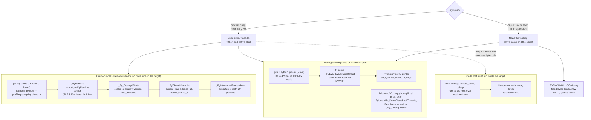

# Python Debugging Hung Processes and C Extensions

> [!summary] Claim:
> Every CPython thread has two stacks: the native C stack, and a linked list of `_PyInterpreterFrame` records hanging off its `PyThreadState`.
> Out-of-process readers such as `py-spy dump` and `python -m profiling.sampling dump` walk the second one by reading raw memory, starting from `_PyRuntime` and its `_Py_DebugOffsets` table (cookie `xdebugpy`), so they work even when no thread can run Python code.
> GDB's `python-gdb.py` instead finds `_PyEval_EvalFrameDefault` C frames through DWARF and pretty-prints each `PyObject *` by reading `ob_type->tp_name`, which needs CPython debug info and a GDB native target (no Apple Silicon support).
> A hang that involves a C extension is usually a lock-order cycle between the GIL and a native lock, and it shows up only when both stacks are read together: `Waiting for the GIL` (`take_gil`) on one thread, `pthread_mutex_lock` on the other.
> A use-after-free in an extension often returns wrong answers silently until `PYTHONMALLOC=debug` fills freed memory with `0xDD` and turns it into a deterministic crash.



## The Mechanism

### Two stacks per thread

A CPython thread is a native thread with a `PyThreadState` attached to it.
The native stack holds C frames: the interpreter's dispatch functions, `PyObject_Vectorcall`, the extension's own functions, and libc wait calls.
The Python stack is not on the native stack at all.
Since CPython 3.11 each Python call is an `_PyInterpreterFrame` allocated in a per-thread data stack (the debug offsets name it `datastack_chunk`), linked through `previous`, with the newest one in `tstate->current_frame` (3.13 and newer; 3.11 and 3.12 keep it in `tstate->cframe->current_frame`, per `Include/cpython/pystate.h` on those branches).
A frame records its code object in `executable`, its current instruction in `instr_ptr`, and its locals in `localsplus`.
One C-level call of the evaluation loop can run several Python frames, which is why the CPython GDB guide warns that in 3.12 and newer `py-up` may move several Python frames at once.

The two stacks answer different questions.
A Python traceback names the line of Python that called into C, but it never shows which C function is blocked or on what.
A native backtrace shows the blocked C function and the lock word, but on a release build it shows only interpreter internals for the Python part.
Hang diagnosis means reading both and joining them at the extension boundary.

### Out-of-process readers: py-spy and Tachyon

`py-spy` reads the target's memory from a separate process: `process_vm_readv` on Linux, `vm_read` on macOS, and `ReadProcessMemory` on Windows (py-spy README).
On Linux, `process_vm_readv(2)` is "governed by a ptrace access mode PTRACE_MODE_ATTACH_REALCREDS check", so the same rules as `gdb -p` apply: Yama `ptrace_scope=1` limits attach to descendants, `2` requires `CAP_SYS_PTRACE`, and `3` forbids attach entirely.
The same man page says the transfers "are not guaranteed to be atomic in any way", which is why py-spy pauses the target by default and why `--nonblocking` can return torn or partial stacks.

To find the interpreter, py-spy dereferences `_PyRuntime` (or `interp_head` on old versions) when symbols exist, and otherwise scans the BSS for something shaped like a `PyInterpreterState` (py-spy README).
CPython now publishes a map for this.
CPython 3.13 added `_Py_DebugOffsets` as the first member of `_PyRuntimeState`, with a comment that it "must be first to facilitate locating it by out of process debuggers" (`Include/internal/pycore_runtime.h` on the 3.13 branch).
The same comment warns that the struct "is **NOT** backwards compatible between minor version of the interpreter" and is only stable between patch versions, so a reader still needs per-minor-version knowledge of the table itself.
CPython 3.14 moved it to `Include/internal/pycore_debug_offsets.h` and declared `_PyRuntime` through `GENERATE_DEBUG_SECTION(PyRuntime, _PyRuntimeState _PyRuntime)` in `Python/pylifecycle.c`, which places it in a named section: `.PyRuntime` on Linux ELF, `__DATA,PyRuntime` on Mach-O, and `PyRuntime` on Windows.
The Linux ELF section is older than the table: `Python/pylifecycle.c` has put `_PyRuntime` in `.PyRuntime` under `__linux__` since the 3.10 branch (the 3.9 branch has no such attribute), so what 3.14 added is the Mach-O and Windows sections.
The table starts with an 8-byte cookie `"xdebugpy"`, then `version` (`PY_VERSION_HEX`) and `free_threaded`, then byte offsets for every field a stack walker needs: `runtime_state.interpreters_head`, `interpreter_state.threads_head`, `thread_state.current_frame`, `thread_state.holds_gil`, `interpreter_frame.previous`, `interpreter_frame.instr_ptr`, `code_object.qualname`, `code_object.linetable`, and more.
On the macOS host (Homebrew CPython 3.15.2, as of 2026-11), `otool -s __DATA PyRuntime` on the framework binary prints `62656478 79706775 030f02f0` as the first 12 bytes: the little-endian words `"xdeb"` `"ugpy"`, then `0x030f02f0`, which is `PY_VERSION_HEX` for 3.15.2 final.
A reader that checks the cookie and version can walk any build of a known minor release, whatever its compiler flags, without hard-coding the layout of every struct.
py-spy claims support for CPython 2.3-2.7 and 3.3-3.15 (py-spy README, as of 2026-11), and py-spy 0.4.3 uses both kinds of layout knowledge.
For CPython 3.13 to 3.15 it reads the table at run time: `PythonProcessLayout::from_debug_offsets` in `src/python_process_info.rs` copies `_Py_DebugOffsets` from the `_PyRuntime` address and takes three offsets from it, `runtime_state.interpreters_head`, `interpreter_state.ceval_gil`, and `interpreter_state.imports_modules`.
When the binary has no `_PyRuntime` symbol, `scan_memory_for_debug_offsets` searches the `PyRuntime` section, and then the BSS, for the cookie `xdebugpy`.
Everything past those three addresses (thread states, frames, code objects, strings) still comes from generated per-version struct bindings, `src/python_bindings/v2_7_15.rs` to `v3_15_0.rs`, and a source comment calls the set of addresses taken from the table "fairly minimal".
A new CPython minor release therefore still needs a new py-spy release.

CPython 3.15 ships its own reader.
PEP 799 adds the `profiling` package, and its `profiling.sampling` module (Tachyon) has a `dump` subcommand that the 3.15 What's New describes as "a traceback-style stack of every thread ... Useful for investigating hung processes."
Its C backend `_remote_debugging` exposes `RemoteUnwinder` and thread-status flags such as `THREAD_STATUS_HAS_GIL` and `THREAD_STATUS_GIL_REQUESTED` (`dir(_remote_debugging)` on 3.15.2, as of 2026-11).
`dump -a` covers all threads, `--native` adds artificial `<native>` frames, and `--async-aware` dumps asyncio tasks (`--help` on 3.15.2).
The dump annotates each thread with its state: main thread, has GIL, on CPU, waiting for GIL, has exception, or idle (`profiling.sampling` documentation for 3.15).
The two GIL labels are two fields of the thread state, read through the table: `Modules/_remote_debugging/threads.c` sets `THREAD_STATUS_HAS_GIL` from `thread_state.holds_gil`, and `THREAD_STATUS_GIL_REQUESTED` from `thread_state.gil_requested` when the thread does not hold the GIL (3.15 branch).
On macOS both py-spy 0.4.3 and Tachyon refused to read a same-user Homebrew Python without root: py-spy printed `This program requires root on OSX.` and Tachyon printed `Permission Error: Unable to access process memory on macOS` (as of 2026-11, macOS 27.2).

py-spy's thread labels answer a different question from Tachyon's.
`StackTrace::status_str` in `src/stack_trace.rs` prints `idle` whenever the operating system reports the thread as not running, whether or not it owns the GIL, `active+gil` for a running owner, and `active` otherwise, so a GIL holder parked on a native mutex is `idle` (py-spy 0.4.3).
Its core-file mode, `py-spy dump --core FILE`, exists only in Linux builds (`src/config.rs`) and has no thread activity to report, so `write_trace` in `src/dump.rs` marks the owner `(gil)` there.

Neither reader runs code in the target, so neither needs the GIL.
That is the property that makes them the first tool for a hang: a deadlocked interpreter cannot service any request that needs a thread to run Python.

### GDB and python-gdb.py

`python-gdb.py` (source `Tools/gdb/libpython.py`) is a GDB Python extension that ships with CPython builds and distro debug packages.
On Ubuntu 24.04, installing `python3.12-dbg` placed `python3.12-gdb.py` in `/usr/share/gdb/auto-load/usr/bin/`, where GDB auto-loads it for `/usr/bin/python3.12` (as of 2026-11, Linux arm64 container).
The CPython guide notes that debuginfod fetches debug info but "will not install the `python-gdb.py` extension".
A source build drops `python-gdb.py` next to the binary, and GDB loads it only after `add-auto-load-safe-path /path/to/cpython`.

The extension does two things.
First, `pretty_printer_lookup` registers a printer for `PyObject *`, `PyFrameObject *`, `PyUnicodeObject *`, `wrapperobject *`, and `_PyStackRef`.
The printer reads `ob_type->tp_name` with `safe_tp_name()`, picks a proxy class from a name map (`bool`, `NoneType`, `frame`, `set`) or from the `tp_flags` subclass bits (`LONG`, `LIST`, `TUPLE`, `BYTES`, `UNICODE`, `DICT`, `BASE_EXC`), and renders something close to `repr()` without calling `repr()`.
Output is capped at `MAX_OUTPUT_LEN = 1024` characters with a `...(truncated)` suffix, and container walks stop at 1000 items.
To see raw fields, cast: `p *(PyLongObject*)v`.

Second, it defines `py-bt`, `py-bt-full`, `py-list`, `py-up`, `py-down`, `py-print`, and `py-locals`.
`Frame.is_evalframe()` returns true only for a C frame named `_PyEval_EvalFrameDefault` whose type is `gdb.NORMAL_FRAME`, and `get_pyop()` reads that frame's local variable `frame` to reach the `_PyInterpreterFrame` chain.
`is_other_python_frame()` labels a `take_gil` frame `Waiting for the GIL`, the collector functions (`gc_collect_main`, `gc_collect_young`, and others) `Garbage-collecting`, and `cfunction_vectorcall_*` or `cfunction_call` frames with the pretty-printed `func`, such as `<built-in method cache_get of module object at remote 0x...>`.
When it cannot read the frame it prints `(unable to read python frame information)`.
The helper commands do not all start from the same frame.
`py-list` uses `Frame.get_selected_bytecode_frame`, which walks outward to the nearest `_PyEval_EvalFrameDefault` frame.
`py-print` and `py-locals` use `Frame.get_selected_python_frame`, which stops at the nearest frame of either kind, and a labeled frame has no `_PyInterpreterFrame` to read, so they print `Unable to read information on python frame` until `py-up` has moved the selection to a bytecode frame (`libpython.py` at tag v3.12.3 and on the 3.15 branch).
The `<built-in method ...>` label is version-dependent: it appeared on CPython 3.12.3 and on none of the six CPython 3.15.2 builds tested for this note, because no `cfunction_vectorcall_*` frame was on the stack.
In 3.15 `_Py_LeaveRecursiveCallTstate` is an empty function (in 3.12 it incremented `c_recursion_remaining`), so calling the C function is the last thing the wrapper does, and the disassembly of `cfunction_vectorcall_NOARGS` on the tail-call PGO build leaves through `br x2`, a tail jump (Linux arm64, as of 2026-11).

Two limits follow from that design.
It needs DWARF for CPython itself: without it GDB cannot read the local `frame`, and the guide says only that GDB "is not always able to read the relevant frame information, depending on the optimization level".
It also needs a GDB native target for the platform.
`gdb/configure.nat` adds native Darwin support only for an `i386` host CPU, so GDB cannot run or attach to native arm64 processes on Apple Silicon, even though Homebrew bottles gdb 18.1 for arm64 macOS (as of 2026-11).
On macOS the debugger is lldb, and lldb cannot load `python-gdb.py`.

GDB without `python-gdb.py` still answers most of a hang, because three things need no CPython debug info.
Native backtraces come from the unwind tables and the dynamic symbol table, and they name every exported C API function, such as `PyEval_RestoreThread`.
An object's type name is two pointer reads away: `ob_type` is the second word of the object, and `tp_name` is at offset 24 of the type, after the 24-byte `PyVarObject` header.
The interpreter's own traceback dumper, the function `faulthandler` uses, can be called by name: Ubuntu's stripped `python3.12` exports `_Py_DumpTracebackThreads` (as of 2026-11).
GDB waits without limit for a called function by default; GDB 15 added `set direct-call-timeout SECONDS` and `set unwind-on-timeout on` (`gdb/NEWS`).
With CPython debug info the GIL's owner is one expression away: on 3.12 `_PyRuntime.interpreters.main->ceval.gil` points at the GIL state, whose `locked`, `last_holder`, and `interval` fields give the lock bit, the owning `PyThreadState`, and the switch interval, and `native_thread_id` of that thread state is the LWP that `info threads` shows (hand-run on 3.12.3, Linux arm64, as of 2026-11).

The tail-calling interpreter changes the C stack, and whether `py-bt` survives it depends on inlining, not on tail calls as such.
CPython 3.14 added an opt-in interpreter built from small C functions that tail-call each other, which works only with Clang 19 or newer (What's New in 3.14), and Homebrew builds 3.15.2 with `--with-tail-call-interp`, `--enable-optimizations`, and `--with-lto` (`sysconfig` `CONFIG_ARGS`, as of 2026-11).
In that mode `_PyEval_EvalFrameDefault` is still the entry point: it keeps the `_PyEntryFrame entry` record on its own C stack, links it into the frame chain, and calls `_TAIL_CALL_start_frame` (`Python/ceval.c` on the 3.15 branch), so a `_TAIL_CALL_<OPCODE>` handler sits directly above it on the stack.
Six builds of CPython 3.15.2 from the python.org tarball settle what GDB sees (Linux arm64, Debian 13, Clang 19.1.7, GCC 14.2.0, GDB 16.3, as of 2026-11), each attached to the deadlock from the worked example:

| Build | `_PyEval_EvalFrameDefault` as GDB sees it | `thread apply all py-bt` |
|---|---|---|
| GCC, default flags (`-O3 -g`) | `NORMAL` frame | Full traceback on both threads |
| Clang, default flags | `NORMAL` frame | Full traceback on both threads |
| Clang, `--with-tail-call-interp` | `NORMAL` frame under `_TAIL_CALL_CALL` | Full traceback on both threads |
| Clang, `--with-tail-call-interp --with-lto` (ThinLTO) | `NORMAL` frame under `_TAIL_CALL_CALL` | Full traceback on both threads |
| Clang, `--enable-optimizations --with-lto` | `NORMAL` frame | Full traceback on both threads |
| Clang, `--with-tail-call-interp --enable-optimizations --with-lto` (Homebrew's flags) | `INLINE` frame, inlined into `_PyEval_Vector` | Blocked thread prints only `Waiting for the GIL`; main thread prints its frame |

`is_evalframe()` rejects `gdb.INLINE_FRAME`, so on the last build no C frame qualifies as an eval frame.
`print_traceback_helper` then behaves in two ways.
A thread with no recognizable C frame at all falls back to the thread state's `current_frame` (`PyFramePtr.get_thread_local_frame`) and prints its Python stack, which is what the main thread did.
A thread with a labeled frame such as `take_gil` takes the C-frame path instead, prints the label, finds no eval frame, and prints nothing else, so the thread you most need loses every Python frame.
lldb's symbol-only backtrace on the Homebrew build is consistent with the same inlining: it goes from `_PyEval_Vector` straight to `_TAIL_CALL_CALL`, and without a dSYM lldb cannot show inlined frames.
The out-of-process readers do not depend on C frames: Tachyon printed both complete Python stacks on all six builds, and `py-spy dump` did on the three it was run against.

### lldb on macOS: calling the dump function inside the target

lldb on macOS attaches through `debugserver`, which carries the `com.apple.private.cs.debugger` entitlement.
It attached to the ad-hoc-signed Homebrew Python (`flags=0x2(adhoc)`, no hardened runtime) without `sudo`, while py-spy and Tachyon did not (as of 2026-11, macOS 27.2).
The three outcomes have three different causes.
py-spy never asks the kernel: `pyspy_main` in `src/main.rs` prints `This program requires root on OSX.` and exits whenever `geteuid()` is not 0.
Tachyon does ask: `pid_to_task` in CPython's `Python/remote_debug.h` calls `task_for_pid`, which returned `kern_return_t` 5 (`KERN_FAILURE`), and the CLI replaces the resulting `PermissionError` with its `Unable to access process memory on macOS` text.
In the public XNU source, `task_for_pid` in `bsd/kern/kern_proc.c` first requires root or a same-uid target (`task_for_pid_posix_check`), then runs the MAC policy hook `mac_proc_check_get_task`, and then, only "if we aren't root", makes an upcall to the `taskgated` daemon (tag xnu-12377.121.6, the newest public tag; macOS 27.2 runs xnu-13432).
`taskgated(8)` says the daemon checks the authorization right `system.privilege.taskport` for a caller that holds the `com.apple.security.cs.debugger` entitlement, and `system.privilege.taskport.debug` for one that holds `com.apple.private.cs.debugger`.
On this host `security authorizationdb read` shows both rights as `class user`, `group _developer`, `authenticate-user true`, and the user is a member of `_developer`.
The Homebrew `python3.15` binary has no entitlements, so its request is refused; `debugserver` has the private one, so its request goes to the `.debug` right and was granted.
A C probe that only calls `task_for_pid` reproduced the split on the same target: with no entitlement it got `kr=5 ((os/kern) failure)` at once, and re-signed ad hoc with `com.apple.security.cs.debugger` it stopped failing and instead did not return (killed after 20 s), which is consistent with the `authenticate-user` rule waiting for a credential while `DevToolsSecurity -status` reported developer mode disabled.
Neither tool was run as root here, because the host has no non-interactive `sudo`.
Root is the documented route: the `profiling.sampling` platform requirements list "Running as root" first for macOS, the CPython remote debugging guide says processes with superuser privileges "are not subject to this check", the py-spy README says "OSX always requires running as root", and the XNU code makes the `taskgated` upcall only for a non-root caller.
The remote debugging guide names one more route for a non-root user: sign the target Python binary ad hoc with the `com.apple.security.get-task-allow` entitlement, which it describes for non-framework builds (not tried here; Homebrew's is a framework build).
[[How-Debuggers-Work-ptrace-Mach-and-Breakpoints]] owns the Mach side.

The Homebrew build ships no dSYM, so lldb shows CPython symbols but no types or Python frames.
The workaround is to make the target print its own Python stacks with the function `faulthandler` uses:
- CPython 3.15 exports `PyUnstable_DumpTracebackThreads(int fd, PyInterpreterState *interp, PyThreadState *current_tstate, Py_ssize_t max_threads)` (gh-145559).
- CPython 3.14 has the internal `_Py_DumpTracebackThreads(int fd, PyInterpreterState *interp, PyThreadState *current_tstate)`, which is a local symbol in Homebrew 3.14.10 that lldb still resolves by name.

With `interp` and `current_tstate` NULL, the function reads the calling thread's state through `PyGILState_GetThisThreadState()` and walks every thread of that interpreter, writing with `write()` to `fd` (`Python/traceback.c`).
It takes no lock and does not need the GIL, which is why faulthandler can call it from a signal handler and why it is safe to call from a debugger in a deadlock.
The output goes to the target's file descriptor 2, not to lldb.

Anything that needs the GIL is different.
lldb runs an expression on the selected thread.
On the main thread of the GIL deadlock in the worked example, `expr (int)PyGILState_Ensure()` returned `0` at once, because that thread already held the GIL, which tells you nothing.
On the `refresher` thread it blocked in `take_gil`: with an explicit limit, `expr -t 3000000 -- (int)PyGILState_Ensure()`, lldb printed `error: Expression execution was interrupted.` after 3 seconds, and without `-t` the expression had not returned after 58 seconds, when lldb was killed.
`expr` has no overall timeout by default: `help expression` says it runs the selected thread alone for 0.25 seconds and then resumes all threads, with `-t` there to set a limit (lldb-2103.0.34.407, as of 2026-11).
GDB behaves the same way on Linux: `call PyGILState_Ensure()` returned `0` on the holder, and on the waiter it ran until `set direct-call-timeout 2` made GDB abandon it (GDB 15.1, as of 2026-11).
Do not use `PyRun_SimpleString` from a debugger to diagnose a GIL hang.

LLDB's memory reader is also a way around the closed task port.
A script that calls `SBProcess.ReadMemory` can walk `_Py_DebugOffsets` the way py-spy does with `vm_read`, with no root and no call into the target; the macOS lab does this and prints each thread's `holds_gil`, `gil_requested`, and Python frames.

### PEP 768 and why it cannot rescue a deadlock

CPython 3.14 implements PEP 768: a tool locates the thread state through `_Py_DebugOffsets`, writes a `.py` path into `debugger_script_path` (512 bytes per thread), sets `debugger_pending_call`, and sets `_PY_EVAL_PLEASE_STOP_BIT` in `eval_breaker`.
The interpreter runs the script at its next safe point, which is how `sys.remote_exec(pid, path)` and `python -m pdb -p PID` work.
The PEP states the limit plainly: "the injected code won't be able to run until that operation completes and the GIL becomes available."
In a hang where every thread is blocked in C, no thread ever checks the eval breaker, so remote attach waits forever.
It can be disabled with `PYTHON_DISABLE_REMOTE_DEBUG`, `-X disable-remote-debug`, or `--without-remote-debug`, and it raises two audit events: `sys.remote_exec` in the process that calls it and `cpython.remote_debugger_script` in the target (`sys.remote_exec` documentation for 3.15; the PEP's sample code calls the second one `debugger_script`, which is not the shipped name).
[[Python-pdb-debugpy-and-Remote-Attach]] owns the interactive workflow.

### The GIL against a native lock

`Py_BEGIN_ALLOW_THREADS` expands to `{ PyThreadState *_save; _save = PyEval_SaveThread();` and `Py_END_ALLOW_THREADS` to `PyEval_RestoreThread(_save); }`.
`PyEval_RestoreThread` "will wait until the GIL can be acquired" (C API, Thread states and the GIL).
An extension that owns a native lock therefore has two lock-order rules to keep:
1. Never block on the native lock while attached, because the GIL is held and every other Python thread stalls behind you.
2. Never reattach (`Py_END_ALLOW_THREADS`, `PyGILState_Ensure`) while holding the native lock, because a thread that holds the GIL may be waiting for that lock.
Break either rule in two threads and you get the classic cycle: thread A holds the GIL and waits for the mutex, and thread B holds the mutex and waits for the GIL.
On a GIL build, every other Python thread then queues behind thread A, so the whole process freezes at close to 0% CPU.
[[Cpp-Playbook-Deadlocks-and-Livelocks]] owns general lock-graph analysis; the Python-specific point is that the GIL is one of the nodes and is invisible to Python-level tools.

The two waits in that cycle look different from outside the process.
`pthread_mutex_lock` parks the GIL holder once, for good.
`take_gil` waits on the GIL's condition variable in slices of the switch interval: `gil->interval`, which `DEFAULT_INTERVAL` sets to 5000 microseconds and `sys.getswitchinterval()` reports as `0.005`.
After each timeout it sets the drop request on the holder and waits again (`Python/ceval_gil.c`, the same loop on 3.12 and 3.15).
The holder is parked in C and never reaches an eval-breaker check, so the loop never ends: the waiter wakes once per interval, uses almost no CPU, and makes no progress.
On 3.15 the same function sets `tstate->gil_requested = 1` before the loop and `tstate->holds_gil = 1` after it, and those are the two fields a memory reader reports.
A thread that wakes every 5 ms in `futex` is therefore waiting for the GIL, and a thread that never wakes is stuck on something else, usually while holding it; [[Debugging-Without-a-Debugger-and-Concurrency-Bugs]] owns the wider set of `/proc` techniques.
Two build variants change which GIL is meant.
Since 3.12 an interpreter can own its GIL (PEP 684), which is why the table reaches the GIL through `interpreter_state.ceval_gil` of each interpreter and not through one global.
A free-threaded build has no GIL to wait for: `free_threaded` is 1 in the table, and Tachyon reports the thread state's `active` flag in place of `holds_gil` (`threads.c`); [[Python-Concurrency-Asyncio-Multiprocessing-and-Free-Threading-Bugs]] owns lock-order bugs on those builds.

The documentation names three more hang sources worth checking in the stacks:
- `PyGILState_Ensure` and `PyEval_RestoreThread` called during finalization hang the thread "until the program exits", and 3.14 changed this from terminating the thread to hanging it.
- A raw `fork()` from C, rather than `os.fork()`, can leave one of Python's internal locks owned by a thread that does not exist in the child.
- Python resets only its own locks at `os.fork()`; "there is no way to inform Python of additional (non-Python) locks".

### Refcount bugs and the debug allocator

A borrowed reference (from `PyList_GetItem`, `PyDict_GetItem`, `PyTuple_GET_ITEM`) does not own the object.
`Py_DECREF` on it drops the count the container owns, and if that was the last reference the object is freed while the container still points at it.
With the default pymalloc allocator, freed blocks keep their bytes until reuse, so later reads often "work" and return garbage.
Reuse can be immediate.
`PyObject_GetAttrString` builds a temporary string for the attribute name with `PyUnicode_FromString` (`Objects/object.c`), and a short name falls in the same pymalloc size class as a short freed string: `sys.getsizeof` gives 45 bytes for `abc1` and 46 for `upper`, and with `ALIGNMENT` 16 on a 64-bit build both come from the 48-byte class.
The freed block can then be handed to the name string itself, so the method is looked up on, and called on, the string `upper`.
`PYTHONMALLOC=debug` installs the debug hooks on a release build: newly allocated memory is filled with `0xCD`, freed memory with `0xDD`, and each block is surrounded by `0xFD` guard bytes; the hooks also detect API mismatches and check for an attached thread state on `PyMem_*` and `PyObject_*` calls (C API, Memory Management; the byte values changed to these in 3.8).
A pointer read out of a freed object then becomes `0xdddddddddddddddd`, and the next dereference faults at a recognizable address.
[[Python-faulthandler-and-Crash-Diagnostics]] owns the crash traceback, including the C stack that 3.14's `faulthandler.dump_c_stack()` and `enable(c_stack=True)` add; [[Python-tracemalloc-gc-and-Memory-Leaks]] owns leaks.

## Commands and Numbers to Know

| Item | Value | Platform | Notes |
|---|---|---|---|
| `py-spy dump --pid PID` | all threads' Python stacks, target paused (as of 2026-11) | Both | py-spy 0.4.3; `-l` adds locals, `-ll` more, `--json`, `--nonblocking` skips the pause. |
| `py-spy dump --native` | merges C frames into the dump (as of 2026-11) | Linux | The macOS arm64 0.4.3 build hides the flag and answers `not supported on your platform`; on arm64 Linux the unwind stops at the first frame built with return-address signing. |
| py-spy on macOS | `This program requires root on OSX.` (as of 2026-11) | macOS | A `geteuid()` check in `src/main.rs`, made before any attach attempt. |
| py-spy in Docker | worked as container root with no added capability (as of 2026-11) | Linux | Docker 29.8.2 default seccomp, same-container target; the README's `--cap-add SYS_PTRACE` advice was not needed on this setup. |
| `python -m profiling.sampling dump -a PID` | Tachyon one-shot dump of all threads, each labeled `has GIL`, `waiting for GIL`, or `idle` (as of 2026-11) | Both | New in 3.15 (PEP 799); `--native`, `--async-aware`, `--opcodes`; refused a non-root user on macOS (`task_for_pid` returned 5). |
| py-spy thread labels | `idle`, `active`, `active+gil` in a live dump; `(gil)` in a core dump (as of 2026-11) | Both | py-spy 0.4.3; `idle` means off CPU, so a GIL holder blocked in C is `idle`. |
| `py-spy dump --core FILE` | Python stacks from a core file (as of 2026-11) | Linux | py-spy 0.4.3; the option is compiled into Linux builds only. |
| Tachyon thread labels | `has GIL` is `holds_gil`, `waiting for GIL` is `gil_requested` (as of 2026-11) | Both | `Modules/_remote_debugging/threads.c` on the 3.15 branch. |
| GIL switch interval | 5 ms: `DEFAULT_INTERVAL` is 5000 microseconds (as of 2026-11) | Both | `sys.getswitchinterval()`; a thread in `take_gil` wakes once per interval. |
| `faulthandler.dump_traceback_later(1.0)` | a watchdog thread writes every Python stack after 1 s (as of 2026-11) | Both | Needs no GIL and no attach permission, but must be armed before the hang. |
| `_Py_DebugOffsets` cookie | `xdebugpy`, then `PY_VERSION_HEX` and `free_threaded` (as of 2026-11) | Both | 3.13 added the table; 3.14 moved it to `pycore_debug_offsets.h`. |
| `PyRuntime` section | `.PyRuntime` (ELF), `__DATA,PyRuntime` (Mach-O) (as of 2026-11) | Both | ELF since 3.10, Mach-O since 3.14; `otool -s __DATA PyRuntime <libpython>` shows the cookie. |
| python-gdb.py commands | `py-bt`, `py-bt-full`, `py-list`, `py-up`, `py-down`, `py-print`, `py-locals` (as of 2026-11) | Linux | `thread apply all py-bt` for every thread. |
| python-gdb.py frame key | C frame `_PyEval_EvalFrameDefault`, `gdb.NORMAL_FRAME`, local `frame` (as of 2026-11) | Linux | `Tools/gdb/libpython.py` on the 3.15 branch; an inlined copy does not count, and Clang with tail calls, PGO, and LTO inlined it. |
| python-gdb.py labels | `Waiting for the GIL` (`take_gil`), `Garbage-collecting` (as of 2026-11) | Linux | Plus `<built-in method ...>` for C function calls, seen on 3.12.3 and absent on the 3.15.2 builds tested. |
| python-gdb.py frame selection | `py-list` finds the nearest bytecode frame; `py-print` and `py-locals` need one selected (as of 2026-11) | Linux | Otherwise `Unable to read information on python frame`; use `py-up` first. |
| python-gdb.py output cap | `MAX_OUTPUT_LEN = 1024`, 1000 items (as of 2026-11) | Linux | Appends `...(truncated)`. |
| Ubuntu debug package | `python3.12-dbg`, auto-loads `/usr/share/gdb/auto-load/usr/bin/python3.12-gdb.py` (as of 2026-11) | Linux | Ubuntu 24.04, CPython 3.12.3, GDB 15.1. |
| GDB dump call, 3.12 | `call ((const char *(*)(int, void *, void *))_Py_DumpTracebackThreads)(2, 0, 0)` (as of 2026-11) | Linux | Exported by Ubuntu's stripped `python3.12`; returns NULL; text goes to the target's stderr. |
| GDB call timeout | `set direct-call-timeout SECONDS`, default unlimited (as of 2026-11) | Linux | New in GDB 15; `set unwind-on-timeout on` pops the dummy frame afterwards. |
| GIL owner from GDB, 3.12 | `p _PyRuntime.interpreters.main->ceval.gil->last_holder` (as of 2026-11) | Linux | Needs CPython debug info; `native_thread_id` of that thread state is the LWP. |
| `gcore -o hang PID` | writes `hang.PID` and leaves the process running (as of 2026-11) | Linux | GDB 15.1; a core answers `bt`, `py-bt`, and `py-spy dump --core`, but not `call`. |
| GDB on Apple Silicon | no native target (as of 2026-11) | macOS | `configure.nat` Darwin native support is `i386` only. |
| macOS task port for a non-root caller | `taskgated` decides by entitlement (as of 2026-11) | macOS | `com.apple.security.cs.debugger` maps to the right `system.privilege.taskport`, `com.apple.private.cs.debugger` to `system.privilege.taskport.debug`; no entitlement gets `KERN_FAILURE` (5). |
| libunwind and `DW_CFA_AARCH64_negate_ra_state` | rejected in 1.5, handled since 1.7.0 (as of 2026-11) | Linux | py-spy 0.4.3's arm64 wheel behaves like 1.5: the stack ends at the first signed frame. |
| lldb dump call, 3.15 | `expr -- (const char *)PyUnstable_DumpTracebackThreads(2, (void*)0, (void*)0, 0)` (as of 2026-11) | macOS | Returns NULL on success; text goes to the target's stderr. |
| lldb dump call, 3.14 | `expr -- (const char *)_Py_DumpTracebackThreads(2, (void*)0, (void*)0)` (as of 2026-11) | macOS | Local symbol in Homebrew 3.14.10. |
| `PYTHONMALLOC=debug` | new `0xCD`, freed `0xDD`, guards `0xFD` (as of 2026-11) | Both | Works on release builds. |
| PEP 768 opt-out | `PYTHON_DISABLE_REMOTE_DEBUG`, `-X disable-remote-debug`, `--without-remote-debug` (as of 2026-11) | Both | Script path buffer is 512 bytes per thread; audit events `sys.remote_exec` (caller) and `cpython.remote_debugger_script` (target). |
| Yama `ptrace_scope` | `0` same uid, `1` descendants, `2` `CAP_SYS_PTRACE` only, `3` none (as of 2026-11) | Linux | Governs `gdb -p` and `process_vm_readv` alike. |

## Multi-Language Comparison: Native Extensions Under the Same Tools

| Concern | C or C++ extension (C API, pybind11) | Python code | Rust extension (PyO3) |
|---|---|---|---|
| Release the GIL around blocking work | `Py_BEGIN_ALLOW_THREADS` / `Py_END_ALLOW_THREADS`; pybind11 `py::gil_scoped_release` or `py::call_guard<py::gil_scoped_release>()` | Not available; the interpreter releases it around blocking I/O | `py.detach(...)`, named `allow_threads` before PyO3 0.26.0 |
| Reacquire to touch objects | `PyGILState_Ensure` (soft deprecated in 3.15 for `PyThreadState_Ensure`), pybind11 `py::gil_scoped_acquire` | Implicit | `Python::attach`, named `with_gil` before 0.26.0 |
| How a GIL-vs-lock hang looks in `py-spy dump` | Python line that called the extension, thread marked `idle` | Real Python wait such as `Thread._wait_for_tstate_lock` (3.12 and older; the frame is `Thread.join` on 3.13 and newer) | Same as C: only the calling Python line |
| How it looks in native stacks | `take_gil` under `PyEval_RestoreThread` against `pthread_mutex_lock` in your function | Lock waits in `_PyMutex_LockTimed` and `_PyParkingLot_Park` on 3.15.2 | Same shape, with mangled Rust symbols unless demangled |
| Typical memory bug | `Py_DECREF` on a borrowed reference | Not possible without `ctypes` | Rare in safe code; appears in `unsafe` FFI blocks |
| What turns it into a crash | `PYTHONMALLOC=debug`, ASan | n/a | `PYTHONMALLOC=debug`, Miri for pure-Rust parts |
| Owning note | [[Cpp-AddressSanitizer-and-LeakSanitizer-Internals]] | [[Python-Concurrency-Asyncio-Multiprocessing-and-Free-Threading-Bugs]] | [[Rust-FFI-Boundary-Debugging-Across-Cpp-and-Python]] |

## Worked Lab Example

Two labs run one extension and two scripts on two platforms, and `make verify` diffs what they print against `expected/<platform>.txt`:
- `code/03-Debugging/python_gil_deadlock_gdb/` (`# requires: linux`) runs in the pinned lab image: Ubuntu 24.04 arm64, CPython 3.12.3, GDB 15.1, GCC 13.3.0, as an unprivileged user with no capabilities and no network (as of 2026-11).
  The image has neither `python3.12-dbg` nor `python3-dev`, which is the usual state of a production image.
- `code/03-Debugging/python_gil_deadlock_lldb/` (`# requires: macos`) runs on macOS 27.2 arm64 as a normal user: Homebrew CPython 3.15.2 (tail-calling interpreter, no dSYM), Apple clang 21.0.0, lldb-2103.0.34.407 (as of 2026-11).

Every output block in this section is a contiguous excerpt of `expected/linux-aarch64.txt` or `expected/darwin-arm64.txt`, named at the block.
The labs replace thread ids and addresses with `0xADDR`, strip the work directory from paths, and write the standard library directory as `<stdlib>`.
Three kinds of observation cannot be in the labs: tools the lab image has no network to install (py-spy, `python3.12-dbg`, strace), a second CPython build (3.15 on Linux), and anything that needs root on macOS.
Those are reported in prose, marked hand-run with their platform, and `make verify` does not check them.

### The extension and the hang

`badext.c` has two bugs.
`cache_get` locks `cache_lock` while attached.
`cache_refresh` detaches, locks `cache_lock`, sleeps 200 ms, and reattaches while still holding it.
`first_upper`, used in Step 7, calls `Py_DECREF` on the borrowed result of `PyList_GetItem` and then calls a method on it.

```c
/* Bug 1: takes cache_lock while still holding the GIL. */
static PyObject *
cache_get(PyObject *self, PyObject *noargs)
{
    pthread_mutex_lock(&cache_lock);
    pthread_mutex_unlock(&cache_lock);
    Py_RETURN_NONE;
}

/* Releases the GIL, takes cache_lock, then needs the GIL back to call cb. */
static PyObject *
cache_refresh(PyObject *self, PyObject *cb)
{
    PyObject *res;
    Py_BEGIN_ALLOW_THREADS
    pthread_mutex_lock(&cache_lock);
    usleep(200000);
    Py_END_ALLOW_THREADS          /* blocks in take_gil while holding cache_lock */
    res = PyObject_CallNoArgs(cb);
    pthread_mutex_unlock(&cache_lock);
    return res;
}
```

`gil_deadlock.py`, in full:

```python
import faulthandler
import sys
import threading
import time

import badext

# A watchdog thread written in C, which needs no GIL: one second from now it writes
# every thread's Python stack to stderr, unless the script has finished by then.
faulthandler.dump_traceback_later(1.0, file=sys.stderr)

started = threading.Event()


def refresher():
    started.set()
    badext.cache_refresh(lambda: None)


t = threading.Thread(target=refresher, name="refresher")
t.start()
started.wait()
time.sleep(0.05)       # refresher now holds cache_lock without the GIL
badext.cache_get()     # main holds the GIL and blocks on cache_lock
```

Both labs compile the same `badext.c`.
The macOS lab builds it against Homebrew's `Python.h`.
The Linux image has no `Python.h`, so that lab ships `stable_abi/Python.h`, a 66-line stand-in that declares the structs a module is made of (`PyObject`, `PyMethodDef`, `PyModuleDef`) and the nine symbols `badext.c` needs, all of them listed in CPython's Stable ABI manifest `Misc/stable_abi.toml`.
The interpreter binary exports those symbols, so the result is an ordinary extension module that `import badext` loads.
The only difference from a build against the real header is that `Py_DECREF` and `Py_RETURN_NONE` call the exported functions `Py_DecRef` and `Py_NewRef` where the real header inlines them.

### Step 1: is it a deadlock, and which thread wants the GIL (Linux, /proc only)

`proc_threads.py` reads `/proc/PID/task/*/syscall` and the `voluntary_ctxt_switches` counter in `/proc/PID/task/*/status` for half a second, with no ptrace attach.
From `expected/linux-aarch64.txt`:

```text
thread 1 (tid == pid): seen blocked in futex: yes; in 0.5 s it never woke
thread 2: seen blocked in futex: yes; in 0.5 s it woke about every 5 ms
CPU used by the process in 0.5 s: under 20 ms
```

Both threads sit in `futex`, and the process uses almost no CPU, but the two waits are not the same.
Thread 1 never wakes: it is parked on the mutex.
Thread 2 wakes about every 5 ms, which is the switch interval, so it is the thread inside `take_gil`, asking the holder for the GIL again and again.
That identifies the GIL waiter, and therefore the GIL as one node of the cycle, before any debugger is attached.
strace shows the same thing from the system call side: in one second the waiter made 315 `futex` calls, of which 157 were `FUTEX_WAIT_BITSET_PRIVATE` waits that ended in `ETIMEDOUT`, while the main thread stayed in a single `futex(..., FUTEX_WAIT_PRIVATE, 2, NULL` that never returned (hand-run with strace 6.8 in the lab image, Linux arm64, as of 2026-11).

### Step 2: the Python-level view (faulthandler in both labs; py-spy and Tachyon by hand)

The script armed `faulthandler.dump_traceback_later(1.0)`, so one second in, a watchdog thread that holds no Python thread state wrote every Python stack to stderr.
From `expected/linux-aarch64.txt`:

```text
Timeout (0:00:01)!
Thread 0xADDR (most recent call first):
  File "gil_deadlock.py", line 17 in refresher
  File "<stdlib>/threading.py", line 1010 in run
  File "<stdlib>/threading.py", line 1073 in _bootstrap_inner
  File "<stdlib>/threading.py", line 1030 in _bootstrap

Thread 0xADDR (most recent call first):
  File "gil_deadlock.py", line 24 in <module>
```

Both threads sit on a line that calls into `badext`.
That is all a Python-level dump can say: it names neither lock, and it would look the same if the two calls were merely slow.
The macOS lab prints the same two stacks, with the thread name that CPython 3.14 and newer add to the header.
From `expected/darwin-arm64.txt`:

```text
Thread 0xADDR [refresher] (most recent call first):
  File "gil_deadlock.py", line 17 in refresher
```

py-spy reads the same information from outside, with no preparation in the target.
`py-spy dump --pid PID` printed `Thread ... (idle): "MainThread"` with the frame `<module> (gil_deadlock.py:24)`, and `Thread ... (idle): "refresher"` with `refresher (gil_deadlock.py:17)` followed by `Thread.run (threading.py:1010)`, `Thread._bootstrap_inner (threading.py:1073)`, and `Thread._bootstrap (threading.py:1030)` (hand-run, py-spy 0.4.3 in the lab image as root, Linux arm64, as of 2026-11).
Both threads are `idle`, including the one that holds the GIL, because `idle` in a live dump means the operating system reports the thread as not running.

`py-spy dump --native --pid PID` added native frames (same hand-run).
For the main thread it printed one unnamed libc frame, `pthread_mutex_lock (libc.so.6)`, `cache_get (badext.c:14)`, and then `<module> (gil_deadlock.py:24)`.
For `refresher` it printed one unnamed libc frame and `pthread_cond_timedwait (libc.so.6)`, and then went straight to `refresher (gil_deadlock.py:17)`.
So `--native` exposes the mutex wait in `cache_get`, but the merged stack for `refresher` shows neither `take_gil` nor `cache_refresh`, and those are two separate effects.
py-spy hides interpreter frames on purpose: `get_merge_strategy` in `src/native_stack_trace.rs` drops every frame inside the Python binary or libpython, except `_PyEval_EvalFrameDefault`, which it replaces with Python frames, and names whose first token, split on `_` and `.`, is on an allowlist (`time`, `sys`, `gc`, `os`, `unicode`, `thread`, `stringio`, `sre`, `PyGilState`, `PyThread`, `lock`).
`take_gil` and `PyEval_RestoreThread` are therefore never printed.
`cache_refresh` lives in `badext`, so it should print, and it is missing because the native unwind stopped early.
py-spy's Linux arm64 wheel is statically linked, and the cross-build image its wheel workflow uses builds libunwind 1.5.0 (as of 2026-11).
Ubuntu compiles `/usr/bin/python3.12` with AArch64 return-address signing: 17,489 pointer-authentication instructions and 18,776 `DW_CFA_AARCH64_negate_ra_state` CFI operations across 7,630 FDEs, against 24 of each in `libc.so.6` (hand-run with `objdump` and `readelf` on `python3.12` 3.12.3-1ubuntu0.17, as of 2026-11).
libunwind 1.5 treats that CFI opcode (`0x2d`) as `Unexpected CFA opcode` and fails the step with `-UNW_EINVAL` (`run_cfi_program` in `src/dwarf/Gparser.c`); support arrived in libunwind 1.7.0.
Its AArch64 `unw_step` then falls back to the link register once and reports the end of the stack on the next step (`src/aarch64/Gstep.c`).
When the unwind never reaches a `_PyEval_EvalFrameDefault` frame, py-spy appends the whole Python stack after whatever native frames it has, which is the shape of the output.
A control run confirmed the cause: one test extension, parked under `pthread_mutex_lock`, showed all three of its frames when built with `-mbranch-protection=none`, and only its innermost frame, listed twice, when built with `-mbranch-protection=standard` (hand-run, Linux arm64, as of 2026-11).
On Debian 13, where libc itself is built with return-address signing (2,218 `paciasp` instructions), the same py-spy stopped inside libc and printed no extension frame for either thread (hand-run, as of 2026-11).
So on arm64 Linux a `--native` stack from py-spy 0.4.3 ends at the first signed frame, and GDB is the tool that sees through it.
The opcode is an AArch64 vendor extension (`DW_CFA_AARCH64_negate_ra_state`, `0x2D`, in the Arm AADWARF64 specification) and `-mbranch-protection` is an AArch64-only GCC option, so this failure cannot arise on x86-64, where nothing was run for this note.

Tachyon answers the GIL half of the question directly, where it is allowed to read.
On CPython 3.15.2 on Linux, `python3 -m profiling.sampling dump -a PID` headed the `refresher` stack `waiting for GIL` and the other one `main thread, has GIL`, each with the same Python frames as the watchdog dump and the source text of every line (hand-run as root with `SYS_PTRACE` in the `python:3.15.2-alpine` image, Linux arm64, as of 2026-11; a Debian 13 source build gave the same labels).
That names the GIL holder and the waiter without a debugger, but not the native lock the holder is blocked on; `--native` only inserts `<native>` markers where C frames sit (same hand-run).
On macOS the same command is refused for a normal user.
From `expected/darwin-arm64.txt`:

```text
$ python3 -m profiling.sampling dump -a $PID
Permission Error: Unable to access process memory on macOS
exit status: 1
```

### Step 3: the native view and the join (Linux, GDB with no debug packages)

`py-bt` is the first thing to try and the first thing to fail on a stock image.
From `expected/linux-aarch64.txt`:

```text
/usr/share/gdb/auto-load/usr/bin/python3.12-gdb.py: absent
$ gdb -q -batch -p $PID -ex py-bt
Undefined command: "py-bt".  Try "help".
```

The command does not exist, because nothing installed `python3.12-gdb.py`.
Plain GDB still gets the whole diagnosis.
`hang_probe.py` is a 95-line GDB Python script that walks each thread's frames, prints the chain from the extension's frame inward, reads one `PyObject` by hand, and makes three calls into the target.
From `expected/linux-aarch64.txt`:

```text
== 4. gdb -q -batch -p $PID -x hang_probe.py ==
thread 1: cache_get (badext.c:13) -> pthread_mutex_lock -> ??
thread 1: _PyEval_EvalFrameDefault C frames: NORMAL_FRAME
thread 2: cache_refresh (badext.c:26) -> PyEval_RestoreThread -> ??
thread 2: _PyEval_EvalFrameDefault C frames: NORMAL_FRAME
cache_refresh argument cb: ob_type is the symbol PyFunction_Type, tp_name "function"
_Py_DumpTracebackThreads(2, NULL, NULL) on thread 2: returned 0x0
PyGILState_Ensure() on thread 1: returned 0
PyGILState_Ensure() on thread 2, direct-call-timeout 2: The program being debugged timed out while in a function called from GDB.
```

Thread 1 is in `cache_get` at line 13, inside `pthread_mutex_lock`: it holds the GIL, since `cache_get` never released it, and waits for `cache_lock`.
Thread 2 is in `cache_refresh` at line 26, the `Py_END_ALLOW_THREADS` line, inside `PyEval_RestoreThread`: it holds `cache_lock` and waits for the GIL.
The `??` under `PyEval_RestoreThread` is `take_gil`, a static function that a stripped `python3.12` cannot name.
The chain of thread 2 is cut two frames inward from the extension on purpose, because `take_gil` wakes every 5 ms and the frames under it differ from one attach to the next.
Both threads have a `_PyEval_EvalFrameDefault` C frame that GDB classifies as `NORMAL_FRAME`, which is the frame `py-bt` would key on if the debug package were present.

The `cb` line is the pretty-printer's first step done by hand.
`ob_type` is the second word of every object, so `cb->ob_type` is readable with the two-field `PyObject` that the stand-in header declares, and it resolves to the exported symbol `PyFunction_Type`.
`tp_name` is the fourth word of a type object, at offset 24 after the 24-byte `PyVarObject` header, so `x/s *(char **)((char *)cb->ob_type + 24)` prints `"function"`.

The last three lines are calls into the target.
`_Py_DumpTracebackThreads` is exported by Ubuntu's stripped `python3.12`, so `call ((const char *(*)(int, void *, void *))_Py_DumpTracebackThreads)(2, 0, 0)` works with no debug info, and it returned on thread 2, the thread that is waiting for the GIL.
The text went to the target's stderr.
From `expected/linux-aarch64.txt`:

```text
Current thread 0xADDR (most recent call first):
  File "gil_deadlock.py", line 17 in refresher
  File "<stdlib>/threading.py", line 1010 in run
  File "<stdlib>/threading.py", line 1073 in _bootstrap_inner
  File "<stdlib>/threading.py", line 1030 in _bootstrap

Thread 0xADDR (most recent call first):
  File "gil_deadlock.py", line 24 in <module>
```

`Current thread` marks the thread GDB ran the call on, which proves the function ran to completion on a thread that does not hold the GIL.
`PyGILState_Ensure()` behaves the other way: on thread 1, the holder, it returned `0` at once, and on thread 2 it blocked until `set direct-call-timeout 2` made GDB give up.

With `python3.12-dbg` installed the same attach reads much better (hand-run in the lab image as root with network access, `python3.12-dbg` 3.12.3-1ubuntu0.17, Linux arm64, as of 2026-11):

| Thread | `thread apply all py-bt`, most recent call first | Frames of `thread apply all bt` that matter |
|---|---|---|
| 2 | `Waiting for the GIL`, then `<built-in method cache_refresh of module object at remote 0x...>`, then `File "/tmp/w/gil_deadlock.py", line 17, in refresher` | `take_gil (tstate=...) at ../Python/ceval_gil.c:376`, `PyEval_RestoreThread (tstate=0x...) at ../Python/ceval_gil.c:708`, `cache_refresh (self=<module at remote 0x...>, cb=<function at remote 0x...>) at badext.c:26` |
| 1 | `<built-in method cache_get of module object at remote 0x...>`, then `File "/tmp/w/gil_deadlock.py", line 24, in <module>` | `pthread_mutex_lock () from /lib/aarch64-linux-gnu/libc.so.6`, `cache_get (self=<module at remote 0x...>, noargs=0x0) at badext.c:13`, `cfunction_vectorcall_NOARGS (func=<built-in method cache_get of module object at remote 0x...>, ...)` |

This is the whole diagnosis in one screen: `Waiting for the GIL` over `take_gil` on one thread, a mutex wait under `cache_get` on the other, and the pretty-printer turning `self`, `cb`, and `func` into `<module at remote 0x...>`, `<function at remote 0x...>`, and `<built-in method ...>` with no casts.
In an image that also has `libc6-dbg`, the libc frame printed `___pthread_mutex_lock (mutex=0x... <cache_lock>) at ./nptl/pthread_mutex_lock.c:93`, which names the lock (hand-run, as of 2026-11).
The same session answered three more questions:
- Who holds the GIL: `p _PyRuntime.interpreters.main->ceval.gil->locked` printed `{_value = 1}`, and `p ((PyThreadState *)_PyRuntime.interpreters.main->ceval.gil->last_holder._value)->native_thread_id` printed the LWP of thread 1.
- How long a waiter sleeps: `p _PyRuntime.interpreters.main->ceval.gil->interval` printed `5000`.
- Where the helper commands stop: `py-list` printed lines 19 to 24 of the script with `>24` marked, but `py-print t` and `py-locals` printed `Unable to read information on python frame` until one `py-up` on thread 1, or two on thread 2, had selected a bytecode frame; after that `py-print t` printed `global 't' = <Thread(...)>` and `py-print len` printed `builtin 'len' = <built-in method len of module object at remote 0x...>`.

### Step 4: a snapshot for later (Linux, gcore)

A hung process is usually killed by an orchestrator before anyone has finished looking, so the lab takes a core first and then runs the same script on it.
From `expected/linux-aarch64.txt`:

```text
$ gcore -o hang $PID
process still running after gcore: yes
$ PROBE_MODE=core gdb -q -batch python3 hang.$PID -x hang_probe.py
thread 1: cache_get (badext.c:13) -> pthread_mutex_lock -> ??
thread 1: _PyEval_EvalFrameDefault C frames: NORMAL_FRAME
thread 2: cache_refresh (badext.c:26) -> PyEval_RestoreThread -> ??
thread 2: _PyEval_EvalFrameDefault C frames: NORMAL_FRAME
_Py_DumpTracebackThreads(2, NULL, NULL) on thread 2: You can't do that without a process to debug.
```

`gcore` attaches, writes the core, and detaches; the process was still running afterwards.
The core holds every thread's native stack, so both chains are identical to the live ones.
It cannot run code: the dump call fails with GDB's `You can't do that without a process to debug.`
Python frames therefore have to be read from the core's memory, by `py-bt` or by a memory reader.
With the debug package and py-spy installed, both worked on the 165 MB core: `gdb /usr/bin/python3.12 CORE -batch -ex "thread apply all py-bt"` printed the same two tracebacks as the live attach, including `Waiting for the GIL`, and `py-spy dump --core CORE` printed `Thread ... (gil): "MainThread"` with `<module> (/tmp/w/gil_deadlock.py:24)` and an unlabeled `"refresher"` thread (hand-run in the lab image as root, Linux arm64, as of 2026-11).
py-spy marks the GIL owner in a core dump although it called the same thread `idle` in the live dump, because the core path has no thread activity to report.

### Step 5: the same hang on macOS without root (LLDB)

`hang_probe.py` in the macOS lab is the same probe written against LLDB's `SB` API.
From `expected/darwin-arm64.txt`:

```text
thread main: cache_get (badext.c:13) -> _pthread_mutex_firstfit_lock_slow -> _pthread_mutex_firstfit_lock_wait -> __psynch_mutexwait
thread main: _PyEval_EvalFrameDefault C frames: none
thread refresher: cache_refresh (badext.c:26) -> _PyThreadState_Attach -> take_gil
thread refresher: _PyEval_EvalFrameDefault C frames: none
p cb->ob_type->tp_name: "function"
p *(PyFunctionObject*)cb: error: use of undeclared identifier 'PyFunctionObject'
PyUnstable_DumpTracebackThreads(2, NULL, NULL, 0) on thread refresher: returned NULL
PyGILState_Ensure() on thread main: returned 0
PyGILState_Ensure() on thread refresher, 3 s timeout: error: Expression execution was interrupted.
```

The shape is the same as on Linux, with more names, because the Homebrew binary keeps its symbol table: `take_gil` is visible, and on 3.15.2 `Py_END_ALLOW_THREADS` reaches it through `_PyThreadState_Attach`.
Neither thread has a `_PyEval_EvalFrameDefault` frame: in LLDB's `bt all` the stack goes from `_TAIL_CALL_CALL` straight to `_PyEval_Vector`, as on the Linux build with the same flags, where the function is inlined.
The extension was compiled with `-g` against the real header, so LLDB knows `PyObject` and `PyTypeObject` from its DWARF, and `p cb->ob_type->tp_name` works with no offsets.
`p *(PyFunctionObject*)cb` fails, because the extension's debug info contains only the types it uses, and Homebrew ships no CPython debug info.

The dump call is `expr -- (const char *)PyUnstable_DumpTracebackThreads(2, (void*)0, (void*)0, 0)`, run on the `refresher` thread, and again the target wrote the stacks to its own stderr.
From `expected/darwin-arm64.txt`:

```text
Current thread 0xADDR [refresher] (most recent call first):
  File "gil_deadlock.py", line 17 in refresher
  File "<stdlib>/threading.py", line 1161 in run
  File "<stdlib>/threading.py", line 1219 in _bootstrap_inner
  File "<stdlib>/threading.py", line 1181 in _bootstrap

Thread 0xADDR (most recent call first):
  File "gil_deadlock.py", line 24 in <module>
```

`PyGILState_Ensure()` returned `0` at once on the main thread and was interrupted on `refresher` when the 3-second limit of `expr -t 3000000` expired.

### Step 6: walk the debug offsets by hand (macOS, LLDB as the memory reader)

`task_for_pid` is closed to a normal user, but LLDB already holds the task port, and its `SBProcess.ReadMemory` is the same primitive `vm_read` gives py-spy.
`offsets_walk.py` is an LLDB script of about 190 lines that does what an out-of-process reader does, using no symbol, no debug info, and no call into the target:
1. Find the section `__DATA,PyRuntime` in the loaded images; its load address is `_PyRuntime`, and `_Py_DebugOffsets` is its first member.
2. Take the field order of the table from the interpreter's own `internal/pycore_debug_offsets.h`, since the table is not stable across minor versions: an 8-byte cookie, then `uint64_t` fields.
3. Check the cookie, the version, and `free_threaded`.
4. Follow `runtime_state.interpreters_head` to the interpreter, `interpreter_state.ceval_gil` to its GIL, and `interpreter_state.threads_head` and `thread_state.next` through the thread states.
5. For each thread read `native_thread_id`, `holds_gil`, and `gil_requested`, then follow `thread_state.current_frame` and `interpreter_frame.previous`.
6. For each frame skip the ones owned by the interpreter (`owner == FRAME_OWNED_BY_INTERPRETER`, the C-stack entry frames), clear the two tag bits of the `executable` stack reference to get the code object, and read `qualname`, `filename`, and `firstlineno`.
7. Turn `instr_ptr` into a line: its distance from `co_code_adaptive` in 2-byte code units is looked up in `co_linetable`, the location table described in `InternalDocs/code_objects.md`.

From `expected/darwin-arm64.txt`:

```text
$ otool -l $PYTHON_LIB | grep -A1 'sectname PyRuntime'
sectname PyRuntime
segname __DATA
section __DATA,PyRuntime found in image: Python
cookie: xdebugpy
version field equals python3's sys.hexversion: yes
free_threaded: 0
runtime_state.size equals the size of the section: yes
GIL: locked=1, last_holder is the thread state of thread main
thread refresher: holds_gil=0 gil_requested=1
  refresher (gil_deadlock.py:17)
  Thread.run (threading.py:1161)
  Thread._bootstrap_inner (threading.py:1219)
  Thread._bootstrap (threading.py:1181)
thread main: holds_gil=1 gil_requested=0
  <module> (gil_deadlock.py:24)
executable references with a tag bit set: 0 of 5
```

The walk reproduces the watchdog's stacks line for line, and it adds what the watchdog cannot say: the GIL is locked, its last holder is the main thread, `refresher` has `gil_requested=1`, and the main thread has `holds_gil=1`.
Those two fields are exactly what Tachyon turns into `waiting for GIL` and `has GIL`.
`runtime_state.size`, which is `sizeof(_PyRuntimeState)`, equals the size of the section, so the section is the struct and nothing else.
None of the five `executable` references had a tag bit set, which is the normal case on a GIL build, where the tag marks a reference that owns no refcount, as every reference to an immortal object does; the mask is still required, and Tachyon applies it to every read (`GET_MEMBER_NO_TAG` in `_remote_debugging.h`).
On the Linux lab's CPython 3.12 the section exists and the table does not.
From `expected/linux-aarch64.txt`:

```text
python3.12: ELF section .PyRuntime present, non-empty
python3.12: section starts with the _Py_DebugOffsets cookie xdebugpy: no
```

A reader of a 3.12 process has only its own per-version struct layouts to go on, which is why py-spy still carries them.

### Step 7: the use-after-free (both platforms)

`first_upper` in `badext.c`:

```c
/* Bug 2: decrefs a borrowed reference, then uses the freed object. */
static PyObject *
first_upper(PyObject *self, PyObject *list)
{
    PyObject *item = PyList_GetItem(list, 0);   /* borrowed */
    if (item == NULL) {
        return NULL;
    }
    Py_DECREF(item);                             /* wrong: we do not own it */
    return PyObject_CallMethod(item, "upper", NULL);
}
```

`uaf.py`, in full:

```python
import faulthandler
import sys

import badext

faulthandler.enable()
words = ["".join(["ab", "c", str(len(sys.argv))])]   # refcount 1, owned by the list
print(badext.first_upper(words))
```

With the default allocator nothing crashes.
From `expected/darwin-arm64.txt`:

```text
5 runs, exit statuses: 0 0 0 0 0
every run printed ABC1 (right) or UPPER (wrong): yes
```

The right answer is `ABC1`.
`UPPER` is the name of the method, upper-cased: the freed block was handed to the temporary string `upper` that `PyObject_GetAttrString` builds for the lookup, so `item` now points at that string.
On macOS the two outcomes mix: 60 more runs printed `ABC1` 34 times and `UPPER` 26 times, all with exit status 0 (hand-run, as of 2026-11).
On Linux the reuse happens every time.
From `expected/linux-aarch64.txt`:

```text
5 runs, exit statuses: 0 0 0 0 0
5 runs, printed: UPPER UPPER UPPER UPPER UPPER
```

300 further runs in the lab image printed `UPPER` 300 times (hand-run, as of 2026-11).
Even "wrong answer, exit 0" is an accident of this exact call sequence.
With `title` in place of `upper`, where the right answer is `Abc1`, the Linux lab printed `Title` on all five runs, and 40 runs on macOS printed `Title` 18 times and died with status 139 the other 22 times, with no debug allocator involved (hand-run, as of 2026-11).

`PYTHONMALLOC=debug` turns the silent wrong answer into a crash at the first use.
From `expected/darwin-arm64.txt`:

```text
$ PYTHONMALLOC=debug python3 uaf.py
exit status: 139
Fatal Python error: Segmentation fault
  File "uaf.py", line 8 in <module>
  Binary file "badext.cpython-315-darwin.so", at first_upper [0xADDR]
Extension modules: badext (total: 1)
$ lldb --batch -o 'command script import uaf_probe.py' -o 'uaf_probe $PYTHON_BIN'
stop reason: EXC_BAD_ACCESS
fault address minus a pointer made of 0xDD bytes: 0x40
faulting function: PyObject_GetAttrString
caller in the extension: first_upper (badext.c:41)
offsetof(PyTypeObject, tp_getattr): 0x40
16 bytes at item (ob_refcnt, ob_type): dd dd dd dd dd dd dd dd dd dd dd dd dd dd dd dd
```

Exit status 139 is 128 plus `SIGSEGV`, and faulthandler names the Python line, the C frame `first_upper`, and the extension module.
Under LLDB the fault is in `PyObject_GetAttrString`, called from line 41 of `badext.c`, and the 16 bytes at `item`, which are `ob_refcnt` and `ob_type`, are all `0xDD`.
`PyObject_GetAttrString` begins by loading `Py_TYPE(v)->tp_getattr`, and `tp_getattr` is at offset `0x40` of a type object, so the fault address is the dead-byte pointer plus `0x40`, `0xddddddddddddde1d`.
The lab launches the real binary, `Python.app/Contents/MacOS/Python`, because `/opt/homebrew/bin/python3.15` re-executes into it.
The Linux lab reaches the same place with GDB.
From `expected/linux-aarch64.txt`:

```text
$ PYTHONMALLOC=debug python3 uaf.py
exit status: 139
Fatal Python error: Segmentation fault
  File "uaf.py", line 8 in <module>
Extension modules: badext (total: 1)
$ gdb -q -batch -x uaf_probe.py --args python3 uaf.py
stopped by signal 11 in PyObject_GetAttrString
caller in the extension: first_upper (badext.c:41)
16 bytes at item (ob_refcnt, ob_type): dd dd dd dd dd dd dd dd dd dd dd dd dd dd dd dd
```

## Pitfalls

> [!warning] Pitfall 1: Trusting a Python-only dump for a hang that involves C
> `py-spy dump`, faulthandler, and Tachyon show the Python line that called the extension and nothing about the native lock it is blocked on.
> In the worked example py-spy marked both threads `idle` on innocent lines, and Tachyon named the GIL holder and the waiter but not `cache_lock`.
> Always take a native dump of the same moment: `gdb -p` with `thread apply all bt`, `lldb -p` with `bt all`, or `py-spy dump --native` on Linux where its unwind is complete.

> [!warning] Pitfall 2: Calling Python from the debugger to inspect a hung process
> `PyRun_SimpleString`, `PyObject_Repr`, or `PyGILState_Ensure` from `gdb call` or `lldb expr` needs the GIL.
> On the GIL holder it returns immediately and proves nothing; on any other thread it blocks in `take_gil` until a timeout you set yourself fires, as lldb's `expr -t 3000000` did after 3 seconds, and lldb's `expr` has no overall timeout by default.
> GDB's `call` waits without limit as well, unless `set direct-call-timeout` is set, which needs GDB 15 or newer.
> Use `PyUnstable_DumpTracebackThreads` or `_Py_DumpTracebackThreads`, which take no locks, or read memory with an out-of-process tool.

> [!warning] Pitfall 3: Expecting PEP 768 attach or `pdb -p` to reach a deadlocked process
> Remote execution runs at the next eval-breaker check, and the PEP says injected code cannot run until the blocking operation completes and the GIL becomes available.
> A thread parked in `pthread_mutex_lock` never checks it.
> Use memory readers first, and keep `sys.remote_exec` for live processes that still execute bytecode.

> [!warning] Pitfall 4: Expecting `py-bt` everywhere
> `py-bt` needs CPython DWARF, a non-inlined `_PyEval_EvalFrameDefault` C frame, and a GDB native target.
> Stripped or optimized builds print `(unable to read python frame information)`, and GDB has no native arm64 macOS target.
> Inlining removes the frame without any error: on a Linux build with the tail-calling interpreter, PGO, and LTO, `py-bt` printed only `Waiting for the GIL` for the blocked thread, while the same build without PGO, or without the tail-calling interpreter, printed the full traceback.
> Install the distro `-dbg` or `-dbgsym` package on Linux, run `py-bt` once against every interpreter build you ship, and use Tachyon, py-spy, or lldb plus the dump function elsewhere.

> [!warning] Pitfall 5: Treating a correct-looking result as proof of no refcount bug
> The use-after-free in the lab exits 0 on every default-allocator run: it prints the right answer `ABC1` on some macOS runs and the wrong answer `UPPER` on the rest, and `UPPER` on every Linux run.
> Run extension tests with `PYTHONMALLOC=debug` (or a `--with-pydebug` build) so freed objects read as `0xDD` and crash at the faulting line.
> Pair it with ASan for native heap bugs, as [[Cpp-AddressSanitizer-and-LeakSanitizer-Internals]] describes.

> [!warning] Pitfall 6: Reading a `--nonblocking` or torn sample as truth
> `process_vm_readv` is not atomic, so a sample taken while the target runs can mix two moments, and py-spy warns that `--nonblocking` may give partial or wrong frames.
> For a hang the process is not moving, so the default pause costs nothing; keep it.

> [!warning] Pitfall 7: Assuming root, or a capability, is the only gate
> On Linux, Yama `ptrace_scope=1` blocks a non-root `py-spy dump --pid` on a process that is not a descendant, and `3` blocks even root.
> On macOS py-spy refuses any non-root user before it tries, Tachyon fails in `task_for_pid` because the Python binary carries no debugger entitlement, and lldb attached to the same ad-hoc-signed Homebrew Python without root because `debugserver` carries one.
> Tachyon's own error adds that SIP may block access to system Python binaries.
> Check `/proc/sys/kernel/yama/ptrace_scope` and the container's seccomp and capability settings before blaming the tool.

> [!warning] Pitfall 8: Reading a short `py-spy --native` stack as the whole stack
> py-spy hides interpreter frames such as `take_gil` by design, and on arm64 Linux its bundled libunwind stops at the first frame compiled with return-address signing (`-mbranch-protection=standard`).
> Ubuntu 24.04's `python3.12` and Debian 13's libc are built that way, so the worked example lost `cache_refresh`, and on Debian every extension frame.
> py-spy reports no error when that happens: it appends the Python frames after whatever native frames it recovered.
> Take the native half with GDB on such hosts.

> [!warning] Pitfall 9: Reading `Unable to read information on python frame` as missing debug info
> `py-print` and `py-locals` print that message when the selected Python-related frame is a labeled C frame, such as `Waiting for the GIL` or `<built-in method ...>`, which is exactly where a hung thread sits.
> `py-bt` and `py-list` on the same thread work, because they search for a bytecode frame themselves.
> Run `py-up` until the header line reads `Frame 0x..., for file ...`, then ask again.

> [!warning] Pitfall 10: Restarting the process before taking a snapshot
> A restart destroys the only evidence, and a liveness probe will restart a hung process for you.
> `gcore -o hang PID` writes a core and leaves the process running; the core answers `bt`, `py-bt`, and `py-spy dump --core` later.
> A core cannot run code, so if the target's own traceback dump is the only Python view available, call the dump function before you detach.

> [!warning] Pitfall 11: Calling a process deadlocked because every thread is in `futex`
> A thread waiting for the GIL and a thread parked on a mutex both sit in `futex`, and so does every idle worker of a healthy process.
> The GIL waiter is the one that wakes once per switch interval, about every 5 ms; a mutex waiter never wakes.
> Count wake-ups in `/proc/PID/task/TID/status` (`voluntary_ctxt_switches`) or watch `strace -p TID` before you decide which lock to chase.

## At Scale

For one developer, the loop is a memory-reader dump (`py-spy dump --native` or Tachyon), then a debugger with symbols, then a fix and a `PYTHONMALLOC=debug` test.
For a team of 100, the gap is symbols: most hangs happen on release builds whose Python and extension debug info nobody kept.
For 1,000 to 50,000 engineers, hangs are mostly found by watchdogs, not humans, and the expensive part is getting two stacks from a process that is still alive before an orchestrator kills it.

Decision rules:
1. Ship py-spy (or rely on Tachyon on 3.15) in every production image, and grant the minimum attach permission it needs: a sidecar with `SYS_PTRACE` in the pod, or same-uid tooling with `ptrace_scope=1` and `PR_SET_PTRACER`.
2. On liveness failure, run `py-spy dump --native --json` on Linux (or `python -m profiling.sampling dump -a`) before `SIGKILL`, and attach the result to the incident; a killed process cannot be dumped.
   Where the time budget allows, take `gcore PID` as well: the core keeps both stacks for `py-bt` and `py-spy dump --core`, and [[Core-Dumps-Minidumps-and-Crash-Reporting]] owns its storage and privacy rules.
   On arm64 fleets add `gdb -p PID -batch -ex "thread apply all bt"`, because py-spy 0.4.3 cannot unwind through binaries built with return-address signing.
3. Keep `faulthandler.dump_traceback_later` or `faulthandler.register(signal.SIGUSR1)` enabled as an in-process fallback; it writes Python stacks without the GIL, as [[Python-faulthandler-and-Crash-Diagnostics]] explains.
4. Publish debug info for CPython and every native extension to a debuginfod or symbol server keyed by build ID, as [[Symbol-Servers-and-debuginfod]] describes, so a GDB session months later can still run `py-bt`.
5. Lint extension code for the two GIL lock-order rules, and require `PYTHONMALLOC=debug` plus ASan jobs for every C, C++, or Rust extension in CI.
6. Treat PEP 768 remote debugging as a security surface: decide fleet-wide whether to keep it, set `PYTHON_DISABLE_REMOTE_DEBUG` where policy forbids code injection, and audit the `cpython.remote_debugger_script` event where it stays on.
7. When a build switches interpreter strategy or optimization flags (tail-calling, JIT, free-threaded, PGO, LTO), re-validate the hang runbook on that build before rollout, because inlining can remove the C frame `py-bt` keys on without any error, as the tail-call PGO build showed.

## Practice Drill

> [!tip] Practice Drill: Find the second lock
> Run the lab for your platform (`make verify LAB=03-Debugging/python_gil_deadlock_`), then reproduce it by hand: build `badext.c` with `-g`, run `gil_deadlock.py`, and take three views of the hang: the faulthandler watchdog dump, a memory reader (`py-spy dump` and `py-spy dump --native` on Linux), and one debugger attach (`gdb -p` with `thread apply all bt` and `py-bt` on Linux, or `lldb -p` with `bt all` plus `PyUnstable_DumpTracebackThreads` on macOS).
> Write the wait-for graph with the GIL and `cache_lock` as nodes, and name the frame that proves each edge.
> Fix `cache_refresh` so it does not reattach while holding `cache_lock` (unlock before `Py_END_ALLOW_THREADS`, then call the callback), fix `cache_get` so it detaches around the lock, and show that the lab now fails with `gil_deadlock.py did not deadlock`.
> Then run `uaf.py` five times without and five times with `PYTHONMALLOC=debug`, explain every output, change the method name to `title`, predict what the default allocator does on your platform, and replace `Py_DECREF(item)` with the correct ownership.
> Continue with [[Drill-Debugging-Mixed-Python-Rust-FFI-Segfault]] for the Rust version of the crash.

## Interview Questions

> [!question] L5: A Python service is hung at 0% CPU. What do you run first, and why that tool?
> > [!success]- Answer
> > `py-spy dump --native --pid PID` on Linux (or `python -m profiling.sampling dump -a PID` on 3.15), because it reads the target's memory from outside and needs no thread in the target to run.
> > A hung interpreter often cannot run anything, so tools that inject code (`sys.remote_exec`, `pdb -p`) or call Python from a debugger may never get a turn.
> > `--native` matters because a hang in C shows only the calling Python line without it, and Tachyon's `has GIL` and `waiting for GIL` labels show at once whether the GIL is part of the hang.
> > If the native part looks cut short, as it does on arm64 binaries built with return-address signing, follow with `gdb -p PID` and `thread apply all bt`.
> > If permissions block it, check Yama `ptrace_scope`, container capabilities, and on macOS run it as root or use lldb.

> [!question] L5: What do `py-bt`, `py-list`, and `py-print` do, and what must be installed for them to work?
> > [!success]- Answer
> > `py-bt` prints the Python-level backtrace of the selected thread, `py-list` shows the source around the current Python line, and `py-print NAME` looks a name up in locals, globals, then builtins.
> > They come from `python-gdb.py`, built from CPython's `Tools/gdb/libpython.py`, which GDB auto-loads for the matching binary.
> > They need CPython debug info, such as Ubuntu's `python3.12-dbg`, which also installs `python3.12-gdb.py` under `/usr/share/gdb/auto-load`; debuginfod alone fetches symbols but not the extension.
> > For a source build, add the build directory with `add-auto-load-safe-path`.

> [!question] L5: Why does GDB print a `PyObject *` argument as `<module at remote 0x...>` instead of a hex pointer?
> > [!success]- Answer
> > `python-gdb.py` registers a pretty-printer for `PyObject *` and related pointer types.
> > It reads `ob_type->tp_name` from the inferior, chooses a proxy class from the type name or `tp_flags` subclass bits, and builds a `repr()`-like string from the object's memory without calling `repr()` in the target.
> > Output is capped at 1024 characters, and container walks stop at 1000 items.
> > To see raw fields you cast, such as `p *(PyLongObject*)v`.

> [!question] L6: Debug this: a thread calls `badext.cache_refresh(cb)` while the main thread calls `badext.cache_get()`, and the process freezes. Find the bug and fix it.
> ```c
> static PyObject *cache_get(PyObject *self, PyObject *noargs) {
>     pthread_mutex_lock(&cache_lock);
>     pthread_mutex_unlock(&cache_lock);
>     Py_RETURN_NONE;
> }
> static PyObject *cache_refresh(PyObject *self, PyObject *cb) {
>     PyObject *res;
>     Py_BEGIN_ALLOW_THREADS
>     pthread_mutex_lock(&cache_lock);
>     usleep(200000);
>     Py_END_ALLOW_THREADS
>     res = PyObject_CallNoArgs(cb);
>     pthread_mutex_unlock(&cache_lock);
>     return res;
> }
> ```
>
> > [!success]- Answer
> > `cache_refresh` detaches, locks `cache_lock`, and then runs `Py_END_ALLOW_THREADS`, which expands to `PyEval_RestoreThread` and waits for the GIL while still holding `cache_lock`.
> > `cache_get` locks `cache_lock` while attached, so it holds the GIL while it waits.
> > That is a cycle: GIL to `cache_lock` on the main thread, `cache_lock` to GIL on the refresher; GDB shows `Waiting for the GIL` with `take_gil` on one thread and `pthread_mutex_lock` in `cache_get` on the other.
> > Fix both rules: in `cache_get`, wrap the lock in `Py_BEGIN_ALLOW_THREADS`/`Py_END_ALLOW_THREADS`; in `cache_refresh`, unlock `cache_lock` before reattaching and call the callback after.
> > If the callback must run under the lock, the design is wrong; copy the needed state out under the lock instead.

> [!question] L6: Predict the output: `uaf.py` calls `Py_DECREF` on the borrowed result of `PyList_GetItem` for a list holding a fresh string `"abc1"`, then calls `.upper()` on it. What happens over three normal runs, and what with `PYTHONMALLOC=debug`?
> > [!success]- Answer
> > The decref drops the only reference, so the string is freed while the list still points at it.
> > With pymalloc, the freed block keeps its bytes until reuse, so every run exits 0 and prints either the right answer `ABC1` or `UPPER`.
> > `UPPER` is not garbage: `PyObject_GetAttrString` allocates the name string `upper` in the same 48-byte size class, gets the freed block, and the method then runs on that string.
> > The lab's five Linux runs all print `UPPER`, and its macOS runs print a mix.
> > The clean exit is luck as well: the same bug with `title` as the method crashed 22 of 40 default-allocator runs on macOS.
> > With `PYTHONMALLOC=debug` the freed block is filled with `0xDD`, so `ob_type` reads as `0xdddddddddddddddd` and `PyObject_GetAttrString` faults at `0xddddddddddddde1d`.
> > faulthandler then prints `Fatal Python error: Segmentation fault`, the Python line, and, on 3.14 and newer, a C stack with `first_upper`, and the exit status is 139.

> [!question] L6: Why can't `python -m pdb -p PID` attach to a process deadlocked between the GIL and a native mutex?
> > [!success]- Answer
> > PEP 768 writes the script path into the thread state and sets a bit in `eval_breaker`; the script runs only when a thread next checks that bit between bytecodes.
> > In this deadlock one thread is in `pthread_mutex_lock` and the other in `take_gil`, so no thread executes bytecode and the request never runs.
> > The PEP says so: injected code cannot run "until that operation completes and the GIL becomes available".
> > Read the stacks from outside instead, with py-spy, Tachyon, GDB, or lldb.

> [!question] L6: Two threads of a hung Python process are both in `futex`, and you have no debugger and no py-spy. How do you tell which one is waiting for the GIL?
> > [!success]- Answer
> > Count wake-ups per thread: `voluntary_ctxt_switches` in `/proc/PID/task/TID/status`, read twice half a second apart, or `strace -p TID`.
> > `take_gil` waits in slices of the switch interval, 5 ms by default, and after each timeout re-requests the GIL, so the waiter wakes about every 5 ms forever.
> > A thread parked in `pthread_mutex_lock` never wakes.
> > In the lab the waiter woke about every 5 ms and the mutex holder not once, and under strace the waiter's `futex` waits ended in `ETIMEDOUT` 157 times in one second.
> > That tells you the GIL is part of the cycle and which thread holds it, before any attach permission is needed.

> [!question] L7: How does py-spy find Python frames in a process it knows nothing about, and what changed in CPython 3.13 and 3.14 to make that robust?
> > [!success]- Answer
> > It reads memory with `process_vm_readv`, `vm_read`, or `ReadProcessMemory`, finds `_PyRuntime` by symbol or by scanning the BSS for a plausible `PyInterpreterState`, and walks interpreters, thread states, and `_PyInterpreterFrame` chains.
> > It carries per-version struct layouts, generated bindings from `v2_7_15.rs` to `v3_15_0.rs`, so a new CPython minor release needs a new py-spy release.
> > CPython 3.13 put `_Py_DebugOffsets` at the start of `_PyRuntime`, with the cookie `xdebugpy`, the version, the free-threaded flag, and offsets for every field a walker needs.
> > Linux ELF builds have kept `_PyRuntime` in a `.PyRuntime` section since 3.10, and CPython 3.14 extended the named section to Mach-O (`__DATA,PyRuntime`) and Windows, so a tool can find it by section name without symbols.
> > py-spy 0.4.3 uses the table on 3.13 and newer for three things only: the interpreter list head, the GIL holder, and the modules pointer, and it finds the table by scanning for the cookie when there is no `_PyRuntime` symbol.
> > The same table underpins PEP 768 and the stdlib's own `_remote_debugging` and Tachyon.

> [!question] L7: Rebuild: you have a primitive that reads N bytes at an address in a CPython 3.15 process. List the steps that turn it into a Python stack dump with GIL state.
> > [!success]- Answer
> > Find `_PyRuntime` by section name (`.PyRuntime` in ELF, `__DATA,PyRuntime` in Mach-O) and read the `_Py_DebugOffsets` table at its start; check the cookie `xdebugpy`, the version, and `free_threaded`.
> > Take the table's field order from that minor version's `pycore_debug_offsets.h`, because the table itself is not stable across minor versions.
> > Follow `runtime_state.interpreters_head`, then `interpreter_state.threads_head` and `thread_state.next`; per thread read `native_thread_id`, `holds_gil`, and `gil_requested`.
> > Follow `thread_state.current_frame` and `interpreter_frame.previous`; skip frames whose `owner` is `FRAME_OWNED_BY_INTERPRETER`, and clear the tag bits of `executable` to get the code object.
> > Read `qualname` and `filename` as compact ASCII strings, and map `instr_ptr` to a line by its distance from `co_code_adaptive`, in 2-byte code units, through the `co_linetable` location table.
> > The macOS lab does exactly this in about 190 lines through LLDB's `ReadMemory` and matches faulthandler's output line for line.
> > A production reader adds what the lab skips: retries for torn reads of a running process, non-ASCII strings, generator and asyncio frames, and the free-threaded build's per-thread bytecode copies.

> [!question] L7: You are on an Apple Silicon Mac with Homebrew Python and no sudo. A process is hung. Get both stacks.
> > [!success]- Answer
> > GDB is out: it has no native arm64 Darwin target.
> > py-spy exits on its own `geteuid()` check, and Tachyon's `task_for_pid` call fails with `KERN_FAILURE` because the Python binary has no debugger entitlement for `taskgated` to accept.
> > `lldb -p PID -o "bt all"` attaches without root to a non-hardened, ad-hoc-signed Python, because `debugserver` holds `com.apple.private.cs.debugger`, and gives native stacks, but Homebrew ships no dSYM, so it shows symbols without types or Python frames.
> > For Python frames, call the dump function inside the target: `expr -- (const char *)PyUnstable_DumpTracebackThreads(2, (void*)0, (void*)0, 0)` on 3.15, or `_Py_DumpTracebackThreads` with three arguments on 3.14; the stacks appear on the target's stderr.
> > For the GIL state without calling anything, script LLDB's memory reader: find `__DATA,PyRuntime`, walk `_Py_DebugOffsets`, and read each thread's `holds_gil` and `gil_requested`, which is what Tachyon would print if it had the task port.
> > Do not call anything that needs the GIL, such as `PyRun_SimpleString`, because on a non-holder thread it blocks in `take_gil`, and lldb's `expr` waits without limit unless you pass `-t`.

> [!question] L7: Your fleet moves to a CPython built with the tail-calling interpreter. What do you re-verify in your hang runbook, and why?
> > [!success]- Answer
> > The C stack changes shape: `_TAIL_CALL_<OPCODE>` handlers sit above `_PyEval_EvalFrameDefault`, which stays as the entry point because it owns the entry frame.
> > `python-gdb.py` accepts `_PyEval_EvalFrameDefault` only as a real, non-inlined GDB frame, so the risk is inlining, and that depends on the whole flag set.
> > On CPython 3.15.2 with Clang 19 on Linux arm64, `py-bt` printed full tracebacks with the tail-calling interpreter alone and with ThinLTO added.
> > With PGO and ThinLTO together (Homebrew's flags) the function was inlined into `_PyEval_Vector`, and the thread blocked in `take_gil` printed only `Waiting for the GIL`.
> > Out-of-process readers that use `_Py_DebugOffsets` and the thread state's `current_frame` are independent of C frames, and Tachyon printed full stacks on every build, so make them the primary path.
> > Re-test `py-bt` and native-merge output such as `py-spy --native` on every new interpreter build, since both key on the `_PyEval_EvalFrameDefault` C frame.

> [!question] L8+: Design hang diagnostics for 20,000 Python services, many with native extensions.
> > [!success]- Answer
> > Make capture automatic: a liveness failure triggers `py-spy dump --native --json` or Tachyon `dump -a` before the kill, a GDB `thread apply all bt` where py-spy's native unwind is known to truncate, plus `faulthandler` watchdogs inside the process as a fallback.
> > Make it permitted: a debug sidecar with `SYS_PTRACE` per pod, a documented Yama policy, and an explicit fleet decision on PEP 768 with `PYTHON_DISABLE_REMOTE_DEBUG` where code injection is forbidden.
> > Make it symbolized: CPython and extension debug info in a build-ID symbol server so GDB `py-bt` works on any captured core.
> > Make it preventable: CI jobs with `PYTHONMALLOC=debug` and ASan for every extension, a review rule for the two GIL lock-order rules, and a re-validation gate whenever the interpreter build strategy changes.
> > Measure it: cluster dumps by the top native frame plus the calling Python frame, because the pair, not either half alone, identifies a hang class.

## Further Reading

- Python documentation, Debugging C API extensions and CPython Internals with GDB: the official setup and command reference for `python-gdb.py`.
- `Tools/gdb/libpython.py` in CPython: the frame-detection rules and pretty-printers, which change with interpreter internals.
- `Include/internal/pycore_debug_offsets.h` in CPython: the exact table out-of-process tools rely on.
- PEP 768: the remote execution protocol and its blocking limitation.
- What's New in Python 3.14 and 3.15: the tail-calling interpreter, `pdb -p`, `asyncio ps`, faulthandler C stacks, Tachyon, and `PyUnstable_DumpTracebackThreads`.
- Python C API, Thread states and the global interpreter lock: the attach and detach rules, finalization hangs, and fork cautions behind most extension hangs.
- Python C API, Memory Management: the debug hooks and byte patterns.
- py-spy README: how it reads memory, its permission model, and the meaning of `--nonblocking`, `--native`, and `idle`.
- py-spy `src/native_stack_trace.rs` and `src/python_process_info.rs`: which native frames `--native` hides, what it does when the unwind stops early, and how it uses `_Py_DebugOffsets`.
- XNU `bsd/kern/kern_proc.c` and `taskgated(8)`: the checks behind every macOS attach, in the order the kernel makes them.
- process_vm_readv(2) and the Yama LSM documentation: the kernel rules that decide whether any of these tools can attach.
- `Python/ceval_gil.c` in CPython: `take_gil`, the 5 ms timed wait, and the `gil_requested` and `holds_gil` fields that memory readers report.
- `Modules/_remote_debugging/` in CPython 3.15: the reference implementation of a `_Py_DebugOffsets` walker, including frame ownership and tagged stack references.
- `InternalDocs/code_objects.md` in CPython: the location table format that turns an instruction pointer into a line number.
- CPython remote debugging guide, Permission requirements: the per-platform rules for reading another process, including the macOS entitlements.

## Related

- Prerequisites: [[Python-faulthandler-and-Crash-Diagnostics]], [[How-Debuggers-Work-ptrace-Mach-and-Breakpoints]]
- Next: [[Python-Concurrency-Asyncio-Multiprocessing-and-Free-Threading-Bugs]]
- See also: [[Python-pdb-debugpy-and-Remote-Attach]], [[Python-tracemalloc-gc-and-Memory-Leaks]], [[Cpp-Playbook-Deadlocks-and-Livelocks]], [[Cpp-AddressSanitizer-and-LeakSanitizer-Internals]], [[Symbol-Servers-and-debuginfod]], [[Core-Dumps-Minidumps-and-Crash-Reporting]], [[Debugging-Without-a-Debugger-and-Concurrency-Bugs]], [[Cpp-Debugger-Scripting-and-Pretty-Printers]], [[Rust-FFI-Boundary-Debugging-Across-Cpp-and-Python]], [[Drill-Debugging-Mixed-Python-Rust-FFI-Segfault]], [[02-Programming-Languages/Python/Python-Backend-Interview-Prep/10-Testing-Debugging-Production|10 Testing Debugging Production]], [[02-Programming-Languages/Python/Python_Zero_to_Godhood/Chapter_29_PROFILING_BENCHMARKING_AND_DIAGNOSTICS|Chapter_29_PROFILING_BENCHMARKING_AND_DIAGNOSTICS]]
- Lab: `code/03-Debugging/python_gil_deadlock_gdb/` (requires: linux), `code/03-Debugging/python_gil_deadlock_lldb/` (requires: macos)
