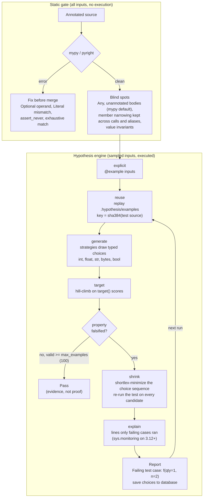

# Python Hypothesis and Type Checkers as Bug Prevention

> [!summary] Claim:
> A type checker proves that no execution can produce a type error of the kinds it models, and it proves it for all inputs at once, but it stops at `Any`, at unannotated code, and at narrowings it assumes survive a call or a write through an alias.
> Hypothesis proves nothing; it searches for an input that falsifies a property, then shrinks that input by shrinking the sequence of random choices that generated it, so the minimal example is always one the generator could have produced.
> The shrinker minimizes in shortlex order over that choice sequence and stops at a local minimum, which is why its report is small but not always the smallest.
> An expert runs both: the checker for the closed-world mistakes (a `None` reaching arithmetic, a missing enum case), and properties plus a `RuleBasedStateMachine` model for value and sequencing bugs that every type admits.



## The Mechanism

### What each tool can and cannot know

PEP 484 (2014, Python 3.5) added annotations and says that "Python will remain a dynamically typed language" and that no type checking happens at runtime.
A static checker reads annotations and control flow and computes, for each expression, a set of types that covers every execution.
If an operation is unsafe for any member of that set, it reports an error, so a clean result is a proof over all inputs, limited to the facts the type system can express.
`float` cannot express "finite", `list[int]` cannot express "sorted", and `int` cannot express "sums to the parent quantity".
Those facts are value invariants, and they are where property-based testing works.

Hypothesis executes the code on generated inputs and checks properties written as ordinary `assert` statements.
It cannot prove a property, but it can find a counterexample to one, and it hands back a reduced counterexample that is usually small enough to read.
The two techniques fail in opposite directions: the checker over-approximates and has false positives, while Hypothesis under-approximates and has false negatives.

### Hypothesis: the test is a parser of choices

MacIver and Donaldson describe the design in their ECOOP 2020 paper.
A random generator is a deterministic function of the bits it reads from a pseudo-random source, so they view "random generators as parsers of choice sequences".
Hypothesis applies test-case reduction internally, to that sequence, instead of to the generated value.
The paper states the consequence: because reduction works by re-generating, "any reduced test case is one that could have been generated".
That removes the test-case validity problem: if a strategy only builds sorted lists, every shrunk list is still sorted, with no hand-written shrinker.
The paper says internal reduction has been Hypothesis's only reducer "since early 2016".

The paper describes the sequence as bits.
Current Hypothesis records typed choices instead: `ChoiceT = int | str | bool | float | bytes` in `hypothesis/internal/conjecture/choice.py`, each stored in a `ChoiceNode` with its type and constraints.
The changelog dates the move: 6.103.0 (2024-05-29) "migrates the shrinker to our new internal representation, called the IR layer", and 6.123.2 (2024-12-27) says the shrinker "now uses the typed choice sequence ... when ordering failing examples".

### The reduction order: shortlex over choice indices

`sort_key` in `internal/conjecture/shrinker.py` defines "simpler": `x` is simpler than `y` if it is shorter, or if it has the same length and `map(choice_to_index, x)` is lexicographically smaller.
The paper calls this shortlex order and argues for it: fewer choices means fewer generation decisions, and earlier choices usually matter more, so they are minimized first.
`choice_to_index` maps each value to its rank within its constraints, with 0 as the simplest.
For integers the rank zigzags around `shrink_towards`, usually 0: an unbounded integer orders as `0, 1, -1, 2, -2, ...`, and a bounded range stops on each side at its bounds.
So shrinking toward the index-0 value is shrinking toward 0, the empty string, `False`, and the shortest collection.
The lab prints both halves of the rule: `sort_key` puts the one-choice sequence `[100]` before the two-choice sequence `[0, 0]`, and among sequences of equal length `[0, 3]` before `[1, 0]`.
The order is over indices, not values, which shows in reports: three distinct integers shrink to `-1, 0, 1`, the three lowest indices, not to `0, 1, 2`.

### Shrink passes and why the result is a local minimum

The `Shrinker` holds the best known failing choice sequence and runs shrink passes over it until none makes progress.
In 6.170.15 the pass list, in order, is `try_trivial_spans`, five `node_program` passes that delete runs of 5, 4, 3, 2, and 1 choices, `pass_to_descendant`, `reorder_spans`, `minimize_duplicated_choices`, `minimize_individual_choices`, `redistribute_numeric_pairs`, `lower_integers_together`, `lower_duplicated_characters`, `normalize_unicode_chars`, and `widen_to_span_with_recorded_value`.
A span is the range of choices drawn by one strategy call, so a span-level deletion removes a whole list element or a whole state-machine step.
Each candidate is a full re-execution of the test, and a candidate is accepted only if it still fails with the same exception type and location.
The source requires that "whether it makes progress must be deterministic", which lets the shrinker stop once every pass has made no progress.
That stopping rule gives a local minimum for every pass, not a global one; the paper says "in general the result will only be locally minimal".

The engine bounds the work in `internal/conjecture/engine.py`:
- `MAX_SHRINKS = 500` successful shrinks per failure.
- `MAX_SHRINKING_SECONDS = 300`, after which it prints a warning and reports the partly shrunk case.
- `max_stall` in `shrinker.py` starts at 200: that many test calls since the last successful shrink ends shrinking, and each successful shrink raises it to at least twice the calls that shrink needed.
- `BUFFER_SIZE = 8 * 1024` caps the entropy one test case may use; a draw past it is an overrun and the case is discarded.

### Generation: when the engine stops

`settings.max_examples` (default 100) counts valid test cases, not calls.
A case that calls `assume(False)` or fails a `.filter()` is invalid and does not count.
The engine gives up with `ExitReason.max_iterations` when invalid plus overrun cases exceed `INVALID_THRESHOLD_BASE + INVALID_PER_VALID * valid`, which evaluate to 458 and 100 in 6.170.15.
The source comment says the formula stops "once we're 99% confident the true valid rate is below 1%".
Separately, the `filter_too_much` health check fails a test whose strategy rejects too much during generation.
`HealthCheck` has seven members in 6.170.15: `data_too_large`, `filter_too_much`, `too_slow`, `large_base_example`, `function_scoped_fixture`, `differing_executors`, and `nested_given`.

Strategies compose with `.map`, `.filter`, `.flatmap`, `st.builds`, and `@st.composite`, and `st.data()` draws inside the test body when a draw depends on runtime state, as the lab's state machine does.
`target(observation)` feeds a finite number to the `target` phase, which tries to maximize it.
Its documentation says "the targeting effect is noticeable above" `max_examples=1000`, so it adds little at the default of 100.

### Phases, settings, and the example database

A run goes through six phases, in `Phase` order: `explicit` (`@example` inputs), `reuse` (replay saved failures), `generate`, `target` (mutate toward higher `target()` scores), `shrink`, and `explain`.
The `explain` phase traces which lines ran only in failing cases and prints them under `Explanation:`.
`internal/scrutineer.py` uses `sys.monitoring` with tool id 3 on Python 3.12 and later, and `sys.settrace` on older versions; [[Python-sys-monitoring-and-Tracing]] owns that mechanism.
Because it claims a monitoring tool slot, the explain phase skips itself when another tool already holds id 3.
The same phase varies each reported argument and appends `# or any other generated value` when the test kept failing; for a draw inside a state machine that comment can be wrong, as Step 2 of the Worked Lab Example shows.

Failures persist in a `DirectoryBasedExampleDatabase` under `.hypothesis/examples`, keyed by `function_digest(test)`.
`function_digest` hashes with sha384 the test's source with decorators, comments, blank lines, and trailing whitespace removed, plus its signature.
Adding an `@example` keeps the key; editing the body or the `def` line of the test changes it and orphans every saved failure.
A saved entry is the choice sequence, serialized by `choices_to_bytes` as one metadata byte per choice (type tag in the high three bits, payload size in the low five) followed by the payload.
A boolean is the metadata byte alone, and a payload of 31 bytes or more sets the size bits to `11111` and adds a ULEB128 length.
`@reproduce_failure(version, blob)` carries the same sequence: `encode_failure` zlib-compresses it when that is smaller, prefixes `\x00` or `\x01`, and base64-encodes it.
The blob only replays under the exact Hypothesis version that printed it.

Determinism and the database exclude each other.
`settings(derandomize=True)` seeds the generator from `function_digest(test)` and forces `database=None`; passing a database as well raises `InvalidArgument` ("derandomize=True implies database=None").
`@seed(n)` also sets `database=None` for the test, and `--hypothesis-seed` runs every test without a database key, so a seeded run neither replays nor saves.

When the `CI` environment variable is set to any value, or a vendor variable such as `GITHUB_ACTIONS=true`, `TF_BUILD=true`, `CIRCLECI=true`, or `GITLAB_CI` is present, Hypothesis loads its built-in `ci` profile.
Some of those variables are matched by value: `GITHUB_ACTIONS=1` does not select the profile, `GITHUB_ACTIONS=true` does.
That profile sets `derandomize=True`, `deadline=None`, `database=None`, `print_blob=True`, and suppresses `HealthCheck.too_slow`.
So on CI the same commit runs the same examples every time on one platform, nothing is saved between jobs, and every failure prints a `@reproduce_failure` line.
Across platforms the examples are not guaranteed equal: the lab's derandomized filter test discarded 8969 invalid cases on darwin-arm64 and 9061 on linux-aarch64 at identical versions, and the cause was not found (as of 2026-11).

The `deadline` (default 200 ms) is enforced with slack: during generation the limit is `deadline // 4 * 5`, 250 ms by default, and only the final replay uses the exact value.
If the final replay is fast, Hypothesis reports "Unreliable test timings!" and raises `FlakyFailure` instead of a deadline failure.
The deadline check is skipped for a thread when other threads overlap it, because the interpreter may switch away for an arbitrary time.

### Stateful testing: RuleBasedStateMachine

A property over one input cannot find a bug that needs a sequence of operations.
`hypothesis.stateful.RuleBasedStateMachine` turns the class into a generator of programs: each step chooses one applicable `@rule`, draws its arguments, and runs it, and every `@invariant` runs once after initialization and again after each step.
`@precondition(fn)` removes a rule from the choice while `fn(self)` is false, `@initialize` rules run once before any normal rule, and `Bundle` with `consumes()` passes values returned by one rule into later rules.
`stateful_step_count` (default 50) caps steps per program.
Because a step is a span in the choice sequence, the shrinker deletes whole steps and minimizes their arguments with the same passes it uses for any input.
The report is a Python program, `state = Machine()` followed by one line per step and `state.teardown()`, that can be pasted into a regression test.

The usual pattern is model-based testing: keep a trivially correct model (a `dict`, an `OrderedDict`, a sorted list) beside the system under test, apply each rule to both, and assert they agree.

### Type checkers: narrowing is flow analysis

A variable has a declared type, and at each program point the checker tracks a narrowed type that the control flow has proven.
mypy 2.4.1 and pyright 1.1.414 reveal the same narrowed types, each in its own notation, for `x is None`, `isinstance`, `issubclass`, `type(x) is C`, `callable(x)`, `==` against a `Literal`, `is` against an enum member, `len(x) == L` on a tuple union, a `Literal`-typed member that discriminates a union, truthiness, and a `TypeIs` guard; the lab's `forms.py` runs every one of them through both checkers (as of 2026-11).
They differ on containment.
For `v: str`, `if v in ("a", "b")` narrows `v` to `Literal['a', 'b']` in pyright and leaves it `str` in mypy.
For a union of two `TypedDict` types, `if "name" in v` narrows to the one that declares the key in pyright, while mypy keeps the whole union in that branch and narrows only the `else` branch.
The documentation lags the tools in both directions.
pyright's list of type guards does not mention `callable`, which pyright narrows on, and pyright's comparison page still lists `x == L` as a form "not currently supported by mypy", although mypy narrows the literal union.
mypy's documentation states its limit directly: it "will not track relationships between symbols", so `if a is not None or b is not None` narrows neither variable, and pyright behaves the same way on that code.
pyright documents one more boundary: inside a lambda or inner function a captured variable keeps its narrowed type only if it "is not modified on any code path after the inner-scope function or lambda is defined".

Narrowing applies to member-access chains such as `o.fill_price` as well as names, and that is the main soundness hole.
pyright's documentation lists member-access chains such as `a.foo.next` among the expressions that support narrowing, and says narrowing "is applied whenever a symbol is assigned a new value".
Both checkers apply that rule to an assignment written as `o.fill_price = None`: the next read is `None`, and arithmetic on it is an error.
Neither pyright's nor mypy's narrowing page documents what a call or a write through another name does to a narrowed member access, so the next two sentences rest on execution.
Both checkers keep `o.fill_price` narrowed to `float` after `o.reset()` sets it back to `None`, and after `alias.fill_price = None` where `alias` is the same object (mypy 2.4.1 and pyright 1.1.414, Linux and macOS, as of 2026-11).
Neither `mypy --strict` nor pyright's strict mode reports either one.

User-defined guards come in two forms:
- `TypeGuard[T]` (PEP 647, Python 3.10) narrows only the positive branch and does not require `T` to be a subtype of the input; the PEP says "it is not required that the return type be strictly narrower" and "the type is not narrowed in the negative case".
- `TypeIs[T]` (PEP 742, Python 3.13, mypy 1.10 and later) narrows the positive branch to the intersection of the argument type and `T`, the negative branch to the argument type minus `T`, and requires `T` to be consistent with the input type.

Exhaustiveness comes from narrowing to `Never`: after every member of an `Enum` or `Literal` union has been handled, the remaining type is empty, and `assert_never(x)` type-checks only if it is.
For `match` statements there is no `assert_never` call to fail, so the check needs a switch: mypy's optional `exhaustive-match` error code (added in mypy 1.17) or pyright's `reportMatchNotExhaustive`, which is `"none"` in standard mode and `"error"` in strict.

### Where checkers are silent by default

mypy's defaults favor gradual adoption:
- `check_untyped_defs` is false, so the body of an unannotated function is not checked at all.
- `warn_return_any` is false, so an `Any` from `json.loads` can flow into a `float` return.
- `--strict` turns on `--disallow-any-generics`, `--disallow-subclassing-any`, `--disallow-untyped-calls`, `--disallow-untyped-defs`, `--disallow-incomplete-defs`, `--check-untyped-defs`, `--disallow-untyped-decorators`, `--warn-redundant-casts`, `--warn-unused-ignores`, `--warn-return-any`, `--no-implicit-reexport`, `--strict-equality`, and `--extra-checks` (mypy 2.4.1 `--help`).
- `--strict` does not turn on `--warn-unreachable` or optional error codes such as `exhaustive-match`, `possibly-undefined`, `truthy-bool`, `redundant-expr`, and `ignore-without-code`.
- mypy 2.0 made `--local-partial-types` and `--strict-bytes` default.

pyright's `typeCheckingMode` is `off`, `basic`, `standard` (the default), or `strict`.
pyright always checks function bodies, but an unannotated parameter is `Unknown`, which behaves like `Any` until strict mode reports `reportUnknownParameterType` and `reportUnknownMemberType`.
A `# pyright: strict` comment applies strict mode to one file, and `"typeCheckingMode": "strict"` in a configuration file applies it to a project.
pyright's documentation also says `Any` "is not narrowed" except by `isinstance`, `issubclass`, class patterns, and user-defined guards.
An explicit `Any` is not `Unknown`: pyright's strict mode accepts `return json.loads(raw)["px"]` in a function declared to return `float`, where `mypy --strict` reports `no-any-return`.

### The two checkers are different programs

pyright's comparison page explains why they disagree: PEP 484 "intentionally leaves many other behaviors undefined", and pyright follows mypy only "unless there is a compelling justification for deviating".
Two documented differences are enough to make one file clean under one checker and an error under the other, in both directions.
For an unannotated variable, pyright infers "the union of all assigned types", while mypy "typically treats the first assignment ... as though it is an implicit type declaration", so `value = 1` followed by `value = "one"` is an error only in mypy.
For a function without a return annotation, pyright "infers the return type from `return` and `yield` statements", while mypy "never infers return types" and assumes `Any`, so returning that value from a function declared `-> int` is an error only in pyright.

### The bridge: strategies from annotations

`st.from_type(T)` and `st.builds(cls)` read annotations to build strategies.
For a frozen dataclass with `side: Literal["buy", "sell"]`, `qty: int`, and `limit: float | None`, `repr(st.from_type(Child))` on Hypothesis 6.170.15 is `builds(Child, limit=one_of(none(), floats()), qty=integers(), side=sampled_from(['sell', 'buy']))`.
So the annotations a checker trusts also drive the inputs Hypothesis tries, including the values an annotation admits but the author forgot: `floats()` draws NaN and infinities, and `integers()` draws negatives and very large values.
The `hypothesis write` ghostwriter (`pip install "hypothesis[cli]"`) emits starter property tests from a function's signature.
`settings.backend` (default `'hypothesis'`) selects the generator, and the `hypothesis[crosshair]` extra installs `hypothesis-crosshair` and `crosshair-tool` as an alternative backend, which this note did not run.

## Commands and Numbers to Know

`Both` means Linux and macOS.
The lab prints or exercises every Hypothesis, mypy, and pyright value in this table and passes on darwin-arm64 and linux-aarch64.
The `pytest --help` row, the changelog dates, and the PEP row come from sources that do not vary by platform, and Windows was not run.

| Item | Value | Platform |
| --- | --- | --- |
| `settings.max_examples` default | 100 valid test cases (as of 2026-11, Hypothesis 6.170.15) | Both |
| `settings.deadline` default | 200 ms; 250 ms during generation, exact on final replay (as of 2026-11) | Both |
| `settings.stateful_step_count` default | 50 (as of 2026-11) | Both |
| `settings.derandomize` default | `False`; `True` under the `ci` profile; `True` forces `database=None` (as of 2026-11) | Both |
| `ci` profile trigger | `CI` set to any value, or vendor variables such as `GITHUB_ACTIONS=true`, `TF_BUILD=true`, `CIRCLECI=true`, `GITLAB_CI` (as of 2026-11) | Both |
| `ci` profile values | `derandomize=True`, `deadline=None`, `database=None`, `print_blob=True`, suppress `too_slow` (as of 2026-11) | Both |
| Database location | `.hypothesis/examples`; `HYPOTHESIS_STORAGE_DIRECTORY=DIR` replaces `.hypothesis`, giving `DIR/examples` (as of 2026-11) | Both |
| Database key | sha384 (48 bytes) of cleaned test source plus signature (as of 2026-11) | Both |
| `MAX_SHRINKS` | 500 successful shrinks per failure (as of 2026-11) | Both |
| `MAX_SHRINKING_SECONDS` | 300 s (as of 2026-11) | Both |
| `BUFFER_SIZE` | `8 * 1024` (unit undefined by design) (as of 2026-11) | Both |
| Invalid-case cap | invalid + overrun > 458 + 100 * valid gives `max_iterations` (as of 2026-11) | Both |
| `pytest --hypothesis-show-statistics` | per-phase pass, fail, invalid counts and stop reason (as of 2026-11) | Both |
| `pytest --hypothesis-seed=N`, `--hypothesis-profile=NAME`, `--hypothesis-verbosity=LEVEL`, `--hypothesis-explain` | plugin options listed by `pytest --help` (as of 2026-11) | Both |
| Native code in Hypothesis | Rust extension since 6.156.0 (2026-07-01); Rust toolchain needed only to build from source (as of 2026-11) | Both |
| `mypy --strict` | 13 flags listed by `mypy --help`; excludes `--warn-unreachable` and optional codes (as of 2026-11, mypy 2.4.1) | Both |
| `mypy --enable-error-code exhaustive-match` | non-exhaustive `match` becomes an error; since mypy 1.17 (as of 2026-11) | Both |
| mypy `check_untyped_defs`, `warn_return_any`, `warn_unreachable` | default `False` (as of 2026-11) | Both |
| mypy `strict_optional`, `local_partial_types`, `strict_bytes` | default `True` (as of 2026-11) | Both |
| pyright `typeCheckingMode` | `off`, `basic`, `standard` (default), `strict` (as of 2026-11, pyright 1.1.414) | Both |
| pyright `reportMatchNotExhaustive`, `reportUnnecessaryComparison`, `reportUnknownMemberType`, `reportUnknownParameterType` | `"none"` in standard, `"error"` in strict (as of 2026-11) | Both |
| `TypeIs` | PEP 742, `typing` in 3.13, `typing_extensions` before; mypy 1.10+ (as of 2026-11) | Both |

## Multi-Language Comparison

| Concern | Python | C++ | Rust |
| --- | --- | --- | --- |
| Property-based testing | Hypothesis: shrinks the choice sequence, so shrinking is automatic and respects generator constraints | RapidCheck: QuickCheck-inspired, automatic shrinking, Google Test and Boost Test integration | proptest: per-strategy shrinking that "do[es] not generate or shrink to values that violate" simple constraints; `quickcheck` crate shrinks by value |
| Stateful or model testing | `RuleBasedStateMachine`, rules, invariants, bundles | RapidCheck commands "in the vein of Erlang QuickCheck" | A hand-written model loop over a generated `Vec` of operations; Loom for concurrency permutations, see [[Rust-Miri-Sanitizers-Loom-and-Cargo-Fuzz]] |
| Coverage-guided fuzzing | Hypothesis `fuzz_one_input` for external fuzzers | libFuzzer and AFL++, see [[Cpp-Clang-Tidy-Static-Analyzer-and-Fuzzing-libFuzzer-AFLPlusPlus]] | cargo-fuzz, see [[Rust-Miri-Sanitizers-Loom-and-Cargo-Fuzz]] |
| Static type safety | Optional, external checkers (mypy, pyright); annotations unenforced at runtime | Compiler-enforced types; clang-tidy and the Static Analyzer for flow bugs | Compiler-enforced types and ownership; Clippy, see [[Rust-Borrow-Checker-Trait-Errors-Cargo-Expand-and-Clippy]] |
| Null safety | `X \| None` plus `strict_optional` (default on) and narrowing | None by default; `std::optional` unchecked on `*` | `Option<T>` enforced by the compiler |
| Exhaustiveness | `assert_never`, mypy `exhaustive-match`, pyright `reportMatchNotExhaustive` | `-Wswitch` for enums | `match` must be exhaustive |

## Worked Lab Example

The lab is `code/03-Debugging/hypothesis_and_type_checkers/`; it needs `uv` and network access to PyPI, so its `run.sh` declares `# requires: network` and runs only with `TOOLCHAIN_LABS_NETWORK=1`.

```bash
cd code
TOOLCHAIN_LABS_NETWORK=1 make verify LAB=03-Debugging/hypothesis_and_type_checkers/
```

`run.sh` builds a throwaway virtualenv on uv's managed CPython 3.14.6 and installs `requirements.txt` with `--require-hashes`: hypothesis 6.170.15, pytest 9.2.0, mypy 2.4.1, and pyright 1.1.414, whose wheels carry pyright's JavaScript bundle and a Node.js runtime.
The interpreter is pinned to the patch release because the output quotes CPython's own error messages.
It copies the sources to a temporary directory and starts `lab.py` under `env -i`, because a leaked `CI` variable would switch Hypothesis to its `ci` profile and change the output.
`lab.py` runs pytest, mypy, and pyright on the sources, strips the temporary path from what they print, replaces the no-break spaces pyright indents with, and exits non-zero if a tool exits with a code the lab does not expect.
Every Hypothesis test that prints a counterexample or a count sets `derandomize=True` and `deadline=None`, so a run depends on the Hypothesis version, the source, and the platform, and never on timing.
`db_key.py` is the exception, because `derandomize=True` forbids the database it demonstrates; it prints only results that hold for any seed.

The lab's properties are of four kinds: a conserved quantity (Step 1), a strategy's own constraint, agreement with a model (Step 2), and an annotation checked as a runtime postcondition (Step 4).

### Verified output

Recorded by `make record` on darwin-arm64 (macOS 27.2) on 2026-11-11 and re-checked by `make verify`; the file is `code/03-Debugging/hypothesis_and_type_checkers/expected/darwin-arm64.txt`.
Every `text` block in this section is an excerpt of that file.
A second recording, `expected/linux-aarch64.txt`, was made the same day in an Ubuntu 24.04 container and differs from it only in the invalid-case count and its percentage in the filtering section.

### Step 1: a value invariant no type can express

```python
# test_split.py
from hypothesis import given, settings, strategies as st


def split_order(qty: int, n: int) -> list[int]:
    """Split qty shares into n child orders whose sizes differ by at most 1."""
    base = qty // n
    return [base] * n  # bug: drops the remainder qty % n


@settings(derandomize=True, deadline=None)
@given(qty=st.integers(min_value=0, max_value=10**6), n=st.integers(min_value=1, max_value=50))
def test_split_conserves_quantity(qty: int, n: int) -> None:
    parts = split_order(qty, n)
    assert len(parts) == n
    assert sum(parts) == qty
    assert max(parts) - min(parts) <= 1
```

mypy and pyright both accept this file: every expression is a correct `int` or `list[int]`.
pytest reports (darwin-arm64):

```text
$ python -m pytest -q -p no:cacheprovider test_split.py
test_split_conserves_quantity:
E       assert 0 == 1
E        +  where 0 = sum([0, 0])
E       Failing test case: test_split_conserves_quantity(
E           qty=1,
E           n=2,
E       )
result: 1 failed
$ CI=1 python -m pytest -q -p no:cacheprovider test_split.py
E       You can reproduce this test case by temporarily adding @reproduce_failure('6.170.15', b'AEEBQQI=') as a decorator on your test function
```

`qty=1, n=2` is the global shortlex minimum: `qty=0` and `n=1` never fail, so 1 and 2 are the lowest-index failing values.
With `CI=1` the same run also prints the `@reproduce_failure` line.
`hypothesis.core.decode_failure(b'AEEBQQI=')` returns `(1, 2)`: the blob is `\x00` (uncompressed) then `0x41 0x01` and `0x41 0x02`, each an integer tag (`2 << 5`) with payload size 1.
The choice sequence is the two integers the strategies drew, nothing else.

A second property shows that shrinking never leaves the strategy's domain.

```python
# test_sorted.py
from hypothesis import given, settings, strategies as st

sorted_lists = st.lists(st.integers()).map(sorted)


@settings(derandomize=True, deadline=None)
@given(sorted_lists)
def test_fewer_than_three_distinct(xs: list[int]) -> None:
    assert xs == sorted(xs)  # the strategy's own constraint, checked on every shrink candidate too
    assert len(set(xs)) < 3
```

```text
$ python -m pytest -q -p no:cacheprovider test_sorted.py
test_fewer_than_three_distinct:
E       assert 3 < 3
E        +  where 3 = len({-1, 0, 1})
E        +    where {-1, 0, 1} = set([-1, 0, 1])
E       Failing test case: test_fewer_than_three_distinct(
E           xs=[-1, 0, 1],
E       )
result: 1 failed
```

The first assertion re-checks sortedness on every candidate the shrinker tries, and it never fires: the only failure is the second assertion (darwin-arm64).
The reported list is `[-1, 0, 1]` and not `[0, 1, 2]`, because the shrinker minimized the three integer choices to the three lowest indices, 0, 1, and -1, and `.map(sorted)` then ordered them.

### Step 2: a bug that needs a sequence, found by a model

```python
# test_lru.py
from collections import OrderedDict

from hypothesis import settings, strategies as st
from hypothesis.stateful import RuleBasedStateMachine, invariant, precondition, rule


class LRUCache:
    """Bounded cache that evicts the least recently used key."""

    def __init__(self, capacity: int) -> None:
        self.capacity = capacity
        self.data: dict[int, int] = {}
        self.order: list[int] = []  # least recently used first

    def get(self, key: int) -> int | None:
        if key not in self.data:
            return None
        self.order.remove(key)
        self.order.append(key)
        return self.data[key]

    def put(self, key: int, value: int) -> None:
        if len(self.data) >= self.capacity:  # bug: evicts even when key is already present
            victim = self.order.pop(0)
            del self.data[victim]
        if key in self.data:
            self.order.remove(key)
        self.data[key] = value
        self.order.append(key)


CAPACITY = 2
keys = st.integers(min_value=0, max_value=3)


class LRUModel(RuleBasedStateMachine):
    def __init__(self) -> None:
        super().__init__()
        self.cache = LRUCache(CAPACITY)
        self.model: OrderedDict[int, int] = OrderedDict()

    @rule(key=keys, value=st.integers())
    def put(self, key: int, value: int) -> None:
        self.cache.put(key, value)
        self.model[key] = value
        self.model.move_to_end(key)
        if len(self.model) > CAPACITY:
            self.model.popitem(last=False)

    @precondition(lambda self: len(self.model) > 0)
    @rule(data=st.data())
    def get_present(self, data: st.DataObject) -> None:
        key = data.draw(st.sampled_from(sorted(self.model)))
        assert self.cache.get(key) == self.model[key]
        self.model.move_to_end(key)

    @invariant()
    def same_keys(self) -> None:
        assert set(self.cache.data) == set(self.model)


LRUModel.TestCase.settings = settings(derandomize=True, deadline=None)
TestLRU = LRUModel.TestCase
```

The failure report (darwin-arm64):

```text
$ python -m pytest -q -p no:cacheprovider test_lru.py
TestLRU.runTest:
E       assert {0} == {0, 1}
E         Extra items in the right set:
E         1
E         Use -v to get more diff
E       Failing test case: <state machine>
E       state = LRUModel()
E       state.same_keys()
E       state.put(key=0, value=0)
E       state.same_keys()
E       state.put(key=1, value=0)
E       state.same_keys()
E       Draw 1: 0  # or any other generated value
E       state.get_present(data=data(...))
E       state.same_keys()
E       state.put(key=0, value=0)
E       state.same_keys()
E       state.teardown()
result: 1 failed
```

Read it as a program: after `get(0)` the least recently used key is 1, so re-putting key 0 into a full cache wrongly evicts 1.
`replay_lru.py` replays that program and four variations of it against `LRUCache` and the model, outside Hypothesis (darwin-arm64):

```text
$ python replay_lru.py
reported: put(0) put(1) get(0) put(0): invariant fails at step 4: cache [0], model [0, 1]
get(1) in place of get(0): invariant holds
reported without the get: invariant holds
reported with the last key 1: invariant holds
shorter: put(0) put(1) put(1): invariant fails at step 3: cache [1], model [0, 1]
```

The shrinker cannot delete the `get` step: without it, the eviction victim is key 0 itself, which is then re-inserted, and the invariant holds.
It cannot change the last key from 0 to 1 either: with the `get` still present, key 1 is then both the victim and the key re-inserted, and the invariant holds again.
Yet `put(0), put(1), put(1)` is a shorter failing program (re-putting key 1 evicts key 0).
Reaching it needs two coordinated changes, so no single pass makes progress: this is the local minimum the paper warns about.
Treat a shrunk report as small and valid, not as the unique smallest cause; [[Scientific-Debugging-Delta-Debugging-and-Heisenbugs]] owns the general theory of minimization.

The `# or any other generated value` comment on `Draw 1` is wrong for this program: with `get(1)` in place of `get(0)` the invariant holds.
`explain_overrun.py` wraps `Shrinker._explain` and counts what the explain phase saw when it varied that draw (darwin-arm64):

```text
$ python explain_overrun.py
Draw 1 = 0, extended with fresh choices: INTERESTING x100
Draw 1 = 1, exact replay: OVERRUN x111
Draw 1 = 1, extended with fresh choices: INTERESTING x111
comment attached: ['or any other generated value']
```

With the draw set to 1 the machine no longer fails at step 4, so when the engine is allowed to extend the sequence with fresh choices the machine runs further steps and fails later, and the exact replay of the recorded sequence runs out of choices and ends as `OVERRUN`.
`_explain` skips an `OVERRUN` result and clears the comment only on a `VALID` one, so it never observes the passing variation, and the 100 failing runs with the draw at 0 attach the comment.
A passing variation of a state-machine draw cannot be `VALID` here, because the recorded sequence of a failing program ends at the failure and holds no choice that stops the machine.
Check an explain-phase comment on a state-machine draw by replaying the program before relying on it (as of 2026-11, Hypothesis 6.170.15).

### Step 3: what the checkers catch

```python
# narrow.py
from enum import Enum
from typing import TypeGuard, TypeIs, assert_never, reveal_type


def notional(prices: dict[str, float], symbol: str, qty: int) -> float:
    return prices.get(symbol) * qty  # None is a possible value


def is_str_guard(x: object) -> TypeGuard[str]:
    return isinstance(x, str)


def is_str_is(x: object) -> TypeIs[str]:
    return isinstance(x, str)


def guards(v: int | str) -> None:
    if is_str_guard(v):
        reveal_type(v)
    else:
        reveal_type(v)
    if is_str_is(v):
        reveal_type(v)
    else:
        reveal_type(v)


class Side(Enum):
    BUY = 1
    SELL = 2
    SHORT = 3


def sign(side: Side) -> int:
    if side is Side.BUY:
        return 1
    elif side is Side.SELL:
        return -1
    else:
        assert_never(side)
```

mypy with default settings reports (darwin-arm64):

```text
-- mypy narrow.py
narrow.py:7: error: Unsupported operand types for * ("None" and "int")  [operator]
narrow.py:7: note: Left operand is of type "float | None"
narrow.py:20: note: Revealed type is "str"
narrow.py:22: note: Revealed type is "int | str"
narrow.py:24: note: Revealed type is "str"
narrow.py:26: note: Revealed type is "int"
narrow.py:41: error: Argument 1 to "assert_never" has incompatible type "Literal[Side.SHORT]"; expected "Never"  [arg-type]
```

pyright in standard mode reports the same two errors under its own rule names, and the same four revealed types (darwin-arm64):

```text
-- pyright narrow.py
narrow.py:7:12 - error: Operator "*" not supported for "None" (reportOptionalOperand)
narrow.py:20:21 - information: Type of "v" is "str"
narrow.py:22:21 - information: Type of "v" is "int | str"
narrow.py:24:21 - information: Type of "v" is "str"
narrow.py:26:21 - information: Type of "v" is "int"
narrow.py:41:22 - error: Argument of type "Literal[Side.SHORT]" cannot be assigned to parameter "arg" of type "Never" in function "assert_never"
  Type "Literal[Side.SHORT]" is not assignable to type "Never" (reportArgumentType)
```

The else branch of the `TypeGuard` keeps `int | str`, while the else branch of the `TypeIs` narrows to `int`.

### Step 4: what both checkers miss

```python
# orders.py
class Order:
    def __init__(self) -> None:
        self.fill_price: float | None = None

    def reset(self) -> None:
        self.fill_price = None


def after_assignment(o: Order, ref: float) -> float:
    if o.fill_price is not None:
        o.fill_price = None  # assignment to the narrowed expression itself
        return o.fill_price - ref
    return 0.0


def after_call(o: Order, ref: float) -> float:
    if o.fill_price is not None:
        o.reset()  # the same write, made through self inside a method
        return o.fill_price - ref
    return 0.0


def after_alias(o: Order, ref: float) -> float:
    alias = o
    if o.fill_price is not None:
        alias.fill_price = None  # the same write, made through another name
        return o.fill_price - ref
    return 0.0


def through_local(o: Order, ref: float) -> float:
    fill_price = o.fill_price
    if fill_price is not None:
        o.reset()
        return fill_price - ref  # no call can rebind a local
    return 0.0
```

The four functions make the same mistake or avoid it in four ways, and the checkers see only the first (darwin-arm64):

```text
-- mypy orders.py
orders.py:13: error: Unsupported operand types for - ("None" and "float")  [operator]
-- mypy --strict orders.py
orders.py:13: error: Unsupported operand types for - ("None" and "float")  [operator]
-- pyright orders.py
orders.py:13:16 - error: Operator "-" not supported for types "None" and "float" (reportOperatorIssue)
-- pyright -p pyrightconfig.strict.json orders.py
orders.py:13:16 - error: Operator "-" not supported for types "None" and "float" (reportOperatorIssue)
orders.py:13:16 - error: Return type is unknown (reportUnknownVariableType)
```

Line 13 is the subtraction in `after_assignment`, where the assignment to `o.fill_price` replaced the narrowed type.
Lines 20 and 28, the same subtraction after `o.reset()` and after the write through `alias`, are accepted in default and strict modes.
pyright's second strict diagnostic on line 13 follows from the first, since the rejected operator leaves the result type unknown.

A property test checks the annotation at run time:

```python
# test_orders.py
from collections.abc import Callable

from hypothesis import given, settings, strategies as st

from orders import Order, after_alias, after_call, through_local

finite = st.floats(allow_nan=False, allow_infinity=False)
cases = given(fill=st.none() | finite, ref=finite)


def returns_float(slippage: Callable[[Order, float], float], fill: float | None, ref: float) -> None:
    o = Order()
    o.fill_price = fill
    assert isinstance(slippage(o, ref), float)


@settings(derandomize=True, deadline=None)
@cases
def test_after_call(fill: float | None, ref: float) -> None:
    returns_float(after_call, fill, ref)


@settings(derandomize=True, deadline=None)
@cases
def test_after_alias(fill: float | None, ref: float) -> None:
    returns_float(after_alias, fill, ref)


@settings(derandomize=True, deadline=None)
@cases
def test_through_local(fill: float | None, ref: float) -> None:
    returns_float(through_local, fill, ref)
```

```text
$ python -m pytest -q -p no:cacheprovider test_orders.py
test_after_call:
E           TypeError: unsupported operand type(s) for -: 'NoneType' and 'float'
E           Failing test case: test_after_call(
E               fill=0.0,
E               ref=0.0,  # or any other generated value
E           )
E           Explanation:
E               These lines were always and only run by failing test cases:
E                   orders.py:19
test_after_alias:
E           TypeError: unsupported operand type(s) for -: 'NoneType' and 'float'
E           Failing test case: test_after_alias(
E               fill=0.0,
E               ref=0.0,  # or any other generated value
E           )
E           Explanation:
E               These lines were always and only run by failing test cases:
E                   orders.py:27
result: 2 failed, 1 passed
```

Both unsafe functions fail with `fill=0.0`, and `through_local` passes (darwin-arm64).
The `# or any other generated value` comment comes from the explain phase: it varied `ref` and the test still failed, so `ref` is irrelevant to the bug.
`Explanation:` names line 19, the `o.reset()` call, although the `TypeError` is raised on line 20.
Lines 19, 7 (the body of `reset`), and 20 all ran only in failing cases; `get_explaining_locations` in `internal/scrutineer.py` reports only the first such line on each path from the start of the test.

### Step 5: make exhaustiveness a gate

```python
# match_ex.py
from enum import Enum


class Side(Enum):
    BUY = 1
    SELL = 2
    SHORT = 3


def route(side: Side, log: list[str]) -> None:
    match side:
        case Side.BUY:
            log.append("bid")
        case Side.SELL:
            log.append("ask")
```

```text
-- mypy match_ex.py
(no diagnostics)
-- mypy --strict match_ex.py
(no diagnostics)
-- mypy --enable-error-code exhaustive-match match_ex.py
match_ex.py:12: error: Match statement has unhandled case for values of type "Literal[Side.SHORT]"  [exhaustive-match]
match_ex.py:12: note: If match statement is intended to be non-exhaustive, add `case _: pass`
-- pyright match_ex.py
(no diagnostics)
-- pyright -p pyrightconfig.strict.json match_ex.py
match_ex.py:12:11 - error: Cases within match statement do not exhaustively handle all values
  Unhandled type: "Literal[Side.SHORT]"
  If exhaustive handling is not intended, add "case _: pass" (reportMatchNotExhaustive)
```

`mypy`, `mypy --strict`, and pyright in standard mode all accept the missing `Side.SHORT` case (darwin-arm64).
mypy needs the optional `exhaustive-match` code, and pyright needs strict mode or `reportMatchNotExhaustive` set to `"error"`.

### Narrowing forms, unannotated code, and guards

`forms.py` holds one function per narrowing form; `lab.py` prints the type each checker reveals in the `if` branch and in the `else` branch.
The four forms where the checkers' answers are worth comparing (darwin-arm64):

```text
by_in
  mypy     str
  pyright  Literal['a', 'b']
by_len
  mypy     tuple[int] ; tuple[int, int]
  pyright  tuple[int] ; tuple[int, int]
by_member
  mypy     forms.A ; forms.B
  pyright  A ; B
by_key
  mypy     TypedDict(forms.Named, {'name': str}) | TypedDict(forms.Numbered, {'number': int}) ; TypedDict(forms.Numbered, {'number': int})
  pyright  Named ; Numbered
```

`untyped.py` holds `def untyped(): return "a" + 1` and `def untyped_param(x): return x.no_such_method() + 1`, and `any_flow.py` returns `json.loads(raw)["px"]` from a function declared `-> float` (darwin-arm64):

```text
-- mypy untyped.py
(no diagnostics)
-- mypy --check-untyped-defs untyped.py
untyped.py:3: error: Unsupported operand types for + ("str" and "int")  [operator]
-- mypy --strict untyped.py
untyped.py:2: error: Function is missing a return type annotation  [no-untyped-def]
untyped.py:3: error: Unsupported operand types for + ("str" and "int")  [operator]
untyped.py:6: error: Function is missing a type annotation  [no-untyped-def]
-- pyright untyped.py
untyped.py:3:12 - error: Operator "+" not supported for types "Literal['a']" and "Literal[1]" (reportOperatorIssue)
-- pyright -p pyrightconfig.strict.json untyped.py
untyped.py:2:5 - error: Return type is unknown (reportUnknownParameterType)
untyped.py:3:12 - error: Operator "+" not supported for types "Literal['a']" and "Literal[1]" (reportOperatorIssue)
untyped.py:3:12 - error: Return type is unknown (reportUnknownVariableType)
untyped.py:6:5 - error: Return type is unknown (reportUnknownParameterType)
untyped.py:6:19 - error: Type of parameter "x" is unknown (reportUnknownParameterType)
untyped.py:6:19 - error: Type annotation is missing for parameter "x" (reportMissingParameterType)
untyped.py:7:12 - error: Type of "no_such_method" is unknown (reportUnknownMemberType)
untyped.py:7:12 - error: Return type is unknown (reportUnknownVariableType)
-- mypy any_flow.py
(no diagnostics)
-- mypy --strict any_flow.py
any_flow.py:6: error: Returning Any from function declared to return "float"  [no-any-return]
-- pyright any_flow.py
(no diagnostics)
-- pyright -p pyrightconfig.strict.json any_flow.py
(no diagnostics)
```

`guards.py` declares `looks_numeric(x: str) -> TypeGuard[int]`, the same signature with `TypeIs[int]` on line 9, and `add_one`, which returns `s + 1` after the `TypeGuard` narrowed `s: str` to `int`.
`disagree.py` assigns `1` and then `"one"` to an unannotated variable (line 5), and returns the result of an unannotated function that returns `1` or `"one"` from a function declared `-> int` (line 16) (darwin-arm64):

```text
-- mypy guards.py
guards.py:9: error: Narrowed type "int" is not a subtype of input type "str"  [narrowed-type-not-subtype]
-- pyright guards.py
guards.py:9:33 - error: Return type of TypeIs ("int") is not consistent with value parameter type ("str") (reportGeneralTypeIssues)

== where the two checkers disagree: disagree.py ==
-- mypy disagree.py
disagree.py:5: error: Incompatible types in assignment (expression has type "str", variable has type "int")  [assignment]
-- pyright disagree.py
disagree.py:16:12 - error: Type "Literal[1, 'one']" is not assignable to return type "int"
  Type "Literal[1, 'one']" is not assignable to type "int"
    "Literal['one']" is not assignable to "int" (reportReturnType)

== what the checkers accepted, at run time: runtime_facts.py ==
any_flow.price('{"px": "1.5"}') returned str '1.5'
guards.add_one("41") raised TypeError: can only concatenate str (not "int") to str
test_filter_unbounded: 100 valid cases, 39 distinct values, 0 drawn 16 times
```

Only the `TypeIs` declaration is rejected; the `TypeGuard` and the `s + 1` it enables pass both checkers and fail at run time.
Each checker reports one line of `disagree.py` that the other accepts.
The last three lines come from `runtime_facts.py`, which calls what the checkers accepted: `price` returns a `str` where `float` is declared, `add_one` raises, and the 100 valid cases of the filtered strategy hold 39 distinct values.

### Filtering and the example database

`test_filter.py` runs the same assertion over three strategies: `st.integers().filter(lambda x: x % 1000 == 0)`, the same filter on `st.integers(min_value=1)`, and `st.integers().map(lambda k: k * 1000)` (darwin-arm64):

```text
$ python -m pytest -q -p no:cacheprovider --hypothesis-show-statistics test_filter.py
E   hypothesis.errors.FailedHealthCheck: It looks like this test is filtering out a lot of inputs. 0 inputs were generated successfully, while 50 inputs were filtered out.
test_filter.py::test_filter_unbounded:
    - 100 passing, 0 failing, and 8969 invalid test cases
      * 98.90%, gave up because: Aborted test because unable to satisfy integers().filter(lambda x: x % 1000 == 0)
  - Stopped because settings.max_examples=100
test_filter.py::test_map_constructs:
    - 100 passing, 0 failing, and 0 invalid test cases
  - Stopped because settings.max_examples=100
result: 1 failed, 2 passed
```

`db_key.py` computes `function_digest` for five variants of one test, then saves a failure in an `InMemoryExampleDatabase` and replays each variant with only the `reuse` phase enabled (darwin-arm64):

```text
key: 48 bytes
base: key same
comment and blank line added: key same
@example added: key same
body edited: key different
def line edited: key different
generate and shrink under @seed(0), base: fails
keys in the database: 0
generate and shrink, base: fails
entry saved under the base key: ['42 03 e8']
reuse phase only, base: fails
reuse phase only, comment and blank line added: fails
reuse phase only, @example added: fails
reuse phase only, body edited: no test case ran
reuse phase only, def line edited: no test case ran
```

The saved entry `42 03 e8` is the minimal counterexample 1000: metadata byte `0x42` is the integer tag with payload size 2, and `0x03e8` is 1000.
The variants that keep the key replay the failure without generating anything, and the two whose key changed run no test case at all.

### Engine constants, profiles, and mypy defaults

`engine_facts.py` reads the numbers this note quotes from the installed Hypothesis, and `lab.py` then starts one interpreter per environment variable to show which profile it selects (darwin-arm64):

```text
phases: explicit, reuse, generate, target, shrink, explain
health checks: data_too_large, filter_too_much, too_slow, large_base_example, function_scoped_fixture, differing_executors, nested_given
default profile: max_examples=100 deadline=0:00:00.200000 stateful_step_count=50 derandomize=False database=.hypothesis/examples print_blob=False suppress_health_check=[]
ci profile: max_examples=100 deadline=None stateful_step_count=50 derandomize=True database=None print_blob=True suppress_health_check=['too_slow']
settings(derandomize=True).database: None
derandomize=True with a database: InvalidArgument
deadline during generation: deadline // 4 * 5 = 0:00:00.250000
MAX_SHRINKS: 500
MAX_SHRINKING_SECONDS: 300
BUFFER_SIZE: 8192
INVALID_THRESHOLD_BASE, INVALID_PER_VALID: 458 100
max_stall at start: 200
shrink passes (15): try_trivial_spans, node_program(X*5), node_program(X*4), node_program(X*3), node_program(X*2), node_program(X*1), pass_to_descendant, reorder_spans, minimize_duplicated_choices, minimize_individual_choices, redistribute_numeric_pairs, lower_integers_together, lower_duplicated_characters, normalize_unicode_chars, widen_to_span_with_recorded_value
explain phase sys.monitoring tool id: 3
ChoiceT: int | str | bool | float | bytes
unbounded integers, simplest first: [0, 1, -1, 2, -2]
integers(1, 50) index of 1, 2, 50: [0, 1, 49]
sort_key of [100]: (1, (199,))
sort_key of [0, 0]: (2, (0, 0))
sort_key of [0, 3]: (2, (0, 5))
sort_key of [1, 0]: (2, (1, 0))
choices_to_bytes([1, 2]): 41 01 41 02
choices_to_bytes([True, False]): 01 00
choices_to_bytes(['a' * 31]) first two bytes: 9f 1f
encode_failure([1, 2]): b'AEEBQQI='
base64-decoded: 00 41 01 41 02
decode_failure(b'AEEBQQI='): (1, 2)
from_type(Child): builds(Child, limit=one_of(none(), floats()), qty=integers(), side=sampled_from(['sell', 'buy']))
no CI variable: derandomize=False deadline=0:00:00.200000 database=directory print_blob=False
CI=1: derandomize=True deadline=None database=None print_blob=True
GITHUB_ACTIONS=true: derandomize=True deadline=None database=None print_blob=True
GITHUB_ACTIONS=1: derandomize=False deadline=0:00:00.200000 database=directory print_blob=False
GITLAB_CI=1: derandomize=True deadline=None database=None print_blob=True
TF_BUILD=true: derandomize=True deadline=None database=None print_blob=True
HYPOTHESIS_STORAGE_DIRECTORY=elsewhere: database at elsewhere/examples
```

`mypy_defaults.py` and `mypy --help` give the mypy side (darwin-arm64):

```text
--strict enables 13 flags: --disallow-any-generics --disallow-subclassing-any --disallow-untyped-calls --disallow-untyped-defs --disallow-incomplete-defs --check-untyped-defs --disallow-untyped-decorators --warn-redundant-casts --warn-unused-ignores --warn-return-any --no-implicit-reexport --strict-equality --extra-checks
defaults: check_untyped_defs=False warn_return_any=False warn_unreachable=False strict_optional=True local_partial_types=True strict_bytes=True
error codes enabled by default: exhaustive-match=False possibly-undefined=False truthy-bool=False redundant-expr=False ignore-without-code=False
```

### Controls

`lab.py` ends by patching one line of `test_split.py` and one line of `test_lru.py` and running the same properties again (darwin-arm64):

```text
test_split.py with the fix: 1 passed
test_lru.py with the fix: 1 passed
```

The split fix returns `[base + 1] * (qty % n) + [base] * (n - qty % n)`, and the cache fix evicts only when `key not in self.data`.
So each failure in Steps 1 and 2 is caused by the marked line, and the properties pass on correct code.

## Pitfalls

> [!warning] Pitfall 1: Trusting member-access narrowing across a call or an alias
> Both mypy 2.4.1 and pyright 1.1.414 keep `o.fill_price` narrowed to `float` after a method call that sets it to `None`, and after a write through another name for the same object, in default and strict modes.
> Copy the attribute into a local (`fill_price = o.fill_price`) before the check, so the narrowing applies to a name that no call can rebind, and cover state transitions with a property or a state machine.

> [!warning] Pitfall 2: Believing mypy checked an unannotated function
> With the default `check_untyped_defs = False`, mypy 2.4.1 skips the body of `def untyped(): return "a" + 1` entirely; `--check-untyped-defs` reports `Unsupported operand types for + ("str" and "int")`.
> `--check-untyped-defs` alone still accepts `def untyped_param(x): return x.no_such_method() + 1`, because the unannotated `x` is `Any`; only `disallow_untyped_defs` (in `--strict`) rejects that function, with `no-untyped-def`.
> Turn on `--strict` for new packages, and use `disallow_untyped_defs` per module to ratchet old ones.

> [!warning] Pitfall 3: `--strict` is not "everything on"
> `mypy --strict` omits `--warn-unreachable` and every optional error code, including `exhaustive-match`, `possibly-undefined`, and `truthy-bool`.
> The lab's non-exhaustive `match` passed `mypy --strict` and pyright standard mode; enable the codes explicitly in `pyproject.toml`.
> pyright's strict mode has its own gap: it accepted an explicit `Any` from `json.loads` returned as `float`, and the function returned the `str` `'1.5'` at run time.

> [!warning] Pitfall 4: `TypeGuard` that lies
> `def looks_numeric(x: str) -> TypeGuard[int]` is accepted, because PEP 647 does not require the guarded type to be narrower than the input, and it then narrows a `str` to `int`.
> Both checkers then accept `s + 1` on that `str`, and `add_one("41")` raises `TypeError: can only concatenate str (not "int") to str`.
> The same signature with `TypeIs[int]` is rejected by mypy (`narrowed-type-not-subtype`) and pyright (`reportGeneralTypeIssues`); prefer `TypeIs` when the narrowed type is a subtype of the input.

> [!warning] Pitfall 5: Filtering instead of constructing
> `st.integers().filter(lambda x: x % 1000 == 0)` rejects almost every draw, and the test still passes.
> In the lab it reached 100 valid cases only after 8969 invalid ones on darwin-arm64 (9061 on linux-aarch64), and those 100 cases held only 39 distinct values, with 0 drawn 16 times (as of 2026-11, Hypothesis 6.170.15).
> The same filter on `st.integers(min_value=1)` failed the `filter_too_much` health check after 50 rejected inputs and no valid one; only `--hypothesis-show-statistics` exposes the silent case.
> Build valid values directly (`st.integers().map(lambda k: k * 1000)`), which gave 100 valid cases and no invalid one.

> [!warning] Pitfall 6: Editing a test and losing its saved failures
> The database key is a sha384 of the test's cleaned source and signature, so an edit to the body or the `def` line orphans every failure `.hypothesis/examples` had saved for it.
> Pin a found counterexample with `@example(...)`, which survives edits, runs in the `explicit` phase, and keeps the key, since decorators are excluded from it.

> [!warning] Pitfall 7: A green CI run that tested nothing new
> Under the `ci` profile, `derandomize=True` makes every CI run of the same commit explore the same 100 cases, and `database=None` saves nothing between jobs.
> Keep that for merge gates, and add a scheduled job with a larger `max_examples`, `derandomize=False`, and a persistent database to keep exploring.
> Do not combine the two: `settings(derandomize=True, database=...)` raises `InvalidArgument`.

> [!warning] Pitfall 8: Annotations that admit NaN
> `st.from_type` maps `float` to `floats()`, which draws NaN and infinities, and NaN breaks `==`, `sorted`, and `min`.
> If the domain is finite prices, the annotation is too wide: validate at the boundary, or say so in the strategy with `allow_nan=False, allow_infinity=False`.

> [!warning] Pitfall 9: Native test tooling on a prerelease interpreter
> Hypothesis has shipped a Rust extension since 6.156.0.
> On uv-managed CPython 3.15.0b3 on macOS (run outside the lab, 2026-11), 6.170.15 installed a `cp315` stable-ABI wheel whose module is `_native.abi3t-darwin.so`, a suffix that build does not list in `EXTENSION_SUFFIXES`, so `import hypothesis` failed with `No module named 'hypothesis._native'`.
> Homebrew CPython 3.15.2 lists `.abi3t-darwin.so`, installs the same wheel, and imports it (as of 2026-11).
> Run the test toolchain on a released interpreter, and pin Hypothesis in a lockfile.

> [!warning] Pitfall 10: Reading the report as the whole truth
> A shrunk state-machine program is a local minimum: the lab's four-step report has a three-step failing relative that no single shrink pass reaches.
> The `# or any other generated value` comment on a state-machine draw can be false, because a passing variation ends as `OVERRUN` and the explain phase skips it.
> Replay the variations that matter by hand, as `replay_lru.py` does, before writing the postmortem.

## At Scale

For one developer, the cost of both tools is minutes: annotate signatures, run pyright in the editor, and write properties for the functions with invariants.
For a team, the checker becomes a merge gate with a checked-in configuration, and Hypothesis tests run inside the normal pytest job under the `ci` profile.
At 1,000 to 50,000 engineers, the questions become strictness ratchets, CI minutes, and reproducibility across thousands of runs a day.

A detailed public account at that scale is Dropbox's: mypy's author reports "almost 4 million lines of statically typed code in about three years", a clean mypy build that "would take over 15 minutes" before mypy itself was compiled with mypyc, and a rollout in which "we gradually increased strictness requirements for new code" until "we now require type annotations in new Python files and most existing files" (Lehtosalo, 2019).

The decision rules in this section are this note's recommendations.
Each one names the mechanism or source it rests on; none is a measured result.
1. Gate on one checker as the source of truth and run the other in editors only.
   The two disagree by design on unannotated variables and inferred return types, and the lab's `disagree.py` is clean under each checker exactly where the other reports an error, so two gates make every change satisfy two rule sets.
2. Start new packages at `--strict` plus `exhaustive-match`, `possibly-undefined`, and `warn_unreachable`; ratchet legacy packages module by module.
   mypy's guide for existing code calls passing `mypy --strict` "an excellent goal to aim for" and recommends enabling `disallow_untyped_defs` per module "to prevent new code from being added without annotations", which matches the sequence Dropbox describes.
3. Require error codes on every ignore with `ignore-without-code`, which mypy documents as ensuring "that only the expected errors are silenced", so a suppression cannot hide a second, unrelated error.
4. Budget Hypothesis by profile, not per test.
   The `derandomize` documentation describes the split: "quick deterministic tests on every commit, and a longer non-deterministic nightly testing run", and only the second can use a database, because `derandomize=True` forces `database=None`.
5. Write a `RuleBasedStateMachine` model for every stateful core component (caches, order books, schedulers, parsers with modes); one model replaces many hand-written sequence tests, as the cache model in Step 2 does.
6. Turn every Hypothesis failure into a permanent `@example`, which survives the edits that orphan a database entry, and every escaped production bug into either a type or a property, and record which in the [[Debugging-Decision-Records]] for the incident.
7. Treat `Any` as a tracked quantity: count it in reports, forbid it at package boundaries, and wrap untyped dependencies with typed facades.
   Dropbox reports "sources of type imprecision, such as using explicit, unchecked Any types in annotations", and the lab's `any_flow.py` shows one `Any` defeating both checkers' default modes.

The cost model is asymmetric.
A type error found by the checker costs one edit, and the checker's time grows with code size, not with test count.
A property costs execution: 100 cases of a 2 ms test is 0.2 s, but 100 cases of a test that starts a database is a design smell, so keep properties on pure code and on models of stateful code.
These figures are arithmetic from the default settings, not measurements.
The one execution count the lab does record is the filtered strategy's: 9069 test cases executed on darwin-arm64 to deliver 100 valid ones.

> [!tip] Practice Drill: Close the gaps the lab leaves open
> Copy `code/03-Debugging/hypothesis_and_type_checkers/` to a scratch directory and work in the copy.
> First, rewrite `after_alias` in `orders.py` so that `test_after_alias` passes, and confirm that neither checker's output for `orders.py` changes.
> Second, add the `Side.SHORT` case to `narrow.py` and to `match_ex.py`, and put the `exhaustive-match` code in a `pyproject.toml` so that removing the case again fails the gate.
> Third, replace the filter in `test_filter_positive` with a `.map`, and read `--hypothesis-show-statistics` to confirm 100 valid cases and no invalid one.
> Fourth, in `test_lru.py`, change `value=st.integers()` to `value=st.just(0)` and compare the reported program with `put(0), put(1), put(1)`.

## Interview Questions

> [!question] L5: What does a type checker guarantee that a property-based test cannot, and the reverse?
> > [!success]- Answer
> > A clean type check is a proof over all inputs that the modeled type errors cannot happen, without running the code.
> > A property test only samples inputs, so passing is evidence, but it can check value invariants (sums, ordering, round trips, model agreement) that no type can express.
> > The checker misses value bugs and anything hidden behind `Any`; Hypothesis misses bugs on inputs it never draws.
> > Using both covers the closed-world mistakes statically and the value and sequencing mistakes dynamically.

> [!question] L5: Predict the output.
> What do the four `reveal_type` calls print under mypy?
> ```python
> from typing import TypeGuard, TypeIs, reveal_type
> def g(x: object) -> TypeGuard[str]: return isinstance(x, str)
> def i(x: object) -> TypeIs[str]: return isinstance(x, str)
> def f(v: int | str) -> None:
>     if g(v): reveal_type(v)
>     else: reveal_type(v)
>     if i(v): reveal_type(v)
>     else: reveal_type(v)
> ```
> > [!success]- Answer
> > `str`, `int | str`, `str`, `int`, which mypy 2.4.1 and pyright 1.1.414 both report for the lab's `narrow.py`.
> > `TypeGuard` narrows only the positive branch, so the else branch keeps the declared union.
> > `TypeIs` narrows the else branch to the argument type minus `str`, which is `int`.

> [!question] L6: Predict the output.
> A property over `st.lists(st.integers()).map(sorted)` asserts `len(set(xs)) < 3`.
> What list does Hypothesis report?
> > [!success]- Answer
> > `[-1, 0, 1]`, as the lab's `test_sorted.py` shows, not `[0, 1, 2]`.
> > The shrinker minimizes the choice sequence in shortlex order over per-choice indices, and for an unbounded integer the indices run `0, 1, -1, 2, -2`.
> > Three distinct integers with the lowest indices are 0, 1, and -1, and the strategy's `.map(sorted)` then orders them.
> > The list is sorted because the shrunk choices are re-parsed through the strategy, so the constraint cannot be lost.

> [!question] L6: Why does Hypothesis shrink the choice sequence instead of the generated value, and what does that buy you?
> > [!success]- Answer
> > The generator is a deterministic parser of its choices, so a smaller choice sequence re-parsed through the same strategy yields a simpler value.
> > Every shrunk candidate is therefore something the strategy could have generated, which preserves its constraints (sortedness, bounds, valid UTF-8, applicable state-machine rules) without a custom shrinker.
> > The order is shortlex over per-choice indices, where index 0 is the simplest value, so shrinking pushes toward fewer choices, then toward 0, empty, and `False`.
> > The cost is many full re-executions of the test, bounded by `MAX_SHRINKS = 500` and 300 seconds.

> [!question] L6: A teammate says "Hypothesis shrank it to four steps, so the bug needs four operations." Is that right?
> > [!success]- Answer
> > No: the shrinker stops at a local minimum, where no single pass makes progress, and the paper says the result is only locally minimal in general.
> > In the LRU example it reported `put(0), put(1), get(0), put(0)`, but `put(0), put(1), put(1)` also fails; reaching it needs deleting a step and changing a key together.
> > Treat the report as a valid, small reproducer, then reason about the mechanism (here, eviction when the key is already present) rather than about step counts.

> [!question] L6: Debug this. mypy `--strict` and pyright strict both pass, yet production raises `TypeError: unsupported operand type(s) for -: 'NoneType' and 'float'` in this function.
> Why, and how do you prevent the class of bug?
> ```python
> def slippage(o: Order, ref: float) -> float:
>     if o.fill_price is not None:
>         o.reset()
>         return o.fill_price - ref
>     return 0.0
> ```
> > [!success]- Answer
> > The check narrows the member-access expression `o.fill_price` to `float`, and both checkers keep that narrowing across `o.reset()`, which assigns `None` through `self`, not at the call site.
> > Narrowing is replaced only by an assignment written to the narrowed expression itself, which is why the lab's `after_assignment` is flagged and its `after_call` and `after_alias` are not.
> > Fix it by reading the attribute into a local before the check and using the local, so no call can change what was narrowed.
> > Prevent the class with properties or state-machine models over object state, which found it in the lab with `fill=0.0`.

> [!question] L7: Your Hypothesis suite passes on every CI run but a bug ships that a 10x larger run would have found.
> What is going on and what do you change?
> > [!success]- Answer
> > Under the `ci` profile, triggered by the `CI` variable, `derandomize=True` makes each run of a commit explore the same cases, and `database=None` keeps nothing between runs.
> > So the pull-request gate is a fixed sample of 100 valid cases per test, which is reproducible but does not accumulate exploration.
> > Keep that gate, and add a scheduled profile with a larger `max_examples`, `derandomize=False`, and a shared persistent database; the two cannot be merged, because `derandomize=True` forces `database=None`.
> > Promote every failure the scheduled job finds to an `@example`, and check `--hypothesis-show-statistics` for tests whose invalid count is high, since filtered-out cases do not count toward the 100.

> [!question] L7: How would you design a model-based test for an order book, and what makes it shrink well?
> > [!success]- Answer
> > Make a `RuleBasedStateMachine` with rules for add, cancel, modify, and match, and keep a naive model such as a sorted list of resting orders per side.
> > Use `Bundle` with `consumes()` so cancels and modifies refer only to orders that exist, and `@precondition` so rules apply only in valid states.
> > Add invariants: best bid below best ask, quantities conserved, and the book's levels equal to the model's aggregated levels.
> > It shrinks well because each step is a span the shrinker can delete whole, and arguments drawn from small integer ranges shrink toward 0 or the first price level.

> [!question] L7: Why does editing a Hypothesis test sometimes make a known failure disappear on the next local run?
> > [!success]- Answer
> > The `reuse` phase replays failures stored under a key derived from a sha384 of the test's source, without decorators, comments, or blank lines, plus its signature.
> > An edit to the test body changes the key, so the saved choice sequences are no longer looked up, and the new random run may not find the bug again.
> > Pin known counterexamples with `@example`, which survives edits and does not change the key.
> > For one-off replay across machines, use the printed `@reproduce_failure` blob, which only works with the exact Hypothesis version that printed it.

> [!question] L7: Debug this.
> A state-machine report says `Draw 1: 0  # or any other generated value`, but replaying the program with 1 passes.
> Is Hypothesis wrong?
> > [!success]- Answer
> > The comment is wrong, and the mechanism is visible in `Shrinker._explain`.
> > The explain phase replays the failing sequence with the draw replaced; a variation that fails the same way counts toward the comment, and only a `VALID` result clears it.
> > With the draw at 1 the machine passes the step where it used to fail and asks for another step, but the recorded sequence has no more choices, so the exact replay ends as `OVERRUN`, which the loop skips.
> > In the lab, 111 such replays were `OVERRUN`, none was `VALID`, and 100 failing replays with the draw at 0 attached the comment.
> > Treat the comment as a hint for `@given` arguments and verify it by replay for state-machine draws.

> [!question] L8+: You own Python quality for 3,000 engineers and 400 packages with no type checking.
> Plan the rollout of type checking and property-based testing.
> > [!success]- Answer
> > Pick one gating checker, check in its configuration, and turn it on at the default level everywhere, recording a baseline of errors per package that may only go down.
> > New packages start strict, with `exhaustive-match`, `possibly-undefined`, `warn_unreachable`, and `ignore-without-code`; old packages ratchet module by module with per-module overrides.
> > Require typed public APIs at package boundaries and wrap untyped third-party dependencies, because `Any` crossing a boundary silently turns checking off downstream.
> > Seed property-based testing where the payoff is highest: serialization round trips, pricing and allocation arithmetic, and state-machine models of caches, schedulers, and books.
> > Run Hypothesis under the `ci` profile on pull requests and a larger, persistent nightly profile, and track per-team metrics: ignores, `Any` count, properties per core module, and escaped bugs classified as type-preventable or property-preventable.

> [!question] L8+: When is adding a property test the wrong investment, and what do you do instead?
> > [!success]- Answer
> > When the oracle is as complex as the implementation, the property only restates the code; use a differential test against a reference implementation or a model instead.
> > When each case is slow (network, database, subprocess), 100 cases per test multiply CI time; test the pure core with properties and keep a few example-based integration tests.
> > When the input space is a binary format with deep structure, coverage-guided fuzzing explores it better, and Hypothesis can feed an external fuzzer through `fuzz_one_input`.
> > When the bug class is fully type-expressible (a missing case, a `None`), a type and an exhaustiveness check prevent it at zero runtime cost.

## Further Reading

- MacIver and Donaldson, ECOOP 2020, Test-Case Reduction via Test-Case Generation: the design of internal reduction, shortlex order, and its evaluation against C-Reduce and delta debugging.
- Hypothesis API reference: settings, phases, health checks, `@example`, `@reproduce_failure`, `target`, and the database classes at the current version.
- Hypothesis stateful testing guide: rules, invariants, preconditions, bundles, and how the failure program is printed.
- Hypothesis changelog: dates for the IR migration (6.103.0 to 6.123.x), the Rust core (6.156.0), and the "test case" terminology change (6.159.0).
- Hypothesis source, `internal/conjecture/shrinker.py` and `engine.py`: the pass list, `sort_key`, the explain loop, and the limits this note quotes.
- PEP 484: the runtime-optional design of Python type hints.
- PEP 647 and PEP 742: the exact narrowing rules of `TypeGuard` and `TypeIs`.
- mypy type narrowing guide and configuration reference: supported narrowings, stated limitations, and every flag default.
- mypy guide to existing codebases: the order in which to enable strictness options, and per-module configuration.
- pyright type concepts (advanced) and configuration: the full list of narrowing forms, the treatment of `Any`, and the standard versus strict rule table.
- pyright, Differences Between Pyright and Mypy: the documented reasons one file can pass one checker and fail the other.
- Lehtosalo, Our journey to type checking 4 million lines of Python: a detailed public account of a strictness ratchet, coverage reporting, and checker performance at that size.
- Elhage, Two kinds of testing: testing for correctness versus testing as change feedback, the essay the `derandomize` documentation links to.
- proptest book and RapidCheck README: how the Rust and C++ equivalents generate and shrink.

## Related

- Prerequisites: none
- See also: [[02-Programming-Languages/Python/Python_Zero_to_Godhood/Chapter_41_Testing_Debugging_and_Quality_Assurance|Chapter_41_Testing_Debugging_and_Quality_Assurance]], [[Scientific-Debugging-Delta-Debugging-and-Heisenbugs]], [[Python-sys-monitoring-and-Tracing]], [[Python-pdb-debugpy-and-Remote-Attach]], [[Python-Concurrency-Asyncio-Multiprocessing-and-Free-Threading-Bugs]], [[Cpp-Clang-Tidy-Static-Analyzer-and-Fuzzing-libFuzzer-AFLPlusPlus]], [[Rust-Miri-Sanitizers-Loom-and-Cargo-Fuzz]], [[Rust-Borrow-Checker-Trait-Errors-Cargo-Expand-and-Clippy]], [[Debugging-Decision-Records]]
- Lab: `code/03-Debugging/hypothesis_and_type_checkers/` (requires: network)
