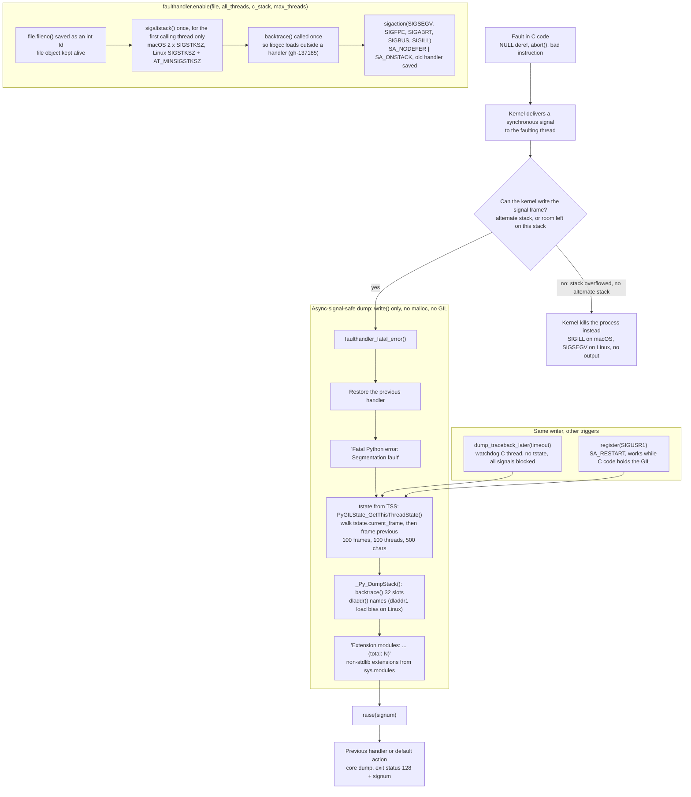

# Python faulthandler and Crash Diagnostics

> [!summary] Claim:
> `faulthandler` installs C-level `sigaction` handlers for SIGSEGV, SIGFPE, SIGABRT, SIGBUS, and SIGILL that run on an alternate signal stack, walk the interpreter's frame lists without the GIL or the heap, and `write()` a Python traceback to a file descriptor captured at enable time.
> After the dump it restores the previous handler and re-raises the signal, so core dumps and exit status 139 still happen.
> Since 3.14 it also prints a C stack from `backtrace(3)` and `dladdr`, which shows the extension frame that a Python traceback cannot.
> The same writer powers a watchdog thread (`dump_traceback_later`) and user-signal dumps (`register`), which work while the GIL is held by stuck C code.
> An expert knows its blind spots: worker-thread stack overflows, a reused file descriptor, the 100-frame cap that drops the outermost frames, a watchdog that does not survive `fork()`, and a C stack that differs between macOS and Linux.



## The Mechanism

### Why a separate crash path exists

A normal Python traceback is built from heap objects, formatted by Python code in `traceback.py`, and printed through `sys.stderr`, which is a buffered `TextIOWrapper`.
None of that is safe once a C extension has corrupted memory or a thread has received SIGSEGV.
POSIX lets a signal handler call only async-signal-safe functions, which excludes `malloc`, `printf`, and any lock that the faulting thread might already hold.
`faulthandler` (added in Python 3.3) is the answer: a C module that reads the interpreter's frame structures in place and emits text with `write(2)`.
The docs state the resulting limits: ASCII only with `backslashreplace`, 500 characters per string, filename, function, and line number only, no source lines, 100 frames per thread, 100 threads, most recent call first.

Without it, a CPython segfault prints nothing from Python at all.
In the lab, a NULL dereference writes zero bytes to stderr and exits with status 139, which is 128 + SIGSEGV, on CPython 3.15 on macOS and on CPython 3.12 on Linux (as of 2026-11).
A parent that started the process through `subprocess` sees the same death as `returncode == -11`, the negated signal number.

### Enabling it: three switches, one config field

`-X faulthandler`, `PYTHONFAULTHANDLER`, and Python Development Mode (`-X dev` or `PYTHONDEVMODE`) all set `PyConfig.faulthandler`, and `_PyFaulthandler_Init()` then calls `faulthandler.enable()` during startup.
`config_read_complex_options()` in `Python/initconfig.c` sets the field when `config_get_env(config, "PYTHONFAULTHANDLER")` or `config_get_xoption(config, L"faulthandler")` returns anything, so the value is never parsed, and `config_read()` sets it for Development Mode.
The documentation says the same: the variable enables the handler when it is "set to a non-empty string".
The consequence is counterintuitive, and the lab asserts it on CPython 3.15 on macOS and on CPython 3.12 on Linux; 3.13.18 and 3.14.10 gave the same table in hand runs (as of 2026-11):

| Invocation | `faulthandler.is_enabled()` |
|---|---|
| no option | `False` |
| `PYTHONFAULTHANDLER=1` | `True` |
| `PYTHONFAULTHANDLER=0` | `True` |
| `PYTHONFAULTHANDLER=` (empty) | `False` |
| `-X faulthandler=0` | `True` |
| `-X dev` or `PYTHONDEVMODE=1` | `True` |
| `PYTHONFAULTHANDLER=1 python -E` or `-I` | `False` |

`-E` and `-I` ignore `PYTHON*` variables, so an isolated entry point loses an environment-only crash configuration.
The only way to turn it off after startup is `faulthandler.disable()`, which returns `True` if a handler was installed and `False` otherwise; the documentation does not mention the return value, but `faulthandler_disable_py_impl()` returns it and the lab prints `True False` for two consecutive calls under `-X dev`.

### `enable()`: what is captured, and when

`faulthandler_py_enable_impl()` does its risky work up front, in normal Python context:
1. `faulthandler_get_fileno()` calls `file.fileno()` and `file.flush()`, or takes an int directly, defaulting to `sys.stderr`.
   It raises `RuntimeError: sys.stderr is None` when `sys.stderr` is `None`, which is what a process started with fd 2 closed gets, and an object without a real descriptor such as `io.StringIO` fails with `io.UnsupportedOperation: fileno`.
   A path string is not accepted either: `enable(file="x.log")` fails with `AttributeError: 'str' object has no attribute 'fileno'`.
2. It stores the integer fd and a strong reference to the file object in `_PyRuntime.faulthandler.fatal_error`, together with `all_threads`, `c_stack`, `max_threads`, and the interpreter.
   Keeping the object alive stops garbage collection from closing the fd, but nothing stops your code from calling `close()`.
3. `faulthandler_allocate_stack()` allocates the alternate stack with `PyMem_Malloc` and installs it with `sigaltstack()`; this happens lazily on first use since 3.9 (bpo-37851).
   It returns early once the stack exists, so only the thread that makes the first `enable()` or `register()` call in the process gets one.
4. `_Py_InitDumpStack()` calls `backtrace()` once, because the first call can `dlopen` libgcc and allocate, which the `backtrace(3)` man page warns about; this was gh-137185, fixed in 3.14.1.
5. For each of the five signals it calls `sigaction()` with `SA_NODEFER | SA_ONSTACK` and saves the previous `struct sigaction`.

The alternate stack is sized in `_PyFaulthandler_Init()`: `SIGSTKSZ * 2` (bpo-21131), or `SIGSTKSZ + getauxval(AT_MINSIGSTKSZ)` when Linux 5.14 or newer reports a minimum (bpo-46968, for AMX state on Sapphire Rapids).
Read back with `sigaltstack(NULL, &ss)` through `ctypes`, the lab measures `disabled` before `enable()`, 262144 bytes (256 KiB, 2 x 131072) after it on macOS 27.2 arm64, and `disabled` again on a thread started afterwards (as of 2026-11).
On Linux the size depends on the glibc headers the interpreter was compiled against (as of 2026-11).
The Linux lab runs Ubuntu 24.04's CPython 3.12.3 in an arm64 container on a Linux 7.2 kernel and measures 25200 bytes, which is 20480 + 4720: glibc 2.34 and newer turn `SIGSTKSZ` into `sysconf(_SC_SIGSTKSZ)` when `_GNU_SOURCE` is defined, as CPython defines it, and `getauxval(AT_MINSIGSTKSZ)` is 4720 there.
python-build-standalone 3.15.2 reported 21104 bytes in the same container in a hand run on 2026-11-11, which is 16384 + 4720 and matches the fixed aarch64 `SIGSTKSZ` of glibc before 2.34.

### The fatal handler

`faulthandler_fatal_error(int signum)` is the whole crash path, and it is short on purpose:
1. Save `errno`, find the `fault_handler_t` entry for `signum`, and restore the previous handler with `sigaction()`.
2. Write `Fatal Python error: <name>\n\n` with `_Py_write_noraise()`, where the names are `Segmentation fault`, `Bus error`, `Illegal instruction`, `Floating-point exception`, and `Aborted`.
3. Get the thread state from thread-specific storage with `PyGILState_GetThisThreadState()`, not from the GIL holder, because a thread that released the GIL around a C call can still fault, and the dump must describe that thread.
4. Dump the Python stacks, then the C stack if `c_stack` is true, then `_Py_DumpExtensionModules()`.
5. Restore `errno` and call `raise(signum)`.
   `SA_NODEFER` lets the re-raised signal be delivered immediately to the restored previous handler, which by default terminates the process and writes a core.

The handler is installed through `sa_handler`, without `SA_SIGINFO`, so it never receives the `ucontext_t` that holds the faulting PC and registers.
Everything it prints comes from interpreter state and from a stack walk that starts inside the handler.

Because the handler restores the previous disposition first, a second fault of the same signal during the dump goes to the old handler instead of recursing.
A `static volatile int reentrant` flag in `faulthandler_dump_traceback()` also makes a nested dump return at once, for example a different fatal signal arriving during a `register()` dump (bpo-23836, 3.5).

The Python-stack writer lives in `Python/traceback.c`.
`PyUnstable_DumpTracebackThreads()` (public C API in 3.15 via gh-145559, `_Py_DumpTracebackThreads` before that) walks `PyInterpreterState_ThreadHead(interp)` and each `tstate->next`.
For every thread it prints `Current thread 0x...` or `Thread 0x...`, then the OS thread name in brackets from `pthread_getname_np()` (gh-125434, 3.14.0a7), then `  Garbage-collecting` if the faulting thread was inside a collection (bpo-44466, first shipped in 3.10.0b4).
`dump_traceback()` walks `tstate->current_frame` through `frame->previous`, skips frames owned by the interpreter (trampolines), and prints each frame with `_PyCode_SafeAddr2Line()` for the line number.
Since 3.14.1 (gh-140815), `_PyMem_IsPtrFreed()` checks make a freed frame, code object, or thread state print `<freed frame>`, `<invalid frame>`, or `<freed thread state>` instead of faulting again.
`_Py_DumpASCII()` escapes non-ASCII as `\x`, `\u`, or `\U` and appends `...` after 500 characters.

The limits are constants: `MAX_STRING_LENGTH 500`, `MAX_FRAME_DEPTH 100`, `DEFAULT_MAX_NTHREADS 100`, and `BACKTRACE_SIZE 32` for C frames.
Two behaviors follow from the code rather than the docs:
- The frame loop breaks when `depth` reaches 100, and its `plus N frames` branch needs `depth > 100`, which never happens, so a deep stack is cut silently.
  In the lab, a `dump_traceback()` call at the bottom of a 150-deep recursion writes exactly 101 lines: the header and the 100 innermost frames, with no `<module>` line and no marker, and a fatal-signal dump of the same stack also stops at 100 frames.
- After `max_threads` threads it prints a line containing only `...`; in the lab, 120 parked threads plus the main thread give 100 thread headers and that line, and `max_threads=3` (new in 3.15, gh-149085) gives 3.

The string rules show up the same way: the lab prints a 600-character function name as 500 characters followed by `...`, and a function whose name ends in U+00E9 as `caf\xe9`.

`_Py_DumpExtensionModules()` iterates `sys.modules` without allocating, skips names in `sys.stdlib_module_names` and their submodules, and prints `Extension modules: a, b (total: 2)`.
That line is often the fastest clue in a fleet crash, because it names the third-party native code that was loaded.

### The C stack (3.14 and later)

`_Py_DumpStack()` (gh-127604, Peter Bierma, 3.14) calls `backtrace()` into a 32-entry array and formats each address itself, since `backtrace_symbols()` mallocs.
`_Py_backtrace_symbols_fd()` uses `dladdr()` on macOS and `dladdr1(..., RTLD_DL_LINKMAP)` on Linux, where it replaces `dli_fbase` with the link map's `l_addr`, the load bias.
It prints `Binary file "<path>", at <symbol>+0x<off> [0x<addr>]`, or `at +0x<off>` relative to the load bias when no symbol is found, and `<truncated rest of calls>` when all 32 slots fill.
On a build without `backtrace` and `dladdr`, it prints `<cannot get C stack on this system>`, and the docs warn that a dump "can be arbitrarily slow, depending on the DWARF level of the binaries in the call stack".

The two platforms produce different stacks for the same bug, which matters when reading one.
The lab's test extension calls a `noinline` leaf `parse_record()` that dereferences NULL:
- macOS 27.2, Homebrew 3.15.2: the stack names `_sigtramp`, then `crash+0x18`, which is the return address after `bl parse_record`; `parse_record` itself is missing.
  Apple's `backtrace()` calls `_thread_stack_pcs()`, which starts at `__builtin_frame_address(0)` and follows saved frame records only (`gen/thread_stack_pcs.c`, Libc-1752.120.2), so it never reads the faulting PC from the signal context.
  XNU's `sendsig_set_thread_state64()` sets only `x0` to `x5`, `pc`, `cpsr`, and `sp` for the handler, and `_sigtramp` is an ordinary C function, so the frame record it saves holds the interrupted `x29` and `x30`.
  The frame printed after `_sigtramp` is therefore the interrupted link register: the caller's return address when a leaf faults, and for a function that already made a call, its own last return address.
  The lab's second entry point, `crash_after_call()`, reaches `parse_checked()`, which calls `getpid()`, does arithmetic on a `volatile` local, and then dereferences NULL: the dump shows `parse_checked+0x18`, the instruction after that call, while `objdump` puts the faulting `ldr` at `+0x2c`.
  The Apple sources cited are the newest published tags (as of 2026-11, rechecked against the tag lists on 2026-11-11), older than the lab host's xnu-13432.41.4, so every behavior taken from them is also asserted by the lab on the host.
- Linux 7.2 arm64, python-build-standalone 3.15.2, Ubuntu 24.04 with glibc 2.39 and GCC 13.3.0, in hand runs on 2026-11-11: the stack shows `__kernel_rt_sigreturn`, then `+0x678` (the faulting `ldr` in `parse_record`) and `+0x698` (the return address in `crash`), because libgcc's unwinder recovers the faulting PC from the signal frame.
  The arm64 vDSO trampoline carries no CFI (the directives in `arch/arm64/kernel/vdso/sigreturn.S` are commented out), so libgcc's `aarch64_fallback_frame_state()` recognizes the `mov x8, #139; svc 0` sequence and reads the interrupted registers from the `sigcontext` in the kernel's `rt_sigframe`.
  The names are missing because `dladdr` sees only dynamic symbols, and both functions are `static`; `addr2line -f -e python3.15 0x12a5068` turned an interpreter offset from the same dump into `faulthandler_dump_c_stack`.

The lab separates the stack walk from CPython with `minifault.c`, a small C program with a handler of the same shape: an alternate stack, `backtrace()` into 32 slots, `dladdr()` names, and `write()` only.
It adds `SA_SIGINFO`, which faulthandler does not use, and prints the faulting PC from the signal context next to the walk.
On macOS, for the leaf, the context names `parse_record` while the walk prints `handler`, `_sigtramp`, `crash`, `main`.
For the function that had already made a call, the walk does name `parse_checked`, but at the return address of that call, so in neither case is the first frame below the trampoline the faulting PC.
On Linux the walk prints `handler`, `__kernel_rt_sigreturn`, `parse_record`, `crash`, `main`, and the first frame below the trampoline equals the faulting PC in both cases.
Two rebuilds of the same file show what the Linux result rests on.
Without `-rdynamic`, every function of the program prints as `<no dynamic symbol>`, which is what a `static` function or a stripped binary looks like to `dladdr`.
With `-fno-asynchronous-unwind-tables -fno-unwind-tables`, the walk returns one frame, the handler itself, even though the build keeps frame pointers, because glibc's `backtrace()` follows `.eh_frame` unwind tables and not frame records.

Read every frame except the faulting one as a return address, and subtract one instruction before symbolizing it.
The lab reads the disassembly to show why: the `bl` to `parse_record` sits at `crash+0x14`, so the `crash+0x18` in the dump is the instruction after the call, and `atos` or `addr2line` on that address can name the following source line instead of the call.

### Threads, the GIL, and free-threaded builds

The fatal handler reads other threads' frame lists without stopping them, which is a data race that the GIL build tolerates because a crashing process is about to die anyway.
CPython 3.14 made the free-threaded build dump only the faulting thread from a fatal signal while the GIL is disabled (gh-128400, 3.14.0a4): `deduce_all_threads()` returns a sentinel unless `_PyEval_IsGILEnabled()` is true, and the handler prints `<Cannot show all threads while the GIL is disabled>`, which a hand run on a uv-managed 3.14.6t showed (macOS, 2026-11-11).
The Python-level `faulthandler.dump_traceback()` brackets the walk with `_PyEval_StopTheWorld()`, so on 3.14.6t it still showed both threads.
`faulthandler_user()` passes `user->all_threads` straight to `faulthandler_dump_traceback()` with neither that check nor a stop-the-world (v3.15.2 source), so a user-signal dump on a free-threaded build walks running threads.
The same hand run on 3.14.6t agreed: a `register(SIGUSR1)` dump showed both threads, and no crash was observed.
The labs run GIL builds only, so none of the free-threaded behavior is asserted by `make verify`.
[[Python-Concurrency-Asyncio-Multiprocessing-and-Free-Threading-Bugs]] owns the free-threading bug classes themselves.

### The watchdog: `dump_traceback_later()`

`dump_traceback_later(timeout, repeat=False, file=sys.stderr, exit=False)` starts a raw C thread, `faulthandler_thread()`, after formatting a header such as `Timeout (0:00:00.500000)!` with `format_timeout()`.
The thread blocks every signal with `sigfillset(&set)` and `pthread_sigmask(SIG_SETMASK, &set, NULL)`, then waits on `PyThread_acquire_lock_timed(cancel_event, timeout_us)`.
A timeout writes the header and calls `PyUnstable_DumpTracebackThreads(fd, interp, NULL, ...)`; because the watchdog has no thread state, no thread is labelled `Current thread`.
With `exit=True` it calls `_exit(1)` right after the dump, which skips `atexit`, `finally` blocks, and buffer flushes; the docstring calls this "not safe".
Calling it again cancels and replaces the previous timer, and `cancel_dump_traceback_later()` releases the event and joins the thread.
A zero timeout raises `ValueError: timeout must be greater than 0`.

The watchdog never takes the GIL, so it fires even when the main thread is blocked in `lock.acquire()` or spinning in C code that holds the GIL.

A thread dump has one limit that matters for async services: a suspended coroutine is on no thread's stack.
In the lab, a task that awaits an `asyncio.Event` forever produces a one-thread dump whose innermost frame is `select` in `selectors.py`, and the coroutine `wait_for_reply` does not appear at all.
For a task-level view use `python -m asyncio ps <pid>` or `python -m asyncio pstree <pid>` (3.14 and later), which [[Python-Concurrency-Asyncio-Multiprocessing-and-Free-Threading-Bugs]] owns.

### User signals: `register()`

`register(signum, file, all_threads=True, chain=False)` is POSIX only and refuses the five fatal signals with `RuntimeError: signal 11 cannot be registered, use enable() instead`.
`faulthandler_user()` runs as a real C signal handler installed with `SA_RESTART`, so an interrupted system call restarts instead of failing with `EINTR`; with `chain=True` the flags are `SA_NODEFER` instead.
With `chain=True` it reinstalls the previous handler, re-raises, and registers itself again, so an existing handler for that signal keeps working.
In the lab, a plain `register(SIGUSR1)` over an existing Python-level handler dumps and silences that handler, and the same call with `chain=True` dumps and then lets it run.

This is different from `signal.signal()`.
A Python-level handler only sets a flag, and the eval loop runs the Python function later, between bytecodes on the main thread.
If the main thread is inside one long C call that holds the GIL, the Python handler waits, and a `register()` dump does not.
The lab makes the difference deterministic: `crashext.raise_both()` raises SIGUSR2 (Python handler) and SIGUSR1 (`register`) inside one C call and looks at both output files before it returns.
At that point the faulthandler dump is already written and the Python handler has written 0 bytes; its line appears only after the call returns.
Timed hand runs with `sum(range(400_000_000))`, which ran for 2 s to 4 s depending on load (2.0 s, 2.3 s, 3.8 s, and 4.1 s on 2026-11-08 and 2026-11-11), showed the same thing: a parent sent SIGUSR2 and SIGUSR1 at 0.5 s, the faulthandler dump arrived at 0.5 s, and the Python handler ran only when the call returned.

### Child processes and `fork()`

Signal dispositions and the alternate stack are process state, so a `fork()` child keeps an `enable()` made by its parent, and a newly started interpreter does not.
`multiprocessing` starts a new interpreter for the `spawn` and `forkserver` start methods and rebuilds its command line with `subprocess._args_from_interpreter_flags()`, which copies `-X` options and Development Mode, while the environment carries `PYTHONFAULTHANDLER`.
The lab measures all three: after `faulthandler.enable()` in the parent, a `fork` child reports `is_enabled()` as `True` and `spawn` and `forkserver` children report `False`, while `-X faulthandler` and `PYTHONFAULTHANDLER=1` give `True` for every start method.
The default start method is `spawn` on macOS and, since 3.14, `forkserver` on other POSIX platforms; the Linux lab's 3.12 still reports `fork` (as of 2026-11).
A programmatic `enable()` in the parent therefore does not reach pool workers by default on current versions.

The watchdog fares worse, because `fork()` copies only the calling thread.
`PyOS_AfterFork_Child()` in `Modules/posixmodule.c` has no faulthandler hook, so the child inherits `thread.cancel_event` and a `thread.running` lock that the vanished watchdog thread will never release.
The lab arms a 0.3 s watchdog, forks, and gets the same four outcomes on macOS (3.15) and Linux (3.12).
A child that sleeps 1.0 s is never dumped.
A child that calls `dump_traceback_later()` again, calls `cancel_dump_traceback_later()`, or simply leaves through `sys.exit()` blocks forever: all three paths reach `cancel_dump_traceback_later()`, which waits for `thread.running`, and interpreter shutdown gets there through `_PyFaulthandler_Fini()`.
A child that ends with `os._exit()`, as a `multiprocessing` fork child does in `popen_fork.py`, never runs that code.
The fix is ordering: when the parent cancels before `fork()`, the child can arm its own watchdog, and the lab's child then prints one `Timeout` dump and exits 1.

### `Py_FatalError()` is not faulthandler

`Py_FatalError()` and its variants call `fatal_error()` in `Python/pylifecycle.c`, which always writes `Fatal Python error: <func>: <msg>`, `Python runtime state: ...`, the Python stacks, and the extension-module list to C `stderr`, whether or not faulthandler is enabled.
When the calling thread holds the GIL and an exception with a traceback is set, it prints that exception in place of the stacks.
It does not print a C stack.
If the calling thread has a thread state and holds the GIL, `fatal_error()` calls `_PyFaulthandler_Fini()` before `abort()` so that faulthandler does not dump a second time.
From a C thread with no thread state, that condition fails, so with faulthandler on, the `abort()` triggers a second dump headed `Fatal Python error: Aborted` that includes the C stack.
The lab shows each case: `Py_FatalError(b"boom")` through `ctypes` prints `Fatal Python error: boom` with no C frames and exits 134 with faulthandler off, prints one dump with it on, and `faulthandler._fatal_error_c_thread()` prints two, the second headed `Aborted` with C frames.
A plain `os.abort()` under faulthandler prints the `Aborted` header and exits 134.

### Test helpers that are not crash tests for your pipeline

`faulthandler._sigsegv()`, `_sigabrt()`, `_sigfpe()`, `_stack_overflow()`, and `_fatal_error_c_thread()` exist for CPython's own tests.
Each helper calls `faulthandler_suppress_crash_report()` first, which sets `RLIMIT_CORE` to 0 and, on Windows, suppresses the error dialog.
The lab shows the limit moving without needing a core: with SIGSEGV ignored so that the helper's `raise()` returns, the soft `RLIMIT_CORE` goes from 4096 to 0 across one `_sigsegv()` call, on both platforms.
In hand runs in a Linux container with `ulimit -c unlimited` and `core_pattern` set to `core` (2026-11-08 and 2026-11-11), a `ctypes.string_at(0)` crash under `-X faulthandler` left a core file and `faulthandler._sigsegv()` did not.
Use a real fault, such as `ctypes.string_at(0)` or a test extension, to test that cores and crash reports reach your collector.

### Development Mode adds a second detector

Development Mode pairs faulthandler with debug hooks on the memory allocators, as if `PYTHONMALLOC=debug` were set, and the documentation lists what they check: buffer underflow, buffer overflow, allocator API violations, and unsafe use of the GIL.
The hooks surround every block with "forbidden bytes" (`0xFD`) and check them when the block is freed, which turns a silent heap overrun into a fatal error with a Python stack at the `free()`, long before the corruption would surface as a segfault somewhere unrelated.
In the lab, a C-level write one byte past a 10-byte `PyMem_Malloc()` block goes unnoticed without options, and under `-X dev` or `PYTHONMALLOC=debug` it ends in `Fatal Python error: _PyMem_DebugRawFree: bad trailing pad byte` with status 134 and a report that names the damaged pad byte.
The hooks cover only memory obtained through the `PyMem_Raw*`, `PyMem_*`, and `PyObject_*` allocator families, not an extension's own `malloc()`.
The report's advice to enable tracemalloc for the allocation traceback leads to [[Python-tracemalloc-gc-and-Memory-Leaks]].

### Windows

On Windows `enable()` also installs a vectored exception handler, `AddVectoredExceptionHandler(1, faulthandler_exc_handler)`, since 3.6.
It ignores codes without the error bit and the MSC and COM exception codes, prints `Windows fatal exception: ` followed by `access violation`, `stack overflow`, `int divide by zero`, another named case, or `code 0x` and the number, dumps the Python stacks and the C stack, and returns `EXCEPTION_CONTINUE_SEARCH` so that the next handler still runs.
`register()` is not available there, and the documentation says the fault handler "is compatible with system fault handlers like Apport or the Windows fault handler".
This subsection is read from `Modules/faulthandler.c` and the documentation at v3.15.2; nothing in it was run for this note.

## Commands and Numbers to Know

| Item | Value | Platform | Notes |
|---|---|---|---|
| `python -X faulthandler app.py` | enables at startup (as of 2026-11) | Both | Any value, including `=0`, enables it. |
| `PYTHONFAULTHANDLER` | any non-empty string enables, including `0` (as of 2026-11) | Both | Ignored under `-E` and `-I`. |
| `-X dev` / `PYTHONDEVMODE=1` | also enables faulthandler (as of 2026-11) | Both | Plus `-W default`, debug memory hooks, asyncio debug. |
| `PYTHONMALLOC=debug` | allocator debug hooks without the rest of Development Mode (as of 2026-11) | Both | A heap overrun ends in `_PyMem_DebugRawFree: bad trailing pad byte` and status 134 when the block is freed. |
| Fatal signals | SIGSEGV, SIGFPE, SIGABRT, SIGBUS, SIGILL (as of 2026-11) | Both | Windows adds a vectored exception handler (3.6). |
| Exit status after a dump | 139 SIGSEGV, 134 SIGABRT (as of 2026-11) | Both | The handler re-raises, so the default action still runs. |
| `subprocess` return code | `-11` for SIGSEGV, `-6` for SIGABRT (as of 2026-11) | Both | The negated signal number; a shell adds 128 instead. |
| Frame, thread, string caps | 100 frames, 100 threads, 500 chars (as of 2026-11) | Both | Frames beyond 100 are cut with no marker; threads beyond the cap print `...`. |
| `max_threads=` | keyword on `enable`, `dump_traceback`, `dump_traceback_later`, `register` (as of 2026-11) | Both | New in 3.15 (gh-149085); default 100. |
| C stack | 32 frames from `backtrace()`, then `<truncated rest of calls>` (as of 2026-11) | Both | 3.14 and later; `c_stack=False` turns it off. |
| `faulthandler.dump_c_stack(file)` | current thread's C stack on demand (as of 2026-11) | Both | 3.14 and later. |
| Alternate stack size | 262144 bytes (256 KiB) on macOS arm64; 25200 bytes (Ubuntu 24.04 CPython 3.12.3) or 21104 bytes (python-build-standalone 3.15.2, hand run) in the Linux arm64 container (as of 2026-11) | Both | `2 x SIGSTKSZ`, or `SIGSTKSZ + AT_MINSIGSTKSZ` on Linux 5.14 and newer; `SIGSTKSZ` is 16384 or the `sysconf` value, by build. |
| Alternate stack scope | the thread that made the first `enable()` or `register()` call (as of 2026-11) | Both | `pthread_create(3)`: a new thread does not inherit it. |
| C stack overflow on another thread | 139 and no output on Linux; 132 and no output, or 138 after a partial `Bus error` dump, on macOS (as of 2026-11) | Both | The kernel cannot write the signal frame: Linux forces SIGSEGV, XNU forces SIGILL. |
| Watchdog header | `Timeout (H:MM:SS)!` or `Timeout (H:MM:SS.ffffff)!` (as of 2026-11) | Both | `exit=True` calls `_exit(1)`. |
| Watchdog across `fork()` | not inherited; re-arming, cancelling, or a normal exit in the child blocks forever (as of 2026-11) | Both | Call `cancel_dump_traceback_later()` before `fork()` and arm again afterwards. |
| Child processes | `fork` keeps a parent's `enable()`; `spawn` and `forkserver` need `-X faulthandler` or `PYTHONFAULTHANDLER` (as of 2026-11) | Both | Default start method: `spawn` on macOS, `forkserver` on Linux since 3.14. |
| `python -m asyncio ps <pid>` | task-level view that a thread dump cannot give (as of 2026-11) | Both | 3.14 and later; `pstree` prints the await graph. |
| `kill -USR1 <pid>` with `register(signal.SIGUSR1)` | dumps all threads on demand (as of 2026-11) | Both | Not on Windows; refuses fatal signals. |
| pytest | plugin on by default; `faulthandler_timeout`, `faulthandler_exit_on_timeout` ini keys (as of 2026-11) | Both | pytest 9.2.0; the exit option is new in 9.0.0; disable with `-p no:faulthandler`. |
| `addr2line -f -e <binary> 0x<off>` | names a Linux `at +0x<off>` frame (as of 2026-11) | Linux | The offset is relative to the load bias, so it works on PIE binaries. |
| `atos -o <dSYM DWARF file> -arch arm64 0x<addr>` | file and line for a macOS frame (as of 2026-11) | macOS | Subtract one instruction from return addresses. |

## Multi-Language Comparison

| Concern | C++ | Python (CPython 3.15) | Rust |
|---|---|---|---|
| Default output on SIGSEGV | none; the process dies with status 139 | none, unless faulthandler is enabled | none for a plain SIGSEGV; std prints `thread '<name>' (<tid>) has overflowed its stack` for a guard-page hit |
| Opt-in crash dump | your own `sigaction` handler calling `backtrace_symbols_fd`, or Crashpad/Breakpad | `-X faulthandler`: Python frames plus a `backtrace()` C stack | a panic hook for panics; a signal handler or crash reporter for faults |
| Stack overflow in a worker thread | handled reliably only if you call `sigaltstack()` on that thread | no dump or a cut one: only the first enabling thread has an alternate stack | std installs an alternate stack per spawned thread (`stack_overflow.rs`, `make_handler`), so the message appears |
| Hung process, on demand | gdb or lldb attach | `register(SIGUSR1)` or the watchdog; attach tools in [[Python-Debugging-Hung-Processes-and-C-Extensions]] | gdb or lldb attach; tokio-console for async |
| Signal safety of the formatter | `std::stacktrace` (C++23) is not specified as async-signal-safe | `write()`-only formatter, no heap | panic machinery is not async-signal-safe; the overflow handler writes with `rtprintpanic!` |

The Rust row was checked by hand with rustc 1.99.0 on the macOS host (2026-11-08 and 2026-11-11), outside the labs: a spawned thread named `deep` that overflowed printed the message above and `fatal runtime error: stack overflow, aborting`, with status 134 (as of 2026-11, macOS).
[[Rust-FFI-Boundary-Debugging-Across-Cpp-and-Python]] covers a Rust or C++ crash inside a Python process, where both runtimes' handlers compete for the same signals.

## Worked Lab Example

Two labs back this note, and every output block below is copied from their golden files.
`code/03-Debugging/faulthandler_crash_dump/` runs on a macOS host against a GIL-enabled CPython 3.15 with headers (recorded on macOS 27.2 arm64 with Homebrew CPython 3.15.2); its golden file is `expected/darwin-arm64.txt`.
`code/03-Debugging/faulthandler_linux_signals/` runs in the pinned Ubuntu 24.04 container against that image's CPython 3.12.3, which predates the C stack dump; its golden file is `expected/linux-aarch64.txt`.
The labs print real dump text and normalize only what moves between runs or patch releases: the interpreter prefix becomes `$PREFIX`, the temporary work directory is cut from paths, thread ids and code addresses become `0xADDR`, line numbers of standard library frames become `N`, and C frame offsets outside the lab's own extension become `+0xOFF`.
Run them with `make verify LAB=03-Debugging/faulthandler` from `code/`.

### Step 1: a C extension that crashes

`crashext.c` holds the crash paths; this is the leaf case:

```c
static int __attribute__((noinline)) parse_record(const int *field) {
    return *field + 1;               /* NULL dereference in a leaf: no call made, no frame record */
}

static PyObject *crash(PyObject *self, PyObject *args) {
    const int *volatile field = NULL;
    return PyLong_FromLong(parse_record(field));
}
```

`app.py` calls it two Python frames deep:

```python
import crashext

def handle(batch):
    return [crashext.crash() for _ in batch]

def main():
    handle(range(3))

main()
```

`run.sh` builds the extension against the interpreter's own headers, and `lab.py` runs the script without and with the flag:

```sh
INCLUDE="$(python3 -c 'import sysconfig; print(sysconfig.get_paths()["include"])')"
SUFFIX="$(python3 -c 'import sysconfig; print(sysconfig.get_config_var("EXT_SUFFIX"))')"
"${CC:-cc}" -O1 -fno-omit-frame-pointer -I"$INCLUDE" -bundle -undefined dynamic_lookup crashext.c -o "crashext$SUFFIX"
python3 app.py
python3 -X faulthandler app.py
```

### Step 2: read the dump

Output on macOS (`expected/darwin-arm64.txt`):

```text
python3 app.py: stderr 0 bytes, status 139 (128 + SIGSEGV)
python3 -X faulthandler app.py:
Fatal Python error: Segmentation fault

Current thread 0xADDR (most recent call first):
  File "app.py", line 4 in handle
  File "app.py", line 7 in main
  File "app.py", line 9 in <module>

Current thread's C stack trace (most recent call first):
  Binary file "$PREFIX/Python", at _Py_DumpStack+0xOFF [0xADDR]
  Binary file "$PREFIX/Python", at faulthandler_dump_c_stack+0xOFF [0xADDR]
  Binary file "$PREFIX/Python", at faulthandler_fatal_error+0xOFF [0xADDR]
  Binary file "/usr/lib/system/libsystem_platform.dylib", at _sigtramp+0xOFF [0xADDR]
  Binary file "crashext.cpython-315-darwin.so", at crash+0x18 [0xADDR]
  Binary file "$PREFIX/Python", at PyObject_Vectorcall+0xOFF [0xADDR]
  Binary file "$PREFIX/Python", at _Py_VectorCallInstrumentation_StackRefSteal+0xOFF [0xADDR]
  Binary file "$PREFIX/Python", at _TAIL_CALL_CALL+0xOFF [0xADDR]
  Binary file "$PREFIX/Python", at _PyEval_Vector+0xOFF [0xADDR]
  Binary file "$PREFIX/Python", at PyEval_EvalCode+0xOFF [0xADDR]
  Binary file "$PREFIX/Python", at run_mod+0xOFF [0xADDR]
  Binary file "$PREFIX/Python", at _PyRun_File+0xOFF [0xADDR]
  Binary file "$PREFIX/Python", at _PyRun_SimpleFile+0xOFF [0xADDR]
  Binary file "$PREFIX/Python", at _PyRun_AnyFile+0xOFF [0xADDR]
  Binary file "$PREFIX/Python", at pymain_run_file_obj+0xOFF [0xADDR]
  Binary file "$PREFIX/Python", at pymain_run_file+0xOFF [0xADDR]
  Binary file "$PREFIX/Python", at Py_RunMain+0xOFF [0xADDR]
  Binary file "$PREFIX/Python", at pymain_main+0xOFF [0xADDR]
  Binary file "$PREFIX/Python", at Py_BytesMain+0xOFF [0xADDR]
  Binary file "/usr/lib/dyld", at start+0xOFF [0xADDR]

Extension modules: crashext (total: 1)
status=139 (128 + SIGSEGV)
enable(c_stack=False): C frames 0, status 139 (128 + SIGSEGV)
```

Read it in four passes:
1. The header names the signal, so this is a memory fault, not an `abort()` from an assertion.
2. The Python stack shows the list comprehension inlined into `handle` (PEP 709), and the innermost Python frame is the caller of the C function, because C functions have no Python frame.
3. The first three C frames are faulthandler itself and `_sigtramp` is the user-space signal trampoline in `libsystem_platform` that the kernel enters; the first frame below it is the crash site, here `crash+0x18`.
4. The last line lists every loaded non-stdlib extension, which is the suspect list when the C stack is short.

Without the flag the same crash is silent, and `enable(c_stack=False)` keeps the Python stacks and drops the C section.

### Step 3: what the frame after the trampoline means

Output on macOS (`expected/darwin-arm64.txt`):

```text
leaf fault (crashext.crash): frame after _sigtramp = crash+0x18
objdump: the call to parse_record returns to crash+0x18
parse_record, the function that faulted, appears in the C stack: no
fault after a call (crashext.crash_after_call): frame after _sigtramp = parse_checked+0x18
objdump: the call to getpid returns to parse_checked+0x18, and the load through NULL is at parse_checked+0x2c
./minifault leaf (status 139 (128 + SIGSEGV)):
  faulting pc from the signal context: parse_record
  backtrace() from the handler, most recent call first:
    handler
    _sigtramp
    crash
    main
    start
  first frame below the trampoline is the faulting pc: no
./minifault after-call (status 139 (128 + SIGSEGV)):
  faulting pc from the signal context: parse_checked
  backtrace() from the handler, most recent call first:
    handler
    _sigtramp
    parse_checked
    crash_after_call
    main
    start
  first frame below the trampoline is the faulting pc: no
faulthandler.dump_c_stack(): "Current thread's C stack trace (most recent call first):", first frame _Py_DumpStack
```

`crash+0x18` is a return address: the call to `parse_record` returns there, and `parse_record`, where the fault happened, is not in the stack at all.
macOS `backtrace()` walks frame records, the faulting PC exists only in the signal context, and a leaf that never saves a frame record leaves nothing for the walk to find.
When the faulting function has already made a call, the walk shows that function, but at the return address of its last call (`+0x18`) and not at the faulting load (`+0x2c`).
`minifault` confirms it outside CPython: the signal context names the right function both times, and the first frame below the trampoline is never the faulting PC.

The same C file in the Linux container (`expected/linux-aarch64.txt`):

```text
./minifault leaf (status 139 (128 + SIGSEGV)):
  faulting pc from the signal context: parse_record
  backtrace() from the handler, most recent call first:
    handler
    __kernel_rt_sigreturn
    parse_record
    crash
    main
    <no dynamic symbol>
    __libc_start_main
    _start
  first frame below the trampoline is the faulting pc: yes
./minifault after-call (status 139 (128 + SIGSEGV)):
  faulting pc from the signal context: parse_checked
  backtrace() from the handler, most recent call first:
    handler
    __kernel_rt_sigreturn
    parse_checked
    crash_after_call
    main
    <no dynamic symbol>
    __libc_start_main
    _start
  first frame below the trampoline is the faulting pc: yes
./minifault_unexported leaf (status 139 (128 + SIGSEGV)):
  faulting pc from the signal context: <no dynamic symbol>
  backtrace() from the handler, most recent call first:
    <no dynamic symbol>
    __kernel_rt_sigreturn
    <no dynamic symbol>
    <no dynamic symbol>
    <no dynamic symbol>
    <no dynamic symbol>
    __libc_start_main
    <no dynamic symbol>
  first frame below the trampoline is the faulting pc: yes
./minifault_no_tables leaf (status 139 (128 + SIGSEGV)):
  faulting pc from the signal context: parse_record
  backtrace() from the handler, most recent call first:
    handler
  first frame below the trampoline is the faulting pc: n/a, the walk stopped before the trampoline
```

Linux shows the faulting frame that macOS dropped, because libgcc reads the interrupted registers out of the kernel's signal frame.
It also shows the two ways a Linux C stack goes dark: unexported functions have no names, and a binary built without unwind tables stops the walk inside the handler.

CPython's own dump behaves the same way on Linux.
In hand runs on 2026-11-11 with python-build-standalone 3.15.2 in the same container, the frames after `__kernel_rt_sigreturn` were `crashext...so, at +0x678` and `+0x698`; `objdump` put `parse_record` at `0x678` and the instruction after `bl 678 <parse_record>` at `0x698`.
Only exported symbols such as `PyEval_EvalCode` and `Py_RunMain` kept their names, and `addr2line -f` turned the interpreter offsets `0x12a5068`, `0x12a4fb0`, and `0x7e906c` into `faulthandler_dump_c_stack`, `faulthandler_fatal_error`, and `_TAIL_CALL_CALL`.
Those offsets belong to that one build and are not in a golden file.
Neither platform gives a complete answer alone: symbolize Linux offsets with `addr2line`, and on macOS remember that the top frame may be the caller.

### Step 4: a hang instead of a crash

`watchdog.py` deadlocks a named worker on a lock that `main` holds, and arms a 0.5 s watchdog:

```python
import faulthandler, threading

def worker(lock):
    with lock:           # never returns: lock is already held by main
        pass

def main():
    lock = threading.Lock()
    lock.acquire()
    t = threading.Thread(target=worker, args=(lock,), name="db-writer", daemon=True)
    t.start()
    faulthandler.dump_traceback_later(0.5, exit=True)
    t.join()

main()
```

Output on macOS (`expected/darwin-arm64.txt`):

```text
Timeout (0:00:00.500000)!
Thread 0xADDR [db-writer] (most recent call first):
  File "watchdog.py", line 4 in worker
  File "$PREFIX/lib/python3.15/threading.py", line N in run
  File "$PREFIX/lib/python3.15/threading.py", line N in _bootstrap_inner
  File "$PREFIX/lib/python3.15/threading.py", line N in _bootstrap

Thread 0xADDR (most recent call first):
  File "$PREFIX/lib/python3.15/threading.py", line N in join
  File "watchdog.py", line 13 in main
  File "watchdog.py", line 15 in <module>
status=1
```

No thread is `Current thread`, because the watchdog has no thread state; the `[db-writer]` name comes from the OS thread name that `threading` sets.
The macOS main thread has no OS name, while a hand run on Linux with 3.15.2 showed `[python3.15]`; the exit status is 1 from `_exit(1)`, not a signal.

### Step 5: the blind spots, measured

Stack overflow away from the first enabling thread, on macOS (`expected/darwin-arm64.txt`):

```text
main thread:                         'Fatal Python error: Segmentation fault', C frames 32, status 139 (128 + SIGSEGV)
worker thread, -X faulthandler:      stderr 0 bytes, status 132 (128 + SIGILL)
worker thread, no faulthandler:      stderr 0 bytes, status 138 (128 + SIGBUS)
worker makes the first enable():     'Fatal Python error: Bus error', C frames 32, status 138 (128 + SIGBUS)
worker enables after the main thread: stderr 0 bytes, status 132 (128 + SIGILL)
worker thread, probed 4 KiB frames, 8 stack sizes: 8 of 8 end without one C frame, 8 of 8 exit 132 or 138
```

And on Linux (`expected/linux-aarch64.txt`):

```text
main thread:                          'Fatal Python error: Segmentation fault', status 139 (128 + SIGSEGV)
worker thread, -X faulthandler:       stderr 0 bytes, status 139 (128 + SIGSEGV)
worker thread, no faulthandler:       stderr 0 bytes, status 139 (128 + SIGSEGV)
worker makes the first enable():      'Fatal Python error: Segmentation fault', status 139 (128 + SIGSEGV)
worker enables after the main thread: stderr 0 bytes, status 139 (128 + SIGSEGV)
worker thread, 8 stack sizes:         8 of 8 print nothing and exit 139
```

A watchdog armed across `os.fork()`, on macOS (`expected/darwin-arm64.txt`); the Linux golden file has the same five lines:

```text
child sleeps 1.0 s past the 0.3 s timeout:      child exit status 7, Timeout dumps on stderr: 0
child calls dump_traceback_later() again:       child hung, killed by the lab after 2 s, Timeout dumps on stderr: 0
child calls cancel_dump_traceback_later():      child hung, killed by the lab after 2 s, Timeout dumps on stderr: 0
child leaves through sys.exit(3):               child hung, killed by the lab after 2 s, Timeout dumps on stderr: 0
parent cancels before fork, child arms its own: child exit status 1, Timeout dumps on stderr: 1
```

What each start method inherits, on macOS (`expected/darwin-arm64.txt`):

```text
default multiprocessing start method: spawn
faulthandler.enable() in the parent: fork True, spawn False, forkserver False
-X faulthandler:                     fork True, spawn True, forkserver True
PYTHONFAULTHANDLER=1:                fork True, spawn True, forkserver True
```

A heap overrun under Development Mode, on macOS (`expected/darwin-arm64.txt`):

```text
no option:          PyMem_Free() returned, status 0
-X dev:             'Fatal Python error: _PyMem_DebugRawFree: bad trailing pad byte', status 134 (128 + SIGABRT)
PYTHONMALLOC=debug: 'Fatal Python error: _PyMem_DebugRawFree: bad trailing pad byte', status 134 (128 + SIGABRT)
the debug hook's report under -X dev includes:
    10 bytes originally requested
    The 8 pad bytes at tail=0xADDR are not all FORBIDDENBYTE (0xfd):
        at tail+0: 0x41 *** OUCH
```

The remaining sections of the macOS golden file assert the caps, the reused descriptor, the lost buffer, the asyncio dump, `register()` inside a C call, `Py_FatalError()`, the alternate stack, the Python-level SIGSEGV handler, and the test helper; the Pitfalls quote their results.

## Pitfalls

> [!warning] Pitfall 1: A stack overflow in a worker thread loses the dump
> `sigaltstack()` is per thread, and `pthread_create(3)` says a new thread "does not inherit the creating thread's alternate signal stack".
> faulthandler installs one only for the thread that made the first `enable()` or `register()` call, so on any other thread the kernel has to write the signal frame onto the stack that just overflowed.
> When the frame does not fit, both kernels kill the process without running the handler: Linux `signal_setup_done()` calls `force_sigsegv()` (v7.2), and XNU `sendsig()` resets SIGILL to the default action and sends it to the thread (xnu-12377.121.6).
> macOS also names the fault differently: a guard-page hit is `KERN_PROTECTION_FAILURE`, which `ux_exception()` maps to SIGBUS, and `handle_ux_exception()` rewrites it to SIGSEGV only inside the main thread's stack range, so a worker overflow is a `Bus error`.
> The labs assert the outcome under `-X faulthandler` (as of 2026-11): a main-thread overflow prints a dump and exits 139 on both platforms, while an overflow in a default-size `threading.Thread` prints zero bytes and exits 139 on Linux and 132 on macOS.
> Without faulthandler the macOS worker exits 138 (SIGBUS), so the 132 is the kernel's substitute SIGILL, not a bad instruction.
> A second `enable()` from the worker changes nothing, because `faulthandler_allocate_stack()` returns early once a stack exists.
> The silence is not guaranteed on macOS, because clang there calls `___chkstk_darwin` to probe a large frame, such as the 4 KiB buffer of `faulthandler._stack_overflow()`, before moving `sp`, so the fault can arrive with some stack left and the handler starts on the worker's own stack.
> In the macOS lab, 8 of 8 probed runs at different `threading.stack_size()` values end without a single C frame and exit 132 or 138.
> A wider hand sweep of 64 sizes on Homebrew 3.15.2 (2026-11-08 and 2026-11-11) split 42 / 21 / 1: 42 runs printed `Fatal Python error: Bus error` and Python stacks but no C frame and exited 138, 21 printed nothing and exited 132, and 1 printed nothing and exited 138.
> The 138 exits are a second overflow inside the dump: under `lldb` with `EXC_BAD_ACCESS` passed through as a signal (2026-11-11), the second SIGBUS arrived on the worker thread in `___chkstk_darwin`, called from `_Py_backtrace_symbols_fd` under `_Py_DumpStack`, below `_sigtramp` on the worker's own stack, and the process then died of signal 10 because the handler had already restored the default action.
> The lab's extension recurses with 32-byte frames, which get no probe, and that worker prints nothing and exits 132; the Linux lab's worker prints nothing and exits 139 at 8 of 8 stack sizes on CPython 3.12.3, and a hand sweep with python-build-standalone 3.15.2 gave 64 of 64.
> When the worker thread itself makes the first `enable()` call, its overflow prints the whole dump: with 32 C frames and status 138 in the macOS lab, and as a full Python dump with status 139 in the Linux lab.
> Keep a core dump or out-of-process crash reporter as the backstop, as [[Core-Dumps-Minidumps-and-Crash-Reporting]] describes.

> [!warning] Pitfall 2: The crash dump goes to whichever file now owns the fd
> faulthandler keeps an integer fd, so closing the file and opening another can hand the same number to the new file.
> In the lab, `enable(file=open("crash.log", "w"))`, then `close()`, then `open("data.csv", "w")` gives both fd 3, and the segfault leaves `crash.log` at 0 bytes and writes `Fatal Python error: Segmentation fault` into the first line of `data.csv`.
> Log rotation and `os.dup2()` cause the same problem; call `enable()` again after each replacement, or point it at an fd that never changes, such as a `dup()` of stderr kept for the process lifetime, which is what pytest does.

> [!warning] Pitfall 3: `PYTHONFAULTHANDLER=0` turns it on
> The variable and `-X faulthandler` are presence flags, so `0`, `false`, and `off` all enable the handler on 3.13, 3.14, and 3.15.
> Only an unset or empty variable leaves it off, and `-E` or `-I` silently drops it.
> Configure production with `-X faulthandler` in the service command or `faulthandler.enable()` in the entry point, and assert `faulthandler.is_enabled()` at startup.

> [!warning] Pitfall 4: The outermost frames are the ones that disappear
> The frame walker starts at the innermost frame and stops after 100 with no marker.
> In a 150-deep recursion, the dump ended inside the recursion and never showed `<module>`, the frame that would say which request or job started it.
> For deep-recursion crashes, log the entry point before the risky call, or reproduce with `sys.setrecursionlimit()` lowered so a `RecursionError` gives a full Python traceback.

> [!warning] Pitfall 5: Buffered output written just before the crash is lost
> The handler writes with `write(2)` and then re-raises, so nothing flushes `sys.stdout`, `sys.stderr` buffers, or `logging` handlers.
> In the lab, `print("order accepted id=42")` followed by a segfault, with stdout redirected to a file, leaves that file at 0 bytes, and the same call with `flush=True` leaves the line in it.
> Put crash-relevant logs on an unbuffered path (`PYTHONUNBUFFERED=1`, `flush=True`, or a handler that flushes per record) when you need the last line before a fault.

> [!warning] Pitfall 6: A Python-level SIGSEGV handler turns a crash into a hang
> `signal.signal(signal.SIGSEGV, handler)` installs CPython's C trampoline, which only sets a flag and returns, so the faulting instruction runs again and faults again.
> In the lab, both orders, a handler set after `enable()` and `enable()` called after a handler, are still running when the lab kills them after 2 s, and the Python handler never runs; in the second order faulthandler dumps once, restores the trampoline, and the loop begins.
> Never install Python handlers for the five fatal signals; crash reporters that need SIGSEGV must be native and must chain.

> [!warning] Pitfall 7: Using `faulthandler._sigsegv()` to test the crash pipeline
> The private test helpers set `RLIMIT_CORE` to 0 before raising, so a crash-reporting test built on them proves nothing about cores.
> In the lab, the soft `RLIMIT_CORE` drops from 4096 to 0 across one `_sigsegv()` call; in hand runs in a container with cores enabled, `ctypes.string_at(0)` left a core and `faulthandler._sigsegv()` did not.

> [!warning] Pitfall 8: Trusting the C stack's top frame on macOS, or its names on Linux
> On macOS, the frame after `_sigtramp` is the interrupted link register, not the faulting PC: a leaf function that faults is missing and its caller's return address is shown, and a function that had already made a call is shown at that call's return address.
> On Linux, static functions and stripped binaries show as `at +0x<off>`, which needs `addr2line` against the exact build, ideally fetched from [[Symbol-Servers-and-debuginfod]].
> Only 32 frames are captured, and the first three or four belong to faulthandler and the signal trampoline.

> [!warning] Pitfall 9: The watchdog with `exit=True` skips cleanup
> `_exit(1)` skips `finally` blocks, `atexit`, and buffer flushes, so a test run killed this way can leave temporary state, partial files, and unflushed logs.
> Use `exit=True` in CI to free a stuck runner, and do not use it as a production deadline.

> [!warning] Pitfall 10: A watchdog armed across `fork()` hangs the child
> `fork()` copies only the calling thread, so the watchdog thread is gone in the child while its `thread.running` lock stays held.
> In both labs the child is never dumped, and a child that re-arms the watchdog, cancels it, or exits through normal interpreter shutdown blocks forever in `cancel_dump_traceback_later()`.
> This is the case of a test that forks while pytest's `faulthandler_timeout` is armed, or a prefork server whose master armed a watchdog before creating workers.
> Call `cancel_dump_traceback_later()` before `fork()` and arm again in the parent and the child, or make the child leave with `os._exit()`.

> [!warning] Pitfall 11: `faulthandler.enable()` in the parent does not reach spawned workers
> `spawn` and `forkserver` children are new interpreters, and in the lab they report `is_enabled()` as `False` after a parent-side `enable()`, while a `fork` child reports `True`.
> `spawn` is the default on macOS and `forkserver` on other POSIX platforms since 3.14, so pool workers and `ProcessPoolExecutor` workers crash silently unless the switch travels with them.
> `-X faulthandler` and `PYTHONFAULTHANDLER=1` do travel, the first through `_args_from_interpreter_flags()` and the second through the environment, and a worker initializer that calls `enable()` covers the remaining case.

> [!warning] Pitfall 12: A thread dump of an asyncio service shows the event loop, not the stuck task
> A suspended coroutine has no frame on any thread's stack, so the watchdog or `kill -USR1` dump of a hung asyncio process shows only `select` under `run_forever`.
> In the lab, the coroutine that never resumes, `wait_for_reply`, does not appear anywhere in the dump.
> Use `python -m asyncio ps <pid>` or `pstree` on 3.14 and later, or `asyncio.all_tasks()` from inside the process; [[Python-Concurrency-Asyncio-Multiprocessing-and-Free-Threading-Bugs]] owns those tools.

## At Scale

For one developer, `-X dev` during local runs is enough, because it turns on faulthandler with other checks.
For a team, the paved road is `-X faulthandler` in every service launcher, a `register(signal.SIGUSR1)` call in the entry point so on-call engineers can `kill -USR1` a stuck worker, and `faulthandler_timeout` in pytest so CI hangs end with stacks.
For 1,000 to 50,000 engineers, the crash text is a data source: thousands of hosts each write `Fatal Python error` lines to stderr, and the question is whether the log pipeline collects, keeps, and groups them.

The cost model is simple:
- Steady-state cost is near zero: `enable()` allocates one alternate stack and installs five handlers, and no code runs until a fault.
  This note has no benchmark of startup overhead, so measure it in your environment before quoting a number.
- Crash-time cost is a few kilobytes of `write()` calls per thread; in the lab, 120 parked threads produce more than 65536 bytes from `dump_traceback()` (77,725 in a hand count on Homebrew 3.15.2), which is more than the 65,536-byte default capacity of a Linux pipe with 4 KiB pages (`pipe(7)`), so a slow log driver can truncate or stall a dump.
- C stack dumps add `dladdr` lookups, which the docs warn can be slow with heavy DWARF.

Grouping crashes needs a stable key, and the dump supplies three: the signal name, the innermost Python frames, and the extension-module list.
C frame addresses are unstable across builds and ASLR, so normalize them to `module+offset` or symbolize them before hashing.
Keep faulthandler as the cheap first layer, and pair it with a core or minidump pipeline for the cases it cannot see: worker-thread overflows, frames beyond 100, and heap state.
[[Debug-a-Production-Crash-From-a-Core-Dump]] is the runbook for the second layer.

Decision rules:
1. Enable faulthandler in every long-running Python service and CI job, with a command-line flag rather than an environment variable that `-E` can drop.
2. Write the dump to the process's stderr, or to a `dup()` of it, never to a file you rotate.
3. Register SIGUSR1 (or another free signal) for on-demand dumps, and check that no other library already owns it, or use `chain=True`.
4. Set `faulthandler_timeout` in pytest slightly below the CI job timeout, and add `faulthandler_exit_on_timeout = true` when a hung test would otherwise burn the runner.
5. Collect cores or minidumps as well, and test the pipeline with a real fault, not the private `_sigsegv()` helper.
6. On free-threaded builds, expect fatal dumps of the faulting thread only, and use `dump_traceback()` from Python or an external sampler for all-thread views.
7. For worker processes, carry the switch on the command line or in the environment, never only in a parent-side `enable()`, and never hold an armed watchdog across `fork()`.

> [!tip] Practice Drill: Reproduce each blind spot
> Run `make verify LAB=03-Debugging/faulthandler` from `code/`, then build `minifault.c` on macOS and on Linux, and explain why only Linux shows `parse_record`.
> Rebuild it on Linux without `-rdynamic` and then without unwind tables, and predict both outputs before you run them.
> Run `faulthandler._stack_overflow()` on the main thread and in a `threading.Thread` under `-X faulthandler`, and record the bytes written and the exit status of each.
> Repeat the thread case with several `threading.stack_size()` values on macOS, and explain why some sizes print a partial `Bus error` dump and exit 138 while others print nothing and exit 132.
> Enable faulthandler on a log file, close it, open another file, and crash, then find the dump.
> Write a pytest test that deadlocks, set `faulthandler_timeout = 2`, and read the stacks pytest prints.
> Arm a watchdog, `os.fork()`, and let the child fall off the end of the script; explain the hang, then fix it with one call before the fork.
> Then run [[Drill-Debugging-Mixed-Python-Rust-FFI-Segfault]] with faulthandler as the first tool.

## Interview Questions

> [!question] L5: What does `faulthandler` print on a segfault, and why can it print anything at all?
> > [!success]- Answer
> > It prints `Fatal Python error: Segmentation fault`, then the Python stack of each thread with file, line, and function, then on 3.14 and later a C stack, then the non-stdlib extension modules.
> > It can do this because its handler is C code that runs on an alternate signal stack and only reads interpreter structures and calls `write(2)`, with no heap allocation and no GIL.
> > It then restores the old handler and re-raises, so the process still dies with status 139 and can still dump core.

> [!question] L5: Predict the output: `PYTHONFAULTHANDLER=0 python3.15 -c "import faulthandler; print(faulthandler.is_enabled())"`
> > [!success]- Answer
> > It prints `True`.
> > `initconfig.c` only checks whether the variable is set and non-empty, so `0` enables it, and `-X faulthandler=0` does too.
> > Only an unset or empty variable leaves it off, and `-E` or `-I` would ignore the variable entirely and print `False`.

> [!question] L5: A test suite hangs in CI with no output; what do you turn on?
> > [!success]- Answer
> > Set `faulthandler_timeout` in the pytest configuration, which makes pytest call `faulthandler.dump_traceback_later()` around each test and cancel it afterwards.
> > The watchdog is a C thread that does not need the GIL, so it dumps all threads even if the test is stuck in a lock or in C code.
> > Add `faulthandler_exit_on_timeout = true` (pytest 9.0 and later) to end the process after the dump.

> [!question] L6: Debug this: production enables `faulthandler.enable(file=open("/var/log/app/crash.log", "a"))`; after a segfault, `crash.log` is empty but a CSV export contains `Fatal Python error`; explain and fix.
> > [!success]- Answer
> > faulthandler stores the integer fd, not a path, and the log rotation code closed `crash.log`, so the kernel reused that fd number for the next file opened, the CSV export.
> > The handler wrote to whatever file owned that number at crash time.
> > Fix it by writing to stderr or a `dup()` of it kept for the process lifetime, and call `enable()` again after any rotation or `os.dup2()`.

> [!question] L6: A service is stuck at 100% CPU in a C extension that holds the GIL. Why does `signal.signal(SIGUSR1, dump)` print nothing, while `faulthandler.register(SIGUSR1)` works?
> > [!success]- Answer
> > The Python handler only sets a flag in C; the eval loop runs the Python function between bytecodes, and a single long C call never returns to the loop.
> > `register()` installs a C handler that runs immediately on the thread that receives the signal and walks the frames without taking the GIL.
> > In the lab, both signals are raised inside one C call: the faulthandler dump is on disk before the call returns, and the Python handler's output appears only afterwards.

> [!question] L6: Why does the C stack on macOS omit the function that actually faulted, while Linux shows it?
> > [!success]- Answer
> > On macOS, `backtrace()` walks saved frame records starting from the handler and never reads the faulting PC from the signal context, so the first frame after `_sigtramp` is the interrupted link register.
> > For a leaf function that never saved a frame record, that is its caller's return address, so the leaf is skipped.
> > On Linux arm64, libgcc's unwinder recognizes the `__kernel_rt_sigreturn` trampoline, which has no CFI, and reads the interrupted registers from the `sigcontext` in the kernel signal frame, so it recovers the faulting PC and the leaf appears.
> > Linux often lacks names because `dladdr` sees only dynamic symbols, so symbolize `+0x` offsets with `addr2line` against the exact binary.

> [!question] L6: Debug this: why does the child of a test that forks while pytest's `faulthandler_timeout` is armed never exit?
> > [!success]- Answer
> > `dump_traceback_later()` runs a C watchdog thread and holds two locks, `thread.cancel_event` and `thread.running`; the thread releases `running` when it ends.
> > `fork()` copies only the calling thread, so in the child the watchdog does not exist and `running` stays held forever.
> > Interpreter shutdown calls `_PyFaulthandler_Fini()`, which calls `cancel_dump_traceback_later()`, which waits for `running`, so a child that exits normally hangs, and so does a child that re-arms or cancels the watchdog.
> > Cancel the watchdog before `fork()` and arm it again on both sides, or end the child with `os._exit()`; the lab shows the hang and the fix on macOS and Linux.

> [!question] L6: Predict the output: the parent calls `faulthandler.enable()` and starts one child with each of `fork`, `spawn`, and `forkserver`; each child prints `faulthandler.is_enabled()`.
> > [!success]- Answer
> > `True`, `False`, `False`.
> > Signal handlers and the alternate stack are copied by `fork()`, while `spawn` and `forkserver` start new interpreters that only receive what the command line and environment carry.
> > With `-X faulthandler` or `PYTHONFAULTHANDLER=1` all three print `True`, because `multiprocessing` rebuilds the child's flags with `_args_from_interpreter_flags()` and the environment is inherited.
> > On 3.14 and later the default start method on Linux is `forkserver`, so the `False` case is the default one.

> [!question] L7: Your fleet has thousands of segfault exits with status 139 but some have no `Fatal Python error` text despite `-X faulthandler`; list the causes you would check.
> > [!success]- Answer
> > First, stack overflows on threads other than the one that first enabled faulthandler: they have no alternate stack, the Linux kernel cannot write the signal frame, and it forces a default SIGSEGV, so the exit is 139 with no text; check the core's faulting thread and its stack pointer against the guard page.
> > Second, a lost destination: stderr redirected to a pipe or log driver that dropped the bytes, or an fd that was closed or reused.
> > Third, a native library that installed its own SIGSEGV handler after faulthandler and did not chain, or a Python-level SIGSEGV handler, which would hang instead.
> > Fourth, the entry point running under `-E` or `-I` while relying on `PYTHONFAULTHANDLER`, or `faulthandler.disable()` called by a framework.
> > Fifth, worker processes started with `spawn` or `forkserver` when only the parent called `enable()`.
> > Confirm each from cores or minidumps, which keep working because faulthandler re-raises.

> [!question] L7: How does faulthandler behave on the free-threaded build, and why?
> > [!success]- Answer
> > Since 3.14, a fatal signal with the GIL disabled dumps only the faulting thread and prints `<Cannot show all threads while the GIL is disabled>`, because walking other threads' frames while they run is a data race that could fault inside the handler (gh-128400).
> > The Python-level `dump_traceback()` stops the world first, so it still shows every thread.
> > The `register()` handler does not apply the same check, so on 3.14.6t it dumped all threads without stopping them, which is a racy read to keep in mind.

> [!question] L8+: Design the crash-diagnostics standard for 5,000 engineers running Python services with native extensions.
> > [!success]- Answer
> > Layer one is faulthandler everywhere, enabled with `-X faulthandler` in a shared launcher, writing to stderr, with SIGUSR1 registered for on-demand dumps, and a startup assertion that `is_enabled()` is true.
> > Layer two is cores or minidumps with symbols on a debuginfod server, because faulthandler misses worker-thread overflows, frames past 100, and heap state.
> > The log pipeline parses `Fatal Python error` blocks and groups them by signal, innermost Python frames, and the `Extension modules` list, with C frames normalized to module and offset.
> > CI uses pytest's `faulthandler_timeout` below the job timeout, and a periodic canary crashes a real extension to prove both layers still capture output.

## Further Reading

- `faulthandler` documentation (3.15): the API, limits, and the file-descriptor warning this note builds on.
- `Modules/faulthandler.c` at v3.15.2: the handler, the alternate stack, the watchdog, the user-signal path, and the test helpers that suppress cores.
- `Python/traceback.c` at v3.15.2: the frame walker, the 100-frame and 100-thread caps, and the C stack formatter.
- `Python/pylifecycle.c` at v3.15.2: `fatal_error()` and `_Py_DumpExtensionModules()`, which explain the `Py_FatalError()` output.
- `Python/initconfig.c` at v3.15.2: why any value of `PYTHONFAULTHANDLER` enables the handler.
- Python Development Mode documentation: the full list of what `-X dev` turns on, including the allocator debug hooks.
- What's New in Python 3.14 and 3.15, and the 3.14 changelog: when the C stack, thread names, `max_threads`, and the free-threaded restriction arrived.
- `multiprocessing` documentation, "Contexts and start methods": which children are new interpreters, and the 3.14 change of default to `forkserver`.
- `Modules/posixmodule.c` at v3.15.2, `PyOS_AfterFork_Child()`: the list of subsystems reinitialized after `fork()`, which does not include faulthandler.
- `sigaltstack(2)` and `pthread_create(3)`: why the alternate stack is per thread.
- XNU `bsd/dev/arm/unix_signal.c` and `bsd/uxkern/ux_exception.c` at xnu-12377.121.6: why a worker-thread overflow on macOS is a SIGBUS that ends as SIGILL when the signal frame cannot be written.
- Linux `arch/arm64/kernel/signal.c` and `kernel/signal.c` at v7.2: the same failure on Linux, where `signal_setup_done()` forces SIGSEGV.
- Apple Libc `gen/thread_stack_pcs.c` at Libc-1752.120.2: the frame-record walk behind macOS `backtrace()`, which explains the missing faulting frame.
- `backtrace(3)`: the libgcc loading caveat behind gh-137185.
- pytest's `faulthandler.py` at 9.2.0: how a test runner should own the fd and the watchdog.
- Rust's `stack_overflow.rs` at 1.99.0: a runtime that gives every thread an alternate stack, for contrast.

## Related

- Prerequisites: none
- Next: [[Python-tracemalloc-gc-and-Memory-Leaks]]
- See also: [[02-Programming-Languages/Python/Python-Backend-Interview-Prep/10-Testing-Debugging-Production|10 Testing Debugging Production]], [[Core-Dumps-Minidumps-and-Crash-Reporting]], [[Python-Debugging-Hung-Processes-and-C-Extensions]], [[Python-pdb-debugpy-and-Remote-Attach]], [[Python-Concurrency-Asyncio-Multiprocessing-and-Free-Threading-Bugs]], [[Debug-a-Production-Crash-From-a-Core-Dump]], [[Symbol-Servers-and-debuginfod]], [[Rust-FFI-Boundary-Debugging-Across-Cpp-and-Python]], [[Drill-Debugging-Mixed-Python-Rust-FFI-Segfault]]
- Lab: `code/03-Debugging/faulthandler_crash_dump/` (requires: macos)
- Lab: `code/03-Debugging/faulthandler_linux_signals/` (requires: linux)
