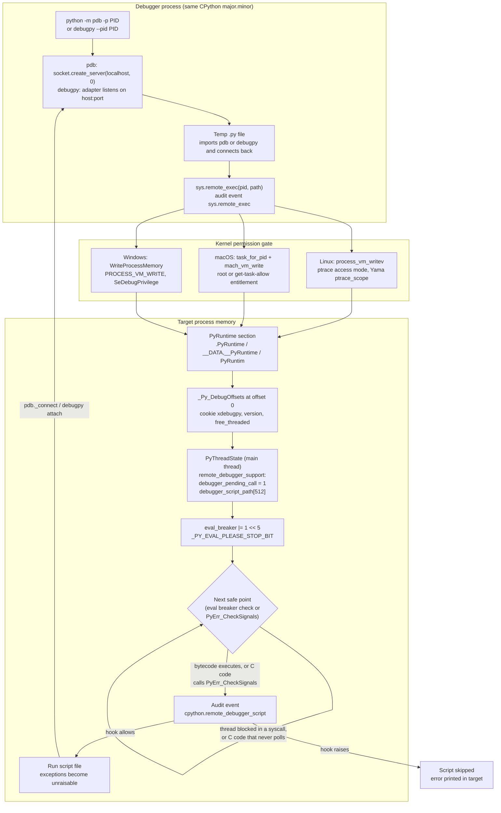

# Python pdb, debugpy, and Remote Attach

> [!summary] Claim:
> pdb is a pure-Python debugger built on `bdb`, which since CPython 3.14 can drive either `sys.settrace` or `sys.monitoring`; `breakpoint()`, `python -m pdb`, and post-mortem all enter the same command loop.
> debugpy splits debugging into a DAP client (the IDE), an adapter process, and pydevd running inside the target, talking JSON with a `Content-Length` header over TCP.
> Before 3.14, attaching to a running process meant ptrace plus gdb or lldb forcing code into the interpreter at an arbitrary instruction, which can crash inside `malloc` or deadlock on thread state.
> PEP 768 replaces that with a cooperative handshake: the debugger writes a script path and a flag into the target's `PyThreadState` and sets an eval-breaker bit, and the interpreter runs the script at its next safe point.
> `python -m pdb -p PID` and `debugpy --pid` both ride that handshake on 3.14, but the OS still decides who may write another process's memory.



## The Mechanism

### 1. pdb is bdb plus cmd, and 3.14 gave bdb a second engine

`pdb.Pdb` subclasses `bdb.Bdb`, which decides when to stop, and `cmd.Cmd`, which reads commands (`Lib/pdb.py`, class `Pdb`, v3.14.10).
Every stop, whether from a breakpoint, a step, `breakpoint()`, or a post-mortem, ends in `Pdb.interaction(frame, traceback_or_exception)`, which prints the frame and runs the command loop.
Until 3.13, bdb had one engine: `sys.settrace`, which calls a Python function on every `call`, `line`, `return`, and `exception` event in every traced frame, so a stepping session slows every line of the debuggee.
CPython 3.14 added a `sys.monitoring` engine (gh-124533), implemented as `bdb._MonitoringTracer`, which claims tool slot `sys.monitoring.DEBUGGER_ID`, enables events per code object with `set_local_events`, and returns `sys.monitoring.DISABLE` from callbacks for locations it does not care about.
[[Python-sys-monitoring-and-Tracing]] owns how `sys.monitoring` events, tool slots, and `DISABLE` work; this note uses them only as pdb's engine.

Which engine you get depends on the entry point, not on a global switch (`Lib/pdb.py` v3.14.10):
- `python -m pdb` constructs `Pdb(mode='cli', backend='monitoring', colorize=True)` in `main()`.
- `pdb.set_trace()` and `breakpoint()` construct `Pdb(mode='inline', backend='monitoring', colorize=True)`, and reuse the most recent instance if one exists (gh-121450).
- A bare `pdb.Pdb()` uses `get_default_backend()`, whose module-level default is `'settrace'`, changeable with `pdb.set_default_backend('monitoring')`.
- Remote pdb's `_PdbServer` is a `Pdb` subclass built without a backend argument, so it uses the default backend at the time `_connect` runs.

The `mode` argument (3.14, gh-123757) changes two behaviors that matter on a live service.
In `'inline'` mode, `run` and `restart` are disabled, and `quit` prompts `Quitting pdb will kill the process. Quit anyway? [y/n]`, then calls `sys.exit(1)` on `y`, Enter, or EOF instead of raising `bdb.BdbQuit` (gh-124704).
Since 3.13, `set_trace()` stops on the line that called it rather than on the next line, which is why a `breakpoint()` session opens with `-> breakpoint()` as the current line.

### 2. breakpoint() is a hook lookup (PEP 553)

`breakpoint()` (3.7, PEP 553) calls `sys.breakpointhook()`, which reads `PYTHONBREAKPOINT` on every call:
- Unset or empty: import `pdb` and call `pdb.set_trace()`.
- `0`: return `None` immediately, so the call is a no-op.
- `pkg.mod.callable`: import `pkg.mod` and call `callable`; a name with no dot is looked up in `builtins`.
- An import failure issues `RuntimeWarning: Ignoring unimportable $PYTHONBREAKPOINT: "..."` and continues.
`python -E` ignores `PYTHONBREAKPOINT` entirely, and `sys.__breakpointhook__` keeps the original hook so it can be restored.
This hook is how `debugpy.breakpoint()`, `ipdb`, or a no-op get swapped in without editing code.

### 3. Post-mortem: the frame is still in the traceback

An exception's `__traceback__` holds every frame between the raise and the handler, and each frame holds its locals, so a post-mortem debugger is just `interaction()` on the bottom frame of that chain.
`pdb.post_mortem(t=None)` accepts a traceback or, since 3.13, an exception object; `pdb.pm()` uses `sys.last_exc`, which the REPL sets for an uncaught exception.
Passing an exception object, not a traceback, unlocks the 3.13 `exceptions` command, which lists the `__cause__` and `__context__` chain and moves between members with `exceptions N`; pdb caps the walk at `MAX_CHAINED_EXCEPTION_DEPTH = 999`.
`python -m pdb script.py` enters post-mortem on any uncaught exception other than `SystemExit`, and `cont` or `step` from there restarts the script with breakpoints kept.

### 4. The pre-3.14 attach story and why PEP 768 exists

A debugger that attaches to a running CPython needs the target to execute Python code: import pydevd, open a socket, install a trace function.
Before 3.14 the only way in from outside was a native debugger.
debugpy's vendored pydevd still does this as a fallback (`pydevd_attach_to_process/add_code_to_python_process.py`, debugpy 1.8.22): on Linux it drives `gdb --nw --nh --nx` (or lldb with `--linux-attach-prefer-lldb`, which sets `PYDEVD_ATTACH_PREFER_LLDB`), on macOS it runs `lldb --no-lldbinit` with `load_lib_and_attach` to load `attach.dylib`, and on Windows it uses an `inject_dll_*.exe` helper.
The native debugger stops the process at whatever instruction it happens to be on and makes the interpreter call into injected code from there.
PEP 768's motivation lists what goes wrong: allocating while already inside `malloc()` crashes, mutating objects during garbage collection corrupts the interpreter, and touching thread state at the wrong time deadlocks.
[[How-Debuggers-Work-ptrace-Mach-and-Breakpoints]] owns ptrace and Mach task ports; [[Python-Debugging-Hung-Processes-and-C-Extensions]] owns read-only native inspection such as `py-bt` and `py-spy dump`.

### 5. The PEP 768 handshake, field by field

PEP 768 (Final, Python 3.14, authors Pablo Galindo Salgado, Matt Wozniski, Ivona Stojanovic) makes the interpreter a cooperating party.
The protocol, as the CPython "Remote debugging attachment protocol" HOWTO specifies it:

1. **Find `PyRuntime`.**
   CPython places the `_PyRuntime` global in its own section: `.PyRuntime` in ELF, section `__PyRuntime` of segment `__DATA` in Mach-O, and `PyRuntim` in PE (truncated by the 8-byte `IMAGE_SIZEOF_SHORT_NAME`).
   The debugger finds where the executable or `libpython` is mapped (`/proc/PID/maps` on Linux, `mach_vm_region` plus `proc_regionfilename` on macOS, `Module32First`/`Module32Next` on Windows), reads the section offset from the file on disk, and adds the load base.
2. **Validate `_Py_DebugOffsets`.**
   The first bytes of `PyRuntime` are a `_Py_DebugOffsets` table for out-of-process profilers and debuggers, whose `cookie` is the string `xdebugpy` (`_Py_Debug_Cookie`, `pycore_debug_offsets.h`).
   The table and its cookie are in the 3.13.18 headers (`pycore_runtime.h`) and absent from the 3.12.13 headers, although PEP 768 dates the table to 3.12.
   The debugger refuses to continue unless the cookie matches, the `version` matches its own major.minor (exactly, if either side is a pre-release), and `free_threaded` matches (`Python/remote_debugging.c`, v3.14.10).
3. **Find a thread state.**
   Follow `runtime_state.interpreters_head` to the first `PyInterpreterState`, then `interpreter_state.threads_main` to the main thread's `PyThreadState`, or walk `threads_head` and `next` comparing `native_thread_id`.
4. **Write the request.**
   Each `PyThreadState` embeds `_PyRemoteDebuggerSupport remote_debugger_support`, which is `int32_t debugger_pending_call` plus `char debugger_script_path[_Py_MAX_SCRIPT_PATH_SIZE]`, with the size defined as 512 (`Include/cpython/pystate.h`, v3.14.10).
   The debugger writes the script path, sets `debugger_pending_call = 1`, then reads `eval_breaker` and writes it back with `_PY_EVAL_PLEASE_STOP_BIT` (`1U << 5`, `pycore_ceval.h`) set.
   The offsets for all of these come from the `debugger_support` block of `_Py_DebugOffsets`, so the debugger never hard-codes a struct layout.
5. **Let the interpreter run it.**
   The eval loop already checks `eval_breaker` to handle signals, GIL drop requests, and async exceptions, so the new check adds nothing to the fast path.
   When it sees the pending call, it clears the flag, raises the audit event `cpython.remote_debugger_script` with the path, and executes the file; an exception in the script is reported as unraisable in that thread (`_PyRunRemoteDebugger` in `Python/ceval_gil.c`, v3.14.10).
   An audit hook that raises blocks the script.
   `PyErr_CheckSignals()` makes the same call before it runs Python signal handlers (`Modules/signalmodule.c`, v3.14.10), so C code that polls for signals is a safe point too.

`sys.remote_exec(pid, script)` (3.14) is the stdlib's implementation of steps 1 to 4, and raises the audit event `sys.remote_exec` in the caller.
It returns as soon as the memory writes are done, with no completion signal, so the caller must keep the file on disk and unmodified until the script has a visible effect.
The documentation says the script runs on the target's main thread "at the next available opportunity, similarly to how signals are handled".
That has two consequences:
- A main thread blocked in a system call, such as `time.sleep`, `socket.accept`, or a lock wait, runs no bytecode, so nothing happens until the call returns or a signal with a Python handler interrupts it.
  For `time.sleep`, the interrupted call fails with `EINTR` and the retry path in `pysleep` (`Modules/timemodule.c`, v3.14.10) calls `PyErr_CheckSignals()`, which starts the script before the handler runs.
- A main thread stuck in C code that neither returns to the eval loop nor calls `PyErr_CheckSignals()` never reaches a safe point at all.

The in-process side can be turned off three ways: `PYTHON_DISABLE_REMOTE_DEBUG` set to any value (`1`, `0`, and an empty string all disable it on 3.14.6), `-X disable-remote-debug`, or building with `./configure --without-remote-debug`.
`sys.is_remote_debug_enabled()` reports the result, and a debugger hitting a disabled target gets `RuntimeError: Remote debugging is not enabled in the remote process`.
The switch works in both directions: a caller that is itself disabled fails with `RuntimeError: Remote debugging is not enabled`, so a debugger launched from an environment that exports the variable cannot attach to anything.
None of these switches restrict ptrace, `/proc/PID/mem`, or `task_for_pid`, so a gdb-based injector or a memory-reading profiler still works against a disabled target.

The OS permission gate is unchanged from native debuggers:
- **Linux** (from the HOWTO, `process_vm_readv(2)`, and `Python/remote_debugging.c`; not run here): `process_vm_readv` and `process_vm_writev`, which the kernel gates with a `PTRACE_MODE_ATTACH_REALCREDS` ptrace access check, with a fallback to `/proc/PID/mem` when the system call returns `ENOSYS`.
  Yama `kernel.yama.ptrace_scope`, `CAP_SYS_PTRACE`, container seccomp profiles, and an already attached tracer such as `strace` can therefore all block it.
  Per process, `setpriv --ptracer any python3` (util-linux 2.41 or newer), run on the process being debugged, loosens the Yama restriction.
- **macOS**: `task_for_pid` needs root or a target binary signed with `com.apple.security.get-task-allow`, and System Integrity Protection still protects OS binaries.
- **Windows** (not run here): `OpenProcess` with `PROCESS_VM_READ | PROCESS_VM_WRITE | PROCESS_VM_OPERATION | PROCESS_QUERY_INFORMATION` (`Python/remote_debug.h`, v3.14.10), which the HOWTO says usually needs an Administrator terminal and sometimes `SeDebugPrivilege`.

### 6. How `python -m pdb -p PID` uses the handshake

`pdb.attach(pid, commands)` in `Lib/pdb.py` (v3.14.10) does this:
1. It opens `socket.create_server(("localhost", 0))` and notes the ephemeral port.
2. It writes a `NamedTemporaryFile` containing `pdb._connect(host="localhost", port=..., frame=sys._getframe(1), commands=..., version=..., signal_raising_thread=..., colorize=...)`.
3. It adds group and other read bits to the file (`stat.S_IROTH | stat.S_IRGRP`), so a target running as another user can read it.
4. It calls `sys.remote_exec(pid, path)` and blocks in `accept()` with no timeout (the source carries `# TODO Add a timeout?`).
5. In the target, `_connect` dials back, builds a `_PdbServer`, and calls `set_trace(frame=sys._getframe(1))`, so the session starts in the user's frame rather than the injected script's frame.
6. The local `_PdbClient` sends commands as newline-delimited JSON; the server replies with `{"message", "type"}`, `{"prompt", "state"}`, `{"completions"}`, `{"help"}`, and `{"command_list"}` messages.

The server checks a protocol version, `int(f"{major:02X}{minor:02X}{revision:02X}F0", 16)`, which is `0x030E00F0` for 3.14, and refuses a second session with `Another PDB instance is already attached.`
In a hand run on darwin-arm64, killing a client that was waiting after `c` left that state behind, and the next `pdb -p` got the same message and exited.
Ctrl-C in the client calls `os.kill(pid, SIGINT)` on Unix; on Windows, which cannot deliver SIGINT to another process, the target dials a second connection to the client's server socket, the client writes to it, and a listener thread in the target calls `signal.raise_signal(SIGINT)`.
`quit` in a remote session detaches through `_PdbServer.detach()` and leaves the target running, and `run`/`restart` print `remote PDB cannot restart the program`.
Only the attached thread stops; other Python threads keep running while you sit at the prompt.
A `PermissionError` from `sys.remote_exec` prints a pointer to the HOWTO's permission section; 3.15.2 also turns a `RuntimeError` into `Cannot attach to pid N, please make sure that the process exists and is using the same Python version.`

### 7. debugpy and the Debug Adapter Protocol

The Debug Adapter Protocol (DAP), published by Microsoft, standardizes what an IDE says to a debugger, so each editor implements one debugging UI and each language ships one adapter.
Its base protocol is a `Content-Length: N\r\n\r\n` header followed by N bytes of UTF-8 JSON; every message has a `seq` and a `type` of `request`, `response`, or `event` (`ProtocolMessage` in the DAP specification).
A session runs `initialize`, then `launch` or `attach`; the adapter sends an `initialized` event, the client sends `setBreakpoints` (and optionally `setExceptionBreakpoints`), then `configurationDone`, and the adapter answers the `attach`.
On a stop, the adapter sends a `stopped` event with a reason and thread id, and the client walks `threads`, `stackTrace`, `scopes`, then `variables`, repeating `variables` for nested values.

debugpy 1.8.22 (requires Python 3.10 or newer per PyPI metadata, as of 2026-11) has three pieces:
- **Client**: VS Code or any DAP client.
- **Adapter**: `debugpy/adapter`, a separate Python process that speaks DAP to the client and pydevd's protocol to the debuggee.
  `debugpy.listen()` spawns it with `--for-server`, `--host`, `--port`, and a random 32-byte hex `--server-access-token`, and on POSIX the adapter forks again to daemonize, so it outlives the call.
- **Server**: pydevd, vendored inside debugpy and imported into the debuggee, which uses `sys.monitoring` on 3.12 and newer (`PYDEVD_USE_SYS_MONITORING` in `pydevd_constants.py` overrides that).

`debugpy.listen(5678)` binds `127.0.0.1` when given only a port, raises `RuntimeError` if called twice, and returns the bound `(host, port)`.
`in_process_debug_adapter=True` skips the adapter process, at the cost of automatic subprocess debugging.
`debugpy --pid PID` builds a one-line bootstrap that imports `attach_pid_injected` and calls `attach(setup)`.
It tries `sys.remote_exec` first when the running interpreter has it (unless `--disable-sys-remote-exec` is given), with a temp file that deletes itself at the end.
On any exception it logs `Injecting code using sys.remote_exec() failed with error: ... Will reattempt using pydevd.` and falls back to gdb or lldb injection.
`--pid` cannot be combined with `--wait-for-client`.

[[Remote-Debugging-gdbserver-lldb-server-and-RSP]] owns the native equivalent, where the remote stub speaks GDB RSP and the IDE side can be gdb's own DAP interpreter (`gdb -i=dap`, GDB 14.1 and newer) or `lldb-dap`.

## Commands and Numbers to Know

| Item | Value | Platform | Notes |
|---|---|---|---|
| `python -m pdb -p PID` | attach to a live process (as of 2026-11) | Both | CPython 3.14+, debugger and target same major.minor; also Windows. |
| `python -m pdb -c 'b mod.py:42' -p PID` | `-c` commands run at attach (as of 2026-11) | Both | `attach()` passes `opts.commands` into `_PdbServer.rcLines`. |
| `python -m pdb script.py` | `sys.monitoring` backend, post-mortem on uncaught exception, restart on `cont` (as of 2026-11) | Both | `main()` in `Lib/pdb.py` v3.14.10. |
| `pdb.set_default_backend('monitoring')` | default is `'settrace'` (as of 2026-11) | Both | Affects only explicit `Pdb()` construction, not `breakpoint()`. |
| `PYTHONBREAKPOINT` | unset or empty: pdb; `0`: no-op; `mod.callable`: custom (as of 2026-11) | Both | Read on every call; ignored under `-E`. |
| `exceptions [N]` | list or switch chained exceptions (as of 2026-11) | Both | 3.13+, needs an exception object, not a traceback. |
| `$_frame`, `$_retval`, `$_exception`, `$_asynctask` | pdb convenience variables (as of 2026-11) | Both | `$_asynctask` is 3.14+; all cleared on resume. |
| `await pdb.set_trace_async()` | breakpoint that allows `await` at the prompt (as of 2026-11) | Both | 3.14+, gh-132576. |
| `sys.remote_exec(pid, path)` | returns immediately, no completion signal (as of 2026-11) | Both | Audit events `sys.remote_exec` (caller) and `cpython.remote_debugger_script` (target). |
| `_Py_MAX_SCRIPT_PATH_SIZE` | 512 bytes (as of 2026-11) | Both | `Include/cpython/pystate.h`, v3.14.10. |
| `_PY_EVAL_PLEASE_STOP_BIT` | `1U << 5` (as of 2026-11) | Both | `Include/internal/pycore_ceval.h`, v3.14.10. |
| `_Py_Debug_Cookie` | `"xdebugpy"` (as of 2026-11) | Both | First field of `_Py_DebugOffsets`. |
| `PyRuntime` section | `.PyRuntime` ELF, `__DATA,__PyRuntime` Mach-O, `PyRuntim` PE (as of 2026-11) | Both | Plus Windows. |
| Remote pdb protocol version | `0x030E00F0` on 3.14 (as of 2026-11) | Both | `_PdbServer.protocol_version()`. |
| Disable remote attach | `PYTHON_DISABLE_REMOTE_DEBUG=1`, `-X disable-remote-debug`, `--without-remote-debug` (as of 2026-11) | Both | Check with `sys.is_remote_debug_enabled()`. |
| macOS opt-in | `codesign --sign - --entitlements get-task-allow.plist path/to/python3` (as of 2026-11) | macOS | Non-framework binary per the HOWTO; root also works. |
| Linux opt-in | `setpriv --ptracer any python3` or `kernel.yama.ptrace_scope=0` (as of 2026-11) | Linux | From the HOWTO; not run on the authoring host. |
| `debugpy.listen(5678)` | binds `127.0.0.1:5678` (as of 2026-11) | Both | debugpy 1.8.22; `("0.0.0.0", 5678)` exposes code execution to the network. |
| `python -m debugpy --listen 127.0.0.1:5678 --wait-for-client app.py` | start under the debugger and block until a client attaches (as of 2026-11) | Both | debugpy 1.8.22 CLI. |
| `python -m debugpy --listen 127.0.0.1:5678 --pid PID` | inject into a live process (as of 2026-11) | Both | Tries `sys.remote_exec` first on 3.14+; `--disable-sys-remote-exec` forces gdb or lldb. |
| `--log-to DIR` or `DEBUGPY_LOG_DIR` | writes `debugpy.adapter-*.log`, `debugpy.server-*.log`, `debugpy.pydevd.*.log` (as of 2026-11) | Both | First stop for a failed attach. |
| `-Xfrozen_modules=off` | silences pydevd's frozen-modules warning (as of 2026-11) | Both | Frozen stdlib modules can make breakpoints in them miss. |
| `ssh -L 5678:127.0.0.1:5678 host` | reach a loopback-only debugpy (as of 2026-11) | Both | Keeps the listener off the network. |

## Multi-Language Comparison

| Concern | C++ | Python | Rust |
|---|---|---|---|
| Stop mechanism | Software breakpoint (`int3`, `brk`) written into code by gdb or lldb | `sys.monitoring` or `sys.settrace` callbacks in the interpreter | Same as C++, plus DWARF from rustc |
| Attach to a live process | `gdb -p PID`, `lldb -p PID` (ptrace or Mach task port) | `python -m pdb -p PID`, `debugpy --pid PID` (PEP 768 cooperative, 3.14+) | `rust-gdb -p PID`, `lldb -p PID` |
| Where injected code runs | Anywhere the native debugger stopped the thread | Only at an eval-breaker safe point | Anywhere, as for C++ |
| Remote protocol | GDB RSP to `gdbserver` or `lldb-server` | pdb: JSON lines over loopback TCP; debugpy: DAP plus pydevd protocol | GDB RSP |
| IDE protocol | `gdb -i=dap` (GDB 14.1+), `lldb-dap` | DAP via debugpy's adapter | `lldb-dap` or a DAP extension wrapping lldb |
| Post-mortem source | Core dump plus debug info | Live traceback object or `sys.last_exc`, not a core | Core dump plus debug info, or a panic backtrace |
| Blocked thread | Debugger stops it anyway | Attach waits for the next bytecode or a signal handler | Debugger stops it anyway |
| Owning note | [[Cpp-GDB-and-LLDB-Expert-Guide]] | This note | [[Rust-GDB-LLDB-Panics-and-Backtraces]] |

Mixed-language processes, such as a Python service with a Rust or C++ extension, need both halves; [[Rust-FFI-Boundary-Debugging-Across-Cpp-and-Python]] and [[Drill-Debugging-Mixed-Python-Rust-FFI-Segfault]] own that workflow.

## Worked Example

Two labs back this note, and every output block in this section is copied from a lab's `expected/darwin-arm64.txt`.
- `code/03-Debugging/pdb_remote_attach/` (`# requires: macos`) attaches pdb to live CPython 3.14 processes, shows each refusal, and runs post-mortem and `breakpoint()`.
- `code/03-Debugging/debugpy_dap_session/` (`# requires: macos, network`) drives debugpy 1.8.22 with a hand-written DAP client; it installs `debugpy==1.8.22` from PyPI into a throwaway venv, which is why it needs the network.

Both labs need `uv` and a uv-managed (python-build-standalone, non-framework) CPython 3.14.
The first also needs the free-threaded 3.14t and a final CPython 3.15 release, and it must run as an unprivileged user, because root passes the gate that Step 1 shows.
Neither lab downloads an interpreter: a preflight stops with exit 2 and names the missing piece.
The recordings were made by `make record` on darwin-arm64 (macOS 27.2, managed CPython 3.14.6, Homebrew CPython 3.15.2) on 2026-11-11 and re-checked by `make verify`.
`run.sh` replaces the run's temporary directory with `<dir>` and process IDs with `<pid>`, and strips trailing spaces, so a prompt with nothing after it prints as `(Pdb)`.
The targets are loops whose counters differ between runs, so the sessions print only values that do not, such as `qty` at a breakpoint whose condition is `qty == 5`.
There is no Linux or Windows recording: every Linux and Windows statement in this note comes from the cited documentation and source.

### Step 1: The OS gate refuses an interpreter that lacks the entitlement

The target is the uv-managed interpreter as installed: ad-hoc signed, with no entitlements.
`sys.remote_exec` from the same unprivileged user fails before it touches interpreter state, and `python -m pdb -p` turns the same `PermissionError` into help text and exit status 1 (darwin-arm64):

```text
sys.remote_exec: PermissionError: Cannot get task port for PID <pid> (kern_return_t: 5). This typically requires running as root or having the 'com.apple.system-task-ports' entitlement.
Error: The specified process cannot be attached to due to insufficient permissions.
See the Python documentation for details on required privileges and troubleshooting:
https://docs.python.org/3.14/howto/remote_debugging.html#permission-requirements

pdb exit status: 1
  target: ready remote_debug_enabled=True
```

The target's own line shows that PEP 768 was enabled inside it, so the refusal came from `task_for_pid`, not from the interpreter.
Homebrew's framework build of 3.14.10, also ad-hoc signed with no entitlements, was refused the same way in a hand run on the same host.

### Step 2: Sign a non-framework copy

The lab never re-signs the installed interpreter: it copies the tree and signs the copy with `get-task-allow.plist`, the file that the HOWTO's `plutil` recipe produces.

```sh
cp -R ~/.local/share/uv/python/cpython-3.14.6-macos-aarch64-none pbs
codesign --force --sign - --entitlements get-task-allow.plist pbs/bin/python3.14
```

With a target started from the copy, the same call goes through (darwin-arm64):

```text
entitlement on the copy: get-task-allow=true
caller audit event: sys.remote_exec
sys.remote_exec: returned
  target: ready remote_debug_enabled=True
  target: injected: thread=MainThread interrupted=target.py:7 in <module>
```

- The caller's audit hook saw `sys.remote_exec` before the call returned.
- The call returned at once; the `injected` line came from the target afterward, when its main thread reached a safe point.
- The script ran on `MainThread`, and `sys._getframe(1)` inside it was the frame it interrupted: `<module>` at line 7 of `target.py`, the `time.sleep(0.05)` call.
  That is the frame `pdb._connect` hands to `set_trace`.

### Step 3: Attach, break, inspect, detach

`service.py` calls `handle(i, i % 7)` in a loop; `handle` computes `total = qty * 3` and sleeps 0.05 s.
The pdb client reads its commands from a pipe:

```sh
printf 'where\nb handle, qty == 5\nc\np qty, order_id %% 7\nn\np total\nup\np i %% 7\nclear 1\nrun\nq\n' | pbs/bin/python3.14 -m pdb -p "$PID"
```

The session, the liveness check, and a second client that uses `-c` (darwin-arm64):

```text
> <dir>/service.py(7)handle()
-> time.sleep(0.05)
(Pdb)   <dir>/service.py(15)<module>()
-> handle(i, i % 7)
> <dir>/service.py(7)handle()
-> time.sleep(0.05)
(Pdb) Breakpoint 1 at <dir>/service.py:6
(Pdb) > <dir>/service.py(6)handle()
-> total = qty * 3
(Pdb) (5, 5)
(Pdb) > <dir>/service.py(7)handle()
-> time.sleep(0.05)
(Pdb) 15
(Pdb) > <dir>/service.py(15)<module>()
-> handle(i, i % 7)
(Pdb) 5
(Pdb) Deleted breakpoint 1 at <dir>/service.py:6
(Pdb) *** remote PDB cannot restart the program
(Pdb)
target alive after quit: yes
('handle', True)
target alive after -c quit: yes
```

Read it this way:
- A piped client echoes no input, so each `(Pdb)` is followed directly by the output of the command typed at that prompt.
- The session opened in `handle()` on line 7, the `time.sleep` call, where the main thread spends nearly all of its time.
  The injected script's own frame is absent from `where`, because `_connect` passes `sys._getframe(1)`.
- `b handle, qty == 5` stopped at the first call whose `qty` was 5, whatever the loop counter was by then; `n` executed line 6, and `up` reached the module frame, where `i % 7` is also 5.
- `run` is refused in a remote session, and `q` detached and left the target alive.
- The second client ran `python -m pdb -c 'p handle.__name__, i > 0' -c 'q' -p "$PID"` with an empty stdin: `-c` commands run at attach, before any banner, and that session also left the target alive.

Two behaviors seen in hand runs on the same host are not in the lab.
A piped client whose last command is `c` does not exit at end of input: it stays connected and waits for the next stop.
Sending SIGINT to that client, which forwards it to the target, printed `Program interrupted. (Use 'cont' to resume).` and a prompt, and end of input at that prompt detached.

### Step 4: Other threads keep running at the prompt

`threads.py` starts a worker thread that increments `ticks` every 10 ms.
The lab waits for the first prompt, sends `t0 = ticks`, lets half a second pass at the prompt, and then sends `p ticks > t0` (darwin-arm64):

```text
> <dir>/threads.py(18)<module>()
-> time.sleep(0.05)
(Pdb) (Pdb) True
(Pdb) ['MainThread', 'worker']
(Pdb)
```

Only the main thread stopped: the worker advanced `ticks` while the session sat at the prompt.

### Step 5: A blocked main thread and a signal

`blocked.py` installs a SIGUSR1 handler that prints the file of the frame it interrupts, prints `ready`, and calls `time.sleep(30)` (darwin-arm64):

```text
sys.remote_exec: ok
1 s later:
  target: ready
after kill -USR1:
  target: ready
  target: handler ran, interrupting <string>
  target: injected: thread=MainThread interrupted=blocked.py:13 in <module>
```

- One second after `sys.remote_exec` returned, nothing had run: the request is a flag in a thread that is executing no bytecode.
- `kill -USR1` made the sleep fail with `EINTR`, and the retry path called `PyErr_CheckSignals()`, which started the pending script before any Python signal handler.
- The handler then ran at the script's first eval-breaker check, which is why it reports interrupting `<string>`, the injected script, and why its line prints first.
- The script reports the frame beneath it as `<module>` at line 13, the `time.sleep(30)` call.
- `sleep returned` never printed: PEP 475 makes `time.sleep` resume for the remaining time once the handler returns.

### Step 6: Disable switches, mismatches, and an audit hook

Each case starts a fresh target from the signed copy and calls `sys.remote_exec` (darwin-arm64):

```text
target started with PYTHON_DISABLE_REMOTE_DEBUG=1
  target: ready remote_debug_enabled=False
  sys.remote_exec: RuntimeError: Remote debugging is not enabled in the remote process
target started with PYTHON_DISABLE_REMOTE_DEBUG=0
  target: ready remote_debug_enabled=False
  sys.remote_exec: RuntimeError: Remote debugging is not enabled in the remote process
target started with PYTHON_DISABLE_REMOTE_DEBUG= (empty)
  target: ready remote_debug_enabled=False
  sys.remote_exec: RuntimeError: Remote debugging is not enabled in the remote process
target started with -X disable-remote-debug
  target: ready remote_debug_enabled=False
  sys.remote_exec: RuntimeError: Remote debugging is not enabled in the remote process
caller started with PYTHON_DISABLE_REMOTE_DEBUG=1
  target: ready remote_debug_enabled=True
  sys.remote_exec: RuntimeError: Remote debugging is not enabled
caller is a final CPython 3.15
  target: ready remote_debug_enabled=True
  sys.remote_exec: RuntimeError: Can't send commands from a Python 3.15 process to a Python 3.14 process
caller is free-threaded CPython 3.14t
  target: ready remote_debug_enabled=True
  sys.remote_exec: RuntimeError: Cannot send commands from a free-threaded Python process to a process running a non-free-threaded version
target audit hook raises on cpython.remote_debugger_script
  sys.remote_exec: ok
  target: ready
  target: audit event: cpython.remote_debugger_script inject.py
  target stderr: Audit hook failed for remote debugger script <dir>/inject.py:
  target stderr: Traceback (most recent call last):
  target stderr:   File "<dir>/audited.py", line 10, in hook
  target stderr:     raise RuntimeError("blocked by policy")
  target stderr: RuntimeError: blocked by policy
  target alive: yes
```

- Any value of `PYTHON_DISABLE_REMOTE_DEBUG`, including `0` and the empty string, disables the target, as does `-X disable-remote-debug`.
- The same variable in the caller's environment disables the caller, with a shorter message.
- The version and free-threaded checks compare `_Py_DebugOffsets`, so they fail before anything is written.
  A pre-release 3.15.0b3 caller got a different message in a hand run: `Can't send commands from a pre-release Python interpreter to a process running a different Python version`.
- With the audit hook, `sys.remote_exec` still succeeded in the caller, because it only writes the request.
  The target raised the event, the hook's exception was reported as unraisable, the script never ran, and the target kept running.

### Step 7: Post-mortem through a chained exception

`crash.py` raises `KeyError` from a `ValueError` inside `load()`.
The session is `printf 'c\nexceptions\nexceptions 0\np raw\nexceptions 1\np row, out\nq\n' | pbs/bin/python3.14 -m pdb crash.py`, with stderr, which carries the traceback, discarded (darwin-arm64):

```text
> <dir>/crash.py(1)<module>()
-> def parse(raw):
(Pdb) Uncaught exception. Entering post mortem debugging
Running 'cont' or 'step' will restart the program
> <dir>/crash.py(11)load()
-> raise KeyError(f"bad row {row!r}") from e
(Pdb)     0 ValueError("invalid literal for int() with base 10: 'x3'")
>   1 KeyError("bad row 'x3'")
(Pdb) > <dir>/crash.py(2)parse()
-> return int(raw)
(Pdb) 'x3'
(Pdb) > <dir>/crash.py(11)load()
-> raise KeyError(f"bad row {row!r}") from e
(Pdb) ('x3', [1, 2])
(Pdb)
```

`exceptions 0` jumped to the frame where the original `ValueError` was raised, with `raw` still bound, which a plain `where` on the `KeyError` traceback cannot show.

### Step 8: breakpoint() follows the hook

`bp.py` is three lines: `x = 41`, `breakpoint()`, and `print("after", x + 1)` (darwin-arm64):

```text
PYTHONBREAKPOINT=0
  after 42
PYTHONBREAKPOINT=builtins.print

  after 42
PYTHONBREAKPOINT=nosuch.hook
  <dir>/bp.py:2: RuntimeWarning: Ignoring unimportable $PYTHONBREAKPOINT: "nosuch.hook"
    breakpoint()
  after 42
PYTHONBREAKPOINT=0 with python -E, then 'p x' and 'c'
  > <dir>/bp.py(2)<module>()
  -> breakpoint()
  (Pdb) 41
  (Pdb) after 42
no hook variable, then 'q' and end of input
  > <dir>/bp.py(2)<module>()
  -> breakpoint()
  (Pdb) Quitting pdb will kill the process. Quit anyway? [y/n]
  exit status: 1
```

- `0` makes the call a no-op, `builtins.print` turns it into an empty line, and an unimportable name warns and continues.
- `-E` ignores the variable, so pdb starts.
- In the last run, `q` drew the inline-mode prompt, end of input answered it, and the process exited with status 1 without printing `after 42`.

### Step 9: debugpy.listen, a DAP session by hand, and debugpy --pid

The second lab runs every process from a signed copy of the interpreter, inside a venv that holds debugpy 1.8.22.
`listen_facts.py` calls `debugpy.listen(0)` and inspects its own process (darwin-arm64):

```text
debugpy.listen(0) bound host: 127.0.0.1
second debugpy.listen(0): RuntimeError: debugpy.listen() has already been called on this process
sys.monitoring DEBUGGER_ID tool: pydevd
pdb.Pdb(backend='monitoring').set_trace(): ValueError: Another debugger is using the monitoring tool
sys.breakpointhook module: debugpy._vendored.force_pydevd
adapter process: parent pid 1, --host 127.0.0.1, access token of 64 hex digits
```

`listen` bound loopback, refused a second call, and left a separate adapter process whose parent is PID 1.
pydevd held the `sys.monitoring` debugger slot, so pdb's monitoring backend could not start, and `breakpoint()` now belongs to pydevd.

`dap_target.py` calls `debugpy.listen(("127.0.0.1", 0))` and loops over `handle(i, i % 7)`.
`dap_client.py` is a 100-line client that frames each request as `Content-Length: N`, a blank line, and N bytes of JSON (darwin-arm64):

```text
-> request:initialize
<- response:initialize success=True
   message keys: body, command, request_seq, seq, success, type
-> request:attach
<- event:initialized
-> request:setBreakpoints
<- response:setBreakpoints success=True
   breakpoint verified: True
-> request:configurationDone
<- response:configurationDone success=True
<- response:attach success=True
   attach answered only after configurationDone was sent: True
<- event:stopped
   reason: breakpoint
-> request:stackTrace
<- response:stackTrace success=True
   frame: handle line 11
   frame: <module> line 18
-> request:scopes
<- response:scopes success=True
   first scope: Locals
-> request:variables
<- response:variables success=True
   qty = 5, order_id % 7 = 5
-> request:evaluate
<- response:evaluate success=True
   qty * 3 = 15
   qty 5 orders the debuggee finished while stopped: 0
-> request:disconnect
<- response:disconnect success=True
telemetry output events seen: True
debuggee after disconnect: handled 6 more qty 5 orders, alive: yes
```

- The `attach` response arrived only after `configurationDone` was sent, which is the DAP ordering.
- The condition was evaluated in the debuggee, so the first stop had `qty == 5`, and no order with `qty` 5 had finished while the client held the stop.
- After `disconnect` with `terminateDebuggee: false`, the debuggee handled six more such orders, about 2 s of running.
  Checking only that the process is alive would prove nothing: with `terminateDebuggee: true`, the debuggee exited about 0.5 s after the response in a hand run.
- The client prints only the messages it waits for.
  In hand runs debugpy also sent telemetry `output` events and `debugpySockets`, `debugpyWaitingForServer`, `process`, `thread`, and `module` events, all of which a client can ignore.

`plain_target.py` knows nothing about debugpy; `python -m debugpy --listen 127.0.0.1:0 --log-to log --pid "$PID"` injects into it (darwin-arm64):

```text
Attempting to inject code at '<tmp>' using sys.remote_exec()
fell back to gdb or lldb injection: no
adapter running for the injected debuggee: yes
debuggee alive: yes
```

On 3.14, debugpy used `sys.remote_exec` and did not fall back.
In hand runs on the same host the fallback did happen twice: against the unsigned Homebrew target, and against a target started with `PYTHON_DISABLE_REMOTE_DEBUG=1`.
Both times debugpy logged the `sys.remote_exec` failure, attached with `lldb`, and the adapter then came up listening.
The old injector reached processes that the PEP 768 path could not.
lldb's `debugserver` is signed with the Apple-private `com.apple.private.cs.debugger` entitlement (shown by `codesign -d --entitlements -`), which a Python interpreter calling `task_for_pid` does not carry.

## Pitfalls

> [!warning] Pitfall 1: Attach hangs because the main thread is not running bytecode
> `sys.remote_exec` only sets flags; the script runs when the main thread next passes an eval-breaker check.
> A thread parked in `accept()`, `select()`, a lock, or a long C call never gets there, and `pdb -p` waits in `accept()` with no timeout.
> Register a no-op handler for a spare signal such as `SIGUSR1` in services you expect to debug, and send it after attaching; for a thread stuck in C, use native tools from [[Python-Debugging-Hung-Processes-and-C-Extensions]].

> [!warning] Pitfall 2: Listening on 0.0.0.0 is remote code execution
> Anyone who can reach a debugpy port can evaluate arbitrary Python in the process, and the debugpy README says to do it only on secure networks.
> Bind `127.0.0.1` (the default when only a port is given) and reach it with `ssh -L` or `kubectl port-forward`, never a published container port on a shared network.

> [!warning] Pitfall 3: The script file is the trust boundary
> PEP 768 passes a path, not code, so whoever can replace that file or swap a symlink before the target reads it chooses what runs.
> `pdb.attach` makes its temp file group- and world-readable so a different-user target can read it, and debugpy's bootstrap file removes itself after it runs.
> Write custom `remote_exec` scripts to a directory only the debugging user can write.

> [!warning] Pitfall 4: Mismatched interpreters fail before attach
> `sys.remote_exec` requires the same major.minor, the exact same version for pre-releases, and the same free-threaded setting.
> In a fleet that runs 3.14 and 3.14t, or a container image whose Python differs from the host's, run the debugger inside the target's image or venv.

> [!warning] Pitfall 5: Disabling PEP 768 is not a security boundary
> `PYTHON_DISABLE_REMOTE_DEBUG` stops only the in-process handler.
> In a hand run on darwin-arm64, `debugpy --pid` against a target started with `PYTHON_DISABLE_REMOTE_DEBUG=1` logged the `sys.remote_exec` failure and attached with lldb instead, so the real control is ptrace scope, `CAP_SYS_PTRACE`, seccomp, and code-signing policy.

> [!warning] Pitfall 6: `quit` from a breakpoint() session kills the process
> Since 3.14, `quit` in `'inline'` mode prompts and then calls `sys.exit(1)` on `y`, Enter, or EOF, so a stray `breakpoint()` reached in a service with a closed stdin exits it with status 1.
> Ship with `PYTHONBREAKPOINT=0`, lint for `breakpoint(` in CI, and use `pdb -p`, whose `quit` detaches.

> [!warning] Pitfall 7: The paused thread still owns its locks
> At a pdb prompt, only the attached thread stops; other threads keep running and block on any lock, connection, or transaction the paused thread holds.
> Health checks served by that thread fail, and an orchestrator may restart the pod mid-session; drain the instance from load balancing before stepping.

> [!warning] Pitfall 8: Two debuggers fight over one monitoring slot
> bdb's `sys.monitoring` engine claims `sys.monitoring.DEBUGGER_ID` and raises `ValueError('Another debugger is using the monitoring tool')` if another tool holds it.
> pydevd claims the same slot on 3.12 and newer, so after `debugpy.listen()`, `pdb.Pdb(backend='monitoring').set_trace()` raises exactly that error, and `sys.monitoring.get_tool(DEBUGGER_ID)` returns `'pydevd'`.
> debugpy also installs its own `breakpointhook`, so `breakpoint()` goes to pydevd rather than pdb; use one debugger per process and detach it before switching.

> [!warning] Pitfall 9: Frozen modules hide stdlib breakpoints under debugpy
> pydevd warns that frozen modules "may make the debugger miss breakpoints".
> Start the target with `-Xfrozen_modules=off` when you need breakpoints inside the frozen stdlib modules, and set `PYDEVD_DISABLE_FILE_VALIDATION=1` only to silence the warning, not to fix it.

## At Scale

One developer needs `breakpoint()`, `python -m pdb`, and an IDE launching debugpy; the cost of a mistake is one terminal.
A team adds shared containers and staging services, where the questions become network exposure and who may attach.
At 1,000 to 50,000 engineers, the question is policy: attach is a privileged, audited, rare action on production, and the default path is evidence that needs no attach at all, such as logs, traces, `faulthandler`, and sampling profilers.

Trade-offs that change with size:
- **Interactive versus read-only.** `pdb -p` and debugpy execute code in the target; `py-spy dump` only reads its memory.
  Read-only tools need the same OS permission but cannot mutate state, so they are the default for production triage.
- **Who holds ptrace.** Granting `CAP_SYS_PTRACE` or `ptrace_scope=0` fleet-wide makes every compromised process a debugger of its neighbors; per-process `setpriv --ptracer` or a privileged debug sidecar scoped to one pod keeps the blast radius small.
- **Disable switch versus audit.** `PYTHON_DISABLE_REMOTE_DEBUG=1` in production images removes the cooperative path, and Pitfall 5 shows it does not remove ptrace injection.
  An audit hook on `cpython.remote_debugger_script` that logs, or rejects scripts outside an allowlisted directory, gives a record instead.
- **Interpreter uniformity.** Remote attach demands exact major.minor and build matching, so a fleet with many Python builds needs the debugger shipped inside each image, not on the host.

Decision rules:
1. On production, start with read-only evidence ([[Python-faulthandler-and-Crash-Diagnostics]], [[Python-Debugging-Hung-Processes-and-C-Extensions]], [[Debugging-Distributed-Systems-with-Traces-and-Correlation]]); attach only when you must evaluate an expression or step.
2. Attach through a break-glass path that records who, which PID, and which script, and that drains the instance first.
3. Bind debugpy to loopback everywhere and tunnel; treat any non-loopback debug listener found by a port scan as an incident.
4. Ship `PYTHONBREAKPOINT=0` in production images and fail CI on committed `breakpoint()` and `set_trace()` calls.
5. Keep the debugger in the same image as the service, because a host-side 3.15 cannot attach to a container's 3.14.
6. Decide per environment whether PEP 768 is on: on in development and staging, and on in production only behind the break-glass path, with ptrace restrictions as the actual control.

> [!tip] Practice Drill: Attach to a service that is not running bytecode
> Write a server whose main thread blocks in `socket.accept()` and whose worker thread holds a `threading.Lock` in a loop.
> Run it on CPython 3.14, attach with `python -m pdb -p`, and observe that the prompt does not appear.
> Add a no-op `SIGUSR1` handler, attach again, send `kill -USR1`, and confirm the prompt arrives; then use `where`, `p threading.enumerate()`, and `quit`, and confirm the server survives.
> Repeat with `PYTHON_DISABLE_REMOTE_DEBUG=1` and then with `debugpy --pid`, and explain from the debugpy log why the second one can still attach.
> For the asyncio version of the same hang, continue with [[Drill-Debugging-Asyncio-and-Tokio-Deadlock]].

## Interview Questions

> [!question] L5: What is the difference between `breakpoint()` and `import pdb; pdb.set_trace()`, and how do you disable all breakpoints without editing code?
> > [!success]- Answer
> > `breakpoint()` (PEP 553, 3.7) calls `sys.breakpointhook()`, which by default imports pdb and calls `set_trace()`.
> > The hook reads `PYTHONBREAKPOINT` on every call: `0` turns the call into a no-op, and `pkg.mod.func` routes it to another debugger.
> > `pdb.set_trace()` always enters pdb.
> > Set `PYTHONBREAKPOINT=0` in the environment; note that `python -E` ignores the variable.

> [!question] L5: Predict the output of `PYTHONBREAKPOINT=nosuch.hook python3 bp.py`, where `bp.py` is `x = 41`, `breakpoint()`, `print("after", x + 1)`.
> > [!success]- Answer
> > The hook cannot import `nosuch`, so it issues a warning on stderr and does not stop:
> > `<dir>/bp.py:2: RuntimeWarning: Ignoring unimportable $PYTHONBREAKPOINT: "nosuch.hook"`, where `<dir>` is the absolute directory of the script, followed by the source line `breakpoint()`.
> > Then stdout gets `after 42`.
> > With `PYTHONBREAKPOINT=builtins.print`, the output is an empty line from `print()` and then `after 42`.

> [!question] L5: A script dies with `KeyError` raised `from` a `ValueError`: how do you inspect the local variables where the `ValueError` was raised?
> > [!success]- Answer
> > Run `python -m pdb script.py` and `continue`; pdb enters post-mortem on the uncaught exception.
> > `exceptions` lists the chain, for example `0 ValueError(...)` and `> 1 KeyError(...)`, and `exceptions 0` moves to the frame that raised the `ValueError`, where `p raw` works.
> > In code, call `pdb.post_mortem(exc)` with the exception object, not `exc.__traceback__`, because the `exceptions` command (3.13+) needs the object to see `__cause__` and `__context__`.

> [!question] L6: Walk through what `python -m pdb -p 1234` does, from the debugger's process to the prompt.
> > [!success]- Answer
> > pdb opens a loopback server socket on an ephemeral port and writes a temp script that calls `pdb._connect` with that port, a protocol version, and any `-c` commands.
> > `sys.remote_exec` locates `PyRuntime` through its binary section, validates `_Py_DebugOffsets` (cookie, version, free-threaded), finds the main `PyThreadState`, writes the path into `debugger_script_path`, sets `debugger_pending_call`, and sets bit 5 of `eval_breaker`.
> > At its next eval-breaker check, the target raises `cpython.remote_debugger_script`, runs the script, and connects back; a `_PdbServer` calls `set_trace` on the frame below the script.
> > The client then exchanges newline-delimited JSON messages; `quit` detaches and the process keeps running.

> [!question] L6 (debug this): `python3.14 -m pdb -p $PID` against a single-threaded TCP server prints nothing and never shows a prompt: what is happening, and what do you do?
> > [!success]- Answer
> > The main thread is blocked in `accept()` or `recv()`, so it runs no bytecode and never reaches the eval-breaker check that executes the injected script; pdb is waiting in its own `accept()`, which has no timeout.
> > Confirm with `py-spy dump` or a native backtrace that the thread is in the syscall.
> > Unblock it by making the main thread reach a safe point: send a request to the server, or send a signal that has a Python handler, such as a no-op `SIGUSR1` handler.
> > The signal makes the blocking call fail with `EINTR`, and the retry path calls `PyErr_CheckSignals()`, which runs the pending script.
> > If the thread is inside C code that never polls for signals, PEP 768 cannot help, and you move to read-only native inspection.

> [!question] L6 (debug this): On a Mac, `python3 -m pdb -p` says the process "cannot be attached to due to insufficient permissions", but `debugpy --pid` on the same process works: why?
> > [!success]- Answer
> > `sys.remote_exec` needs a Mach task port for the target, and `task_for_pid` fails with `kern_return_t: 5` for an unprivileged caller unless the target is signed with `com.apple.security.get-task-allow` or the caller is root.
> > debugpy 1.8.22 tries `sys.remote_exec` first, logs the failure, and falls back to pydevd's lldb injection, and lldb could attach to that ad-hoc-signed Homebrew binary in a hand run on darwin-arm64.
> > lldb's `debugserver` carries the Apple-private `com.apple.private.cs.debugger` entitlement, which the Python interpreter does not.
> > To use pdb, run the target from a non-framework Python copy signed with `get-task-allow` (the HOWTO's `codesign --sign - --entitlements` recipe), or use `sudo`.
> > The fallback is the unsafe injection PEP 768 was written to replace, so prefer `--disable-sys-remote-exec` only when you knowingly accept that risk.

> [!question] L6: Describe debugpy's process architecture and the DAP message flow for attaching and hitting a breakpoint.
> > [!success]- Answer
> > The IDE speaks DAP to the debugpy adapter, a separate process that `debugpy.listen()` spawns and that daemonizes on POSIX; the adapter speaks pydevd's protocol to pydevd inside the debuggee, authenticated with a random server access token.
> > DAP frames are `Content-Length: N` plus a blank line plus JSON with `seq` and `type`.
> > The client sends `initialize` and `attach`, waits for the `initialized` event, sends `setBreakpoints` and `configurationDone`, and then gets the `attach` response.
> > On a hit the adapter sends `stopped` with a reason and thread id, and the client asks for `stackTrace`, `scopes`, and `variables`, and can `evaluate` in a frame.
> > The adapter process exists so subprocesses can be debugged and the session can outlive one debuggee; `in_process_debug_adapter=True` removes it and loses automatic subprocess debugging.

> [!question] L7: Why is PEP 768 safer than gdb or lldb injection, and what does it not solve?
> > [!success]- Answer
> > Native injection runs code at whatever instruction the thread was stopped on, which can be inside `malloc`, during garbage collection, or while thread state is inconsistent, so it can crash or deadlock the target.
> > PEP 768 only requests execution; the interpreter runs the script at an eval-breaker check, the same safe point it uses for signals, and the check adds no cost to normal execution.
> > It does not change who may attach, since the debugger still needs OS rights to write the target's memory.
> > It does not reach threads that run no bytecode, and its file-path design makes the script file a trust boundary.
> > It also requires the debugger to match the target's version and free-threaded build, and an audit hook can veto it.

> [!question] L7: Your security team wants to set `PYTHON_DISABLE_REMOTE_DEBUG=1` on every production host: what do you tell them?
> > [!success]- Answer
> > It is cheap defense in depth and disables `pdb -p`, `sys.remote_exec`, and debugpy's first attach path.
> > It does not stop ptrace or Mach-based injection, which debugpy falls back to, or memory-reading profilers, so the real controls are Yama `ptrace_scope`, withholding `CAP_SYS_PTRACE`, seccomp, and code-signing entitlements.
> > If incident response needs live attach, keep it enabled behind a break-glass role, and install an audit hook on `cpython.remote_debugger_script` that logs every script and rejects paths outside an approved directory.
> > Measure the operational cost too: disabling it removes the safest attach mechanism, so teams may reach for the unsafe one.

> [!question] L8+: Design the live-debugging policy for a 10,000-engineer company running Python services on Kubernetes.
> > [!success]- Answer
> > The default is non-invasive evidence: structured logs, traces, `faulthandler` dumps on signals, and sampling profiles collected by an agent; most incidents should close without an attach.
> > For live attach, a just-in-time ephemeral debug container in the pod's namespace runs the same image (so versions match), with ptrace scoped to that pod and an expiry.
> > Every attach goes through a tool that drains the pod from the load balancer and logs who attached to which PID and which script.
> > The tool uses `pdb -p` or `debugpy --listen 127.0.0.1 --pid`, reached over `kubectl port-forward`.
> > Production images ship `PYTHONBREAKPOINT=0` and an audit hook that logs remote scripts, CI rejects committed breakpoints, and network policy rejects any non-loopback debug listener.

## Further Reading

- PEP 768, Safe external debugger interface for CPython: the motivation, protocol, and security argument for `sys.remote_exec`.
- Python HOWTO, Remote debugging attachment protocol: the field-by-field procedure, binary section names, and per-OS permission recipes.
- Python library reference, pdb (3.14): every command, the `mode` and `backend` arguments, and the `-p` caveat about blocked system calls.
- Python library reference, `sys.remote_exec`: the threading, lifetime, and audit-event contract of the primitive.
- `Lib/pdb.py` and `Lib/bdb.py` in CPython 3.14: `attach`, `_connect`, `_PdbServer`, `_PdbClient`, and `_MonitoringTracer` are short and readable.
- PEP 553, Built-in breakpoint(): the `sys.breakpointhook` and `PYTHONBREAKPOINT` contract.
- Debug Adapter Protocol overview and specification: the framing and the initialization and stop sequences every DAP client follows.
- debugpy README and `debugpy/server/cli.py`: the CLI switches and the `sys.remote_exec`-then-pydevd attach order.
- What's New in Python 3.14 and 3.15: the pdb backend, inline-mode, async, and PyREPL input changes, with their gh issue numbers.

## Related

- Prerequisites: none
- Next: [[Python-sys-monitoring-and-Tracing]]
- See also: [[02-Programming-Languages/Python/Python-Backend-Interview-Prep/10-Testing-Debugging-Production|10 Testing Debugging Production]], [[02-Programming-Languages/Python/Python_Zero_to_Godhood/Chapter_41_Testing_Debugging_and_Quality_Assurance|Chapter_41_Testing_Debugging_and_Quality_Assurance]], [[How-Debuggers-Work-ptrace-Mach-and-Breakpoints]], [[Remote-Debugging-gdbserver-lldb-server-and-RSP]], [[Python-Debugging-Hung-Processes-and-C-Extensions]], [[Python-faulthandler-and-Crash-Diagnostics]], [[Python-Concurrency-Asyncio-Multiprocessing-and-Free-Threading-Bugs]]
- Lab: `code/03-Debugging/pdb_remote_attach/` (requires: macos)
- Lab: `code/03-Debugging/debugpy_dap_session/` (requires: macos, network)
