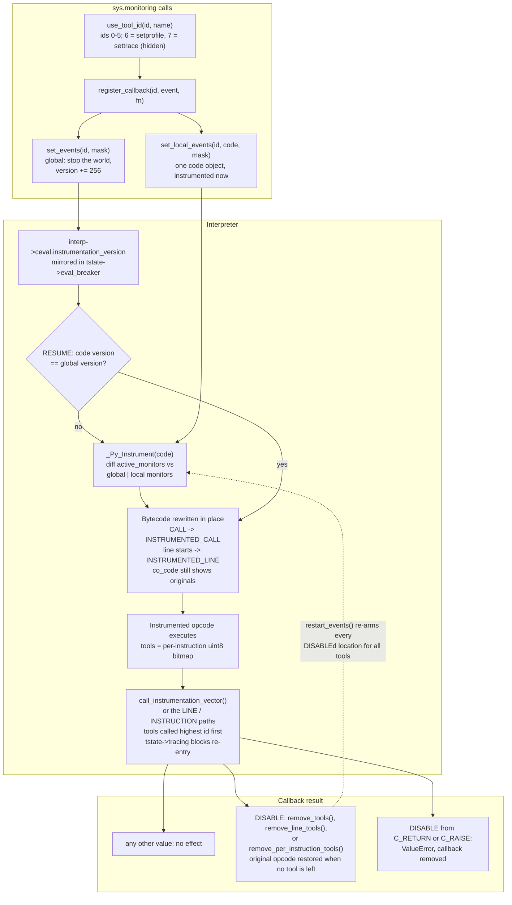

# Python sys.monitoring and Tracing

> [!summary] Claim:
> PEP 669 `sys.monitoring` (CPython 3.12+) replaces "call a function on every line" with per-tool, per-event, per-location instrumentation: turning an event on rewrites only the affected bytecode into `INSTRUMENTED_*` opcodes, and everything else runs at full speed.
> Six tool ids (0 to 5) are public, and two more are hidden: `sys.setprofile` runs as tool 6 and `sys.settrace` as tool 7, both rebuilt on the same machinery in `Python/legacy_tracing.c`.
> A callback that returns `sys.monitoring.DISABLE` makes the VM put the original opcode back at that one location for that one tool, so a coverage tool pays one callback per location and a debugger pays only for its breakpoints.
> Changing the global event set bumps an interpreter-wide version, and each code object re-instruments itself lazily at its next `RESUME` by diffing old and new monitor sets, which explains the API's sharpest edges: a DISABLEd location can outlive `free_tool_id()` and a re-claim of the same id until `restart_events()`, and frames already running produce returns without starts.



## The Mechanism

### 1. Why PEP 669 exists

Before 3.12 the VM offered two hooks.
`sys.settrace(fn)` installs a per-thread global trace function that receives `call` for every Python frame; whatever it returns becomes that frame's `f_trace`, which then receives `line`, `return`, `exception`, and optionally `opcode` events.
`sys.setprofile(fn)` receives `call`, `return`, `c_call`, `c_return`, and `c_exception`, but no line events.
Both are all-or-nothing per thread: a debugger that wants one breakpoint must still look at every line of every frame it chose to trace, and the interpreter has to check for tracing on its hot paths.
PEP 669's abstract states the problem directly: "Slowdowns by an order of magnitude are common."
Mark Shannon's design reuses the PEP 659 quickening machinery, which already rewrites bytecode in place for specialization, to rewrite it for monitoring instead.
The PEP's stated philosophy is that "it should be possible for third-party monitoring tools to achieve high-performance, not that it should be easy for them to do so", and the API's rough edges follow from that choice.
Every fact in this section is from CPython v3.15.2 source or the 3.15 documentation unless another version is named (as of 2026-11, Both).

### 2. Tool identifiers

A tool claims an id with `sys.monitoring.use_tool_id(id, name)`; ids must be 0 to 5, and claiming a held id raises `ValueError`.
The documented names are conventions only: `DEBUGGER_ID = 0`, `COVERAGE_ID = 1`, `PROFILER_ID = 2`, `OPTIMIZER_ID = 5`; the VM treats all ids the same.
`Include/internal/pycore_instruments.h` defines `PY_MONITORING_TOOL_IDS 8` and reserves the last two: `PY_MONITORING_SYS_PROFILE_ID 6` and `PY_MONITORING_SYS_TRACE_ID 7`.
Eight ids is not arbitrary: the per-instruction tool sets are `uint8_t` bitmaps, one bit per tool.
The conventions matter in practice because real tools hard-code them:

- `cProfile` (`Modules/_lsprof.c`) claims `PY_MONITORING_PROFILER_ID` and fails with `ValueError: tool 2 is already in use` on 3.15.2 if anything else holds it, which the lab shows.
  The wording depends on the patch release, not on the minor version: `_lsprof.c` at tags v3.12.0, v3.12.13, v3.13.0 through v3.13.12, v3.14.0 through v3.14.5, and v3.15.0b3 replaces that error with `ValueError: Another profiling tool is already active`, while v3.13.18, v3.14.10, v3.15.0b4, v3.15.0, and v3.15.2 let the message of `use_tool_id()` through (tags fetched and compared; runs on 3.12.13, 3.13.18, 3.14.10, 3.15.0b3, and 3.15.2 agree; as of 2026-11, macOS).
- `bdb`'s monitoring backend (`_MonitoringTracer` in `Lib/bdb.py`) claims `DEBUGGER_ID` under the name `bdbtracer` and raises `ValueError('Another debugger is using the monitoring tool')` if another name holds it.
- debugpy's vendored pydevd claims `DEBUGGER_ID` under the name `pydevd` on 3.12+ unless `PYDEVD_USE_SYS_MONITORING` turns it off (`pydevd_constants.py`, main branch, as of 2026-11).
  A debugpy 1.8.22 session on CPython 3.15.2 confirms it: after `debugpy.listen()`, `sys.monitoring.get_tool(0)` returns `'pydevd'` with no global events set yet and `sys.gettrace()` is `None`, and `bdb.Bdb(backend='monitoring').start_trace()` then fails with the `bdb` error quoted in this list; with `PYDEVD_USE_SYS_MONITORING=false` no tool id is held and `sys.gettrace()` is set instead (as of 2026-11, macOS).
- coverage.py's `sysmon` core claims `COVERAGE_ID` under the name `coverage.py`, and line_profiler claims `PROFILER_ID` under the name `line_profiler`, so enabling `cProfile` while a line_profiler profile is enabled fails with `ValueError: tool 2 is already in use` (coverage 7.17.2 and line_profiler 5.1.0 run on CPython 3.15.2; as of 2026-11, macOS).

`free_tool_id()` releases an id; since 3.14 it first calls `clear_tool_id()`, which unregisters every callback and turns off every global and local event for that id.
In 3.12 and 3.13, `free_tool_id()` only released the name and left events and callbacks in place.

### 3. Events

Each event is a bit; event sets are ORed masks.
The bit numbers are an implementation detail that has already changed once: 3.14 inserted `BRANCH_LEFT` and `BRANCH_RIGHT` at bits 8 and 9, which moved `STOP_ITERATION` from bit 9 to bit 10 and every later event up by one, and moved the now-deprecated `BRANCH` from bit 8 to bit 18 (compare `pycore_instruments.h` at 3.12 with `Include/cpython/monitoring.h` at v3.15.2).
Always use the named constants in `sys.monitoring.events`.

| Group | Events (bit on 3.15) | Can be set per code object | DISABLE effect |
| :--- | :--- | :--- | :--- |
| Local, instrumented | `PY_START` 0, `PY_RESUME` 1, `PY_RETURN` 2, `PY_YIELD` 3, `CALL` 4, `LINE` 5, `INSTRUCTION` 6, `JUMP` 7, `BRANCH_LEFT` 8, `BRANCH_RIGHT` 9, `STOP_ITERATION` 10 | Yes, every version | Removes this tool at this instruction |
| Other | `RAISE` 11, `EXCEPTION_HANDLED` 12, `PY_UNWIND` 13, `PY_THROW` 14, `RERAISE` 15 | 3.15+ only | 3.15+: clears the tool's local bit for this code object; 3.12 to 3.14: `ValueError` |
| Ancillary | `C_RETURN` 16, `C_RAISE` 17 | Only together with `CALL` | `ValueError: Cannot disable C_RETURN events. Callback removed.` |
| Deprecated | `BRANCH` 18 (3.14+) | Stored as `BRANCH_LEFT \| BRANCH_RIGHT` | As for the two branch events |

The ancillary rule is enforced in `monitoring_set_events_impl()`: a mask with `C_RETURN` or `C_RAISE` must contain all three of `CALL`, `C_RETURN`, and `C_RAISE`, or it fails with "cannot set C_RETURN or C_RAISE events independently".
The two C bits are then stripped from the stored mask, so `get_events()` reports only `CALL`, and at dispatch time `get_tools_for_instruction()` maps both events to the `CALL` tool set.

Callback signatures are fixed per event; every callback receives the code object first, and offsets are in bytes (`sys.monitoring` documentation, 3.15):

| Events | Arguments after `code` | Notes |
| :--- | :--- | :--- |
| `PY_START`, `PY_RESUME` | `instruction_offset` | `PY_RESUME` covers `next()` and `send()`; `throw()` fires `PY_THROW` instead |
| `PY_RETURN`, `PY_YIELD` | `instruction_offset`, `retval` | Fired before the frame is left, so the callee's frame is still on the stack |
| `CALL`, `C_RETURN`, `C_RAISE` | `instruction_offset`, `callable`, `arg0` | `arg0` is `sys.monitoring.MISSING` for a call with no arguments; for a method call, `callable` is the function found on the class and `arg0` is the instance |
| `RAISE`, `RERAISE`, `EXCEPTION_HANDLED`, `PY_UNWIND`, `PY_THROW`, `STOP_ITERATION` | `instruction_offset`, `exception` | The exception instance, not a `(type, value, traceback)` tuple |
| `LINE` | `line_number` | The only event without an offset |
| `BRANCH_LEFT`, `BRANCH_RIGHT`, `JUMP` | `instruction_offset`, `destination_offset` | The destination is where execution continues |
| `INSTRUCTION` | `instruction_offset` | One event per executed instruction |

The documentation leaves which side is "left" up to the implementation, and promises only that it stays consistent for the life of the program.

### 4. Instrumentation is bytecode rewriting

`instrumentation.c` keeps three opcode tables: `INSTRUMENTED_OPCODES` maps an opcode to its instrumented twin (`CALL` to `INSTRUMENTED_CALL`, `RESUME` to `INSTRUMENTED_RESUME`, `POP_JUMP_IF_FALSE` to `INSTRUMENTED_POP_JUMP_IF_FALSE`), `DE_INSTRUMENT` maps back, and `EVENT_FOR_OPCODE` names the event each opcode can raise.
In v3.15.2 the instrumented opcodes occupy numbers 233 (`MIN_INSTRUMENTED_OPCODE`) up to 253 (`INSTRUMENTED_LINE`), just below `ENTER_EXECUTOR` at 254 (`Include/opcode_ids.h`).
`RESUME` serves two events: `force_instrument_lock_held()` maps a `RESUME` with oparg 0 to `PY_START` and any other oparg to `PY_RESUME`.

When a code object is first instrumented, `allocate_instrumentation_data()` attaches a `_PyCoMonitoringData`:

- `local_monitors`: the events set for this code object with `set_local_events()`, one `uint8_t` tool bitmap per event.
- `active_monitors`: the union of the interpreter's global monitors and `local_monitors`, which is what the bytecode currently reflects.
- `tools`: one `uint8_t` per code unit saying which tools want the event at that instruction, allocated only when more than one tool is involved.
- `lines` and `line_tools`: for `LINE`, the original opcode and line delta per instruction, plus a per-instruction tool bitmap.
- `per_instruction_opcodes` and `per_instruction_tools`: the same for `INSTRUCTION`.
- `tool_versions[8]`: per tool, the value of `interp->monitoring_tool_versions[tool]` copied when `set_local_events()` last ran for that tool on this code object; `clear_tool_id()` bumps the interpreter's copy, and `update_instrumentation_data()` drops a tool's local events from any code object whose copy differs, which is how freeing an id invalidates its local events without visiting every code object.

`LINE` and `INSTRUCTION` cannot simply swap one opcode for a twin, because any opcode can start a line.
They replace the opcode with `INSTRUMENTED_LINE` or `INSTRUMENTED_INSTRUCTION` and stash the real opcode in the side table, which may itself be an `INSTRUMENTED_*` opcode when events overlap.
PEP 669 estimated the memory cost for 3.12 at roughly 40% of the code object for `LINE` with one tool and 80% for `INSTRUCTION`, rising to roughly 120% and 200% with two or more tools; these are the PEP's design estimates, and the subsection "Specialization, memory, and optimizers" gives the allocation sizes read from v3.15.2 and measured by the lab.

`code.co_code` returns the de-instrumented bytes, so tools that read it see the original program; `dis.get_instructions(code, adaptive=True)` shows the live instrumented and specialized opcodes, which the lab uses as its probe.

### 5. Global events: versions and lazy re-instrumentation

`set_events()` stops the world (`_PyEval_StopTheWorld()`), updates `interp->monitors`, and adds `MONITORING_VERSION_INCREMENT` (`1 << _PY_EVAL_EVENTS_BITS`, which is 256 because `_PY_EVAL_EVENTS_BITS` is 8 in `pycore_ceval.h`) to `interp->ceval.instrumentation_version`.
The version shares a word with the eval breaker's event bits, so `set_global_version()` copies it into the current thread's `tstate->eval_breaker`, and into every thread's on the free-threaded build.
It then calls `instrument_all_executing_code_objects()`, which updates the code objects of frames already on any thread's stack, as the PEP promised.
Every other code object is left stale.
The `RESUME` instruction at the top of every function and after every yield compares the code object's `_co_instrumentation_version` with the global version, and on a mismatch calls `_Py_Instrument()` and re-executes itself (`bytecodes.c`).
On the default build that check is skipped while `tstate->tracing` is nonzero; on the free-threaded build it always runs, so that another thread cannot rewrite the bytecode a frame is executing.

`force_instrument_lock_held()` does not rebuild from scratch.
It computes `removed = active_monitors - (global | local)` and `new = (global | local) - active_monitors` per event, applies only those differences, and stores the new version.
That incremental diff explains two behaviours the lab shows:

- A location DISABLEd by tool 2 stays disabled after `free_tool_id(2)` and a fresh `use_tool_id(2)` plus `set_events(2, LINE)` when the code object did not run in between: its `active_monitors` still contains tool 2 for `LINE`, so the diff is empty.
  If the code object runs while the id is free, its `RESUME` sees the version that `clear_tool_id()` bumped, the diff removes tool 2 everywhere, and the later re-claim adds it back at every location; the lab shows both outcomes.
- `restart_events()` bumps the version twice and records `interp->last_restart_version`; a code object older than that takes the `restarted` branch, which removes all of its active tools and adds them back, re-arming every DISABLEd location for every tool.

`set_local_events()` also stops the world (`monitoring_set_local_events_impl()`), but it does not bump the global version: it updates one code object's `local_monitors` and calls `force_instrument_lock_held()` on that code object immediately; the lab counts `INSTRUMENTED_*` opcodes right after the call, before the function ever runs.
The version is a `uint32_t` that grows by 256 per global change; `restart_events()` uses two increments, and `clear_tool_id()` (so also `free_tool_id()`) can use two, one inside its `set_events(id, 0)` and one of its own.
`_PyMonitoring_SetEvents()`, `_PyMonitoring_ClearToolId()`, and `restart_events()` raise `OverflowError("events set too many times")` when the version would wrap to zero, so an interpreter gets fewer than 2^24 (16,777,216) increments; this limit is read from the source and not exercised by the lab, and `set_events()` with an unchanged mask returns early without consuming one.
PEP 669 classifies `get_events`, `get_local_events`, `register_callback`, and `get_tool` as fast, `set_local_events` as slower, and `use_tool_id`, `free_tool_id`, `set_events`, and `restart_events` as slow, and it warns that an optimizing VM may need hundreds of milliseconds of de-optimization when the active set changes mid-run.

### 6. Dispatch, DISABLE, and re-entry

Most instrumented opcodes call `_Py_call_instrumentation()`, `_Py_call_instrumentation_arg()`, `_Py_call_instrumentation_2args()`, or `_Py_call_instrumentation_jump()`, which all funnel into `call_instrumentation_vector()`; `LINE` and `INSTRUCTION` have their own loops in `_Py_call_instrumentation_line()` and `_Py_call_instrumentation_instruction()`, which follow the same rules with their own tool tables:

1. If `tstate->tracing` is nonzero, return at once: events raised while any monitoring callback runs are never reported, so a callback can call instrumented code without recursion.
2. Read the tool bitmap for this instruction with `get_tools_for_instruction()`.
3. Loop while bits remain, taking `most_significant_bit(tools)` each time, so tools run from the highest id down: `settrace` (7), then `setprofile` (6), then 5 to 0.
4. `call_one_instrument()` increments `tstate->tracing`, vectorcalls the callback, and decrements it.
5. On an exception, stop calling the remaining tools and propagate it into the monitored code, as if the instrumented instruction had raised; the callback stays registered and fires again next time.
6. On `DISABLE` for an instrumented event, stop the world and call `remove_tools(code, offset, event, 1 << tool)` (for `LINE`, `remove_line_tools()`; for `INSTRUCTION`, `remove_per_instruction_tools()`); when no tool is left at that offset, the original opcode is written back.
7. On `DISABLE` for an "other" event in 3.15, call `remove_local_tool()`, which clears the tool's bit in `local_monitors` for that code object and recomputes `active_monitors` as `global | local`.
8. On `DISABLE` for `C_RETURN` or `C_RAISE`, raise `ValueError("Cannot disable %s events. Callback removed.")` and clear the callback "to prevent infinite loop".

Rule 7 has a consequence the documentation does not spell out: when an "other" event is on globally, the global bit is still set after the local bit is cleared, so `DISABLE` changes nothing and every raise is still reported.
The lab measures exactly that on 3.15.2: 5 of 5 raises reported with `RAISE` enabled globally, 1 of 5 with `RAISE` enabled locally.

DISABLE works per instruction location, not per line number.
A line can own several `INSTRUMENTED_LINE` locations, and `_Py_call_instrumentation_line()` reports one only when control arrives from a different line (or from `RESUME`), suppressing it when the previous instruction was on the same line.
In the lab's `hot_loop`, `dis.get_instructions(adaptive=True)` on 3.15.2 shows seven `LINE` locations for six lines: the `for` header has one for loop setup and one on the `FOR_ITER` that the back edge jumps to, so DISABLEing every callback takes seven callbacks.

### 7. Local versus global

Global events (`set_events`) apply to every code object in the interpreter, including those created later.
Local events (`set_local_events`) apply to one code object, and before 3.15 only to the local group.
An event turned on both globally and locally fires once per occurrence; the 3.14 and 3.15 documentation says so explicitly, and the lab confirms identical counts.
Monitoring is per interpreter, not per thread: a tool sees events from every thread, while `sys.settrace` covers only the calling thread unless `threading.settrace_all_threads()` (3.12+) is used.

### 8. `sys.settrace` and `sys.setprofile` on top of sys.monitoring

`Python/legacy_tracing.c` ("Support for legacy tracing on top of PEP 669 instrumentation") registers small C callables as tool 7 and tool 6.
`settrace` turns on `PY_START`, `PY_RESUME`, `PY_THROW`, `PY_RETURN`, `PY_YIELD`, `RAISE`, `STOP_ITERATION`, `LINE`, `PY_UNWIND`, and `JUMP` globally (`set_monitoring_trace_events()`), and `INSTRUCTION` locally on a frame's code object when that frame sets `f_trace_opcodes` (`set_opcode_trace_world_stopped()`), so every frame of that code then pays for it.
`setprofile` turns on `PY_START`, `PY_RESUME`, `PY_RETURN`, `PY_YIELD`, `CALL`, `PY_UNWIND`, and `PY_THROW`, and receives `C_RETURN` and `C_RAISE` through `CALL`.
The legacy handlers return `DISABLE` only from `sys_trace_jump_func()`, and only for jumps that can never produce a legacy event: forward jumps, and backward jumps that land on a different line, which the target's `INSTRUMENTED_LINE` reports anyway.
That function exists because, in the words of its source comment, "sys.settrace generates line events for all backward edges, even if on the same line", so a same-line backward `JUMP` becomes a `line` event.
The lab shows that DISABLE at work: under `sys.settrace`, `hot_loop` carries two `INSTRUMENTED_JUMP_BACKWARD` opcodes before its loop body has run and none after three iterations.
`LINE`, call, return, and exception handlers never return `DISABLE`, because the old API has no way to say "not here again".
For `LINE`, `_Py_call_instrumentation_line()` special-cases tool 7 "to avoid boxing the line number": it materializes the frame object with `_PyFrame_GetFrameObject()` and calls `tstate->c_tracefunc` directly, which for `sys.settrace` is `trace_trampoline()` in `Python/sysmodule.c`.
When a frame has no `f_trace`, `trace_trampoline()` returns at once, but the VM has already paid for the instrumented opcode, the frame object, and the C call on every line, which is why a trace function that returns `None` for every frame still slows the lab's loop past 1.2x.
The two APIs also fail differently: when a settrace function raises, `trace_trampoline()` calls `_PyEval_SetTrace(tstate, NULL, NULL)` and tracing is off from then on, while an exception from a sys.monitoring callback propagates into the monitored code every time and the tool stays registered, which the lab shows.

The translation from monitoring events to legacy events is fixed by the `set_callbacks()` calls in `_PyEval_SetTrace()` and `_PyEval_SetProfile()`:

| Monitoring event | `sys.settrace` (tool 7) | `sys.setprofile` (tool 6) |
| :--- | :--- | :--- |
| `PY_START`, `PY_RESUME`, `PY_THROW` | `call`, `arg` is `None` | `call` |
| `LINE` | `line`, unless the frame set `f_trace_lines = False` | Not enabled |
| `JUMP` | `line`, only for a backward jump that stays on one line | Not enabled |
| `PY_RETURN`, `PY_YIELD` | `return`, `arg` is the returned or yielded value | `return` |
| `PY_UNWIND` | `return`, `arg` is `None` | `return` |
| `RAISE`, `STOP_ITERATION` | `exception`, `arg` is `(type, value, traceback)` | Not enabled |
| `INSTRUCTION` | `opcode`, only on code objects whose frames set `f_trace_opcodes = True` | Not enabled |
| `CALL`, `C_RETURN`, `C_RAISE` | Not enabled | `c_call`, `c_return`, `c_exception`, only when the callable is a builtin function or a method descriptor |
| `EXCEPTION_HANDLED`, `RERAISE` | Not enabled | Not enabled |

The lab prints three consequences of that table.
`sys.settrace` receives an `exception` event in every frame an exception passes through, as its documentation says ("an `'exception'` event is generated at each level"), because `RAISE` fires once per frame.
`sys.setprofile` reports `c_call` and `c_return` for `len()` but nothing for `int("x")` or for instantiating a class, because `sys_profile_call_or_return()` forwards only `PyCFunction` objects and method descriptors and a type is neither, while a sys.monitoring tool receives `CALL` and then `C_RETURN` or `C_RAISE` for all three.
And `opcode` tracing is the `INSTRUCTION` event under another name: the lab counts the same 10 events for `classify(5)` through tool 3 and through a settrace function that sets `f_trace_opcodes`.

PEP 669's text says settrace and setprofile "act as if they were tools 6 and 7 respectively", but the v3.15.2 source assigns setprofile to 6 and settrace to 7, and the lab's callback order (settrace before setprofile before tool 0) agrees with the source.
The PEP's "Order of events" section also says "Each event is delivered to tools in ascending order of ID", while `most_significant_bit()` in v3.15.2 delivers in descending order, which the lab shows as `[2, 1, 0]` for three public tools; the `sys.monitoring` documentation specifies no order, so treat it as an implementation detail.

### 9. Who uses it (as of 2026-11, Both)

- `pdb` and `bdb` (3.14+): `bdb.Bdb(backend='monitoring')` uses `_MonitoringTracer`, which sets `PY_START | PY_RESUME | PY_THROW | PY_UNWIND | RAISE` globally and `LINE | JUMP | PY_RETURN | PY_YIELD | STOP_ITERATION` locally on the code objects of frames that get a trace function, and whose jump callback DISABLEs forward jumps and backward jumps to a different line.
  `breakpoint()`, `pdb.set_trace()`, and the `python -m pdb` CLI always use the monitoring backend; an explicitly constructed `pdb.Pdb` defaults to `'settrace'` unless `pdb.set_default_backend()` changes it.
  [[Python-pdb-debugpy-and-Remote-Attach]] owns pdb usage.
- `cProfile` (3.12+, and its 3.15 name `profiling.tracing`): claims `PROFILER_ID` and registers `PY_START`, `PY_RESUME`, `PY_THROW`, `PY_RETURN`, `PY_YIELD`, `PY_UNWIND`, `CALL`, `C_RETURN`, and `C_RAISE`.
  [[Python-cProfile-Tachyon-and-Sampling-Profilers]] owns profiling.
- coverage.py: the `sysmon` core is the default on Python 3.14+, the C settrace core `ctrace` was the default through 3.13, and on 3.12 and 3.13 `sysmon` does not support branch coverage (coverage.py documentation, 7.17.2 current on PyPI).
  Runs of coverage 7.17.2 agree: under `coverage run` on 3.14.10 and 3.15.2, with and without `--branch`, tool 1 is held as `coverage.py` and `sys.gettrace()` is `None`, while on 3.13.18, and on 3.15.2 with `COVERAGE_CORE=ctrace`, no tool id is held and `sys.gettrace()` is set (as of 2026-11, macOS).
- line_profiler 5.1.0 holds `PROFILER_ID` as `line_profiler` while a profile is enabled on 3.15.2, with `sys.gettrace()` unset (as of 2026-11, macOS).
  [[Python-Memory-Profiling-Memray-and-Line-Profiler]] owns line profiling.
- A C extension can fire the same events "as it emulates the execution of Python code", in the C API documentation's words, through the 3.13+ C API (`PyMonitoring_EnterScope()`, `PyMonitoring_FirePyStartEvent()`, and the rest), passing a code-like object, which is why the documentation tells tools to accept look-alike code objects.

### 10. Exception and call events

The exception events come from a few fixed places in the interpreter loop (`Python/bytecodes.c` and `Python/ceval.c`).
Every exception that reaches the `error` label fires `RAISE` in the frame where it surfaces (`_PyEval_MonitorRaise()`), and control then goes to `exception_unwind`.
If the frame's exception table has a handler for the current offset, the VM fires `EXCEPTION_HANDLED` (`monitor_handled()`) and jumps to the handler.
If it has none, the VM fires `PY_UNWIND` (`monitor_unwind()`), pops the frame, and re-enters `error` in the caller, which fires `RAISE` again there.
`RERAISE` is fired by `monitor_reraise()` from the `RERAISE` instruction, a bare `raise` in `RAISE_VARARGS`, `END_ASYNC_FOR`, and `CLEANUP_THROW`, and `PY_THROW` by `monitor_throw()` when a generator or coroutine frame is entered by `throw()`.

Three consequences follow, and the lab prints all of them for one `KeyError` that crosses three frames:

- `RAISE` counts frames, not exceptions: the one exception produces three `RAISE` events, one in each frame it surfaces in.
- `EXCEPTION_HANDLED` means that control entered an exception-table handler, not that an `except` clause matched.
  A `try`/`finally` compiles to a handler that runs the `finally` body and ends in `RERAISE`, plus a cleanup handler that restores the previous exception state and reraises again, so passing through one `finally` yields two `EXCEPTION_HANDLED` and two `RERAISE` events.
- `PY_UNWIND` is the exit event of a frame that an exception leaves, so a tool that pairs `PY_START` only with `PY_RETURN` leaks one stack entry per unwound frame.

`throw()` shows the same machinery from inside a generator: `PY_THROW` replaces `PY_RESUME`, and `RAISE` and `EXCEPTION_HANDLED` then fire in the generator's frame when its `except` clause catches the thrown exception.

`CALL` fires before every call made from Python code, whatever the callee is.
`C_RETURN` or `C_RAISE` follows for "any callable, except for Python functions", in the documentation's words, and that includes classes: instantiating a pure Python class reports `CALL` and then `C_RETURN`, because the callable is a type.
A Python function reports only `CALL` at the call site; its own frame reports `PY_START` and `PY_RETURN`.

### 11. Specialization, memory, and optimizers

Instrumentation and PEP 659 specialization compete for the same opcode byte.
`instrument()` first maps the opcode back to its unspecialized form through `_PyOpcode_Deopt`, writes the instrumented twin, and resets the inline cache counter to its warm-up value.
The instrumented twins do not specialize: in `bytecodes.c`, `CALL` begins with `_SPECIALIZE_CALL`, while `INSTRUMENTED_CALL` is `_MAYBE_EXPAND_METHOD + _MONITOR_CALL + _DO_CALL` with no specializing step.
An instruction therefore runs in its generic form for as long as any tool has an event on it, even when the callback does nothing, and that cost is separate from the cost of the callback.
The lab shows the cycle on one call site: `CALL_PY_EXACT_ARGS` when warm, `INSTRUMENTED_CALL` while a `CALL` callback returns `None` for 2,000 iterations, plain `CALL` right after the callback returns DISABLE, and `CALL_PY_EXACT_ARGS` again after re-warming, while the neighbouring `FOR_ITER_RANGE` and `BINARY_OP_ADD_INT` stay specialized throughout.
On builds with the tier 2 optimizer (`_Py_TIER2`), `force_instrument_lock_held()` also clears the code object's executors, and `_PyMonitoring_SetEvents()`, `_PyMonitoring_ClearToolId()`, and `restart_events()` call `_Py_Executors_InvalidateAll()`, which is the de-optimization cost the PEP warned about.

The side tables are sized per code unit, and a code unit is two bytes of bytecode.
In v3.15.2, `allocate_instrumentation_data()` and `update_instrumentation_data()` allocate them with `PyMem_Malloc()`:

| Allocation | Size | Allocated when |
| :--- | :--- | :--- |
| `_PyCoMonitoringData` | 136 bytes on a 64-bit 3.15.2 build | The code object is first instrumented, or first re-checked after any global version change, with or without events of its own |
| `tools` | 1 byte per code unit | Two or more tools have events on the code object |
| `lines` | 1 byte plus 2 per code unit, or 3 to 5 per unit when the function's last line is 254 or more lines past its first | `LINE` is active |
| `line_tools` | 1 byte per code unit | `LINE` is active and two or more tools have events |
| `per_instruction_opcodes` | 2 bytes per code unit (the size is multiplied by `sizeof(_PyCoLineInstrumentationData)`, which is 2) | `INSTRUCTION` is active |
| `per_instruction_tools` | 1 byte per code unit | `INSTRUCTION` is active and two or more tools have events |

The lab measures these with `tracemalloc` on `hot_loop`, which has 58 code units: 136 bytes for `PY_START` with one tool and 194 with two, 253 and 369 for `LINE`, 252 and 368 for `INSTRUCTION`, and 369 and 543 for both events together, which is the table's arithmetic exactly.
Measured against the 116 bytes of bytecode, `LINE` or `INSTRUCTION` costs about 100% with one tool and about 200% with two, on top of the fixed 136 bytes; the PEP's percentages do not name their denominator, so the two sets of numbers are not directly comparable.

Two properties matter more than the percentages.
Nothing is freed when events are turned off: `free_monitoring_data()` has one caller, `code_dealloc()`, so the tables live as long as the code object, and the lab reads the same byte counts after `set_local_events(tool, code, 0)`.
The 136-byte record is also allocated for code objects that no tool watches: `force_instrument_lock_held()` calls `update_instrumentation_data()` before it looks at any event, so once any tool in the process has changed the global version, each function that runs afterwards pays 136 bytes at its next `RESUME`.
The lab shows it for a function that only ever runs while no event is on: 0 bytes before, 136 bytes after another tool's `set_events()` and `free_tool_id()`.
Only code objects flagged `CO_NO_MONITORING_EVENTS` return before the allocation.

### 12. Finding out who is monitoring

The public API can describe the six public tools and nothing else.
`get_tool(id)` names the holder of an id, `get_events(id)` returns its global mask, and `get_local_events(id, code)` returns its mask for one code object.
All three reject ids 6 and 7 with a `ValueError` such as `invalid tool 7 (must be between 0 and 5)`, so `sys.settrace` and `sys.setprofile` are visible only through `sys.gettrace()` and `sys.getprofile()`.
The ground truth for one function is its live bytecode: `dis.get_instructions(code, adaptive=True)` shows an `INSTRUMENTED_*` opcode for every event that any of the eight tools still has on it.
The lab's `minitrace.who_is_monitoring()` prints all of these for a process that has a breakpoint tool, a global tool, and a declining `sys.settrace` function at once.

Two details make that picture easy to misread.
Instrumentation is removed as lazily as it is added: after `sys.settrace(None)`, a function keeps its `INSTRUMENTED_*` opcodes until its next `RESUME`, so a disassembly taken right after a tool stops still shows the tool.
And only one call in the API raises an audit event: `register_callback()` raises `sys.monitoring.register_callback`, also when it unregisters, while `use_tool_id()`, `set_events()`, `set_local_events()`, and `free_tool_id()` raise none.
`sys.settrace()` and `sys.setprofile()` raise `sys.settrace` and `sys.setprofile` on every call, including the call that passes `None`.
A `sys.addaudithook()` hook (3.8+) installed at startup is therefore enough to log which code installs tracing in a process.

## Commands and Numbers to Know

| Item | Value | Platform and date | Why it matters |
| :--- | :--- | :--- | :--- |
| Public tool ids | `0` to `5` | Both (as of 2026-11) | `use_tool_id(6, ...)` raises `ValueError` |
| Hidden tool ids | `6` = `setprofile`, `7` = `settrace` | Both (as of 2026-11) | Source and lab agree; PEP 669's text says the reverse |
| Named ids | `DEBUGGER_ID 0`, `COVERAGE_ID 1`, `PROFILER_ID 2`, `OPTIMIZER_ID 5` | Both (as of 2026-11) | pdb, pydevd, and cProfile hard-code these |
| Event bits | 19 events, bits 0 to 18 on 3.14 and 3.15; 17 on 3.12 and 3.13 | Both (as of 2026-11) | Never hard-code a bit |
| Callback order | Highest tool id first | Both (as of 2026-11) | Source and lab agree; PEP 669's text says ascending; settrace sees each event before every public tool |
| Version increment | `1 << 8` = 256 per global change | Both (as of 2026-11) | Low 8 bits of `eval_breaker` are event flags |
| Instrumented opcodes | 233 to 253 in v3.15.2 | Both (as of 2026-11) | `dis.get_instructions(code, adaptive=True)` shows them |
| `sys.monitoring.DISABLE` | Per (tool, instruction location) | Both (as of 2026-11) | Can survive `free_tool_id()` and a re-claim; `restart_events()` always clears it |
| `sys.monitoring.MISSING` | `arg0` of a zero-argument `CALL` | Both (as of 2026-11) | Distinguish from a real `None` argument |
| `clear_tool_id()` | 3.14+ | Both (as of 2026-11) | `free_tool_id()` calls it since 3.14 |
| `BRANCH_LEFT`, `BRANCH_RIGHT` | 3.14+; `BRANCH` deprecated | Both (as of 2026-11) | Each side can be DISABLEd separately |
| Per-code "other" events | 3.15+ | Both (as of 2026-11) | DISABLE no longer raises `ValueError` for them |
| `pdb` backend | CLI, `breakpoint()`, `set_trace()`: `monitoring`; `Pdb()`: `settrace` | Both (as of 2026-11) | `pdb.set_default_backend()` changes the latter |
| coverage.py core | `sysmon` default on 3.14+ | Both (as of 2026-11) | `[run] core` or `COVERAGE_CORE` override it |
| `PYDEVD_USE_SYS_MONITORING` | Default on for 3.12+ | Both (as of 2026-11) | Set false to force debugpy back to settrace |
| `threading.settrace_all_threads()` | 3.12+ | Both (as of 2026-11) | settrace is per thread; monitoring is not |
| Version increments per interpreter | Under 2^24 (16,777,216), then `OverflowError` | Both (as of 2026-11) | Read from source; `restart_events()` uses two, `clear_tool_id()` up to two |
| Callback that raises | Exception propagates into monitored code; callback stays | Both (as of 2026-11) | settrace instead uninstalls itself after one failure |
| Instrumentation record per code object | 136 bytes on 64-bit 3.15.2 | macOS (as of 2026-11) | Allocated for every code object that runs after any global event change; freed only with the code object |
| `LINE` side table | 1 byte plus 2 per code unit for functions under 254 lines | Both (as of 2026-11) | Read from source; the lab measures 117 bytes for 58 code units |
| `RAISE` events per exception | One per frame the exception surfaces in | Both (as of 2026-11) | The lab counts 3 for one exception crossing 3 frames |
| `frame.f_trace_opcodes` | `False` by default, 3.7+ | Both (as of 2026-11) | Setting it turns on `INSTRUCTION` locally for that frame's code object |
| `frame.f_trace_lines` | `True` by default, 3.7+ | Both (as of 2026-11) | `False` suppresses `line` events for the frame; the instrumentation stays |
| Audit events | `sys.monitoring.register_callback`, `sys.settrace`, `sys.setprofile` | Both (as of 2026-11) | `use_tool_id()`, `set_events()`, and `free_tool_id()` raise none |
| coverage.py tool | id 1, name `coverage.py` (7.17.2) | macOS (as of 2026-11) | Seen with `get_tool(1)` during `coverage run` on 3.14 and 3.15 |
| line_profiler tool | id 2, name `line_profiler` (5.1.0) | macOS (as of 2026-11) | `cProfile` cannot start while it is enabled |
| pydevd tool | id 0, name `pydevd` (debugpy 1.8.22) | macOS (as of 2026-11) | Held from `debugpy.listen()` on; blocks bdb's monitoring backend |

```python
import sys
mon, ev = sys.monitoring, sys.monitoring.events

mon.use_tool_id(mon.COVERAGE_ID, "my-cov")           # ValueError if held
mon.register_callback(mon.COVERAGE_ID, ev.LINE,
                      lambda code, line: mon.DISABLE)  # one hit per location
mon.set_events(mon.COVERAGE_ID, ev.LINE)             # global; slow, do it early
mon.set_local_events(mon.COVERAGE_ID, f.__code__, ev.LINE)  # one code object
mon.get_events(mon.COVERAGE_ID)                      # int mask
mon.restart_events()                                 # re-arm DISABLEd locations
mon.free_tool_id(mon.COVERAGE_ID)                    # clears events (3.14+)
```

## Multi-Language Comparison: C++ / Python / Rust

| Concern | C++ (Clang, GCC) | Python (CPython 3.15) | Rust (rustc, LLVM) |
| :--- | :--- | :--- | :--- |
| Dynamic on/off instrumentation | Clang XRay: `-fxray-instrument` emits nop sleds, listed in the `xray_instr_map` section, that `__xray_patch()` rewrites at run time; by default only functions of at least 200 instructions or with a loop get sleds | `set_events` and `set_local_events` rewrite bytecode to `INSTRUMENTED_*` opcodes; DISABLE rewrites it back | `-Z instrument-xray` emits XRay nop sleds, nightly only |
| Function entry and exit hooks | GCC and Clang `-finstrument-functions` calls `__cyg_profile_func_enter` and `__cyg_profile_func_exit` on every call, compiled in and always on | `PY_START`, `PY_RETURN`, `PY_UNWIND`, per tool, switchable per code object | `-Z instrument-mcount` inserts an entry counting call, nightly only |
| Line or statement coverage | `--coverage` (gcov) or `-fprofile-instr-generate -fcoverage-mapping`: counters compiled in, always on | `LINE` plus DISABLE: zero cost after first hit, no rebuild | `-C instrument-coverage`: LLVM source-based counters compiled in |
| Breakpoints | Debugger writes a trap instruction through ptrace or Mach (see [[How-Debuggers-Work-ptrace-Mach-and-Breakpoints]]) | In-process: `LINE` locally on the target code object, DISABLE every other location | Same as C++, through gdb or lldb |
| Cost when nothing is enabled | Nop sleds (XRay) or nothing; counters if compiled in | A version compare in `RESUME`; PEP 669 estimated a small speedup from dropping inline trace checks | Nothing unless compiled in |

The common lesson is that cheap tracing means "patch the program at the points you care about and leave the rest untouched", whether the patch is a trap instruction, a nop sled, or a bytecode opcode.
CPython's version is unusual because it is in-process and dynamic per tool: the program, the tool, and the patching all live in one interpreter.

## Worked Lab Example

The lab is `code/03-Debugging/sys_monitoring_tracer/`; it runs on macOS as is and needs a final release of CPython 3.15 or newer, taken from `python3` when that qualifies and otherwise from the first qualifying `python3.15` on `PATH`.
The harness keys expected files by platform only and the one expected file was recorded on 3.15.2, so `run.sh` stops with exit status 2 and names the missing interpreter instead of running an older one or a 3.15 pre-release.
`SYSMON_LAB_PYTHON=python3.14 bash run.sh` forces another interpreter, CPython 3.14 at the oldest, for comparing releases by hand.
`target.py` holds the observed functions, `minitrace.py` holds four rebuilt tools and the `who_is_monitoring()` report, and `lab.py` runs eighteen numbered experiments.
Each experiment runs in its own interpreter process, so none depends on tool ids, DISABLEd locations, or specialized bytecode that another one left behind, and a section that leaves a tool id, a trace function, or a profile function installed fails the run.
The output holds counts, opcode names, byte sizes, line numbers relative to each `def`, and threshold verdicts instead of timings or addresses.

```bash
cd code/03-Debugging/sys_monitoring_tracer
bash run.sh         # all eighteen sections
bash run.sh 4 13    # only sections 4 and 13
```

`run.sh` runs the interpreter as `-E -s -B lab.py` so `PYTHON*` variables, user site-packages, and stray `.pyc` writes cannot change the result.
Each check could fail: if instrumentation were not bytecode rewriting, section 3 would print no `INSTRUMENTED_*` opcodes; if DISABLE were per line, section 4 would print 6 rather than 7; if settrace were tool 6, section 10 would put `setprofile:call` first; if an instrumented call site still specialized, section 16 would print `CALL_PY_EXACT_ARGS` on its third line.

### Verified output

Recorded by `python3 -m _harness.verify --record` on darwin-arm64 with Homebrew CPython 3.15.2 on 2026-11-10, then re-checked with `python3 -m _harness.verify`; the file is `code/03-Debugging/sys_monitoring_tracer/expected/darwin-arm64.txt`.

```text
python 3.15 (cpython)

== 1. Tool identifiers
named ids: DEBUGGER_ID=0 COVERAGE_ID=1 PROFILER_ID=2 OPTIMIZER_ID=5
use_tool_id(6): ValueError: invalid tool 6 (must be between 0 and 5)
get_tool(0) after claim: 'lab-debugger'
second use_tool_id(0): ValueError: tool 0 is already in use
get_tool(0) after free: None
set_events(3) on unclaimed id: ValueError: tool 3 is not in use
get_tool(7), the hidden settrace slot: ValueError: invalid tool 7 (must be between 0 and 5)
cProfile with PROFILER_ID free: no error
cProfile while another tool holds PROFILER_ID: ValueError: tool 2 is already in use
bdb monitoring backend while DEBUGGER_ID is held by 'pydevd': ValueError: Another debugger is using the monitoring tool

== 2. Events are bits (bit numbers differ between releases)
PY_START=0 PY_RESUME=1 PY_RETURN=2 PY_YIELD=3 CALL=4 LINE=5 INSTRUCTION=6 JUMP=7 BRANCH_LEFT=8 BRANCH_RIGHT=9 STOP_ITERATION=10 RAISE=11 EXCEPTION_HANDLED=12 PY_UNWIND=13 PY_THROW=14 RERAISE=15 C_RETURN=16 C_RAISE=17 BRANCH=18
set_events(CALL | C_RETURN): ValueError: cannot set C_RETURN or C_RAISE events independently
get_events after CALL|C_RETURN|C_RAISE == CALL: True
deprecated BRANCH stored as BRANCH_LEFT|BRANCH_RIGHT: True

== 3. Turning events on rewrites the code object's bytecode
before: none
after set_local_events(LINE | PY_START): INSTRUMENTED_LINE x5, INSTRUMENTED_RESUME x1
co_code still the original bytes: True
after classify(5), every LINE callback returned DISABLE: INSTRUMENTED_LINE x2, INSTRUMENTED_RESUME x1
after set_local_events(0): none

== 4. DISABLE: one callback per location, then none
hot_loop(1000), callback returns None: LINE callbacks = 3003
callback returns DISABLE: first call = 7, second call = 0, distinct line numbers = 6
id 2 freed and claimed again, hot_loop not run in between: 0
id 2 after restart_events(): 3003
id 2 DISABLEd, freed, hot_loop run while free, claimed again: 3003

== 5. Local events versus global events
local LINE on classify only: {'classify': 3}
global LINE plus local LINE on classify: {'classify': 3, 'fib': 30}
global LINE only: {'classify': 3, 'fib': 30}
an event on both lists fires once: True

== 6. Several tools on one event
callback order for the first fib() call: [2, 1, 0]
PY_START callbacks over fib(10) per tool id: {0: 177, 1: 1, 2: 177}
tool 1 returned DISABLE; tools 0 and 2 still see every call: True

== 7. Events raised inside a callback are not reported
PY_START for tiny: 1 | for classify called from the callback: 0

== 8. Scope: sys.monitoring is per interpreter, sys.settrace is per thread
monitoring saw tiny() in: ['MainThread', 'worker']
settrace saw tiny() in: ['MainThread']

== 9. What DISABLE cannot do, and failing callbacks
C_RETURN DISABLE: Cannot disable C_RETURN events. Callback removed. (raised at the next C call, len(), returning)
C_RETURN callback still registered: False
callback that raises, two calls of tiny(): ['RuntimeError(callback failed)', 'RuntimeError(callback failed)'] | events still on: True
settrace function that raises, two calls: ['RuntimeError(tracer failed)', 'returned'] | tracer removed itself: True
RAISE enabled globally, callback returns DISABLE: 5 of 5 raises reported
RAISE enabled locally, callback returns DISABLE: 1 of 5 raises reported

== 10. sys.settrace runs as a hidden tool next to sys.monitoring
event order inside tiny():
  settrace:call, setprofile:call, monitoring:PY_START, settrace:line, monitoring:LINE, settrace:line, monitoring:LINE, settrace:return, setprofile:return

== 11. Generator events, and how the loop exit is reported
consume(2), without branch events:
  caller:PY_START gen:PY_START gen:PY_YIELD gen:PY_RESUME gen:PY_YIELD gen:PY_RESUME gen:PY_RETURN caller:STOP_ITERATION caller:PY_RETURN
consume(2), with BRANCH_LEFT and BRANCH_RIGHT:
  caller:PY_START gen:PY_START gen:BRANCH_LEFT gen:PY_YIELD caller:BRANCH_LEFT gen:PY_RESUME gen:BRANCH_LEFT gen:PY_YIELD caller:BRANCH_LEFT gen:PY_RESUME gen:BRANCH_RIGHT gen:PY_RETURN caller:BRANCH_RIGHT caller:PY_RETURN

== 12. Rebuild: four tools in minitrace.py
line coverage of classify(-1), classify(0), lines relative to def: [1, 2, 3, 4]
never executed: [5]
LINE callbacks during those two calls (each location is reported once, then DISABLEd): 4
matches a sys.settrace reference tracer: True
branch arcs (side, from line, to line) after -1 and 0: [('left', 1, 2), ('left', 3, 4), ('right', 1, 3)]
branch arcs after -1, 0, 7: 4 of 4
fib(10): calls = 177 | max depth = 10
  a naive depth counter (+1 on start, -1 on return) on the same events: max = 8 | lowest = -2
  returns with no start (frames running when events went on): ['CallCounter.start', 'Tool.__enter__']
  starts with no return (frames running when events went off): ['Tool.__exit__', 'Tool.stop']
breakpoint on hot_loop line +4 over two hot_loop(10) calls: hits = 8 | i at hits = [0, 3, 6, 9, 0, 3, 6, 9]
LINE callbacks in total: 14 (hits plus one per other location)

== 13. Exception events across frames, and what sys.settrace makes of them
outer(1) returned 'handled'; one KeyError raised in inner, passed through middle's finally, caught in outer:
  inner:RAISE inner:PY_UNWIND middle:RAISE middle:EXCEPTION_HANDLED middle:RERAISE middle:EXCEPTION_HANDLED middle:RERAISE middle:PY_UNWIND outer:RAISE outer:EXCEPTION_HANDLED outer:PY_RETURN
events for that one exception: RAISE x3, EXCEPTION_HANDLED x3, RERAISE x2, PY_UNWIND x2
gen.throw(ValueError) into a generator that catches it and yields again:
  echo:PY_YIELD echo:PY_THROW echo:RAISE echo:EXCEPTION_HANDLED echo:PY_YIELD
sys.settrace on the same outer(1) call, line events left out, argument type in brackets:
  outer:call(None) middle:call(None) inner:call(None) inner:exception(tuple) inner:return(None) middle:exception(tuple) middle:return(None) outer:exception(tuple) outer:return(str)

== 14. CALL and its ancillary events, and what sys.setprofile makes of them
get_local_events after CALL|C_RETURN|C_RAISE == CALL: True
call_kinds(), local CALL | C_RETURN | C_RAISE:
  CALL(Box, arg0=MISSING)
  C_RETURN(Box, arg0=MISSING)
  CALL(len, arg0=str)
  C_RETURN(len, arg0=str)
  CALL(tiny, arg0=MISSING)
  CALL(Box.get, arg0=Box)
  CALL(int, arg0=str)
  C_RAISE(int, arg0=str)
sys.setprofile on the same call_kinds():
  c_call(len) c_return(len) call(tiny) return(tiny) call(Box.get) return(Box.get)

== 15. Legacy hooks are monitoring tools, and how to find out who is monitoring
INSTRUCTION events for classify(5), tool 3: 10
sys.settrace 'opcode' events for classify(5), f_trace_opcodes = True: 10
classify under sys.settrace with f_trace_opcodes: INSTRUMENTED_INSTRUCTION x11, INSTRUMENTED_LINE x5, INSTRUMENTED_RESUME x1
right after sys.settrace(None), classify not run yet: INSTRUMENTED_INSTRUCTION x11, INSTRUMENTED_LINE x5, INSTRUMENTED_RESUME x1
after one more classify(5): none
hot_loop under sys.settrace, loop body not run yet: INSTRUMENTED_END_FOR x1, INSTRUMENTED_JUMP_BACKWARD x2, INSTRUMENTED_LINE x7, INSTRUMENTED_RESUME x1, INSTRUMENTED_RETURN_VALUE x1
after hot_loop(3), the legacy JUMP handler has DISABLEd the backward jumps: INSTRUMENTED_END_FOR x1, INSTRUMENTED_LINE x7, INSTRUMENTED_RESUME x1, INSTRUMENTED_RETURN_VALUE x1
who_is_monitoring(hot_loop) with a breakpoint tool, a global tool, and a settrace function that declines:
  tool 0 'minitrace-bp': global=[] local[hot_loop]=['LINE']
  tool 3 'lab-global': global=['PY_START', 'RAISE'] local[hot_loop]=[]
  sys.gettrace() set: True | sys.getprofile() set: False
  instrumented opcodes in hot_loop: INSTRUMENTED_END_FOR x1, INSTRUMENTED_LINE x7, INSTRUMENTED_RESUME x1, INSTRUMENTED_RETURN_VALUE x1
  get_local_events(7, hot_loop), asking for settrace's own events: ValueError: invalid tool 7 (must be between 0 and 5)
tiny under sys.setprofile alone (no LINE): INSTRUMENTED_RESUME x1, INSTRUMENTED_RETURN_VALUE x1
audit events raised by use_tool_id + set_events + set_local_events: none
by register_callback(fn): sys.monitoring.register_callback x1
by free_tool_id: none
by sys.settrace(fn) then sys.settrace(None): sys.settrace x2

== 16. An instrumented instruction is not specialized
for header, call to tiny(), += after 2000 warm iterations: FOR_ITER_RANGE, CALL_PY_EXACT_ARGS, BINARY_OP_ADD_INT
right after set_local_events(CALL): FOR_ITER_RANGE, INSTRUMENTED_CALL, BINARY_OP_ADD_INT
after 2000 more iterations, callback returns None: FOR_ITER_RANGE, INSTRUMENTED_CALL, BINARY_OP_ADD_INT
callback returns DISABLE, after one iteration: FOR_ITER_RANGE, CALL, BINARY_OP_ADD_INT
after 2000 more iterations: FOR_ITER_RANGE, CALL_PY_EXACT_ARGS, BINARY_OP_ADD_INT

== 17. Memory held by instrumentation side tables
a function that only runs while no event is on: 0 bytes before any event change, 136 bytes after another tool's set_events() and free_tool_id()
hot_loop: 58 code units, 116 bytes of bytecode; local events for tool 3, then for tools 3 and 4
PY_START: one tool = 136 bytes, two tools = 194 bytes | still held after set_local_events(0): 136, 194
LINE: one tool = 253 bytes, two tools = 369 bytes | still held after set_local_events(0): 253, 369
INSTRUCTION: one tool = 252 bytes, two tools = 368 bytes | still held after set_local_events(0): 252, 368
LINE | INSTRUCTION: one tool = 369 bytes, two tools = 543 bytes | still held after set_local_events(0): 369, 543

== 18. Overhead: counted work, then timing verdicts
Python-level callbacks during one hot_loop(20000) | INSTRUMENTED_LINE opcodes in hot_loop right after it
  untraced: 0 | 0
  LINE + DISABLE, run 1: 7 | 0
  LINE + DISABLE, run 2: 0 | 0
  LINE callback without DISABLE: 60003 | 7
  sys.settrace line tracer: 60005 | 7
  sys.settrace that declines every frame: 1 | 7
timing verdicts (minimum over interleaved samples, as a ratio to the untraced minimum):
  LINE + DISABLE coverage within 1.5x of untraced: yes
  LINE callback without DISABLE above 2.5x untraced: yes
  sys.settrace line tracer above 2.5x untraced: yes
  sys.settrace that declines every frame above 1.2x untraced: yes
```

### Reading the result

- Section 3: `classify` has five line starts, so `set_local_events(LINE | PY_START)` produces five `INSTRUMENTED_LINE` opcodes and one `INSTRUMENTED_RESUME` before the function ever runs.
  `classify(5)` executes lines +1, +3, and +5, each callback DISABLEs its location, and the two unexecuted returns stay instrumented; a coverage tool's remaining instrumentation is exactly its uncovered code.
- Section 4: 3,003 callbacks is three line events per iteration plus `t = 0`, the final loop test, and `return`; with DISABLE the same work costs 7 callbacks, then 0.
  Re-claiming id 2 straight away sees nothing; after `restart_events()`, or when `hot_loop` ran while the id was free, it sees all 3,003 again, which is the incremental diff in `force_instrument_lock_held()` at work.
- Section 6: tool order is 2, 1, 0, and tool 1's DISABLE removed only its own bit, so tools 0 and 2 each saw all 177 calls of `fib(10)`.
- Section 1: the last two lines are the tool-id collisions real tools hit: `cProfile` against anything on `PROFILER_ID`, and bdb's monitoring backend against anything else on `DEBUGGER_ID` (the lab claims it under the name `pydevd` to mimic debugpy).
- Section 9: the `C_RETURN` error surfaced at `len()`, a line unrelated to the bug, and the callback was silently unregistered.
  A raising monitoring callback broke both calls of `tiny()` and stayed registered, while the raising settrace function broke only the first call and removed itself.
  The global versus local `RAISE` results are the 3.15 asymmetry of rule 7 in the Mechanism subsection "Dispatch, DISABLE, and re-entry".
- Section 11: with branch events on, a `for` loop's exit is reported as `BRANCH_RIGHT` instead of `STOP_ITERATION`.
  In `bytecodes.c` the artificial `STOP_ITERATION` is fired only by `INSTRUMENTED_END_FOR` and `INSTRUMENTED_END_SEND`, and a `for` loop over a generator reaches its `END_FOR` only through the specialized `FOR_ITER_GEN`, whose inlined generator frame returns to it; `INSTRUMENTED_FOR_ITER` does not specialize, so on exhaustion it jumps past `END_FOR` to `INSTRUMENTED_POP_ITER`, which reports `BRANCH_RIGHT`.
  The unspecialized `FOR_ITER` skips `END_FOR` in the same way: a probe run during verification on 3.15.2 and 3.14.10, not part of the lab, looped over an already exhausted generator in a function that had never run and received neither `STOP_ITERATION` nor `RAISE` on the first call, then `STOP_ITERATION` on the second call, once `FOR_ITER` had become `FOR_ITER_GEN`.
- Section 12: the coverage tool needed 4 callbacks for the five line executions of its two calls, because line +1 was already DISABLEd on the second call.
  The breakpoint engine paid 14 callbacks for 8 hits: one per hit, plus one for each of the six other locations of `hot_loop`, which were DISABLEd on first sight.
  The call counter's shadow stack shows the boundary frames: `start()` and `__enter__` were already running when events went on, and `__exit__` and `stop()` were still running when they went off.
  A counter that adds one per start and subtracts one per return, fed the same events, reports a maximum depth of 8 instead of 10 and dips to -2.
- Section 13: one `KeyError` produced three `RAISE` events, three `EXCEPTION_HANDLED` events, two `RERAISE` events, and two `PY_UNWIND` events, although exactly one `except` clause ran.
  `middle` contributes the doubled `EXCEPTION_HANDLED` and `RERAISE` pair with nothing but a `try`/`finally`, and `sys.settrace` sees the same exception as three `exception` events and reports the two unwound frames as `return` with `None`.
- Section 14: `Box()` and `int("x")` are type calls, so they produce `CALL` plus `C_RETURN` or `C_RAISE` for a monitoring tool and nothing at all for `sys.setprofile`; `box.get(5)` arrives as the plain function `Box.get` with the instance in `arg0`.
- Section 15: 10 `INSTRUCTION` events and 10 legacy `opcode` events for the same call show that opcode tracing is local `INSTRUCTION` monitoring.
  `classify` stays fully instrumented after `sys.settrace(None)` until it runs once more, and `hot_loop` loses its two `INSTRUMENTED_JUMP_BACKWARD` opcodes to the legacy jump handler's DISABLE.
  The report lists tools 0 and 3 with their masks, but settrace appears only as `sys.gettrace() set: True` and as opcodes in `hot_loop` that no public tool asked for (`INSTRUMENTED_END_FOR` and `INSTRUMENTED_RETURN_VALUE`).
- Section 16: the call site is `INSTRUMENTED_CALL` for as long as a tool listens, with or without work in the callback, and it has to warm up again after DISABLE restores plain `CALL`.
- Section 17: the byte counts are the allocation table of the Mechanism subsection "Specialization, memory, and optimizers" applied to 58 code units, and every count is unchanged after the events are turned off.
- Section 18: the first block counts work instead of timing it.
  `LINE` with DISABLE costs 7 callbacks and leaves no `INSTRUMENTED_LINE` opcode behind; without DISABLE the same loop costs 60,003 callbacks, three per iteration plus three; the settrace line tracer is called 60,005 times, the same lines plus `call` and `return`.
  The settrace function that declines is called once, yet all seven `INSTRUMENTED_LINE` opcodes stay in `hot_loop`, which is why declining a frame is not free.
  The four verdict lines are the lab's only timing-dependent output.
  Each mode is sampled in interleaved rounds of one `hot_loop(20000)` run after a short warm-up, and a verdict compares the minimum per mode against the untraced minimum, because interference from other processes only ever adds time; sampling runs for at least 30 rounds and continues while any ratio is within 15% of its threshold.
  The ratios themselves go to stderr and stay out of the expected file, so run `bash run.sh 18` to see them for your machine.
- Other releases: a manual run under Homebrew CPython 3.14.10 with `SYSMON_LAB_PYTHON=python3.14`, not stored as an expected file, differs on nine lines.
  They are the version header, the two section 9 `RAISE` lines, which print `ValueError: Cannot disable RAISE events. Callback removed.` for the global case and `ValueError: invalid local event set 0x800` for the local case, and the six lines of section 17, where the fixed record is 128 bytes and `hot_loop` compiles to 56 code units.
  A manual run under 3.15.0b3 differs on one line, the `cProfile` collision message.

## Pitfalls

> [!warning] Pitfall: reusing a tool id without `restart_events()`
> DISABLE state lives in each code object's instrumentation, keyed by tool bit, not in the tool's registration.
> A test suite that runs a DISABLE-based coverage tool, frees id 1, and then starts a counting tool on id 1 sees zero events from every location the first tool disabled, unless that code happened to run while the id was free; the outcome depends on execution order, which makes the bug intermittent.
> Call `restart_events()` when a tool that used DISABLE shuts down, and accept that it re-arms other tools' disabled locations too.

> [!warning] Pitfall: returning DISABLE from `C_RETURN` or `C_RAISE`
> The VM raises `ValueError` at whatever C call returns next, which may be far from the tool, and unregisters the callback, so the tool silently stops seeing C returns.
> Return `None` from ancillary events, and filter in the `CALL` callback instead.

> [!warning] Pitfall: expecting DISABLE on a globally enabled "other" event to work
> On 3.12 to 3.14 it raises `ValueError` and removes the callback.
> On 3.15 it clears only the local bit, so with `set_events()` it has no effect at all.
> Enable `RAISE`, `PY_UNWIND`, and the rest per code object with `set_local_events()` on 3.15 if you want DISABLE to bite, and feature-detect the version.

> [!warning] Pitfall: unbalanced start and return events
> Frames already executing when you enable events produce `PY_RETURN` or `PY_UNWIND` without a `PY_START`, and frames still executing when you disable them never return.
> A profiler that keeps `depth += 1` and `depth -= 1` silently reports the wrong depth: on the lab's `fib(10)` run such a counter peaks at 8 instead of 10 and goes negative.
> Keep a shadow stack and match returns to the code object on top.

> [!warning] Pitfall: two tools on the same conventional id
> `cProfile`, `bdb`, pydevd, coverage.py, and line_profiler claim fixed ids, so a custom profiler on `PROFILER_ID` breaks `cProfile`, an enabled line_profiler profile breaks it too, and bdb's monitoring backend, which `pdb.set_trace()` and `python -m pdb` use, refuses to start while another name holds `DEBUGGER_ID`, as pydevd's monitoring mode does once it has claimed the id under the name `pydevd`.
> The lab reproduces the `cProfile` and `bdb` errors.
> Check `get_tool(id)` before claiming, pick an id nobody else uses (3 and 4 have no documented convention), and fail loudly with the holder's name.

> [!warning] Pitfall: a monitoring callback that raises
> The exception propagates out of the monitored instruction, so a bug in a coverage or telemetry callback breaks the application's code path, every time, at an unrelated line.
> A settrace function that raises is removed after the first failure; a sys.monitoring callback is not, so the failure repeats until the tool is cleared.
> Wrap every callback body in `try`/`except Exception`, log once, and return `DISABLE` or clear the tool on failure.

> [!warning] Pitfall: per-line expectations for DISABLE
> DISABLE removes one instruction location; a line can own several (the lab's `for` header has two that fire), and a location that is reached only from the same line never fires at all.
> Coverage tools must record the line number from the callback argument and expect more than one callback per line.

> [!warning] Pitfall: assuming STOP_ITERATION always fires at loop exit
> Whether a generator's exhaustion is reported as `STOP_ITERATION` or as a branch depends on which other events are on, and the documentation allows either a `STOP_ITERATION` or a `RAISE` of `StopIteration`.
> It also depends on specialization: on 3.14.10 and 3.15.2 the event fires for a `for` loop only once `FOR_ITER` has specialized to `FOR_ITER_GEN`, so the first run of a cold loop over an already exhausted generator reports nothing.
> Tools must treat the two as interchangeable, as the documentation says, and must not count loop exits from either alone.

> [!warning] Pitfall: counting exceptions with RAISE or EXCEPTION_HANDLED
> `RAISE` fires once in every frame an exception surfaces in, and `EXCEPTION_HANDLED` fires for every exception-table handler entered, including the two that a `finally` or a `with` block compiles to.
> The lab's single `KeyError` yields three of each, so an error-rate metric built on either event overcounts by the depth of the call stack.
> Count an exception once by marking the exception object at its first `RAISE`, for example with a private attribute, because exception instances cannot be weakly referenced, or count at `PY_UNWIND` of the outermost frame you own.

> [!warning] Pitfall: trusting sys.setprofile to see every C call
> The legacy profiler receives `c_call` only for builtin functions and method descriptors.
> Calls to types, such as `int("x")`, `dict(...)`, or instantiating an extension class, never appear, while a sys.monitoring tool gets `CALL` with `C_RETURN` or `C_RAISE` for them.
> A profile that moves from `sys.setprofile` to sys.monitoring gains call rows that were always there.

> [!warning] Pitfall: assuming a no-op callback is free
> While any tool has an event on an instruction, that instruction is the generic `INSTRUMENTED_*` form and cannot specialize, so a `CALL` callback that returns `None` still turns `CALL_PY_EXACT_ARGS` back into the slow path at every monitored call site.
> Return DISABLE as soon as a location is uninteresting, and expect a warm-up period after it.

> [!warning] Pitfall: expecting instrumentation memory to come back
> Turning events off, freeing the tool id, and `restart_events()` release nothing: the side tables are freed only with the code object, and every code object that runs after a global event change gets a 136-byte record on 3.15.2 whether or not a tool watches it.
> A tool that enables `LINE` or `INSTRUCTION` globally for a short diagnostic window leaves that memory behind in every function that ran during the window.

> [!warning] Pitfall: reading the tool list and concluding nothing is tracing
> `get_tool()` covers ids 0 to 5 only; `sys.settrace` and `sys.setprofile` hold the hidden ids, so a process can be fully line-traced while all six public ids report `None`.
> Check `sys.gettrace()`, `sys.getprofile()`, and the live opcodes of a hot function as well, and remember that a function keeps stale `INSTRUMENTED_*` opcodes until it next runs.

> [!warning] Pitfall: testing against one patch release
> Messages and semantics move inside a minor series: the `cProfile` collision message changed during 3.13.x and 3.14.x and between 3.15.0b3 and 3.15.0b4.
> Match on exception types and on `get_tool()` results, never on message text, and run tool tests on the oldest and newest patch release you support.

> [!warning] Pitfall: hard-coding event bit numbers
> 3.14 renumbered every event from `STOP_ITERATION` upward; a tool that saved masks as integers across versions, or compiled them into a C extension, silently watches the wrong events.

> [!warning] Pitfall: doing slow operations on the hot path
> `set_events()` stops the world and invalidates every code object's version, so toggling it per request or per test turns into a re-instrumentation storm.
> Set global events once at startup, and use `set_local_events()` and DISABLE for fine-grained control.

## At Scale

For one developer, sys.monitoring is invisible: `breakpoint()`, coverage.py on 3.14+, and `cProfile` already use it.
It becomes a platform concern when a fleet runs always-on tooling: production debuggers, coverage in large CI suites, request-level profilers, and security or audit agents that all want the same interpreter.

- Six public ids are a shared, unmanaged namespace.
  A company that ships an in-house agent should document which id it claims, check `get_tool()` first, and degrade gracefully when the id is held.
- Coverage in CI is where the economics show: a DISABLE-based core pays roughly once per location, so suites that were slowed badly by settrace coverage are the first place to measure before and after switching cores; measure on your own suite, because the gain depends on how often each line repeats.
- Always-on production monitors should use only events that are rare (`PY_START` filtered by DISABLE on uninteresting code, or local events on a handful of code objects), never global `LINE` or `INSTRUCTION`.
- Global `set_events()` calls stop the world; on the free-threaded build that is a stop of every thread, so treat changing the global event set like a configuration deploy, not a per-request switch.
- Version drift is real: 3.14 renumbered events and added `clear_tool_id`, and 3.15 changed DISABLE semantics for "other" events, so pin the CPython minor version in tests for any tool, and run a golden-output check such as this lab's on every interpreter upgrade.
- Memory is a one-way ratchet: the fixed record is 136 bytes per code object on 3.15.2 once anything changes the global event set, which is 13.6 MB for a process in which 100,000 code objects run afterwards, before any `LINE` table.
- Tracing is an audit surface: `sys.monitoring.register_callback`, `sys.settrace`, and `sys.setprofile` are audit events, so a startup `sys.addaudithook()` can log or veto any code that installs a tracer, which matters when a third-party package quietly installs one.
- Give on-call engineers one command that prints the holders of the six ids, `sys.gettrace()`, `sys.getprofile()`, and the instrumented opcodes of a named function; the lab's `who_is_monitoring()` is a short function to start from.

Decision rules:

- New debugger, coverage, or tracing tool on 3.12+: use sys.monitoring, never settrace, unless you must support 3.11 or older.
- Need every line, forever (a tracer that logs execution): sys.monitoring buys little over settrace, because the cost is in your callback; the lab's sys.monitoring counting tracer and its settrace tracer are both above 2.5x untraced on the same loop.
- Need "has this run at least once" (coverage, first-call detection, import-time checks): `LINE` or `PY_START` plus DISABLE.
- Need a breakpoint in a long-running service: local `LINE` on the target code object only, DISABLE every other location, and the service pays for the breakpoint hits alone.
- Need production profiling without any code-path changes: prefer a sampling profiler, which [[Python-cProfile-Tachyon-and-Sampling-Profilers]] owns.

## Practice Drill

> [!tip] Practice Drill:
> Extend `minitrace.py` with a `FirstCall` tool on id 4 that records each function the first time it starts, using only `PY_START` and DISABLE, and run the standard library's `json.dumps` over a nested object with it on.
> Predict how many callbacks the tool receives on the second identical `json.dumps` call, then measure it.
> Next, enable `RAISE` globally and locally on a function that raises in a loop and confirm the 3.15 asymmetry on your interpreter; on 3.14, predict both error messages before running `SYSMON_LAB_PYTHON=python3.14 bash run.sh 9`.
> Then add a `with` block around the call in `target.middle` instead of the `try`/`finally`, predict the new `EXCEPTION_HANDLED` and `RERAISE` counts of section 13, and check them with `bash run.sh 13`.
> Finally, break the lab on purpose: delete the `MON.restart_events()` call in `Tool.stop()` and predict which `minitrace` tool, run after the coverage tool on the same id, loses events.
> As a stretch, write a line profiler that times each line by recording `time.perf_counter_ns()` in a `LINE` callback, and explain why the time it attributes to the line after a slow call includes the call's return path.

## Interview Questions

> [!question] L5: What does `sys.monitoring.DISABLE` do, and why does it make coverage cheap?
>
> > [!success]- Answer
> > Returning `DISABLE` from a callback for a local event tells the VM to stop reporting that event, for that tool, at that one instruction location.
> > For `LINE`, `_Py_call_instrumentation_line()` calls `remove_line_tools()` (other instrumented events go through `call_instrumentation_vector()` and `remove_tools()`), and when no tool is left at that location the original opcode is written back, so the next execution runs at full speed.
> > A coverage tool only needs to know that a line ran once, so it records the line and returns `DISABLE`, paying one callback per location instead of one per execution.
> > `restart_events()` re-arms every disabled location for every tool.

> [!question] L5: How do `set_events()` and `set_local_events()` differ, and what happens when an event is on in both?
>
> > [!success]- Answer
> > `set_events()` turns events on for every code object in the interpreter, present and future, and is documented as a slow operation because it stops the world and bumps the global instrumentation version.
> > `set_local_events()` turns events on for one code object and instruments it at once.
> > The code object's active set is the union of the two, and an event that is on in both is delivered once, not twice.
> > Before 3.15 only the local group (lines, calls, returns, jumps, branches, instructions) could be set per code object; 3.15 also allows the "other" events such as `RAISE`.

> [!question] L5 (predict the output): What does this print on CPython 3.15?
>
> ```python
> import sys
> m, E = sys.monitoring, sys.monitoring.events
> def f():
>     for i in range(3):
>         pass
> seen = []
> m.use_tool_id(3, "t")
> m.register_callback(3, E.LINE, lambda c, ln: (seen.append(ln - f.__code__.co_firstlineno) if c is f.__code__ else None, m.DISABLE)[1])
> m.set_local_events(3, f.__code__, E.LINE)
> f(); f()
> print(seen)
> ```
>
> > [!success]- Answer
> > The callback records each location's relative line once and DISABLEs it, so the second `f()` adds nothing.
> > On 3.15.2, line +1 (the `for` header) owns three `INSTRUMENTED_LINE` locations: loop setup, the `FOR_ITER` that the back edge jumps to, and the implicit `return None` after the loop; line +2 owns one.
> > Execution reports setup (1), then the body (2), then `FOR_ITER` when the back edge arrives from line 2 (1); `FOR_ITER` on first entry and the final return are both reached from line +1 itself, so the same-line rule suppresses them.
> > The output is `[1, 2, 1]`.
> > The lab's `hot_loop` shows the same effect: seven DISABLE callbacks for six distinct lines.

> [!question] L6: Why are `sys.settrace` and `sys.setprofile` still slow on 3.12+, if they run on sys.monitoring?
>
> > [!success]- Answer
> > `legacy_tracing.c` registers them as tools 7 and 6 with global event sets, so `settrace` turns `LINE`, `JUMP`, calls, returns, and exceptions on for every code object.
> > Nothing on the legacy `LINE` path ever DISABLEs a location, because the old API has no way to say "not here again"; only the jump handler DISABLEs jumps that can never produce a legacy event, so every line of every function goes through `INSTRUMENTED_LINE`.
> > For tool 7, `_Py_call_instrumentation_line()` builds the frame object and calls the C trace function, `trace_trampoline()`, directly; when a frame has no `f_trace` that returns without calling Python, but the opcode, the frame object, and the call are already paid, which is why the lab's trace function that returns `None` for every frame still costs over 1.2x.
> > PEP 669 predicted that settrace performance would be "about the same" and that tools must port to the new API to get faster.

> [!question] L6: Walk through what happens between `set_events(id, LINE)` and the first `LINE` callback in a function that has not been called yet.
>
> > [!success]- Answer
> > `set_events()` validates the mask, stops the world, records the tool's events in `interp->monitors`, and adds 256 to the interpreter's instrumentation version, copying it into the eval breaker.
> > It re-instruments only code objects with frames on a stack; the target function's code object is now stale.
> > When the function is called, its `RESUME` compares the code's `_co_instrumentation_version` with the global version, calls `_Py_Instrument()`, and re-executes itself.
> > `force_instrument_lock_held()` diffs `active_monitors` against the union of global and local monitors, finds `LINE` new for this tool, allocates the line tables, and replaces every line-start opcode with `INSTRUMENTED_LINE`, saving the original in the side table.
> > The first `INSTRUMENTED_LINE` then calls `_Py_call_instrumentation_line()`, which calls the tool's callback with `(code, line_number)` before executing the saved opcode.

> [!question] L6 (debug this): A team's custom profiler on `PROFILER_ID` works in isolation, but in CI `python -m cProfile` fails with `ValueError: tool 2 is already in use`, and after they move the profiler to id 1, coverage reports for some tests are empty; what is wrong?
>
> > [!success]- Answer
> > First, `cProfile` hard-codes `PROFILER_ID`, so any long-lived tool on id 2 breaks it; the fix is to use an id nobody claims by convention (3 or 4), checked with `get_tool()`.
> > Second, id 1 is `COVERAGE_ID`; a coverage tool that DISABLEs locations and then frees id 1 can leave those locations disabled for id 1, and the profiler (or the next coverage run) inherits the holes for every function that did not run in between, unless someone calls `restart_events()`.
> > That order dependence is why only some tests come back empty.
> > The durable fix is an id registry for the in-house tools, `restart_events()` in every tool's shutdown path, and a test that runs the tools in sequence in one process.

> [!question] L6 (predict the output): A tool counts `RAISE` and `EXCEPTION_HANDLED` globally while `outer()` calls `middle()`, which calls `inner()` inside a `try`/`finally`; `inner()` raises one `KeyError` and `outer()` catches it; what are the two counts?
>
> > [!success]- Answer
> > Three and three, as the lab's section 13 prints.
> > `RAISE` fires at the `error` label of every frame the exception surfaces in: `inner`, then `middle`, then `outer`.
> > `EXCEPTION_HANDLED` fires whenever the exception table has a handler for the current offset: twice in `middle`, once for the handler that runs the `finally` body and once for the cleanup handler that its `RERAISE` lands in, and once in `outer` for the real `except`.
> > Each of `middle`'s two handlers ends in a `RERAISE`, and `inner` and `middle` each report `PY_UNWIND`.
> > An exception counter must therefore deduplicate by exception object, not by event.

> [!question] L6 (debug this): After a deploy, one service is twice as slow; nobody changed tracing code, `sys.monitoring.get_tool(i)` is `None` for all six ids, and CPU profiles show time in the interpreter loop; how do you find the tracer?
>
> > [!success]- Answer
> > The six public ids are not the whole picture: `sys.settrace` and `sys.setprofile` run as hidden tools 7 and 6, which no `sys.monitoring` call reports.
> > Check `sys.gettrace()` and `sys.getprofile()` in the affected thread, and disassemble a hot function with `dis.get_instructions(code, adaptive=True)`: `INSTRUMENTED_LINE` on every line start means a line tracer is active, whichever API installed it.
> > A trace function that returns `None` for every frame still leaves those opcodes in place, so a library that calls `sys.settrace` "just to watch for one module" slows every function, which the lab's last overhead verdict shows.
> > To find the installer, add a `sys.addaudithook()` at startup that logs a stack for the `sys.settrace`, `sys.setprofile`, and `sys.monitoring.register_callback` audit events.
> > Remember that opcodes go stale: a function shows its old instrumentation until it next runs, so check after the function has been called again.

> [!question] L7: A telemetry agent registers a global `CALL` callback that returns `None` after a cheap check; the team measures a slowdown far larger than the callback's own time, and resident memory that never drops after the agent is disabled; explain both.
>
> > [!success]- Answer
> > The slowdown has two parts, and the callback is only one of them.
> > While a tool has `CALL` on an instruction, the opcode is `INSTRUMENTED_CALL`, which has no specializing step, so every call site in the process loses `CALL_PY_EXACT_ARGS` and its relatives and runs the generic call path, plus the dispatch into the tool.
> > The lab shows a call site staying `INSTRUMENTED_CALL` through 2,000 iterations of a no-op callback and re-specializing only after DISABLE.
> > The fix is to return DISABLE for call sites the agent does not care about, or to enable `CALL` locally on a few code objects.
> > The memory does not drop because instrumentation side tables are freed only when the code object is freed: on 3.15.2 every code object that ran got a 136-byte record, plus one byte per code unit for the `tools` table wherever a second tool was active.
> > Neither `set_events(id, 0)` nor `free_tool_id()` returns it, so the agent's steady-state footprint has to be budgeted as permanent.

> [!question] L7: Design a production breakpoint service for a Python fleet that must cost nothing until a breakpoint is set and almost nothing while it waits.
>
> > [!success]- Answer
> > Claim one id at process start (not `DEBUGGER_ID`, so engineers can still attach pdb or debugpy) and register callbacks, but enable no events, so the interpreter runs uninstrumented apart from the version check in `RESUME`.
> > To set a breakpoint, resolve file and line to a code object (walk `gc.get_objects()` or keep an import hook's index), then call `set_local_events(id, code, LINE)` on that code object only, which instruments it immediately and nothing else.
> > The `LINE` callback returns `DISABLE` for every line except the breakpoint, so the function's steady-state cost is one callback per breakpoint hit; capture locals from `sys._getframe(1)`, apply a condition and a hit limit, and ship the snapshot asynchronously.
> > Clear the breakpoint with `set_local_events(id, code, 0)` plus `restart_events()` if other locations must be re-armed; never toggle global events per breakpoint, because that stops the world and invalidates every code object.
> > Budget for callback cost at hot breakpoints with rate limits, and for the free-threaded build, where instrumentation changes stop every thread.

> [!question] L7: Why can a profiler built on `PY_START` and `PY_RETURN` report wrong call depths or negative depths, and how do you make it robust?
>
> > [!success]- Answer
> > Events are switched on and off while frames are running, and the VM immediately instruments code objects that have frames on a stack, so the frame that called `set_events()` reports a `PY_RETURN` with no matching `PY_START`, and frames running when events go off never report a return.
> > Exceptions add `PY_UNWIND` instead of `PY_RETURN`, generators add `PY_YIELD` and `PY_RESUME`, and `throw()` adds `PY_THROW`, so a naive counter drifts in both directions.
> > The robust design keeps a per-thread shadow stack of code objects, pushes on start or resume, pops only when the return or unwind matches the top, and counts mismatches separately as boundary noise.
> > The lab's `CallCounter` does this and reports the two boundary frames on each side rather than letting them shift the depth; its naive twin on the same events reports a maximum depth of 8 instead of 10 and a minimum of -2.

> [!question] L7+: PEP 669 says settrace and setprofile act as tools 6 and 7 "respectively"; the source says otherwise; how would you settle it, and does it matter?
>
> > [!success]- Answer
> > The source is authoritative: `pycore_instruments.h` defines `PY_MONITORING_SYS_PROFILE_ID 6` and `PY_MONITORING_SYS_TRACE_ID 7`, and `legacy_tracing.c` registers each handler with those ids.
> > An experiment confirms it without reading C: three public tools on one event are called in the order 2, 1, 0, so delivery runs from the highest id down (the PEP says ascending, a second place where its text and the source differ), and with both hooks and a public tool active, the observed order settrace, setprofile, tool 0 means settrace holds the higher id.
> > It matters for tool authors because settrace sees every shared event before setprofile and before any public tool, so a tool that records event order, or that inspects state a settrace-based debugger may have just changed, must expect the legacy hook to have run first.

> [!question] L8+: Your organization wants one always-on Python agent that does coverage sampling, exception telemetry, and on-demand breakpoints across thousands of services on mixed CPython 3.12 to 3.15; what are the design constraints?
>
> > [!success]- Answer
> > Feature-detect rather than version-check where possible, but expect real semantic differences: event bit numbers moved in 3.14, `clear_tool_id()` and branch-side events arrived in 3.14, and DISABLE on `RAISE` raises `ValueError` before 3.15 and silently does nothing for globally enabled events on 3.15.
> > Exception telemetry therefore needs per-version handling: on 3.15 enable `RAISE` locally on code of interest so DISABLE works, and before 3.15 keep the callback cheap and never return DISABLE from it.
> > Coverage uses `LINE` plus DISABLE with a periodic `restart_events()` to sample again, accepting that a restart re-arms other tools' disabled locations and briefly costs one callback per location again.
> > Breakpoints use local events only, and the agent claims its own ids and documents them, leaving `DEBUGGER_ID`, `COVERAGE_ID`, and `PROFILER_ID` for pdb, debugpy, coverage.py, and cProfile.
> > Roll out like any runtime change: golden-output tests per CPython minor version, a kill switch that frees the ids and restarts events, and a fleet metric for interpreter CPU before and after enabling each feature.

## Further Reading

- PEP 669, "Low Impact Monitoring for CPython": the design, the performance and memory expectations, and the fast versus slow operation classes.
- `sys.monitoring` documentation for 3.15 (and the 3.12, 3.13, and 3.14 versions for comparison): the normative event list, callback signatures, and the version-changed notes.
- `Python/instrumentation.c` at v3.15.2: `call_instrumentation_vector()`, `force_instrument_lock_held()`, `remove_tools()`, and the opcode tables, which answer most "why does it behave like that" questions.
- `Python/legacy_tracing.c` at v3.15.2: how the old hooks are emulated, including the backward-jump `line` event.
- `Lib/bdb.py` `_MonitoringTracer` at v3.15.2: a production debugger backend in under 200 lines, a good model for local-events-plus-DISABLE design.
- `Modules/_lsprof.c` at v3.15.2: a C profiler that registers through the Python-level API.
- What's New in Python 3.12, 3.14, and 3.15: the dated history of PEP 669, `BRANCH_LEFT`, `clear_tool_id`, the pdb backends, and per-code "other" events.
- coverage.py `[run] core` documentation: the practical state of `sysmon` versus `ctrace`.
- `sys.settrace` and `sys.setprofile` in the `sys` module documentation for 3.15: the legacy event names, `f_trace_lines`, `f_trace_opcodes`, and the audit events both functions raise.
- `Python/bytecodes.c` at v3.15.2, the `error` and `exception_unwind` labels: thirty lines that define when `RAISE`, `EXCEPTION_HANDLED`, and `PY_UNWIND` fire.
- LLVM XRay documentation: the closest native-code analog, nop sleds patched at run time.

## See Also

- [[Python-pdb-debugpy-and-Remote-Attach]]: how pdb and debugpy expose these hooks to a person at a prompt.
- [[Python-faulthandler-and-Crash-Diagnostics]]: what to use when the process dies before any callback can run.
- [[How-Debuggers-Work-ptrace-Mach-and-Breakpoints]]: the out-of-process, trap-instruction model that sys.monitoring replaces in-process.
- [[Python-Debugging-Hung-Processes-and-C-Extensions]]: when the interpreter is stuck and no monitoring callback can fire.
- [[Python-Concurrency-Asyncio-Multiprocessing-and-Free-Threading-Bugs]]: free-threaded builds, where every instrumentation change stops all threads.
- [[Python-cProfile-Tachyon-and-Sampling-Profilers]]: deterministic profiling on sys.monitoring versus sampling.
- [[Python-Memory-Profiling-Memray-and-Line-Profiler]]: line-level profilers, the heaviest users of `LINE` events.

## Related

- Prerequisites: [[Python-pdb-debugpy-and-Remote-Attach]]
- Next: [[Python-faulthandler-and-Crash-Diagnostics]]
- Lab: `code/03-Debugging/sys_monitoring_tracer/`
