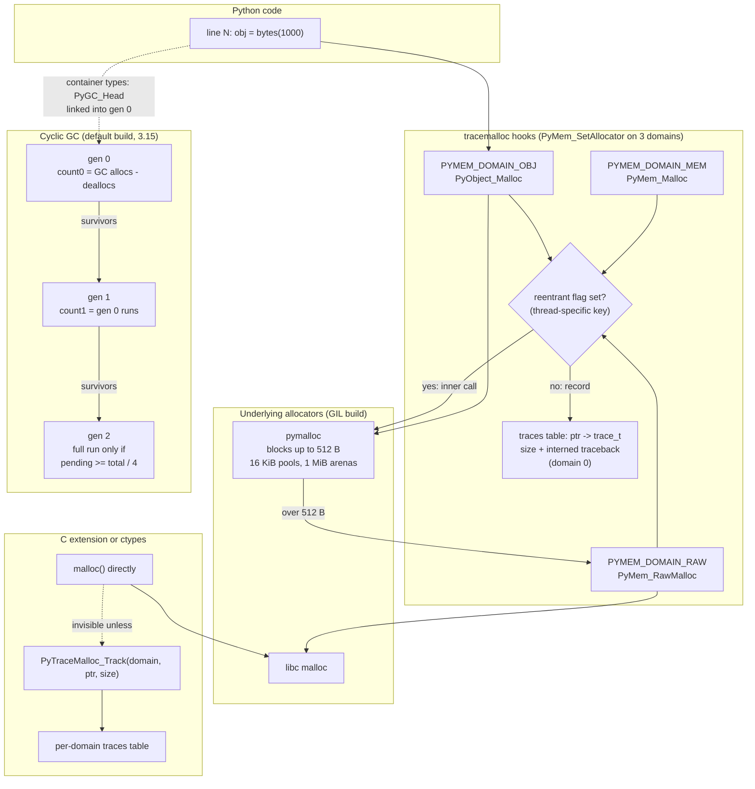

# Python tracemalloc, gc, and Memory Leaks

> [!summary] Claim:
> CPython frees most objects by reference counting, and a separate cyclic collector reclaims only unreachable cycles of GC-tracked containers, so a Python "leak" is almost always a live reference from a root, not lost memory.
> `tracemalloc` installs PEP 445 hooks on the raw, mem, and object allocator domains and records, for every live block, its size and an interned traceback of up to `nframe` Python frames (1 by default, at most 65535).
> A snapshot diff grouped by `lineno` names the line whose live blocks grew, and `gc.get_referrers` walks back from a leaked object to the root that pins it.
> Memory that a C extension takes straight from `malloc` never passes those hooks, so a leak that shows up in RSS but not in `get_traced_memory()` is native, and belongs to native tools.



## The Mechanism

[[Python-Debugging-Hung-Processes-and-C-Extensions]] owns attaching to a live process and reading native stacks; this note owns finding which Python allocations are still alive and why.
Every CPython source-code fact in this note is from tag `v3.15.2` unless another version is named.

### 1. Two collectors: reference counting first, cycles second

Reference counting frees an object the moment its count reaches zero, and freeing it decrements everything it points to, so most garbage disappears without any collector running.
A reference cycle keeps every member's count above zero after the last outside reference is gone, which is the one case reference counting cannot handle.
The cyclic collector exists only for that case, and it looks only at container objects that are "tracked": lists, class instances, dicts, and other types with `Py_TPFLAGS_HAVE_GC` and a `tp_traverse` slot.
Atomic objects such as `int` and `str` are never tracked, because they cannot point to anything.

Two consequences matter for leak hunting:
1. A leak in a GIL build of CPython is almost never "the GC failed": either something reachable still holds the objects, or a cycle exists and the collector has not run yet (or was disabled).
2. The collector cannot see memory that is not a tracked container, so it never helps with a buffer that a C extension allocated and forgot.

### 2. How tracemalloc sees allocations (PEP 445, PEP 454)

PEP 445 (Python 3.4) split CPython's allocators into three domains, each replaceable with `PyMem_SetAllocator()`:
- `PYMEM_DOMAIN_RAW` (`PyMem_RawMalloc`): goes to the system allocator and may be called without an attached thread state.
- `PYMEM_DOMAIN_MEM` (`PyMem_Malloc`): Python buffers, taken from the Python private heap with an attached thread state.
- `PYMEM_DOMAIN_OBJ` (`PyObject_Malloc`): Python objects, from the same private heap.

In the default GIL build both the mem and object domains use pymalloc, which serves requests of at most 512 bytes (`SMALL_REQUEST_THRESHOLD` in `pycore_obmalloc.h`) and falls back to `PyMem_RawMalloc` above that.
On 64-bit builds with the radix tree enabled, pymalloc carves 1 MiB arenas (`ARENA_BITS 20`) into 16 KiB pools (`POOL_BITS 14`).
The free-threaded build uses mimalloc for all three domains instead, and the C API docs require it to allocate every Python object, and only Python objects, through the object domain.

PEP 454 (Victor Stinner, Python 3.4) built `tracemalloc` on those hooks.
`_PyTraceMalloc_Start()` in `Python/tracemalloc.c` does the following:
1. It rejects `nframe` outside `[1; 65535]`, because `MAX_NFRAME` is `UINT16_MAX` and frame counts are stored as `uint16_t`.
2. It saves the current allocator of each domain with `PyMem_GetAllocator()` and installs `tracemalloc_malloc`, `_calloc`, `_realloc`, and `_free` with `PyMem_SetAllocator()`, passing the saved allocator as `ctx`.
3. It registers a reference tracer with `PyRefTracer_SetTracer(_PyTraceMalloc_TraceRef, NULL)`.
4. It sets `tracing` to 1 under `TABLES_LOCK()`.

Each hook calls the saved allocator first and then records the block.
A thread-specific reentrancy flag (`reentrant_key`) stops a nested call from being recorded twice: when `PyObject_Malloc` forwards a 1,041-byte request to the raw domain, only the outer call creates a trace.
The tables are guarded by a `PyMutex` taken with `_Py_LOCK_DONT_DETACH`, because `tracemalloc_free()` can run from `PyMem_RawFree()` in a thread with no attached thread state; tracing never takes the GIL.

The data structures are deliberately small:
- A trace is `trace_t { size_t size; traceback_t *traceback; }`, stored in a hash table keyed by block address; domain 0 has its own table, and every other domain gets a table in a `domains` map.
- A traceback is a packed header (`hash`, `uint16_t nframe`, `uint16_t total_nframe`) followed by 12-byte packed frames of `(const char *filename, unsigned int lineno)`.
- Tracebacks are interned in a hash table, and filenames are interned as UTF-8 strings, so 1,000 blocks allocated on the same call path share one traceback.
- `traceback_get_frames()` walks `_PyInterpreterFrame` links from the current thread state, filling at most `max_nframe` frames and counting the rest into `total_nframe`.

That walk reads the frames directly, so tracemalloc installs no trace function and no monitoring tool; [[Python-sys-monitoring-and-Tracing]] owns those mechanisms.

The reference tracer handles objects that reuse memory without a new allocation: on every `PyRefTracer_CREATE` event, `_PyTraceMalloc_TraceRef()` looks up the block that holds the object (`op` minus the type's pre-header size) and, if it is already traced, replaces its traceback with the current one.

Python code sees this through a small API:
- `start(nframe=1)`, `stop()`, `is_tracing()`, and `PYTHONTRACEMALLOC=N` or `-X tracemalloc=N` to start before any module is imported.
- `get_traced_memory()` returns `(current, peak)` of traced blocks, `reset_peak()` (3.9) moves only the peak, and `get_tracemalloc_memory()` reports tracemalloc's own tables, which the traced totals exclude.
- `clear_traces()` drops every trace without stopping, so later snapshots hold only blocks allocated after the call.
- `take_snapshot()` copies every trace into a `Snapshot`, which supports `filter_traces()`, `statistics(key_type, cumulative=False)`, `compare_to(old, key_type)`, `dump()`, and `load()`.
- `get_object_traceback(obj)` maps one live object back to its allocation traceback.
- `Traceback` frames are ordered oldest to most recent since 3.7, so `tb[-1]` is the allocating line; `Traceback.format(most_recent_first=True)` reverses them.
- `Filter(inclusive, filename_pattern, lineno=None, all_frames=False, domain=None)` uses `fnmatch` patterns, and `DomainFilter(inclusive, domain)` (3.6) selects an address space.
- Because the pattern is an `fnmatch` pattern, a literal path that contains `[`, `*`, or `?` must go through `glob.escape()`; without it the lab's filter matched nothing when run from a directory named `br[1]x` (run here, as of 2026-11).

`compare_to()` sorts by absolute `size_diff`, then `size`, then absolute `count_diff`, so the first entry is the line whose live bytes changed most.
A snapshot holds only blocks allocated after `start()`, which is why the environment variable matters for leaks that begin at import time.

### 3. The C API for memory that is not Python's: domains

C code that allocates outside the PEP 445 domains can still report its memory with two functions from `Include/cpython/tracemalloc.h` (added in 3.7, not part of the Limited API):
- `PyTraceMalloc_Track(unsigned int domain, uintptr_t ptr, size_t size)` returns 0 on success, -1 if a trace could not be allocated, and -2 if tracemalloc is not tracing; tracking a tracked block updates it.
- `PyTraceMalloc_Untrack(unsigned int domain, uintptr_t ptr)` returns -2 if tracemalloc is not tracing and 0 otherwise, whether or not the block was tracked.

Domain 0 is Python's own; the lab registers an 8 MiB `malloc` block in domain 4242 and selects it with `DomainFilter(True, 4242)`.
The traceback recorded is the Python frame that was running when the C code called `Track`, which is usually the call into the extension.

### 4. Finding cycles: the collection algorithm

In the default build each tracked object carries a 16-byte `PyGC_Head` (two pointer-sized words, `_gc_next` and `_gc_prev`) before its `PyObject` header, and these link it into one generation's doubly linked list.
`InternalDocs/garbage_collector.md` and `gc.c` describe one collection of a generation and everything younger:
1. `update_refs()` copies each candidate's real reference count into `gc_refs`, stored temporarily in `_gc_prev` above its two low flag bits (`_PyGC_PREV_SHIFT` is 2 in `pycore_gc.h`).
2. `subtract_refs()` calls `tp_traverse` on every candidate and decrements `gc_refs` of each candidate it points to, so what remains counts only references from outside the candidate set.
3. `move_unreachable()` moves objects with `gc_refs == 0` to a tentatively unreachable list and moves them back if a reachable object points to them, a breadth-first search that needs no recursion and O(1) extra memory.
4. Survivors are merged into the next older generation, and tuples whose contents are all untracked are untracked.
5. Objects with a legacy `tp_del` finalizer, and everything reachable from them, go to `gc.garbage`; with `DEBUG_SAVEALL`, all unreachable objects do.
6. Weak-reference callbacks are handled, `tp_finalize` (which `__del__` maps to) runs once per object, and the set is re-checked for resurrection.
7. `tp_clear` breaks the remaining links so reference counting frees the objects.

PEP 442 (Antoine Pitrou, Python 3.4) is why step 6 exists: before it, a cycle containing an object with `__del__` was uncollectable and landed in `gc.garbage`.
Since 3.4 such cycles are collected, the finalizer runs exactly once even if the object is resurrected, and only C types with a non-NULL `tp_del` still end up in `gc.garbage`.

`gc.collect()` returns the number of objects found unreachable (collected plus uncollectable), so a class with `__slots__` and no `__dict__` gives exactly two per two-object cycle.

### 5. When the collector runs: generations and the 25 percent rule

`_PyObject_GC_Link()` increments `generations[0].count` for every new GC object, and `PyObject_GC_Del()` decrements it, so `count0` is allocations minus deallocations.
When `count0` exceeds `threshold0`, the allocator does not collect on the spot; `_Py_ScheduleGC()` sets the `_PY_GC_SCHEDULED_BIT` eval-breaker bit and the collection runs at the next eval-breaker check.
`gc_select_generation()` then picks the oldest generation whose count exceeds its threshold:
- `count1` is the number of generation 0 collections since generation 1 was last collected, and `count2` the same for generation 1.
- A collection of generation `g` resets the counts of generations `0..g` and increments `count[g+1]`.
- Generation 2 is skipped unless `long_lived_pending >= long_lived_total / 4`, where `long_lived_pending` grows by the survivors of each generation 1 collection and `long_lived_total` is the size of generation 2 after the last full collection.

That last rule, suggested by Martin von Loewis in 2008 (bpo-4074), makes full collections geometrically rarer as the heap grows, so building a large list of tracked objects costs linear rather than quadratic time.
The thresholds default to `(2000, 10, 10)` in 3.15.2 (`GC_GENERATION_INIT` in `Include/internal/pycore_interp_structs.h`), the value the lab prints.

Python 3.14.0 through 3.14.4 shipped an incremental collector with two generations, in which `threshold2` was ignored and `gc.collect(1)` performed one increment.
After reports of memory pressure in production (gh-142516), CPython 3.14.5 and 3.15 restored the 3.13 generational collector (gh-148726), and the 3.14 docs mark `threshold2` and generation 1 as restored in 3.14.5.
A memory regression report against 3.14.0 to 3.14.4 is therefore worth re-testing on 3.14.5 or later before blaming the application.

The free-threaded build has no generations: every collection scans the whole mimalloc heap with two stop-the-world pauses.
The lab run on free-threaded 3.14.6 and 3.15.0b3 agrees: every automatic collection reported generation 0 to `gc.callbacks`, and 1,000,000 surviving lists triggered fewer than 499 runs (as of 2026-11).
[[Python-Concurrency-Asyncio-Multiprocessing-and-Free-Threading-Bugs]] owns the other hazards of that build.
The 3.14 `gc` docs add that it skips a scheduled collection unless process memory grew 10 percent since the last one or net allocations exceeded 40 times `threshold0`.
The 3.15 `gc` page has no such paragraph, and `gc_should_collect()` in `Python/gc_free_threading.c` at v3.15.2 has no memory test: once the young count exceeds `threshold0`, it skips the collection only while that count is below `long_lived_total / 4`.

### 6. Tracking state changes between releases

`gc.is_tracked()` decides whether an object can appear in `gc.get_objects()` and `gc.get_referrers()`.
Up to 3.13, dicts were tracked lazily: an empty or atomic-only dict was untracked until a container was stored in it.
3.14 removed that machinery (GH-127010), so every dict is tracked from creation; the lab prints `empty dict True` on 3.15.2.
The 3.15 `gc` library page still shows `gc.is_tracked({})` returning `False` (as of 2026-11, at tag v3.15.2 and on the `3.15` and `main` branches), which contradicts both `gc.c` and the internal design document.

`gc.get_stats()` gained `candidates` and `duration` per generation in 3.15, and `gc.callbacks` receives the same two keys in its `"stop"` info dict.

### 7. Tools for the referrer graph

- `gc.get_referrers(*objs)` scans every tracked container and returns those that refer directly to an argument; it is O(heap) per call, raises the `gc.get_referrers` audit event, and cannot see referrers that are not GC-tracked.
- `gc.get_referents(*objs)` returns what each argument's `tp_traverse` visits, which may omit untracked children such as ints.
- `gc.get_objects(generation=None)` lists tracked objects, and `gc.freeze()` (3.7) moves all of them to a permanent generation that later collections ignore, which keeps a forking server's pages shared after `fork()`.
- `weakref.ref`, `weakref.WeakMethod`, and `weakref.finalize` let a registry refer to objects without keeping them alive, and a dead `WeakMethod` returns `None`.
- `gc.unfreeze()` moves frozen objects back to the oldest generation, `gc.get_freeze_count()` counts them, and `gc.is_finalized(obj)` (3.9) says whether the collector already ran an object's finalizer.

### 8. Free lists: traced blocks that no object owns

CPython parks freed objects of a few hot types on free lists instead of returning them to the allocator.
`Include/internal/pycore_freelist_state.h` caps the lists at 100 floats, 100 ints, 80 lists, 80 dicts, 2,000 tuples of each length from 1 to 20, and one `PyBytesWriter`, among others.
The lists belong to the interpreter in the default build and to each thread in the free-threaded build (`_Py_freelists_GET()` in `pycore_freelist.h`).
The allocator hooks never see a free for a parked block, so tracemalloc keeps its trace, and a snapshot diff can show a few blocks that no Python object owns.
A full collection ends with `_PyGC_ClearAllFreeLists()` (only for generation 2 in `gc.c`, on every collection in `gc_free_threading.c`), so `gc.collect()` before a snapshot removes them.

Reuse is the reason tracemalloc registers a reference tracer.
Popping a float from the free list makes no allocator call, so without `_PyTraceMalloc_TraceRef()` the block would stay charged to the line that first allocated it.
The lab frees a float, creates another, shows that both have the same `id()`, and shows that the block's traceback now names the second line.

The lab's own payload line shows the effect.
In the snapshot taken right after the 1,000 requests, that line holds 1,002 blocks on CPython 3.15.2, not 1,000 (measured here with a probe, not part of the golden file, as of 2026-11).
The two extra blocks are 56 and 280 bytes.
The first is the one-element argument tuple that `bytes(1000)` is called with, because `bytes` has no vectorcall slot and `_PyObject_MakeTpCall()` builds a tuple: a 16-byte `PyGC_Head` plus a 40-byte tuple.
The second is the `PyBytesWriter` that `int.to_bytes()` uses since 3.15, a 256-byte inline buffer plus 24 bytes of fields.
CPython 3.14.10 shows only the tuple, and 3.13.18 shows it at 48 bytes, because `PyTupleObject` had no cached `ob_hash` field yet (as of 2026-11).
A later snapshot taken without a collection still holds the writer but not the tuple (same probe): another call has reused the tuple and the tracer has moved it to that call's line, while the writer is not an object, never passes the tracer, and stays where it was first allocated.

### 9. Leaks that the referrer graph cannot explain

`gc.get_referrers()` and `gc.get_objects()` see only GC-tracked containers, which leaves two blind spots.

The first is an unbalanced reference count.
A C extension that calls `Py_INCREF` without a matching `Py_DECREF` leaves the object alive with nothing pointing at it.
The lab reproduces this with `ctypes.pythonapi.Py_IncRef`: the object survives `del` and `gc.collect()`, `gc.get_referrers()` finds no holder, `tracemalloc.get_object_traceback()` still names the allocating line, and the matching `Py_DecRef` frees it.
`sys.getrefcount()` can confirm a count that no referrer explains, but the docs warn that it includes the temporary argument reference and is meaningless for immortal objects.

The second is every type the collector never tracks.
A census, `collections.Counter(type(o).__name__ for o in gc.get_objects())` taken twice and subtracted, names the container type that grows and needs no tracing to have been started.
In the lab, 500 leaked `__slots__` instances appear as `Order +500`, while 500 leaked `bytes` objects change the census by 0 and appear only as 500 traced blocks on their line.
`sys.getallocatedblocks()` (3.4) gives one number for the whole interpreter, and its docs recommend `sys._clear_internal_caches()` and `gc.collect()` first, because caches and free lists make it vary from call to call.

### 10. Caches that hold their keys

Most Python leaks are a cache or a registry doing what it was written to do.
`functools.lru_cache` keeps references to the arguments and return values until they age out or the cache is cleared, and when the cached function is a method, `self` is part of the key.
The Programming FAQ entry on caching method calls states the consequence: instances are kept alive until they age out of the cache or until the cache is cleared.
A `maxsize` bounds the number of entries, not their lifetime: the lab's `Report`, cached with `maxsize=128`, stays alive after `del` and `gc.collect()` until `cache_clear()`.
The fixes are `functools.cached_property` for per-instance values, a cache keyed by an identifier instead of the object, or a `weakref.WeakValueDictionary` or `WeakKeyDictionary`.

### 11. Traced memory, resident memory, and peak RSS

`get_traced_memory()` and RSS answer different questions, and both have a peak that is easy to misread.
- `get_traced_memory()[0]` is the sum of requested sizes of live traced blocks, so it falls the moment an object dies.
- `get_traced_memory()[1]` is a high-water mark since `start()` or the last `reset_peak()`; the lab's 4 MiB temporary raises it by at least 4 MiB while the current value returns to within 1 MiB.
- RSS counts pages, so it includes pymalloc arenas that still hold one live object, allocator caches, native allocations, and tracemalloc's own tables.
- On glibc, a block of at least `M_MMAP_THRESHOLD` bytes (initially 128 KiB, raised dynamically as larger blocks are freed) is served by `mmap` and can be returned on its own, while smaller blocks come from the heap, which shrinks only from the top once `M_TRIM_THRESHOLD` bytes are free there.
- `malloc_trim(0)` asks glibc to release free heap memory, which separates "retained by the allocator" from "leaked" in an experiment.

`ru_maxrss` from `getrusage(2)` is a peak, in bytes on macOS and in KiB on Linux, and on Linux it is not always the peak of the program that reads it.
`execve()` folds the high-water mark of the address space it replaces into the process's `signal->maxrss` (`exec_mmap()` in `fs/exec.c` calls `setmax_mm_hiwater_rss(&tsk->signal->maxrss, old_mm)`), and `getrusage()` in `kernel/sys.c` returns the larger of that value and the current image's own mark.
`subprocess` on Linux starts children with `vfork()` when it is safe, so the replaced address space is the parent's.
The lab shows the result: a child of a parent that once touched 128 MiB reports at least 96 MiB at its first `ru_maxrss` reading on Linux and not on macOS.
`VmHWM` in `/proc/<pid>/status` is the peak of the current image alone, which is what the lab reads on Linux.

### 12. Diagnostics built on tracemalloc, and tools beyond it

Two interpreter diagnostics print an allocation traceback only while tracemalloc is tracing:
- `ResourceWarning` for an unclosed file ends with `Enable tracemalloc to get the object allocation traceback` when tracing is off, and with `Object allocated at (most recent call last):` and the frames when it is on.
- The `PYTHONMALLOC=debug` hooks report an error such as a buffer overflow with the traceback where the block was allocated, if the block was traced.

The Python Development Mode (`-X dev`) does not start tracemalloc, because, as its docs put it, the overhead cost to performance and memory would be too large; add `-X tracemalloc=5` yourself.

Beyond tracemalloc and `gc`, three instruments fill the remaining gaps:
- Memray records every allocator call, including native ones: `memray run --native` adds C stacks, `--trace-python-allocators` records every object the Python allocators create instead of only the memory pymalloc takes from the system, `--follow-fork` tracks children, and `memray attach <pid>` injects the tracker into a running process, which then sees only allocations made after the attach (as of 2026-11).
- objgraph packages the census and the referrer walk: `show_growth()`, `by_type()`, `find_backref_chain()`, and `show_backrefs()` (as of 2026-11).
- `sys._debugmallocstats()` and `PYTHONMALLOCSTATS` print the allocator's own statistics (arenas, pools, and size classes for pymalloc), which show fragmentation that neither tracemalloc nor RSS can.

Native allocations belong to the native tools: [[Cpp-AddressSanitizer-and-LeakSanitizer-Internals]] and [[Cpp-Valgrind-Memcheck-Helgrind-and-DRD]] with `PYTHONMALLOC=malloc`, and [[Cpp-Sanitizers-and-Memory-Debugging-on-macOS]] for the macOS tools.

## Commands and Numbers to Know

| Item | Value | Platform | Notes |
|---|---|---|---|
| `tracemalloc.start(nframe)` range | 1 to 65535, default 1 (as of 2026-11) | Both | `MAX_NFRAME = UINT16_MAX`; 65536 raises `ValueError: the number of frames must be in range [1; 65535]` on 3.15.2. |
| `PYTHONTRACEMALLOC=25` or `-X tracemalloc=25` | start before imports with 25 frames (as of 2026-11) | Both | Without it, blocks allocated before `start()` are not in any snapshot. |
| `PyTraceMalloc_Track` return codes | 0 ok, -1 no memory, -2 not tracing (as of 2026-11) | Both | The lab prints -2 before `start()` and 0 after. |
| Traced allocator domains | `RAW`, `MEM`, `OBJ`; trace domain 0 (as of 2026-11) | Both | Other domain numbers exist only through `PyTraceMalloc_Track`. |
| pymalloc small request limit | 512 bytes (as of 2026-11) | Both | GIL build; larger requests go to `PyMem_RawMalloc`. |
| pymalloc arena and pool | 1 MiB arenas, 16 KiB pools on 64-bit (as of 2026-11) | Both | 2 MiB arenas with `--with-pymalloc-hugepages`; 256 KiB arenas on 32-bit. |
| pymalloc arena release | an arena returns to the OS only when all its pools are free, except the last wholly free one (as of 2026-11) | Both | `Objects/obmalloc.c`, case 1 of the free path; see bpo-37257. |
| Free-threaded allocator | mimalloc for all domains, cannot be disabled (as of 2026-11) | Both | `PYTHONMALLOC` accepts only `default`, `debug`, `mimalloc`, `mimalloc_debug` there. |
| `PYTHONMALLOC=malloc` | `malloc()` for all three domains (as of 2026-11) | Both | Lets ASan, Valgrind, or a heap profiler see each Python object as one `malloc` block. |
| `gc.get_threshold()` | `(2000, 10, 10)` on CPython 3.15.2 (as of 2026-11) | Both | `GC_GENERATION_INIT` in `Include/internal/pycore_interp_structs.h`; the lab prints it on macOS and Linux, and the 3.15 `gc` page states no default. |
| Full-collection gate | `long_lived_pending >= long_lived_total / 4` (as of 2026-11) | Both | Default build only; `gc.c` `gc_select_generation()`. |
| `PyGC_Head` | 16 bytes before each tracked object on 64-bit (as of 2026-11) | Both | Default build; the free-threaded build uses a 1-byte `ob_gc_bits` instead. |
| Incremental GC | shipped in 3.14.0 to 3.14.4, reverted in 3.14.5 and 3.15 (as of 2026-11) | Both | gh-148726; reports in gh-142516. |
| `gc.get_stats()` keys | `collections`, `collected`, `uncollectable`, plus `candidates` and `duration` in 3.15 (as of 2026-11) | Both | `gc.callbacks` `"stop"` info has the same additions. |
| `gc.set_debug(gc.DEBUG_LEAK)` | `DEBUG_COLLECTABLE \| DEBUG_UNCOLLECTABLE \| DEBUG_SAVEALL` (as of 2026-11) | Both | Includes `SAVEALL`, so nothing unreachable is freed while it is set. |
| `sys._debugmallocstats()` | prints pymalloc arena, pool, and size-class usage to stderr (as of 2026-11) | Both | CPython-specific; the underscore marks it as an implementation detail. |
| `ru_maxrss` unit | bytes on macOS, KiB on Linux (as of 2026-11) | Both | A peak, never a current value; both units are proven by the lab's recordings, which fail when the conversion is removed. |
| `ru_maxrss` after `execve()` | includes the peak of the replaced address space (as of 2026-11) | Linux | `fs/exec.c` `exec_mmap()` at v6.12; the lab prints `True` on Linux and `False` on macOS. |
| `VmHWM` in `/proc/<pid>/status` | peak RSS of the current image, in kB (as of 2026-11) | Linux | `proc_pid_status(5)` calls the value inaccurate and points to `statm`; the lab needs only a 60 MiB resolution. |
| Free-list caps | 100 floats, 100 ints, 80 lists, 80 dicts, 2,000 tuples per length from 1 to 20, 1 bytes writer (as of 2026-11) | Both | `pycore_freelist_state.h` at v3.15.2; cleared by a full `gc.collect()`. |
| `sys.getallocatedblocks()` | blocks currently allocated by the interpreter (as of 2026-11) | Both | Varies with caches; call `sys._clear_internal_caches()` and `gc.collect()` first. |
| `PYTHONMALLOCSTATS=1` | allocator statistics at each new arena and at shutdown (as of 2026-11) | Both | Ignored when `PYTHONMALLOC` forces the C library `malloc`. |
| `-W always::ResourceWarning -X tracemalloc=5` | unclosed-resource warnings with the allocation site (as of 2026-11) | Both | The lab runs exactly these options; `-X dev` enables the warning but not tracemalloc. |
| glibc `M_MMAP_THRESHOLD` | 128 KiB initially, adjusted upward dynamically, at most 32 MiB on 64-bit (as of 2026-11) | Linux | `mallopt(3)`; setting it, or `M_TRIM_THRESHOLD`, turns the dynamic adjustment off. |
| glibc `M_TRIM_THRESHOLD` | 128 KiB of free memory at the top of the heap (as of 2026-11) | Linux | `mallopt(3)`; `malloc_trim(0)` releases on demand. |
| `memray run` options | `--native`, `--trace-python-allocators`, `--follow-fork`, `--live`, `--aggregate` (as of 2026-11) | Both | `--follow-fork` needs an output file and excludes the live modes. |

## Multi-Language Comparison: Who Finds a Leak, and How

| Concern | C++ | Python (CPython) | Rust |
|---|---|---|---|
| What frees memory | Explicit `delete` or RAII destructors | Reference counting, plus a cyclic collector for tracked containers | Ownership and `Drop`; `Rc` and `Arc` count references |
| What leaks by default | A lost pointer with no owner | A live reference from a root (cache, registry, saved exception); a cycle only while the GC is off or before it runs | An `Rc` or `Arc` cycle, which is never freed; `mem::forget` and `Box::leak` are safe and intentional |
| Cycle handling | None built in | Cyclic GC with `tp_traverse` and `tp_clear` | None; break cycles with `Weak` |
| Allocation-site tool | LeakSanitizer, Valgrind Memcheck, heap profilers | `tracemalloc` snapshot diff by line or traceback | A heap profiler such as `dhat` or a native profiler; Miri reports leaks under `cargo miri` |
| How the tool finds "leaked" | LSan scans memory for pointers at exit; unreferenced blocks are leaks | Nothing is unreferenced; the diff shows what grew, and `gc.get_referrers` shows who holds it | Miri reports allocations still live at program end that no `static` can reach; `-Zmiri-ignore-leaks` turns the check off |
| Blind spot | Leaks still referenced by a global look like "still reachable" | Native `malloc` in extensions, unless they call `PyTraceMalloc_Track` | Leaks through FFI into C allocators |
| Owning note | [[Cpp-AddressSanitizer-and-LeakSanitizer-Internals\|ASan and LSan internals]], [[Cpp-Valgrind-Memcheck-Helgrind-and-DRD\|Valgrind]] | This note | [[Rust-Miri-Sanitizers-Loom-and-Cargo-Fuzz\|Miri and sanitizers]], [[Rust-FFI-Boundary-Debugging-Across-Cpp-and-Python\|FFI boundaries]] |

The contrast that matters: LSan and Memcheck define a leak as a block nobody points to, while a Python leak is a block somebody still points to, so the Python tools answer "what grew" and "who holds it" instead of "what is unreachable".

## Worked Lab Example

The lab lives at `code/03-Debugging/tracemalloc_leak/`; `run.sh` declares no requirements, because it needs only `python3` and uses `ctypes` to reach libc `malloc` and the CPython C API.
`run.sh` sets `LC_ALL=C` and runs `python3 -I leak_lab.py`; isolated mode ignores `PYTHONTRACEMALLOC`, `PYTHONMALLOC`, and `PYTHONDEVMODE`, and the lab passes with all three set.
Every line it prints is a count, a line number, a type name, or a boolean derived from a comparison, never an address, a timing, or an absolute RSS value.

`leak_lab.py` runs thirteen sections:
1. It starts `tracemalloc` with 10 frames, pushes 1,000 requests through `handle_request -> cache_middleware -> render`, where the middleware stores every 1,008-byte body in a module-level dict, and diffs snapshots filtered to its own file, by line, cumulatively, by traceback, and after a `dump()` and `load()` round trip.
2. It allocates 8 MiB with `PyMem_RawMalloc` and 8 MiB with libc `malloc` through `ctypes`, registers the `malloc` block with `PyTraceMalloc_Track` in domain 4242 and untracks it, then measures tracemalloc's own tables and the traced peak.
3. A child process leaks 64 MiB with libc `malloc`, writes every page with `memset`, and compares tracemalloc's growth with peak-RSS growth; the parent first touches and frees 128 MiB, so the child can show whether `ru_maxrss` inherited that peak.
4. With the GC disabled it creates 1,000 two-node cycles of a `__slots__` class, counts live nodes through weak references, then calls `gc.collect()`.
5. It leaks a `Session` by appending its bound method to a module-level listener list, then walks `gc.get_referrers` back to the root, and repeats with `weakref.WeakMethod`.
6. It saves an exception in a global from inside a function that holds a 1 MiB object, then repeats with the exception kept in a local while the GC is disabled.
7. It collects cycles whose class defines `__del__`, after showing that no finalizer ran before the collection, then repeats with `gc.DEBUG_SAVEALL`.
8. It counts automatic collections by generation with `gc.callbacks` while creating 1,000,000 lists that survive, 1,000,000 that die at once, and 1,000,000 survivors with `threshold2 = 0`.
9. It frees a float into the free list, creates another, and follows the traced block from one line to the other and out through `gc.collect()`.
10. It leaks one reference count with `ctypes.pythonapi.Py_IncRef`, looks for a referrer, and releases it with `Py_DecRef`.
11. It takes a census of `gc.get_objects()` by type around 500 leaked `__slots__` instances and around 500 leaked `bytes` objects.
12. It caches a method with `functools.lru_cache(maxsize=128)` and checks whether the instance survives `del`.
13. Two child processes drop an unclosed file under `-W always::ResourceWarning`, one of them with `-X tracemalloc=5`.

### Verified output

Recorded by `python3 -m _harness.verify --record` on darwin-arm64 (Homebrew CPython 3.15.2, macOS 27.2) on 2026-11-11 and re-checked with `python3 -m _harness.verify`; the file is `code/03-Debugging/tracemalloc_leak/expected/darwin-arm64.txt`.

```text
CPython 3.15 (GIL build)

=== 1. Snapshot diff finds the growing cache ===
Top growth line is the payload line (leak_lab.py:57): True
  blocks of exactly sys.getsizeof(payload) = 1041 bytes: 1000
  count_diff and size_diff equal 1000 blocks and 1041000 bytes, within 4 blocks and 1024 bytes: True
  after gc.collect() empties the free lists, blocks on that line: 1000
Dict growth charged to the insert line (leak_lab.py:62): True
cumulative=True also charges the payloads to the calling line (leak_lab.py:84): True
Stored frames for the top trace: 6 (limit 10), Trace.traceback.total_nframe: 6
Call path, oldest first:
  leak_lab.py:796: main()
  leak_lab.py:775: section_snapshot_diff()
  leak_lab.py:84: handle_request(i)  # REQUEST-LOOP
  leak_lab.py:67: return len(cache_middleware(request_id))
  leak_lab.py:61: body = render(request_id)
  leak_lab.py:57: return bytes(1000) + request_id.to_bytes(8, "little")  # LEAK-PAYLOAD
get_object_traceback(_CACHE[500]) points at the payload line: True
Snapshot.dump() then Snapshot.load() gives the same top entry: True
After _CACHE.clear(), payload blocks still traced: 0

=== 2. Allocator domains: what the hooks see ===
PyTraceMalloc_Track before start() returns: -2
PyMem_RawMalloc(8 MiB) traced in domain 0: True
  charged to the calling Python line (leak_lab.py:202): True
libc malloc(8 MiB) traced: False
PyTraceMalloc_Track(domain=4242) returns: 0
  bytes in domain 4242: 8 MiB
  get_traced_memory() now includes it: True
PyTraceMalloc_Untrack returns: 0
  bytes in domain 4242 after untrack: 0
PyMem_RawFree removes the trace: True
10000 more traced blocks grow tracemalloc's own tables by at least 16 bytes each: True
  get_traced_memory() counts the blocks but not those tables: True
A freed 4 MiB temporary leaves current within 1 MiB of its old value: True
  but the peak is at least 4 MiB higher: True
  after reset_peak(), the peak is within 1 MiB of current again: True
PyTraceMalloc_Untrack after stop() returns: -2

=== 3. A native leak is invisible to tracemalloc but not to RSS ===
Native leak of 64 MiB: tracemalloc growth under 1 MiB: True
Native leak of 64 MiB: peak RSS growth at least 60 MiB: True
Child's first ru_maxrss reading already holds the parent's 128 MiB peak: False

=== 4. Reference cycles need the cyclic GC ===
Pairs alive after the last strong name is gone, GC disabled: 1000
gc.collect() returned: 2000
Pairs alive after gc.collect(): 0
Acyclic pair freed by refcounting with GC disabled: True
gc.is_tracked: Node() True, int False, str False, list True, empty dict True

=== 5. gc.get_referrers walks back to the root ===
Session alive after del and gc.collect(): True
Referrer chain from the session: Session <- method <- module global 'LISTENERS'
Session freed after the bound method is removed: True
With weakref.WeakMethod, session freed at once: True
  dead WeakMethod returns None: True

=== 6. A saved exception pins its frames ===
Local 'big' alive after the function returned: True
  reachable as exc.__traceback__.tb_frame.f_locals['big']: True
After traceback.clear_frames(): freed
Exception kept in a local, GC disabled: 'big' alive after return: True
  after gc.collect(): freed

=== 7. Finalizers in cycles (PEP 442) and DEBUG_SAVEALL ===
__del__ calls before the collector runs: []
__del__ ran for cyclic objects: [0, 1, 2, 3, 4], gc.garbage size: 0
With DEBUG_SAVEALL: WithDel objects kept in gc.garbage: 5
gc.garbage after clear: 0

=== 8. Generational trigger and the 25 percent rule ===
gc.get_threshold(): (2000, 10, 10)
1000000 surviving lists: collections by generation (0, 1, 2): (455, 41, 3)
  total equals n // (threshold0 + 1): True
  one run in 11 to 12 reaches generation 1 or 2: True
  one generation 1-or-older run in 11 to 15 is a full run: True
1000000 lists freed at once by refcounting: collections: 0
With set_threshold(2000, 10, 0): collections by generation: (448, 40, 11)
  each full run scanned at least 1.25x the previous one: True
  full runs fewer than half the eligible generation 1 slots: True

=== 9. Free lists keep blocks traced, and reuse moves the traceback ===
Float freed into the free list: blocks still traced on its line: 1
Next float reuses the same block (same id()): True
  the block is now charged to the reusing line (leak_lab.py:601): True
  blocks left on the first line: 0
Second float freed: blocks still traced on its line: 1
  after gc.collect(): 0

=== 10. A leaked reference count has no referrer ===
Object alive after del and gc.collect(), one Py_IncRef unmatched: True
  gc.get_referrers finds a holder: False
  tracemalloc still names the allocating line (leak_lab.py:638): True
After the matching Py_DecRef: freed

=== 11. A census by type sees only GC-tracked objects ===
Largest growth in gc.get_objects() by type after 500 leaked orders: Order +500
500 leaked bytes objects: growth in the census: 0
  blocks of their size traced on their line: 500

=== 12. functools.lru_cache on a method pins self ===
Report alive after del and gc.collect(): True
  cache_info().currsize: 1
After cache_clear(): freed

=== 13. ResourceWarning names the allocation site only while tracing ===
Tracing off: warning for the unclosed file: True, tells you to enable tracemalloc: True
With -X tracemalloc=5: 'Object allocated at' with the open() line (leak_lab.py:735): True
```

`code/03-Debugging/tracemalloc_leak/expected/linux-aarch64.txt` was recorded the same way on the same day inside the `python:3.15.2-slim-trixie` container (CPython 3.15.2, Debian trixie, linux-aarch64).
It differs from the darwin-arm64 recording in one line: section 3 ends with `Child's first ru_maxrss reading already holds the parent's 128 MiB peak: True`.

### Reading the output

The snapshot diff names the leak and its size.
The top `lineno` entry is line 57, the `bytes(1000) + ...` expression, and 1,000 of its blocks are exactly `sys.getsizeof(payload)` = 1,041 bytes: a 1,008-byte body plus 33 bytes of `bytes` object overhead, the size of an empty `bytes` on this build.
The intermediate `bytes(1000)` is freed in the same expression, so it never appears in the diff.
`count_diff` and `size_diff` may exceed 1,000 blocks and 1,041,000 bytes by a few free-list blocks, which the lab bounds instead of pinning; after `gc.collect()` empties the free lists, the line holds exactly 1,000 blocks.
The dict's own resizes are charged to line 62, `_CACHE[request_id] = body`, which is the line a reviewer would actually change.
`statistics("lineno", cumulative=True)` charges the same 1,000 payloads to line 84 as well, the loop that called `handle_request`, which is how a caller is found when the allocating line is a shared helper.
With `nframe=10`, grouping by `traceback` recovers all six frames of the call path, and `total_nframe` equals the stored count, which means nothing was truncated.
A snapshot written with `dump()` and read back with `load()` gives the same top entry, so the diff can be computed on another machine.

The domain section separates what the hooks can and cannot see.
`PyMem_RawMalloc` is traced and charged to the Python line that made the `ctypes` call, because the hook records whichever Python frame is executing.
libc `malloc` of the same size moves `get_traced_memory()` by nothing; only `PyTraceMalloc_Track` makes it visible, in its own domain, and `Untrack` removes it.
Both functions return -2 when tracing is off, `Track` before `start()` and `Untrack` after `stop()`.
Tracing 10,000 more blocks grows tracemalloc's own tables by at least 16 bytes each, the size of one `trace_t`, and `get_traced_memory()` does not count those tables.
A 4 MiB temporary leaves the current traced size where it was and the peak at least 4 MiB higher, until `reset_peak()`.
The child process makes the production symptom concrete: 64 MiB of touched native memory raised peak RSS by at least 60 MiB while tracemalloc grew by less than 1 MiB.
The last line of section 3 is the one that differs by platform: on macOS the child's first `ru_maxrss` reading is its own, and on Linux it already holds the parent's 128 MiB peak, so the lab measures growth with `VmHWM` there.

The GC sections show both halves of CPython's memory management.
With the collector disabled, 1,000 two-node cycles stay alive after the last name is gone, while an acyclic pair is freed at once by reference counting.
`gc.collect()` returns 2,000, two objects per pair, because the class uses `__slots__` and has no separate `__dict__`.
The listener leak survives `gc.collect()` because it is reachable, not cyclic: the chain is `Session <- method <- module global 'LISTENERS'`, and the bound method's `__self__` is the hidden edge.

The exception section shows the leak that `except ... as exc` was designed to prevent.
A global that keeps the exception keeps `__traceback__`, its `tb_frame`, and that frame's locals, so the 1 MiB `big` object outlives its function until `traceback.clear_frames()` clears the frame.
Assigning the exception to another local inside the function builds the cycle `frame -> err -> traceback -> frame`, which only the cyclic GC can break.

The generation counts follow from `gc.c`.
1,000,000 surviving lists trigger `1,000,000 // 2001 = 499` collections, of which 44 reached generation 1 or 2 and 3 were full.
With `threshold2 = 0`, a full collection is eligible after every generation 1 run, yet only 11 of the 51 runs that reached generation 1 or older were full, and each full run scanned at least 1.25 times as many objects as the previous one: that is the 25 percent rule acting alone.
1,000,000 lists that die at once trigger no collection, because each deallocation decrements `count0` as fast as each allocation raises it.
The triples `(455, 41, 3)` and `(448, 40, 11)` did not change when 10,000 extra tracked objects were alive at the start of the section, and they are the same on 3.13.18 and 3.14.10 (run here, as of 2026-11).

The last five sections cover the leaks that the first eight cannot explain.
A float freed into the free list keeps its traced block, the next float gets the same `id()` and moves the block to its own line, and only `gc.collect()` releases it.
One unmatched `Py_IncRef` keeps an object alive with no referrer at all, while tracemalloc still names the line that allocated it.
The census names `Order +500` for leaked instances and reports 0 for 500 leaked `bytes` objects, which only tracemalloc counts.
The `lru_cache` holds the `Report` through its key until `cache_clear()`.
The `ResourceWarning` text changes from advice to enable tracemalloc into the line that opened the file.

### Extending the lab by hand

These commands are not part of the golden file, and their output is not recorded here:

```sh
cd code/03-Debugging/tracemalloc_leak
# Run every section under another interpreter and diff against the 3.15 recording.
python3.14 -I leak_lab.py | diff expected/darwin-arm64.txt -
# Start tracing before imports, with 25 frames.
# No -I here: isolated mode ignores every PYTHON* variable; with -I use -X tracemalloc=25.
PYTHONTRACEMALLOC=25 python3 -c "import tracemalloc; print(tracemalloc.get_traceback_limit())"
# Print pymalloc arena and pool usage.
python3 -c "import sys; sys._debugmallocstats()"
```

On 3.13.18 and 3.14.10 the diff shows the version line and the last two lines of section 8 replaced by a note that `gc.callbacks` has no `candidates` key before 3.15 (as of 2026-11).
On 3.13.18 the `empty dict` field also prints `False`, because 3.13 still tracked dicts lazily.
On free-threaded 3.14.6 and 3.15.0b3 the diff shows the version line, a payload of 1,057 bytes instead of 1,041, and a three-line section 8 that reports no generations; every other line is identical, including the free-list section (as of 2026-11).

## Pitfalls

> [!warning] Pitfall 1: Starting tracemalloc after the leak began
> `take_snapshot()` omits every block allocated before `start()`, so a leak in import-time setup or in a long-lived cache built at startup is invisible to a late `start()`.
> Set `PYTHONTRACEMALLOC=25` or `-X tracemalloc=25` in the environment of the process under test, and diff two snapshots taken after warm-up, not one snapshot against nothing.

> [!warning] Pitfall 2: Reading a one-frame traceback as the cause
> With the default `nframe=1`, every allocation in a shared helper is charged to the helper's line, so a JSON decoder or ORM row factory tops the diff for every caller.
> Use 10 to 25 frames and `compare_to(old, "traceback")`, or `statistics("lineno", cumulative=True)`, which the docs restrict to `filename` and `lineno` keys.

> [!warning] Pitfall 3: Expecting tracemalloc to see native memory
> Only the three PEP 445 domains are hooked; `malloc` inside a C, C++, or Rust extension, `mmap`, and allocator libraries such as jemalloc never reach tracemalloc, as the lab's 64 MiB child shows.
> If RSS grows while `get_traced_memory()[0]` is flat, switch to native tools: Memray with `--native`, ASan or Valgrind with `PYTHONMALLOC=malloc`, or ask the extension to call `PyTraceMalloc_Track`.

> [!warning] Pitfall 4: Treating RSS that does not fall as a leak
> pymalloc returns a 1 MiB arena to the OS only when every pool in it is free, and keeps the last wholly free arena to avoid thrashing, so one live object can pin an arena.
> The system allocator likewise may keep freed memory, so RSS stays high after a burst even though `get_traced_memory()` falls back.
> Decide "leak" from a trend of `get_traced_memory()` or object counts across repeated identical work, not from one RSS reading.

> [!warning] Pitfall 5: Calling gc.collect() to "fix" a leak
> A cache, registry, or listener list keeps objects reachable, so `gc.collect()` cannot free them, as the lab's `Session`, still alive after a collection, shows.
> Find the root with `gc.get_referrers`, then bound the cache, use `weakref.WeakValueDictionary` or `WeakMethod`, or remove the registration.

> [!warning] Pitfall 6: Keeping exceptions, tracebacks, or frames
> A stored exception keeps its traceback, every frame on it, and every local in those frames; storing `sys.exc_info()` or the exception in a local of the same frame creates a cycle.
> Store `repr(exc)` or a formatted traceback string, call `traceback.clear_frames(exc.__traceback__)` before keeping the exception, or rely on `except ... as exc` deleting the name at the end of the clause.

> [!warning] Pitfall 7: Leaving DEBUG_SAVEALL or DEBUG_LEAK on
> `DEBUG_LEAK` includes `DEBUG_SAVEALL`, which appends every unreachable object to `gc.garbage` instead of freeing it, so the debugging flag itself leaks every cycle.
> Turn it on for one diagnostic collection, inspect `gc.garbage`, then `gc.set_debug(0)` and `gc.garbage.clear()`.

> [!warning] Pitfall 8: Trusting gc.get_referrers on the whole picture
> It returns only GC-tracked containers, so a reference held by an untracked C object, a C static, or the C stack is missing, and the object looks like it has no holder.
> It also returns the caller's own frames and temporary lists, which is why the lab ignores its own `chain`, `holders`, and frame; and it is O(heap) per call, so never run it in a request path.

> [!warning] Pitfall 9: Tuning thresholds from 3.14.0 to 3.14.4 behavior
> On the incremental collector `threshold2` was ignored and `gc.collect(1)` meant "one increment"; on 3.14.5 and later both have their 3.13 meaning again.
> Re-check any `gc.set_threshold()` or `gc.collect(1)` call that was tuned on 3.14.0 to 3.14.4.

> [!warning] Pitfall 10: Caching a method with lru_cache
> `self` is part of the cache key, so every instance that ever called the method stays alive until its entry ages out or `cache_clear()` runs, and `maxsize` only bounds how many are pinned at once.
> Use `functools.cached_property`, key the cache by an identifier, or hold the instances weakly.

> [!warning] Pitfall 11: Reading free-list blocks as a leak
> A diff taken right after a burst can show a handful of blocks that belong to no object, such as an argument tuple or a float parked on a free list, and their number changes between CPython releases.
> Call `gc.collect()` before each snapshot, and judge growth by whether it scales with the number of iterations, not by a constant offset.

> [!warning] Pitfall 12: Concluding "nothing holds it" from an empty referrer list
> An object with no referrers that is still alive is not a GC bug; it usually carries a reference count leaked by C code, as the lab's `Py_IncRef` shows, or is held by an untracked C structure.
> Take the allocation traceback from tracemalloc, then audit the extension call on that path for a missing `Py_DECREF`.

> [!warning] Pitfall 13: Trusting ru_maxrss in a spawned worker on Linux
> After `execve()`, `ru_maxrss` still includes the peak of the address space that was replaced, so a small worker started by a large parent reports the parent's peak before it has allocated anything.
> Read `VmHWM` or `VmRSS` from `/proc/self/status` for the worker's own numbers, as the lab does on Linux.

## At Scale

For one developer, `tracemalloc` plus a snapshot diff around a reproduction loop finds most leaks in minutes, and its overhead does not matter.
For a service fleet, the questions become when to pay tracemalloc's CPU and memory cost, how to get a diff out of a production process, and how to tell Python growth from native growth without a debugger.

Overhead has no number in this note: the lab does not benchmark it, and both the docs and PEP 454 say only that more frames cost more memory and CPU; PEP 454 adds that the module has no overhead while it is not tracing.
The lab gives only a floor for memory, at least 16 bytes of tracemalloc tables per traced block, and the Development Mode docs call the cost too large to enable by default.
Measure it on the service's own workload with `get_tracemalloc_memory()` for memory and a load test for latency before enabling it anywhere.

Decision rules:
1. Export three gauges from every Python service: RSS, `gc.get_count()` and `gc.get_stats()` (including `duration` on 3.15), and the size of known caches.
2. Treat RSS growth with flat Python object counts as native until shown otherwise, and route it to native profilers and the extension owner.
3. Enable tracemalloc in production only on one canary instance, behind a flag, with `PYTHONTRACEMALLOC` set at start; dump `Snapshot.dump()` files at two times and diff them offline with `Snapshot.load()`.
4. Make leak tests part of CI for long-running workers: run the same request 1,000 times after warm-up and fail if the snapshot diff for the package's own files grows by more than a fixed budget.
5. Bound every cache by size or time, and prefer weak references for registries of callbacks and listeners.
6. For pre-fork servers, call `gc.disable()` early in the parent, `gc.freeze()` just before `fork()`, and `gc.enable()` in each child, as the `gc.freeze` docs describe, to keep copy-on-write pages shared.
7. Pin and record the CPython patch release with every memory regression report, because 3.14.0 to 3.14.4 and 3.14.5 and later run different collectors.
8. Do not disable the GC fleet-wide to save pause time without measuring cycle garbage first; the lab's disabled-GC sections show how quickly cycles accumulate.
9. In every leak test, call `gc.collect()` before each snapshot, so free-list blocks and uncollected cycles are not counted as growth.
10. Run test suites with `-X dev -X tracemalloc=5`, so every `ResourceWarning` carries the line that created the resource.
11. Export a type census of `gc.get_objects()` on demand from long-running workers; it needs no tracing and names the growing container type, though it cannot see `bytes`, `str`, or native buffers.
12. On Linux, report a worker's own peak from `VmHWM`, not `ru_maxrss`, when workers are spawned by a larger supervisor.

> [!tip] Practice Drill:
> Change the lab's `cache_middleware` to store `request_id.to_bytes(8, "little")` instead of `body`, predict which line tops the snapshot diff and how many bytes per block it reports, then run section 1 and compare.
> Add a second leak through a closure stored in a module-level list, and use `gc.get_referrers` to print a chain that includes the `cell` and `function` objects.
> Write a tiny C extension, or a `ctypes` call, that leaks 1 MiB per call with `malloc`, confirm that the snapshot diff is flat, then add `PyTraceMalloc_Track` with a domain of your choice and show the leak with `DomainFilter`.
> Finally, run the lab on a free-threaded 3.15 build and explain which lines of section 8 change, and why the generation counts no longer apply.
> The lab prints a three-line variant of section 8 on such a build; it was run on free-threaded 3.14.6 and 3.15.0b3, not on a free-threaded 3.15.2 (as of 2026-11).
> Last, remove the `gc.collect()` before the "blocks on that line" count in section 1, predict the new number, and explain why it is neither 1,000 nor the 1,002 of the first snapshot.

## Interview Questions

> [!question] L5: What is the difference between reference counting and the gc module in CPython, and which one frees most objects?
> > [!success]- Answer
> > Reference counting frees an object as soon as its count reaches zero, and it frees almost everything, including the 1,000,000 short-lived lists in the lab, which trigger no collection at all.
> > The `gc` module controls the cyclic collector, which only finds groups of tracked containers that refer to each other and are unreachable from outside.
> > Disabling the GC therefore leaks only cycles; acyclic garbage is still freed immediately.

> [!question] L5: Predict the output.
> ```python
> import gc, weakref
> class Node:
>     __slots__ = ("__weakref__", "peer")
> gc.collect(); gc.disable()
> refs = []
> for _ in range(1000):
>     a, b = Node(), Node()
>     a.peer, b.peer = b, a
>     refs.append(weakref.ref(a))
> del a, b
> print(sum(r() is not None for r in refs))
> print(gc.collect())
> print(sum(r() is not None for r in refs))
> ```
> > [!success]- Answer
> > It prints `1000`, `2000`, and `0`, as section 4 of the lab records on CPython 3.15.2.
> > Each pair is a cycle, so with the GC disabled reference counting cannot free any of them.
> > `gc.collect()` returns the number of unreachable objects found, two per pair, because `__slots__` means no separate `__dict__` objects.
> > After the collection every weak reference is dead.

> [!question] L5: How do you find the line that is leaking memory with tracemalloc?
> > [!success]- Answer
> > Start tracing early with `PYTHONTRACEMALLOC=10` or `tracemalloc.start(10)`, warm up, take a snapshot, run the suspect workload many times, and take another.
> > Call `after.compare_to(before, "lineno")`, optionally after `filter_traces` to drop `tracemalloc` and `importlib` frames, and read the top entries' `size_diff` and `count_diff`.
> > A count that scales with the number of iterations is the leak; group by `"traceback"` to see the callers that reached that line.

> [!question] L6: Debug this: RSS of a Python worker grows by about 50 MiB an hour, but tracemalloc's current traced memory is flat. What do you conclude and do next?
> > [!success]- Answer
> > tracemalloc hooks only the raw, mem, and object domains, so flat traced memory with growing RSS points to memory that does not pass through them: `malloc` in a C or Rust extension, `mmap`, or a native library's own allocator, as the lab's 64 MiB `ctypes` leak shows.
> > It could also be allocator retention rather than a leak, so check that RSS keeps growing under constant load instead of plateauing.
> > Next, run the worker under a native-aware profiler such as Memray with `--native`, or ASan or Valgrind with `PYTHONMALLOC=malloc`, and bisect which extension call grows.
> > If the extension is yours, report its buffers with `PyTraceMalloc_Track` so future snapshots show them in their own domain.

> [!question] L6: Why does pymalloc make RSS a poor leak signal, and what does tracemalloc measure instead?
> > [!success]- Answer
> > pymalloc serves blocks of at most 512 bytes from 16 KiB pools inside 1 MiB arenas, and it returns an arena to the OS only when every pool in it is empty, keeping the last wholly free arena anyway.
> > A few long-lived objects scattered across arenas keep them mapped after most of their objects die, so RSS stays high after a burst.
> > tracemalloc counts the bytes of live blocks requested through the hooks, so `get_traced_memory()` falls when objects die even if RSS does not.

> [!question] L6: Debug this: an object is still alive after `del` and `gc.collect()`, and `gc.get_referrers(obj)` returns nothing but your own frame. What holds it?
> > [!success]- Answer
> > Nothing that the collector can see: either a reference count leaked by C code, a `Py_INCREF` with no matching `Py_DECREF`, or a pointer stored in an untracked C structure or static.
> > Section 10 of the lab reproduces the first case with one `Py_IncRef`: the object is alive, has no holder, and is freed by the matching `Py_DecRef`.
> > tracemalloc still records where the object was allocated, so `get_object_traceback(obj)` or a snapshot diff names the call path, and the extension code on that path is where to look for the missing decrement.
> > A debug build with `-X showrefcount`, or a repeat-and-diff of `sys.getallocatedblocks()`, confirms that the count grows per call.

> [!question] L6: Predict the output.
> ```python
> import functools, gc, weakref
> class Report:
>     @functools.lru_cache(maxsize=128)
>     def total(self, column):
>         return column
> r = Report(); r.total(3)
> ref = weakref.ref(r)
> del r; gc.collect()
> print(ref() is not None, Report.total.cache_info().currsize)
> Report.total.cache_clear()
> print(ref() is None)
> ```
> > [!success]- Answer
> > It prints `True 1` and then `True` on CPython 3.15.2 (run here, as of 2026-11), the behavior that section 12 of the lab records.
> > The cache key contains `self`, so the cache holds a strong reference to the instance, and neither `del` nor `gc.collect()` can free a reachable object.
> > `cache_clear()` drops the key, the count reaches zero, and reference counting frees the instance at once.

> [!question] L6: A cycle contains an object with `__del__`. Is it collected on Python 3.12 or later, and what goes into `gc.garbage`?
> > [!success]- Answer
> > It is collected: since PEP 442 (Python 3.4), the collector runs `tp_finalize`, which `__del__` maps to, on every object in the unreachable set, checks for resurrection, and then clears and frees them.
> > The finalizer runs exactly once per object, even if it resurrects the object.
> > `gc.garbage` now receives only objects whose C type has a legacy `tp_del` slot, or every unreachable object while `DEBUG_SAVEALL` is set, as the lab shows with five `WithDel` objects.

> [!question] L7: Explain what decides when CPython runs a full collection, and why the rule exists.
> > [!success]- Answer
> > New tracked objects raise `count0`, deallocations lower it, and exceeding `threshold0` (2000) schedules a collection through an eval-breaker bit.
> > `gc_select_generation()` takes the oldest generation whose count exceeds its threshold, where `count1` and `count2` count collections of the next younger generation.
> > Generation 2 is skipped unless `long_lived_pending >= long_lived_total / 4`, so each full collection must follow a 25 percent growth of the long-lived set.
> > Without that rule, building a large heap of survivors would rescan it every few thousand allocations, which is quadratic (bpo-4074); in the lab, with `threshold2 = 0`, only 11 of the 51 runs that reached generation 1 or older were full collections, each scanning at least 1.25 times as many objects as the last.

> [!question] L7: How does tracemalloc avoid tracing one allocation twice, and why can it trace without holding the GIL?
> > [!success]- Answer
> > The malloc, calloc, and realloc hooks set a thread-specific reentrancy flag before calling the saved allocator, and the free hook checks it; if pymalloc forwards a request above 512 bytes to the raw domain, the inner hook sees the flag and records nothing.
> > The trace tables are protected by a `PyMutex` locked with `_Py_LOCK_DONT_DETACH`, not by the GIL, because `PyMem_RawFree` may run in a thread with no attached thread state.
> > Traces are `(size, traceback pointer)` entries keyed by address, and tracebacks and filenames are interned, so identical call paths share one traceback.

> [!question] L7: A snapshot diff of a leak test shows two extra blocks, 56 and 280 bytes, on a line that only builds temporaries, and the count is different on 3.14. Is it a leak?
> > [!success]- Answer
> > No: they are free-list entries, blocks that CPython keeps for reuse instead of freeing, so the allocator hooks never saw a free and tracemalloc still holds their traces.
> > On 3.15.2 the two are the one-element argument tuple of a call without vectorcall and the `PyBytesWriter` behind `int.to_bytes()`; 3.14 has only the tuple, because the writer is new in 3.15.
> > The reference tracer re-charges a reused block to the line that reuses it, which is why they sit on the hot line and not where they were first allocated.
> > A full `gc.collect()` clears the free lists, so the test should collect before each snapshot and fail only on growth that scales with iterations; the lab shows exactly 1,000 blocks after the collection.

> [!question] L7: A worker process reports a peak RSS of 2 GiB in its first log line, before loading any data. The supervisor that spawned it is large. Explain and fix the measurement.
> > [!success]- Answer
> > On Linux, `ru_maxrss` survives `execve()`: `exec_mmap()` folds the high-water mark of the replaced address space into `signal->maxrss`, and `getrusage()` returns the larger of that and the new image's own mark.
> > `subprocess` uses `vfork()` on Linux when it can, so the replaced address space is the supervisor's, and the worker starts with the supervisor's peak.
> > The lab shows it: after the parent touches 128 MiB, the child's first reading is at least 96 MiB on Linux and not on macOS.
> > Read `VmHWM` for the peak or `VmRSS` for the current value from `/proc/self/status`, which belong to the current image, and remember that `ru_maxrss` is in KiB on Linux and bytes on macOS.

> [!question] L7: A memory regression appeared after upgrading a service from 3.13 to 3.14.2 and disappeared on 3.14.5. Explain.
> > [!success]- Answer
> > CPython 3.14.0 through 3.14.4 shipped an incremental collector with two generations, which the 3.14 What's New credits with much shorter maximum pauses on large heaps; gh-142516 collected production reports of significant memory pressure under it.
> > 3.14.5 and 3.15 restored the 3.13 generational collector (gh-148726), so `threshold2` and `gc.collect(1)` have their old meaning again.
> > The lesson is to pin the patch release in every memory regression report and to re-check GC tuning made on the affected releases.

> [!question] L8+: Design a leak-detection practice for 300 Python services, some with C and Rust extensions.
> > [!success]- Answer
> > Every service exports RSS, GC counts and per-generation `duration`, and its cache sizes, and alerts on a sustained slope under steady load rather than on a level.
> > CI runs a repeat-the-request leak test with tracemalloc filtered to the package's files and fails on growth above a budget; extension owners must call `PyTraceMalloc_Track` for long-lived buffers so the same test covers them.
> > Production diagnosis uses a canary with `PYTHONTRACEMALLOC` set at start and `Snapshot.dump()` on demand, and native growth goes to a native-aware profiler run by the extension owner.
> > Platform rules ban unbounded module-level caches and strong listener registries in review, and record the CPython patch release with every incident.

> [!question] L8+: A team wants to disable the cyclic GC in a latency-critical service to remove pauses. What do you require before approving it?
> > [!success]- Answer
> > Evidence that the workload creates few cycles: run with the GC disabled in a soak test and show that `gc.collect()` at the end finds a bounded number of objects and that RSS is flat.
> > A plan for the cycles that remain, such as periodic `gc.collect()` at known idle points, or `gc.freeze()` after startup so collections skip the long-lived heap.
> > Pause measurements from `gc.callbacks` or `gc.get_stats()` `duration` before and after, because raising `threshold0` may remove most pauses without the leak risk.
> > A guard in tests that fails on new cycles in hot paths, for example by asserting that `gc.collect()` returns 0 after a request with the GC disabled.

## Further Reading

- PEP 454, Add a new tracemalloc module: why tracemalloc hooks allocators instead of walking objects, and the snapshot design.
- PEP 445, Add new APIs to customize Python memory allocators: the three domains and `PyMem_SetAllocator`, which tracemalloc and debug hooks build on.
- PEP 442, Safe object finalization: why cycles with `__del__` are collected since 3.4, and the exactly-once finalizer rule.
- `tracemalloc` and `gc` library documentation for 3.15: the API, sort orders, `Filter` semantics, and the 3.14.5 version notes.
- Memory Management in the Python/C API documentation: allocator domains, pymalloc, mimalloc, and the `PyTraceMalloc_Track` contract.
- `InternalDocs/garbage_collector.md` at v3.15.2: the collection algorithm, generations, the 25 percent rule, and the free-threaded differences.
- `Python/tracemalloc.c`, `Python/gc.c`, and `Objects/obmalloc.c` at v3.15.2: the hooks and reentrancy flag, generation selection, and arena release.
- What's New in Python 3.15 and gh-142516: the incremental GC revert and the production reports behind it.
- Memray documentation, `memray run`: native tracking and why pymalloc hides individual objects from allocator-level profilers.
- Reference tracing in the Python/C API documentation (`PyRefTracer_SetTracer`, 3.13): the hook tracemalloc uses to follow objects that reuse free-list memory.
- `Include/internal/pycore_freelist_state.h` at v3.15.2: which types have free lists and how many blocks each may park.
- Programming FAQ, "How do I cache method calls?": the documented statement that `lru_cache` on a method keeps instances alive, and the alternatives.
- Python Development Mode documentation: what `-X dev` enables, why tracemalloc is not part of it, and the `ResourceWarning` example with and without tracing.
- `getrusage(2)`, `proc_pid_status(5)`, and `fs/exec.c` at Linux v6.12: the unit of `ru_maxrss`, the per-image `VmHWM`, and why the former survives `execve()`.
- `mallopt(3)` and `malloc_trim(3)`: the glibc thresholds that decide whether freed memory returns to the OS.
- objgraph documentation: `show_growth` and `find_backref_chain`, the packaged form of the census and the referrer walk.

## Related

- Prerequisites: none
- Next: [[Python-Debugging-Hung-Processes-and-C-Extensions]]
- See also: [[02-Programming-Languages/Python/Python-Backend-Interview-Prep/10-Testing-Debugging-Production|10 Testing Debugging Production]], [[Cpp-AddressSanitizer-and-LeakSanitizer-Internals]], [[Cpp-Valgrind-Memcheck-Helgrind-and-DRD]], [[Cpp-Sanitizers-and-Memory-Debugging-on-macOS]], [[Python-sys-monitoring-and-Tracing]], [[Python-Concurrency-Asyncio-Multiprocessing-and-Free-Threading-Bugs]], [[Rust-FFI-Boundary-Debugging-Across-Cpp-and-Python]], [[Scientific-Debugging-Delta-Debugging-and-Heisenbugs]]
- Lab: `code/03-Debugging/tracemalloc_leak/`
