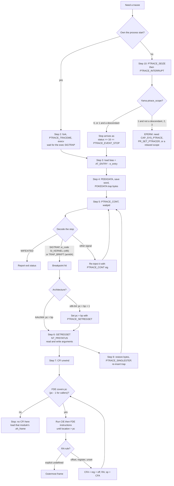

# Rebuild Lab: ptrace Debugger with DWARF Backtrace

> [!summary] Claim:
> A debugger is a loop around `waitpid`: it starts or seizes a tracee, rewrites one instruction into a trap, decodes each stop from the wait status and `siginfo`, and reads and writes registers and memory through `ptrace`.
> The architecture shows through in three places: the trap encoding (`int3` is one byte, `brk #0` is four), where the pc points after the trap (one byte past `int3`, still on `brk`), and which registers carry arguments and the return address.
> A backtrace is a virtual unwind: for each frame, find the FDE in `.eh_frame`, run the CIE and FDE call frame instructions up to the pc, compute the CFA, and recover the return address and saved registers from the rule table.
> The frame-pointer walk that profilers use skips the caller whenever the stop is in a prologue or a frameless leaf, and the lab prints that wrong answer next to the correct CFI one.

The kernel mechanisms (ptrace stops, Mach exception ports, hardware debug registers) are owned by [[How-Debuggers-Work-ptrace-Mach-and-Breakpoints]].
Line tables, location lists, and `<optimized out>` are owned by [[Cpp-Debugging-Optimized-Code]].
This playbook owns the rebuild procedure: about 1,200 lines of C++ that launch, break, step, inspect, unwind, and attach, verified against GDB on the same instruction.

## Trigger and Symptoms

Run this rebuild when one of these is true:

- You must build tooling on top of `ptrace`: a custom tracer for a JIT or proprietary runtime, a crash handler that walks its own stack, a sampling profiler, or a test harness that injects faults at an instruction.
- A profiler or crash reporter produces stacks that are missing a frame, end early at a leaf function, or show a caller that cannot have made the call, and you need to know which unwinder is wrong.
- A hand-written tracer crashes its tracee after a breakpoint, misses the second hit of a breakpoint, or reports registers that do not match the code.
- You are preparing for an interview loop that asks how breakpoints, single-step, or stack unwinding work, and you want answers backed by code you have run.

Symptoms of the bugs this procedure teaches you to recognize:

| Symptom | Mechanism behind it |
| :--- | :--- |
| x86-64 tracee dies with `SIGILL` or `SIGSEGV`, or silently computes a wrong value, right after the first breakpoint continue | The pc was not moved back by one byte after `int3`, so execution resumed inside the original instruction. |
| Breakpoint fires once and never again | The original instruction was restored to step over the trap, and the trap was never re-inserted. |
| Backtrace at a function entry lists `leaf`, then the grandparent | A frame-pointer walk ran before the prologue built a frame record. |
| AArch64 backtrace stops at the first leaf function | The unwinder applied the DWARF default "undefined" to the return-address column, which AArch64 CIEs never mention. |
| Backtrace ends at `main` with "no CFI" | The unwinder loaded `.eh_frame` for the executable only, not for `libc.so.6`. |

## Decision Tree



## Prerequisites

### Linux host or container

```bash
command -v cc c++ gdb nm strip readelf
cat /proc/sys/kernel/yama/ptrace_scope
```

The lab needs a C compiler, a C++17 compiler, GDB for the cross-check, and binutils.
On Ubuntu 24.04 they come from `gcc`, `g++`, `gdb`, and `binutils`; the lab was recorded with gcc and g++ 13.3.0, gdb 15.1, and binutils 2.42 from the pinned `code/_harness/linux-labs.Dockerfile` image (as of 2026-11, Linux).

Permission checks, from the Yama documentation and `security/yama/yama_lsm.c`:
- `PTRACE_TRACEME` from a child you forked works under scopes 0 and 1, and is refused under 2 (without `CAP_SYS_PTRACE`) and 3.
- `PTRACE_ATTACH` and `PTRACE_SEIZE` under scope 1 (the compiled-in default, `YAMA_SCOPE_RELATIONAL`) work only on your descendants or on a process that named you with `prctl(PR_SET_PTRACER, ...)`.
- The lab attaches only to its own child, so it works under scope 0 or 1 without privileges.
  The OrbStack VM that recorded it had scope 0.
- The harness runs the lab under Docker's default seccomp profile with `--cap-drop ALL` and `no-new-privileges`, and every ptrace call in it succeeds there.

**Verification:** `ptrace_scope` prints 0 or 1, and `gcc --version` and `gdb --version` both answer.

### macOS host

macOS has no Linux `ptrace` requests such as `PTRACE_GETREGSET`; LLDB drives the target through Mach task and exception ports instead, as [[How-Debuggers-Work-ptrace-Mach-and-Breakpoints]] explains.
`cd code && make verify LAB=03-Debugging/ptrace_debugger/` runs the lab inside the pinned Linux container when Docker is reachable, and skips it with the reason otherwise.

## Commands and Numbers to Know

| Item | Platform | Value `(as of 2026-11)` | Source or evidence |
| :--- | :--- | :--- | :--- |
| Software breakpoint | x86-64 | `int3`, byte `0xcc`, 1 byte | `i386_break_insn` in GDB `i386-tdep.c` |
| Software breakpoint | AArch64 | `brk #0`, word `0xd4200000` (bytes `00 00 20 d4`), 4 bytes | `aarch64_default_breakpoint` in GDB `aarch64-tdep.c` |
| pc after the trap, minus the breakpoint address | x86-64 | 1 | `set_gdbarch_decr_pc_after_break (gdbarch, 1)` in `i386-tdep.c` |
| pc after the trap, minus the breakpoint address | AArch64 | 0 | Lab output |
| `si_code` of a breakpoint `SIGTRAP` | x86-64 | `SI_KERNEL` (0x80) | `do_int3_user` calls `do_trap` with `sicode` 0, so `force_sig` fills in `SI_KERNEL` |
| `si_code` of a breakpoint `SIGTRAP` | AArch64 | `TRAP_BRKPT` (1) | `do_el0_brk64` calls `send_user_sigtrap(TRAP_BRKPT)`; lab output |
| `si_code` after `PTRACE_SINGLESTEP` | Both | `TRAP_TRACE` (2) | x86 `get_si_code` on `DR_STEP`; arm64 single-step handler; lab output on AArch64 |
| Exec stop wait status | Linux | `0x57f` (stopped, `SIGTRAP`) | Lab output |
| `PTRACE_INTERRUPT` stop wait status | Linux | `0x80057f`: `status >> 16` is `PTRACE_EVENT_STOP` (128) | Lab output; ptrace(2) |
| `PTRACE_GETREGS` | AArch64 | Absent for native tasks; use `PTRACE_GETREGSET` with `NT_PRSTATUS` (1) | arm64 `arch_ptrace` handles only MTE tag requests and compat `GETREGS` |
| `PTRACE_GETREGSET` / `PTRACE_SEIZE` / `PTRACE_O_EXITKILL` | Linux | Since 2.6.34 / 3.4 / 3.8 | ptrace(2) |
| ptrace data word | Linux 64-bit | 8 bytes per `PTRACE_PEEKDATA` and `PTRACE_POKEDATA` | `generic_ptrace_peekdata` copies `sizeof(unsigned long)` |
| Writes into `r-xp` text | Linux | Allowed in private mappings: `generic_ptrace_pokedata` passes `FOLL_FORCE \| FOLL_WRITE`, and `check_vma_flags` rejects forced writes to shared mappings | `kernel/ptrace.c`, `mm/gup.c` |
| DWARF registers | x86-64 | 6 `rbp`, 7 `rsp`, 16 return address (no physical register) | psABI "DWARF Register Number Mapping" |
| DWARF registers | AArch64 | 29 `x29`, 30 `x30`, 31 `sp`, 34 `RA_SIGN_STATE` | aadwarf64 |
| CIE id | Both | 0 in `.eh_frame`; `0xffffffff` in 32-bit `.debug_frame` | libgcc `get_cie`; DWARF 5 section 7.24 |
| CIE version | Both | 1 in the lab's `.eh_frame`; DWARF 5 defines 4 for `.debug_frame` | Lab output; DWARF 5 section 7.24 |
| AArch64 CIE from GCC 13 | AArch64 | `"zR"`, code align 4, data align -8, RA column `x30`, `DW_CFA_def_cfa: sp+0` | Lab output and `readelf --debug-dump=frames` |
| `DW_CFA_AARCH64_negate_ra_state` | AArch64 | Opcode `0x2d`, shared with `DW_CFA_GNU_window_save` | aadwarf64; `include/dwarf2.def` |
| `perf record --call-graph dwarf` stack copy | Linux | 8192 bytes per sample by default | perf-record(1) |

## Step-by-Step Execution

The lab source is `code/03-Debugging/ptrace_debugger/minidbg.cpp`; each step names the function that implements it.
Every step ends with a check, and the lab prints each check, so a broken step changes the output instead of passing silently.

### Step 1: Build a target that carries unwind tables

```bash
cc -O2 -fno-omit-frame-pointer -fasynchronous-unwind-tables -fno-optimize-sibling-calls -o target target.c
readelf -SW target | grep -E ' \.(eh_frame|eh_frame_hdr|symtab) '
```

`target.c` calls `main -> outer_layer -> middle_layer -> leaf_compute` twice, with inputs from `volatile` globals and GCC's `noipa` attribute so the optimizer cannot fold, inline, or clone the functions.
The build has no `-g`: the debugger needs only `.symtab` for names and `.eh_frame` for unwinding.
`-fno-omit-frame-pointer` is explicit because `gcc -Q -O2 --help=optimizers` in the lab image reports `-fomit-frame-pointer [enabled]`, although Canonical's announcement says its GCC package enables frame pointers by default on 64-bit platforms from Ubuntu 24.04.
UNVERIFIED: whether Ubuntu applies that default through package build flags rather than the compiler driver; either way, pass the flag when you need frame pointers.
On AArch64, `-momit-leaf-frame-pointer` is also `[enabled]` in that image, so `leaf_compute` gets no frame record even with the flag.

**Verification:** `.eh_frame` and `.eh_frame_hdr` have flag `A` (allocated, so they are loaded at run time and `strip` keeps them), and `.symtab` has none; the lab printed, with runs of spaces squeezed:

```text
[16] .eh_frame_hdr PROGBITS 0000000000000920 000920 00005c 00 A 0 0 4
[17] .eh_frame PROGBITS 0000000000000980 000980 000124 00 A 0 0 8
[25] .symtab SYMTAB 0000000000000000 010048 000948 18 26 68 8
```

### Step 2: Launch the tracee under ptrace (`spawn`, `launch`)

```cpp
const pid_t pid = fork();
if (pid == 0) {
    ptrace(PTRACE_TRACEME, 0, nullptr, nullptr);
    execv(path.c_str(), argv.data());
    _exit(127);
}
int status = 0;
waitpid(pid, &status, 0);   // stopped, SIGTRAP: the exec has replaced the image
ptrace(PTRACE_SETOPTIONS, pid, nullptr, reinterpret_cast<void*>(PTRACE_O_EXITKILL));
```

After `PTRACE_TRACEME`, every successful `execve` sends the tracee a `SIGTRAP` (ptrace(2)), so the first stop is at the new image's first instruction, before the dynamic loader has run.
`PTRACE_O_EXITKILL` makes the kernel kill the tracee if the debugger dies, so a crashed debugger never leaves a process stopped on a trap it cannot handle.

**Verification:** the lab printed `Stop after execve: SIGTRAP, waitpid status 0x57f`: low byte `0x7f` means stopped, and the next byte is signal 5.

### Step 3: Compute the load bias (`read_auxv`)

```cpp
const uint64_t bias = read_auxv(pid, AT_ENTRY) - elf.e_entry;   // /proc/PID/auxv
```

A position-independent executable (`ET_DYN`) is linked at address 0 and loaded at a random base, so every link-time address from `.symtab` or `.eh_frame` must be shifted by the bias.
`AT_ENTRY` is "the entry address of the executable" (getauxval(3)), which the kernel places in the auxiliary vector at exec time, and `e_entry` is the same address before relocation.

**Verification:** the lab compares the bias with the start of the first `/proc/PID/maps` line whose path is the target and whose offset is 0, and printed `Load bias (AT_ENTRY - e_entry) equals start of first target mapping: yes`.

### Step 4: Insert the breakpoint (`Breakpoint::enable`)

```cpp
saved_ = t_.peek(addr_);                                  // PTRACE_PEEKDATA, 8 bytes
const uint64_t mask = (1ull << (8 * kTrapLen)) - 1;       // 0xff or 0xffffffff
t_.poke(addr_, (saved_ & ~mask) | kTrapBytes);            // PTRACE_POKEDATA
```

`PTRACE_PEEKDATA` returns the word itself, so -1 is a valid result; clear `errno` before the call and test it after (ptrace(2)), which is what `Tracee::peek` does.
The text mapping is `r-xp`, and the write still succeeds because the kernel performs it with `FOLL_FORCE`, which `check_vma_flags` in `mm/gup.c` honors only for copy-on-write (private) mappings: the tracee gets a private copy of the page, and the file and other processes are untouched.
Replace only the trap's bytes of the word and restore only those bytes later: on x86-64 the other seven bytes belong to the following instructions, and another breakpoint may sit there.

**Verification:** the lab reads the word back and printed `Wrote brk #0 (encoding d4200000) with PTRACE_POKEDATA; read back: trap present`, after `Breakpoint on leaf_compute: bias + st_value, in a r-xp mapping of target`.

### Step 5: Continue and decode the stop (`Tracee::wait_trap`)

```cpp
ptrace(PTRACE_CONT, pid, nullptr, nullptr);
waitpid(pid, &status, 0);                                  // WIFSTOPPED, WSTOPSIG == SIGTRAP
siginfo_t si;
ptrace(PTRACE_GETSIGINFO, pid, nullptr, &si);              // si.si_code says why
if (kPcAfterTrap != 0) { set_raw_pc(regs, bp_addr); t.set_regs(regs); }   // x86-64 only
```

A `SIGTRAP` stop alone does not say whether it came from your breakpoint, a single-step, an exec, or a `SIGTRAP` someone sent with `kill`; `si_code` separates them.
On x86-64, `int3` is a trap-class exception, so the saved `rip` is the byte after it; GDB's `decr_pc_after_break` of 1 for i386 and amd64 encodes exactly this.
On AArch64, `brk` is reported with the pc still on the `brk` instruction, so no rewind is needed, and the lab measures it instead of assuming it.

**Verification:** the lab printed `Hit 1: SIGTRAP, si_code TRAP_BRKPT (1)` and `pc - breakpoint address after the trap: 0` on AArch64.
On x86-64 expect `SI_KERNEL (128)`, 1, and a `Rewound pc by 1` line; that path is in the source and type-checks, but it has never been run, so no x86-64 recording exists yet.

### Step 6: Read and write registers (`Tracee::regs`, `Tracee::set_regs`)

```cpp
user_regs_struct r{};
iovec iov{&r, sizeof r};
ptrace(PTRACE_GETREGSET, pid, reinterpret_cast<void*>(NT_PRSTATUS), &iov);
r.regs[1] = 0;                       // AArch64 x1; on x86-64 this is r.rsi
ptrace(PTRACE_SETREGSET, pid, reinterpret_cast<void*>(NT_PRSTATUS), &iov);
```

`PTRACE_GETREGSET` with `NT_PRSTATUS` is the one register call that exists on both architectures, and the kernel sets `iov_len` to the bytes it returned (ptrace(2)), so check it.
The first two integer arguments are in `rdi` and `rsi` on x86-64 and in `x0` and `x1` on AArch64, and `int` arguments occupy the low 32 bits, which the lab masks.

**Verification:** the lab printed `Arguments: a = x0 = 6, b = x1 = 4` on the first hit and `Hit 2: a = 9, b = 5` on the second.
On the second hit it sets `x1` to 0 and printed `PTRACE_SETREGSET: x1 5 -> 0` from a fresh `GETREGSET`.
The exit status then proves the write took effect: `Native run exit status: 73` versus `Debugged run exit status: 28`, because `leaf_compute(9, 0)` returns `0 + bias = 1` instead of `46`, and `(25 + 1) + (1 + 1) = 28`.

### Step 7: Unwind with DWARF CFI (`parse_eh_frame`, `compute_row`, `Unwinder::cfi_backtrace`)

Parsing, per DWARF 5 section 6.4.1 with the `.eh_frame` changes that libgcc implements:
- Each entry starts with a 4-byte length (0 terminates the section, `0xffffffff` announces a 64-bit length).
- A CIE id of 0 marks a CIE; any other value is an FDE whose CIE starts that many bytes before the id field itself (`get_cie` in `unwind-dw2-fde.h`).
- A CIE carries version, augmentation string, code alignment (ULEB128), data alignment (SLEB128), return-address column, then, for `z`, a ULEB128 length and augmentation data: `R` gives the FDE pointer encoding, `L` the LSDA encoding, `P` the personality pointer, `S` marks a signal frame (`extract_cie_info` in `unwind-dw2.c`).
- An FDE's `pc_begin` uses the `R` encoding; GCC writes `0x1b`, which is `DW_EH_PE_pcrel | DW_EH_PE_sdata4`: a signed 32-bit offset from the address of the field itself (`unwind-pe.h`).
- `pc_range` uses the same format without the `pcrel` application, because it is a length.

The rule machine, per DWARF 5 sections 6.4.2 and 6.4.3:
1. Start with every column unset, run the CIE's initial instructions, and keep that row as the "initial" row for `DW_CFA_restore`.
2. Run the FDE's instructions, stopping at the first `advance_loc` or `set_loc` that would move the location past the pc.
3. The resulting row gives the CFA rule (register plus offset) and one rule per register: `offset(N)` means "saved at CFA + N", `val_offset(N)` means "the value is CFA + N", `register(R)` means "in register R", plus `undefined`, `same value`, and expression forms.

The middle frame's FDE from `readelf --debug-dump=frames`, and the code it describes from `objdump -d`, as the lab printed them:

```text
000000a4 000000000000001c 000000a8 FDE cie=00000000 pc=0000000000000870..0000000000000890
  DW_CFA_advance_loc: 4 to 0000000000000874
  DW_CFA_def_cfa_offset: 16
  DW_CFA_offset: r29 (x29) at cfa-16
  DW_CFA_offset: r30 (x30) at cfa-8
  DW_CFA_advance_loc: 24 to 000000000000088c
  DW_CFA_restore: r30 (x30)
  DW_CFA_restore: r29 (x29)
  DW_CFA_def_cfa_offset: 0
  DW_CFA_nop
  DW_CFA_nop
  DW_CFA_nop
0000000000000870 <middle_layer>:
 870:   stp     x29, x30, [sp, #-16]!
 874:   add     w1, w0, #0x2
 878:   add     w0, w0, w0, lsl #1
 87c:   mov     x29, sp
 880:   bl      860 <leaf_compute>
 884:   add     w0, w0, #0x1
 888:   ldp     x29, x30, [sp], #16
 88c:   ret
```

The rules follow the code: `stp x29, x30, [sp, #-16]!` at `0x870` moves `sp` down 16 and stores the pair, so from `0x874` the CFA is `sp+16` with `x29` at CFA-16 and `x30` at CFA-8; the `ldp x29, x30, [sp], #16` at `0x888` undoes it, so from `0x88c` (the `ret`) the rules return to the CIE's.

One unwind step, as `cfi_backtrace` does it:

```cpp
const uint64_t link_pc = pc - bias - (depth == 0 ? 0 : 1);    // callers: look up inside the call
const Row row = compute_row(img, cfi, *fde, link_pc);
const uint64_t cfa = regs[row.cfa_reg] + row.cfa_offset;
// offset(N): caller value = *(cfa + N); unset or same value: unchanged
caller[kSpReg] = cfa;                                           // the CFA is the caller's sp at the call
pc = return_address;                                            // from the return-address column
```

Three rules make this correct, and each is a classic bug when missing:
- Look up a caller at the return address minus 1: a call to a `noreturn` function can be the last instruction of a function, so the return address belongs to the next function or to no function (DWARF 5 section 6.4.4).
- Set the caller's stack pointer to the CFA, because DWARF defines the CFA as the value of the stack pointer at the call site in the previous frame (DWARF 5 section 6.4).
- Treat "never mentioned" as "same value", and only an explicit `DW_CFA_undefined` on the return-address column as the end of the stack.
  DWARF 5 says the default rule is undefined, but the AArch64 CIE never mentions `x30`, so a strict reading ends every backtrace at a leaf; libgcc's `uw_update_context` and the aadwarf64 rule for callee-saved registers both default to same value, and glibc's `_start` marks the true end with `cfi_undefined (x30)` on AArch64 and `cfi_undefined (rip)` on x86-64 (`sysdeps/*/start.S`).

On AArch64 with return-address signing (`-mbranch-protection=standard`), the FDEs also carry `DW_CFA_AARCH64_negate_ra_state`, and a return address loaded from the stack has a pointer authentication code in its high bits.
The unwinder toggles a flag on that opcode and clears the bits in `insn_mask` from the `NT_ARM_PAC_MASK` regset, which the kernel exposes only when the CPU has pointer authentication (kernel `pointer-authentication.rst`).

**Verification:** the lab printed four frames with the rule that produced each return address, and the stop reason:

```text
#0 leaf_compute  CFA=sp+0    RA=x30 (unset: same value)
#1 middle_layer  CFA=sp+16   RA=[CFA-8]
#2 outer_layer   CFA=sp+32   RA=[CFA-24]
#3 main          CFA=sp+32   RA=[CFA-24]
Stop: return address is in libc.so.6, which has no CFI loaded here
```

### Step 8: Compare with a frame-pointer walk (`Unwinder::fp_backtrace`)

```cpp
uint64_t fp = regs[kFpReg];                 // rbp or x29
while (fp != 0) {
    const uint64_t ra = peek(fp + 8);       // saved return address
    names.push_back(name_at(ra - 1));
    fp = peek(fp);                          // saved caller fp
}
```

The breakpoint sits on `leaf_compute`'s first instruction, and on AArch64 `leaf_compute` never builds a frame record at all.
`x29` still points at `middle_layer`'s record, whose saved `x30` returns into `outer_layer`, so the walk reports `outer_layer` as the caller and loses `middle_layer`.
On x86-64 the same happens before `push rbp; mov rbp, rsp` has executed.
The CFI walk is right because the CIE row at the first instruction says where the return address is before any prologue code runs.

**Verification:** the lab printed `FP frames: leaf_compute outer_layer main` and `Frame-pointer walk equals CFI walk: no`.

### Step 9: Step over the breakpoint (`Breakpoint::disable`, `Tracee::step`)

```cpp
bp.disable();                    // original bytes back
t.step();                        // PTRACE_SINGLESTEP executes exactly that instruction
t.wait_trap("single-step");      // si_code TRAP_TRACE
bp.enable();                     // trap back in place before the next continue
t.cont();
```

Continuing with the trap still in place would trap again at once; continuing after removing it without re-inserting it would lose every later hit.
The single-step window is the reason multithreaded debuggers stop all threads (GDB's all-stop mode) or step an out-of-line copy of the instruction (displaced stepping): while the original instruction is back, another thread can run through the breakpoint without stopping.

**Verification:** the lab printed `PTRACE_SINGLESTEP: SIGTRAP, si_code TRAP_TRACE (2)`, `pc advanced by 4 bytes, still in leaf_compute`, `Breakpoint re-inserted: yes`, and later `Breakpoint hits: 2`.

### Step 10: Attach to a running process (`cmd_attach`)

```cpp
ptrace(PTRACE_SEIZE, pid, nullptr, reinterpret_cast<void*>(PTRACE_O_EXITKILL));
ptrace(PTRACE_INTERRUPT, pid, nullptr, nullptr);
waitpid(pid, &status, 0);        // WSTOPSIG == SIGTRAP and status >> 16 == PTRACE_EVENT_STOP
// ... PEEKDATA, GETREGSET ...
ptrace(PTRACE_DETACH, pid, nullptr, nullptr);
```

`PTRACE_SEIZE` attaches without stopping the process, unlike `PTRACE_ATTACH`, which sends `SIGSTOP` and leaves the tracer to tell that stop apart from a real one (ptrace(2)).
`PTRACE_INTERRUPT` works only on seized tracees and reports a `PTRACE_EVENT_STOP` that needs no `PTRACE_GETSIGINFO` to recognize.
The lab waits until `/proc/PID/exe` names the target before seizing, because a seize between `fork` and `execv` would trace a copy of the debugger.

**Verification:** the lab printed the `TracerPid` line of `/proc/PID/status` before attach (`0`), after seize (the debugger), and after detach (`0`), plus `spin_counter unchanged while stopped: yes` and `spin_counter advanced while running: yes`.

### Step 11: Cross-check against GDB

```bash
gdb -nx -q -batch -ex 'set startup-with-shell off' -ex 'break *leaf_compute' -ex run -x gdb_frames.py ./target
```

`break *leaf_compute` stops on the function's first instruction, the same place minidbg stops; `break leaf_compute` would skip the prologue and stop elsewhere.
`gdb_frames.py` walks `gdb.newest_frame()` and `Frame.older()` to `main` and prints the names on one line.

**Verification:** the lab printed `GDB frames: leaf_compute middle_layer outer_layer main` and `minidbg CFI walk equals GDB backtrace: yes`.

## Worked Example: The ptrace_debugger Lab

`code/03-Debugging/ptrace_debugger/run.sh` builds `target.c` and `minidbg.cpp` (with `-Wall -Wextra -Werror`), prints the target's section flags, `middle_layer`'s FDE, and its disassembly, and then runs four parts:
1. `minidbg launch ./target`: Steps 2 to 9, then the exit-status comparison of Step 6.
2. GDB at the same instruction: Step 11.
3. `minidbg unwind ./target.stripped OFFSET`: the same CFI walk on a copy stripped with `strip --strip-all`, with the breakpoint offset taken from `nm` on the unstripped file.
4. `minidbg attach ./target`: Step 10 against `target --spin`.

What the output proves and what it does not:
- The trap encoding, `si_code`, pc offset after the trap, and single-step distance were measured on AArch64, not copied from documentation.
- The CFI walk agrees with GDB name for name at a stop where the frame-pointer walk is wrong, so the agreement is not an artifact of frame pointers.
- The stripped run unwinds the same four frames with no names: unwinding needs `.eh_frame`, which `strip --strip-all` keeps, while names need `.symtab`, which it removes.
- The register write is proved by its effect on the exit status, not by reading the register back alone.
- The unwinder does not load shared libraries' `.eh_frame`, does not evaluate DWARF expressions (`DW_CFA_def_cfa_expression` appears in x86-64 PLT FDEs and signal trampolines), and stops at the first frame outside the executable.
- The x86-64 code path type-checks with clang `-Wall -Wextra` against x86-64 glibc headers but has never been run; the first x86-64 recording should show `SI_KERNEL (128)` and a pc offset of 1.

### Verified output

Recorded by `python3 -m _harness.verify --record` on linux-aarch64 on 2026-11-08, in the pinned `toolchain-labs` image on OrbStack (kernel 7.2.12), and re-verified ten consecutive times with `PASS` after the final source change; the file is `code/03-Debugging/ptrace_debugger/expected/linux-aarch64.txt`.

```text
=== Target sections and raw CFI (readelf) ===
[16] .eh_frame_hdr PROGBITS 0000000000000920 000920 00005c 00 A 0 0 4
[17] .eh_frame PROGBITS 0000000000000980 000980 000124 00 A 0 0 8
[25] .symtab SYMTAB 0000000000000000 010048 000948 18 26 68 8
000000a4 000000000000001c 000000a8 FDE cie=00000000 pc=0000000000000870..0000000000000890
  DW_CFA_advance_loc: 4 to 0000000000000874
  DW_CFA_def_cfa_offset: 16
  DW_CFA_offset: r29 (x29) at cfa-16
  DW_CFA_offset: r30 (x30) at cfa-8
  DW_CFA_advance_loc: 24 to 000000000000088c
  DW_CFA_restore: r30 (x30)
  DW_CFA_restore: r29 (x29)
  DW_CFA_def_cfa_offset: 0
  DW_CFA_nop
  DW_CFA_nop
  DW_CFA_nop
0000000000000870 <middle_layer>:
 870:   stp     x29, x30, [sp, #-16]!
 874:   add     w1, w0, #0x2
 878:   add     w0, w0, w0, lsl #1
 87c:   mov     x29, sp
 880:   bl      860 <leaf_compute>
 884:   add     w0, w0, #0x1
 888:   ldp     x29, x30, [sp], #16
 88c:   ret

=== Launch (fork, PTRACE_TRACEME, execv) ===
Architecture: aarch64
Stop after execve: SIGTRAP, waitpid status 0x57f
ELF type: ET_DYN (position-independent)
Debug info in target: none (.eh_frame and .symtab only)
Load bias (AT_ENTRY - e_entry) equals start of first target mapping: yes
CIEs: 1, FDEs: 10
First CIE: version 1, augmentation "zR", code_align 4, data_align -8, return address column x30

=== Breakpoint ===
Breakpoint on leaf_compute: bias + st_value, in a r-xp mapping of target
Wrote brk #0 (encoding d4200000) with PTRACE_POKEDATA; read back: trap present
Hit 1: SIGTRAP, si_code TRAP_BRKPT (1)
pc - breakpoint address after the trap: 0
Arguments: a = x0 = 6, b = x1 = 4

=== Backtrace: DWARF CFI from .eh_frame ===
#0 leaf_compute  CFA=sp+0    RA=x30 (unset: same value)
#1 middle_layer  CFA=sp+16   RA=[CFA-8]
#2 outer_layer   CFA=sp+32   RA=[CFA-24]
#3 main          CFA=sp+32   RA=[CFA-24]
Stop: return address is in libc.so.6, which has no CFI loaded here
CFI frames: leaf_compute middle_layer outer_layer main

=== Backtrace: frame-pointer walk at the same stop ===
FP frames: leaf_compute outer_layer main
Frame-pointer walk equals CFI walk: no

=== Step over the breakpoint ===
PTRACE_SINGLESTEP: SIGTRAP, si_code TRAP_TRACE (2)
pc advanced by 4 bytes, still in leaf_compute
Breakpoint re-inserted: yes
Hit 2: a = 9, b = 5
PTRACE_SETREGSET: x1 5 -> 0

=== Exit ===
Breakpoint hits: 2
Native run exit status: 73
Debugged run exit status: 28

=== Cross-check: GDB at the same instruction ===
GDB frames: leaf_compute middle_layer outer_layer main
minidbg CFI walk equals GDB backtrace: yes

readelf on the stripped copy: .symtab removed, .eh_frame kept
=== Stripped target: CFI backtrace without symbols ===
Target has .symtab: no
Target has .eh_frame: yes (10 FDEs)
Frames unwound inside the target: 4
Frames with a name: 0
Stop: return address is in libc.so.6, which has no CFI loaded here

=== Attach (PTRACE_SEIZE, PTRACE_INTERRUPT) ===
TracerPid before attach: 0 (untraced)
PTRACE_SEIZE: ok, TracerPid is minidbg: yes
PTRACE_INTERRUPT stop: SIGTRAP with PTRACE_EVENT_STOP in status >> 16: yes, waitpid status 0x80057f
Interrupted inside: spin_forever
spin_counter unchanged while stopped: yes
spin_counter advanced while running: yes
PTRACE_DETACH: TracerPid after detach: 0 (untraced, still running)
Killed with SIGKILL: yes
```

## Rollback Procedure

A debugger changes another process's code and registers, so undoing it means putting the process back exactly as it was, or ending it deliberately.

1. **Remove every breakpoint before detaching.**
   A trap left in the text after `PTRACE_DETACH` raises `SIGTRAP` in an untraced process, and the default action of `SIGTRAP` is `Core` (signal(7)): the process dies and may dump core.
   **Check:** read each breakpoint address back with `PTRACE_PEEKDATA` and compare the trap bytes with the saved original, as `Breakpoint::trap_in_memory` does.
2. **Undo register edits you did not mean to keep.**
   Save the `NT_PRSTATUS` block before any `PTRACE_SETREGSET` and write it back if a step fails halfway.
   On x86-64 the rewind of `rip` after `int3` is part of the hit, not an edit; it must happen before detaching on a hit, or the process resumes one byte into an instruction.
   **Check:** a fresh `GETREGSET` equals the saved block.
3. **Detach, or kill.**
   `PTRACE_DETACH` resumes the process untraced; `PTRACE_O_EXITKILL`, set at launch or seize, kills tracees if the debugger itself crashes, which is the safe default for test tooling but wrong for a production attach.
   **Check:** `grep TracerPid /proc/PID/status` prints 0.
4. **Reap.**
   A child that exits stays a zombie until its parent reaps it with `waitpid`, and the lab's tracer is also the parent of every tracee, so it reaps each one.
   **Check:** `ps -o stat= -p PID` prints nothing or a state other than `Z`.
5. **Restore Yama** if you relaxed it for a session: write the saved value back to `/proc/sys/kernel/yama/ptrace_scope` (writable only with `CAP_SYS_PTRACE`); scope 3 cannot be lowered again without a reboot.

## Failure Modes

| Failure | How it shows up | Recovery |
| :--- | :--- | :--- |
| `PTRACE_TRACEME` or `PTRACE_SEIZE` returns `EPERM` | The child exits 126 in the lab, or `minidbg: PTRACE_SEIZE: Operation not permitted` | Check Yama scope, `CAP_SYS_PTRACE`, a seccomp profile that blocks `ptrace`, and whether the target is non-dumpable (`prctl(PR_SET_DUMPABLE, 0)` or a setuid transition). |
| Breakpoint at a link-time address | `PTRACE_POKEDATA: Input/output error` | The address was not shifted by the load bias; recompute it from `AT_ENTRY - e_entry`. |
| `PTRACE_PEEKDATA` result of -1 treated as an error, or an error treated as data | Spurious failures on memory holding `0xffffffffffffffff`, or garbage frames | Set `errno = 0` before the call and test `errno` after it. |
| x86-64 tracee misbehaves after the first continue | `SIGILL`, `SIGSEGV`, or wrong results | Rewind `rip` to the breakpoint address before restoring the byte and stepping. |
| Second hit never arrives | `waitpid` reports `WIFEXITED` instead of a stop | Re-insert the trap after the single-step. |
| `PTRACE_GETREGS` fails on AArch64 | `EIO` | Use `PTRACE_GETREGSET` with `NT_PRSTATUS`. |
| Backtrace ends at frame 0 on AArch64 | Only the leaf is listed | Treat columns the CFI never mentions as same value; reserve end-of-stack for an explicit `DW_CFA_undefined` on the return-address column. |
| Backtrace skips a caller | Grandparent listed directly under the leaf | That was a frame-pointer walk in a prologue or frameless leaf; use CFI, or on AArch64 take frame 1 from `x30` while in a leaf. |
| Unwinder repeats one frame forever | The same function at every depth until the limit | The caller's stack pointer was not set to the CFA, so the same row is applied to the same registers again. |
| Garbage return addresses on AArch64 | High bits set in addresses read from the stack | Strip the PAC with the `NT_ARM_PAC_MASK` instruction mask when the row's `RA_SIGN_STATE` says signed. |
| `unsupported call frame instruction` or expression rule | The lab exits 1 with the opcode | Implement the DWARF expression evaluator (DWARF 5 section 2.5) or stop the unwind at that frame and say why. |
| Unwind stops at `main` | `return address is in libc.so.6` | Load each mapped module's ELF from `/proc/PID/maps`, compute its bias, and search its `.eh_frame` too. |

## Pitfalls

> [!warning] Breakpoints are writes into a shared page view
> The kernel's `FOLL_FORCE` write is allowed only in copy-on-write mappings (`mm/gup.c`), so the tracee gets a private copy of the page and other processes running the same binary are unaffected.
> A breakpoint written into memory that the program itself checksums, or into a JIT region that the runtime rewrites, is overwritten or detected, so restore and re-insert around code-cache flushes.

> [!warning] SIGTRAP is not proof of your breakpoint
> `SIGTRAP` also arrives after `execve`, after a single-step, from `PTRACE_EVENT_*` stops, and from `kill -TRAP`.
> Decide from `si_code`, the event bits in `status >> 16`, and whether the pc matches a breakpoint you own; anything else must be re-injected with `PTRACE_CONT` and its signal number, or the tracee never sees signals it expects.

> [!warning] One breakpoint, many threads
> Between disabling a breakpoint and re-inserting it, any other running thread passes through that address without stopping.
> In GDB's all-stop mode every thread stops whenever the program stops and all restart together, which closes the window.
> Displaced stepping instead executes an out-of-line copy of the original instruction so the breakpoint never leaves the text; with the default `set displaced-stepping auto`, GDB uses it only in non-stop mode.
> The lab's target is single-threaded, so it shows neither.

> [!warning] Function entry is the worst place for a frame-pointer unwinder
> Every sampling profiler that walks frame pointers sees some samples in prologues and frameless leaves, so its stacks drop the immediate caller in exactly those samples.
> That error is silent and biased toward short leaf functions, which are often the hottest code.

> [!warning] The DWARF default rule is not the unwinder default
> DWARF 5 section 6.4.1 makes "undefined" the default for every column, and the AArch64 ABI then requires consumers to default callee-saved registers to "same value" because producers may omit them.
> An unwinder written straight from DWARF 5 fails on the first AArch64 leaf; one written straight from libgcc fails only if a producer relies on the strict default.

## At Scale

At fleet scale nobody single-steps production; the rebuild matters because every crash reporter, profiler, and tracer contains the same two pieces, a stop mechanism and an unwinder, and their choices decide what data you get.

- **Frame pointers versus CFI in profilers.**
  `perf record --call-graph fp` is the default for user space and follows frame pointers; `--call-graph dwarf` uses CFI and dumps 8192 bytes of user stack per sample by default for later unwinding (perf-record(1), as of 2026-11, Linux).
  Frame-pointer walks are cheap but drop callers in prologues and leaves and fail on code built without frame pointers; DWARF mode is accurate within the copied window but costs memory bandwidth and storage per sample.
  Canonical's 13 December 2023 announcement made frame pointers the GCC default for 64-bit Ubuntu from 24.04 to make that cheap mode useful, keeping them omitted where the impact is high, such as the Python interpreter.
- **Compact unwind tables.**
  SFrame (format version 3) records only what is needed to recover the CFA, frame pointer, and return address, in a loaded `.sframe` section for AMD64, AAPCS64, and s390x, to give stack tracers "a simple, fast and low-overhead mechanism to generate stack traces" (SFrame specification, as of 2026-11).
- **Out-of-process capture.**
  Out-of-process crash handlers on Linux (see [[Core-Dumps-Minidumps-and-Crash-Reporting]]) read the crashed process with `ptrace`, as in Step 10, and the stack walk that symbolizes their dumps is Step 7 run against saved stack memory instead of live `PTRACE_PEEKDATA`.
- **Remote stubs.**
  `gdbserver` and `lldb-server` perform the launch, attach, breakpoint, step, and register operations of Steps 2 to 10 on the target and serve them over a wire protocol, while the debugger host does the symbol and CFI work ([[Remote-Debugging-gdbserver-lldb-server-and-RSP]]).

Decision rules:
- Build fleet binaries with frame pointers and keep `.eh_frame`; frame pointers make cheap always-on profiling possible, and CFI keeps crash and debugger unwinds exact.
- Never ship an unwinder that has not been compared, frame by frame, against GDB or libgcc on breakpoints placed at function entry, mid-body, and at the `ret`.
- Treat custom ptrace tooling as privileged: run it under Yama scope 1 with an explicit `PR_SET_PTRACER` relationship or `CAP_SYS_PTRACE` granted to that tool alone, and set `PTRACE_O_EXITKILL` only where killing the target is acceptable.

## Practice Drill

> [!tip] Practice Drill: Extend minidbg and predict each diff first
> Run `cd code && make verify LAB=03-Debugging/ptrace_debugger/` and confirm `PASS`.
> Then copy the lab to a scratch directory, make one change at a time, predict the output, and explain the difference.
> 1. On AArch64 add `-mbranch-protection=standard` to the target's flags: frames 1 to 3 gain ` (signed)` after their RA rule because their FDEs now toggle `RA_SIGN_STATE`, and the backtrace still matches GDB; on the recording VM, whose CPU reports no pointer authentication, that build still ran and unwound correctly, consistent with the kernel documentation's note that the HINT-space subset of these instructions behaves as NOPs on such CPUs; there the `NT_ARM_PAC_MASK` regset is absent, so the mask is 0.
> 2. Move the breakpoint to the `ret` of `middle_layer` (the offset from `objdump -d`): predict the CFA rule printed for frame 0 and whether the frame-pointer walk now agrees.
> 3. Load `libc.so.6`'s `.eh_frame` from `/proc/PID/maps` with its own bias, and unwind past `main` until glibc's explicit `DW_CFA_undefined` ends the stack.
> 4. Replace the linear FDE scan with a binary search over `.eh_frame_hdr`, whose header is `version, eh_frame_ptr_enc, fde_count_enc, table_enc` (`unw_eh_frame_hdr` in libgcc); dump it with `readelf -x .eh_frame_hdr`, predict the four header bytes from the encodings GCC uses, and check that the FDE count equals the lab's `FDEs: 10`.
> 5. Make `target.c` spawn a second thread that also calls `leaf_compute`, and show that a thread can run through the breakpoint during the single-step window.
> Target time: 30 minutes for steps 1 and 2, then the rest as a rebuild exercise; continue with [[Drill-Debugging-Use-After-Free-Core-Dump]].

## Interview Questions

> [!question] L5
> Why does an x86-64 debugger move `rip` back by one after a breakpoint, and why does an AArch64 debugger not?
>
> > [!success]- Answer
> > `int3` is a one-byte trap instruction; when it executes, the saved instruction pointer is the address after it, so `rip` is the breakpoint address plus 1.
> > To run the original instruction the debugger restores the byte, sets `rip` back to the breakpoint address, single-steps, and re-inserts the trap; GDB encodes the 1 as `decr_pc_after_break` for i386 and amd64.
> > AArch64 `brk #0` raises an exception whose reported pc is the `brk` instruction itself, which the lab measured as `pc - breakpoint address after the trap: 0`.
> > Forgetting the rewind on x86-64 resumes execution one byte into the original instruction.

> [!question] L5
> `PTRACE_PEEKDATA` returned -1.
> Did it fail?
>
> > [!success]- Answer
> > Not necessarily: the request returns the word read, and a word of all ones is -1.
> > The caller must set `errno = 0` before the call and treat the result as an error only if `errno` is non-zero afterwards, which ptrace(2) requires and `Tracee::peek` does.
> > Real errors are `EIO` or `EFAULT` for an unmapped or inaccessible address (ptrace(2) says Linux returns one or the other "more or less arbitrarily") and `ESRCH` when the tracee does not exist, is not traced by you, or is not stopped.

> [!question] L5
> Predict the output: `target.c` is built with `-O2 -fno-omit-frame-pointer` on AArch64, and the debugger stops on the first instruction of `leaf_compute`, called from `middle_layer`, called from `outer_layer`, called from `main`.
> What does a frame-pointer walk print, and what does the CFI walk print?
>
> > [!success]- Answer
> > The frame-pointer walk prints `leaf_compute outer_layer main`, and the CFI walk prints `leaf_compute middle_layer outer_layer main`, which is what the lab recorded.
> > `leaf_compute` is a leaf, and GCC's `-momit-leaf-frame-pointer` (enabled by default in the lab image) gives it no frame record, so `x29` still points at `middle_layer`'s record.
> > That record's saved `x30` is `middle_layer`'s return address into `outer_layer`, so the walk names `outer_layer` next; `middle_layer`'s own return address is still in the `x30` register, which a frame-pointer walk never reads.
> > The CFI row for `leaf_compute` says "CFA = sp + 0, return address = x30 (same value)", so the CFI walk finds `middle_layer`.

> [!question] L6
> Debug this: a hand-written tracer sets a breakpoint, handles the first hit like this, and never sees the second call.
>
> ```cpp
> bp.disable();
> t.step();
> t.wait_trap("single-step");
> t.cont();
> int st = t.wait();   // expected a second SIGTRAP stop
> ```
>
> What happened, and what does `st` contain for the lab's target?
>
> > [!success]- Answer
> > The original instruction was restored for the single-step and the trap was never written back, so the second call to `leaf_compute` ran through the address without stopping.
> > The program then ran to completion, so `waitpid` reports an exit instead of a stop: `WIFEXITED(st)` is true and `WEXITSTATUS(st)` is 73, the native result, which is wait status `0x4900`.
> > The fix is `bp.enable()` immediately after the single-step stop, before `t.cont()`.
> > In a multithreaded tracee the same window lets other threads pass even when the trap is re-inserted, which is why real debuggers stop all threads or step a displaced copy.

> [!question] L6
> Why does an unwinder look up the caller's FDE at the return address minus one, and why minus one rather than minus the call instruction's length?
>
> > [!success]- Answer
> > The return address is the instruction after the call, which can lie in a different scope, on a different line, or past the end of the caller entirely when the call is to a `noreturn` function at the end of the function (DWARF 5 section 6.4.4).
> > Using it unchanged can select the next function's FDE and produce a wrong caller or a broken unwind.
> > On fixed-width architectures you can subtract the instruction size (4 on AArch64); on x86-64 instruction lengths vary, so subtracting 1 lands inside the call instruction, which is always in the caller's range.
> > Frame 0 is the exception: its pc is where execution stopped, not a return address, so it is looked up unchanged.

> [!question] L6
> An AArch64 unwinder written directly from DWARF 5 stops at every leaf function.
> Which rule did it follow, and what should it do?
>
> > [!success]- Answer
> > DWARF 5 section 6.4.1 says the default rule for every column before the CIE's initial instructions is undefined, and an undefined return-address rule means the end of the stack (section 6.4.4).
> > GCC's AArch64 CIE only says `DW_CFA_def_cfa: sp+0` and never mentions `x30`, so a strict unwinder treats `x30` as undefined in every frameless leaf.
> > The AArch64 DWARF ABI requires consumers to default callee-saved registers to same value, and libgcc treats every unmentioned column as same value; only an explicit `DW_CFA_undefined` on the return-address column, as in glibc's `_start`, marks the outermost frame.
> > Fix: track "unset" separately from "undefined".

> [!question] L6
> When would you use `PTRACE_SEIZE` instead of `PTRACE_ATTACH`?
>
> > [!success]- Answer
> > Almost always for new tools: `PTRACE_SEIZE` attaches without stopping the process, takes the options to activate immediately in its `data` argument, and reports group-stops and `PTRACE_INTERRUPT` stops as `PTRACE_EVENT_STOP` in `status >> 16`.
> > `PTRACE_ATTACH` sends a `SIGSTOP`, so the tracer must distinguish its own stop from a real `SIGSTOP`, and must re-inject or suppress it correctly; it also cannot use `PTRACE_INTERRUPT` or `PTRACE_LISTEN`.
> > Both need the same permission: same uid and dumpable target, plus Yama's relationship rule under scope 1.

> [!question] L7
> You must add stack traces to an always-on profiler running on every host of a latency-sensitive fleet.
> Compare frame-pointer walking, DWARF CFI unwinding from copied stacks, and SFrame.
>
> > [!success]- Answer
> > Frame pointers: the cheapest walk, done at sample time with a few memory reads per frame, but only if every binary and library keeps them, and it drops the immediate caller whenever the sample lands in a prologue, epilogue, or frameless leaf, which biases the profile against hot leaf code.
> > DWARF CFI: exact at every instruction for code with unwind tables, but `perf --call-graph dwarf` gets it by dumping a fixed window of user stack (8192 bytes by default) with each sample and unwinding later, so stacks deeper than the window are truncated and the copies cost bandwidth and storage.
> > SFrame: a compact, loaded table of CFA, frame pointer, and return address recovery for AMD64, AAPCS64, and s390x, designed for simple, fast, low-overhead stack tracing; it needs producer and consumer support across the fleet.
> > Decision: require frame pointers fleet-wide for cheap sampling, keep `.eh_frame` for exact unwinds in debuggers and crash handlers, and validate the profiler against CFI ground truth on a sample of stops at function entry.

> [!question] L7
> Your team ships a ptrace-based fault injector for integration tests and it occasionally hangs CI.
> What failure modes do you check, and what defaults do you change?
>
> > [!success]- Answer
> > Unreaped tracees: every stop and exit must be collected with `waitpid`, or children become zombies and later `waitpid` calls block on the wrong process.
> > Swallowed signals: a non-breakpoint stop must be resumed with its signal number, or the target waits forever for a `SIGCHLD`, `SIGALRM`, or `SIGTERM` it never receives.
> > Leftover traps: a trap left in text after detach kills the target with `SIGTRAP`; remove every breakpoint first.
> > Tracer death: without `PTRACE_O_EXITKILL` a crashed tracer leaves the tracee detached and possibly stopped; for test tooling, `EXITKILL` is the right default.
> > Threads: new threads are not traced unless `PTRACE_O_TRACECLONE` is set, and breakpoints race with the single-step window; stop all threads or use one thread per test.
> > Environment: CI containers with Yama scope 2 or 3, or a seccomp profile that blocks `ptrace`, turn `PTRACE_TRACEME` into a failure; detect it up front and fail with a clear message.

> [!question] L8+
> Argue for or against letting production services allow ptrace attach for live debugging.
>
> > [!success]- Answer
> > Ptrace access is code execution: a tracer can rewrite text, registers, and memory, read every secret, and make the process do anything, so it is equivalent to running as that user inside the process.
> > Against broad access: Yama scope 1 or 2, non-dumpable processes for credential holders, and seccomp profiles that block `ptrace` remove an attacker's easiest lateral move, and most incidents are better served by cores, eBPF tracing, and logs.
> > For narrow access: some failures (a hung lock, a wedged event loop) are only diagnosable live, so provide a break-glass path with an audited tool that attaches with `PTRACE_SEIZE`, reads only, never inserts breakpoints by default, detaches cleanly, and runs with `CAP_SYS_PTRACE` granted to that tool alone.
> > The policy should be explicit per service tier, and the tool should be tested the way this lab tests minidbg: every mutation of the target verified and undone before detach.

## Further Reading

- ptrace(2), Linux man-pages project, https://man7.org/linux/man-pages/man2/ptrace.2.html.
  The authoritative description of every request, stop kind, wait-status encoding, and the `PEEK` errno rule.
- DWARF 5, sections 6.4 and 7.24, https://dwarfstd.org/doc/DWARF5.pdf.
  The CFA definition, CIE and FDE layout, every call frame instruction, and the return-address-minus-one advice.
- System V AMD64 psABI, https://gitlab.com/x86-psABIs/x86-64-ABI.
  DWARF register numbers and the `.eh_frame` extensions (relative CIE pointer, augmentations, `GNU_ARGS_SIZE`).
- DWARF for the Arm 64-bit Architecture (aadwarf64), https://github.com/ARM-software/abi-aa/blob/main/aadwarf64/aadwarf64.rst.
  AArch64 register numbers, consumer defaults for unmentioned CIE columns, and the return-address signing opcodes.
- libgcc `unwind-dw2.c`, `unwind-pe.h`, and `unwind-dw2-fde-dip.c`, https://github.com/gcc-mirror/gcc/tree/master/libgcc.
  The production unwinder whose behavior every other unwinder must match.
- Linux `arch/arm64/kernel/debug-monitors.c` and `arch/x86/kernel/traps.c`, https://github.com/torvalds/linux.
  Where `brk`, `int3`, and single-step traps become `SIGTRAP` with a specific `si_code`.
- GDB `aarch64-tdep.c` and `i386-tdep.c`, https://sourceware.org/git/?p=binutils-gdb.git.
  The breakpoint encodings and pc adjustments of a production debugger.
- Pointer authentication in AArch64 Linux, https://github.com/torvalds/linux/blob/master/Documentation/arch/arm64/pointer-authentication.rst.
  The `NT_ARM_PAC_MASK` regset a debugger uses to strip signed return addresses.
- perf-record(1), https://man7.org/linux/man-pages/man1/perf-record.1.html.
  How a production profiler chooses between frame pointers, DWARF, and LBR.
- The SFrame format, https://sourceware.org/binutils/docs/sframe-spec.html.
  The compact unwind format designed for fast, simple stack tracers.

## Related

- Prerequisites: [[How-Debuggers-Work-ptrace-Mach-and-Breakpoints]]
- Next: [[Drill-Debugging-Use-After-Free-Core-Dump]]
- See also: [[01-CS-Foundations/Operating-Systems/GIOS/Part-2-Process-Thread-Management/P2L1-Processes-and-Process-Management|P2L1 Processes and Process Management]], [[Debug-a-Production-Crash-From-a-Core-Dump]], [[Cpp-GDB-and-LLDB-Expert-Guide]]
- Lab: `code/03-Debugging/ptrace_debugger/` (requires: linux)
