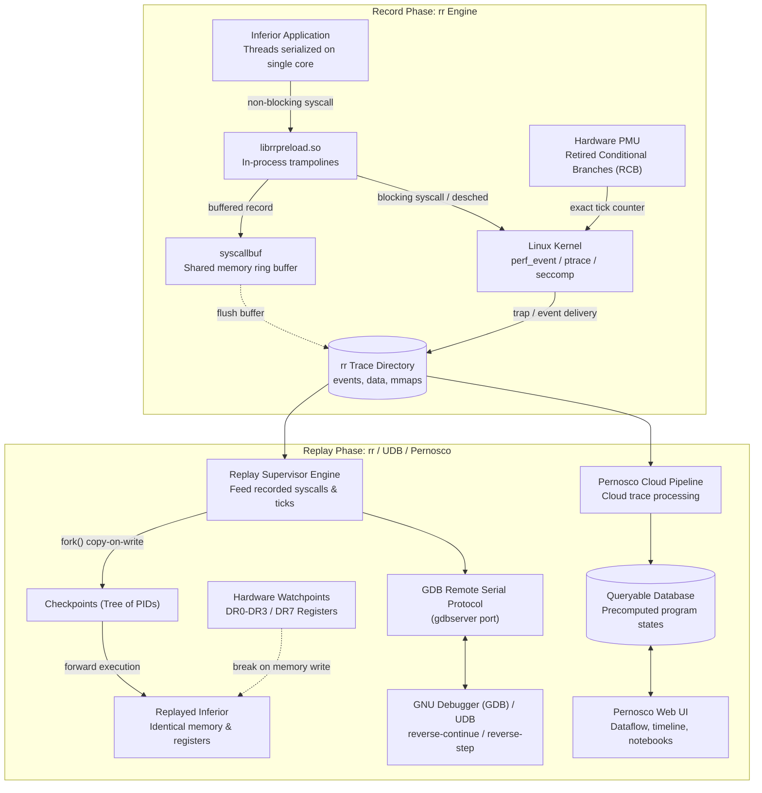
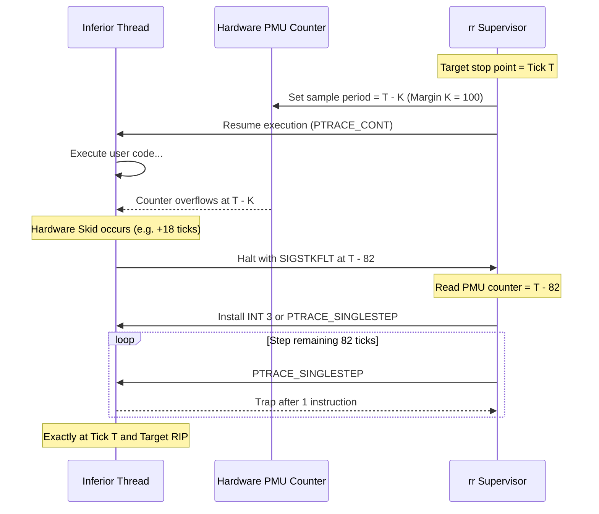
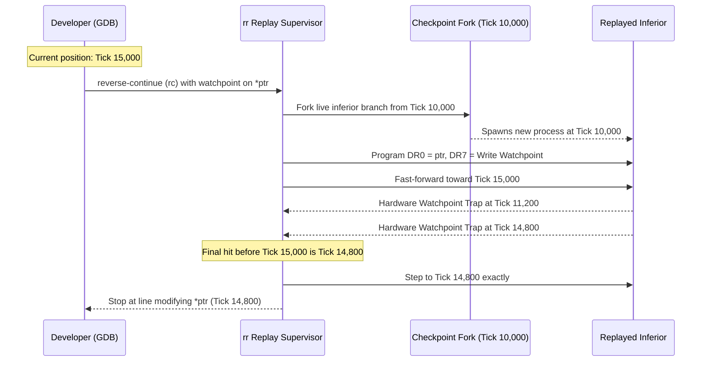
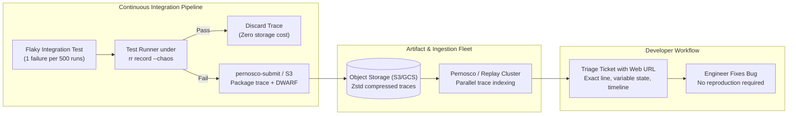
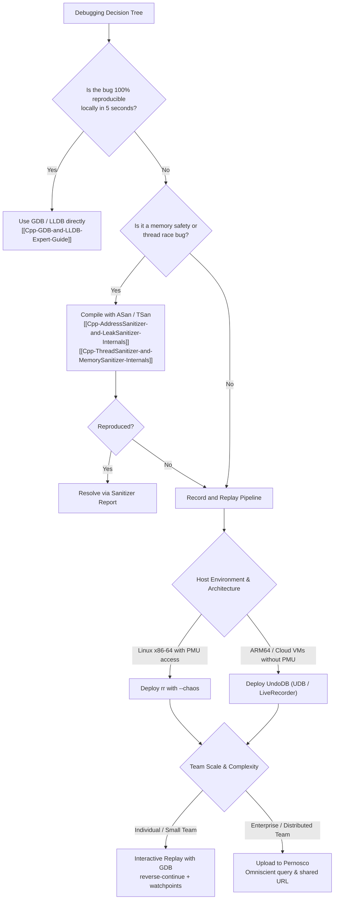

# Record and Replay: rr, UDB, and Pernosco

> [!summary] Scope
> This note owns deterministic user-space record-and-replay debugging systems, analyzing rr, UndoDB (UDB), and cloud-hosted Pernosco.
> It reaches the Use, Explain, and Decide depth rungs by examining PMU retired conditional branch counters, in-process syscallbuf interception that avoids ptrace stops, and hardware watchpoints during reverse execution.
> It distinguishes Linux PMU requirements (bare metal or a VM with PMU virtualization) from Apple Silicon VM limitations and leaves macro replay testing to 14-Low-Latency-Systems.

> [!summary] Claim:
> Record-and-replay debuggers eliminate execution nondeterminism by converting user-space execution into an immutable sequence of discrete events and CPU instructions.
> The rr debugger achieves low recording overhead (as low as 1.2x on Firefox test suites, per rr-project.org) on commodity Linux by serializing thread execution on a single core, counting retired conditional branches via hardware performance counters, and bypassing ptrace context-switch traps using an in-process syscall buffer (`syscallbuf`).
> Nondeterministic CPU instructions like `rdtsc` and `cpuid` are trapped and virtualized through kernel primitives, while reverse execution is implemented by rewinding to copy-on-write `fork()` checkpoints and running forward under hardware watchpoints.
> UndoDB (UDB) eliminates PMU hardware counter dependencies by utilizing dynamic binary translation (x86-64 by default, ARM on an opt-in basis), while Pernosco processes rr recordings in the cloud and precomputes all program states so that shifting time is instantaneous (pernos.co).



## The Mechanism

Traditional debuggers are strictly forward-looking and destructive.
When an engineer encounters memory corruption, a use-after-free, or a data race in a live process, the bug occurred millions of CPU cycles before the symptom manifested.
Restarting the program under a debugger often causes the defect to vanish due to subtle shifts in thread scheduling, memory layout randomization, or I/O latency.
Record-and-replay (R&R) debugging solves this fundamental limitation by capturing a recording of execution and enabling deterministic forward and reverse execution during post-mortem analysis.

### 1. The Nondeterminism Problem in User-Space Execution

A modern computer executing user-space code is deterministic across purely computational instructions like arithmetic, logic, and register-to-register moves.
If two identical CPU cores execute the same sequence of instructions starting from the exact same initial register and memory state, they produce the exact same final state.
Execution diverges only when nondeterministic inputs enter the program.
To guarantee bit-exact replay, a recorder must capture all sources of nondeterminism:

1. **System Call Inputs:** Any data written by the kernel into user-space memory, such as file reads, network packets, terminal input, socket addresses, system time, and process IDs.
2. **Asynchronous Signals:** Operating system signals delivered to a process by external timers, terminal interrupts (`SIGINT`), child process termination (`SIGCHLD`), or cross-process signals (`SIGKILL`, `SIGTERM`).
   A signal can arrive at any arbitrary instruction boundary; replay must deliver the signal at the exact same instruction.
3. **Multithreaded Memory Access and Scheduling:** When multiple threads execute concurrently on multiple physical CPU cores, concurrent writes and reads to shared memory locations produce arbitrary race conditions.
4. **Nondeterministic CPU Instructions:** Instructions that read physical hardware state without issuing a system call, including `rdtsc` and `rdtscp` (timestamp counter), `rdrand` and `rdseed` (hardware entropy), and `cpuid` (hardware processor topology).
5. **Memory Layout and ASLR:** Randomization of memory mappings, stack base pointers, heap arenas, and memory-mapped file offsets.

### 2. Thread Serialization and Single-Core Scheduling

Capturing every shared-memory read and write across multiple CPU cores in hardware or software incurs crippling overhead.
Logging every cache-line invalidation, bus lock, or memory access interleaving requires pervasive code instrumentation or special hardware that imposes significant overhead (rr paper, abstract and Section 1).

The central insight of rr, as formulated by Robert O'Callahan et al. in their 2017 USENIX ATC paper, is to avoid recording multiprocessor memory interleavings altogether.
Instead, rr enforces single-core execution serialization:

- When `rr record` launches an application, it binds all threads of the process and any spawned child processes to a single CPU using `sched_setaffinity()` (`choose_cpu()` in `src/util.cc`, which restricts the choice to P-cores on hybrid Intel parts).
- Thread execution is scheduled in discrete, non-overlapping time slices.
  Only one thread in the entire process tree executes user-space instructions at any given instant.
- Multithreaded execution becomes an interleaved sequence of deterministic single-threaded execution epochs.

This design choice trades multicore throughput for low recording overhead.
If an application contains a data race, running under rr forces an arbitrary serialization of that race during recording.
Once that serialization is recorded, rr reproduces the exact same execution path during replay.
To flush out latent concurrency bugs and race conditions during recording, rr provides a dedicated `--chaos` mode (short flag `-h`, documented in `rr record --help` as "randomize scheduling decisions to try to reproduce bugs") that deliberately randomizes thread scheduling decisions and, with no `--num-cores`, the number of cores reported to the program (`src/RecordCommand.cc`).

### 3. Hardware Performance Counters: Retired Conditional Branches and Skid

To replay asynchronous events like thread context switches and signal deliveries deterministically, the debugger must measure time with instruction-level precision.
Wall-clock time, CPU cycles, and instruction counts are unsuitable for this purpose:

- Wall-clock time varies across runs and CPU frequency scaling states.
- CPU cycle counters (`RDTSC`) vary with cache misses, branch mispredictions, pipeline stalls, and turbo boost frequencies.
- The rr paper requires a counter whose value depends only on the user-space instruction sequence, not on state invisible to user space such as caches, page tables, or speculative CPU state, and notes that this "does not hold for most CPU performance counters in practice" (Section 2.4.1); rr therefore uses a counter it has validated per microarchitecture rather than assuming that any instruction count qualifies.

#### Why Retired Conditional Branches (RCB)

The rr engine measures execution progress in units of **Retired Conditional Branches (RCB)**.
Between any two conditional branches, program execution consists of a straight-line basic block.
Within a basic block, control flow is completely deterministic: if instruction $A$ executes, all subsequent instructions in that block execute in strict order until the next branch.
Therefore, a program's execution coordinate is uniquely defined by a tuple:

$$\text{Execution Coordinate} = (\text{Thread ID}, \text{Event ID}, \text{Retired Conditional Branch Count}, \text{Instruction Pointer})$$

On Intel x86-64 processors, rr programs the hardware Performance Monitoring Unit (PMU) via the Linux kernel's `perf_event_open` system call:

- It opens a per-thread hardware performance counter configured with `type = PERF_TYPE_RAW`.
- On Intel Nehalem through Comet Lake it selects raw event code `0x5101c4` (`BR_INST_RETIRED.CONDITIONAL`); on Ice Lake and later (including Alder Lake, Raptor Lake, Sapphire Rapids, Meteor Lake) it selects `0x5111c4`; on AMD Zen it selects `0x5100d1` (event `0xd1`, `RETIRED_CONDITIONAL_BRANCH_INSTRUCTIONS`) (`src/PerfCounters.cc`, rr master as of 2026-11).
- The counter is configured with `pinned = 1` when it leads its group (`attr->pinned = group_fd == -1`) and counts exclusively in user space (`exclude_kernel = 1`, `exclude_guest = 1`; `init_perf_event_attr()` in `src/PerfCounters.cc`).

#### Hardware Skid and Overflow Interrupt Compensation

When a performance counter overflows, the CPU hardware generates an interrupt to notify the operating system.
However, modern out-of-order superscalar processors do not halt execution instantaneously.
The pipeline contains in-flight instructions that retire before the CPU interrupt vector takes control.
The distance between the exact instruction where the counter reached zero and the instruction where the CPU halts is known as **skid**.

Hardware skid makes it impossible to stop execution at an exact instruction using a counter interrupt alone.
The rr debugger overcomes hardware skid using a two-phase deceleration protocol:

1. **Coarse Phase (PMU Interrupt):** When rr needs to interrupt execution at target tick $T$, it programs the PMU counter sample period to fire early at $T - K$, where $K$ is a safety margin strictly greater than the CPU's maximum possible hardware skid (rr's per-microarchitecture `skid_size` is 100 ticks on Intel Nehalem through Rocket Lake, 125 on Alder Lake and later, and 10000 on AMD Zen, which rr flags `PMU_SKID_UNBOUNDED`; `src/PerfCounters.cc`, as of 2026-11).
2. **Fine Phase (Deterministic Stepping):** When the PMU interrupt fires, execution halts safely before target tick $T$.
   The rr supervisor catches the delivered signal (`SIGSTKFLT`, rr's `PerfCounters::TIME_SLICE_SIGNAL` in `src/PerfCounters.h`), reads the exact current RCB counter value, and switches the inferior into single-step execution via `ptrace(PTRACE_SINGLESTEP)` or installs a temporary software breakpoint (`INT 3`) at the target instruction pointer.
   It then steps the inferior instruction by instruction until the exact target RCB count and instruction pointer (`RIP`) are reached.



### 4. Syscallbuf: In-Process Syscall Interception

Standard Linux debuggers intercept system calls using `ptrace(PTRACE_SYSCALL)`.
Every system call stops the inferior twice, once at syscall entry and once at syscall exit, and each stop is a round trip to the debugger.
The rr paper counts four context switches per traced system call and observes that for common calls such as `gettimeofday` or `read` from a cached file, the cost of even a single context switch dwarfs the cost of the call itself (Section 3).
For system-call-intensive applications such as compilers, database engines, or web servers, raw ptrace tracing therefore adds heavy overhead.

The rr debugger avoids this overhead through an in-process system call buffer called **`syscallbuf`**.
When rr launches an application, it injects a dynamic library (`librrpreload.so`) via `LD_PRELOAD`:

1. **Memory Allocation:** At process startup, rr allocates a per-thread shared memory buffer (default 1 MiB, `syscall_buffer_size_(1024 * 1024)` in `src/RecordSession.cc`, tunable with `rr record --syscall-buffer-size=<KiB>`) mapped into both the inferior process's address space and rr's address space.
2. **Monkeypatching Syscall Sites:** During recording, rr's supervisor-side `Monkeypatcher` patches `syscall` instructions in the tracee (in libc and elsewhere) "whose following instructions match a known pattern to call the syscall hook" in `librrpreload.so` (`src/Monkeypatcher.h`).
   The patched site jumps to the preload library's buffering stub, which handles a fixed set of buffered system calls (such as `read`, `write`, `clock_gettime`, `gettimeofday`, `poll`, `epoll_wait`); it does not rewrite libc function prologues.
3. **Direct User-Space Recording:** When the application issues a buffered system call, the stub executes the system call directly via the CPU's `syscall` instruction without stopping under ptrace.
   Immediately upon return from the kernel, the stub writes a record into the `syscallbuf` memory page:
   - System call number.
   - Return code (`RAX`).
   - Flags recording whether the desched event was armed and whether replay needs an assist.
   - Total record size, followed by the recorded output buffer payload (e.g., bytes returned by `read`).
   The record carries no tick count (`struct syscallbuf_record` in `src/preload/preload_interface.h`).
4. **Buffer Flushing:** Execution continues entirely in user space.
   The inferior traps to the rr supervisor only when:
   - The ring buffer becomes full.
   - An unbuffered or blocking system call occurs.
   - An asynchronous signal arrives.
   - The thread execution time slice expires.
   When a trap occurs, rr reads the recorded entries through its own shared mapping of the buffer (`read_mem()` uses `AddressSpace::local_mapping()` when one exists, `src/RecordTask.cc`) and commits them to the trace.

```c
// Abridged from struct syscallbuf_record in rr src/preload/preload_interface.h (rr master, 2026-11)
struct syscallbuf_record {
    int64_t ret;                  // Syscall return value (RAX / -errno)
    uint16_t syscallno;           // Architecture syscall number (e.g. __NR_read)
    uint8_t desched : 1;          // Did the tracee arm/disarm the desched event?
    uint8_t replay_assist : 1;    // Does replay need an assist for this record?
    uint8_t _flags_padding : 6;
    uint8_t _padding;
    uint32_t size;                // Size of this struct plus trailing payload
    uint8_t extra_data[0];        // Variable-length payload (e.g., read() buffer bytes)
};
```

#### Handling Blocking System Calls with Descheduling Events

A critical hazard arises if an application thread issues a buffered system call that blocks indefinitely in the kernel (for example, reading from an empty socket or waiting on a futex).
If the thread blocks inside a buffered stub without notifying rr, rr cannot schedule other runnable threads, causing the entire process tree to deadlock.

To prevent deadlocks during buffered calls, rr arms a **descheduling event** before executing any potentially blocking system call:

- It opens a dedicated Linux perf event tracking software context switches: `type = PERF_TYPE_SOFTWARE`, `config = PERF_COUNT_SW_CONTEXT_SWITCHES`.
- It arms the event to deliver a signal when the thread context-switches out; the desched signal is `SIGPWR` by default and can be changed with `rr record --syscall-buffer-sig=<NUM>` (`src/RecordCommand.cc`), distinct from the `SIGSTKFLT` time-slice signal.
- If the system call completes immediately without blocking, the stub disarms the descheduling counter and proceeds.
- If the system call blocks in the kernel, the kernel increments the context switch counter and delivers the signal to rr.
- The rr supervisor catches the signal, recognizes that the thread has blocked, saves the partial system call state, and switches execution to another runnable thread.

### 5. Virtualizing Nondeterministic CPU Instructions

Certain x86 instructions execute entirely in user space without entering the kernel, yet return values that change on every execution.
These instructions must be intercepted and replaced with deterministic recorded values.

#### Time-Stamp Counter: `rdtsc` and `rdtscp`

The `rdtsc` instruction reads the CPU's 64-bit time-stamp counter.
Because the hardware cycle counter ticks continuously, successive executions of `rdtsc` return completely different values.
To virtualize this instruction without running heavy binary translation across the whole program:

- The rr supervisor configures the Linux kernel to disable user-space execution of the time-stamp counter by calling:
  `prctl(PR_SET_TSC, PR_TSC_SIGSEGV)` (`src/Task.cc`; x86 only, since Linux 2.6.26 per `PR_SET_TSC(2const)`)
- This kernel call sets the `TSD` (Time Stamp Disable) bit in CPU control register `CR4` (`disable_TSC()` calls `cr4_set_bits(X86_CR4_TSD)` in `arch/x86/kernel/process.c`, Linux master as of 2026-11).
- Any subsequent user-space execution of `rdtsc` or `rdtscp` triggers a hardware general protection fault, which the Linux kernel translates into a `SIGSEGV` delivered to the process.
- The rr supervisor catches this `SIGSEGV`, inspects the faulting instruction bytes (`0x0F 0x31` for `rdtsc`), executes a real `rdtsc` itself and records that value, writes it into `RAX` and `RDX`, advances the instruction pointer past the instruction, and resumes execution (`src/record_signal.cc`).
  Where possible rr instead patches the trapping `rdtsc` into a call to a buffered stub so later executions avoid the trap (`try_patch_trapping_instruction()`).
- During replay, rr writes the exact timestamp recorded in the trace into `RAX` and `RDX`.

#### CPU Feature Detection: `cpuid`

The `cpuid` instruction reports processor features and topology.
Hardware features like `RDRAND` (hardware random number generator) and `RDSEED` provide non-deterministic entropy that cannot be predicted.
Furthermore, replaying a trace on a different machine with differing CPU features would cause control-flow divergence.

To trap `cpuid`, rr uses the `ARCH_SET_CPUID` feature upstreamed into Linux 4.12 by rr maintainer Kyle Huey (commit `e9ea1e7f53b8`, which relies on CPUID faulting, available on Intel "beginning with Ivy Bridge" per the commit message):

- The supervisor calls:
  `arch_prctl(ARCH_SET_CPUID, 0)`
- This disables user-space `cpuid` execution for the thread, causing any `cpuid` instruction to trigger a `SIGSEGV`.
- The rr supervisor catches the fault, inspects `EAX` and `ECX`, and synthesizes a deterministic virtual CPU profile.
- Crucially, rr clears bit 30 of `ECX` on leaf 1 (which advertises `RDRAND`) and bit 18 of `EBX` on leaf 7 (which advertises `RDSEED`) (`CPUID_RDRAND_FLAG` and `CPUID_RDSEED_FLAG` in `src/RecordSession.cc`).
  rr also sets environment variables that tell OpenSSL, Qt, and systemd not to use `RDRAND` (for example `SYSTEMD_RDRAND=0`).
  Applications checking `cpuid` are informed that hardware random number generators are absent, forcing them to fall back to software pseudorandom generators or kernel entropy sources (`/dev/urandom`, `getrandom()`) which rr intercepts and records.

#### Virtual Dynamic Shared Object (vDSO) Monkeypatching

The Linux kernel maps a read-only code page called the **vDSO** into every process address space.
The vDSO executes fast system calls like `clock_gettime`, `gettimeofday`, and `time` entirely in user space by reading kernel-maintained memory structures and hardware cycle counters.
Because vDSO code runs directly on the CPU without issuing a `syscall` instruction or triggering a trap, it evades standard ptrace interception.

During recording, the supervisor's `Monkeypatcher` (not `librrpreload.so`) handles the vDSO: on x86-64 it patches "the VDSO's user-space-only implementation of certain system calls (e.g. gettimeofday) to do a proper kernel system call instead, so rr can trap and record it" (`src/Monkeypatcher.h`).
In current rr the `AT_SYSINFO_EHDR` auxv entry is pointed at rr's own page (`patch_after_exec_arch()` in `src/Monkeypatcher.cc`), and the resulting real syscalls then go through the syscallbuf, forcing time queries through deterministic recording paths.

### 6. Replay Mechanics, Checkpoints, and Reverse Execution

Replaying an execution does not mean running physical CPU silicon in reverse.
Digital state transitions are fundamentally lossy: an `xor %rax, %rax` instruction overwrites `RAX` with zero, permanently discarding the previous 64-bit value.
Reverse execution is achieved through **deterministic forward execution from earlier checkpoints**.

#### The GDB Remote Serial Protocol (RSP) Interface

During replay, rr acts as an RSP gdbserver listening on a TCP port (loopback by default; `rr replay --dbghost` and `--dbgport` change it).
When a developer launches `rr replay`, rr starts a background replay supervisor, spins up the initial inferior process, and launches GDB with a command that connects via (`src/launch_debugger.cc`):
`target extended-remote <host>:<port>`

When the developer issues GDB commands like `step`, `next`, or `continue`, rr executes the inferior forward, replaying recorded system call outputs from disk whenever a system call instruction is reached.

#### Copy-on-Write Checkpointing via `fork()`

To support fast reverse movement without restarting from event zero, rr maintains a tree of execution checkpoints.
Creating a checkpoint must be nearly instantaneous and memory-efficient.
The rr engine achieves this by invoking the Linux `fork()` system call directly on the replayed inferior:

- Because Linux implements `fork()` with copy-on-write (CoW) page table semantics, creating a checkpoint merely duplicates the inferior's page tables.
  Physical memory pages are shared between the parent and the checkpoint child until modified.
- Checkpoint cost grows with the size of the address space: rr's own source budgets "about 50ms" per checkpoint of Firefox (`src/ReplayTimeline.cc`), so sub-millisecond checkpoints hold only for small processes.
- During interactive debugging, rr automatically creates checkpoints spaced to cost "about 0.5s of replay time" apart, with interval lengths growing exponentially so at most O(log L) checkpoints are kept for an execution of length L (`src/ReplayTimeline.cc`).
  Users can also manually freeze state using the `checkpoint` command in GDB (an rr extension command, `src/DebuggerExtensionCommand.cc`).

#### Reverse Execution Algorithm

When an engineer issues a reverse execution command (such as `reverse-continue` / `rc`, or `reverse-step` / `rs`), rr executes the following algorithm (simplified from `ReplayTimeline::reverse_continue` in `src/ReplayTimeline.cc`, rr master as of 2026-11):

1. **Identify Boundary:** rr determines the target destination.
   For `reverse-continue`, it must find the closest preceding instruction that triggers an active breakpoint or hardware watchpoint.
2. **Locate Anchor Checkpoint:** rr searches its internal checkpoint tree for the nearest saved checkpoint whose execution tick count is strictly earlier than the target destination.
3. **Restore State:** rr terminates the current replayed inferior process and forks a new live execution branch from the selected anchor checkpoint.
4. **Arm Hardware Watchpoints:** If the developer set a data watchpoint on a memory address (e.g., `watch *0x7fffffffe000`), rr programs the CPU's physical hardware debug registers (`DR0`, `DR1`, `DR2`, or `DR3`) and configures control register `DR7` to trap on data writes.
5. **Fast-Forward Replay:** rr runs the inferior forward from the anchor checkpoint toward the original position.
   Every time a watchpoint or breakpoint triggers, rr remembers the position of that stop, overwriting the previous one.
6. **Halt at Final Hit:** The last stop that occurred before the starting position represents the exact point of the previous memory write.
   If the interval contained no stop, rr retries from an earlier checkpoint.
   Otherwise rr seeks to the remembered position and returns control to GDB.



### 7. UndoDB (UDB) Architecture: Dynamic Binary Translation vs PMU

While rr relies strictly on hardware PMU counters and Linux kernel ptrace extensions, **UndoDB (UDB)**, developed by Undo Software, uses a fundamentally different architecture based on **Dynamic Binary Translation (DBT)**.

#### How UDB Works Under the Hood

- **JIT Binary Instrumentation:** Rather than executing native machine instructions directly on bare silicon, UDB's execution engine parses machine code on the fly as it is loaded into memory.
  It translates basic blocks into instrumented blocks before execution.
- **Snapshot and Re-execution:** Undo describes its technique as "snapshot-and-replay": periodic copy-on-write snapshots of the application plus a log of only the nondeterministic inputs (syscalls, signals, thread switches) (Undo, quoted on the GDB mailing list, 2009; Undo technical overview, 2014).
  To execute in reverse, UDB jumps to a preceding snapshot and re-executes forward deterministically using its event log.

#### Architectural Comparison: rr vs UDB

| Dimension | Mozilla rr | UndoDB (UDB / LiveRecorder) |
| :--- | :--- | :--- |
| **Primary Mechanism** | PMU Retired Conditional Branches + ptrace | Dynamic Binary Translation (JIT instrumentation) |
| **Hardware Dependency** | Strict: Intel Nehalem or later, certain AMD Zen, or certain AArch64 (Neoverse N1, Apple M-series) with PMU (rr README, as of 2026-11) | No PMU requirement listed; needs no kernel patches or modules (Undo system requirements, as of 2026-11) |
| **Architecture Support** | x86, x86-64, AArch64 (listed as supported in the rr README, not experimental) | 32- and 64-bit processes on x86-64; ARM "on an opt-in basis" (Undo system requirements) |
| **Virtualization Support** | Requires hypervisor PMU counter virtualization | No PMU requirement is listed; Undo's requirements page makes no statement about virtualization (as of 2026-11) |
| **Recording Overhead** | As low as 1.2x on Firefox test suites (rr-project.org); higher for CPU-bound or parallel code | 2x to 5x (InfoQ, 2019); Undo cites about 1.5x for mostly private-memory programs up to 50x when all memory is shared |
| **Trace Storage** | Compressed (brotli) syscall/event log | `.undo` execution log and memory snapshot format |
| **Multicore Recording** | Serialized onto 1 CPU | Serialized execution; LiveRecorder Thread Fuzzing (`--thread-fuzzing`) |
| **Licensing** | Open source (MIT; some bundled third-party files carry their own licenses) | Commercial proprietary |

### 8. Pernosco Architecture: Omniscient Debugging Over rr Traces

Interactive reverse debugging with GDB or UDB still forces the developer to manually step backward, guess which variables to watch, and navigate an iterative search path.
**Pernosco**, which the rr README says sponsors rr development, fundamentally redefines the debugging paradigm by transforming an rr execution recording into an **omniscient, queryable database** that "precomputes all program states so shifting time is instantaneous" (pernos.co overview).

#### The Pernosco Ingestion Pipeline

1. **Recording in CI or Production:** An engineer or CI runner executes a failing test under `rr record`.
   The resulting trace directory is packaged and uploaded to Pernosco's cloud infrastructure using the `pernosco-submit` utility (`pernosco-submit upload [--title <string>] [--url <url>] <rr-trace-dir> [<source-dir>...]`, which sends the trace plus relevant debug info and sources to Amazon S3).
2. **Cloud Replay:** Pernosco replays the uploaded trace on its own cloud infrastructure.
   The internal replay and instrumentation engine is not publicly documented; the earlier claim of a component called `rr remix` is not supported by any source (no such rr subcommand exists in rr's `src/` command list).
3. **Omniscient State Indexing:** pernos.co states that Pernosco "precomputes all program states" and is "designed from scratch with the assumption that we can compute any information about program states we need".
   Its documented views expose, among others:
   - Queries for executions of specific functions and lines.
   - The full dynamic call graph, including the callees of the current function activation.
   - Tracking of data values back to their sources, across multiple copy steps and shared memory.
   - First-class multiprocess debugging and deep gdb integration.
   The internal index layout is not publicly documented.
4. **Interactive Web Client:** Rather than running an interactive debugger against a running process, the developer explores the execution through a responsive web browser UI:
   - **Omniscient Printf Debugging:** The developer can add an expression or print statement to any line in the source code.
     Pernosco evaluates that expression across all times that line was executed and displays the complete history of values instantly.
   - **Dataflow Navigation:** Clicking on any variable or struct field reveals its complete provenance: "Which instruction wrote this value?", "What was the previous value?", and "Which functions read this value later in the execution?"
   - **Integrated Notebook:** Engineers "track your debugging state in our integrated notebook" and share sessions and notebooks with teammates (pernos.co overview); no Python or Jupyter scripting interface is documented there.

### 9. Hardware and Hypervisor Compatibility Matrix

Because rr depends on low-level CPU performance counter microarchitecture and precise Linux kernel features, deployment across physical machines and virtualized cloud infrastructure requires strict environment verification.

#### Intel Core and Xeon Processors

The rr README requires "an Intel CPU with Nehalem (2010) or later microarchitecture" for reliable retired-conditional-branch counting (as of 2026-11, Linux).
On hybrid architectures (such as Alder Lake and Raptor Lake, featuring Performance P-cores and Efficient E-cores), rr has dedicated PMU table entries (`src/PerfCounters.cc`).
The rr 5.10.0 release notes (2026-10-15) state: "On Intel hybrid CPUs, rr prefers P-cores but can use E-cores correctly as well."

#### AMD Zen Microarchitectures: The SpecLockMap Hazard

The rr wiki states that "On Zen CPUs, rr will not work reliably unless you disable the hardware SpecLockMap optimization" and lists validated parts from Zen through Zen 4; rr's PMU table also carries Zen 5 and Zen 6 entries (`src/PerfCounters.cc`, as of 2026-11).
The AMD hardware optimization is called **SpecLockMap**.
The rr wiki names the optimization but gives no mechanism and no error signature; the only documented symptom is that rr "will not work reliably" without the workaround.

To run rr reliably on AMD Zen processors, engineers must disable SpecLockMap by setting bit 54 of Model-Specific Register (MSR) `0xc0011020` ("MSRC001_1020: Load-Store Configuration"; `BIT = 1 << 54`, `val |= BIT` in `scripts/zen_workaround.py`):

```bash
# Load the kernel MSR driver
sudo modprobe msr

# Apply the official rr Zen workaround script from an rr source checkout
# (the script lives in the rr repository's scripts/ directory and is not installed by rr's CMake install rules)
sudo python3 scripts/zen_workaround.py
```

Because the kernel's per-process Speculative Store Bypass mitigation (via prctl or seccomp) rewrites the same MSR from its boot-time value and so can reset the bit on Zen and Zen+ (`scripts/zen_workaround.py` comments), the rr wiki suggests either loading the `zen_workaround.ko` module from `third-party/zen-pmu-workaround` or booting with `nospec_store_bypass_disable` (security cost) or `spec_store_bypass_disable=on` (performance cost); the script must be rerun after each reboot or suspend.

#### Hypervisor Virtualization: KVM and VMware

Running rr inside a Linux virtual machine requires that the hypervisor virtualize the CPU's hardware performance monitoring unit (vPMU); the rr README says "Some configurations of VMware and KVM are known to work", "Some configurations of AWS and GCP VMs are known to work", and "No configurations of Xen are known to work" (as of 2026-11):

- **KVM / QEMU:** The host hypervisor must pass the host CPU configuration with PMU virtualization enabled:
  `-cpu host,pmu=on`
- **VMware Workstation / vSphere:** In VM settings, under *Processors*, the option **"Virtualize CPU performance counters"** must be explicitly checked.
- **AWS EC2 and GCP:** The rr README only says some AWS and GCP configurations are known to work, so run `rr record /bin/true` on the chosen instance type before standardizing on it.

#### Apple Silicon and macOS Virtualization Limitations

Engineers running macOS on Apple Silicon (M1, M2, M3, M4) frequently attempt to run rr inside a Linux virtual machine using Docker Desktop, OrbStack, UTM, or Lima.
**Standard rr works there only if the guest sees a PMU, so check before planning on it.**

- **Root Cause:** the rr README supports VM guests only "as long as the VM supports virtualization of hardware performance counters".
  macOS hypervisor stacks (Apple's `Virtualization.framework`, or QEMU driving `Hypervisor.framework`) differ in what they expose to the guest, and which of them virtualize the ARM PMU was not verified here; the `rr.soft` fork described below exists for guests without counters.
  The rr README does list "the Apple Silicon M-series" among supported AArch64 parts, so any limitation is the VM, not the CPU.
- **Failure Symptom:** Inside the Linux guest VM, calling `perf_event_open` for hardware counters fails (errno not checked on a real guest).
  For `ENOENT`, `rr record` fails immediately with (`src/PerfCounters.cc`):
  `Unable to open performance counter with 'perf_event_open'; are hardware perf events available? See https://github.com/rr-debugger/rr/wiki/Will-rr-work-on-my-system`
- **Remediation Paths:**
  1. Use remote Linux development instances (bare-metal or vPMU-enabled cloud instances) connected via SSH or VS Code Remote.
  2. Boot native Linux on bare metal via the Asahi Linux project, which removes the hypervisor layer.
  3. Deploy **UndoDB (UDB)**, which relies on dynamic binary translation rather than PMU hardware counters (Undo's ARM support is opt-in).
  4. Use the early-stage, not-upstreamed `rr.soft` fork ("Software Counters mode"), which replaces hardware counters with lightweight dynamic instrumentation plus optional gcc and clang plugins, enabled with `-W` on `rr record` and `rr replay`, and documents running Linux in a VM on Apple Silicon.

## Commands and Numbers to Know

| Item | Value / Syntax | Platform and Date | Operational Role and Scope |
| :--- | :--- | :--- | :--- |
| `kernel.perf_event_paranoid` | `<= 3` per rr's own check (the rr wiki still suggests `1`) | Linux (as of 2026-10) | Kernel sysctl controlling unprivileged PMU hardware counter access; rr counts user space only, and fails with "rr needs /proc/sys/kernel/perf_event_paranoid <= 3" only above 3 (the Debian/Ubuntu-patched level 4 blocks all unprivileged `perf_event_open`) |
| `BR_INST_RETIRED.CONDITIONAL` | Raw event `0x5101c4` (Nehalem to Comet Lake), `0x5111c4` (Ice Lake and later) | Linux (as of 2026-10) | Intel PMU event code counting retired conditional branches for execution ticks (`src/PerfCounters.cc`) |
| AMD Zen MSR `0xc0011020` | Bit 54 set | Linux (as of 2026-10) | Disables AMD SpecLockMap optimization to eliminate PMU branch overcounting drift (`scripts/zen_workaround.py`) |
| `prctl(PR_SET_TSC, ...)` | `PR_TSC_SIGSEGV` | Linux (as of 2026-10) | Traps user-space `rdtsc`/`rdtscp` instructions via CPU `CR4.TSD` to ensure deterministic time |
| `arch_prctl(ARCH_SET_CPUID, ...)` | Flag `0` (disabled) | Linux (as of 2026-10) | Traps `cpuid` instructions via `SIGSEGV` to hide non-deterministic CPU features like `RDRAND` |
| `rr record --chaos` | Flag `-h` (`-c` is `--num-cpu-ticks`) | Linux (as of 2026-10) | Randomizes scheduling decisions (and the reported core count unless `--num-cores` is given) to catch heisenbugs (`src/RecordCommand.cc`) |
| `rr record -n` | Flag `--no-syscall-buffer` | Linux (as of 2026-10) | Disables `syscallbuf` optimization; forces every syscall through ptrace stops for debugging rr |
| `rr replay -g <event>` | Flag `--goto=<event>` | Linux (as of 2026-10) | Fast-forwards replay directly to specified execution event number without manual stepping |
| `rr replay -a` | Flag `--autopilot` | Linux (as of 2026-10) | Executes non-interactive replay to verify that execution reproduces without divergence |
| GDB `when` | rr custom command | Linux (as of 2026-10) | Prints `Completed event: <N>`, the last completely replayed rr event (`src/DebuggerExtensionCommand.cc`) |
| GDB `when-ticks` | rr custom command | Linux (as of 2026-10) | Prints `Current tick: <N>`, the rr tick count for the current thread |
| GDB `checkpoint` / `restart` | GDB commands | Linux (as of 2026-10) | Forks a copy-on-write process snapshot (`checkpoint`) or rewinds execution to it (`restart <id>`) |
| GDB `reverse-continue` (`rc`) | GDB reverse command | Linux (as of 2026-10) | Executes execution backward to the preceding breakpoint or triggered hardware watchpoint |
| GDB `reverse-stepi` (`rsi`) | GDB reverse command | Linux (as of 2026-10) | Steps backward by exactly one machine instruction |
| Typical rr recording overhead | as low as `1.2x` | Linux (as of 2026-10) | Slowdown rr-project.org reports for Firefox test suites; actual overhead depends on the workload |
| Typical UDB recording overhead | `2.0x` to `5.0x` | Linux (as of 2026-10) | Runtime slowdown under Undo per InfoQ (2019); Undo itself cites about 1.5x to 50x depending on shared-memory use |
| `live-record` | Binary CLI | Linux (as of 2026-10) | Command-line utility from Undo to record application execution into a portable `.undo` file |
| `pernosco-submit upload` | `pernosco-submit upload [--title <string>] [--url <url>] <rr-trace-dir> [<source-dir>...]` | Linux (as of 2026-10) | Packages rr trace, relevant sources, and debug info and uploads them to Pernosco via Amazon S3; needs `PERNOSCO_USER`, `PERNOSCO_USER_SECRET_KEY`, `PERNOSCO_GROUP` |

## Multi-Language Comparison: C++ / Python / Rust

Record-and-replay tools operate at the machine code and operating system interface level.
However, language runtime architectures introduce distinct trade-offs during recording and reverse debugging:

| Dimension | C++ (Native Systems) | Python (CPython Runtime) | Rust (Native Systems) |
| :--- | :--- | :--- | :--- |
| **Execution Model** | Ahead-of-time compiled native machine code; zero runtime interpretation overhead | C-based virtual machine evaluating bytecode; experimental, off-by-default JIT in Python 3.13+; native extensions | Ahead-of-time compiled machine code; zero-cost abstractions; LLVM backend |
| **Concurrency & Threading** | POSIX threads (`pthreads`), `std::jthread`; threads serialized to 1 core under rr | Global Interpreter Lock (GIL) serializes bytecode; free-threaded Python (3.13t/3.14t) serialized by rr | Standard threads (`std::thread`) and async runtimes (Tokio); serialized to 1 core |
| **Memory Access & Watchpoints** | Raw pointers, arbitrary memory addresses; hardware watchpoints identify memory corruption instantly | Watchpoints hit internal CPython `PyObject` headers or refcount fields rather than Python variables | Strongly typed references; watchpoints track unsafe blocks, raw pointer dereferences, or struct fields |
| **Reverse Stepping Granularity** | `reverse-step` maps to C++ source statements via DWARF line tables; `rsi` steps assembly | `reverse-step` steps through CPython interpreter dispatch loop (`_PyEval_EvalFrameDefault`) unless filtered | `reverse-step` maps cleanly to Rust source lines; inlined functions tracked via DWARF |
| **Nondeterministic Instructions** | Direct use of `rdtsc`, `rdrand`, or inline assembly trapped and virtualized by rr | Time module (`time.time()`) issues libc syscalls; trapped cleanly by `syscallbuf` | Direct use of intrinsics or crates like `rand` trapped by rr's `cpuid` / syscall virtualization |
| **Async Runtime Debugging** | Manual state machine or coroutine frame inspection | Coroutine objects and event loop state inspectable via interpreter frames | Tokio task execution interleaved deterministically; [[Rust-Async-Debugging-tokio-console-and-tracing\|Rust-Async-Debugging]] |
| **Companion Tooling** | [[Cpp-GDB-and-LLDB-Expert-Guide\|GDB Expert Guide]], [[Cpp-AddressSanitizer-and-LeakSanitizer-Internals\|ASan Internals]] | [[Python-pdb-debugpy-and-Remote-Attach\|Python Remote Attach]], [[Python-sys-monitoring-and-Tracing\|sys.monitoring]] | [[Rust-GDB-LLDB-Panics-and-Backtraces\|Rust Backtraces]], [[Rust-Miri-Sanitizers-Loom-and-Cargo-Fuzz\|Rust Miri & Loom]] |

## Worked Lab Example

The companion concept [[Rebuild-Lab-ptrace-Debugger-with-DWARF-Backtrace]] demonstrates how low-level ptrace controls process state.
The walkthrough below demonstrates an end-to-end record-and-replay session using `rr` to diagnose a silent heap corruption bug that manifests millions of instructions after the invalid write occurred.

### Step 1: The Defective Application

The program `corrupt_target.c` simulates a multi-threaded server worker.
A background worker thread experiences a buffer overrun that silently corrupts a metadata field (`status_code`) located in an adjacent heap-allocated structure.
The main thread checks the status code minutes later, detects corruption, and crashes.

```c
// corrupt_target.c
#include <stdio.h>
#include <stdlib.h>
#include <string.h>
#include <pthread.h>
#include <unistd.h>

struct SessionContext {
    char session_name[32];
    int status_code;
    int is_authenticated;
};

struct DataPacket {
    char payload[32];
};

struct AppState {
    struct SessionContext *session;
    struct DataPacket *packet;
};

void *worker_corrupt(void *arg) {
    struct AppState *state = (struct AppState *)arg;
    usleep(1000); // Simulate asynchronous delay

    // Defect: Writing 84 bytes into a 32-byte heap buffer runs through the next chunk header into status_code
    char malicious_input[84];
    memset(malicious_input, 'A', sizeof(malicious_input));
    
    // Unchecked memory copy that overwrites adjacent memory
    memcpy(state->packet->payload, malicious_input, sizeof(malicious_input));
    return NULL;
}

int main(void) {
    struct AppState state;
    // Allocate contiguous heap chunks
    state.packet = (struct DataPacket *)malloc(sizeof(struct DataPacket));
    state.session = (struct SessionContext *)malloc(sizeof(struct SessionContext));

    state.session->status_code = 200; // Expected valid status
    state.session->is_authenticated = 1;

    pthread_t thread;
    pthread_create(&thread, NULL, worker_corrupt, &state);
    pthread_join(thread, NULL);

    // Business logic check long after corruption occurred
    if (state.session->status_code != 200) {
        fprintf(stderr, "FATAL: Session corrupted! Expected 200, got %d (0x%x)\n",
                state.session->status_code, state.session->status_code);
        abort();
    }

    printf("Session completed normally.\n");
    free(state.packet);
    free(state.session);
    return 0;
}
```

We compile the program with debug symbols and disabled optimizations:

```bash
"${CC:-cc}" -g -O0 -pthread corrupt_target.c -o corrupt_target
```

Verification note (2026-11-08): without rr, this program aborts with `FATAL: Session corrupted! Expected 200, got 1094795585 (0x41414141)` on Ubuntu 24.04 glibc 2.39, both x86-64 and aarch64, because glibc places the second 32-byte allocation 48 bytes after the first, so `status_code` sits 80 bytes past `payload`.
The draft's original 40-byte overflow stayed inside the first chunk's usable slack and printed `Session completed normally.` on both architectures.
The lab `code/03-Debugging/rr_reverse_watch/` (requires: linux) compiles this program and runs it twice: plain, and under GDB with a forward write watchpoint on `status_code`.
rr cannot run in the lab because the container exposes no PMU, so the rr transcripts in Steps 2 to 4 are illustrative, not captured: paths, addresses, event numbers, and tick numbers are not from a real recording.
The lab harness scrubs any `0x` followed by 8 to 16 hex digits into `0xADDR`, so the lab prints the two corruption values as `0x_41414141` and `0x_DEADBEEF`.
The lab output below is byte-identical to `expected/linux-aarch64.txt` (Ubuntu 24.04 container, GDB 15.1, glibc 2.39, platform `linux-aarch64`); the block is sections 1 and 2 of the lab output, which cover this worked example (the Practice Drill shows sections 3 and 4):

```text
== 1. worked example without a debugger ==
FATAL: Session corrupted! Expected 200, got 1094795585 (0x_41414141)
== 2. worked example: forward write watchpoint on status_code ==
Hardware watchpoint 2: -location state.session->status_code
Thread 2 "corrupt_target" hit Hardware watchpoint 2: -location state.session->status_code
Old value = 200
New value = 1094795585
worker_corrupt (arg=0xADDR) at corrupt_target.c:33
33	    return NULL;
```

### Step 2: Recording Under rr in Chaos Mode

We execute the binary under `rr record`.
We pass `--chaos` to instruct rr to randomize scheduling decisions:

```bash
# Verify kernel performance counter permissions (rr accepts <= 3; 1 is the conservative wiki value)
sudo sysctl -w kernel.perf_event_paranoid=1

# Record the execution
rr record --chaos ./corrupt_target
```

Terminal output confirms that the failure was captured into a persistent trace:

```text
rr: Saving execution to trace directory `/home/engineer/.local/share/rr/corrupt_target-0`.
FATAL: Session corrupted! Expected 200, got 1094795585 (0x41414141)
Aborted (core dumped)
```

The integer `0x41414141` corresponds to ASCII `'AAAA'`.
The application crashed at the `abort()` statement, but the code that wrote `'AAAA'` executed much earlier inside the worker thread.

### Step 3: Replaying and Setting Reverse Hardware Watchpoints

We launch the interactive replay session:

```bash
rr replay
```

The rr engine initializes an internal GDB server, attaches GDB, and halts at the entry point of the binary.
We continue execution until the crash occurs:

```text
(rr) continue
Continuing.
FATAL: Session corrupted! Expected 200, got 1094795585 (0x41414141)

Program received signal SIGABRT, Aborted.
0x00007ffff7a8900b in __pthread_kill_implementation () from /lib/x86_64-linux-gnu/libc.so.6
```

We navigate up the call stack to inspect the corrupted memory location:

```text
(rr) frame 3
#3  0x00005555555552db in main () at corrupt_target.c:53
53              abort();
(rr) print &state.session->status_code
$1 = (int *) 0x5555555592d0
(rr) print/x state.session->status_code
$2 = 0x41414141
```

The target address `0x5555555592d0` holds the corrupted value `0x41414141`.
We set a hardware write watchpoint on this exact memory address:

```text
(rr) watch *0x5555555592d0
Hardware watchpoint 1: *0x5555555592d0
```

### Step 4: Executing Reverse-Continue to Pinpoint the Defect

We issue `reverse-continue` (`rc`).
The rr engine restores the nearest preceding checkpoint, configures the hardware debug registers (`DR0`), and runs forward until the exact instruction that wrote to `0x5555555592d0`:

```text
(rr) reverse-continue
Continuing.

Hardware watchpoint 1: *0x5555555592d0

Old value = 1094795585
New value = 200
0x00007ffff7bb2374 in __memcpy_avx_unaligned_erms () from /lib/x86_64-linux-gnu/libc.so.6
```

GDB stops immediately on the memory write instruction.
Notice that the "Old value" displayed by GDB is the corrupted value (`1094795585`), while the "New value" is the pre-corruption value (`200`), because execution moved backward across the write (this ordering was confirmed with GDB's own `record full` reverse execution on the drill program in Practice Drill, which reported `Old value = -559038737` and `New value = 12345`).
We inspect the backtrace to identify the calling application frame:

```text
(rr) backtrace
#0  0x00007ffff7bb2374 in __memcpy_avx_unaligned_erms () from /lib/x86_64-linux-gnu/libc.so.6
#1  0x000055555555523a in worker_corrupt (arg=0x7fffffffe050) at corrupt_target.c:32
#2  0x00007ffff7a87ac3 in start_thread () from /lib/x86_64-linux-gnu/libc.so.6
#3  0x00007ffff7b09850 in clone3 () from /lib/x86_64-linux-gnu/libc.so.6
(rr) frame 1
#1  0x000055555555523a in worker_corrupt (arg=0x7fffffffe050) at corrupt_target.c:32
32          memcpy(state->packet->payload, malicious_input, sizeof(malicious_input));
```

The debugger lands directly on line 32 in `worker_corrupt()`.
We immediately observe that `sizeof(malicious_input)` is 84 bytes, but `state->packet->payload` is only 32 bytes.
The 52-byte overflow ran through the next chunk's 8-byte malloc header and the 32-byte `session_name` into `state->session->status_code`.

We inspect the exact execution coordinate using the rr custom commands `when` and `when-ticks` (output formats from `src/DebuggerExtensionCommand.cc`; the numbers are illustrative):

```text
(rr) when
Completed event: 412
(rr) when-ticks
Current tick: 128945
```

We can create an explicit checkpoint here to return to this exact instant at will (rr replies `Checkpoint <id> at <location>`; the location text GDB passes is not shown here because it was not captured):

```text
(rr) checkpoint
Checkpoint 1 at ...
```

The root cause was isolated in under 60 seconds without re-running the application or instrumenting the code with print statements.

## Pitfalls

> [!warning] Pitfall: Missing PMU Virtualization in Virtual Machines and Containers
> Running `rr record` inside a Docker container, cloud instance, or VM without virtualized hardware performance counters fails immediately: either `perf_event_open` fails (`Unable to open performance counter with 'perf_event_open'; are hardware perf events available?`) or rr's startup self-test reports `The hardware performance counter seems to not be working` (`src/PerfCounters.cc`).
> Cloud VMs without vPMU enabled do not expose architectural hardware counters to guests; the rr README notes that only "some configurations of AWS and GCP VMs are known to work".
> Developers must configure KVM with `-cpu host,pmu=on`, verify VMware has "Virtualize CPU performance counters" enabled, or deploy on bare-metal instances.
> On Apple Silicon macOS hosts, rr works in a Linux VM only if the hypervisor exposes the ARM PMU to the guest; check with `rr record /bin/true` first.

> [!warning] Pitfall: Strict Kernel `perf_event_paranoid` Settings
> The upstream kernel default for `/proc/sys/kernel/perf_event_paranoid` is `2`, which still lets an unprivileged user count user-space events on its own processes, and rr counts only user space (`exclude_kernel = 1`).
> Debian and Ubuntu kernels carry a patch adding stricter levels; at level `4` no unprivileged `perf_event_open()` is allowed at all (comment in rr's `src/PerfCounters.cc`).
> Above `3`, `rr record` fails with `rr needs /proc/sys/kernel/perf_event_paranoid <= 3, but it is 4.`; other permission failures print `Permission denied to use 'perf_event_open'; are hardware perf events available?`.
> System administrators should configure `sudo sysctl -w kernel.perf_event_paranoid=3` or lower (rr suggests persisting `kernel.perf_event_paranoid = 3` in `/etc/sysctl.d/10-rr.conf`; the rr wiki still recommends `1`).

> [!warning] Pitfall: AMD Zen Hardware SpecLockMap Counter Overcounting
> On AMD Zen CPUs (the rr wiki validates Zen through Zen 4), the hardware `SpecLockMap` optimization causes retired branch performance counters to overcount when speculative locks roll back (the wiki gives no mechanism and only says rr "will not work reliably").
> Recording on AMD Zen systems without disabling SpecLockMap is documented only as unreliable operation.
> Engineers must set bit 54 of MSR `0xc0011020` using `scripts/zen_workaround.py` (rerun after every reboot or suspend) or load the `zen_workaround.ko` kernel module from `third-party/zen-pmu-workaround`.

> [!warning] Pitfall: Unsynchronized Multi-Process Shared Memory
> The single-core serialization model of rr guarantees deterministic ordering across threads within a process tree.
> However, if two independent processes communicate via shared memory (`shmget`, POSIX shared memory `shm_open`, or file-backed shared `mmap`) without issuing kernel synchronization system calls (like semaphores or mutexes), concurrent writes to shared memory evade rr's serialization.
> Memory modifications made by an untraced external process appear as spontaneous, unrecorded mutations, causing replay divergence.
> All interacting processes must be recorded together under the same rr supervision tree.

> [!warning] Pitfall: Unhandled Hardware Instructions (`RDRAND` / `RDSEED`)
> If an application or third-party library bypasses `cpuid` checks and directly executes `rdrand` or `rdseed` instructions, rr cannot trap the instruction: rr's defenses are masking the CPUID feature bits and setting environment variables that disable `RDRAND` in OpenSSL, Qt, and systemd (`src/RecordSession.cc`).
> The hardware instruction returns physical hardware noise that differs between recording and replay, corrupting program state and causing immediate execution divergence.
> Developers must ensure libraries adhere to standard CPU feature negotiation or link against software pseudorandom fallbacks.

> [!warning] Pitfall: Memory Exhaustion from Unbounded Replay Checkpoints
> During lengthy interactive replay sessions, rr automatically forks checkpoints to accelerate reverse execution; it bounds automatic checkpoints to O(log L) for an execution of length L and discards all checkpoints after the current replay point (`src/ReplayTimeline.cc`), so explicit `checkpoint` commands are the part that accumulates without bound.
> While each checkpoint uses copy-on-write memory, an application that performs extensive heap modifications dirties shared pages, causing the physical memory footprint of the checkpoint tree to multiply.
> In low-memory environments, this triggers the Linux Out-Of-Memory (OOM) killer, terminating the replay supervisor.
> Engineers should periodically delete stale explicit checkpoints using `delete checkpoint <id>` (an rr extension command) during extended reverse debugging sessions.

## At Scale

At the scale of an enterprise engineering organization (1,000 to 50,000 engineers), record-and-replay debuggers shift from individual developer utilities into foundational infrastructure components of the continuous integration (CI) and post-mortem triage pipelines.



### 1. Automated CI Recording of Flaky Tests

The most expensive engineering failure mode in large software monorepos is the **flaky test**: a complex integration test that fails once every 500 or 1,000 runs due to a race condition or memory leak.
Engineers typically spend weeks attempting to reproduce the failure locally.

Production-grade engineering teams solve this with automated CI recording pipelines:

- Test runners are configured to execute flaky tests wrapped in `rr record --chaos`.
- If the test passes, the temporary trace directory is deleted immediately, incurring zero storage cost.
- If the test fails or crashes, the runner automatically captures the trace directory, strips unnecessary core dumps, compresses the files with `zstd -T0`, and uploads the trace to artifact storage (e.g., AWS S3 or Google Cloud Storage) alongside the build's unstripped debug binaries.
- The CI system attaches a direct link to the trace or a generated Pernosco web session directly to the build failure ticket.
- The defect is 100% reproduced on its very first failure; the engineer never needs to re-run the test locally.

### 2. Trace Storage Economics and Compression

A naive recording pipeline can quickly overwhelm corporate storage infrastructure.
Trace size depends on the workload, so measure it on representative runs before sizing storage.

Enterprise deployment rules for trace management:

- **Brotli / Zstandard Compression:** rr already compresses its trace streams internally (brotli, via `CompressedWriter` in `src/TraceStream.cc`), so the remaining redundancy is mostly in copied files rather than in repeated system call payloads.
  Expect little gain from recompressing the streams themselves; measure on your own traces before adding a recompression step.
- **Deduplication of Executable Mappings:** The `mmaps` metadata in an rr trace references shared libraries (`libc.so`, internal `.so` files) and the main binary.
  rr itself tries to hardlink mapped files into the trace directory instead of copying them (`src/TraceStream.cc`), and `rr pack` makes a trace self-contained; beyond that, an enterprise recording agent can compute hashes of mapped ELF files and reference them from a central symbol cache or debuginfod server (see [[Symbol-Servers-and-debuginfod\|Symbol Servers and debuginfod]]).
- **Retention Policies:** Implement strict Lifecycle Management (ILM) on object storage buckets.
  Traces from passing runs are purged immediately; traces from failed CI runs are retained for 14 days, and traces attached to open incident tickets are archived to Glacier or Coldline storage.

### 3. Paved-Road Decision Matrix: Choosing the Right Tool

Engineering leadership must provide clear organizational guidance on when to reach for standard debuggers, sanitizers, rr, UDB, or Pernosco:



- **Use AddressSanitizer / ThreadSanitizer First:** For memory bounds violations, use-after-free, or data races that reproduce reliably under test suites, compiler sanitizers provide immediate stack traces with minimal setup overhead.
- **Use rr for Flaky Heisenbugs on x86-64 Linux:** When a bug reproduces intermittently, depends on timing, or manifests on Linux servers with PMU counter access, rr is the gold standard for zero-cost capture and reverse debugging.
- **Use UDB (LiveRecorder) for Cross-Architecture and Production Deployments:** When recording must occur on ARM64 platforms where rr's PMU support is missing (Undo's ARM support is opt-in; rr itself supports some AArch64 cores such as Neoverse N1), inside cloud hypervisors lacking vPMU support, or embedded inside customer-facing enterprise applications, UDB's dynamic binary translation provides hardware independence.
- **Use Pernosco for High-Complexity Distributed Triage:** When root-cause analysis requires collaboration across teams, asynchronous investigation by engineers without local Linux environments (e.g., macOS laptops), or complex dataflow tracking across billions of instructions, Pernosco's omniscient database eliminates days of manual stepping.

## Practice Drill

> [!tip] Practice Drill: Isolate a Silent Counter Corruption with Reverse Watchpoints
> Execute the following self-contained drill on a Linux host (or VM with PMU virtualization enabled) to master the exact sequence of recording, setting reverse watchpoints, and identifying corrupting instructions.
>
> 1. Create a workspace directory and save the reproduction code `drill_race.c`:
>    The code initializes a ledger of four accounts followed by a sentinel field in one heap allocation, and experiences an off-by-one write during an audit pass that silently corrupts the sentinel (it prints `Sentinel value: 0xDEADBEEF` instead of `0x3039`).
> 2. Compile with debug symbols:
>    `gcc -g -O0 drill_race.c -o drill_race`
> 3. Verify kernel permissions:
>    `sudo sysctl -w kernel.perf_event_paranoid=1`
> 4. Record execution (the program is single-threaded, so `--chaos` adds nothing):
>    `rr record ./drill_race`
> 5. Launch replay non-interactively using GDB batch mode to automatically isolate the corrupting line:
>    Stop after the corruption, set a location watchpoint on the sentinel, issue `reverse-continue`, print the source frame and line, and verify that execution halted on the off-by-one write.
>
> Verification note (2026-11-08): the draft version of this drill used two separate allocations, and on glibc 2.39 (x86-64 and aarch64) the off-by-one write landed in the first chunk's slack, so the sentinel was never corrupted.
> The corrected program below prints `Sentinel value: 0xDEADBEEF`.
> The lab `code/03-Debugging/rr_reverse_watch/` (requires: linux) runs it under GDB 15.1 `record full` with the same breakpoint, `watch -l`, and `reverse-continue` sequence, because rr needs a PMU the lab container lacks.
> rr itself was not run for this drill.

The lab output for the drill, byte-identical to the second half of `expected/linux-aarch64.txt` (platform `linux-aarch64`, GDB 15.1; the value `0xDEADBEEF` is shown as `0x_DEADBEEF` for the reason given in the Worked Lab Example):

```text
== 3. drill without a debugger ==
Sentinel value: 0x_DEADBEEF
== 4. drill: reverse-continue from the symptom ==
Breakpoint 1, main () at drill_race.c:36
36	    audit_ledger(ledger->accounts, 4);
Breakpoint 2, main () at drill_race.c:39
39	    printf("Sentinel value: 0x%X\n", ledger->sentinel);
Hardware watchpoint 3: -location ledger->sentinel
Hardware watchpoint 3: -location ledger->sentinel
Old value = -559038737
New value = 12345
0xADDR in audit_ledger (accounts=0xADDR, count=4) at drill_race.c:20
20	            *adjacent_memory = 0x_DEADBEEF;
#0  0xADDR in audit_ledger (accounts=0xADDR, count=4) at drill_race.c:20
20	            *adjacent_memory = 0x_DEADBEEF;
```

```bash
mkdir -p /tmp/rr_drill && cd /tmp/rr_drill

cat << 'EOF' > drill_race.c
#include <stdio.h>
#include <stdlib.h>

struct Account {
    int id;
    int balance;
};

struct Ledger {
    struct Account accounts[4];
    int sentinel;
};

void audit_ledger(struct Account *accounts, int count) {
    // Defect: Loop index boundary condition overruns array by 1 element
    for (int i = 0; i <= count; i++) {
        if (i == count) {
            // Out-of-bounds write corrupting the adjacent sentinel field
            int *adjacent_memory = (int *)&accounts[i];
            *adjacent_memory = 0xDEADBEEF;
        }
    }
}

int main(void) {
    // One allocation: 4 accounts followed directly by a sentinel
    struct Ledger *ledger = (struct Ledger *)calloc(1, sizeof(struct Ledger));
    ledger->sentinel = 12345;

    for (int i = 0; i < 4; i++) {
        ledger->accounts[i].id = i + 1;
        ledger->accounts[i].balance = 1000 * (i + 1);
    }

    // Call audit ledger with count 4
    audit_ledger(ledger->accounts, 4);

    // Business check: verify memory after ledger
    printf("Sentinel value: 0x%X\n", ledger->sentinel);
    free(ledger);
    return 0;
}
EOF

gcc -g -O0 drill_race.c -o drill_race
sudo sysctl -w kernel.perf_event_paranoid=1 > /dev/null

# Record execution
rr record ./drill_race

# Replay with GDB commands to demonstrate reverse watchpoint automation
# (line 39 is the printf, after the corruption; rr replay passes options after -- to gdb)
rr replay -- -batch \
  -ex "break drill_race.c:39" \
  -ex "continue" \
  -ex "watch -l ledger->sentinel" \
  -ex "reverse-continue" \
  -ex "frame" \
  -ex "list" \
  -ex "quit"
```

## Interview Questions

> [!question] L5: How does rr achieve deterministic execution replay without recording the result of every instruction?
>
> > [!success]- Answer
> > The rr debugger relies on the fact that CPU execution is inherently deterministic between external inputs and asynchronous events.
> > Purely computational instructions (arithmetic, branch logic, register moves) always produce the identical output given the identical inputs.
> > Instead of logging every instruction or memory write, rr records only the *sources of nondeterminism*:
> > 1. Return values and memory payloads of system calls (I/O, network reads, file reads).
> > 2. The exact instruction boundary where asynchronous signals arrive.
> > 3. Thread context switch points.
> > 4. The outputs of nondeterministic CPU instructions (`rdtsc`, `cpuid`).
> >
> > To enforce determinism across threads, rr serializes all execution onto a single CPU core.
> > During replay, rr executes the application's actual compiled machine code forward on the physical CPU.
> > Whenever execution reaches a system call, rr intercepts the call and injects the recorded outputs directly into user-space memory from its trace, without executing the kernel routine.
> > This allows rr to keep recording overhead as low as 1.2x on suitable workloads such as Firefox test suites (rr-project.org) with compact, internally compressed traces.

> [!question] L5: Walk through the exact mechanism of using a hardware watchpoint and `reverse-continue` in GDB under rr to debug a memory corruption bug.
>
> > [!success]- Answer
> > When an application crashes or reports corrupted state at address $A$:
> > 1. Run `rr replay` and execute `continue` to let the program crash at the symptom point.
> > 2. Identify the corrupted memory address $A$ (e.g., `print &struct->field`).
> > 3. Set a hardware write watchpoint on that address: `watch *A` or `watch -l struct->field`.
> >    Under the hood, GDB sends the watchpoint to rr over the remote protocol, and rr programs the tracee's hardware debug registers `DR0`-`DR3` via ptrace (on x86, `Task::set_x86_debug_reg()` in `src/Task.cc` writes the debug registers with `PTRACE_POKEUSER`).
> > 4. Issue the `reverse-continue` (`rc`) command.
> > 5. The rr replay supervisor rewinds execution to the nearest copy-on-write `fork()` checkpoint saved prior to the current tick.
> > 6. rr fast-forwards execution toward the starting point while monitoring hardware watchpoint traps.
> > 7. rr halts execution immediately upon retiring the instruction that wrote the corrupted value into address $A$.
> > 8. The developer can immediately inspect the call stack (`backtrace`), local variables, and registers of the exact function that committed the invalid write, turning a post-mortem symptom into an immediate root-cause identification.

> [!question] L6: Predict the output when executing an rr trace containing an asynchronous `SIGALRM` delivery, and explain how the execution boundary is maintained across replays.
>
> > [!success]- Answer
> > **Prediction:** Across any number of replay runs, the `SIGALRM` signal handler will be invoked at the exact same thread, the exact same retired conditional branch tick count, and the exact same instruction pointer (`RIP`), regardless of system load, CPU clock frequency, or host OS scheduling.
> >
> > **Mechanism:** During recording, when the Linux kernel delivers `SIGALRM` to the inferior, rr intercepts the signal via ptrace.
> > rr reads the thread's hardware Performance Monitoring Unit (PMU) counter tracking retired conditional branches (event `0x5101c4` on Intel through Comet Lake, `0x5111c4` on Ice Lake and later, `0x5100d1` on AMD Zen) and records the tuple `(Event ID, Thread ID, Tick Count, RIP)` into the trace's `events` file.
> > During replay, rr arms the PMU counter sample period to fire shortly before that recorded tick count (compensating for hardware skid).
> > Once execution reaches the precise target tick count and `RIP`, rr synthesizes the signal delivery by constructing a signal frame on the thread's stack and redirecting `RIP` to the registered signal handler.
> > Because the instruction count and register state match the recording bit-for-bit, execution flow is indistinguishable from the recorded run.

> [!question] L6: Why is raw `ptrace(PTRACE_SYSCALL)` tracing too slow for production record-and-replay, and how does `syscallbuf` resolve the bottleneck?
>
> > [!success]- Answer
> > Intercepting system calls with raw `PTRACE_SYSCALL` forces the traced process to halt twice for every system call: once at entry, and once at exit.
> > Each halt forces two context switches between inferior and debugger.
> > The rr paper counts four context switches per traced system call, and for common calls one switch costs more than the call itself (Section 3).
> >
> > rr resolves this using **`syscallbuf`**:
> > 1. An injected library (`librrpreload.so`) maps a shared memory buffer (1 MiB per thread by default) between inferior and supervisor.
> > 2. rr's supervisor-side `Monkeypatcher` patches `syscall` instruction sites that match known instruction patterns so they jump to the preload library's user-space stubs.
> > 3. For non-blocking calls (e.g., `read`, `clock_gettime`), the stub issues the `syscall` instruction directly, logs the return value and memory buffer into the ring buffer, and returns immediately without a ptrace stop.
> > 4. Execution remains in user space at native speed.
> > 5. If a call blocks, an armed perf context-switch counter (`PERF_COUNT_SW_CONTEXT_SWITCHES`) fires a descheduling signal (`SIGPWR` by default), alerting rr to switch threads.
> > 6. rr reads the buffer through its own shared mapping and flushes it to the trace only when full, on blocking calls, or on execution slice expiration, so a buffered call does not need its own ptrace stop.

> [!question] L6: How does the Linux kernel enable rr to trap and virtualize `rdtsc` and `cpuid` instructions without binary translation?
>
> > [!success]- Answer
> > Rather than rewriting user code with a JIT compiler, rr uses hardware control bits exposed by the Linux kernel:
> > - **For `rdtsc` / `rdtscp`:** rr calls `prctl(PR_SET_TSC, PR_TSC_SIGSEGV)`.
> >   The kernel sets the Time Stamp Disable (`TSD`) flag in CPU control register `CR4`.
> >   Any user-space attempt to execute `rdtsc` generates a hardware fault that the kernel translates into a `SIGSEGV`.
> >   rr catches the signal via ptrace, reads the instruction bytes, executes a real `rdtsc` in the supervisor and records the value into the trace, writes it into `RAX:RDX`, advances the instruction pointer, and resumes execution; replay injects the recorded value.
> > - **For `cpuid`:** rr calls `arch_prctl(ARCH_SET_CPUID, 0)`, a kernel feature added in Linux 4.12.
> >   This disables user-space `cpuid` execution, causing `cpuid` to trigger a `SIGSEGV`.
> >   rr catches the fault, simulates the CPUID leaf registers, and deliberately clears feature bits for nondeterministic hardware instructions like `RDRAND` and `RDSEED`.
> >   Applications are forced to fall back to predictable software algorithms or kernel entropy sources that rr can record.

> [!question] L7: Debug this: An engineer runs `rr record` on a cluster of new AMD Zen 3 servers and finds that while recording succeeds, `rr replay` consistently fails with `FATAL: ticks mismatch`.
> Diagnose the root cause and prescribe the remediation.
>
> > [!success]- Answer
> > **Diagnosis:** The failure is caused by an architectural erratum in AMD Zen processors (the rr wiki validates Zen through Zen 4) known as the **SpecLockMap** overcounting bug (literal `ticks mismatch` error text not checked in rr source).
> > Zen processors implement a hardware optimization called SpecLockMap to speculatively elide locks during atomic memory operations.
> > When the CPU rolls back a mispredicted or contended speculative lock execution, it correctly rolls back the instruction stream, but fails to roll back the PMU hardware counter for retired conditional branches (`RETIRED_CONDITIONAL_BRANCH_INSTRUCTIONS`).
> > Consequently, the hardware counter accumulates phantom branch counts during recording.
> > During replay, execution executes non-speculatively or with different cache contention, resulting in a different retired branch count at the same instruction boundary.
> > rr detects this divergence and terminates with `ticks mismatch`.
> >
> > **Remediation:**
> > 1. Disable the SpecLockMap hardware feature by setting bit 54 in AMD Model-Specific Register (MSR) `0xc0011020`.
> > 2. Run the official rr script from an rr source checkout: `sudo python3 scripts/zen_workaround.py` (rerun after each reboot or suspend).
> > 3. To prevent the kernel's per-process Speculative Store Bypass mitigation from resetting the MSR bit (an issue on Zen and Zen+), boot the server kernel with `nospec_store_bypass_disable` or `spec_store_bypass_disable=on`, or build and load the `zen_workaround.ko` kernel module from `third-party/zen-pmu-workaround`.

> [!question] L7: Compare the architectural trade-offs of rr's PMU-based counting against UndoDB's dynamic binary translation and Pernosco's cloud omniscient database.
>
> > [!success]- Answer
> > **Mozilla rr (PMU + ptrace):**
> > - *Strengths:* Lowest recording overhead (as low as 1.2x on Firefox tests); compact, compressed trace files; open-source (MIT).
> > - *Weaknesses:* Rigid hardware requirements (Intel Nehalem or later, certain AMD Zen, or certain AArch64 cores, with PMU access); cannot run inside Apple Silicon VMs without PMU virtualization; serializes all threads to 1 core; interactive replay requires serial GDB navigation.
> >
> > **UndoDB / UDB (Dynamic Binary Translation):**
> > - *Strengths:* No PMU requirement; runs on x86-64 (32- and 64-bit processes) with ARM support opt-in (Undo system requirements); supports in-process LiveRecorder API; snapshot-and-replay reverse execution plus LiveRecorder Thread Fuzzing.
> > - *Weaknesses:* Higher recording overhead (2x to 5x per InfoQ; Undo cites up to 50x for heavily shared memory) due to JIT basic-block translation; commercial closed-source licensing.
> >
> > **Pernosco (Cloud Omniscient Database over rr):**
> > - *Strengths:* Eliminates interactive single-stepping; entire execution history is precomputed into an omniscient database; instant omniscient printf debugging; backward data provenance queries; shareable web session URLs for distributed teams.
> > - *Weaknesses:* Relies on rr's underlying PMU hardware constraints for recording; requires uploading large traces and DWARF binaries to cloud infrastructure; substantial cloud compute indexing cost per trace.

> [!question] L8+: Design an automated continuous integration (CI) and post-mortem triage architecture for a 20,000-engineer monorepo that captures flaky test failures using record-and-replay and makes them instantly debuggable.
>
> > [!success]- Answer
> > **Architecture Specification:**
> >
> > 1. **Compute Pool Provisioning:**
> >    - Deploy bare-metal or vPMU-enabled cloud worker instances (e.g., bare-metal instances or KVM with `-cpu host,pmu=on`).
> >    - Configure kernel host settings via Ansible/Puppet: `kernel.perf_event_paranoid=1` (rr accepts up to 3), and load `zen_workaround.ko` if AMD Zen nodes are utilized .
> >
> > 2. **Execution Harness:**
> >    - Wrap test runner commands in an intelligent supervisor:
> >      `rr record --chaos --output-trace-dir=/tmp/trace_$$ ./test_binary`
> >    - Chaos mode forces randomized scheduling slices to maximize the probability of reproducing concurrency bugs.
> >    - If the test passes (`exit code == 0`), the runner immediately executes `rm -rf /tmp/trace_$$` to prevent storage bloat.
> >
> > 3. **Artifact Packaging and Ingestion Pipeline:**
> >    - Upon test failure, the harness triggers an upload worker:
> >      - Scans trace `mmaps` to extract build IDs of all loaded executables and shared libraries.
> >      - Replaces embedded binary copies in the trace with pointers to a centralized enterprise debuginfod server ([[Symbol-Servers-and-debuginfod\|Symbol Servers and debuginfod]]).
> >      - Compresses the remaining trace files (`events`, `data`) with `zstd -T0 -19` (rr streams are already brotli-compressed, so gains are mostly on copied files).
> >      - Uploads compressed package to an S3 bucket configured with an S3 Lifecycle rule (14-day retention).
> >
> > 4. **Automated Triage and Analysis:**
> >    - A webhook triggers a Pernosco cloud indexing worker or an internal headless replay cluster (`rr replay -a`).
> >    - The worker generates a crash report containing:
> >      - Exact crash backtrace.
> >      - Execution event ID and tick count at failure.
> >      - Web link to the interactive Pernosco omniscient debugging session.
> >    - The link is posted directly into the pull request review thread and Jira/Linear incident tracker.
> >    - Developers click the URL and immediately inspect variable history, data provenance, and memory writes without needing local Linux machines or reproduction attempts.

## Further Reading

- Robert O'Callahan et al., *Engineering Record and Replay for Deployability* (USENIX ATC 2017): The foundational academic paper defining rr's PMU counter architecture, single-core serialization, and syscallbuf design.
- rr Project Documentation (`rr-project.org`): The authoritative operational manual for installation, kernel configuration, and command-line usage across Linux microarchitectures.
- Kyle Huey, Linux Kernel Commit `e9ea1e7f53b8` (*x86/arch_prctl: Add ARCH_[GET|SET]_CPUID*, Linux 4.12): The upstream kernel mechanism implemented to allow debuggers to trap `cpuid` in user space.
- Undo Ltd., *Undo documentation* (docs.undo.io, including System requirements and Thread Fuzzing): The vendor's reference for supported platforms and LiveRecorder features.
- Robert O'Callahan, *Omniscient Printf Debugging In Pernosco* (Eyes Above The Waves, 2019): The Pernosco co-founder's explanation of evaluating expressions across all times by querying the omniscient database instead of re-executing.
- Intel 64 and IA-32 Architectures Software Developer's Manual, Volume 3B (Performance Monitoring chapter): Normative specification of architectural performance monitoring counters and retired conditional branch event definitions.

## Related

- Prerequisites: [[How-Debuggers-Work-ptrace-Mach-and-Breakpoints]]
- Next: [[Debugging-Distributed-Systems-with-Traces-and-Correlation]]
- See also: [[14-Low-Latency-Systems/13 - Reliability, Ops & Testing/Deterministic Replay and Packet Injection Testing|Deterministic Replay and Packet Injection Testing]]
- Lab: `code/03-Debugging/rr_reverse_watch/` (requires: linux)
- Companion debuggers: [[Cpp-GDB-and-LLDB-Expert-Guide]], [[Remote-Debugging-gdbserver-lldb-server-and-RSP]]
- Crash analysis & symbols: [[Core-Dumps-Minidumps-and-Crash-Reporting]], [[Symbol-Servers-and-debuginfod]], [[Debug-a-Production-Crash-From-a-Core-Dump]]
- Memory safety: [[Cpp-AddressSanitizer-and-LeakSanitizer-Internals]], [[Cpp-ThreadSanitizer-and-MemorySanitizer-Internals]]
- Rebuild lab & drills: [[Rebuild-Lab-ptrace-Debugger-with-DWARF-Backtrace]], [[Drill-Debugging-Use-After-Free-Core-Dump]]
