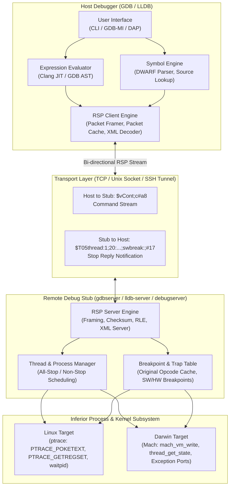
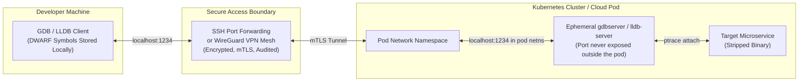

# Remote Debugging: gdbserver, lldb-server, and RSP

> [!summary] Claim:
> Remote debugging splits the debugger into a heavyweight host that parses DWARF debug info and compiles expressions, and a lightweight target stub (`gdbserver`, `lldb-server`, or macOS `debugserver`) that translates ASCII GDB Remote Serial Protocol (RSP) packets into low-level operating system execution primitives.
> RSP packets are framed as `$packet-data#checksum` using an 8-bit modulo-256 checksum, run-length encoding for sparse byte strings, and the `QStartNoAckMode` capability to eliminate half-duplex packet acknowledgment round trips over high-latency networks.
> Execution control and state synchronization rely on structured query packets (`qSupported`, `qXfer:features:read:target.xml`), multi-action thread resumption (`vCont`), and asynchronous stop reply notifications (`%Stop:`, `vStopped`, `T05`) that stream register states, breakpoint triggers, and hardware watchpoint traps without stalling unhit threads in non-stop mode.



## The Mechanism

The GDB Remote Serial Protocol (RSP) began as a way to debug embedded microprocessors across serial lines: the client side lives in gdb/remote.c, whose copyright notice starts in 1988 and which describes itself as "Remote target communications for serial-line targets in custom GDB protocol" (binutils-gdb tag gdb-1999-07-26).
The `+`/`-` acknowledgment scheme exists for unreliable transports such as a serial line (GDB manual, Overview).
This note does not claim a protocol introduction date, because a copyright year dates the file, not the wire format.
The protocol cleanly divides debugging into two halves: a symbol-aware, memory-intensive client running on the developer workstation, and an execution stub running adjacent to the target hardware.
This separation protects resource-constrained embedded devices, bare-metal microcontrollers, and isolated container environments from the memory and disk footprint of modern debug symbol tables.

### 1. The Architectural Split: Host vs. Stub

A full debugger binary is heavy.
Parsing multi-gigabyte DWARF debug information bundles, constructing syntax trees for C++ or Rust expressions, resolving inline function frames, and hosting Python or Lua scripting engines consumes hundreds of megabytes of resident memory.
Embedded systems, IoT devices, bare-metal kernels, and lean container microservices cannot spare those resources.

The remote debugging paradigm enforces an asymmetric architectural split:

1. **The Host Debugger (`gdb`, `lldb`):**
   The host retains all symbol tables, DWARF compilation units, `.eh_frame` call frame information tables, and source files.
   When an engineer runs `print x->foo()`, the host resolves `x` from local DWARF symbols, evaluates the type structure, generates machine code or an inferior function call stub, and sends low-level memory and register instructions across the wire.
   The host never requires access to the target operating system's kernel debugging APIs.

2. **The Target Debug Stub (`gdbserver`, `lldb-server`, Apple `debugserver`):**
   The stub does not parse DWARF; when it needs a symbol address (gdbserver does, for `libthread_db` thread enumeration) it asks the host through the `qSymbol` packet, which "notif[ies] the target that GDB is prepared to serve symbol lookup requests" (GDB manual, General Query Packets).
   It acts strictly as an execution daemon and system call bridge.
   On Linux, it interfaces directly with `ptrace(2)` (`PTRACE_PEEKTEXT`, `PTRACE_POKETEXT`, `PTRACE_GETREGSET`, `PTRACE_SETREGSET`, `PTRACE_CONT`), `process_vm_readv(2)`, and `waitpid(2)`.
   On macOS, `debugserver` interfaces with the Mach kernel subsystem via Mach task ports, `mach_vm_read`, `mach_vm_write`, and Mach exception ports (`task_set_exception_ports`).
   The stub exposes these primitives to the host across a bidirectional byte stream, typically over a TCP socket, Unix domain socket, or serial line (`/dev/ttyS0`).

[[How-Debuggers-Work-ptrace-Mach-and-Breakpoints]] details the underlying ptrace and Mach kernel traps that the stub drives.
[[Cpp-GDB-and-LLDB-Expert-Guide]] covers the developer-facing interactive CLI commands that drive the host side.

### 2. RSP Framing, Checksums, and Transport Handshakes

All RSP communication (with the exception of single-character acknowledgments and asynchronous notification frames) is packaged into discrete ASCII packets:

```text
$packet-data#checksum
```

The packet framing rules defined in Appendix E of the GDB manual specify:
- The leading character `$` (`0x24`) marks the start of the payload.
- The trailing character `#` (`0x23`) terminates the payload.
- The two hexadecimal characters immediately following `#` represent an 8-bit unsigned checksum.
- The checksum is computed as the modulo 256 sum of all ASCII bytes between the leading `$` and the trailing `#`:

$$\text{checksum} = \left( \sum_{i=0}^{N-1} \text{byte}[i] \right) \pmod{256}$$

#### Acknowledgment Handshake and `QStartNoAckMode`

Under the original serial protocol specification, every packet required an immediate single-character acknowledgment:
- `+` (`0x2b`): Positive acknowledgment (ACK); the recipient validated the checksum and accepted the packet.
- `-` (`0x2d`): Negative acknowledgment (NACK); the checksum failed, requesting retransmission.

The GDB manual notes that when "the transport mechanism is itself reliable (such as a pipe or TCP connection)" these acknowledgments are redundant, and disabling them reduces communication overhead.
The overhead is extra bytes, extra reads, and checksum-driven retransmission logic on every packet, not an extra full round trip: in a request-reply exchange the stub's `+` and its reply travel back together, so each query still costs roughly one network round trip either way.

To eliminate this overhead, modern debuggers negotiate `QStartNoAckMode` (offered by the stub as `QStartNoAckMode+` in its `qSupported` reply):
1. Host sends: `$QStartNoAckMode#b0`
2. Stub responds: `+` (the last ACK it sends) followed by `$OK#9a`
3. Host sends: `+` (final ACK of the `OK`, which the stub "can safely ignore")
4. From this point forward, neither side transmits `+` or `-`.
The session relies entirely on the reliable, ordered delivery guarantees of TCP/IP, pipes, or Unix domain sockets; packets keep their checksum, "but the checksum may be ignored by the receiver" (GDB manual, Packet Acknowledgment).
A live `lldb` session on macOS (lldb-2103.0.34.407, as of 2026-11) shows exactly this sequence: `$QStartNoAckMode#b0`, `+`, `$OK#9a`, `+`, after which debugserver stops sending valid checksums (`#00`).

#### Binary Data Escaping

RSP was designed for 7-bit clean serial links, so binary memory and register data was historically serialized as two hexadecimal ASCII characters per byte.
For high-bandwidth transfers (such as downloading memory pages or core data), modern packets (such as the `X` memory-write packet and `qXfer` file transfers) transmit raw 8-bit binary bytes.

Binary data uses the escape character `}` (`0x7d`).
Any escaped byte is transmitted as `}` followed by the original byte XORed with `0x20` (`byte ^ 0x20`):
- `0x7d` (`}`) escapes to `0x7d 0x5d`
- `0x23` (`#`) escapes to `0x7d 0x03`
- `0x24` (`$`) escapes to `0x7d 0x04`
- Responses sent from the stub to the host must also escape `0x2a` (`*`) to `0x7d 0x0a` so that binary bytes are never misinterpreted as the start of a run-length encoded sequence.

#### Run-Length Encoding (RLE)

To compress long runs of repetitive bytes (such as unmapped memory pages filled with zeros or uninitialized register fields), RSP specifies a printable run-length encoding format:
- A run of identical characters is replaced by the initial character, followed by an asterisk `*` (`0x2a`), followed by an encoded repeat count character.
- If character $c$ repeats $n$ times immediately following its first appearance, the repeat count character is encoded as $n + 29$.
- Because encoding requires two bytes (`*` and the count), RLE only produces net compression for repeat counts $n \ge 3$.
- A repeat count of 3 yields ASCII code $3 + 29 = 32$ (the space character `' '`).
  Thus, four consecutive zeros `"0000"` are encoded as `"0* "`.
- The repeat count character must never exceed ASCII 126 (`'~'`), capping a single run at $126 - 29 = 97$ repeats.
- Furthermore, the encoded repeat character must not be `#` ($35 - 29 = 6$ repeats) or `$` ($36 - 29 = 7$ repeats) to prevent packet framing corruption.
- Stubs break runs of 6 or 7 repeats into safe sub-runs.
For example, eight consecutive zeros `"00000000"` is encoded as `"0*\"00"`, where `"` ($34 - 29 = 5$) specifies 5 repeats, producing 6 zeros, followed by two literal `'0'` characters.

### 3. Core Protocol Operations: Registers, Memory, and Breakpoints

Once the transport connection is established, the host and stub execute a standardized command-response loop.

```text
Host -> Stub: $qSupported:multiprocess+;swbreak+;hwbreak+;qXfer:features:read+#40
Stub -> Host: $PacketSize=4000;qXfer:features:read+;swbreak+;hwbreak+;vContSupported+;QStartNoAckMode+#ba
```

#### Feature Negotiation (`qSupported`)

The `qSupported` packet consolidates startup probing into a single handshake round trip.
The host announces its capabilities, and the stub returns its supported features:
- `PacketSize=bytes`: The stub "can accept packets up to at least bytes in length", in hexadecimal, so `PacketSize=4000` means 16384 bytes.
  gdbserver advertises `PBUFSIZ - 1` with `PBUFSIZ` 131104 (`PacketSize=2001f`), and macOS debugserver advertised `PacketSize=20000` (131072 bytes) in a live session (as of 2026-11; gdbserver/server.h, server.cc).
- `qXfer:features:read+`: The stub can stream target architecture XML descriptions.
- `multiprocess+`: Both peers understand the `p<pid>.<tid>` composite thread identification format.
- `swbreak+` and `hwbreak+`: The stub explicitly reports software and hardware breakpoint triggers in stop reply packets.
- `vContSupported+`: The stub "reports the supported actions in the reply to `vCont?` packet" (GDB sends the same name to say it wants that list).
- `QNonStop+`: The stub supports non-stop execution mode.

#### Register Access (`g`, `G`, `p`, `P`)

The protocol provides two mechanisms for register manipulation:
1. **Bulk Register Access (`g`, `G`):**
   The host sends `$g#67`.
   The stub reads all general-purpose registers from the target thread (via `PTRACE_GETREGSET` on Linux or `thread_get_state` on macOS) and formats them as a contiguous hex string.
   Each register is encoded in target architecture byte order (little-endian for x86-64 and AArch64).
   The `$G<hex-data>#checksum` command writes the entire register block back to the target.
2. **Individual Register Access (`p`, `P`):**
   The host sends `$p<reg_hex>#checksum` to read an individual register by index, or `$P<reg_hex>=<val_hex>#checksum` to write it.
   Register index numbers are defined either by architecture convention or dynamically assigned via target XML descriptions.

#### Memory Access (`m`, `M`, `X`)

Memory access operations specify an address and byte length:
- Read: `$m<addr_hex>,<length_hex>#checksum`.
  The stub reads the inferior's address space using `process_vm_readv(2)` or `PTRACE_PEEKTEXT`.
  It returns the raw bytes as hexadecimal pairs.
  If the memory region is unmapped or protected, the stub returns an error packet; gdbserver answers a failed `m` read with `$E01#a6` (`write_enn` in gdbserver/remote-utils.cc carries the comment "Some day, we should define the meanings of the error codes"), so the `NN` in `E NN` is a hex code with no standard errno meaning.
- Hex Write: `$M<addr_hex>,<length_hex>:<hex_bytes>#checksum`.
- Binary Write: `$X<addr_hex>,<length_hex>:<binary_data>#checksum`.
  Transmits raw escaped binary data, halving bandwidth consumption during bulk program loading or memory patching.

#### Breakpoints and Watchpoints (`Z`, `z`)

RSP delegates breakpoint injection to the stub via the `Z` (insert) and `z` (remove) packet family:

```text
$Z<type>,<addr_hex>,<kind>#checksum
$z<type>,<addr_hex>,<kind>#checksum
```

The `<type>` parameter selects the underlying hardware or software mechanism:
- `0`: Software breakpoint.
  The stub reads the target instruction at `addr_hex`, saves the original bytes in an internal lookup table, and overwrites the location with a trap instruction (`0xcc` for x86 `int3`, `0xd4200000` for AArch64 `brk #0`).
- `1`: Hardware breakpoint.
  The stub programs the processor's hardware debug registers (such as x86 DR0-DR3 or ARM DBGBVR/DBGBCR) to trap execution when the program counter reaches `addr_hex`.
- `2`: Write watchpoint.
  Traps when the memory range is written.
- `3`: Read watchpoint.
  Traps when the memory range is read.
- `4`: Access watchpoint.
  Traps when the memory range is read or written.

The `<kind>` argument "is target-specific and typically indicates the size of the breakpoint in bytes" (GDB manual, Packets):
- On x86 and x86-64, `<kind>` is `1` (the single-byte `0xcc` trap).
- On ARM, `<kind>` is `2` for 16-bit Thumb, `3` for 32-bit Thumb-2, or `4` for 32-bit ARM mode (GDB manual, ARM Breakpoint Kinds).
- On AArch64, `<kind>` is `4` (the 32-bit `brk #0`, stored by gdbserver as bytes `00 00 20 d4` in gdbserver/linux-aarch64-low.cc; LLDB sent `Z0,<addr>,4` in a live arm64 macOS session, as of 2026-11).

#### Software Breakpoint Program Counter Rewind (`swbreak`)

On architectures such as x86 and x86-64, the CPU executes the 1-byte `int3` trap instruction before generating the interrupt.
As a physical consequence of instruction decoding, the program counter (RIP) stored in the hardware interrupt frame advances past the trap instruction:

$$\text{RIP}_{\text{stopped}} = \text{Address}_{\text{breakpoint}} + 1$$

Without stub help, the host GDB client applies an architecture-specific heuristic: when a `SIGTRAP` arrives and one of its own breakpoints is inserted at `PC - 1`, it decrements the PC itself (`adjust_pc_after_break` in gdb/infrun.c, which returns early when `target_supports_stopped_by_sw_breakpoint ()`).
That heuristic is ambiguous for a trap that was not a breakpoint (a single-step that lands one byte past an inserted breakpoint), and it breaks in non-stop mode, where a breakpoint may already have been removed by the time a thread's stale stop is processed.

Under the modern RSP specification, host and stub negotiate `swbreak+` in `qSupported` (GDB sends it to say it understands the stop reason, the stub replies with it to say it will report it).
When `swbreak+` is active:
1. The stub decides, upon receiving `SIGTRAP`, whether a software breakpoint instruction executed - "irrespective of whether it was GDB that planted the breakpoint or the breakpoint is hardcoded in the program" (GDB manual, Stop Reply Packets).
2. If so, "the stub is responsible for adjusting the PC to point back at the breakpoint address" before reporting the stop.
3. The stub appends `swbreak:;` to the `T` stop reply packet.
4. The host trusts `swbreak:;` and skips its own decrement; the manual states the stop reason "is required for correct non-stop mode operation".

### 4. Run Control, Range Stepping, and Stop Replies

Early RSP revisions used `$c#63` (continue) and `$s#73` (step).
These legacy packets are global and cannot direct individual threads in multi-threaded programs.

Modern run control uses the `vCont` packet family:

```text
Host -> Stub: $vCont?#49
Stub -> Host: $vCont;c;C;s;S;t;r#be
```

Stubs differ: macOS debugserver replies `vCont;c;C;s;S` with no `t` or `r` (RNBRemote.cpp, and observed live as of 2026-11, macOS).

A `vCont` invocation supplies a prioritized, semicolon-separated list of actions applied to specific thread identifiers:

```text
$vCont;s:p1024.1025;c#bd
```

In this command:
- Thread `p1024.1025` is single-stepped (`s`).
- All other threads in the inferior are resumed concurrently (`c`).
- "For each inferior thread, the leftmost action with a matching thread-id is applied" (GDB manual, Packets).

#### Range Stepping (`vCont;r`)

Source-level single-stepping in high-level languages (such as stepping across a single C++ source line with `step` or `next`) often requires executing dozens of assembly instructions.
Under classic single-stepping, the host issues `$vCont;s:tid#checksum`, waits for the stop reply, reads the program counter, compares it against the DWARF line table, and repeats the cycle 40 times.
Over a 50 ms network link, a single line step takes 2,000 ms.

Range stepping moves the stepping evaluation loop inside the target stub:

```text
$vCont;r100000334,10000035c:p1024.1025;c#8f
```

Addresses are bare hex with no `0x` prefix, like every RSP address field.
The stub receives the starting address (inclusive) and ending address (exclusive) corresponding to the contiguous instruction range of the current source line.
The stub executes the single-steps locally on the target (a userspace stub still takes one `PTRACE_SINGLESTEP` trap per instruction, but none of them crosses the network).
It only transmits a stop reply back to the host when, in the manual's words, "the thread goes out of the range or is stopped due to an unrelated reason, such as hitting a breakpoint":
1. The program counter leaves the specified `[start, end)` address range.
2. A breakpoint or watchpoint triggers.
3. An unexpected signal (such as `SIGSEGV`) occurs.

Range stepping collapses the per-instruction round trips of one line into one, which is what makes line stepping over a wide-area link tolerable; calls out of the range still stop and return control to the host.
GDB uses it by default when the target supports it (`set range-stepping`, default `on`); gdbserver gained it in GDB 7.7 for x86/x86-64 GNU/Linux and also implements it for AArch64 Linux in current sources, while macOS debugserver does not advertise `r` (gdb/NEWS, gdbserver/linux-aarch64-low.cc, as of 2026-11).

#### Stop Reply Packets

When an inferior stops, the stub transmits a stop reply packet to notify the host:
- `S AA`: Legacy stop packet indicating the process received two-digit hex signal number `AA` (`05` indicates `SIGTRAP`, `0b` indicates `SIGSEGV`).
- `T AA [key:val;]...`: Modern structured stop reply.
  In addition to the signal number, it streams critical state directly inside the stop packet:
  - `thread:<thread-id>;`: The specific thread that triggered the stop.
  - `core:<core-id>;`: The CPU core ID where the stop occurred.
  - `<reg_num>:<hex_val>;`: Expedited register values.
    The stub immediately bundles the program counter, stack pointer, and frame pointer into the stop reply.
    The host extracts the call frame immediately without issuing separate `p` or `g` register read packets.
  - `swbreak:;`: Indicates a software breakpoint instruction was triggered.
  - `hwbreak:;`: Indicates a hardware execution breakpoint triggered.
  - `watch:<addr_hex>;`: Indicates a data watchpoint triggered, reporting the faulted memory address.
  - `fork:<child_tid>;` / `vfork:<child_tid>;`: Reports process fork events when `fork-events+` is negotiated.
  - `exec:<path_hex>;`: Reports an `execve(2)` transition with the hex-encoded binary path.
- `W AA`: Normal process termination with exit code `AA`.
- `X AA`: Abnormal termination killed by signal `AA`.
- `O <hex_text>`: Console output packet.
  Transmits stdout or stderr emitted by the target program to be displayed directly on the host console.
  It "can happen at any time while the program is running" and "is not permitted in non-stop mode" (GDB manual, Stop Reply Packets).

### 5. Target XML Descriptions (`qXfer:features:read:target.xml`)

Historically, GDB and LLDB hardcoded fixed register arrays for each target architecture.
This approach broke down as modern processor architectures introduced optional, heterogeneous extensions:
- x86-64 processors range from legacy SSE2 to AVX, AVX2, and 512-bit AVX-512 with opmask registers.
- ARMv8/ARMv9 processors feature optional Scalable Vector Extensions (SVE/SVE2) with vector lengths from 128 to 2048 bits (16 to 256 bytes, a multiple of 16 bytes) that Linux tracks and sets per thread (Linux kernel docs, arm64 SVE).
- Embedded RISC-V cores support dozens of vendor-defined custom Control and Status Registers (CSRs).

RSP solves this dynamic architecture problem through Target XML Descriptions.
During the connection handshake, the host issues:

```text
Host -> Stub: $qXfer:features:read:target.xml:0,1000#0c
Stub -> Host: $m<xml-chunk>#xx
Host -> Stub: $qXfer:features:read:target.xml:1000,1000#9d
Stub -> Host: $l<final-xml-chunk>#xx
```

Offset and length are hex; the response prefix `m` indicates more data is pending; the prefix `l` indicates the final page.
LLDB asks for a large first page instead (`qXfer:features:read:target.xml:0,1ffff`), and debugserver answered with a single `l` page in a live session (as of 2026-11, macOS).
The XML below is an illustrative sketch: GDB's real `aarch64-core.xml` types `cpsr` with a flags type rather than `uint32`, and the SVE feature defines union vector types whose size follows the thread's vector length.
The returned XML payload defines the target architecture, OS ABI, register sizes, register groupings, and data types:

```xml
<?xml version="1.0"?>
<!DOCTYPE target SYSTEM "gdb-target.dtd">
<target version="1.0">
  <architecture>aarch64</architecture>
  <osabi>GNU/Linux</osabi>
  <feature name="org.gnu.gdb.aarch64.core">
    <reg name="x0" bitsize="64" regnum="0" type="uint64" group="general"/>
    <reg name="x1" bitsize="64" regnum="1" type="uint64" group="general"/>
    <reg name="sp" bitsize="64" regnum="31" type="data_ptr" group="general"/>
    <reg name="pc" bitsize="64" regnum="32" type="code_ptr" group="general"/>
    <reg name="cpsr" bitsize="32" regnum="33" type="uint32" group="general"/>
  </feature>
  <feature name="org.gnu.gdb.aarch64.sve">
    <vector id="svev" type="uint8" count="128"/>
    <reg name="z0" bitsize="1024" regnum="34" type="svev" group="vector"/>
  </feature>
</target>
```

Through this mechanism:
1. The target stub dictates the exact register layout, offsets, bit widths, and vector shapes to the host.
2. The host dynamically configures its internal DWARF register mapping tables and expression evaluator.
3. A single host debugger binary can debug standard desktop binaries, embedded microcontrollers, and specialized vector accelerators without recompilation.

### 6. Execution Models: All-Stop vs. Non-Stop Mode

Traditional debuggers operate in **All-Stop Mode**:
- When any single thread in a multi-threaded application hits a breakpoint, encounters a segmentation fault, or completes a single-step, the stub halts every thread across all attached processes.
- Resuming execution resumes all threads simultaneously.

In high-throughput server backends, database engines, and real-time telecommunications software, All-Stop mode introduces severe failure modes.
Halting all threads stalls background health checks, heartbeat pings to consensus clusters (such as Raft or ZooKeeper), and watchdogs, causing upstream orchestrators to mark the debugged node dead and trigger cascade failovers.

To resolve this, modern RSP specifies **Non-Stop Mode** (`QNonStop:1`):
1. When thread A hits a breakpoint, thread A halts, but threads B, C, and D continue executing application logic without interruption.
2. The host can single-step thread A while thread B processes production network requests.
3. Resuming thread A does not perturb the scheduler state of other running threads.

#### The Asynchronous Notification Loop (`%Stop:`, `vStopped`)

In All-Stop mode, the host issues a resume command (`vCont`) and blocks waiting for a synchronous stop reply packet (`T05`).
In Non-Stop mode, this synchronous model is impossible because the process is already running, and multiple threads may trigger breakpoint traps at arbitrary times.

Non-Stop mode transitions RSP into an asynchronous notification architecture:
1. When the host issues `$vCont;c#a8`, the stub responds immediately with `$OK#9a` (gdbserver's `resume` calls `write_ok` when `non_stop` is set, gdbserver/server.cc).
   The command is complete; the communication channel is now idle and ready for subsequent memory or register queries.
2. When a thread encounters an event (such as a breakpoint trap), the stub pushes an asynchronous **Notification Packet** across the wire:

```text
Stub -> Host: %Stop:T05thread:p100.101;20:3403000001000000;swbreak:;#8d
```

3. Notification packets begin with `%` instead of `$`, receive no `+` or `-` acknowledgment "whether it's intact or corrupted", and are sent unsolicited by the stub (GDB manual, Notification Packets).
4. "Only one notification at a time may be pending."
   If other threads trigger breakpoints while a notification is unacknowledged, the stub queues them internally.
5. When the host is ready to process the stop event, it acknowledges the notification by transmitting the `$vStopped#55` packet as a normal synchronous request.
6. The stub responds to `$vStopped#55` with either the next queued stop reply (`T05...`) or `$OK#9a` when the internal event queue is empty:

```text
Stub -> Host: %Stop:T05thread:p100.101;20:3403000001000000;swbreak:;#8d
Host -> Stub: $vStopped#55
Stub -> Host: $T05thread:p100.102;20:a005000001000000;swbreak:;#da
Host -> Stub: $vStopped#55
Stub -> Host: $OK#9a
```

Register `20` (the AArch64 PC) is shown in little-endian target byte order, as in every other stop reply in this note.

This handshake guarantees that asynchronous multi-threaded events are streamed without packet drops or transport race conditions.

### 7. Implementation Engines: `gdbserver` vs. `lldb-server` vs. macOS `debugserver`

While both GDB and LLDB adhere to the core RSP grammar, their stub implementations and protocol extensions diverge significantly.

#### `gdbserver` Architecture

`gdbserver` is the standard GNU debugging stub for Linux and POSIX platforms.
It supports two distinct connection modes:
- **Target Remote (`target remote host:port`):**
  The target binary is already launched or attached by `gdbserver` (`gdbserver :port prog` or `gdbserver --attach :port pid`).
  "When the debugged program exits or you detach from it, GDB disconnects from the target", and `gdbserver` exits.
  "The `run` command is not supported", and neither is GDB's `attach` (GDB manual, Connecting).
- **Target Extended-Remote (`target extended-remote host:port`):**
  "GDB remains connected to the target, even though no program is running", and `gdbserver` does not exit "unless it was invoked using the --once option" (stop it with `monitor exit`).
  Persistence comes from the extended-remote connection mode; `gdbserver --multi host:port` only lets the stub start with no program or PID, and the manual states `--multi` "has no influence on" when it terminates.
  The host uses `$vRun;<hex-filename>;<hex-arg>...#checksum` (filename and arguments are hex-encoded) to spawn new inferiors and restart crashed ones, and `vAttach;<pid>` to attach to running PIDs (GDB manual, Packets).

#### `lldb-server` and LLDB RSP Extensions

`lldb-server` is modularized into two operating modes:
1. `lldb-server platform`:
   A persistent system daemon that manages remote target platforms.
   It handles remote file synchronization via `vFile` packets, directory enumeration, process discovery, environment configuration, and spawning dedicated `gdbserver` child instances on allocated TCP ports.
2. `lldb-server gdbserver` (`llgs`):
   The low-level ptrace execution stub that attaches to the target process and speaks RSP.

LLDB extends standard RSP with high-performance JSON and batched packets (documented in LLDB's GDB Remote Protocol Extensions):
- `QThreadSuffixSupported`: Permits appending `;thread:<tid>;` to the register packets `g`, `G`, `p`, and `P` (memory packets are not per-thread and take no suffix), eliminating the need to send standalone `$Hg<tid>#checksum` context-switching packets before every register query.
- `QListThreadsInStopReply`: Directs the stub to bundle the complete list of active thread IDs (`threads:101,102,103;thread-pcs:1000,1004,1008;`) directly inside the `T05` stop reply packet, eliminating multiple round trips to `qfThreadInfo`/`qsThreadInfo`.
  In a live macOS session (as of 2026-11) the PCs appear as plain hex numbers (`thread-pcs:10000cbf0;`), not in target byte order.
- `jThreadsInfo`: A bulk JSON packet returning, for all threads in one round trip, the thread ID, stop reason, Mach exception data, dispatch queue address, expedited registers (values hex-encoded "in debuggee-endian byte order", keyed by decimal register number), and expedited stack `memory` (on macOS debugserver, the frame pointer backchain, up to 256 entries):

```json
[{"tid":37040602,"reason":"breakpoint","registers":{"32":"3403000001000000","31":"d0e0df6f01000000"}}]
```

- `jMultiBreakpoint`: Batches insertion and removal of multiple breakpoints across libraries in a single packet; the LLDB extensions page documents it as low priority, and macOS debugserver advertised `jMultiBreakpoint+` in its `qSupported` reply and received it from lldb-2103.0.34.407 in a live session (as of 2026-11, macOS):

```text
$jMultiBreakpoint:{"breakpoint_requests":["Z0,100000334,4","Z0,18c70bcbc,4"]}#4e
```

- `_M<size>,<permissions>` and `_m<addr>`: Allocates and deallocates executable heap memory inside the target process.
  LLDB uses these packets to allocate memory buffers for inferior function calls and Clang JIT expression bytecode injection.
- `vFile:open:`, `vFile:pread:`, `vFile:pwrite:`, `vFile:close:`: Exposes a POSIX-like remote filesystem interface across the debug connection, allowing LLDB to fetch remote shared library binaries for local symbol resolution.
  These are GDB's standard Host I/O packets, not an LLDB invention; the LLDB extensions page points to the GDB manual for them.

#### macOS `debugserver` Architecture

On macOS and iOS, Apple does not use `lldb-server`.
Instead, Apple maintains `debugserver`, a specialized C++ stub located at:
`/Library/Developer/CommandLineTools/Library/PrivateFrameworks/LLDB.framework/Versions/A/Resources/debugserver` (as of 2026-11, macOS).

`debugserver` bypasses Linux-style `ptrace` in favor of native Darwin Mach primitives:
- It uses `task_for_pid()` to obtain the Mach task port of the target process.
- It intercepts execution events by installing a Mach exception port (a mask set including `EXC_MASK_BAD_ACCESS` and `EXC_MASK_BREAKPOINT`) via `task_set_exception_ports` (MachException.cpp).
- It manipulates memory using `mach_vm_read` and `mach_vm_write` (MachVMMemory.cpp).
- Under macOS System Integrity Protection (SIP) and Hardened Runtime, a binary built with the hardened runtime is attachable only if it carries the `com.apple.security.get-task-allow` entitlement; an ordinary ad-hoc, linker-signed binary from `clang` (no hardened runtime, no entitlements) was launched and debugged without it in a live session (as of 2026-11, macOS).
Attaching to Apple platform system binaries (such as `/bin/sleep`) fails immediately: debugserver replies `E96` to `vAttach`, and LLDB prints `attach failed: Not allowed to attach to process` (observed with lldb-2103.0.34.407, as of 2026-11, macOS).

---

## Commands and Numbers to Know

The following table compiles operational parameters, packet names, and protocol constants across Linux and macOS platforms:

| Item | Value | Platform and date | What it controls |
| :--- | :--- | :--- | :--- |
| Packet framing | `$data#checksum` | Both (as of 2026-11) | Standard RSP frame; checksum is 8-bit unsigned sum modulo 256 |
| Checksum characters | 2 lowercase hex digits | Both (as of 2026-11) | Formatted as `%02x`; case-insensitive on receipt |
| ACK / NACK characters | `+` (ACK), `-` (NACK) | Both (as of 2026-11) | Positive/negative transmission acknowledgment |
| `QStartNoAckMode` | `$QStartNoAckMode#b0` | Both (as of 2026-11) | Disables `+`/`-` acknowledgments on a reliable transport; saves ACK bytes and processing, not whole round trips |
| Binary escape byte | `0x7d` (`}`) | Both (as of 2026-11) | Prefixes escaped binary bytes in `X` and `qXfer` streams |
| Binary XOR mask | `0x20` | Both (as of 2026-11) | Byte following `0x7d` is transmitted as `original_byte ^ 0x20` |
| RLE min repeat count | 3 repeats | Both (as of 2026-11) | Encoded count offset is `n + 29`; minimum printable ASCII code is 32 (`' '`) |
| RLE max repeat count | 97 repeats | Both (as of 2026-11) | Maximum repeat character is ASCII 126 (`'~'`) |
| RLE forbidden chars | `#` (`0x23`), `$` (`0x24`) | Both (as of 2026-11) | Cannot represent repeat counts of 6 (`#`) or 7 (`$`) |
| Breakpoint types | `0`=SW, `1`=HW, `2`=Write, `3`=Read, `4`=Access | Both (as of 2026-11) | Type parameter for `$Z<type>` and `$z<type>` packets |
| Breakpoint kind (x86) | `1` byte | Both (as of 2026-11) | Size of x86 software trap instruction (`0xcc`, `int3`) |
| Breakpoint kind (ARM) | `2` (Thumb-16), `3` (Thumb-32), `4` (ARM-32) | Both (as of 2026-11) | Opcode width in bytes for ARM architectures |
| Breakpoint kind (AArch64) | `4` bytes | Both (as of 2026-11) | Opcode width of AArch64 software trap (`0xd4200000`, `brk #0`) |
| `swbreak` flag | `swbreak:;` | Both (as of 2026-11) | Stop packet tag confirming stub adjusted PC to breakpoint address |
| `vCont` query | `$vCont?#49` | Both (as of 2026-11) | Queries stub for supported actions (`c`, `C`, `s`, `S`, `t`, `r`); debugserver replies `vCont;c;C;s;S` |
| Range step action | `r start,end[:tid]` | Linux (as of 2026-11) | Steps until PC leaves `[start, end)`; gdbserver x86/x86-64 (since GDB 7.7) and AArch64; not offered by macOS debugserver |
| Non-Stop enable | `$QNonStop:1#8d` | Both (as of 2026-11) | Enables independent thread execution without all-stop stalling |
| Notification prefix | `%Stop:<stop-reply>#checksum` | Both (as of 2026-11) | Unsolicited asynchronous stop reply emitted in non-stop mode |
| Drain query | `$vStopped#55` | Both (as of 2026-11) | Drains pending queued stop events following a `%Stop:` notification |
| XML Annex query | `qXfer:features:read:target.xml:offset,length` | Both (as of 2026-11) | Paged transfer of target register and architecture descriptions |
| `jThreadsInfo` | `$jThreadsInfo#c1` | Both (as of 2026-11) | LLDB bulk JSON thread register and state inspection |
| `_M` packet | `$_M<size>,<perms>#xx` | Both (as of 2026-11) | LLDB remote inferior memory allocation for expression JIT |
| Default `PacketSize` | gdbserver `2001f` (131103 bytes); debugserver `20000` (131072 bytes) | Both (as of 2026-11) | Hex value advertised in the `qSupported` reply (gdbserver/server.h `PBUFSIZ`; live debugserver reply) |
| `gdbserver` extended | `gdbserver --multi :port` | Linux (as of 2026-11) | Starts the stub with no program; persistence and `vRun`/`vAttach` come from `target extended-remote` |

---

## Multi-Language Comparison: C++ / Python / Rust

Remote debugging mechanisms diverge fundamentally depending on whether the execution runtime relies on native machine code and OS threads, or interpreted bytecode and virtual frames:

| Concern | C++ (Native Machine Code) | Python (Interpreted Bytecode / C-API) | Rust (Native Machine Code) |
| :--- | :--- | :--- | :--- |
| **Debug Stub Engine** | `gdbserver` / `lldb-server` / `debugserver` attaching via OS ptrace or Mach ports | `debugpy` / `pydevd` running in-process; bridges to GDB/LLDB via `libpython` hooks | `gdbserver` / `lldb-server` attaching via OS ptrace or Mach ports |
| **Protocol Layer** | GDB Remote Serial Protocol (RSP) | Debug Adapter Protocol (DAP): JSON messages with a `Content-Length` header (not JSON-RPC); PEP 768 `sys.remote_exec(pid, script)` (Python 3.14) for attach by PID | GDB Remote Serial Protocol (RSP) |
| **Thread Model & Scheduling** | 1:1 Kernel threads; `vCont;s` steps OS thread; non-stop mode controls hardware threads | Green coroutines (asyncio tasks) or OS threads; GIL serializes bytecode steps | 1:1 Kernel threads; Tokio tasks multiplexed across threadpool invisible to ptrace |
| **Breakpoint Injection** | Injects `int3` (`0xcc`) or `brk #0` into executable pages; overwrites machine instructions | Injects line event hooks into interpreter frame (`PyEval_SetTrace` / `sys.monitoring`) | Injects `int3` (`0xcc`) or `brk #0` into executable pages; overwrites machine instructions |
| **Register Description** | Dynamic hardware registers via `qXfer:features:read:target.xml` or DWARF mappings | Virtual frame objects (`f_locals`, `f_globals`); no hardware registers in pure Python | Hardware registers via target XML; Rust compiler maps registers to DWARF numbers |
| **Expression Evaluation** | Compiles C++ AST to machine code (Clang JIT), allocates memory via `_M`, calls inferior function | Evaluates Python AST dynamically inside the running interpreter via `eval()` / `exec()` | Compiles Rust expressions or evaluates using DWARF location expressions and synthetic providers |
| **Type & Structure Reconstruction** | DWARF `.debug_info` and `.debug_types`; LLDB C++ data formatters | Python runtime object inspection (`PyTypeObject`, `ob_refcnt`, `tp_dict`) | DWARF debug info with rustc mangling; LLDB synthetic child providers for enums/slices |

[[Python-pdb-debugpy-and-Remote-Attach]] covers the DAP architecture and CPython in-process tracing engines.
[[Rust-GDB-LLDB-Panics-and-Backtraces]] covers Rust-specific DWARF unwinding and enum representation.

---

## Worked Example: Minimal RSP Debug Stub and Packet Trace

To demonstrate the exact byte-level mechanics of RSP framing, checksum verification, run-length decoding, capability negotiation, and execution control, consider the following self-contained Python program.
The script implements a functional, in-memory RSP target stub and drives it with an RSP client test harness.
It is the lab file `code/03-Debugging/rsp_stub/rsp_stub.py`, verbatim; `make verify` runs it and diffs its output against the recorded files, and a second script, `checks.py`, re-parses the bytes the client received and fails the lab if framing, ACK suppression, NACKs, RLE, escaping, breakpoints, or endianness stop working:

```python
import socket
import threading
from typing import List, NamedTuple, Union

TIMEOUT_S = 5.0
ESCAPED = (0x7D, 0x23, 0x24, 0x2A)  # }  #  $  *  must be escaped in binary data


def calc_checksum(payload: str) -> str:
    s = sum(payload.encode("latin1")) % 256
    return f"{s:02x}"


def frame_packet(payload: str) -> str:
    return f"${payload}#{calc_checksum(payload)}"


def parse_packet(raw: str) -> str:
    if not (raw.startswith("$") and "#" in raw):
        raise ValueError(f"Malformed packet: {raw}")
    payload, csum = raw[1:].split("#", 1)
    expected = calc_checksum(payload)
    if csum.lower() != expected.lower():
        raise ValueError(f"Checksum mismatch: received {csum}, expected {expected}")
    return payload


def rle_decode(s: str) -> str:
    res = []
    i = 0
    while i < len(s):
        if s[i] == "*" and res:
            count = ord(s[i + 1]) - 29
            res.append(res[-1] * count)
            i += 2
        else:
            res.append(s[i])
            i += 1
    return "".join(res)


def rle_encode(s: str) -> str:
    """Encode runs as c*N where N = repeats after the first copy + 29, 3 <= repeats <= 97, never '#' or '$'."""
    if "*" in s:
        raise ValueError("'*' cannot appear in an RLE payload")
    out = []
    i = 0
    while i < len(s):
        ch = s[i]
        run = 1
        while i + run < len(s) and s[i + run] == ch:
            run += 1
        i += run
        while run:
            repeats = min(run - 1, 97)
            if repeats in (6, 7):  # 6 + 29 is '#', 7 + 29 is '$': split the run differently
                repeats = 5
            if repeats >= 3:
                out.append(ch + "*" + chr(repeats + 29))
                run -= repeats + 1
            else:
                out.append(ch * run)
                run = 0
    return "".join(out)


def escape(data: bytes) -> bytes:
    out = bytearray()
    for b in data:
        if b in ESCAPED:
            out += bytes((0x7D, b ^ 0x20))
        else:
            out.append(b)
    return bytes(out)


def unescape(data: bytes) -> bytes:
    out = bytearray()
    it = iter(data)
    for b in it:
        if b == 0x7D:
            try:
                out.append(next(it) ^ 0x20)
            except StopIteration:
                raise ValueError("dangling escape byte") from None
        else:
            out.append(b)
    return bytes(out)


class DummyTarget:
    def __init__(self):
        self.pc = 0x0000000100000000
        self.regs = {0: 0x42, 32: self.pc}  # 0: x0/r0, 32: pc
        self.mem = {self.pc: b"\x1f\x20\x03\xd5", self.pc + 4: b"\x00\x00\x00\x91"}
        self.breakpoints = set()
        self.tid = 1


def run_stub(server_sock, log_list):
    conn, _ = server_sock.accept()
    conn.settimeout(TIMEOUT_S)
    target = DummyTarget()
    no_ack = False
    swbreak = False  # set when the client offers swbreak+ in qSupported

    def send_resp(data: str):
        pkt = frame_packet(data)
        log_list.append(f"<- {pkt}")
        conn.sendall(pkt.encode("ascii"))

    def stop_reply():
        tag = "swbreak:;" if swbreak and target.pc in target.breakpoints else ""
        return f"T05thread:{target.tid};20:{target.pc.to_bytes(8, 'little').hex()};{tag}"

    buf = ""
    while True:
        chunk = conn.recv(1024)
        if not chunk:
            break
        buf += chunk.decode("latin1")
        while "$" in buf and "#" in buf:
            start = buf.find("$")
            end = buf.find("#", start)
            if end < 0 or end + 3 > len(buf):
                break
            raw_pkt = buf[start:end + 3]
            buf = buf[end + 3:]
            log_list.append(f"-> {raw_pkt}")
            try:
                payload = parse_packet(raw_pkt)
            except ValueError:
                if not no_ack:
                    log_list.append("<- -")
                    conn.sendall(b"-")
                continue
            if not no_ack:
                conn.sendall(b"+")
                log_list.append("<- +")
            if payload == "QStartNoAckMode":
                no_ack = True
                send_resp("OK")
            elif payload.startswith("qSupported"):
                swbreak = "swbreak+" in payload.partition(":")[2].split(";")
                send_resp("PacketSize=4000;qXfer:features:read+;swbreak+;hwbreak+;vContSupported+;QStartNoAckMode+")
            elif payload == "?":
                send_resp(stop_reply())
            elif payload.startswith("p"):
                reg_id = int(payload[1:], 16)
                val = target.regs.get(reg_id, 0)
                send_resp(val.to_bytes(8, "little").hex())
            elif payload.startswith("m"):
                addr_str, len_str = payload[1:].split(",")
                addr = int(addr_str, 16)
                length = int(len_str, 16)
                data = target.mem.get(addr, b"\x00" * length)[:length]
                send_resp(data.hex())
            elif payload.startswith("Z0,"):
                _, addr_str, _ = payload.split(",")
                target.breakpoints.add(int(addr_str, 16))
                send_resp("OK")
            elif payload.startswith("z0,"):
                _, addr_str, _ = payload.split(",")
                target.breakpoints.discard(int(addr_str, 16))
                send_resp("OK")
            elif payload == "vCont?":
                send_resp("vCont;c;C;s;S")
            elif payload.startswith("vCont;c"):
                target.pc += 4
                target.regs[32] = target.pc
                if target.pc in target.breakpoints:
                    send_resp(stop_reply())
                else:
                    send_resp("W00")
            elif payload.startswith("vCont;s"):
                target.pc += 4
                target.regs[32] = target.pc
                send_resp(stop_reply())
            elif payload == "k":
                send_resp("X09")
                conn.close()
                return
            else:
                send_resp("")  # RSP: an empty reply means "unsupported packet"


class Session(NamedTuple):
    log: List[str]      # the stub's own account of the exchange
    wire: bytes         # every byte the client received
    replies: List[str]  # checksum-verified reply payloads, "-" for a NACK


def reply_complete(buf: bytes) -> bool:
    text = buf.decode("latin1")
    start = text.find("$")
    if start < 0:
        return "-" in text
    end = text.find("#", start)
    return end >= 0 and len(text) >= end + 3


def session(commands: List[Union[str, bytes]]) -> Session:
    """Run commands (payload strings, or raw bytes sent unframed) against a fresh stub on loopback."""
    srv = socket.socket(socket.AF_INET, socket.SOCK_STREAM)
    srv.setsockopt(socket.SOL_SOCKET, socket.SO_REUSEADDR, 1)
    srv.bind(("127.0.0.1", 0))
    srv.listen(1)
    srv.settimeout(TIMEOUT_S)
    port = srv.getsockname()[1]

    log: List[str] = []
    errors: List[BaseException] = []

    def serve():
        try:
            run_stub(srv, log)
        except BaseException as exc:  # a dead stub must fail the run, not truncate it
            errors.append(exc)

    t = threading.Thread(target=serve)
    t.start()
    wire = b""
    replies: List[str] = []
    try:
        with socket.create_connection(("127.0.0.1", port), timeout=TIMEOUT_S) as cli:
            for cmd in commands:
                cli.sendall(cmd if isinstance(cmd, bytes) else frame_packet(cmd).encode("ascii"))
                got = b""
                while not reply_complete(got):
                    chunk = cli.recv(1024)
                    if not chunk:
                        raise ConnectionError(f"stub closed the connection before answering {cmd!r}")
                    got += chunk
                wire += got
                text = got.decode("latin1")
                replies.append(parse_packet(text[text.find("$"):]) if "$" in text else "-")
    finally:
        t.join(TIMEOUT_S * 2)
        srv.close()
    if errors:
        raise errors[0]
    if t.is_alive():
        raise RuntimeError("stub thread did not exit")
    return Session(log, wire, replies)


def main():
    result = session([
        "QStartNoAckMode",
        "qSupported:multiprocess+;swbreak+;hwbreak+",
        "?",
        "Z0,100000004,4",
        "vCont;c",
        "vCont;s:1",
        "k",
    ])
    for line in result.log:
        print(line)

    # Verify RLE decoding and encoding on typical sparse zero registers
    sample_rle = "0*\"00"
    assert rle_decode(sample_rle) == "00000000"
    print(f"RLE validation passed: '{sample_rle}' -> '{rle_decode(sample_rle)}'")
    zeros = "0" * 10
    assert rle_decode(rle_encode(zeros)) == zeros
    print(f"RLE round trip passed: '{zeros}' -> '{rle_encode(zeros)}' -> '{rle_decode(rle_encode(zeros))}'")
    special = b"}#$*"
    assert unescape(escape(special)) == special
    print(f"Binary escape passed: {special.hex()} -> {escape(special).hex()}")


if __name__ == "__main__":
    main()
```

### Verified Output

When executed on `darwin-arm64` using `python3` 3.15 (as of 2026-11), the script produces the following deterministic packet exchange.
The `linux-aarch64` recording (Python 3.12 in the pinned lab container) is byte-identical:

```text
-> $QStartNoAckMode#b0
<- +
<- $OK#9a
-> $qSupported:multiprocess+;swbreak+;hwbreak+#65
<- $PacketSize=4000;qXfer:features:read+;swbreak+;hwbreak+;vContSupported+;QStartNoAckMode+#ba
-> $?#3f
<- $T05thread:1;20:0000000001000000;#af
-> $Z0,100000004,4#cb
<- $OK#9a
-> $vCont;c#a8
<- $T05thread:1;20:0400000001000000;swbreak:;#17
-> $vCont;s:1#23
<- $T05thread:1;20:0800000001000000;#b7
-> $k#6b
<- $X09#c1
RLE validation passed: '0*"00' -> '00000000'
RLE round trip passed: '0000000000' -> '0*&' -> '0000000000'
Binary escape passed: 7d23242a -> 7d5d7d037d047d0a
```

### Reading the Result

1. In line 1, the client transmits `$QStartNoAckMode#b0`.
   The stub returns `+` to acknowledge the frame, followed immediately by `$OK#9a`.
   From that moment onward, zero `+` or `-` acknowledgment characters are transmitted (this toy client also skips the optional final `+` that GDB sends).
2. In lines 4-5, capability negotiation via `qSupported` informs the stub that the host supports software/hardware breakpoints and multiprocess thread naming.
   The stub announces its buffer limit (`PacketSize=4000`, hex, so 16384 bytes) and confirmed features (`swbreak+`, `QStartNoAckMode+`).
3. In line 6, the `$?#3f` query elicits an initial stop packet (`$T05...`), reporting thread 1 halted at PC `0x0000000100000000` (register `20` serialized little-endian as `0000000001000000`).
4. In line 8, `$Z0,100000004,4#cb` inserts a 4-byte software breakpoint at `0x100000004`.
5. In line 10, `$vCont;c#a8` resumes inferior execution.
   The simulated target encounters the breakpoint at `0x100000004` and halts.
   The stop reply appends `swbreak:;`, explicitly confirming the stop source (the toy appends it only because the client offered `swbreak+` in `qSupported`, as a real stub must; `checks.py` proves the tag is absent otherwise).
6. In line 12, `$vCont;s:1#23` issues a targeted single-step command.
   The target executes exactly one instruction, advancing PC to `0x100000008`.
7. In line 14, `$k#6b` kills the target process, and the toy answers `$X09#c1` (`SIGKILL`).
   The real protocol defines no reply: "the `k` packet has no reply" (GDB manual, Packets), and GDB treats a closed connection as success.
8. The last three lines run the codec helpers: `0*"00` decodes to eight zeros, ten zeros encode to `0*&` (`&` is ASCII 38, so 9 repeats), and the four bytes that must be escaped (`}`, `#`, `$`, `*`) become `7d5d`, `7d03`, `7d04`, `7d0a`.
   `rle_encode` splits runs that would need a repeat count of 6 or 7, because those counts would print as `#` and `$`.

---

## Pitfalls

> [!warning] Pitfall: Missing Program Counter Rewind on x86 Software Breakpoints
> On x86 and x86-64 hardware, the execution of the 1-byte `0xcc` (`int3`) instruction increments RIP by 1 byte before raising the debug interrupt.
> If a custom stub advertises `swbreak+` and reports `swbreak:;` but fails to decrement RIP by 1 byte before reporting the stop, GDB trusts the report, skips its own `decr_pc_after_break` adjustment (gdb/infrun.c `adjust_pc_after_break`), and the thread stops with RIP one byte past the breakpoint address.
> If the user resumes with `continue`, execution restarts mid-instruction, corrupting execution flow or crashing the program with an invalid opcode.
> A stub that does not offer `swbreak+` must leave the PC alone, because GDB then rewinds it itself; rewinding in both places double-adjusts.

> [!warning] Pitfall: Endianness Confusion in Register Hex Serializations
> RSP mandates that register values in `g`, `G`, `p`, and `P` packets are formatted in target architecture byte order, not network byte order.
> On little-endian architectures (x86-64 and AArch64), a 64-bit program counter value of `0x0000000100000334` must be serialized as `3403000001000000`, not `0000000100000334`.
> Reversing the endianness causes the host debugger to jump to unmapped memory addresses, failing backtrace unwinding completely.

> [!warning] Pitfall: Generating Illegal Characters in Run-Length Encoding
> When generating RLE-compressed packets, stubs must never emit repeat characters with values exceeding 126, nor the characters `#` (`0x23`) or `$` (`0x24`).
> Emitting `#` or `$` as an RLE repeat count immediately corrupts the host's packet framer, causing the host to truncate the payload and flag a checksum failure.
> Runs of 6 repeats ($6 + 29 = 35$, ASCII `#`) and 7 repeats ($7 + 29 = 36$, ASCII `$`) must be partitioned into literal characters or shorter repeat runs.

> [!warning] Pitfall: Exposing Unauthenticated `gdbserver` to the Public Network
> The GDB Remote Serial Protocol contains zero built-in authentication, zero cryptographic integrity verification, and zero transport encryption.
> The GDB manual warns that "gdbserver does not have any built-in security. Do not run gdbserver connected to any public network."
> A TCP listener exposes a remote code execution vulnerability to anyone who can reach the port.
> `gdbserver` cannot be told to listen on loopback only: the manual states that in `host:port` "the 'host' part is ignored", and gdbserver/remote-utils.cc sets the listen address to `INADDR_ANY` / `in6addr_any`, so `gdbserver 127.0.0.1:1234` still listens on every interface (as of 2026-11, Linux).
> An attacker can connect with a standard GDB client, write shellcode into memory via `M` or `X` packets, overwrite the program counter via `P`, and execute arbitrary commands with the privileges of the running stub.
> Keep the listener unreachable instead: run it in an isolated network namespace (a pod with no exposed port) or a firewalled host, or skip TCP entirely with the stdio transport (`target remote | ssh host gdbserver - prog`), and reach it only through SSH or an authenticated tunnel.

> [!warning] Pitfall: Throughput Collapse From Missing `QStartNoAckMode`
> On a reliable transport, leaving ACK mode enabled adds a `+` to every packet in both directions and keeps checksum-retransmission logic in play that TCP already makes redundant (GDB manual, Packet Acknowledgment).
> The per-query cost is still about one network round trip with or without ACKs, because the stub's `+` travels back with its reply; the dominant WAN cost is the number of request-reply exchanges, which range stepping, expedited registers, and `jThreadsInfo` reduce.
> Verify that your stub advertises `QStartNoAckMode+` in its `qSupported` response anyway, since it is cheap and every major stub supports it.

> [!warning] Pitfall: Session Termination on Process Exit Under `target remote`
> When connecting with `target remote host:port`, `gdbserver` exits when the inferior process calls `exit(2)` or is detached (GDB manual, Connecting).
> The engineer cannot re-run the process with the GDB `run` command, which "is not supported" in this mode, without restarting the stub and reconnecting.
> For long-running development workflows, connect using `target extended-remote host:port`, which keeps the stub alive unless it was started with `--once` and enables re-execution via `vRun`; add `gdbserver --multi :port` when the stub should start with no program at all.

> [!warning] Pitfall: Missing Linux Container Capabilities (`SYS_PTRACE`)
> Attaching `gdbserver` to an arbitrary process inside a Docker container or Kubernetes pod commonly fails with `EPERM` (Operation not permitted) under default settings.
> Docker's documentation states that tracing arbitrary processes "is already blocked by dropping `CAP_SYS_PTRACE`", and its default `seccomp` profile blocks `process_vm_readv`/`process_vm_writev` without that capability and blocks `ptrace(2)` outright only on kernels before 4.8.
> Granting `--cap-add=SYS_PTRACE` is the targeted fix on kernel 4.8 and later; `--security-opt seccomp=unconfined` is a much broader relaxation, needed only on older kernels or custom profiles (as of 2026-11, Linux; Docker Docs, Seccomp security profiles).

---

## At Scale

At the scale of a single developer on a local machine, debugging is interactive and forgiving.
When organizations scale from 1,000 to 50,000 engineers running hundreds of thousands of microservices across distributed cloud clusters, remote debugging policies must be engineered around security, network economics, and production observability.

### Fleet Debugging Topology: Local Stubs vs. Ephemeral Sidecars

Exposing open debug ports in production environments violates enterprise zero-trust security postures:



#### Ephemeral Sidecar Injection

In modern container fleets, `gdbserver` is never baked into production base images:
1. Production containers run as non-root users with minimal attack surfaces and stripped debug symbols.
2. When an engineer must debug a live, stuck microservice, an ephemeral debugging container is attached to the target pod using `kubectl debug -it <pod> --image=debug-tools --target=<container> --profile=<profile>`; `--target` "targets the process namespace of another container", and `--profile` (default `legacy`; the docs recommend `general` or another profile) sets its security properties (Kubernetes docs, Debug Running Pods, as of 2026-11).
3. The debugging container runs `gdbserver --attach :1234 <pid>`; gdbserver listens on all interfaces of the pod network namespace, so isolation comes from never exposing port 1234 through a Service, Ingress, or LoadBalancer and from NetworkPolicy, not from a loopback bind.
4. The engineer opens a port-forward (`kubectl port-forward <pod> 1234:1234`), allowing the local workstation GDB client to connect to `localhost:1234`.
5. `kubectl port-forward` is authorized by the API server through RBAC: the user needs `get` on `pods` and `create` on `pods/portforward`, and the Kubernetes docs advise restricting that permission because forwarding "may bypass network-level controls" (Kubernetes docs, Use Port Forwarding, as of 2026-11); the remote stub is never exposed to external ingress.

### WAN Latency Optimization at Scale

When engineering teams work remotely across continents, round-trip ping times between developer laptops and remote cloud data centers frequently range from 40 ms to 120 ms.
Under standard RSP configurations, this latency destroys developer productivity.

Large-scale engineering organizations enforce the following client and server optimizations:
1. **Target-Side Range Stepping (`vCont;r`):**
   Ensures that multi-instruction source line steps execute on the remote target without one transatlantic round trip per instruction (gdbserver on x86/x86-64 and AArch64 Linux; LLDB and macOS debugserver do not use it, as of 2026-11).
2. **Bulk Thread Inspection (`jThreadsInfo`):**
   When attaching to trading systems, game servers, or database engines with 500 active threads, classic GDB iteration issues $500 \times 2 = 1,000$ packets to query thread IDs and call frames.
   LLDB's `jThreadsInfo` returns all 500 threads' stop reasons, expedited registers, and expedited stack memory in one request-reply exchange; at an illustrative 60 ms RTT that is 1,000 x 60 ms = 60 seconds versus one 60 ms round trip plus the transfer time of a large JSON reply.
3. **Expedited Register Caching:**
   Configuring stubs to bundle PC, SP, and FP registers directly into `T05` packets eliminates preliminary register queries during backtrace unwinding.

### Decision Matrix: When to Use Remote Stubs vs. Alternatives

Live remote debugging halts or perturbs target execution.
Organizations establish strict operational guidelines governing when to attach remote stubs versus reaching for less intrusive diagnostic mechanisms:

| Diagnostic Need | Recommended Tool | Why It Wins at Scale |
| :--- | :--- | :--- |
| **Post-Mortem Crash Analysis** | [[Core-Dumps-Minidumps-and-Crash-Reporting]] | Zero production stall; core dump is captured in milliseconds and triaged offline on symbol servers |
| **Intermittent / Heisenbug Concurrency** | [[Record-and-Replay-rr-UDB-and-Pernosco]] | Deterministic recording captures race conditions without probe effect perturbation |
| **Interactive Live State Triage** | [[Remote-Debugging-gdbserver-lldb-server-and-RSP]] | Full interactive breakpoint control, memory patching, and inferior expression evaluation |
| **Production Distributed Latency** | [[Debugging-Distributed-Systems-with-Traces-and-Correlation]] | Sampling traces (OpenTelemetry) incurs less than 1% runtime overhead across 10,000 nodes |
| **Live Performance Bottlenecks** | Off-CPU / On-CPU Profiling (eBPF) | Sampling stack traces via Linux perf / eBPF avoids pausing worker threads |

---

## Practice Drill

> [!tip] Practice Drill:
> Write a standalone Python script that calculates the RSP checksum for arbitrary packet strings, decodes run-length encoded memory responses, and tests packet verification.
> Then, use LLDB to launch a local test binary, enable remote packet logging, and observe the live RSP packet handshake.

### Step 1: RSP Checksum and RLE Validation Script

Execute the following script to verify packet checksumming and test RLE expansion of sparse register dumps:

```bash
python3 -c '
def rsp_checksum(data: str) -> str:
    s = sum(data.encode("latin1")) % 256
    return f"{s:02x}"

def rle_decode(s: str) -> str:
    out = []
    i = 0
    while i < len(s):
        if s[i] == "*" and out:
            count = ord(s[i + 1]) - 29
            out.append(out[-1] * count)
            i += 2
        else:
            out.append(s[i])
            i += 1
    return "".join(out)

# 1. Test standard packet checksums
assert rsp_checksum("QStartNoAckMode") == "b0"
assert rsp_checksum("?") == "3f"
assert rsp_checksum("vCont?") == "49"
assert rsp_checksum("OK") == "9a"
print("Standard RSP checksum tests: PASS")

# 2. Test RLE decoding
# "0* " -> 4 zeros (1 + 3)
assert rle_decode("0* ") == "0000"
# "0*\"00" -> 8 zeros (1 + 5 + 2)
assert rle_decode("0*\"00") == "00000000"
print("RLE decoding tests: PASS")

# 3. Decode simulated GDB bulk register response
raw_registers = "0000000000000000" + "0* " + "3403000001000000"
decoded = rle_decode(raw_registers)
print(f"Decoded register stream length: {len(decoded)} chars")
'
```

### Step 2: Observe Live LLDB GDB-Remote Packet Logging

Compile a minimal C program and execute LLDB with `log enable gdb-remote packets` to inspect the actual RSP exchange on your local machine:

```bash
DIR=$(mktemp -d) && cd "$DIR"
cat << 'EOF' > test.c
#include <stdio.h>
int main() {
    volatile int counter = 100;
    counter += 1;
    return 0;
}
EOF

"${CC:-clang}" -g test.c -o test

lldb --batch \
  -o "log enable gdb-remote packets" \
  -o "target create ./test" \
  -o "breakpoint set -n main" \
  -o "process launch" \
  -o "thread step-over" \
  -o "process continue"

cd / && rm -rf "$DIR"
```

Observe the live packet output:
- Identify the `$QStartNoAckMode#b0` transmission and `$OK#9a` confirmation.
- Inspect the `$qSupported` feature negotiation flags.
- Locate the `$Z0` software breakpoint packet and the corresponding `$T05` stop reply with expedited register values.
- Notice whether LLDB utilizes `$vCont;s` or range stepping during `thread step-over` (on macOS with lldb-2103.0.34.407, as of 2026-11, it sent `vCont;s:<tid>` per instruction and no `vCont;r`, since debugserver replies `vCont;c;C;s;S`).
- Notice `jMultiBreakpoint` packets batching `Z0`/`z0` requests and the `#00` checksums debugserver sends once no-ACK mode is active.

---

## Interview Questions

### L5 Questions

> [!question] L5: Explain the structure of an RSP packet, how the checksum is calculated, and what happens if a checksum mismatch occurs.
>
> > [!success]- Answer
> > An RSP packet is framed as `$packet-data#checksum`.
> > The payload begins after the leading `$` and terminates before the trailing `#`.
> > The checksum consists of two hexadecimal ASCII characters representing the 8-bit unsigned sum of all characters in the payload modulo 256.
> > When a packet is received, the receiver computes the modulo 256 sum of the incoming payload bytes and compares it against the transmitted two-digit checksum.
> > In standard acknowledgment mode, if the checksum matches, the receiver transmits a single `+` character (ACK).
> > If the checksum mismatches (due to serial noise or frame truncation), the receiver transmits `-` (NACK), prompting the sender to retransmit the packet.
> > If `QStartNoAckMode` has been negotiated, `+` and `-` are suppressed, and transport errors are handled by TCP retransmission or socket teardown.

> [!question] L5: What is the purpose of `QStartNoAckMode`, and why is it essential when debugging across a WAN?
>
> > [!success]- Answer
> > Under the original RSP specification, every packet is answered first by an acknowledgment (`+` or `-`), which lets the protocol survive unreliable links such as a serial line.
> > On a reliable transport (the GDB manual names "a pipe or TCP connection"), those acknowledgments are redundant: they add bytes and reads to every exchange and keep a retransmission path that TCP already provides.
> > `QStartNoAckMode` lets the host and the stub agree to drop them; the stub offers `QStartNoAckMode+` in `qSupported`, the host sends the packet, the stub replies `OK`, and GDB sends one final `+` that the stub may ignore.
> > Once negotiated, neither peer emits `+` or `-` characters.
> > The latency win is modest, because a query costs about one round trip either way (the stub's `+` travels back with its reply); the large WAN wins come from cutting the number of exchanges with range stepping, expedited registers, and batched packets such as `jThreadsInfo`.

### L6 Questions

> [!question] L6: Predict-the-Output: Decode the following raw RSP packet sequence and determine the target's register state, stop reason, and thread ID:
> ```text
> -> $vCont;c#a8
> <- $T05thread:p0abc.0def;20:3403000001000000;1f:d0e0df6f01000000;swbreak:;#5b
> ```
>
> > [!success]- Answer
> > The client issues `$vCont;c#a8`, which continues execution across all inferior threads.
> > The stub responds with structured stop packet `T05`:
> > 1. **Signal:** `05` corresponds to `SIGTRAP`.
> > 2. **Process and Thread ID:** `thread:p0abc.0def;` indicates process ID `0x0abc` (`2748` decimal) and thread ID `0x0def` (`3567` decimal).
> > 3. **Register 0x20 (Register 32, the Program Counter in AArch64 numbering):** The value is `3403000001000000`.
> > In little-endian target byte order, reversing the bytes yields `0x0000000100000334`.
> > 4. **Register 0x1f (Register 31, the Stack Pointer in AArch64 numbering):** The value is `d0e0df6f01000000`.
> > Reversing the little-endian bytes yields `0x000000016fdfe0d0`.
> > 5. **Stop Reason:** The tag `swbreak:;` explicitly denotes that the thread executed a software breakpoint instruction, whether GDB planted it or it is hardcoded in the program, and that the stub already moved the PC back to the breakpoint address.

> [!question] L6: Debug-This: An engineer writes a custom embedded RSP stub for an x86 target.
> Breakpoints trigger successfully the first time, but when GDB issues `continue`, the program immediately crashes or re-triggers `SIGTRAP` at the same instruction in an infinite loop.
> What is the root cause and how is it resolved?
>
> > [!success]- Answer
> > On x86 processors, executing the 1-byte software breakpoint instruction `0xcc` (`int3`) increments the instruction pointer (RIP) by 1 byte before raising the debug interrupt: $\text{RIP} = \text{Breakpoint Address} + 1$.
> > When GDB attempts to resume from a breakpoint, it expects RIP to point to the *original* breakpoint address so it can restore the original instruction, single-step across it, re-insert `0xcc`, and continue.
> > Exactly one side must perform that rewind.
> > If the stub advertises `swbreak+` and reports `swbreak:;` but leaves RIP at the breakpoint address plus 1, GDB trusts the report and skips its own adjustment (gdb/infrun.c `adjust_pc_after_break`), so the inferior resumes mid-instruction and crashes on a garbage decode.
> > If the stub does not offer `swbreak+` but rewinds RIP anyway, GDB applies its own `decr_pc_after_break` on top, landing one byte too early.
> > A stub that rewinds but never lets GDB step over the breakpoint (for example, it ignores the `z0` removal or restores the wrong saved bytes) re-executes `int3` and re-triggers `SIGTRAP` at the same address forever.
> > To fix this:
> > 1. Pick one owner for the rewind: either report no stop reason and leave RIP untouched, or rewind in the stub (`regs.rip -= 1` when an `int3` trap occurred) and advertise `swbreak+`.
> > 2. When the stub owns it, append `swbreak:;` to the `T05` stop reply only after GDB also offered `swbreak+`, and make `z0` restore the exact saved original byte.

> [!question] L6: Why do modern debuggers use Target XML Descriptions (`target.xml`) instead of hardcoding architecture register tables?
>
> > [!success]- Answer
> > Modern CPU architectures feature variable register sets, vector extensions, and custom coprocessors that vary across processor implementations.
> > For example, x86-64 processors may or may not support AVX-512 with 32 512-bit ZMM registers; ARMv8/ARMv9 processors have Scalable Vector Extensions (SVE) where vector widths vary from 128 to 2048 bits; and RISC-V cores support custom vendor CSRs.
> > If a debugger hardcoded register layouts, the client binary would break whenever connected to a processor variant with different register offsets.
> > Target XML descriptions allow the target stub to stream its exact register names, bit sizes, offsets, register groupings (`general`, `vector`, `float`), and composite types directly to the host via `qXfer:features:read:target.xml`.
> > The host dynamically configures its DWARF register mappings, register caches, and expression evaluator to match the target at runtime.

### L7 Questions

> [!question] L7: Compare All-Stop mode and Non-Stop mode in RSP.
> How does Non-Stop mode prevent production heartbeat timeouts, and how does the asynchronous notification protocol prevent lost events?
>
> > [!success]- Answer
> > In All-Stop mode, when any single thread hits a breakpoint or trap, the stub stops all threads across all processes.
> > In production distributed systems, stopping all threads halts consensus heartbeats (e.g. Raft or ZooKeeper) and watchdog timers, causing cluster orchestrators to mark the node dead and initiate unwanted failovers.
> > In Non-Stop mode (`QNonStop:1`), when a thread hits a breakpoint, only that specific thread halts; all other threads continue servicing production traffic.
> > Because execution is asynchronous, stop events cannot be returned as synchronous replies to `vCont` (which immediately returns `OK`).
> > Instead, the stub pushes an unsolicited `%Stop:<stop-reply>#checksum` notification packet.
> > Only one notification may be outstanding at a time.
> > If additional threads stop while a notification is pending, the stub queues them internally.
> > The host processes the notification and drains the queue by sending `$vStopped#55` packets until the stub responds with `$OK#9a`.
> > This ensures no thread stop events are dropped while keeping running threads active.

> [!question] L7: How does Range Stepping (`vCont;r`) optimize source-level stepping over high-latency networks compared to classic instruction single-stepping (`vCont;s`)?
>
> > [!success]- Answer
> > Stepping over a single high-level source line (e.g. C++ `step` or `next`) often corresponds to 20 to 60 machine instructions.
> > Under classic single-stepping (`vCont;s`), the debugger executes a full network round trip for every single instruction: host sends step, stub single-steps target, stub sends stop reply, host reads PC, host queries DWARF line table, and repeats.
> > Across a 50 ms WAN link, 40 instructions require 40 round trips, taking 2,000 ms.
> > Range stepping (`vCont;r<start>,<end>:<tid>`) transmits the starting address and ending address of the entire source line to the stub in a single packet.
> > The stub repeatedly single-steps the target thread locally on the target (one `ptrace` single-step trap per instruction, but no network packet).
> > The stub only transmits a stop packet when the program counter exits the `[start, end)` range, or when an external signal or breakpoint triggers.
> > This collapses the per-instruction round trips of one line into one exchange; GDB uses it by default when the stub offers `r` in its `vCont?` reply (`set range-stepping`, default `on`).

### L8+ Questions

> [!question] L8+: Walk through the network round-trip economics of attaching to a 500-thread process over a 100 ms cross-region WAN link using standard GDB RSP vs LLDB's `jThreadsInfo` and `QListThreadsInStopReply`.
>
> > [!success]- Answer
> > In standard unoptimized GDB RSP:
> > 1. Querying active threads requires `$qfThreadInfo#bb` and multiple `$qsThreadInfo#c8` packets until `l` is returned (approx. 5 to 10 round trips).
> > 2. For each of the 500 threads, the debugger must switch context and fetch registers: `$Hg<tid>#xx` followed by `$g#67` (or multiple `$p<reg>#xx` packets).
> > 3. For 500 threads, $500 \times 2 = 1,000$ round trips are required.
> > 4. At 100 ms RTT, $1,000 \times 0.100\text{ s} = 100\text{ seconds}$ simply to attach and render the thread list.
> >
> > In optimized LLDB with extensions:
> > 1. During the initial stop, `QListThreadsInStopReply` bundles all 500 thread IDs and their current program counters directly inside the `T05` packet payload: 0 round trips.
> > 2. LLDB then issues a single `$jThreadsInfo#c1` packet.
> > 3. The stub responds with a consolidated JSON payload containing thread IDs, stop reasons, queue names, and expedited registers (PC, SP, FP and the other registers the stub chooses) plus expedited stack memory for all 500 threads in one transmission.
> > 4. Total round trips: exactly 1.
> > 5. Total attach time: $1 \times 0.100\text{ s} = 100\text{ milliseconds}$, representing a 1,000x latency reduction.

> [!question] L8+: Design a secure remote debugging architecture for a fleet of Kubernetes microservices running across multi-tenant cloud clusters.
> How do you resolve permissions (`SYS_PTRACE`, seccomp), network isolation, and symbol management?
>
> > [!success]- Answer
> > A distinguished-level architecture addresses security, container isolation, and symbol management as follows:
> > 1. **Container Security & In-Process Isolation:**
> >    Production base images must never contain `gdbserver` or debug symbols, and must run as unprivileged users.
> >    When an incident occurs, use Kubernetes Ephemeral Containers (`kubectl debug`) to add an ephemeral debug container to the target pod, using `--target=<container>` to join that container's process namespace (pod-wide `shareProcessNamespace: true` is not required).
> >    Grant `CAP_SYS_PTRACE` only to the ephemeral container and configure an audited seccomp profile allowing `process_vm_readv` and `ptrace`.
> > 2. **Network Security & Authentication:**
> >    RSP is completely unauthenticated and plaintext.
> >    The debug stub inside the ephemeral container cannot be bound to loopback with gdbserver (the host part of `host:port` is ignored), so keep it reachable only inside the pod network namespace with a default-deny NetworkPolicy, or use the stdio transport.
> >    The developer connects via an audited, mTLS-authenticated proxy or `kubectl port-forward` tunnel.
> >    No debug ports are ever exposed via Ingress or LoadBalancers.
> > 3. **Symbol Management:**
> >    The target binary running in production is completely stripped.
> >    The remote stub transmits only raw addresses and register offsets across RSP.
> >    The developer's workstation host debugger configures `debuginfod` (`DEBUGINFOD_URLS="https://debuginfod.example.com"`).
> >    The host learns the executable path via `qXfer:exec-file:read` (which returns "the full absolute name of the file that was executed"), reads the binary's build ID (fetching the stripped binary over `vFile` if it has no local copy), then queries the internal symbol server by build ID, downloading the matching unstripped DWARF binary and source code locally without consuming network bandwidth or memory on the production node.

---

## Further Reading

- Free Software Foundation, *Debugging with GDB: Appendix E - GDB Remote Serial Protocol* (GDB 18.1, 2026): The normative specification for packet syntax, checksumming, run-length encoding, and stop replies.
- Free Software Foundation, *Debugging with GDB: Appendix G - Target Descriptions* (GDB 18.1, 2026): Details the XML schema and DTD used to define dynamic processor register architectures.
- LLVM Project, *GDB Remote Protocol Extensions* (LLDB docs, main, 2026): Normative reference for LLDB extensions including `jThreadsInfo`, `_M`/`_m` memory allocation, and JSON multi-breakpoints.
- LLVM Project, *LLDB Platform Packets* (LLDB docs, main, 2026): Documents the control plane packets used by `lldb-server platform` to spawn stubs, forward signals, and manage remote files.
- Apple Inc., *debugserver source code* (LLVM / macOS Command Line Tools, 2026): Real-world implementation demonstrating Mach task port inspection, exception port interception, and Darwin VM manipulation.
- W. Richard Stevens and Stephen A. Rago, *Advanced Programming in the UNIX Environment* (Addison-Wesley): Foundational reference for process control, signal delivery, and inter-process communication underlying remote stubs.

---

## Related

- Prerequisites: [[How-Debuggers-Work-ptrace-Mach-and-Breakpoints]]
- Next: [[Core-Dumps-Minidumps-and-Crash-Reporting]]
- See also: [[Cpp-GDB-and-LLDB-Expert-Guide]], [[Symbol-Servers-and-debuginfod]], [[Record-and-Replay-rr-UDB-and-Pernosco]], [[Python-pdb-debugpy-and-Remote-Attach]]
- Lab: `code/03-Debugging/rsp_stub/`
