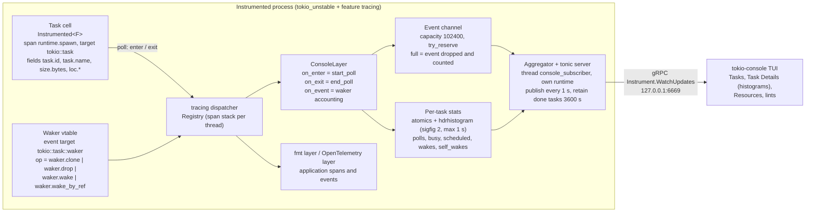

# Rust Async Debugging: tokio-console and tracing

> [!summary] Claim:
> A suspended Tokio task has no thread and no stack: it is a state machine in a heap cell, so a thread debugger sees parked workers, not the hung request.
> Built with `--cfg tokio_unstable` and the `tracing` feature, Tokio wraps each task in a `runtime.spawn` span and emits a `tokio::task::waker` event for every waker clone, drop, and wake, and `console-subscriber` turns span enters and exits into poll counts, busy time, scheduled time, and HDR histograms.
> `tokio-console` reads those over gRPC on `127.0.0.1:6669` and applies five lints, of which lost-waker is the bookkeeping rule "idle, not completed, and zero live wakers" (clones minus drops, with a by-value wake counted as a drop).
> In application code, a `tracing` span follows a future across `.await` only if it is attached with `Instrument` or `#[instrument]`; a `Span::enter` guard held across an await leaks the span onto whatever task runs next, and `tokio::spawn` never inherits the caller's span.



## The Mechanism

### 1. Why a thread debugger cannot see a hung async request

[[Rust-GDB-LLDB-Panics-and-Backtraces]] owns stacks, frames, and backtraces of threads.
An async function compiles to a state machine whose locals live in the future value, and Tokio stores that future in a heap-allocated task cell.
While the task waits, no thread executes it, so no stack frame belongs to it.
`thread apply all bt` on a hung Tokio service shows worker threads parked in the I/O driver or on a condition variable, which is what a healthy idle service also shows.
The information that matters is per task: whether it is running, scheduled, or idle, how long each poll took, and whether anything still holds a way to wake it.

The contract that every hang violates is in the `Future::poll` documentation: when a future returns `Poll::Pending`, it "stores a clone of the Waker copied from the current Context", and that waker is woken once the future can make progress.
Only the waker from the most recent poll is guaranteed to be scheduled.
Two distinct failures follow:

- Lost waker: the future returned `Pending` and kept no waker, so nothing in the process can ever reschedule the task.
- Missing wake: a waker is stored, but the event that would call it never happens, such as a channel whose sender is alive and idle or a lock acquired in the wrong order; this is a deadlock or a logic bug, and the waker bookkeeping looks healthy.

tokio-console detects the first failure directly and gives you the evidence (state, idle time, resources, location) for the second.
[[Drill-Debugging-Asyncio-and-Tokio-Deadlock]] is the timed exercise for the second.

### 2. What Tokio emits, and the build switch that turns it on

Tokio's instrumentation sits behind `cfg_trace!`, which expands to `#[cfg(all(tokio_unstable, feature = "tracing"))]` in `src/macros/cfg.rs` at 1.54.1.
`tokio_unstable` is a compiler `--cfg`, not a Cargo feature, so it is set with `RUSTFLAGS="--cfg tokio_unstable"` or `[build] rustflags = ["--cfg", "tokio_unstable"]` in `.cargo/config.toml`, never in `Cargo.toml`.
Tokio's crate documentation says the public API behind it "may break in 1.x releases" (as of 2026-11, Both).
Because `RUSTFLAGS` changes the fingerprint of every crate in the build, switching it on or off rebuilds the whole dependency graph, which the console-subscriber README also warns about.
The lab builds one source file both ways: with the cfg, three `tokio::spawn` calls give a subscriber three `runtime.spawn` spans of kind `task`, one of kind `block_on`, and six waker events; without it the same binary emits none, and no error or warning says so.

When the cfg and feature are on, `util/trace.rs` wraps every spawned future in `tracing::Instrumented` with this span:

- Level `TRACE`, target `tokio::task`, name `runtime.spawn`, and `parent: None`, so a task span never nests under the span that spawned it.
- Fields `kind` (`task`, `local`, or `block_on`; blocking tasks get a separate span with target `tokio::task::blocking`, `kind = blocking`, an extra `fn` field, and no `parent: None`), `task.name` (from the unstable `tokio::task::Builder::name`), `task.id`, `size.bytes`, `original_size.bytes` (present only when Tokio boxed the future), and `loc.file`, `loc.line`, `loc.col` from `#[track_caller]`.

Because the task future is an `Instrumented`, every poll enters the span and every return from poll exits it.
Since tracing 0.1.38 `Instrumented` also enters its span while dropping the inner future, so every task span is entered one extra time when Tokio drops the future: right after the last poll of a task that completed, or at cancellation for a task that was aborted.

The waker vtable in `runtime/task/waker.rs` emits one `TRACE` event per waker operation, with target `tokio::task::waker`, field `op` set to `waker.clone`, `waker.drop`, `waker.wake`, or `waker.wake_by_ref`, and field `task.id`.
That `task.id` is not the Tokio task ID: `Header::get_tracing_id` returns the tracing span ID stored in the task header (`tracing_id = future.id()` in `runtime/task/core.rs`), which is how a subscriber attributes the event to the right task span.

Tokio also emits `runtime.resource` and `runtime.resource.async_op` spans and `runtime::resource::poll_op` and `state_update` events for timers and `tokio::sync` types, which feed the console's Resources view.
The console-subscriber README lists which Tokio release added each kind: task waker events need Tokio 1.7.0, `time` resources 1.13.0, `sync` resources 1.15.0, and future sizes (the `large-future` and `auto-boxed-future` lints) 1.41.0.

### 3. console-subscriber: from span enters to histograms

`console-subscriber` is a `tracing-subscriber` `Layer`.
`spawn()` attaches a per-layer filter that passes events whose target starts with `runtime` or `tokio` and spans whose name starts with `runtime.` or whose target starts with `tokio`, so it sees Tokio's `TRACE` data even when the application's own fmt layer is at `info`.
The convenience `console_subscriber::init()` also installs a fmt layer filtered by `RUST_LOG`, defaulting to `error`, and panics if a global subscriber is already set.
The `TOKIO_CONSOLE_*` variables are read only by `Builder::with_default_env`, which the free functions `console_subscriber::init()` and `console_subscriber::spawn()` call; a hand-built `ConsoleLayer::builder().spawn()` ignores them unless it calls `with_default_env()` itself (`src/builder.rs`).
`ConsoleLayer::build` asserts at runtime that `tokio_unstable` (or the escape hatch `console_without_tokio_unstable`, for other runtimes) was set, so a misconfigured build fails at startup rather than showing an empty console.

The layer keeps the bookkeeping in `stats.rs`:

- `on_enter` of a task span calls `start_poll`, which increments `polls` only on the first concurrent enter and records `last_poll_started`.
- Scheduled time for that poll is measured from `max(last_wake, last_poll_ended)` to the poll start; the source notes that a self-wake can land before the previous poll ends, and taking the later timestamp keeps busy and scheduled time from overlapping.
- `on_exit` calls `end_poll`, which adds the poll's duration to busy time and to the poll-duration histogram.
- The layer cannot tell a poll from the drop-time enter of `Instrumented`, so that enter also runs `start_poll` and `end_poll`: once a task's future has been dropped, `polls` is the number of `Future::poll` calls plus one, and the drop adds a sample to the poll-time histogram and, for a task that was polled or woken before, to the scheduled-time histogram.
  Measured by the lab with console-subscriber 0.5.0 (as of 2026-11, macOS arm64 and Linux aarch64): a task polled once to completion reports 2 polls, 2 poll-time samples, and 1 scheduled-time sample; a task polled six times reports 7, 7, and 6; a task aborted before its first poll reports 1, 1, and 0; and a live task polled once reports 1, 1, and 0.
  On a two-worker multi-thread runtime the individual counts race, but every finished task still reports its real polls plus one and every live task its real polls.
- For an aborted task that extra "poll" starts at the cancellation, and an abort emits no `waker.wake` event, so the whole idle period since the last poll ended is booked as scheduled time: in the lab a task parked for 300 ms and then aborted reports at least 300 ms of scheduled time and under 50 ms of busy time.
- Before a task's first poll both `last_wake` and `last_poll_ended` are unset, and `start_poll` returns before it books anything, so the wait between spawn and first poll is in neither `scheduled_time` nor the scheduled-time histogram.
  A task spawned behind a 1300 ms blocking poll reports under 50 ms of scheduled time in the lab; the delay is visible on the wire only as `first_poll - created_at`, which the TUI has no column for.
- Each histogram is an `hdrhistogram::Histogram<u64>` in nanoseconds created with `new_with_max(max, 2)`, two significant figures; a value above the maximum (default 1 s for both histograms) is clamped and counted in `high_outliers`, and the largest one is kept as `highest_outlier`.
- A `waker.clone` increments `waker_clones` and a `waker.drop` increments `waker_drops`.
- A `waker.wake` increments `wakes` and also `waker_drops`, because `Waker::wake` consumes the waker without running its `Drop`, so live wakers are always `clones - drops`.
- A wake is a self-wake when the woken task's span is on the current thread's console span stack, that is, the task woke itself during its own poll.

Polls and waker operations update the per-task atomics in place and never touch a channel.
Stats reach a client only when they changed since the last publish (`Aggregator::publish` asks for `Include::UpdatedOnly`, and each stats object clears its dirty flag in `take_unsent`), so a task stuck in one long poll is published once, at the tick after the poll starts, and then goes quiet.
The TUI fills the gap from its own clock: `Task::busy(SystemTime::now())` in tokio-console adds the time since `last_poll_started` to the published busy time while the task is running.
What goes to the aggregator through the bounded channel of `DEFAULT_EVENT_BUFFER_CAPACITY = 1024 * 100` entries is callsite metadata, each new task, resource, and async-op span, and resource poll-op events, sent with `try_reserve`; when the channel is full the item is dropped and a per-kind dropped-event counter is incremented (`send_stats` in `src/lib.rs`), so a flood of short tasks loses tasks from the view rather than blocking the application.
The aggregator and a tonic gRPC server run on their own thread named `console_subscriber` with their own runtime, so console traffic is not scheduled on the application's workers.
The wire protocol is `console-api`: service `Instrument` with `WatchUpdates`, `WatchTaskDetails`, `WatchState`, `Pause`, and `Resume`.

### 4. tokio-console: states, columns, and the five lints

The TUI derives task state from the timestamps, checked in this order: `Completed` when a total duration exists, `Running` when `last_poll_started > last_poll_ended`, `Scheduled` when `last_wake > last_poll_started`, and `Idle` otherwise.
A task that has been spawned and never polled has none of those timestamps, so the rule lands on `Idle` with `Polls` 0, although the task is runnable and waiting for a worker.
The Tasks view shows `Warn, ID, State, Name, Total, Busy, Sched, Idle, Polls, Kind` and location and fields, and Task Details adds percentiles and histograms of poll time and scheduled time.

The lints in `tokio-console/src/warnings.rs` at 0.1.14, all enabled by default:

| Lint | Rule in source | What it usually means |
| :--- | :--- | :--- |
| `lost-waker` | not completed, `clones - drops == 0`, not running, not awakened; skipped for tasks of kind `blocking` or `block_on` | A hand-written future or adapter returned `Pending` without storing `cx.waker()`; the task can never run again |
| `self-wakes` | self-wakes over 50% of wakes; not restricted to live tasks; skipped for kinds `blocking` and `block_on` | A hand-written future that calls `cx.waker().wake_by_ref()` and returns `Pending`, polling for a condition instead of registering for it; a `tokio::task::yield_now` loop does not count, because since Tokio 1.23.0 `yield_now` defers its wake until the poll has returned |
| `never-yielded` | state `Running`, at most one poll, busy at least 1 s; skipped for kinds `blocking` and `block_on` | Blocking code (sync I/O, `std::thread::sleep`, a CPU loop, a contended `std::sync::Mutex`) inside a task, starving its worker |
| `large-future` | `size.bytes` at least 1024; skipped for kinds `blocking` and `block_on` | Large state machines, which are moved on spawn and occupy stack while polled; Tokio's own comment on `BOX_FUTURE_THRESHOLD` cites stack overflow as the reason it boxes large futures |
| `auto-boxed-future` | `original_size.bytes` present and different from `size.bytes`; applies to every kind | Tokio boxed the future because it exceeded `BOX_FUTURE_THRESHOLD` (2048 bytes in debug, 16384 in release, Tokio 1.54.1) |

The CLI help describes `lost-waker` as "a task is dropped without being woken", but the code checks that the task's wakers were all dropped while the task is alive and idle; read the rule, not the help string.
The skip is wider than the word blocking suggests: `Task::is_blocking` in `src/state/tasks.rs` matches the kinds `blocking` and `block_on`, so the future passed to `Runtime::block_on` (the body of `#[tokio::main]`) is exempt from four of the five lints, and a blocking call made directly in it never raises `never-yielded`.
The lint therefore has a precise blind spot: a waker that is stored somewhere nothing will ever call it (a parked receiver whose sender is alive, a waker in a leaked struct) keeps `clones - drops` at 1, and the task shows as plainly `Idle`.

For that second failure the evidence is in the Resources view (`r`), whose columns are `ID, Parent, Kind, Total, Target, Type, Vis, Location, Attributes`, and in the Async Ops table under a resource, whose columns are `ID, Parent, Task, Source, Total, Busy, Idle, Polls, Attributes`.
console-subscriber fills the `Task` column from poll-op events: the task span that is entered when a resource reports a poll becomes the async op's task (`set_task_id` in `src/lib.rs`).
In the lab, the task parked on a `oneshot::Receiver` is tied to the async op `Receiver::await` on a resource of kind `Sync` and type `Sender|Receiver` whose attributes read `tx_dropped=false` and `value_sent=false`: the sender is alive and has sent nothing, which is the whole diagnosis of a missing wake.
The lost-waker task has no async op and no resource at all, because a hand-written future emits none of that instrumentation.

### 5. Starvation, the coop budget, and runtime metrics

A Tokio worker can only switch tasks when a poll returns.
Tokio gives each task a cooperative budget of 128 operations per poll (`Budget::initial()` in `task/coop/mod.rs`); Tokio resources that are ready still return `Pending` once the budget is exhausted, so a task looping on an always-ready channel yields eventually.
Code that never touches a Tokio resource never consumes budget, so a CPU loop or a blocking syscall holds the worker until it finishes, which is what `never-yielded` and a long tail in the poll-time histogram show.

The lab makes the starvation visible on a current-thread runtime: a task named `hog` calls `std::thread::sleep` for 1300 ms inside its first poll while one task has just been woken and another has just been spawned.
The hog reports at least 1300 ms of busy time and one poll-time sample above the 1 s histogram maximum, and it is the task the `never-yielded` rule fires on while the poll is in progress.
The woken victim reports at least 1300 ms of scheduled time, which is the number to sort the Tasks view by when hunting a starved worker, and the newly spawned victim reports almost none, for the first-poll reason given under console-subscriber.

When the console is not available, stable `RuntimeMetrics` give the fleet-level view without `tokio_unstable` (as of 2026-11, Both): `num_workers` (the changelog records its stabilization as `worker_count` in Tokio 1.38), `num_alive_tasks` (1.39), `global_queue_depth` (1.41), and on targets with 64-bit atomics `worker_total_busy_duration`, `worker_park_count`, and `worker_park_unpark_count` (1.45; the changelog entry names the third one `worker_unpark_count`, but the method in `src/runtime/metrics/runtime.rs` is `worker_park_unpark_count`).
Poll-time histograms, `budget_forced_yield_count`, per-worker steal and queue depths, and the schedule-latency histogram remain behind `tokio_unstable` in 1.54.1.
`num_alive_tasks` alone already exposes a hang as a leak: in the lab it reads 2 after every other task has finished, one for the lost waker and one for the missing wake.

Per-task numbers without `tokio_unstable` come from the `tokio-metrics` crate (0.5.2, as of 2026-11, Both): `TaskMonitor::instrument` wraps a future the way `Instrumented` does, and its `TaskMetrics` carry `total_poll_duration`, `total_slow_poll_count` (polls over `DEFAULT_SLOW_POLL_THRESHOLD`, 50 microseconds), `total_scheduled_duration`, and `total_first_poll_delay`.
That last field is the spawn-to-first-poll wait that console-subscriber does not book anywhere; the crate's `RuntimeMonitor` is separate, and its documentation says some of its metrics still require `tokio_unstable`.

### 6. Task dumps: the async equivalent of `thread apply all bt`

`Handle::dump()` returns a trace of every task's await chain, the closest thing to a stack for a suspended task.
It needs `--cfg tokio_unstable` and the `taskdump` feature, and `lib.rs` turns it into a `compile_error!` anywhere except Linux on `aarch64`, `x86`, `x86_64`, or `s390x` (as of 2026-11, Linux only).
The documentation warns that a dump pauses the workers and re-polls every task in a tracing mode, so it is expensive; that tasks inside `FuturesUnordered` or `LocalSet` may not appear; that it may never complete if a worker is blocked for more than 250 ms, so wrap it in `tokio::time::timeout`; that split debuginfo must be off; and that on a current-thread runtime the dump must be requested from inside the runtime being dumped.

The trace is taken at Tokio's own leaf futures: during the tracing re-poll, `trace_leaf` in `runtime/task/trace/mod.rs` captures a backtrace, defers a wake, and returns `Pending`, and it is called from Tokio's timers, I/O registration, `yield_now`, and the `tokio::sync` primitives.
A task suspended in a future that never reaches one of those calls has nothing to capture.
The lab shows both halves on Linux aarch64: the task parked on a `oneshot` dumps as `handle_request`, then `wait_for_reply`, then the receiver's poll, and the lost-waker task, parked in a hand-written future, appears in the dump with zero frames.
The two tools are therefore complementary: the console flags the lost waker and cannot show an await chain, while the dump shows the await chain of the missing wake and is silent about the lost waker.

### 7. tracing spans across await points

`tracing` keeps a per-thread stack of entered spans in the subscriber; `Span::enter` pushes and its guard's `Drop` pops.
An `.await` that returns `Pending` leaves the async function's scope without dropping its locals, so a guard held across the await stays entered while the worker polls other tasks, and their events are attributed to your span.
The `Span::enter` documentation in tracing 0.1.44 warns about exactly this and gives two fixes: `Span::in_scope` for synchronous sections, and `Instrument::instrument` for futures.

`Instrumented::poll` is three lines: enter the span, poll the inner future, drop the guard on return.
The span is therefore current during every poll and never while the future is suspended.
`#[instrument]` on an `async fn` expands to the same combinator (`::tracing::Instrument::instrument(...)` in `tracing-attributes` 0.1.31 `expand.rs`), and the lab's `annotated` function behaves exactly like the hand-instrumented one.

Context does not cross a spawn on its own.
`tokio::spawn` takes the future as given, so a span current in the caller is lost unless the future is wrapped with `.in_current_span()` or `.instrument(span)`, and `spawn_blocking` closures need `let span = Span::current();` captured and then `span.in_scope(...)` inside.
When the child should have its own span, `Span::or_current` (tracing 0.1.44 `src/span.rs`) returns the caller's current span if the new span is disabled by the level filter, so the child stays attached to the request either way.
Propagating that context across processes, with W3C trace context and OpenTelemetry exporters, belongs to [[Debugging-Distributed-Systems-with-Traces-and-Correlation]].

With `FmtSpan::CLOSE`, the `tracing-subscriber` fmt layer reports each closed span's `time.busy` and `time.idle`, a cheap per-request version of the console's busy and idle split for application spans.
Busy is time entered, so the two attachment styles book the same suspension differently: in the lab a 50 ms `sleep` under a held `Span::enter` guard is all `time.busy`, and under `Instrument` it is all `time.idle`.
The fields disappear when the layer is built with `without_time()`, because that call also clears `fmt_timing` in `FmtSpanConfig` (`src/fmt/format/mod.rs`) and the close event is then just `close`; `with_timer(())` drops the timestamp and keeps the timings.
Compile-time level caps (`max_level_*` and `release_max_level_*` features on `tracing`) remove callsites entirely; the console-subscriber README tells you not to enable them, because they would also remove Tokio's `TRACE` instrumentation.

## Commands and Numbers to Know

| Item | Value | Platform and date | What it controls |
| :--- | :--- | :--- | :--- |
| `--cfg tokio_unstable` | `RUSTFLAGS` or `[build] rustflags` in `.cargo/config.toml` | Both (as of 2026-11) | Gates Tokio's tracing instrumentation, `task::Builder`, unstable metrics, task dumps; changing it rebuilds everything |
| Tokio feature `tracing` | off by default | Both (as of 2026-11) | Emits `runtime.spawn` spans and waker events; needs `tokio_unstable` too |
| Crate versions read for this note | tokio 1.54.1, console-subscriber 0.5.0, tokio-console 0.1.14, tracing 0.1.44, tracing-subscriber 0.3.23 | Both (as of 2026-11) | Every default in this table is from these sources |
| `TOKIO_CONSOLE_BIND` | `127.0.0.1:6669` | Both (as of 2026-11) | gRPC listen address; loopback by default; like every `TOKIO_CONSOLE_*` variable, read only through `with_default_env()` |
| `TOKIO_CONSOLE_RETENTION` | 3600 s | Both (as of 2026-11) | How long completed task data is kept in the process |
| `TOKIO_CONSOLE_PUBLISH_INTERVAL` | 1 s | Both (as of 2026-11) | Update cadence to clients |
| `TOKIO_CONSOLE_RECORD_PATH` | unset | Both (as of 2026-11) | File to record events to |
| `TOKIO_CONSOLE_BUFFER_CAPACITY` | 102400 events | Both (as of 2026-11) | Layer-to-aggregator channel; full means dropped events |
| Client buffer | 4096 updates | Both (as of 2026-11) | Per-client backlog before a slow client may be disconnected |
| Poll and scheduled histogram max | 1 s each, 2 significant figures | Both (as of 2026-11) | Values above are clamped and counted as outliers |
| `RUST_LOG` under `console_subscriber::init()` | default filter `error` | Both (as of 2026-11) | Filters only the fmt layer `init()` adds |
| `tokio-console [TARGET_ADDR]` | default `http://127.0.0.1:6669`; on Unix also `file://localhost/path` for a Unix socket | Both (as of 2026-11) | Which process to attach to |
| `--warn` / `-W`, `--allow` / `-A` | all five lints warn by default | Both (as of 2026-11) | Lint selection; `-A all` silences them |
| `--retain-for` | `6s` | Both (as of 2026-11) | How long the TUI keeps showing completed tasks |
| `--log`, `--log-dir` | `off`, `/tmp/tokio-console/logs` | Both (as of 2026-11) | The console's own diagnostics; `--log` also takes its value from `RUST_LOG` in the console's environment |
| `tokio-console gen-config` | prints `console.toml` | Both (as of 2026-11) | Read from `./console.toml` and `tokio-console/console.toml` in the platform config directory |
| TUI keys | `t` tasks, `r` resources, `Enter` details, `Esc` back, `?` help, space pause or resume, `q` quit | Both (as of 2026-11) | Navigation |
| Lint thresholds | self-wakes over 50%, never-yielded 1 s, large-future 1024 B | Both (as of 2026-11) | Compiled-in defaults in `warnings.rs` |
| `BOX_FUTURE_THRESHOLD` | 2048 B debug, 16384 B release | Both (as of 2026-11) | Futures larger than this are boxed on spawn |
| `Polls` on a finished task | `Future::poll` calls + 1 | macOS arm64 and Linux aarch64 (as of 2026-11, console-subscriber 0.5.0, tracing 0.1.44) | The drop of the task's `Instrumented` future is counted as a poll; live tasks are exact |
| Coop budget | 128 per task poll | Both (as of 2026-11) | Forced `Pending` from Tokio resources after this many operations |
| `Handle::dump()` | feature `taskdump` + `tokio_unstable` | Linux aarch64, x86, x86_64, s390x (as of 2026-11) | Await-chain dump of every task; pair with a timeout |
| Stable `RuntimeMetrics` | `num_workers`, `num_alive_tasks`, `global_queue_depth`, `worker_total_busy_duration`, `worker_park_count`, `worker_park_unpark_count` | Both (as of 2026-11) | Fleet metrics without `tokio_unstable` |
| `FmtSpan::CLOSE` | fields `time.busy`, `time.idle` | Both (as of 2026-11) | Per-span busy and idle time in logs |
| `await-holding-invalid-types` in `clippy.toml` | `[{ path = "tracing::span::Entered" }]` | Both (as of 2026-11, clippy 0.1.99) | Makes `clippy::await_holding_invalid_type` flag a span guard held across `.await` |

## Multi-Language Comparison: C++ / Python / Rust

| Concern | C++ (Boost.Asio, C++20 coroutines) | Python (asyncio, CPython 3.15) | Rust (Tokio 1.54.1) |
| :--- | :--- | :--- | :--- |
| Unit of scheduling | Completion handler or coroutine frame; the standard defines no runtime | `asyncio.Task` wrapping a coroutine | Task cell holding a `Future` state machine |
| Live task inventory | No standard tool; Boost.Asio handler tracking (`BOOST_ASIO_ENABLE_HANDLER_TRACKING`) writes handler lifecycles to stderr for `handlerviz.pl` | `asyncio.all_tasks()`; since 3.14, `python -m asyncio ps PID` and `pstree PID` read another process without running code in it | tokio-console over gRPC, or `Handle::dump()` on Linux |
| Await chain of a suspended unit | Library-specific: Clang's coroutine guide walks the `continuation` handle each task type stores in its `promise_type` with a debugger script, and adds return-address bookkeeping at a runtime cost | `asyncio.print_call_graph()` and `capture_call_graph()` (3.14) | `Handle::dump()` traces; console shows spawn location only |
| Lost or missing wakeups | Handler tracking shows handlers created but never invoked | Debug mode logs a never-awaited coroutine with its creation traceback, and a destroyed pending task logs "Task was destroyed but it is pending!" | `lost-waker` lint from waker clone and drop counts |
| Blocking the loop | Profiler or handler tracking timestamps | Debug mode logs callbacks slower than `loop.slow_callback_duration`, default 0.1 s | `never-yielded` lint, poll-time histogram, coop budget |
| Context across awaits | Manual; thread-locals are wrong after a coroutine resumes on another thread | `contextvars` are copied into each new task by default (`copy_context()` when no context is given, `tasks.py`) | `Instrument` per future; spawn needs `in_current_span()` |
| Opt-in cost | Macro at compile time | `PYTHONASYNCIODEBUG=1`, `asyncio.run(debug=True)`, or development mode | `--cfg tokio_unstable` rebuild plus a subscriber |

The Python contrast is the useful one: `contextvars` copy into child tasks by default, while a `tracing` span does not follow `tokio::spawn`, so code ported from asyncio silently loses its request context at every spawn.
[[Python-Concurrency-Asyncio-Multiprocessing-and-Free-Threading-Bugs]] owns the asyncio side.

## Worked Lab Example

The lab is `code/03-Debugging/tokio_console_accounting/`, run with `python3 -m _harness.verify 03-Debugging/tokio_console_accounting/` and marked `# requires: network` because Cargo fetches the pinned crates (`Cargo.lock`, built with `--locked`).
It is a Cargo workspace of three packages built with `RUSTFLAGS="--cfg tokio_unstable"`: `basics` (the binaries `spawncount`, `wakers`, and `spans`), `console` (Program 3), and `taskdump` (built on Linux only).
It pins tokio 1.54.1, tracing 0.1.44, tracing-subscriber 0.3.23, console-subscriber 0.5.0, and console-api 0.9.0, and needs `cargo` with the `clippy` component and `python3`.
Nothing it prints varies between runs: durations are reduced to threshold checks, and the gRPC server binds a loopback port chosen by the kernel.
Every block below is a byte-identical section of `expected/darwin-arm64.txt` (rustc and clippy 1.99.0, as of 2026-11); `expected/linux-aarch64.txt` differs from it only in section 8.

### 1. What `--cfg tokio_unstable` gates

`spawncount` runs three `tokio::spawn` tasks that each `yield_now` once, under a layer that counts `runtime.spawn` spans by `kind` and `tokio::task::waker` events.
The lab builds it twice from the same source, and `cargo check` on `wakers.rs` without the cfg shows why the instrumented programs need it.

```text
== 1. What --cfg tokio_unstable gates: the same sources, built with and without it
cfg(tokio_unstable)=true runtime.spawn spans: kind=task 3 kind=block_on 1; tokio::task::waker events: 6
cfg(tokio_unstable)=false runtime.spawn spans: kind=task 0 kind=block_on 0; tokio::task::waker events: 0
wakers.rs without the cfg: cargo check exit 101
error[E0433]: cannot find `Builder` in `task`
```

- With the cfg: three `task` spans, one `block_on` span for the future passed to `block_on`, and six waker events (one clone and one wake for each of the three yields).
- Without it: zero of everything, no error, no warning; a subscriber simply sees nothing.
- `tokio::task::Builder` is an unstable API, so a program that names its tasks fails to compile without the cfg, with `error[E0433]: cannot find `Builder` in `task``.

### 2. Program 1: re-deriving the lost-waker lint

The interactive TUI is hard to script, so `wakers` installs a small `Layer` that does the same accounting as `console-subscriber` 0.5.0 and applies the `LostWaker` rule from `tokio-console` 0.1.14.
It spawns five named tasks on a current-thread runtime: a future that returns `Pending` without storing the waker, a task parked on a `oneshot` whose sender stays alive, a task that completes on its first poll, a future that calls `wake_by_ref` once and then completes, and a task that awaits `yield_now()` five times.

The core of the layer, abridged to the accounting:

```rust
fn on_new_span(&self, attrs: &Attributes<'_>, id: &Id, _: LCtx<'_, S>) {
    if attrs.metadata().name() != "runtime.spawn" { return; }  // Tokio's task span
    // remember task.name for span id
}
fn on_enter(&self, id: &Id, _: LCtx<'_, S>) {      // console: start_poll
    // s.enters += 1; s.in_poll = true; s.woken_since_poll = false;
}
fn on_event(&self, ev: &Event<'_>, _: LCtx<'_, S>) {
    if ev.metadata().target() != "tokio::task::waker" { return; }
    // field task.id is the tracing span id of the task, not tokio::task::Id
    match op.as_str() {
        "waker.clone" => s.clones += 1,
        "waker.drop" => s.drops += 1,
        "waker.wake" => { s.drops += 1; s.wakes += 1; /* by-value wake = drop */ }
        "waker.wake_by_ref" => { s.wakes += 1; }
        _ => {}
    }
}
// LostWaker: !closed && clones - drops == 0 && !in_poll && !(enters == 0 || woken_since_poll)
```

The two hand-written futures:

```rust
struct Forgetful; // the bug: Pending with no stored waker
impl Future for Forgetful {
    type Output = ();
    fn poll(self: Pin<&mut Self>, _cx: &mut Context<'_>) -> Poll<()> { Poll::Pending }
}

struct YieldOnce(bool); // correct: wake itself once, then finish
impl Future for YieldOnce {
    type Output = ();
    fn poll(mut self: Pin<&mut Self>, cx: &mut Context<'_>) -> Poll<()> {
        if self.0 { return Poll::Ready(()); }
        self.0 = true;
        cx.waker().wake_by_ref();
        Poll::Pending
    }
}
```

Output (darwin-arm64):

```text
== 2. Program 1: the lost-waker rule re-derived from Tokio's waker events
task               enters wakes self_wake clones drops  wakers     lost?
five-yields             7     5         0      5     5       0     false
lost-waker              1     0         0      0     0       0      true
parked-on-oneshot       1     0         0      1     0       1     false
ready-at-once           2     0         0      0     0       0     false
yield-once              3     1         1      0     0       0     false
RuntimeMetrics::num_alive_tasks 2
```

- `lost-waker` was polled once, cloned no waker, and is idle and not completed, so the rule fires; nothing in the process can ever poll it again.
- `parked-on-oneshot` is just as stuck, because the sender is alive and never sends, but the receiver stored one waker clone, so `clones - drops` is 1 and the rule stays silent; this is the missing-wake blind spot.
- `yield-once` shows one wake, and it is a self-wake because it happened inside the task's own poll; one such wake is 100% self-wakes, enough for the real TUI to flag this finished task in Program 3, which is why the `self-wakes` lint is worth reading only on long-lived tasks.
- Tokio's `wake_by_ref` from inside the poll produced no clone and no drop event, so the live-waker count never went negative.
- `five-yields` has 5 wakes and 0 self-wakes, with 5 clones and 5 drops: `yield_now` clones the waker and hands it to the scheduler through `context::defer` (`task/yield_now.rs` in Tokio 1.54.1; the changelog records the deferral in 1.23.0), and the scheduler wakes it by value after the poll has returned, outside the task's span.
- `ready-at-once` was entered twice for one poll, `yield-once` three times for two polls, and `five-yields` seven times for six polls: the extra enter is `Instrumented`'s drop of the completed future (tracing 0.1.38 and later).
  `console-subscriber`'s `on_enter` calls `start_poll` for any enter of a task span, and Program 3 confirms that the real layer counts that enter as a poll.
- `num_alive_tasks` from the stable `RuntimeMetrics` reads 2 after every other task has finished: the lost waker and the missing wake both leak a task.

### 3. Program 2: a span held across `.await`

The functions that matter, abridged from `spans.rs` (the program runs them on a current-thread runtime with `fmt().without_time().with_ansi(false).with_target(false)`):

```rust
async fn wrong() {
    let span = info_span!("wrong", req = 1);
    let _g = span.enter(); // guard lives across the await below
    tokio::task::yield_now().await;
    info!("wrong: resumed");
}

async fn right() {
    async {
        tokio::task::yield_now().await;
        info!("right: resumed");
    }
    .instrument(info_span!("right", req = 2))
    .await
}

#[tracing::instrument(fields(req = 4))]
async fn annotated() {
    tokio::task::yield_now().await;
    info!("annotated: resumed");
}

// Inside `async { ... }.instrument(info_span!("handler", req = 3))`:
tokio::spawn(async { info!("child spawned without in_current_span") }).await.unwrap();
tokio::spawn(async { info!("child spawned with in_current_span") }.in_current_span()).await.unwrap();
tokio::task::spawn_blocking(|| info!("blocking closure without a captured span")).await.unwrap();
let span = Span::current();
tokio::task::spawn_blocking(move || span.in_scope(|| info!("blocking closure with span.in_scope"))).await.unwrap();
```

Each of `wrong`, `right`, and `annotated` is spawned together with a `bystander` task that logs one line with no span of its own.

Output (darwin-arm64):

```text
== 3. Program 2: spans across .await, tokio::spawn, and spawn_blocking
 INFO wrong{req=1}: bystander 1: polled while the other task is suspended
 INFO wrong{req=1}: wrong: resumed
 INFO bystander 2: polled while the other task is suspended
 INFO right{req=2}: right: resumed
 INFO bystander 3: polled while the other task is suspended
 INFO annotated{req=4}: annotated: resumed
 INFO child spawned without in_current_span
 INFO handler{req=3}: child spawned with in_current_span
 INFO blocking closure without a captured span
 INFO handler{req=3}: blocking closure with span.in_scope
```

- The first line is the bug: an unrelated task's event carries `wrong{req=1}`, because the guard kept the span on the thread's stack while `wrong` was suspended.
- `right` and `annotated` put their span on their own event and nothing on the bystander's, because `Instrumented` exits on every `Pending`; `#[instrument]` behaves exactly like the hand-written `.instrument`.
- `tokio::spawn` drops the caller's span unless the child is wrapped with `in_current_span()`.
- A `spawn_blocking` closure runs with no span unless it captures `Span::current()` and enters it.

### 4. `FmtSpan::CLOSE`: busy versus idle

Running `spans` with `SPAN_CLOSE=timings` prints one close event per span for the same 50 ms `sleep` held under `Span::enter` (`sleepy_wrong`) and under `Instrument` (`sleepy_right`), and `span_timings.py` reduces the real timings to a threshold check; `SPAN_CLOSE=without_time` prints the raw events from a layer built with `without_time()`.

```text
== 4. FmtSpan::CLOSE: where a 50 ms suspension is booked under each style
sleepy_wrong: the 50 ms sleep is booked as time.busy; the other field is under 25 ms: true
sleepy_right: the 50 ms sleep is booked as time.idle; the other field is under 25 ms: true
close events after without_time():
 INFO sleepy_wrong: close
 INFO sleepy_right: close
```

- Busy is time entered, so the held guard books the whole suspension as `time.busy` and `Instrument` books it as `time.idle`.
- `without_time()` also switches the span timings off, so the close events carry no fields at all; `with_timer(())` is the way to drop only the timestamp.

### 5. Clippy `await_holding_invalid_type`

`basics/clippy.toml` lists `tracing::span::Entered` under `await-holding-invalid-types`.
The lab runs `cargo clippy` on `spans.rs` and prints each `holding a disallowed type` warning with the source line it points at.

```text
== 5. Clippy await_holding_invalid_type, with tracing::span::Entered listed in clippy.toml
warnings: 2
warning: holding a disallowed type across an await point `tracing::span::Entered`
  basics/src/bin/spans.rs: let _g = span.enter(); // guard lives across the await below
warning: holding a disallowed type across an await point `tracing::span::Entered`
  basics/src/bin/spans.rs: let _g = span.enter();
```

- The two warnings are the two held guards, `wrong` and `sleepy_wrong`; `right`, `sleepy_right`, and `annotated` produce none.
- Removing the `clippy.toml` entry removes both warnings, so the lint reports only what the configuration lists.

### 6. Program 3: the same tasks under the real console-subscriber

Program 1 re-implements the accounting, so it cannot show what the real layer reports.
The `console` binary installs `console_subscriber::ConsoleLayer`, wraps every task future in a counter that increments on each `Future::poll` call, and reads its own `Instrument.WatchUpdates` and `WatchTaskDetails` streams with a `console-api` client on a second thread, so every number is what a `tokio-console` would be given.
Besides Program 1's tasks it adds `aborted-unpolled` (aborted before the runtime polls it), `aborted-parked` (aborted after one poll), `aborted-idle-300ms` (aborted after 300 ms parked), `hog` (a blocking `std::thread::sleep` of 1300 ms inside its first poll), `victim-woken` (woken while `hog` runs), `victim-new` (spawned while `hog` runs), a 1200-byte future (`large-future`), and a 20000-byte future (`auto-boxed`).

The parts that matter, abridged:

```rust
struct Counted<F> { inner: Pin<Box<F>>, polls: Arc<AtomicU64> } // ground truth
impl<F: Future> Future for Counted<F> {
    type Output = F::Output;
    fn poll(mut self: Pin<&mut Self>, cx: &mut Context<'_>) -> Poll<F::Output> {
        self.polls.fetch_add(1, Ordering::SeqCst);
        self.inner.as_mut().poll(cx)
    }
}

let layer = console_subscriber::ConsoleLayer::builder()
    .server_addr(addr)                  // a loopback address chosen by the kernel
    .publish_interval(Duration::from_millis(100))
    .spawn();
tracing_subscriber::registry().with(layer).init();

// Starvation: hog blocks the only worker inside its first poll.
let hog = spawn("hog", Box::pin(async move { std::thread::sleep(block) }));
vtx.send(()).unwrap();                  // victim-woken is runnable, queued behind hog
let victim_new = spawn("victim-new", Box::pin(async {}));
```

Polls and wakes, with the count the future itself made (darwin-arm64, current-thread runtime):

```text
== 6. Program 3: the real console-subscriber, read back over gRPC (current_thread runtime)
-- Future::poll calls counted by the future, against what console-subscriber publishes
task               true_polls console_polls wakes self_wake clones drops completed
aborted-idle-300ms          1             2     0         0      1     1      true
aborted-parked              1             2     0         0      1     1      true
aborted-unpolled            0             1     0         0      0     0      true
five-yields                 6             7     5         0      5     5      true
hog                         1             2     0         0      0     0      true
lost-waker                  1             1     0         0      0     0     false
parked-on-oneshot           1             1     0         0      1     0     false
ready-at-once               1             2     0         0      0     0      true
victim-new                  1             2     0         0      0     0      true
victim-woken                2             3     1         0      1     1      true
yield-once                  2             3     1         1      0     0      true
dropped_events 0
```

- Every task whose future has been dropped reports one poll more than its future counted, and the two live tasks (`lost-waker`, `parked-on-oneshot`) are exact.
- `aborted-unpolled` reports 1 poll although `Future::poll` never ran: the only enter of its span was the drop.
- The waker columns for `lost-waker`, `parked-on-oneshot`, `ready-at-once`, and `yield-once` equal Program 1's, so the re-implementation matches the real layer on those cases, and `five-yields` again has 5 wakes and 0 self-wakes.
- `victim-woken` has one wake that is not a self-wake: `vtx.send` woke it from outside its poll.

Histogram samples, read from `WatchTaskDetails`:

```text
-- histogram samples from WatchTaskDetails
task               console_polls poll_samples sched_samples
aborted-idle-300ms             2            2             1
aborted-parked                 2            2             1
aborted-unpolled               1            1             0
five-yields                    7            7             6
hog                            2            2             1
lost-waker                     1            1             0
parked-on-oneshot              1            1             0
ready-at-once                  2            2             1
victim-new                     2            2             1
victim-woken                   3            3             2
yield-once                     3            3             2
```

- The drop adds a sample to the poll-time histogram of every finished task, so `poll_samples` equals `console_polls`.
- `sched_samples` is `console_polls - 1` on every row, because the first reported poll books no scheduled time (see the next block).

Time booked on the wire:

```text
-- time booked on the wire
aborted-idle-300ms scheduled_time >= 300 ms: true
aborted-idle-300ms busy_time < 50 ms: true
hog busy_time >= 1300 ms: true
hog poll-time samples above the 1 s histogram maximum: 1
victim-woken scheduled_time >= 1300 ms: true
victim-new first_poll - created_at >= 1300 ms: true
victim-new scheduled_time < 50 ms: true
```

- A task parked for 300 ms and then aborted reports at least 300 ms of scheduled time and under 50 ms of busy time: the abort emits no `waker.wake`, the drop-time enter starts a "poll", and `start_poll` measures from `max(last_wake, last_poll_ended)`, so the whole idle period is booked as scheduled time.
- `hog` is busy for at least 1300 ms in one poll, and that poll lands above the 1 s histogram maximum as a high outlier (clamped, but counted).
- The woken `victim-woken` waited behind `hog` and reports at least 1300 ms of scheduled time.
- The newly spawned `victim-new` waited just as long, but reports under 50 ms of scheduled time: before a task's first poll both `last_wake` and `last_poll_ended` are unset, so that wait is booked nowhere and is visible only as `first_poll - created_at`, for which the TUI has no column.

The lints, applied with `tokio-console` 0.1.14's rules to the last published state:

```text
-- last published state, with tokio-console 0.1.14's lint rules applied
task               kind     state   polls  lints
aborted-idle-300ms task     DONE        2  -
aborted-parked     task     DONE        2  -
aborted-unpolled   task     DONE        1  -
auto-boxed         task     DONE        3  auto-boxed-future
five-yields        task     DONE        7  -
hog                task     DONE        2  -
large-future       task     DONE        3  large-future
lost-waker         task     IDLE        1  lost-waker
parked-on-oneshot  task     IDLE        1  -
ready-at-once      task     DONE        2  -
victim-new         task     DONE        2  -
victim-woken       task     DONE        3  -
yield-once         task     DONE        3  self-wakes
(block_on future)  block_on IDLE     many  -
```

- `lost-waker` fires on the `Forgetful` task and stays silent on `parked-on-oneshot`, and `self-wakes` fires on the finished `yield-once` task but not on `five-yields`.
- `large-future` and `auto-boxed-future` fire on the two sized tasks.
  The next block shows the numbers behind them.
- The unnamed `block_on` task never raises a lint; the block after next shows why `never-yielded` skips it.

```text
-- future sizes from the task span fields
large-future size.bytes >= 1024: true  size.bytes == size_of::<usize>(): false original_size.bytes: absent
auto-boxed   size.bytes >= 1024: false size.bytes == size_of::<usize>(): true  original_size.bytes: present, above 2048
```

- A spawned 1200-byte future keeps its size (`large-future` needs `size.bytes` of 1024 or more), while the 20000-byte one was boxed by Tokio: `size.bytes` is the size of a `Box` and `original_size.bytes` records the real size, above the 2048-byte debug threshold.

```text
-- first polls seen in progress (the never-yielded rule needs RUNNING, polls <= 1, busy >= 1 s)
(block_on future)  kind block_on seen RUNNING in its first poll for >= 1 s: true  never-yielded: skipped by is_blocking()
hog                kind task     seen RUNNING in its first poll for >= 1 s: true  never-yielded: fires
```

- Both `hog` and the `block_on` future were seen `RUNNING` in their first poll for at least 1 s, which is the `never-yielded` precondition, but the rule fires only on `hog`, because `is_blocking()` matches the kinds `blocking` and `block_on`.
  A blocking call made directly in the body of `#[tokio::main]` is therefore never reported.

```text
-- what the stuck tasks wait on, from the resource and async-op updates
parked-on-oneshot: Receiver::await on Sync resource Sender|Receiver [rx_dropped=false tx_dropped=false value_received=false value_sent=false]
lost-waker: no async op, no resource
```

- The task parked on the `oneshot` is tied to the async op `Receiver::await` on a `Sync` resource whose attributes read `tx_dropped=false` and `value_sent=false`: the sender is alive and has sent nothing, which is the whole diagnosis of a missing wake.
- The lost-waker task has neither, because a hand-written future emits no resource or async-op instrumentation.

### 7. Program 3 on a multi-thread runtime

With `FLAVOR=multi` and two workers the counts race, so the lab asserts only the invariants.
On a multi-thread runtime `aborted-parked` is a race between the abort and the first poll (in eleven manual runs the abort won ten times, and the task was dropped unpolled), which is why the lab does not print per-task counts here.

```text
== 7. Program 3 on a two-worker multi_thread runtime
finished tasks whose console_polls == true_polls + 1: 9 of 9
live tasks whose console_polls == true_polls: 2 of 2
dropped_events 0
```

### 8. `Handle::dump()` on Linux

`taskdump` spawns three tasks (a request handler awaiting a `oneshot`, the `Forgetful` future, and a one-hour `sleep`), then calls `Handle::dump()` inside `tokio::time::timeout` and prints each task's frames.
Tokio supports task dumps only on Linux, so `expected/linux-aarch64.txt` (Linux aarch64, as of 2026-11) holds:

```text
== 8. Handle::dump(): the await chain of each parked task
tasks in dump: 3
task 1: 0 frames
task 2: 4 frames
    taskdump::linux::handle_request
      taskdump::linux::wait_for_reply
        <tokio::sync::oneshot::Receiver<()> as core::future::future::Future>
          <tokio::sync::oneshot::Inner<()>>
task 3: 3 frames
    taskdump::linux::sleeper
      <tokio::time::sleep::Sleep as core::future::future::Future>
        <tokio::time::sleep::Sleep>
```

On macOS the same section prints `not built on Darwin: tokio's taskdump feature is a compile_error! outside Linux` (`expected/darwin-arm64.txt`).

- The task parked on the `oneshot` dumps as `handle_request`, then `wait_for_reply`, then the receiver's poll: an await chain a thread backtrace never shows.
- The `Forgetful` task dumps with zero frames, because it never reaches a Tokio leaf future that calls `trace_leaf`.
- The sleeper dumps as `sleeper` over Tokio's `Sleep`.

### Attaching the real TUI by hand

The lab does not run `tokio-console`, because the TUI needs a terminal and `cargo install`.
During verification (not part of the lab, not gated by it), `tokio-console` 0.1.14 was attached to the `console` binary on macOS arm64 with `HOLD=<seconds>` and the address set, as `tokio-console http://127.0.0.1:16669 --no-colors --ascii-only true --retain-for 10min` in a detached `tmux` pane, and the screen was read with `tmux capture-pane -p`.
It showed the following, which agrees with the lab's wire numbers:

- Three warnings: one task had woken itself over 50% of the time, one had lost its waker, and one had been boxed by the runtime due to its size.
- The `Polls` column is the published counter unchanged, so the TUI shows the same plus-one on finished tasks (2 for `ready-at-once`, 7 for `five-yields`, 1 for `aborted-unpolled`) and the exact count on live ones.
- `aborted-idle-300ms` showed `Total` 304ms, `Sched` 304ms, and `Idle` 56us, the same misbooking seen on the wire; its scheduled time was 301 to 305 ms across eight runs.
- The `ID` numbers and the row order are not stable: IDs shifted by one across captures because Tokio's task ID counter is process-wide (`static NEXT_ID` in `runtime/task/id.rs`) and the `console_subscriber` thread's own runtime draws from it, and the sub-millisecond `DONE` rows reorder under the default sort on `Total`.
- `lost-waker`'s Task Details view reads "This task has lost its waker, and will never be woken again." (`src/warnings.rs`) with `Current wakers: 0` (`src/view/task.rs`), and `parked-on-oneshot` has no warning and `Current wakers: 1`.
- The third warning belongs to the unnamed `block_on` task, whose fields read `original_size.bytes=3264 size.bytes=8` in a debug build: the main future exceeded the 2048-byte threshold and Tokio boxed it.

## Pitfalls

> [!warning] Pitfall: `tokio_unstable` set in the wrong place
> Stable Cargo has no `rustflags` key in `Cargo.toml`, a `.cargo/config.toml` below the directory Cargo is invoked from is not read, and the Cargo reference lists `CARGO_ENCODED_RUSTFLAGS`, `RUSTFLAGS`, `target.<triple>.rustflags`, and `build.rustflags` as mutually exclusive sources where the first one found wins, so a `RUSTFLAGS` set in CI silently replaces the config file's `--cfg tokio_unstable`.
> The symptom is a build error such as ``cannot find `Builder` in `task` ``, or a panic at startup from the assertion in `ConsoleLayer::build` that task tracing requires Tokio to be built with `RUSTFLAGS="--cfg tokio_unstable"`.

> [!warning] Pitfall: compile-time level filters erase Tokio's instrumentation
> Enabling `tracing`'s `max_level_info` or `release_max_level_*` features anywhere in the dependency graph removes `TRACE` callsites in every crate, including Tokio's `runtime.spawn` span and waker events.
> Features unify across the graph, so a library that enables one disables the console for the whole binary.

> [!warning] Pitfall: trusting `lost-waker` silence as proof of health
> The lint counts wakers; it does not know whether anyone will call them.
> A task parked on a channel whose sender is alive and idle, or on a lock held by a task that waits on it, has one live waker and shows only as `Idle` with growing idle time; sort by `Idle`, open Task Details, and check the Resources view.

> [!warning] Pitfall: `Span::enter` across `.await`
> The guard survives the suspension, so other tasks' events and child spans are attributed to your span, and the span's own timing includes time when it was not running.
> Use `.instrument(span)`, `#[instrument]`, or `span.in_scope(|| ...)` for synchronous sections.
> Clippy can enforce it: listing `tracing::span::Entered` under `await-holding-invalid-types` in `clippy.toml` makes `clippy::await_holding_invalid_type` (warn by default) flag the guard; on the lab's `spans.rs` with clippy 0.1.99 it reported ``holding a disallowed type across an await point `tracing::span::Entered` `` twice, at each `let _g = span.enter();` line (`wrong` and `sleepy_wrong`), and nothing in `right`, `sleepy_right`, or `annotated`.

> [!warning] Pitfall: expecting spans to follow `tokio::spawn` or `spawn_blocking`
> The `runtime.spawn` span of a `tokio::spawn` task has `parent: None`, and the spawned future carries no application span unless you attach one.
> Wrap children with `.in_current_span()` and capture `Span::current()` before `spawn_blocking`, or request-scoped logs lose their request ID at the first spawn.

> [!warning] Pitfall: exposing the console port
> Setting `TOKIO_CONSOLE_BIND=0.0.0.0:6669` publishes task names, field values, and source locations to anyone who can reach the port, and the server code in console-subscriber 0.5.0 has no authentication or TLS option (none appears in its `src/`, as of 2026-11, Both), while `Pause` and `Resume` are callable by any client.
> Keep the loopback default and reach it with `kubectl port-forward` or an SSH tunnel, as [[Remote-Debugging-gdbserver-lldb-server-and-RSP]] does for debugger stubs.

> [!warning] Pitfall: reading histogram tails past one second
> Poll and scheduled durations above the histogram maximum (1 s by default) are clamped, so the histogram's top bucket understates them; check the high-outlier count and the highest outlier, or raise `poll_duration_histogram_max` on the builder.

> [!warning] Pitfall: reading `Polls` and `Sched` on finished tasks as exact
> `Polls` on a completed or aborted task is one more than the number of times its future was polled, because the drop of the task's `Instrumented` future enters the span and console-subscriber 0.5.0 counts every enter as a poll (as of 2026-11, macOS arm64 and Linux aarch64, tracing 0.1.44).
> A task aborted while parked also has its final idle period booked as scheduled time, so a large `Sched` on a cancelled task is not evidence of a starved worker.
> Subtract one, or compare against a live task, before concluding that a finished task was "polled once" or "never polled".

> [!warning] Pitfall: `console_subscriber::init()` in a binary that already sets a subscriber
> `init()` sets the global default and panics if one is already set; compose with `console_subscriber::spawn()` as one layer of a `tracing_subscriber::registry()` instead.

## At Scale

For one developer, tokio-console is a local tool: add the layer behind a Cargo feature, build with `tokio_unstable`, run `tokio-console`, and look for lints, long `Idle`, and fat poll-time tails.
The questions change when hundreds of services and thousands of engineers depend on the same runtime.

- `tokio_unstable` is a whole-graph switch with no semver promise, so shipping it means accepting that a minor Tokio upgrade can break the build; treat it as a separate, CI-tested build profile, not a flag individual teams set ad hoc.
- The instrumentation costs a span enter and exit per poll and an event per waker operation, plus the aggregator thread and up to an hour of retained completed-task data; this note did not measure that cost, so benchmark it on your own workload before enabling it on latency-critical services.
- Stable runtime metrics (`num_alive_tasks`, `global_queue_depth`, per-worker busy duration and park counts) are cheap enough to export on every service and are what alerting should use; the console is what an engineer attaches after an alert.
- Application spans are the request-level view and flow into the fleet's tracing backend; [[Debugging-Distributed-Systems-with-Traces-and-Correlation]] owns sampling and propagation across processes.

Decision rules:

- Every service: stable `RuntimeMetrics` exported, `#[instrument]` or `Instrument` on request handlers, and `clippy::await_holding_invalid_type` configured with `tracing::span::Entered` and denied in CI.
- Services with a history of hangs or tail-latency incidents: ship a debug build profile with `tokio_unstable`, `tracing`, and `console-subscriber` bound to loopback, so on-call can redeploy one replica and attach without changing code.
- Linux services where a hang must be diagnosed in place: also consider `taskdump` and a guarded admin endpoint that calls `Handle::dump()` under a timeout, accepting the pause it causes.
- Never expose the console port beyond loopback, and never make `tokio_unstable` the default build for the whole organization without an owner who tracks Tokio releases.
- Concurrency invariants that must hold for all interleavings belong in Loom tests, which [[Rust-Miri-Sanitizers-Loom-and-Cargo-Fuzz]] owns; the console only shows the interleavings that happened.

## Practice Drill

> [!tip] Practice Drill:
> Read the `wakers` source in the lab and predict each row of section 2 before running it.
> Then add a fifth task that stores `cx.waker().clone()` in a `static Mutex<Option<Waker>>` and never wakes it: predict whether `lost-waker` fires (it should not, the clone is live) and explain why that task is as stuck as `lost-waker`.
> Next, run a real service under `tokio-console` with `RUSTFLAGS="--cfg tokio_unstable"`, add a handler that calls `std::thread::sleep(Duration::from_secs(2))`, and confirm that `never-yielded` fires and the poll-time histogram shows an outlier above 1 s.
> Fix it with `tokio::task::spawn_blocking` and confirm the warning disappears and the worker's other tasks stop accumulating `Sched` time.
> Finish with [[Drill-Debugging-Asyncio-and-Tokio-Deadlock]], which hides a missing wake behind healthy waker counts.

## Interview Questions

> [!question] L5: A Tokio service stops answering requests, but `thread apply all bt` shows every worker parked; why is that backtrace not useful, and what do you look at instead?
>
> > [!success]- Answer
> > A suspended async task is a state machine stored in a heap task cell, and no thread executes it while it waits, so no stack frame belongs to it.
> > Parked workers are what both a healthy idle service and a service with every task stuck look like.
> > The useful data is per task: state, idle time, poll durations, wake and waker counts, and the resources the task waits on, which tokio-console shows when the binary is built with `--cfg tokio_unstable` and the `tracing` feature.
> > On Linux, `Handle::dump()` with the `taskdump` feature gives each task's await chain, the async equivalent of a backtrace.

> [!question] L5: What does it take to make tokio-console show tasks, and why does turning it on rebuild the whole project?
>
> > [!success]- Answer
> > Tokio needs the `tracing` Cargo feature and the `tokio_unstable` compiler cfg, and the application needs the `console-subscriber` layer installed, through `console_subscriber::init()` or as one layer of a registry.
> > `tokio_unstable` is passed as `--cfg` through `RUSTFLAGS` or `build.rustflags` in `.cargo/config.toml`, not in `Cargo.toml`.
> > Changing rustflags changes every crate's build fingerprint, so Cargo rebuilds the entire dependency graph, and alternating between the two settings rebuilds it each time.
> > Also check that no crate enables a `tracing` compile-time level cap, which would delete Tokio's `TRACE` instrumentation.

> [!question] L5: Predict the output: task A enters `info_span!("wrong")`, holds the guard, and awaits `yield_now()`; task B, spawned next on the same current-thread runtime, logs `info!("bystander")` with no span; what prefix does B's line get in the default fmt format?
>
> > [!success]- Answer
> > `INFO wrong{req=1}: bystander ...`, the same prefix as A's own event.
> > `yield_now` returns `Pending`, the async function's scope is left without dropping the guard, and the span stays on the thread's entered-span stack while the runtime polls B.
> > The fmt layer formats the current span scope, so B's event is attributed to A's span.
> > Wrapping A's body with `.instrument(span)` gives B's line no prefix, because `Instrumented::poll` exits the span every time the inner future returns.

> [!question] L6: State the exact rule tokio-console 0.1.14 uses for `lost-waker`, and give one case it misses and one detail of the counting that matters.
>
> > [!success]- Answer
> > For a task whose kind is neither `blocking` nor `block_on`: not completed, live wakers equal to zero, not currently running, and not woken since its last poll.
> > Live wakers are `waker_clones - waker_drops`, computed from Tokio's `tokio::task::waker` events, and `console-subscriber` counts a by-value `waker.wake` as a drop because `Waker::wake` consumes the waker without running `Drop`.
> > It misses any task whose waker is stored but will never be called, such as a receiver whose sender is alive and idle, or a waker stored in a leaked struct; those show as `Idle` with one live waker.
> > It also only sees wakers that pass through Tokio's waker vtable; a future that returns `Pending` on behalf of a waker it never cloned is exactly what it catches.

> [!question] L6: Debug this: p99 latency spikes to over a second on one service, CPU is low, and tokio-console shows one task with `Polls` 1, `Busy` growing, and a `never-yielded` warning; what is happening and how do you fix it?
>
> > [!success]- Answer
> > The task is inside a single poll that has not returned for over a second, so its worker cannot run any other task, and every task queued on that worker accumulates scheduled time, which is the latency spike.
> > Low CPU points to a blocking call rather than computation: synchronous file or network I/O, `std::thread::sleep`, a blocking client library, or a `std::sync::Mutex` held by another thread.
> > Tokio's coop budget does not help, because it only forces a yield when the task touches Tokio resources.
> > Move the blocking work to `tokio::task::spawn_blocking` or replace it with the async API, or for CPU-bound loops split the work and call `tokio::task::yield_now()`; then confirm the warning clears and the other tasks' `Sched` time drops.

> [!question] L6: Why does console-subscriber measure a task's scheduled time from the later of its last wake and its last poll end?
>
> > [!success]- Answer
> > Scheduled time is meant to be the delay between becoming runnable and being polled, and busy time is the time inside polls; the two must not overlap.
> > A task that wakes itself does so during its own poll, so its wake timestamp is earlier than the end of that poll.
> > Measuring from the wake would count part of the poll as scheduled time; measuring from `max(last_wake, last_poll_ended)` starts the clock only once the task is both woken and out of its previous poll.
> > The source also uses a saturating subtraction because a task that moves between worker threads can produce a poll start timestamp slightly before the recorded wake.

> [!question] L7: A team wants request IDs on every log line, including work done in spawned tasks and in `spawn_blocking`; what breaks with the obvious implementation and what do you require in review?
>
> > [!success]- Answer
> > The obvious implementation enters a request span with `Span::enter` at the top of the handler, which leaks the span onto other tasks at the first `Pending` and misattributes their logs.
> > Even with `#[instrument]` on the handler, `tokio::spawn` does not inherit the span, so spawned children log without the request ID, and a `spawn_blocking` closure runs on another thread with no current span.
> > Require `#[instrument]` or `.instrument(span)` on async entry points, `.in_current_span()` or an explicit span on every spawned future, and `let span = Span::current();` captured and used with `span.in_scope` inside blocking closures.
> > Enforce the first rule mechanically: add `tracing::span::Entered` to `await-holding-invalid-types` in `clippy.toml` and deny `clippy::await_holding_invalid_type` in CI.
> > Test propagation by asserting on captured log output in a current-thread runtime, where the leak is deterministic.

> [!question] L7: Should tokio-console instrumentation run in production builds?
>
> > [!success]- Answer
> > Weigh three costs: `tokio_unstable` removes semver protection for the APIs it unlocks, so a minor Tokio upgrade can break the build; the instrumentation adds a span enter and exit per poll and an event per waker operation plus an aggregator thread and retained data; and the gRPC port exposes task metadata without authentication.
> > A sound policy is stable `RuntimeMetrics` and application spans everywhere, plus a separately built debug profile with console-subscriber bound to loopback that on-call can deploy to one replica.
> > Before any wider rollout, measure the overhead on the service's own workload rather than relying on a general number.
> > On Linux, `taskdump` is a complementary option for in-place hangs, used rarely and under a timeout because a dump pauses all workers.

> [!question] L8+: You own the async runtime platform for a thousand Rust services; design the debugging story for hangs and starvation.
>
> > [!success]- Answer
> > Tier one, always on: export stable `RuntimeMetrics` (`num_alive_tasks`, `global_queue_depth`, per-worker busy duration and park counts) and alert on task count growth, queue depth, and workers that stop parking.
> > Tier two, request level: a shared crate that installs the subscriber stack, `#[instrument]` on handlers, span propagation helpers for spawn and spawn_blocking, and a shared `clippy.toml` that forbids holding `tracing::span::Entered` across an await.
> > Tier three, on demand: a blessed `tokio_unstable` build profile, tested in CI against each Tokio release, with console-subscriber on loopback and optional `taskdump` on Linux, reachable only through port forwarding.
> > Back it with runbooks that teach the two failure classes, lost waker versus missing wake, and with Loom tests for the hand-written futures and synchronization primitives where those bugs originate.

## Further Reading

- `console-subscriber` 0.5.0 `src/stats.rs` and `src/lib.rs`: the exact poll, scheduled, and waker accounting, including the by-value wake rule.
- `tokio-console` 0.1.14 `src/warnings.rs`: the five lint rules and thresholds, shorter and more precise than the CLI help.
- `console-api` 0.9.0 `proto/`: the gRPC wire format, for building custom consumers or recorders.
- Tokio 1.54.1 `src/util/trace.rs` and `src/runtime/task/waker.rs`: what the runtime emits and under which cfg.
- Tokio crate documentation, "Unstable features": what `tokio_unstable` unlocks and the absence of semver guarantees.
- `Handle::dump` documentation in Tokio 1.54.1: requirements and limits of task dumps.
- tracing 0.1.44 `Span::enter` documentation, section "In Asynchronous Code": the canonical explanation of the guard-across-await bug.
- Eliza Weisman, "Announcing Tokio Console 0.1" (Tokio Blog, 2021): the motivation and the original architecture.
- `std::future::Future::poll` documentation: the waker contract every lost-waker bug violates.

## Related

- Prerequisites: [[Rust-GDB-LLDB-Panics-and-Backtraces]]
- Next: [[Rust-Borrow-Checker-Trait-Errors-Cargo-Expand-and-Clippy]]
- See also: [[Drill-Debugging-Asyncio-and-Tokio-Deadlock]], [[Debugging-Distributed-Systems-with-Traces-and-Correlation]], [[Rust-Miri-Sanitizers-Loom-and-Cargo-Fuzz]], [[Python-Concurrency-Asyncio-Multiprocessing-and-Free-Threading-Bugs]], [[Debugging-Without-a-Debugger-and-Concurrency-Bugs]]
