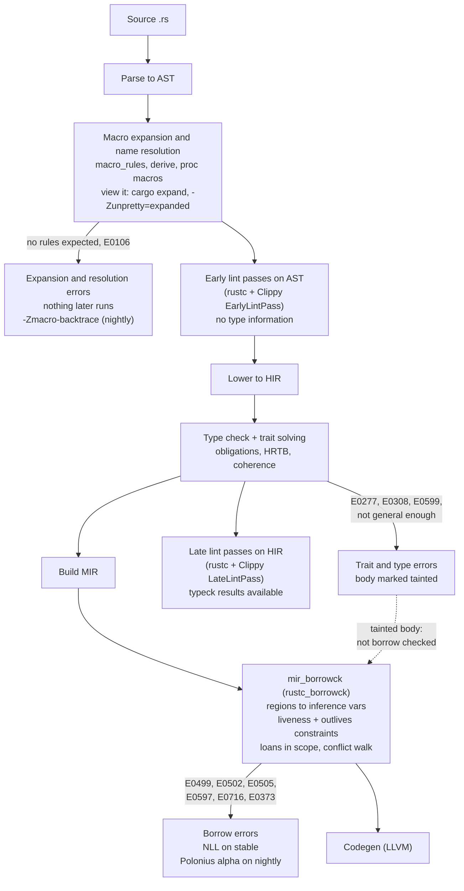

# Rust Borrow Checker, Trait Errors, Cargo-Expand, and Clippy

> [!summary] Claim:
> Every rustc rejection comes from one phase, and the phase decides how to read it: macro expansion and name resolution (`no rules expected`, E0106), type checking and trait solving (E0277, E0308), or the MIR borrow checker (E0499, E0502, E0505, E0597, E0716).
> The borrow checker reports a loan that is still live at a conflicting action, as three spans: where the borrow is created, the conflicting action, and the later use that keeps it live; stable NLL is flow-insensitive about lifetimes that escape a function, and Polonius alpha, the nightly default since early August 2026, fixes that case.
> A trait error is an obligation chain read from the bottom up: the primary span label, or the `help:` line when the trait customizes its headline, names the leaf bound that failed, and each `required for` / `required by a bound in` note is one step back toward your call.
> `cargo expand` shows the code that type checking actually sees, and Clippy is a second set of rustc lint passes with ten groups (830 lints in clippy 0.1.99), configured per crate through Cargo's `[lints]` table, `clippy.toml`, and `#[expect]`.



## The Mechanism

Every output block in this note is copied from the recorded output of one of three labs, and names the lab and platform it came from.
A line that starts with `$` is a command the lab ran, and `[exit N]` is that command's exit status when it is not 0 (the labs run with `pipefail`, so a failing `rustc` in a pipeline counts).
All of it was recorded on darwin-arm64 with rustc 1.99.0, cargo 1.99.0, and clippy 0.1.99 (as of 2026-11), and the nightly lab with rustc 1.101.0-nightly (2026-10-24).

### 1. Where each error is born

rustc is a query-driven pipeline, and a diagnostic carries the fingerprint of the phase that emitted it.
[[Compiler-Pipeline-and-Debuggability]] owns the general pipeline; this note owns reading Rust's static rejections.

- Expansion errors (`no rules expected`, `cannot find macro`, proc-macro panics) are emitted while the AST is still being built, before any types exist.
- Resolution errors, including E0106 (missing lifetime specifier), come from `rustc_resolve`, also before any type exists.
- Type and trait errors (E0277 trait bound not satisfied, E0308 mismatched types, E0599 no method found, "implementation of `Fn` is not general enough") come from type checking and the trait solver on HIR.
- Borrow errors come from `mir_borrowck`, which runs on MIR, after type checking has succeeded for that body.

The ordering has two practical consequences, and the lab shows both with one file per case (`rust_static_diagnostics`, section 1, darwin-arm64):

```text
$ rustc --edition 2024 phases.rs 2>&1 | grep -E "^error|^ +-->"
error: no rules expected `;`
 --> phases.rs:9:18
 --> phases.rs:2:15
error: aborting due to 1 previous error
[exit 1]
$ rustc --edition 2024 --cfg macro_fixed phases.rs 2>&1 | grep -E "^error|^ +-->"
error[E0308]: mismatched types
  --> phases.rs:15:18
error[E0502]: cannot borrow `v` as mutable because it is also borrowed as immutable
  --> phases.rs:20:5
error: aborting due to 2 previous errors
[exit 1]
$ rustc --edition 2024 tainted.rs 2>&1 | grep -E "^error|^ +-->"
error[E0308]: mismatched types
 --> tainted.rs:7:18
error[E0502]: cannot borrow `v` as mutable because it is also borrowed as immutable
  --> tainted.rs:12:5
error: aborting due to 2 previous errors
[exit 1]
$ rustc --edition 2024 --cfg type_fixed tainted.rs 2>&1 | grep -E "^error|^ +-->"
error[E0502]: cannot borrow `v` as mutable because it is also borrowed as immutable
 --> tainted.rs:4:5
error[E0502]: cannot borrow `v` as mutable because it is also borrowed as immutable
  --> tainted.rs:12:5
error: aborting due to 2 previous errors
[exit 1]
```

`phases.rs` holds a macro call that matches no rule, a type error, and a borrow error, in three functions.
The first run reports only the expansion error: when expansion fails, rustc stops before type checking, so the two later errors are invisible until `--cfg macro_fixed` repairs the macro call.
`tainted.rs` holds two functions with the same `v.push` while `&v[0]` is live, and `a` also holds a type error.
A function body with a type error is not borrow-checked, so the first run reports E0308 for `a` (line 7) and E0502 only for `b` (line 12).
The E0502 in `a` (line 4) appears only after the type error is fixed, so "fix one error, get three new ones" is the borrow checker finally reaching that body, not a regression.

`-Ztrack-diagnostics`, a nightly flag that the rustc-dev-guide documents for compiler debugging, prints the compiler source location that created each diagnostic, which turns "which phase was this" into a lookup (same lab, same section; the flag is reached on stable through `RUSTC_BOOTSTRAP=1`, which the cargo-expand part of this note explains):

```text
$ for f in phases.rs codes/e0106.rs ../traits/codes/e0308.rs ../traits/chain.rs e0502.rs variance.rs; do printf "%s: " "$f"; RUSTC_BOOTSTRAP=1 rustc --edition 2024 -Ztrack-diagnostics "$f" 2>&1 | sed -n -E "s#.*created at .*/compiler/([a-z_]+)/src/.*#\1#p" | sort -u | paste -sd " " -; done
phases.rs: rustc_expand
codes/e0106.rs: rustc_resolve
../traits/codes/e0308.rs: rustc_trait_selection
../traits/chain.rs: rustc_trait_selection
e0502.rs: rustc_borrowck
variance.rs: rustc_borrowck
[exit 1]
```

`rustc_trait_selection` hosts the reporting code for both mismatched types (E0308) and unsatisfied bounds (E0277), so those two share a crate.

### 2. The MIR borrow checker and non-lexical lifetimes

The rustc-dev-guide describes `mir_borrowck` (crate `rustc_borrowck`) as these steps:

1. Make a local copy of the body's MIR.
2. Replace every region in it with a fresh inference variable (`replace_regions_in_mir`).
3. Run dataflow analyses that track moves and initialization.
4. Type check the MIR a second time to collect constraints between regions.
5. Run region inference: compute, for each region, the set of control-flow points where it must be valid.
6. Compute which borrows (loans) are in scope at each point.
7. Walk the MIR again and check every action against the loans in scope, reporting conflicts.

RFC 2094 (non-lexical lifetimes, 2017) defines the two ideas that make this work.
A variable is live at a point if "the current value that it holds may be used later", and a region is live at a point if some live variable's type mentions it.
A loan is the triple of a region, a kind (shared, unique, or mutable), and the borrowed place; a forward dataflow pass kills a loan when its region no longer contains the point or the borrowed path is overwritten.
An error is an action at point P that conflicts with a loan in scope at P, and the RFC proposed explaining it with three points: the borrow, the intervening action, and the later use.
That is exactly the layout of every modern borrow error (`rust_static_diagnostics`, section 2, darwin-arm64):

```text
$ rustc --edition 2024 e0502.rs
error[E0502]: cannot borrow `v` as mutable because it is also borrowed as immutable
 --> e0502.rs:4:5
  |
3 |     let first = &v[0];
  |                  - immutable borrow occurs here
4 |     v.push(4);
  |     ^^^^^^^^^ mutable borrow occurs here
5 |     println!("{first}");
  |                ----- immutable borrow later used here

error: aborting due to 1 previous error

For more information about this error, try `rustc --explain E0502`.
[exit 1]
$ rustc --edition 2024 nll_reordered.rs && ./nll_reordered
1
```

The "later used here" span is the evidence for liveness: delete or move that use and the loan dies before the conflicting action.
`nll_reordered.rs` is the same program with the `println!` above the `push`, and it compiles and prints `1`, which is the NLL rule in one line: a borrow lasts until its last use, not until the end of its lexical scope.

History, from the release posts:

- NLL was stabilized for the 2018 edition in Rust 1.31.0.
- Rust 1.36.0 brought NLL to the 2015 edition in a "migration mode" that turned new errors into warnings.
- Rust 1.63.0 removed the old lexical (AST) borrow checker from rustc for all editions.

#### Two-phase borrows

`v.push(v.len())` compiles even though `push` needs `&mut v` and `len` needs `&v`.
The rustc-dev-guide lists three places where rustc creates a two-phase borrow: the autoref of a method call with a `&mut self` receiver, a mutable reborrow in function arguments, and the implicit mutable borrow of an overloaded compound assignment such as `x += y`.
The borrow is created at the reservation point and acts as a shared borrow until its activation point, the call, so reads in between are allowed.
An explicit `&mut v` written in source is never two-phase, so `let r = &mut v; r.push(v.len());` is still rejected (`rust_static_diagnostics`, section 3, darwin-arm64):

```text
$ rustc --edition 2024 two_phase.rs && ./two_phase
[1, 2, 3, 3]
$ rustc --edition 2024 two_phase_explicit.rs 2>&1 | grep "^error"
error[E0502]: cannot borrow `v` as immutable because it is also borrowed as mutable
error: aborting due to 1 previous error
[exit 1]
```

#### Places, signatures, and closure captures

The borrow checker tracks loans per place, and field paths are disjoint places, so `&mut b.title` and `&mut b.pages` can be live together.
A method signature `fn title_mut(&mut self) -> &mut String` tells the caller only that the result borrows all of `self`; the body's knowledge that it touched one field does not cross the function boundary, which RFC 2094 lists among the errors it will not eliminate ("Disjoint fields across functions", called "out of scope for this RFC").
`fields_vs_methods.rs` has both versions in one file, and only the method version is rejected, at its second call (`rust_static_diagnostics`, section 4, darwin-arm64):

```text
$ rustc --edition 2024 fields_vs_methods.rs 2>&1 | grep -E "^error|-->|mutable borrow"
error[E0499]: cannot borrow `*b` as mutable more than once at a time
  --> fields_vs_methods.rs:21:13
   |             - first mutable borrow occurs here
   |             ^ second mutable borrow occurs here
error: aborting due to 1 previous error
[exit 1]
```

Closures follow the same place rule only since Rust 2021.
The Edition Guide states that in Rust 2018 and before "closures capture entire variables, even if the closure only uses one field", and that from Rust 2021 (Rust 1.56.0, RFC 2229) they typically capture only the fields they use.
`closure_capture.rs` mutates `q.bid` in a closure while `&q.ask` is live: it fails with E0502 under `--edition 2018` ("first borrow occurs due to use of `q` in closure") and prints `100 101` under `--edition 2021` (`rust_static_diagnostics`, section 7).
The Edition Guide's warning applies in reverse when reading old code: capturing less can change drop order and whether a closure is `Send` or `Clone`.

#### Scopes: temporaries and drop order

E0716 and E0597 depend on where a value is dropped, and two rules decide that.
Temporaries: a temporary normally dies at the end of its statement, so `let s: &str = String::from("temp").as_str();` leaves `s` dangling (E0716), and rustc suggests binding the temporary with `let`.
The 2024 edition changed the tail-expression case: a temporary in a block's tail expression is now dropped before the block's locals, so `let c = RefCell::new(".."); c.borrow().len()` as a function's tail fails with E0597 under `--edition 2021` and compiles and prints `2` under `--edition 2024` (`rust_static_diagnostics`, section 7).
Locals: the Reference's destructor rules drop variables "in reverse order of declaration", and a type with a `Drop` impl uses its borrows when it is dropped.
That produces a borrow error with no conflicting action at all, only a scope end (`rust_static_diagnostics`, section 8, darwin-arm64):

```text
$ rustc --edition 2024 dropck.rs
error[E0597]: `line` does not live long enough
  --> dropck.rs:10:19
   |
 9 |     let line = String::from("order 7");
   |         ---- binding `line` declared here
10 |     _log = Logger(&line);
   |                   ^^^^^ borrowed value does not live long enough
11 | }
   | -
   | |
   | `line` dropped here while still borrowed
   | borrow might be used here, when `_log` is dropped and runs the `Drop` code for type `Logger`
   |
   = note: values in a scope are dropped in the opposite order they are defined

error: aborting due to 1 previous error

For more information about this error, try `rustc --explain E0597`.
[exit 1]
```

Declaring `line` before `_log`, or removing the `Drop` impl, makes `dropck.rs` compile; both were checked as lab mutations.

#### Variance: when a longer lifetime is not accepted

"lifetime may not live long enough" has no error code, and it means region inference needs an outlives relation that nothing proves.
The surprising cases come from variance.
The Reference's variance table says `&'a T` is covariant in `T` and `&'a mut T` is invariant in `T`: a `&'long str` can be used as a `&'short str`, but a `&mut &'long str` cannot be used as a `&mut &'short str`, because the holder could write a short-lived reference into a slot that someone else still reads as long-lived.
`variance.rs` has both functions, and only the `&mut` one is rejected; rustc names the rule in the last three lines (`rust_static_diagnostics`, section 8, darwin-arm64):

```text
$ rustc --edition 2024 variance.rs
error: lifetime may not live long enough
 --> variance.rs:5:5
  |
4 | fn shorten_inner<'long: 'short, 'short, 'r>(r: &'r mut &'long str) -> &'r mut &'short str {
  |                  -----          ------ lifetime `'short` defined here
  |                  |
  |                  lifetime `'long` defined here
5 |     r
  |     ^ function was supposed to return data with lifetime `'long` but it is returning data with lifetime `'short`
  |
  = help: consider adding the following bound: `'short: 'long`
  = note: requirement occurs because of a mutable reference to `&str`
  = note: mutable references are invariant over their type parameter
  = help: see <https://doc.rust-lang.org/nomicon/subtyping.html> for more information about variance

error: aborting due to 1 previous error
[exit 1]
```

E0521 (borrowed data escapes outside of function) is the same rule seen from a `Vec<&'static str>` parameter, and its text ends with the same two variance notes.

#### Borrow error field guide

Each row is one minimal program in the lab's `borrow/codes/` directory, and the headline rustc 1.99.0 prints for it (`rust_static_diagnostics`, section 5, darwin-arm64):

```text
$ for f in codes/*.rs; do printf "%s: " "$f"; rustc --edition 2024 "$f" 2>&1 | awk "/^error/ && !n++"; done
codes/e0106.rs: error[E0106]: missing lifetime specifier
codes/e0373.rs: error[E0373]: closure may outlive the current function, but it borrows `v`, which is owned by the current function
codes/e0382.rs: error[E0382]: borrow of moved value: `s`
codes/e0499.rs: error[E0499]: cannot borrow `s` as mutable more than once at a time
codes/e0505.rs: error[E0505]: cannot move out of `s` because it is borrowed
codes/e0506.rs: error[E0506]: cannot assign to `n` because it is borrowed
codes/e0507.rs: error[E0507]: cannot move out of index of `Vec<String>`
codes/e0515.rs: error[E0515]: cannot return reference to local variable `s`
codes/e0521.rs: error[E0521]: borrowed data escapes outside of function
codes/e0596.rs: error[E0596]: cannot borrow `v` as mutable, as it is not declared as mutable
codes/e0597.rs: error[E0597]: `s` does not live long enough
codes/e0716.rs: error[E0716]: temporary value dropped while borrowed
codes/lifetime_may_not.rs: error: lifetime may not live long enough
[exit 1]
```

| Code | Root cause | Usual fix |
| :--- | :--- | :--- |
| E0106 | A returned reference with more than one candidate input lifetime; elision cannot choose (a resolution error, not a borrow error) | Name the lifetime in the signature |
| E0373 | A borrowing closure passed where `'static` is required (for example `thread::spawn`) | `move`, or `std::thread::scope` for borrowing threads |
| E0382 | A use after a move, no live loan involved | Borrow instead of moving, or clone before the move |
| E0499 | Two live `&mut` to overlapping places; also any two `&mut self` method calls whose results are both live | Split field borrows (`&mut s.a`, `&mut s.b`), or return both from one method |
| E0505 | A move while a loan is live | Clone, reorder, or pass a reference |
| E0506 | An assignment while a loan is live | Reorder, or assign through the existing `&mut` |
| E0507 | A move out of a place that is only borrowed (an index, a `&` field) | Borrow the element, clone it, or `mem::take` it |
| E0515 | A reference to a local returned from its function | Return the owned value |
| E0521 | A borrowed argument stored somewhere that outlives the call | Take `'static` or owned data, or tie the lifetimes in the signature |
| E0596 | A mutable borrow of a binding not declared `mut` | Declare it `mut` |
| E0597 | A reference outlives its referent's scope | Move the owner to an outer scope, or return an owned value |
| E0716 | A reference into a temporary that dies at the end of the statement | Bind the temporary with `let` (rustc suggests it) |
| (no code) lifetime may not live long enough | Region inference needs `'a: 'b` and nothing proves it | Name the lifetimes in the signature, or change ownership |

`rustc --explain E0502` prints the long-form text for any code offline, and `--error-format=short` prints one line per diagnostic (`e0502.rs:4:5: error[E0502]: ...`) for grep and editors.

#### What the borrow checker does not check

The checker proves that safe references obey the aliasing rules inside one function body at a time.
Three things are outside it, and each has its own tool:

- `RefCell` moves the same rule to run time: the standard library calls it "a mutable memory location with dynamically checked borrow rules", and `borrow_mut` panics if the value is currently borrowed.
  `refcell_runtime.rs` compiles and then exits 101 with "RefCell already borrowed" (`rust_static_diagnostics`, section 9); the backtrace workflow for such panics is in [[Rust-GDB-LLDB-Panics-and-Backtraces]].
- Raw pointers carry no loan: `raw_alias.rs` creates two live `&mut` to one `u32` through a `*mut u32` and compiles with no diagnostic (same section).
  That is undefined behavior, which only a dynamic checker such as Miri reports, and [[Rust-Miri-Sanitizers-Loom-and-Cargo-Fuzz]] owns it.
- Lifetimes written on `extern` signatures are promises, not checked facts, which is why [[Rust-FFI-Boundary-Debugging-Across-Cpp-and-Python]] starts where this note stops.

### 3. Where NLL is still too strict: Polonius alpha

RFC 2094's problem case #3, "conditional control flow across functions", is the canonical false positive that shipped NLL still rejects:

```rust
use std::collections::HashMap;
fn get_default<'m>(map: &'m mut HashMap<u32, String>, key: u32) -> &'m mut String {
    match map.get_mut(&key) {
        Some(value) => value,
        None => {
            map.insert(key, String::new());
            map.get_mut(&key).unwrap()
        }
    }
}
fn main() {
    let mut m = HashMap::new();
    get_default(&mut m, 1).push('x');
    println!("{:?}", m);
}
```

The `Some(value) => value` arm returns the loan, so the loan's region must include all of `'m`, which is the whole rest of the function; NLL computes one region for the loan regardless of which branch is taken, so the loan is considered live in the `None` arm too.
The 2026 Polonius post states it directly: "NLL's analysis is _flow-insensitive_."
Polonius alpha performs "flow-sensitive borrow checking of lifetime outlives relationships", so it sees that on the `None` path the loan is never returned and is dead.

Status (as of 2026-11, Both):

- Polonius alpha is the default borrow checker on nightly; the announcement is dated 2026-08-04.
- The stable 1.99.0 binary already contains it behind `-Zpolonius=next`: its `-Zhelp` lists `polonius` with `(default: no)`, and under `RUSTC_BOOTSTRAP=1` that flag makes stable accept `get_default`.
- The project is "aiming to stabilize prior to the end of the year"; Polonius alpha "currently does strictly equal or more work compared to NLL", the top ten thousand crates by downloads showed "relatively few" significant regressions, and "the worst case we've seen is a 2-3x regression", all per the announcement and not measured here.
- Polonius alpha is not a superset of the original Datalog ("legacy") Polonius: the post reports programs accepted by each and rejected by the other.

The nightly lab compares the two toolchains on that one file (`rust_nightly_checkers`, section 1, darwin-arm64, rustc 1.101.0-nightly 2026-10-24):

```text
$ rustc +stable --edition 2024 get_default.rs 2>&1 | grep -c "^error\[E0499\]"
2
[exit 1]
$ rustc +nightly --edition 2024 get_default.rs && ./get_default
{1: "x"}
$ rustc +nightly --edition 2024 -Zpolonius=off get_default.rs 2>&1 | grep -c "^error\[E0499\]"
2
[exit 1]
$ rustc +nightly -Zhelp | grep -oE "polonius=val.*"
polonius=val -- enable polonius-based borrow-checker (default: next)
```

The stable workarounds trade a second hash lookup or an API change for acceptance: check first (`if !map.contains_key(&key) { map.insert(...) } map.get_mut(&key).unwrap()`), or use `map.entry(key).or_default()`.
`get_default_fixed.rs` holds both and prints `{1: "ab"}` on stable (`rust_static_diagnostics`, section 10).

### 4. Trait errors: reading the obligation chain

Type checking turns every generic call into obligations such as `Rc<str>: Send` and hands them to the trait solver.
When an obligation fails deep inside a chain of blanket impls, rustc prints the chain, and the order is fixed: the primary span is your call, the leaf obligation that actually failed is named by the span label or, when the trait customizes its headline (as `Send` does, and as `#[diagnostic::on_unimplemented]` does for your own traits), by the `help:` line, and each `note: required because ...`, `note: required for ...`, or `note: required by a bound in ...` is one step from that leaf back toward your call.

`chain.rs` builds a three-step chain: `fan_out` requires `P: Publish`, `Batch<T>` is `Publish` only if `T: Send`, and `Tick` holds an `Rc<str>` (`rust_static_diagnostics`, section 11, darwin-arm64):

```text
$ rustc --edition 2024 chain.rs
error[E0277]: `Rc<str>` cannot be sent between threads safely
  --> chain.rs:18:13
   |
18 |     fan_out(Batch(vec![t]));
   |     ------- ^^^^^^^^^^^^^^ `Rc<str>` cannot be sent between threads safely
   |     |
   |     required by a bound introduced by this call
   |
   = help: within `Tick`, the trait `Send` is not implemented for `Rc<str>`
help: the trait `Publish` is conditionally implemented for `Batch<T>`
  --> chain.rs:9:1
   |
 9 | impl<T: Send> Publish for Batch<T> {
   | ^^^^^^^^----^^^^^^^^^^^^^^^^^^^^^^
   |         |
   |         unsatisfied requirement introduced here: `Tick: Send`
note: required because it appears within the type `Tick`
  --> chain.rs:6:8
   |
 6 | struct Tick {
   |        ^^^^
note: required for `Batch<Tick>` to implement `Publish`
  --> chain.rs:9:15
   |
 9 | impl<T: Send> Publish for Batch<T> {
   |         ----  ^^^^^^^     ^^^^^^^^
   |         |
   |         unsatisfied trait bound introduced here
note: required by a bound in `fan_out`
  --> chain.rs:12:15
   |
12 | fn fan_out<P: Publish>(p: P) {
   |               ^^^^^^^ required by this bound in `fan_out`

error: aborting due to 1 previous error

For more information about this error, try `rustc --explain E0277`.
[exit 1]
```

Read it bottom up: `fan_out` requires `Publish`; `Batch<Tick>` is `Publish` only if `Tick: Send`; `Tick` is `Send` only if its field is; the field `Rc<str>` is not.
The fix lives at the leaf (use `Arc<str>`), never at the top: adding `P: Send` to your own function only moves the error to your caller.
The classic `std::thread::spawn(move || println!("{shared}"))` with an `Rc<i32>` has the same shape, with the closure in the middle ("required because it's used within this closure") and `spawn` at the top (`send_rc.rs`, same section).

The async variant drops the error code and adds the await point, because the future's auto traits depend on what is alive across each `.await` (same section):

```text
$ rustc --edition 2024 async_send.rs
error: future cannot be sent between threads safely
  --> async_send.rs:10:18
   |
10 |     require_send(work());
   |                  ^^^^^^ future returned by `work` is not `Send`
   |
   = help: within `impl Future<Output = ()>`, the trait `Send` is not implemented for `Rc<i32>`
note: future is not `Send` as this value is used across an await
  --> async_send.rs:6:12
   |
 5 |     let seq = Rc::new(1);
   |         --- has type `Rc<i32>` which is not `Send`
 6 |     tick().await;
   |            ^^^^^ await occurs here, with `seq` maybe used later
note: required by a bound in `require_send`
  --> async_send.rs:2:20
   |
 2 | fn require_send<T: Send>(_: T) {}
   |                    ^^^^ required by this bound in `require_send`

error: aborting due to 1 previous error
[exit 1]
```

The fix is to end the `Rc`'s life before the await or to use `Arc`; creating the `Rc` after the await compiles, which was checked as a lab mutation.
Runtime diagnosis of tasks that do compile belongs to [[Rust-Async-Debugging-tokio-console-and-tracing]].

Three tools shorten long chains (`rust_static_diagnostics`, section 12):

- Long types: when a type does not fit, rustc prints an abbreviated form such as `Chain<Take<Skip<Peekable<_>>>, Empty<_>>`, writes the full name to a file next to the output named `<output>.long-type-<hash>.txt`, and says "consider using `--verbose` to print the full type name to the console"; with `--verbose` no file is written.
- `#[diagnostic::on_unimplemented(message = ..., label = ..., note = ...)]`, stable since 1.78.0, lets a library author replace the E0277 headline for their trait; `{Self}` and generic parameter names are interpolated, and malformed input is a warning, not an error, for forward and backward compatibility.
- `#[diagnostic::do_not_recommend]`, stable since 1.85.0, placed on an impl tells rustc not to walk into that impl when explaining a failure.

The last one matters most for blanket impls.
Given `impl<T: Copy + Into<u64>> Wire for T` and a call `send(String::from("x"))` where `send<W: Wire>`, the attribute (switched on here with `--cfg hide`) turns two errors about an implementation detail into one about the trait the caller used (darwin-arm64):

```text
$ rustc --edition 2024 do_not_recommend.rs 2>&1 | grep -E "^error|the trait .* is not implemented for"
error[E0277]: the trait bound `String: Wire` is not satisfied
   |     ---- ^^^^^^^^^^^^^^^^^ the trait `Copy` is not implemented for `String`
error[E0277]: the trait bound `u64: From<String>` is not satisfied
   |     ---- ^^^^^^^^^^^^^^^^^ the trait `From<String>` is not implemented for `u64`
error: aborting due to 2 previous errors
[exit 1]
$ rustc --edition 2024 --cfg hide do_not_recommend.rs 2>&1 | grep -E "^error|the trait .* is not implemented for"
error[E0277]: the trait bound `String: Wire` is not satisfied
   |          ^^^^^^^^^^^^^^^^^ the trait `Wire` is not implemented for `String`
error: aborting due to 1 previous error
[exit 1]
```

#### Trait and type error field guide

Each row is one minimal program in the lab's `traits/codes/` directory (`rust_static_diagnostics`, section 13, darwin-arm64):

```text
$ for f in codes/*.rs; do printf "%s: " "$f"; rustc --edition 2024 "$f" 2>&1 | awk "/^error/ && !n++"; done
codes/e0038.rs: error[E0038]: the trait `Shape` is not dyn compatible
codes/e0117.rs: error[E0117]: only traits defined in the current crate can be implemented for types defined outside of the crate
codes/e0119.rs: error[E0119]: conflicting implementations of trait `Wire` for type `u8`
codes/e0271.rs: error[E0271]: expected `IntoIter<u8>` to be an iterator that yields `u32`, but it yields `u8`
codes/e0275.rs: error[E0275]: overflow evaluating the requirement `Vec<Vec<Vec<Vec<Vec<Vec<Vec<_>>>>>>>: Tr`
codes/e0282.rs: error[E0282]: type annotations needed
codes/e0283.rs: error[E0283]: type annotations needed
codes/e0308.rs: error[E0308]: mismatched types
codes/e0599.rs: error[E0599]: the method `clone` exists for struct `Vec<Price>`, but its trait bounds were not satisfied
[exit 1]
```

| Code | Root cause | Usual fix |
| :--- | :--- | :--- |
| E0038 | A `dyn Trait` of a trait that is not dyn compatible (here a method returning `Self`); the Reference notes the concept "was formerly known as object safety" | Add `where Self: Sized` to the method, or use generics |
| E0117 | The orphan rule: neither the trait nor the type is local | Wrap the type in a local newtype |
| E0119 | Two impls that can apply to the same type (a blanket impl plus a concrete one) | Remove one, or narrow the blanket impl |
| E0271 | An associated type does not match (`Iterator<Item = u32>` given an iterator of `u8`) | Convert at the call, or loosen the bound |
| E0275 | The solver recursed without end (`impl<T> Tr for T where Vec<T>: Tr`) | Break the cycle in the where clauses |
| E0282 | Inference has no constraint for a type (`collect()` with no target) | Annotate the binding or use a turbofish |
| E0283 | More than one impl could satisfy the obligation (`sum()` with no target) | Annotate the binding or use a turbofish |
| E0308 | Expected and found types differ | Fix the expression, or convert explicitly |
| E0599 | The method exists, but only for types meeting bounds this type misses (`Vec<Price>: Clone` needs `Price: Clone`) | Implement or derive the missing trait on the inner type |

E0117 and E0119 are coherence errors: the Reference calls an implementation incoherent "if either the orphan rules check fails or there are overlapping implementation instances".

#### The solver is changing

Rust 1.84.0 switched coherence checking (overlap between impls, the source of E0119) to the next-generation trait solver.
As of 2026-11 the next-generation solver is enabled for everything by default on nightly, announced 2026-08-21, with `-Znext-solver=coherence` as the opt-out; the announcement says it causes "a non-trivial amount of breakage", that its error messages have not yet had much attention, and that stabilization is planned "in the next months".
The nightly lab shows that nightly with no flag matches `-Znext-solver=globally` and differs from `=coherence`, on three of this note's programs (`rust_nightly_checkers`, section 2, darwin-arm64, rustc 1.101.0-nightly 2026-10-24):

```text
$ for s in "" -Znext-solver=globally -Znext-solver=coherence; do printf "[%s] " "$s"; rustc +nightly --edition 2024 $s hrtb_general.rs 2>&1 | awk "/^error/ && !n++"; done
[] error[E0277]: expected `Fn(&'a u32)` signature, found `fn(&'static u32) {takes_static}`
[-Znext-solver=globally] error[E0277]: expected `Fn(&'a u32)` signature, found `fn(&'static u32) {takes_static}`
[-Znext-solver=coherence] error: implementation of `Fn` is not general enough
[exit 1]
$ for s in "" -Znext-solver=globally -Znext-solver=coherence; do printf "[%s] " "$s"; rustc +nightly --edition 2024 $s e0275.rs 2>&1 | grep -c "^error\[E0275\]"; done
[] 1
[-Znext-solver=globally] 1
[-Znext-solver=coherence] 2
[exit 1]
$ for s in "" -Znext-solver=coherence; do printf "[%s] " "$s"; rustc +nightly --edition 2024 $s do_not_recommend.rs 2>&1 | grep -c "^error\[E0277\]"; done
[] 1
[-Znext-solver=coherence] 2
[exit 1]
$ rustc +stable --edition 2024 hrtb_general.rs 2>&1 | awk "/^error/ && !n++"
error: implementation of `Fn` is not general enough
[exit 1]
```

The same program gets a different headline, a different error count, or both: the higher-ranked failure becomes an E0277, the E0275 overflow is reported once instead of twice, and the unannotated `do_not_recommend.rs` yields one error because the next solver stops at the first failed bound.
The stable 1.99.0 binary gives the same counts under `RUSTC_BOOTSTRAP=1` with `-Znext-solver=globally`, with yet another wording for the first headline (`rust_static_diagnostics`, section 15).
A trait error that differs between stable and nightly in late 2026 is therefore a solver difference until proven otherwise.

### 5. Higher-ranked trait bounds

A bound `F: for<'a> Fn(&'a i32)` means "for all choices of `'a`" (the Rustonomicon's phrasing): `F` must accept a reference of every lifetime, including lifetimes that only exist inside the callee.
The Reference's example is the reason the feature exists: a function that calls `f(&zero)` on a local cannot name the local's lifetime in its signature, so only a higher-ranked bound works.
The elision rules make the sugar higher-ranked implicitly: `dyn Fn(&str) -> &str` is `dyn for<'a> Fn(&'a str) -> &'a str`, and `fn(&str) -> &str` is `for<'a> fn(&'a str) -> &'a str`.

Two failure modes produce most HRTB errors.

The first is passing something that works for one lifetime where every lifetime is required (`rust_static_diagnostics`, section 14, darwin-arm64):

```text
$ rustc --edition 2024 hrtb_general.rs
error: implementation of `Fn` is not general enough
  --> hrtb_general.rs:10:5
   |
10 |     call_with_local(takes_static);
   |     ^^^^^^^^^^^^^^^^^^^^^^^^^^^^^ implementation of `Fn` is not general enough
   |
   = note: `fn(&'static u32) {takes_static}` must implement `Fn<(&'0 u32,)>`, for any lifetime `'0`...
   = note: ...but it actually implements `Fn<(&'static u32,)>`

error: implementation of `FnOnce` is not general enough
  --> hrtb_general.rs:10:5
   |
10 |     call_with_local(takes_static);
   |     ^^^^^^^^^^^^^^^^^^^^^^^^^^^^^ implementation of `FnOnce` is not general enough
   |
   = note: `fn(&'static u32) {takes_static}` must implement `FnOnce<(&'0 u32,)>`, for any lifetime `'0`...
   = note: ...but it actually implements `FnOnce<(&'static u32,)>`

error: aborting due to 2 previous errors
[exit 1]
```

`'0` is rustc's name for the universally quantified lifetime; the error is correct, because the callee would hand `takes_static` a pointer to a stack local.
rustc 1.99.0 emits the same error a second time for `FnOnce`, the supertrait, so count the distinct call sites, not the errors.

The second is a closure whose signature rustc infers as not higher-ranked (same section):

```text
$ rustc --edition 2024 hrtb_closure.rs
error: lifetime may not live long enough
 --> hrtb_closure.rs:2:24
  |
2 |     let id = |s: &str| s;
  |                  -   - ^ returning this value requires that `'1` must outlive `'2`
  |                  |   |
  |                  |   return type of closure is &'2 str
  |                  let's call the lifetime of this reference `'1`

error: aborting due to 1 previous error
[exit 1]
$ rustc --edition 2024 hrtb_closure_fixed.rs && ./hrtb_closure_fixed
hello
```

With no expected signature, rustc gives the parameter and the return type separate lifetimes, and the closure body cannot prove one outlives the other.
Closure signatures are inferred from an expected `Fn` bound when one exists, so passing the closure straight into a generic function with `F: for<'a> Fn(&'a str) -> &'a str` (the identity helper in `hrtb_closure_fixed.rs`) makes the same closure compile, as does writing a `fn` item.
The direct syntax `for<'a> |s: &'a str| -> &'a str { s }` is still unstable on 1.99.0 (E0658, tracking issue #97362); with the `closure_lifetime_binder` feature enabled it compiles and prints `hello` (same section).

### 6. Machine-readable diagnostics and applicability

Every diagnostic exists as JSON before it exists as text.
`rustc --error-format=json` (and `cargo --message-format=json`, which wraps each one in a `compiler-message` object) emits one object per diagnostic with `message`, `code`, `level`, `spans` (each with `is_primary`, file, line, and column), `children` for notes and help, and `rendered`, the text a terminal would show.
A span that proposes an edit carries `suggested_replacement` and `suggestion_applicability`, which the rustc book defines with four values:

| Applicability | Meaning (rustc book, JSON Output) | Tooling may apply it |
| :--- | :--- | :--- |
| `MachineApplicable` | "The suggestion is definitely what the user intended" | Yes, automatically |
| `MaybeIncorrect` | May be what the user intended; results in valid Rust if applied | Only with a human looking |
| `HasPlaceholders` | Contains placeholders such as `(...)`; not valid Rust as is | No |
| `Unspecified` | Unknown | No |

The lab's `diag_json.py` prints those fields for five borrow errors and one inference error (`rust_static_diagnostics`, section 6, darwin-arm64):

```text
$ for f in codes/e0596.rs codes/e0505.rs codes/e0716.rs codes/e0106.rs codes/e0499.rs; do rustc --edition 2024 --error-format=json "$f" 2>&1 | python3 ../diag_json.py; done
error E0596 at codes/e0596.rs:3:5
  suggestion MachineApplicable: 'mut '
error E0505 at codes/e0505.rs:5:13
  suggestion MachineApplicable: '.clone()'
error E0716 at codes/e0716.rs:2:19
  suggestion MaybeIncorrect: 'let binding = String::from("temp");\n    '
  suggestion MaybeIncorrect: 'binding'
error E0106 at codes/e0106.rs:1:33
  suggestion MaybeIncorrect: "<'a>"
  suggestion MaybeIncorrect: "'a "
  suggestion MaybeIncorrect: "'a "
  suggestion MaybeIncorrect: "'a "
error E0499 at codes/e0499.rs:4:13
[exit 1]
$ rustc --edition 2024 --error-format=json ../traits/codes/e0282.rs 2>&1 | python3 ../diag_json.py
error E0282 at ../traits/codes/e0282.rs:2:9
  suggestion HasPlaceholders: ': Vec<_>'
[exit 1]
```

Two readings matter.
E0499 carries no suggestion at all: rustc does not know which of two exclusive borrows you meant to keep.
E0505's `.clone()` is `MachineApplicable`, which means "this edit compiles and keeps the meaning", not "this is the right design"; the rendered text says "consider cloning the value if the performance cost is acceptable".

This field is the whole contract of `cargo fix` and `cargo clippy --fix`.
Cargo's `src/ops/cargo_fix/mod.rs` reads the JSON, and passes rustfix the filter `Filter::MachineApplicableOnly` unless the internal environment variable `__CARGO_FIX_YOLO` is set, in which case it passes `Filter::Everything` (Cargo master, as of 2026-11; the variable is undocumented and not for normal use).

### 7. Macro expansion debugging with cargo-expand

`cargo expand` (David Tolnay, third-party, `cargo install cargo-expand`; version 1.0.127 here) prints the crate after all `macro_rules!`, `#[derive]`, and attribute macros have run.
Its `src/main.rs` shows the mechanism:

- It runs `cargo rustc` with `-Zunpretty=expanded` and `-o <file>`, using the `check` profile unless `--release`, `--profile`, or `--tests` selects another.
- `-Zunpretty` is a nightly flag, so when the active rustc refuses it, cargo-expand installs itself as `RUSTC_WRAPPER`, and that wrapper sets `RUSTC_BOOTSTRAP=1` only on the rustc call that carries `-Zunpretty=expanded`.
- It parses the result with `syn` and pretty-prints it with `prettyplease`, falling back to rustfmt (or using rustfmt first when its configuration sets `rustfmt = true`); `--ugly` skips formatting and cannot be combined with an item path.
- A positional item path such as `cargo expand main` or `cargo expand net::codec` prints only that item, which is the only practical way to read a large crate's expansion.

The cargo-expand lab installs the pinned version and observes each of those (`rust_cargo_expand`, sections 1 to 4, darwin-arm64, cargo-expand 1.0.127):

```text
$ cargo expand --version
cargo-expand 1.0.127
$ cargo expand main 2>/dev/null
fn main() {
    let q = Quote { bid: 99, ask: 101 };
    let s = [(1 + 1) * (1 + 1), 3 * 3];
    {
        ::std::io::_print(format_args!("{0:?} {1:?}\n", q, s));
    };
}
$ cargo expand 2>/dev/null | grep -c ""; cargo expand 2>/dev/null | grep -c "^#\[automatically_derived\]"
48
4

== 2. Two printers: prettyplease by default, rustc's own text with --ugly ==
$ cargo expand --ugly 2>/dev/null | sed -n "/^fn main/,\$p"
fn main() {
    let q = Quote { bid: 99, ask: 101 };
    let s = [(1 + 1) * (1 + 1), 3 * 3];
    { ::std::io::_print(format_args!("{0:?} {1:?}\n", q, s)); };
}
$ cargo expand --ugly main
ERROR: cannot expand single item (main) in ugly mode.
[exit 1]

== 3. The cargo command line behind it ==
$ cargo expand --color never --verbose main 2>&1 | grep -oE "cargo .*rustc --verbose.*expanded.$"
cargo +nightly rustc --verbose --color=never --profile=check -- -o /TMP -Zunpretty=expanded`

== 4. RUSTC_BOOTSTRAP=1 reaches only the rustc call that prints the expansion ==
$ RUSTC_WRAPPER=../spy.sh cargo expand -p app 2>/dev/null | sed -n "/^struct Order/,/^}/p"; cat "$SPY_LOG"
struct Order;
impl Describe for Order {
    fn describe() -> &'static str {
        "Order"
    }
}
crate=describe_derive unpretty=no RUSTC_BOOTSTRAP=unset
crate=app unpretty=yes RUSTC_BOOTSTRAP=1
$ RUSTC_BOOTSTRAP=1 RUSTC_WRAPPER=../spy.sh cargo expand -p app >/dev/null 2>&1; cat "$SPY_LOG"
crate=describe_derive unpretty=no RUSTC_BOOTSTRAP=1
crate=app unpretty=yes RUSTC_BOOTSTRAP=1
```

Four details in that recording are worth reading closely.
The whole crate expands to 48 lines with four `#[automatically_derived]` impls, and the item path cuts it to the seven lines of `main`.
`--ugly` prints rustc's own layout (the `_print` call on one line); the default layout is `prettyplease`'s.
The `--verbose` line always spells the command as `cargo +nightly rustc ...`, even on a stable toolchain where no `+nightly` is used; `/TMP` stands for cargo-expand's temporary output file.
The spy, a `RUSTC_WRAPPER` script that logs each rustc call, shows that the dependency `describe_derive` is compiled with `RUSTC_BOOTSTRAP` unset and only `app`, the crate being expanded, gets `RUSTC_BOOTSTRAP=1`; exporting the variable yourself makes every crate inherit it, as the last command shows.

Without cargo-expand the same view is one command, and the stable lab uses it throughout (`rust_static_diagnostics`, section 16, darwin-arm64):

```text
$ rustc --edition 2024 square.rs && ./square
Quote { bid: 99, ask: 101 } [4, 9]
$ "${CC:-cc}" -o square_c square.c && ./square_c
3
$ rustc --edition 2024 -Zunpretty=expanded square.rs 2>&1 | sed -n 1p
error: the option `Z` is only accepted on the nightly compiler
[exit 1]
$ RUSTC_BOOTSTRAP=1 rustc --edition 2024 -Zunpretty=expanded square.rs | sed -n "/^fn main/,\$p"
fn main() {
    let q = Quote { bid: 99, ask: 101 };
    let s = [(1 + 1) * (1 + 1), 3 * 3];
    { ::std::io::_print(format_args!("{0:?} {1:?}\n", q, s)); };
}
```

Plain `-Zunpretty=expanded` on stable fails with "the option `Z` is only accepted on the nightly compiler"; with `RUSTC_BOOTSTRAP=1` it works, and `cargo rustc --profile=check -- -Zunpretty=expanded` behaves the same way (section 19).
The Unstable Book calls `RUSTC_BOOTSTRAP` perma-unstable and "strongly discourage[s]" it; a debugging view is the acceptable use, a production build is not.

What the expansion teaches:

- A `macro_rules!` `$x:expr` fragment is substituted as one AST node, not as text: `square_all!(1 + 1, 3)` expands to `[(1 + 1) * (1 + 1), 3 * 3]` and prints `[4, 9]`, while the C macro `#define SQUARE(x) x * x` gives `SQUARE(1 + 1) == 3`.
- `#[derive(Debug)]` on a two-field struct becomes an `impl ::core::fmt::Debug` that calls `Formatter::debug_struct_field2_finish`, and every derived impl carries `#[automatically_derived]` (same section).
- `println!` becomes `::std::io::_print(format_args!(...))`, and `format_args!` stays unexpanded because it is a compiler built-in.

#### Hygiene: the expanded text is not the program

The README's disclaimer is the main limitation: expansion to text is lossy, a debugging aid only, and the output may not compile or may behave differently.
The Reference gives the reason: macros by example have mixed-site hygiene, so "loop labels, block labels, and local variables are looked up at the macro definition site while other symbols are looked up at the macro invocation site".
`hygiene.rs` makes the loss visible: `twice!` declares its own `x`, and the caller passes `x + 1` (`rust_static_diagnostics`, section 17, darwin-arm64):

```text
$ rustc --edition 2024 hygiene.rs && ./hygiene
22 7
$ RUSTC_BOOTSTRAP=1 rustc --edition 2024 -Zunpretty=expanded hygiene.rs | sed -n "/^fn helper/,\$p"
fn helper() -> u32 { 7 }
fn main() {
    let x = 10;
    {
        ::std::io::_print(format_args!("{0} {1}\n",
                { let x = 2; (x + 1) * x }, helper()));
    };
}
$ RUSTC_BOOTSTRAP=1 rustc --edition 2024 -Zunpretty=expanded,hygiene hygiene.rs | sed -n "/^fn main/,/^}/p" | sed -E "s/[0-9]+#/N#/g" | grep -E "let x|x /"
    let x /* N#0 */ = 10;
                    let x /* N#7 */ = 2;
                    (x /* N#0 */ + 1) * x /* N#7 */
```

The program prints `22`, that is `(10 + 1) * 2`.
The expanded text `{ let x = 2; (x + 1) * x }`, read as ordinary Rust, would compute `(2 + 1) * 2 = 6`.
`-Zunpretty=expanded,hygiene` prints each identifier's syntax context after `#` (the lab replaces the symbol index before it with `N`): the caller's `x` is `#0` and the macro's `x` is `#7`, two different variables with the same name.
Items are the other half of the rule: `helper`, a function the `declare!` macro defines, is visible to the caller, because items are not hygienic.
The recompiled expansion also fails for a plainer reason: stable 1.99.0 rejects it with E0554 (`#![feature]` on the stable channel) and E0658 for the internals `print_internals` and `fmt_helpers_for_derive` (section 16).

#### Errors that point into macros

For a `macro_rules!` matcher failure, the `note: while trying to match` span points at the exact matcher token that was expected, which is usually the fastest fix.
For an error inside an expansion, stable rustc prints one line of provenance and points at nightly (`rust_static_diagnostics`, section 18, darwin-arm64):

```text
$ rustc --edition 2024 nested.rs 2>&1 | grep -E "^error|-->|in this macro invocation|originates"
error[E0277]: cannot add `&str` to `{integer}`
  --> nested.rs:3:12
   |             --------- in this macro invocation
   = note: this error originates in the macro `pair_sum` which comes from the expansion of the macro `outer` (in Nightly builds, run with -Z macro-backtrace for more info)
error: aborting due to 1 previous error
[exit 1]
$ RUSTC_BOOTSTRAP=1 rustc --edition 2024 -Zmacro-backtrace nested.rs 2>&1 | sed -n "1,/^   = help/p"
error[E0277]: cannot add `&str` to `{integer}`
  --> nested.rs:3:12
   |
 1 | / macro_rules! pair_sum {
 2 | |     ($a:expr, $b:expr) => {
 3 | |         $a + $b
   | |            ^ no implementation for `{integer} + &str`
 4 | |     };
 5 | | }
   | |_- in this expansion of `pair_sum!` (#2)
 6 | / macro_rules! outer {
 7 | |     ($x:expr) => {
 8 | |         pair_sum!($x, "one")
   | |         -------------------- in this macro invocation (#2)
 9 | |     };
10 | | }
   | |_- in this expansion of `outer!` (#1)
11 |   fn main() {
12 |       let _ = outer!(1);
   |               --------- in this macro invocation (#1)
   |
   = help: the trait `Add<&str>` is not implemented for `{integer}`
[exit 1]
$ RUSTC_BOOTSTRAP=1 rustc --edition 2024 -Ztrace-macros nested.rs 2>&1 | grep "= note: \(expanding\|to\) "
   = note: expanding `outer! { 1 }`
   = note: to `pair_sum! (1, "one")`
   = note: expanding `pair_sum! { 1, "one" }`
   = note: to `1 + "one"`
[exit 1]
```

`-Zmacro-backtrace` numbers each expansion (`#1` for `outer!`, `#2` for the nested `pair_sum!`) and shows the full path from the invocation to the `+` that failed.
`-Ztrace-macros` (the `trace_macros!` feature as a flag) prints every expansion step as `expanding` and `to` pairs, which finds the step where a recursive macro goes wrong.

#### Procedural macros

The Reference gives procedural macros two ways to report an error: "The first is to panic. The second is to emit a `compile_error` macro invocation."
The lab's `describe_derive` crate, written against `proc_macro` alone so that it needs no registry access, does one of each (`rust_static_diagnostics`, section 19, darwin-arm64):

```text
$ cargo run -q -p app
Order
$ cargo check -q -p app --features derive_on_enum
error: proc-macro derive panicked
  --> app/src/main.rs:11:10
   |
11 | #[derive(Describe)]
   |          ^^^^^^^^
   |
   = help: message: Describe supports structs only

error: could not compile `app` (bin "app") due to 1 previous error
[exit 101]
$ cargo check -q -p app --features derive_on_union
error: Describe cannot be derived for a union
  --> app/src/main.rs:17:10
   |
17 | #[derive(Describe)]
   |          ^^^^^^^^
   |
   = note: this error originates in the derive macro `Describe` (in Nightly builds, run with -Z macro-backtrace for more info)

error: could not compile `app` (bin "app") due to 1 previous error
[exit 101]
```

A panic is reported as "proc-macro derive panicked" with the panic message as `help`, and `compile_error!` produces an ordinary error with the author's text; both point at the derive attribute, since that is the only span the macro kept.
`-Zproc-macro-backtrace` (nightly, default no) adds a backtrace for the panic case.
The Reference also states that "procedural macros are unhygienic": their output behaves as if written inline, so a derive must use absolute paths and unusual names for anything it introduces.
`cargo expand -p app` shows the generated `impl Describe for Order` (the cargo-expand recording above), which is how to read what a derive such as `serde::Serialize` actually wrote.

### 8. Lint levels in rustc

Clippy lints and rustc lints share one level system, so its rules come first.
The rustc book lists the levels `allow`, `expect`, `warn`, `force-warn`, `deny`, and `forbid`, and defines how the sources combine:

- Attributes scope a level to an item, and an inner item may override an outer one, except under `forbid`.
- `forbid` "can not be overridden to be anything lower than an error": an `#[allow]` beneath it is itself an error, E0453.
- On the command line "the order of these command line arguments is taken into account", and the last flag naming a lint wins, which is how a group is set and one member excepted.
- `--cap-lints LEVEL` is a ceiling over attributes and the `-D`, `-W`, and `-F` flags; the book notes that Cargo "will pass `--cap-lints allow` when compiling your dependencies", which is why a dependency's warnings never reach your build.
- `--force-warn` takes precedence over everything, including the cap.

`levels.rs` has an `unsafe` block under `#[allow(unsafe_code)]` and one unused variable (`rust_static_diagnostics`, section 20, darwin-arm64):

```text
$ rustc --edition 2024 levels.rs 2>&1 | grep -E "^(warning|error)"
warning: unused variable: `unused`
warning: 1 warning emitted
$ rustc --edition 2024 --cfg deny_unsafe levels.rs 2>&1 | grep -E "^(warning|error)"
warning: unused variable: `unused`
warning: 1 warning emitted
$ rustc --edition 2024 --cfg forbid_unsafe levels.rs 2>&1 | grep -E "^(warning|error)|forbid"
error[E0453]: allow(unsafe_code) incompatible with previous forbid
1 | #![cfg_attr(forbid_unsafe, forbid(unsafe_code))]
  |                                   ----------- `forbid` level set here
  |         ^^^^^^^^^^^ overruled by previous forbid
error: usage of an `unsafe` block
1 | #![cfg_attr(forbid_unsafe, forbid(unsafe_code))]
warning: unused variable: `unused`
error: aborting due to 2 previous errors; 1 warning emitted
[exit 1]
$ rustc --edition 2024 -D warnings levels.rs 2>&1 | grep -E "^(warning|error)"
error: unused variable: `unused`
error: aborting due to 1 previous error
[exit 1]
$ rustc --edition 2024 -D warnings --cap-lints warn levels.rs 2>&1 | grep -E "^(warning|error)"
warning: unused variable: `unused`
warning: 1 warning emitted
$ rustc --edition 2024 --cap-lints allow levels.rs 2>&1 | grep -cE "^(warning|error)"
0
[exit 1]
$ rustc --edition 2024 -A unused_variables -W unused levels.rs 2>&1 | grep -cE "^warning: unused variable"
1
$ rustc --edition 2024 -W unused -A unused_variables levels.rs 2>&1 | grep -cE "^warning: unused variable"
0
[exit 1]
```

`#![deny(unsafe_code)]` lets the inner `allow` win, `#![forbid(unsafe_code)]` turns it into E0453, `--cap-lints warn` downgrades `-D warnings`, and swapping `-A unused_variables` and `-W unused` flips the result.
`rustc -W help` lists rustc's own groups, such as `unused`, `nonstandard-style`, `rust-2018-idioms`, and `future-incompatible`.

### 9. Clippy as rustc lint passes

`cargo clippy` runs `clippy-driver`, which behaves like rustc with extra lint passes registered.
Clippy's development guide separates them: an `EarlyLintPass` sees the AST "after expansion, before lowering to HIR" and has no type information, and a `LateLintPass` sees HIR with typeck results, which is why most semantic lints are late.
Because both kinds run after macro expansion, Clippy sees expanded code, which is why a lint can point at a span inside a macro invocation.

Groups and defaults, counted by the lab from the driver's own `-W help` tables (`rust_static_diagnostics`, section 21, darwin-arm64, clippy 0.1.99; the docs say "over 800 lints"):

```text
$ cargo clippy -q -- -W help 2>/dev/null | python3 ../../clippy_groups.py
lints: 830 (warn 426, allow 337, deny 67)
groups: 10
  clippy::correctness: 67 lints, default deny
  clippy::suspicious: 85 lints, default warn
  clippy::style: 159 lints, default warn
  clippy::complexity: 144 lints, default warn
  clippy::perf: 38 lints, default warn
  clippy::pedantic: 145 lints, default allow
  clippy::restriction: 135 lints, default allow
  clippy::nursery: 52 lints, default allow
  clippy::cargo: 5 lints, default allow
  clippy::all: 493 lints, equal to the union of the five default-on groups: True
the nine groups other than clippy::all partition the lints exactly: True
```

| Group | Meaning (Clippy book) |
| :--- | :--- |
| `clippy::correctness` | Code that is outright wrong or useless |
| `clippy::suspicious` | Code that is most likely wrong or useless |
| `clippy::style` | Code that should be written more idiomatically |
| `clippy::complexity` | Code that does something simple in a complex way |
| `clippy::perf` | Code that can be written to run faster |
| `clippy::pedantic` | Strict lints with occasional false positives |
| `clippy::restriction` | Lints that forbid language or library features |
| `clippy::nursery` | New lints still under development |
| `clippy::cargo` | Lints on the Cargo manifest |
| `clippy::all` | Union of the five default-on groups |

The book's rule for `restriction` is emphatic: never enable it as a group, because its lints can contradict each other and other groups; cherry-pick members such as `unwrap_used` or `indexing_slicing`.

Configuration lives in four places, from coarse to fine:

1. Cargo's `[lints.clippy]` table, respected since Rust 1.74, which applies only to the current package, never to dependencies; groups need an explicit lower priority so that individual lints can override them.
2. `clippy.toml` or `.clippy.toml`, found in `CLIPPY_CONF_DIR`, else `CARGO_MANIFEST_DIR`, else the current directory, walking up to the root; it holds lint parameters, not levels, and the book warns that the configuration file "is unstable and may be deprecated in the future".
3. `msrv` in `clippy.toml`, which defaults to `rust-version` in `Cargo.toml` and turns off suggestions that need a newer standard library.
4. Source attributes: `#[allow]`, `#[warn]`, `#[deny]`, `#[forbid]`, and `#[expect]` (stable since 1.81.0), each accepting `reason = "..."`.

The lab runs one small crate under five manifests and prints each diagnostic's lint name and applicability; four of the five are quoted here (`rust_static_diagnostics`, section 22, darwin-arm64):

```text
$ cp ../manifests/priority_clash.toml Cargo.toml; sed -n "/^\[lints/,\$p" Cargo.toml; cargo clippy -q --message-format=json 2>/dev/null | python3 ../../diag_json.py
[lints.clippy]
pedantic = "warn"
manual_midpoint = "allow"
error clippy::lint_groups_priority at Cargo.toml:8:1
  suggestion MaybeIncorrect: '{ level = "warn", priority = -1 }'
warning clippy::needless_range_loop at src/main.rs:3:14
  suggestion HasPlaceholders: '<item>'
  suggestion HasPlaceholders: '&prices'
warning clippy::clone_on_copy at src/main.rs:10:13
  suggestion MachineApplicable: 'bid'
warning unfulfilled_lint_expectations at src/main.rs:14:10
[exit 101]
$ cp ../manifests/priority_same_level.toml Cargo.toml; sed -n "/^\[lints/,\$p" Cargo.toml; cargo clippy -q --message-format=json 2>/dev/null | python3 ../../diag_json.py
[lints.clippy]
pedantic = "warn"
manual_midpoint = "warn"
warning clippy::needless_range_loop at src/main.rs:3:14
  suggestion HasPlaceholders: '<item>'
  suggestion HasPlaceholders: '&prices'
warning clippy::clone_on_copy at src/main.rs:10:13
  suggestion MachineApplicable: 'bid'
warning clippy::manual_midpoint at src/main.rs:11:5
  suggestion MachineApplicable: 'u64::midpoint(b, ask)'
warning unfulfilled_lint_expectations at src/main.rs:14:10
$ cp ../manifests/priority_ok.toml Cargo.toml; sed -n "/^rust-version/p; /^\[lints/,\$p" Cargo.toml; cargo clippy -q --message-format=json 2>/dev/null | python3 ../../diag_json.py
rust-version = "1.85"
[lints.clippy]
pedantic = { level = "warn", priority = -1 }
unwrap_used = "warn"
warning clippy::needless_range_loop at src/main.rs:3:14
  suggestion HasPlaceholders: '<item>'
  suggestion HasPlaceholders: '&prices'
warning clippy::clone_on_copy at src/main.rs:10:13
  suggestion MachineApplicable: 'bid'
warning clippy::manual_midpoint at src/main.rs:11:5
  suggestion MachineApplicable: 'u64::midpoint(b, ask)'
warning unfulfilled_lint_expectations at src/main.rs:14:10
$ cp ../manifests/msrv_184.toml Cargo.toml; sed -n "/^rust-version/p" Cargo.toml; cargo clippy -q --message-format=json 2>/dev/null | python3 ../../diag_json.py
rust-version = "1.84"
warning clippy::needless_range_loop at src/main.rs:3:14
  suggestion HasPlaceholders: '<item>'
  suggestion HasPlaceholders: '&prices'
warning clippy::clone_on_copy at src/main.rs:10:13
  suggestion MachineApplicable: 'bid'
warning unfulfilled_lint_expectations at src/main.rs:14:10
```

Four facts are in that recording.
A group at the same priority as an individual lint set to a different level is itself a deny-by-default error, `clippy::lint_groups_priority`, reported against `Cargo.toml` with the fix as its suggestion; when the group and the lint have the same level (the second manifest, both `warn`), Clippy stays silent.
With `priority = -1` the group applies first and `manual_midpoint`, a pedantic lint, fires on `(b + ask) / 2`.
The MSRV gate is observable: the same crate with `rust-version = "1.84"` gets no `manual_midpoint`, because `u64::midpoint` does not exist there.
`#[expect(lint, reason = "...")]` is the suppression that cleans itself up: the crate expects `clippy::needless_return` on a function that has no `return`, so rustc emits `unfulfilled_lint_expectations` (warn by default) and stale suppressions surface instead of accumulating.

`cargo clippy --fix` implies `--no-deps` and `--all-targets` (per `cargo clippy --help`, clippy 0.1.99) and runs through `cargo fix`, so it refuses to run without a VCS or with uncommitted or staged changes unless `--allow-no-vcs`, `--allow-dirty`, or `--allow-staged` is passed.
It applies exactly the `MachineApplicable` suggestions (`rust_static_diagnostics`, section 23, darwin-arm64):

```text
$ cargo clippy -q >/dev/null 2>&1; echo "exit $?"
exit 0
$ CARGO_BUILD_WARNINGS=deny cargo clippy -q 2>&1 | tail -1
error: warnings are denied by `build.warnings` configuration
[exit 101]
$ cargo clippy -q -- -D warnings 2>&1 | grep -E "^error"
error: the loop variable `i` is only used to index `prices`
error: using `clone` on type `u64` which implements the `Copy` trait
error: manual implementation of `midpoint` which can overflow
error: this lint expectation is unfulfilled
error: could not compile `policy` (bin "policy") due to 4 previous errors
[exit 101]
$ cargo clippy -q --fix 2>&1
error: no VCS found for this package and `cargo fix` can potentially perform destructive changes; if you'd like to suppress this error pass `--allow-no-vcs`
[exit 101]
$ cargo clippy -q --fix --allow-no-vcs 2>/dev/null; sed -n "9,12p" src/main.rs
fn mid(bid: u64, ask: u64) -> u64 {
    let b = bid;
    u64::midpoint(b, ask)
}
$ cargo clippy -q --message-format=json 2>/dev/null | python3 ../../diag_json.py
warning clippy::needless_range_loop at src/main.rs:3:14
  suggestion HasPlaceholders: '<item>'
  suggestion HasPlaceholders: '&prices'
warning unfulfilled_lint_expectations at src/main.rs:14:10
```

`--fix` rewrote `bid.clone()` to `bid` and `(b + ask) / 2` to `u64::midpoint(b, ask)`, the two `MachineApplicable` suggestions, and left `needless_range_loop`, whose suggestion `HasPlaceholders`, for a human.

For CI, the book now recommends `CARGO_BUILD_WARNINGS=deny` (Cargo `build.warnings`, respected since 1.97) over `cargo clippy -- -D warnings`, which it says invalidates build caches; `build.warnings = "deny"` affects only lint warnings of local packages.
Both exit 101 on this crate, and both also fail on rustc's own lints, here `unfulfilled_lint_expectations`.

`clippy.toml` changes what a lint means, not whether it runs (`rust_static_diagnostics`, section 24, darwin-arm64):

```text
$ clippy-driver --edition 2024 configured.rs 2>&1 | grep -cE "^warning"
0
[exit 1]
$ cat conf/clippy.toml; CLIPPY_CONF_DIR=conf clippy-driver --edition 2024 configured.rs 2>&1 | grep -E "^warning|= note"
msrv = "1.85"
too-many-arguments-threshold = 3
disallowed-methods = [
    { path = "std::option::Option::unwrap", reason = "return an error instead" },
]
warning: this function has too many arguments (4/3)
  = note: `#[warn(clippy::too_many_arguments)]` on by default
warning: use of a disallowed method `std::option::Option::unwrap`
  = note: return an error instead
  = note: `#[warn(clippy::disallowed_methods)]` on by default
warning: 2 warnings emitted
```

`too-many-arguments-threshold` defaults to 7, so a four-argument function is silent until the threshold is lowered to 3, and `disallowed-methods` turns any path into a lint with your reason attached (each entry has `path`, optional `reason`, `replacement`, and `allow-invalid`).
`clippy-driver` is used directly here, which is Clippy without Cargo.

## Commands and Numbers to Know

| Item | Value | Platform and date | What it does |
| :--- | :--- | :--- | :--- |
| `rustc --explain E0502` | Long-form error text with examples | Both (as of 2026-11) | Offline error index for any `E` code |
| `--error-format=short` | One line per diagnostic | Both (as of 2026-11) | `file:line:col: error[E0502]: ...` for grep and editors |
| `--error-format=json` | One JSON object per diagnostic | Both (as of 2026-11) | Spans, children, `rendered`, `suggestion_applicability`; what rustfix reads |
| `--verbose` | rustc flag | Both (as of 2026-11) | Prints full type names instead of the `long-type-<hash>.txt` file |
| `-Zpolonius=next` | Nightly only; default `next` on nightly, `no` in stable 1.99.0 | Both (as of 2026-11) | Polonius alpha; `-Zpolonius=off` restores NLL on nightly |
| `-Znext-solver=globally` | Nightly only; the nightly default | Both (as of 2026-11) | Next-generation trait solver everywhere; `=coherence` opts out |
| `-Ztrack-diagnostics` | Nightly only | Both (as of 2026-11) | Prints the compiler source location that created each diagnostic |
| `-Zmacro-backtrace` | Nightly only, default no | Both (as of 2026-11) | Numbered expansion chain for errors inside macros |
| `-Ztrace-macros` | Nightly only, default no | Both (as of 2026-11) | Prints every macro expansion step |
| `-Zproc-macro-backtrace` | Nightly only, default no | Both (as of 2026-11) | Backtraces for panics inside proc macros |
| `-Zunpretty=expanded` | Also `expanded,hygiene`, `hir`, `hir,typed`, `ast-tree` | Both (as of 2026-11) | What `cargo expand` runs; nightly or `RUSTC_BOOTSTRAP=1` |
| `RUSTC_BOOTSTRAP=1` | Perma-unstable environment variable | Both (as of 2026-11) | Makes a stable rustc accept `-Z` flags and `#![feature]`; debugging views only |
| `cargo expand [ITEM]` | cargo-expand 1.0.127 | Both (as of 2026-11) | Expanded crate or one item; `--ugly`, `--verbose`, `--lib`, `--bin`, `--test`, `--tests` |
| `--cap-lints LEVEL` | rustc flag; Cargo passes `allow` for dependencies | Both (as of 2026-11) | Ceiling on every lint level except `--force-warn` |
| `-A`, `-W`, `-D`, `-F`, `--force-warn` | Last flag naming a lint wins | Both (as of 2026-11) | Command-line lint levels |
| `cargo clippy --fix` | Implies `--no-deps --all-targets` | Both (as of 2026-11) | Applies `MachineApplicable` suggestions; needs a clean VCS state |
| `cargo clippy --explain LINT` | clippy 0.1.99 | Both (as of 2026-11) | Lint documentation offline |
| `clippy-driver` | rustc-compatible CLI | Both (as of 2026-11) | Clippy without Cargo |
| `CLIPPY_CONF_DIR` | Directory holding `clippy.toml` | Both (as of 2026-11) | First place Clippy looks for its configuration |
| `too-many-arguments-threshold` | Default 7 | Both (as of 2026-11) | Example of a `clippy.toml` parameter |
| Clippy lint count | 830 (426 warn, 337 allow, 67 deny) | macOS, darwin-arm64, clippy 0.1.99 (as of 2026-11) | Counted by the lab from `cargo clippy -- -W help` |
| Clippy group sizes | correctness 67, suspicious 85, style 159, complexity 144, perf 38, pedantic 145, restriction 135, nursery 52, cargo 5, all 493 | macOS, darwin-arm64, clippy 0.1.99 (as of 2026-11) | Same count; changes with every release |
| `[lints]` table | Rust 1.74 | Both (as of 2026-11) | Per-package lint levels with `priority` |
| `#[expect]` and `reason =` | Rust 1.81 | Both (as of 2026-11) | Self-checking suppression |
| `#[diagnostic::on_unimplemented]` | Rust 1.78 | Both (as of 2026-11) | Custom E0277 message, label, notes |
| `#[diagnostic::do_not_recommend]` | Rust 1.85 | Both (as of 2026-11) | Hides an impl from failure explanations |
| `build.warnings` / `CARGO_BUILD_WARNINGS` | `warn` default, `allow`, `deny`; Cargo 1.97 | Both (as of 2026-11) | Fail on lint warnings without changing `RUSTFLAGS` |
| Closure disjoint capture | Rust 2021 (Rust 1.56) | Both (as of 2026-11) | Closures capture the fields they use, not whole variables |
| Tail-expression temporaries | Rust 2024 (Rust 1.85) | Both (as of 2026-11) | Dropped before the block's locals |
| NLL milestones | 1.31 (2018 edition), 1.36 (2015, migrate), 1.63 (old checker removed) | Both (as of 2026-11) | Borrow checker history |
| Toolchains recorded | rustc 1.99.0, clippy 0.1.99, cargo 1.99.0, nightly 1.101.0 (2026-10-24), cargo-expand 1.0.127 | macOS, darwin-arm64 (as of 2026-11) | Versions every output block came from |

## Multi-Language Comparison: C++ / Python / Rust

| Concern | C++ (Clang, GCC) | Python (CPython, type checkers) | Rust (rustc 1.99, Clippy 0.1.99) |
| :--- | :--- | :--- | :--- |
| Lifetime and aliasing errors | Not checked by the language; partial warnings (the `-Wdangling` family and the Clang `lifetimebound` attribute), real bugs found at run time by sanitizers | Not applicable to user code; reference counting and the GC own lifetimes | Hard errors from MIR borrowck (E0499, E0502, E0597, E0716) |
| Constraint failures | Template instantiation backtraces; C++20 concepts name the unsatisfied constraint | Protocol and overload errors from mypy or pyright, before run time only if a checker runs | E0277 obligation chains; `on_unimplemented` and `do_not_recommend` let libraries shape them |
| Viewing macro output | `clang -E` or `gcc -E` (text substitution) | Not applicable; decorators and metaclasses run at import time | `cargo expand`, `-Zunpretty=expanded` (AST substitution with hygiene) |
| Macro argument `1 + 1` squared | `#define SQUARE(x) x * x` gives 3 | Not applicable | `$x:expr` gives 4 |
| Linter | clang-tidy, Clang Static Analyzer | ruff, pylint | Clippy, plus rustc's own lints |
| Lint configuration | `.clang-tidy` | `pyproject.toml` `[tool.ruff]` | Cargo `[lints]`, `clippy.toml` |
| Suppression that reports when stale | No standard equivalent for `NOLINT` | mypy `--warn-unused-ignores`, ruff `RUF100` for unused `noqa` | `#[expect]` raises `unfulfilled_lint_expectations` |

[[Cpp-ODR-Violations-Static-Init-and-Linker-Template-Errors]] owns template error triage and [[Cpp-Clang-Tidy-Static-Analyzer-and-Fuzzing-libFuzzer-AFLPlusPlus]] owns clang-tidy; [[Python-Hypothesis-and-Type-Checkers-as-Bug-Prevention]] owns mypy and pyright.

## Worked Lab Example

Three labs back this note; `make verify` re-runs them and diffs their output against the recorded files.

- `code/03-Debugging/rust_static_diagnostics/` (no requirements): stable rustc, cargo, and Clippy, 24 sections; it needs no registry access, because every crate in it has path dependencies only.
- `code/03-Debugging/rust_nightly_checkers/` (`# requires: nightly`): what a default nightly runs differently, compared against stable on the same sources.
- `code/03-Debugging/rust_cargo_expand/` (`# requires: network`): cargo-expand 1.0.127 itself; it uses that version from `PATH` or installs it into a temporary directory, so it runs only with `TOOLCHAIN_LABS_NETWORK=1`.

From `code/`, run one with `make verify LAB=03-Debugging/rust_static_diagnostics/`.
Each `run.sh` asserts the key fact after every command, so `make record` cannot accept a run in which the mechanism did not happen.
The steps below are the triage order for a rejected build, each with the lab section that proves it.

### Step 1: name the phase before reading the message

Run the compiler and look only at the codes and locations first.
An error with no `E` code and the words `no rules expected` is expansion: fix it alone, because nothing later has run.
A mix of E0308 and E0502 means type errors are still hiding borrow errors in the same bodies: fix the type errors and recompile before reasoning about borrows.
Section 1 of `rust_static_diagnostics` is this step, and its recording is quoted under "Where each error is born".

### Step 2: read a borrow error as three spans, then check for the false positive

`get_default.rs` is the match on `get_mut` that returns the loan from one arm (`rust_static_diagnostics`, section 10, darwin-arm64):

```text
$ rustc --edition 2024 get_default.rs 2>&1 | grep -c "^error\[E0499\]"
2
[exit 1]
$ rustc --edition 2024 get_default.rs 2>&1 | sed -n "1,/^\$/p"
error[E0499]: cannot borrow `*map` as mutable more than once at a time
 --> get_default.rs:6:13
  |
2 |   fn get_default<'m>(map: &'m mut HashMap<u32, String>, key: u32) -> &'m mut String {
  |                  -- lifetime `'m` defined here
3 |       match map.get_mut(&key) {
  |       -     --- first mutable borrow occurs here
  |  _____|
  | |
4 | |         Some(value) => value,
5 | |         None => {
6 | |             map.insert(key, String::new());
  | |             ^^^ second mutable borrow occurs here
... |
9 | |     }
  | |_____- returning this value requires that `*map` is borrowed for `'m`
[exit 1]
$ rustc --edition 2024 get_default_fixed.rs && ./get_default_fixed
{1: "ab"}
$ RUSTC_BOOTSTRAP=1 rustc -Zhelp | grep -oE "polonius=val.*"
polonius=val -- enable polonius-based borrow-checker (default: no)
$ RUSTC_BOOTSTRAP=1 rustc --edition 2024 -Zpolonius=next get_default.rs && ./get_default
{1: "x"}
```

Read the three spans: the loan is the `get_mut` on line 3, the conflict is the `insert` on line 6, and the "later use" is not a line at all but the return, which forces the loan to cover all of `'m`.
That missing use-site is the signature of an escaping-lifetime false positive rather than a real aliasing bug.
The last two commands confirm it without a second toolchain: the stable binary's own Polonius alpha accepts the program.
Ship the stable workaround (`entry(key).or_default()`), and leave a comment pointing at Polonius stabilization so the code can be simplified later.

### Step 3: find the leaf of a trait error, then shrink it for your users

For `chain.rs`, quoted under "Trait errors: reading the obligation chain", go to the `= help:` line first (`within Tick, the trait Send is not implemented for Rc<str>`), then confirm the path with the three `note:` lines.
If you own the trait, the two `do_not_recommend.rs` runs show the cost of not annotating a blanket impl: two errors about `Copy` and `From<String>`, against one that names `Wire`.

### Step 4: expand, then lint

For an error inside a macro, expand the one item (`cargo expand main`, or `RUSTC_BOOTSTRAP=1 rustc -Zunpretty=expanded` when cargo-expand is not installed), then ask for the backtrace.
Sections 16 to 19 of `rust_static_diagnostics` and the whole of `rust_cargo_expand` are this step.
Then run Clippy with the policy in `Cargo.toml`, apply `--fix`, and read what is left (`rust_static_diagnostics`, section 22, darwin-arm64):

```text
$ cat Cargo.toml; cargo clippy -q --message-format=json 2>/dev/null | python3 ../../diag_json.py
[package]
name = "policy"
version = "0.1.0"
edition = "2021"
rust-version = "1.85"
warning clippy::needless_range_loop at src/main.rs:3:14
  suggestion HasPlaceholders: '<item>'
  suggestion HasPlaceholders: '&prices'
warning clippy::clone_on_copy at src/main.rs:10:13
  suggestion MachineApplicable: 'bid'
warning unfulfilled_lint_expectations at src/main.rs:14:10
```

That is the default policy: two default-on lints and the unfulfilled expectation.
The `--fix` recording under "Clippy as rustc lint passes" is the rest of the step: the `MachineApplicable` edits are applied, and the loop rewrite is left for review.

## Pitfalls

> [!warning] Pitfall: fixing the top of an E0277 chain
> The headline names your call, but the failing obligation is in the span label or the `help:` line, and the `required for` note marks the bound that introduced it.
> Adding `T: Send` to your own function when the leaf is an `Rc` field only moves the error to your caller.

> [!warning] Pitfall: reaching for `clone()` because rustc suggested it
> For E0505 rustc 1.99.0 suggests `.clone()` "if the performance cost is acceptable", and marks the edit `MachineApplicable`.
> The suggestion compiles, but it often hides a design error (a value owned in the wrong place), and Clippy's `redundant_clone` lives in `nursery`, so nothing will flag the copy later.

> [!warning] Pitfall: trusting that borrowck has seen every body
> A body with a type error is not borrow-checked, and an expansion error stops everything, so a clean borrow report while other errors remain proves nothing.
> Fix expansion and type errors first, then expect a second wave of borrow errors.

> [!warning] Pitfall: reading or copying `cargo expand` output as if it were source
> Expansion is lossy: hygiene is gone, so two different variables can print with one name, and unstable internals such as `#[prelude_import]`, `::std::io::_print`, and `Formatter::debug_struct_field2_finish` do not compile in user code (stable 1.99.0 rejects the expanded demo with E0554 and E0658).
> Use it to read, with `-Zunpretty=expanded,hygiene` when a name looks ambiguous, not to vendor.

> [!warning] Pitfall: `RUSTC_BOOTSTRAP=1` leaking out of a debugging session
> It makes stable rustc accept `-Z` flags and `#![feature]`, which silently opts the build out of stability guarantees, and once exported it reaches every crate in the build, not only the one being inspected.
> Keep it on the `cargo expand` or `-Zunpretty` command line, never in `.cargo/config.toml` or CI environment.

> [!warning] Pitfall: enabling `clippy::restriction` or a group at priority 0
> `restriction = "warn"` turns on contradictory lints, and `pedantic = "warn"` next to an individual lint at a different level (for example `manual_midpoint = "allow"`) fails with `clippy::lint_groups_priority`; give groups `priority = -1`.

> [!warning] Pitfall: `#[allow]` where `#[expect]` belongs
> An `allow` outlives the code that needed it.
> Use `#[expect(..., reason = "...")]` for temporary suppressions, and `clippy::allow_attributes` (restriction) to forbid bare `allow` where the policy demands it.

> [!warning] Pitfall: `forbid` as a stronger `deny`
> `#![forbid(lint)]` makes every `#[allow(lint)]` beneath it an E0453 error, including ones that macros and generated code emit.
> Use `deny` for policy that needs local, reasoned exceptions and `forbid` only for invariants such as `unsafe_code` in a crate that must have none.

> [!warning] Pitfall: lint flag order on the command line
> `-A unused_variables -W unused` warns and `-W unused -A unused_variables` does not, because the last flag naming a lint wins.
> A wrapper script that appends flags can silently undo the exceptions written before them.

> [!warning] Pitfall: treating `RefCell` as a way past the borrow checker
> `RefCell` does not remove the aliasing rule, it defers the check: the lab's double borrow compiles and panics with "RefCell already borrowed".
> A compile error became a production panic that only one code path triggers.

> [!warning] Pitfall: comparing nightly and stable diagnostics in late 2026
> Nightly runs Polonius alpha and the next-generation trait solver by default, so code that compiles on nightly can fail on stable and the reverse, and the same failure has different text and a different error count; pin the toolchain with `rust-toolchain.toml` before bisecting a compile error.

> [!warning] Pitfall: `clippy -- -D warnings` in CI
> The Clippy book says it invalidates build caches and is therefore not recommended; prefer `CARGO_BUILD_WARNINGS=deny` on Cargo 1.97 and later, and set `rust-version` so the MSRV gate matches what you actually support.
> Either form also fails the build on rustc's own lint warnings such as `dead_code`, not only on Clippy's.

## At Scale

For one developer, the defaults are right: stable toolchain, `cargo clippy` with default groups, and `rustc --explain` when a code is unfamiliar.
The problems at 1,000 to 50,000 engineers are consistency, upgrade cost, and suppression debt.

- Toolchain drift: every new stable release adds or moves Clippy lints, and a fleet that floats on `stable` gets a red CI wave on release day.
  Pin `rust-toolchain.toml` per repository or monorepo, upgrade on a schedule with an owner, and run the new Clippy in a non-blocking job one release ahead.
  [[Rust-SemVer-Checks-MSRV-and-Editions]] owns the MSRV and edition policy that `rust-version` encodes.
- Lint policy as code: put shared levels in the root manifest's `[workspace.lints.clippy]` and `[workspace.lints.rust]` tables, and have each member opt in with `[lints]` containing `workspace = true` (respected since 1.74), so a policy change is one diff.
  Keep `clippy.toml` for parameters such as `disallowed-methods` (each entry has `path`, optional `reason`, `replacement`, `allow-invalid`) and `msrv`.
- Dependencies are outside the policy by construction: Cargo caps their lints with `--cap-lints allow`, and `[lints]` applies only to the current package, so vendored or forked code must become a workspace member before any lint reaches it.
- Suppression debt: require `reason =` on every suppression and prefer `#[expect]`; count `allow`/`expect` per crate as a health metric, because each one is a decision that nobody revisits otherwise.
- Diagnostics as data: `--message-format=json` gives every diagnostic a lint name, a location, and an applicability, so dashboards, bots that open fix pull requests, and "new warnings only" gates should read JSON, never scrape rendered text, which changes between releases.
- Pedantic is a per-team choice, not a fleet default: the Clippy book says to "expect to also use `#[allow]` attributes generously" with it and that its false positives "sometimes are intentional in order to prevent false negatives", so a fleet default of `clippy::all` plus a curated list of pedantic and restriction lints scales better than whole groups.
- Compile-time cost: Clippy runs a check build with extra lint passes, and the Polonius announcement reports that Polonius alpha does equal or more work than NLL, with a 2-3x worst case; measure with [[Rust-Compile-Time-and-Binary-Size-Profiling]] before blaming either.
- Upgrade readiness: run a scheduled nightly job with default nightly flags so Polonius and next-solver differences show up before they reach stable, and treat new rejections as either a bug report upstream or a code fix.
  When a toolchain upgrade changes whether code compiles, `cargo-bisect-rustc` "automatically downloads rustc artifacts and tests them against a project you provide until it finds the regression", and the reduction method in [[Scientific-Debugging-Delta-Debugging-and-Heisenbugs]] shrinks the reproducer for the report.
- Library diagnostics are an API: a public trait with a blanket impl costs every downstream caller the two-error form of `do_not_recommend.rs` until its owner annotates it.

Decision rules:

- A borrow error with a "returning this value requires" span and no later-use span: suspect the NLL limitation, verify with `-Zpolonius=next` or on nightly, ship the stable workaround.
- A borrow error at a scope end with no conflicting action: it is drop order or a temporary; reorder the declarations or bind the temporary.
- "lifetime may not live long enough" behind a `&mut` or a `Cell`: it is invariance; change the signature, not the body.
- A trait error longer than one screen: read the span label and the `help:` line first; if you own the trait, add `on_unimplemented` and `do_not_recommend` to its blanket impls.
- An error inside a macro: `cargo expand ITEM` first, `-Zmacro-backtrace` second.
- CI gate: `CARGO_BUILD_WARNINGS=deny cargo clippy --all-targets` on a pinned toolchain, with group levels in `[lints]`.
- Automated fixes: apply `MachineApplicable` only, and review every `clone()` they add.

## Practice Drill

> [!tip] Practice Drill:
> Write five ten-line programs that each trigger one of E0499, E0502, E0505, E0597, and E0716, and before compiling each, predict the three spans rustc will print (borrow, conflict, later use) and the help suggestion; check your answers against the lab's `borrow/codes/` programs.
> Then make each one compile two ways: once by reordering statements without changing types, and once by changing ownership (owned value, `Arc`, or a scoped thread).
> Take `get_default` from this note, confirm stable rejects it and `-Zpolonius=next` accepts it, and time both with `-Zpolonius=off` and without on a larger function you write to see whether the borrow checker's cost is measurable at all.
> Run `rustc --error-format=json` on each program and list which suggestions are `MachineApplicable`; predict which ones `cargo fix` would apply before running it.
> Finally, write a library trait with a blanket impl, trigger an E0277 from a caller, and shrink the error to one line using `on_unimplemented` and `do_not_recommend`; then run `cargo expand` on a crate that uses `#[derive(serde::Serialize)]` and find where the derive calls the field serializer.

## Interview Questions

> [!question] L5: What changed between lexical lifetimes and NLL, and what does the "later used here" span in a borrow error tell you?
>
> > [!success]- Answer
> > Under lexical lifetimes a borrow stored in a variable lasted until the end of the variable's scope; under NLL a loan lasts only while some live variable's type contains its region, which in practice means until the last use.
> > NLL shipped for the 2018 edition in 1.31, came to 2015 in 1.36 in migration mode, and the old checker was removed in 1.63.
> > The "later used here" span is the use that keeps the loan live across the conflicting action; moving or removing that use is often the whole fix.

> [!question] L5 (predict the output): Which of these compile on stable rustc 1.99, and why? (a) `let first = &v[0]; println!("{first}"); v.push(4);` (b) `v.push(v.len());` (c) `let r = &mut v; r.push(v.len());`
>
> > [!success]- Answer
> > (a) compiles, because the shared loan is dead after the `println!`, before the `push`.
> > (b) compiles, because the `&mut v` autoref for `push` is a two-phase borrow: reserved before the arguments, acting as a shared borrow until the call activates it, so `v.len()` may read `v`.
> > (c) fails with E0502 ("cannot borrow `v` as immutable because it is also borrowed as mutable"), because an explicit `&mut v` is never two-phase, and `r` is live at the call while `v.len()` borrows `v`.

> [!question] L5: rustc reports E0716 on `let s: &str = String::from("temp").as_str();`; what is happening, and what is the fix?
>
> > [!success]- Answer
> > `String::from("temp")` creates a temporary that is freed at the end of the `let` statement, and `s` borrows from it, so the reference outlives its referent.
> > Bind the owner with `let binding = String::from("temp");` and borrow from it, which is the suggestion rustc 1.99.0 attaches (marked `MaybeIncorrect`, so `cargo fix` will not apply it for you).
> > Temporary scope rules are edition-dependent: Rust 2024 drops tail-expression temporaries before locals, which turns some 2021 E0597 errors into accepted code.

> [!question] L5 (predict the output): Given `macro_rules! twice { ($e:expr) => {{ let x = 2; $e * x }}; }` and a caller that writes `let x = 10; println!("{}", twice!(x + 1));`, what prints, and what does `cargo expand` show?
>
> > [!success]- Answer
> > It prints `22`: the `x` in the caller's `x + 1` is the caller's variable, and the `x` the macro declares is a different variable, because local variables in `macro_rules!` are resolved at the definition site (mixed-site hygiene).
> > `cargo expand` shows `{ let x = 2; (x + 1) * x }`, which read as plain Rust would be 6; the text lost the syntax contexts that keep the two `x` apart.
> > `-Zunpretty=expanded,hygiene` prints them, and that gap is why expanded output is a reading aid and not source.

> [!question] L6: Why does `b.title_mut()` followed by `b.pages_mut()` fail with E0499 when `&mut b.title` and `&mut b.pages` work?
>
> > [!success]- Answer
> > Field paths are disjoint places, and borrowck tracks loans per place, so two field borrows do not conflict.
> > A method with signature `fn title_mut(&mut self) -> &mut String` exposes only that the result borrows all of `*self`; the checker is intraprocedural and does not look into the body.
> > RFC 2094 explicitly leaves "Disjoint fields across functions" out of scope.
> > Fixes: borrow the fields directly, return both references from one method (`fn parts_mut(&mut self) -> (&mut String, &mut Vec<u32>)`), or restructure the type.

> [!question] L6 (debug this): A colleague fixes one type error in a 200-line function, gets four new borrow errors, and suspects the fix broke something; what do you tell them?
>
> > [!success]- Answer
> > The borrow errors were always there: rustc does not borrow-check a body that failed type checking, so the four errors were hidden until the body typechecked.
> > On rustc 1.99.0 a file with a type error in function `a` and a borrow error in both `a` and `b` reports only E0308 for `a` and E0502 for `b`, and the second E0502 appears once the type error is gone.
> > Work the new errors in source order, reading each one's three spans, and do not revert the type fix.

> [!question] L6: Explain "implementation of `Fn` is not general enough" for `call_with_local(takes_static)` where `call_with_local<F: for<'a> Fn(&'a u32)>`.
>
> > [!success]- Answer
> > The bound is higher-ranked: `F` must implement `Fn(&'a u32)` for every lifetime `'a`, because `call_with_local` passes a reference to its own local.
> > `takes_static` implements `Fn(&'static u32)` only, one instance of that infinite set, so the solver reports that its implementation is not general enough, naming the universally quantified lifetime `'0`.
> > The error is a real soundness catch, since the callee would receive a pointer to a stack local; the fix is to make the function accept any lifetime (`fn takes_any(_: &u32)`) or to change the API so it does not need a higher-ranked bound.
> > On a late-2026 nightly the same mistake is reported as an E0277 with different wording, because the next-generation solver is the default there.

> [!question] L6: A function takes `r: &'r mut &'long str` and returns it as `&'r mut &'short str`, with `'long: 'short`; the shared-reference version compiles, so why is this one rejected?
>
> > [!success]- Answer
> > `&'a T` is covariant in `T`, so a reference to a longer-lived `&str` can stand in for a reference to a shorter-lived one.
> > `&'a mut T` is invariant in `T`: if the conversion were allowed, the holder of the `&mut &'short str` could store a short-lived string into the slot, while the original owner still believes it holds a `&'long str`, and would later read a dangling reference.
> > rustc says so in the error's notes: "mutable references are invariant over their type parameter".
> > The fix is in the signature (use one lifetime for the inner reference), not in the body.

> [!question] L6 (debug this): CI passes `-A unused_variables` in `RUSTFLAGS`, yet the build log still shows `unused variable` warnings; where do you look?
>
> > [!success]- Answer
> > At the order of the flags and at who appends to them: the last flag naming a lint wins, so a later `-W unused` (the group that contains `unused_variables`) re-enables it.
> > Then at attributes: a `#![warn(unused)]` in the crate overrides the command line for that crate, and only `--cap-lints` or `--force-warn` sit above attributes.
> > The durable fix is to move levels out of `RUSTFLAGS` into the `[lints]` table with explicit priorities, where order in the file does not matter.

> [!question] L7: Why does stable NLL reject the `get_default` match-on-`get_mut` pattern, how does Polonius alpha accept it, and what do you ship today?
>
> > [!success]- Answer
> > The `Some(value) => value` arm returns the loan, which forces the loan's region to include all of the caller's `'m`; NLL computes one region per loan independent of the path taken, so the loan is considered live in the `None` arm where `insert` needs `&mut *map`.
> > Polonius alpha checks outlives relationships flow-sensitively and sees that on the `None` path the loan never reaches the return, so it is dead there.
> > As of 2026-11 Polonius alpha is the nightly default (opt out with `-Zpolonius=off`), is present in stable 1.99 behind `-Zpolonius=next`, and is aiming for stabilization by the end of 2026, while stable still rejects the code by default.
> > Ship `map.entry(key).or_default()` or a `contains_key` check, accept the extra lookup, and note the cleanup for after stabilization.

> [!question] L7: How does `cargo expand` work on a stable toolchain, and what are the limits of reading its output?
>
> > [!success]- Answer
> > It runs `cargo rustc` with `-Zunpretty=expanded` under the `check` profile by default; because `-Z` flags are nightly-only, it installs itself as `RUSTC_WRAPPER` and sets `RUSTC_BOOTSTRAP=1` only on the rustc call for the crate being expanded, then pretty-prints the result through `syn` and `prettyplease`, with rustfmt as a fallback and `--ugly` to skip formatting.
> > Its README calls expansion to text lossy and a debugging aid only: the output loses hygiene, may reference compiler internals, and may not compile or may behave differently.
> > For errors inside nested macros, pair it with `-Zmacro-backtrace`, which numbers each expansion step.

> [!question] L7: What does `cargo clippy --fix` apply, what does it leave, and why is a `MachineApplicable` suggestion still worth reviewing?
>
> > [!success]- Answer
> > It runs through `cargo fix`, which reads rustc's JSON diagnostics and gives rustfix the `MachineApplicableOnly` filter, so only suggestions rustc marked `MachineApplicable` are written; `MaybeIncorrect` and `HasPlaceholders` suggestions are left as warnings.
> > In the lab it rewrote `bid.clone()` and the manual midpoint and left `needless_range_loop`, whose suggestion contains placeholders.
> > `MachineApplicable` promises that the edit compiles and preserves meaning, not that it is the right design: E0505's `.clone()` has that marking, and applying it blindly buys a copy on a hot path.
> > It also refuses to run on a dirty or unversioned tree unless told otherwise, which is the safety net for the review.

> [!question] L8+: Design the lint and diagnostics policy for a 5,000-engineer Rust monorepo.
>
> > [!success]- Answer
> > Pin the toolchain in `rust-toolchain.toml`, upgrade on a cadence with an owner, and run the next stable's Clippy and a default nightly (Polonius alpha, next-generation solver) in non-blocking jobs so lint and checker changes arrive as planned work.
> > Encode levels in Cargo `[lints]` (workspace-shared where possible), with `clippy::all` as the floor, groups at `priority = -1`, a curated list of restriction lints such as `unwrap_used` for service code, and `rust-version` set so the MSRV gate matches support policy.
> > Gate CI with `CARGO_BUILD_WARNINGS=deny` instead of `-D warnings`, require `reason =` on every suppression, prefer `#[expect]`, and track suppression counts per crate from JSON diagnostics, not from rendered text.
> > For library teams, require `on_unimplemented` on public traits that users implement and `do_not_recommend` on blanket impls, because diagnostic quality is part of the API cost paid by every caller.

> [!question] L8+: How do you respond to a proposal to enable the whole `clippy::pedantic` and `clippy::restriction` groups as errors?
>
> > [!success]- Answer
> > Reject `restriction` as a group: the Clippy book says it should "emphatically" not be enabled whole, because its lints can contradict each other and other groups and often have no alternative suggestion.
> > `pedantic` is usable but has intentional false positives, so as errors it trains engineers to sprinkle suppressions; enable it as warnings per crate where a team wants it, or cherry-pick members.
> > The real goal is a small, stable, high-precision deny set, because a gate that fires on reasonable code gets bypassed.

## Further Reading

- RFC 2094, Non-lexical lifetimes: liveness-based regions, loans, the four problem cases, and the three-point error format.
- rustc-dev-guide, MIR borrow check and two-phase borrows: the actual phases inside `rustc_borrowck` and the reservation and activation rules.
- Jack Huey, "Enabling the next iteration of the borrow checker on nightly" (2026): what Polonius alpha accepts, its cost, and its stabilization plan.
- lcnr, "Enabling the next-generation trait solver on nightly" (2026): why trait errors on nightly differ from stable in late 2026.
- The Rust Reference, subtyping and variance, and destructors: the variance table and the drop-order rules behind the two borrow errors that have no conflicting action.
- The Rust Reference, diagnostic attributes and lint check attributes: the exact contract for `on_unimplemented`, `do_not_recommend`, `expect`, and `reason`.
- The Rust Reference, trait bounds and lifetime elision, and the Rustonomicon HRTB chapter: what `for<'a>` means and when the sugar inserts it.
- The Rust Reference, macros by example and procedural macros: mixed-site hygiene, and the two ways a proc macro reports an error.
- The Rust Edition Guide, disjoint capture in closures and tail expression temporary scope: why the same code is accepted or rejected by edition.
- The rustc book, JSON output and lint levels: the diagnostic schema with `suggestion_applicability`, and how attributes, flags, `--cap-lints`, and `--force-warn` combine.
- cargo-expand README and `src/main.rs`: the exact rustc invocation and the lossy-output disclaimer.
- The Clippy Book, groups, usage, configuration, lint configuration, and lint passes: the authoritative group semantics and configuration lookup order.
- The Cargo Book, the `[lints]` section, `build.warnings`, and `cargo fix`, and Cargo's `src/ops/cargo_fix/mod.rs`: per-package lint policy and the filter that decides which fixes are applied.

## Related

- Prerequisites: none
- Next: [[Rust-FFI-Boundary-Debugging-Across-Cpp-and-Python]]
- See also: [[Rust-GDB-LLDB-Panics-and-Backtraces]], [[Rust-Miri-Sanitizers-Loom-and-Cargo-Fuzz]], [[Rust-Async-Debugging-tokio-console-and-tracing]], [[Compiler-Pipeline-and-Debuggability]], [[Rust-SemVer-Checks-MSRV-and-Editions]], [[Scientific-Debugging-Delta-Debugging-and-Heisenbugs]]
- Lab: `code/03-Debugging/rust_static_diagnostics/`
- Lab: `code/03-Debugging/rust_nightly_checkers/` (requires: nightly)
- Lab: `code/03-Debugging/rust_cargo_expand/` (requires: network)
