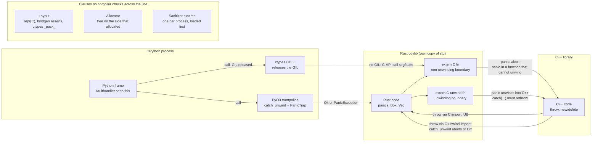

# Rust FFI Boundary Debugging Across C++ and Python

> [!summary] Claim:
> Every FFI boundary is a contract with five clauses: calling convention, data layout, allocator ownership, unwinding, and (for Python) thread-state ownership.
> No compiler checks the clauses on both sides at once, so a violation compiles cleanly and fails later, far from the boundary, as an abort, a segfault, or a silently wrong value.
> Rust turns the unwinding clause into a deterministic abort at an `extern "C"` boundary (since 1.81), PyO3 turns it into a Python `PanicException`, and cxx turns it into `std::terminate` or `abort`.
> The layout, allocator, and thread-state clauses get no such guard, and sanitizers only see them when one runtime is loaded first and every language was instrumented by a compatible LLVM.
> An expert debugs the boundary by naming which clause broke, then choosing the one tool that can observe that clause.



## The Mechanism

### 1. The boundary contract and why it fails silently

A call from Rust into C++ or from Python into Rust compiles each side against its own view of the interface.
The Rust side trusts an `extern` declaration, a bindgen-generated struct, or a PyO3 macro expansion.
The C++ side trusts its header, its compiler flags, and its exception model.
The Python side trusts a ctypes signature or the module's method table.
Nothing in the build compares those views, so each clause of the contract can be violated without a diagnostic:
1. Calling convention: the declared ABI string and argument types must match the callee's real ones.
2. Layout: size, alignment, field offsets, and the set of valid bit patterns must agree.
3. Allocator ownership: memory must be freed by the allocator that produced it.
4. Unwinding: a panic or exception must stop at a boundary that is declared to stop it, or cross only boundaries declared to carry it.
5. Thread state: a call into the CPython C API must hold an attached thread state (the GIL on a default build).

The rest of this note takes the clauses in order of how loudly they fail: unwinding fails loudest, layout and allocators fail quietest.

### 2. Calling convention: the ABI string and the signature each side assumes

A Rust `extern` block or `extern fn` names an ABI, and the Rust Reference lists "calling a function with the wrong call ABI, or unwinding past a stack frame that does not allow unwinding" as undefined behavior.
Nothing compares the declared ABI, argument types, or return type with the callee, so a wrong declaration compiles.
rustc catches one self-inflicted form: `clashing_extern_declarations` warns when one symbol is declared twice with different signatures or ABIs (observed on rustc 1.99.0 for `"C"` against `"C-unwind"`, and in lab section 5).

The caller's signature is types in Rust and data in ctypes, and ctypes has defaults that are wrong for most modern interfaces.
The Python 3.15 documentation says functions are assumed to return a C `int` unless `restype` is set.
A 64-bit integer or a pointer returned in a full-width register is therefore cut to its low 32 bits.
In lab section 3 a Rust export returning `0x1_0000_0002` reached Python as `2`, and a heap pointer above 4 GiB came back as a different address.
The failure is allocator-dependent: on `linux-aarch64` a small `Box` happened to sit below 4 GiB and survived the missing `restype`, while a 64 MiB buffer did not on either platform.
So set `restype` and `argtypes` on every ctypes function (`c_void_p` for pointers, `c_size_t` for sizes), or generate the bindings.

On the C++ side only `extern "C"` gives an unmangled symbol with a stable ABI; C++ member functions, templates, and non-trivially-copyable by-value types have no equivalent, which is why the layout section below sends them behind pointers or through cxx.

### 3. Unwinding: `extern "C"` versus `extern "C-unwind"`

Most Rust ABI strings come in two variants, one with an `-unwind` suffix, and the Rust Reference (`items.fn.extern.unwind`) defines what happens when an unwind reaches each kind of boundary:

| Panic runtime | Boundary ABI | Rust `panic` reaches it | Native (C++) unwind reaches it |
|---|---|---|---|
| `panic=unwind` | unwinding (`"Rust"`, `"C-unwind"`) | unwinds | unwinds |
| `panic=unwind` | non-unwinding (`"C"`, `"system"`) | abort | undefined behavior |
| `panic=abort` | unwinding | aborts without unwinding | abort |
| `panic=abort` | non-unwinding | aborts without unwinding | undefined behavior |

The history matters when you read old code or old blog posts:
- RFC 2945 (start date 2019-04-03) defined `"C-unwind"` because some projects need cross-language unwinding.
- Rust 1.71 (July 2023) stabilized `"C-unwind"` and the other `-unwind` ABIs, and explicitly left unwinding through `"C"` as undefined behavior.
- Rust 1.81 (September 2024) completed the transition: non-unwinding ABIs now abort on an uncaught unwind, closing a long-standing soundness hole.

The abort is generated code, not a convention.
For a function with a non-unwinding ABI, rustc emits a cleanup path that calls the `panic_cannot_unwind` lang item in `core/src/panicking.rs`, which is marked `#[rustc_nounwind]` and calls `panic_nounwind("panic in a function that cannot unwind")`.
A nounwind panic cannot unwind, so the runtime aborts the process with `SIGABRT`.
That is why an `extern "C"` panic prints two panic messages in a debug build: the original one at the user's source line, then the second one from `panicking.rs`.
The lab's macOS release build printed `fatal runtime error: failed to initiate panic, error 3, aborting` instead, which is std's `rust_panic` reporting the `_Unwind_Reason_Code` that `_Unwind_RaiseException` returned (rust-src, `panic_unwind/src/gcc.rs`; the Itanium C++ ABI lists the codes from 0 to 8).
So match on `SIGABRT`, not on the second message.
The Reference leaves one detail open: with `panic=unwind`, either no destructors run or all destructors up to the boundary run, and which one happens is unspecified.

Foreign exceptions coming into Rust have three cases:
1. A C++ exception that unwinds into Rust through a function declared `extern "C"` is undefined behavior; the Reference's Panic chapter names exactly this case (`panic.unwind.ffi.undefined`), and its list of undefined behavior carries the general rule, "unwinding past a stack frame that does not allow unwinding".
2. Through a function declared `extern "C-unwind"`, the exception unwinds through Rust frames and runs their destructors.
3. If a foreign exception reaches `std::panic::catch_unwind`, `JoinHandle::join`, or a thread root, the process either aborts or the call returns `Err` with an opaque payload, and it is unspecified which.

In lab section 1, case 3 aborts on both platforms: std's `__rust_foreign_exception` in `std/src/panicking.rs` calls `rtabort!("Rust cannot catch foreign exceptions")`.
Case 1, through a `"C"` import, gave the same abort in the debug build and a C++ runtime `terminate` in the release build.
That is the dangerous part: the undefined behavior looked like a clean abort in one build and changed in the next.

A Rust panic going out into C++ through `"C-unwind"` is visible to a C++ `catch (...)`.
The Reference gives no guarantee about a foreign runtime disposing of or rethrowing a Rust panic payload: a Rust unwind must either terminate the process or be caught by the same Rust runtime.
So C++ code may observe a Rust panic with `catch (...)` for logging, but must rethrow it, and even the rethrow is outside the guarantee.

The note in the Reference about multiple standard libraries is the one Python engineers miss.
Rust code linked against a different instance of the Rust standard library counts as foreign for this purpose.
Every PyO3 extension module is a separate `cdylib` with its own statically linked copy of std, so a panic payload that escapes one extension and reaches `catch_unwind` in another extension is a foreign exception, even when both were built by the same rustc.
Lab section 2 reproduces it with two plain `cdylib` crates: one catches its own panic, and the same `catch_unwind` aborts with `Rust cannot catch foreign exceptions` on a panic raised by the other.

Forced unwinding is a separate category.
RFC 2945 defines a Plain Old Frame (POF) as one that can be deallocated with no observable effect, meaning it holds no pending destructor and no `catch_unwind` call, and makes forced unwinding (glibc `pthread_exit`, Windows `longjmp`) undefined behavior whenever it crosses a non-POF, on every platform and ABI.
A C library that `longjmp`s out of an error callback must therefore skip only Rust frames that have nothing to drop and no `catch_unwind`, and the RFC calls even that necessary but not sufficient: it specifies no safe form of forced unwinding.

The binding generators each pick one policy:
- bindgen documents that a C++ function that raises an exception it does not catch generates undefined behavior through the generated bindings.
- cxx maps `Result<T>` on an `extern "Rust"` function to a C++ throw of `rust::Error`, maps a C++ exception to `Err` only on an `extern "C++"` function declared to return `Result`, calls `std::terminate` if any other C++ function throws, and logs then calls `std::process::abort` on any Rust panic.
- PyO3 wraps every generated entry point in `catch_unwind`, covered in the Python thread-state section.

### 4. Layout: what `repr(C)`, bindgen, and ctypes each promise

Rust's default layout is unspecified: the Rust Reference (Type layout) promises the default `repr(Rust)` only what soundness needs, namely that a field's offset is a multiple of its alignment and the type's alignment is at least its fields' maximum.
Only `#[repr(C)]`, `#[repr(transparent)]`, and primitive `#[repr(u8)]`-style enums have a layout another language can rely on.
`repr(C)` is defined by an algorithm: fields in declaration order, each at the next offset that is a multiple of its alignment, the struct's alignment that of its most-aligned field, and its size the end offset rounded up to that alignment.
`repr(transparent)` gives a one-field wrapper the layout and ABI of that field, which `repr(C)` does not (a `repr(C)` struct always has the ABI of a C struct).
rustc's `improper_ctypes` lint (on `extern` blocks) and `improper_ctypes_definitions` lint (on `extern` fn definitions) warn about types such as `&str`, `String`, and non-`repr(C)` structs, and both are warn-by-default on rustc 1.99.0 (lab section 5 shows them on the nightly toolchain).
Those lints check only the Rust side; they cannot know what the C++ compiler did.

bindgen closes part of that gap.
For every struct it generates, it also emits compile-time assertions computed by libclang, in this form from the bindgen test expectations:

```rust
const _: () = {
    ["Size of foo"][::std::mem::size_of::<foo>() - 8usize];
    ["Alignment of foo"][::std::mem::align_of::<foo>() - 4usize];
    ["Offset of field: foo::bar"][::std::mem::offset_of!(foo, bar) - 0usize];
};
```

If the Rust layout differs, the subtraction underflows or indexes past the one-element array, and the crate fails to compile.
These layout tests are on by default (`Builder::layout_tests`, bindgen 0.73.2).
They prove only that rustc agrees with libclang as bindgen invoked it, with the clang arguments and target bindgen was given.
They prove nothing about how the C++ library was actually compiled: a different `-D` macro, `#pragma pack`, `-fshort-enums`, a different target triple, or a checked-in binding generated from an older header all pass the assertions and still mismatch at run time.

C++ adds clauses bindgen cannot express.
The bindgen C++ guide lists inline functions, template functions, automatic copy and move constructors and destructors, and C++-specific calling conventions as unsupported.
A type that is non-trivial for the purposes of calls (for example one with a user-provided copy constructor or destructor) is passed by pointer and may be returned through a hidden parameter on some ABIs, and bindgen says generated interfaces that pass such types by value are currently invalid.
Pass such types behind a pointer, or let cxx generate both sides.

Validity is a stricter clause than layout.
The Reference makes it undefined behavior for a `bool` to hold anything but 0 or 1, for an `enum` to hold an invalid discriminant, and for a reference or `Box` to be null, dangling, or misaligned.
A C enum that gains a new value in a library upgrade becomes undefined behavior the moment Rust reads it as a Rust `enum`, which is why bindgen's `EnumVariation::Rust` documentation warns that creating it from an invalid value invokes undefined behavior.
Use the `Consts` or `NewType` enum styles for enums that the C side owns, and match unknown values explicitly.

`i128` and `u128` show how layout can change under you.
Rust 1.76 and earlier gave them 8-byte alignment on x86-32 and x86-64, while C's `__int128` is 16-byte aligned under the x86-64 psABI.
Rust 1.77 changed the alignment to 16, and Rust 1.78 bundled LLVM 18, which fixed a calling-convention bug that split 128-bit arguments between a register and the stack.
Rust before 1.77 is incompatible with GCC and Clang for these types across FFI, and a Rust 1.77 built against a system LLVM older than 18 still passes them incorrectly.
Rust 1.89.0 (August 2025) removed `i128` and `u128` from the `improper_ctypes_definitions` lint, as the last follow-up to that layout change (rust-lang/rust pull request 137306, merged 2025-06-04).
The 1.89.0 announcement attaches caveats: the Rust types are ABI- and layout-compatible with C's `__int128` only where that type is available, and `i128` is not necessarily compatible with `_BitInt(128)`, which does not share an ABI with `__int128` on x86-64.
On macOS arm64, rustc 1.88.0 warned on a `u128` parameter and an `i128` return in both an `extern` block (`improper_ctypes`) and an `extern "C"` fn definition (`improper_ctypes_definitions`), and rustc 1.89.0 and 1.99.0 warned on neither (run 2026-11-11).
The announcement names only `improper_ctypes_definitions`; the `extern` block result is the author's observation.

Misalignment has a debug-only guard.
A debug build inserts an alignment check before a raw-pointer dereference, and lab section 4 shows a misaligned load in an `extern "C"` function printing `misaligned pointer dereference: address must be a multiple of 0x8 but is 0x...` followed by `thread caused non-unwinding panic. aborting.`, on both platforms.
The lab's release build printed the value and exited 0, because arm64 tolerates the unaligned load and the check is gone; a hand run showed the same with `rustc -O` and with `-C debug-assertions=off`.
Use `ptr::read_unaligned` for bytes that come from a wire format or a packed C struct.

ctypes is a third, independent layout engine.
A `ctypes.Structure` lays out fields like the platform C compiler by default, and `_pack_` or `_layout_` override it.
A Rust `#[repr(C)] struct Pair { tag: u8, value: u64 }` is 16 bytes with `value` at offset 8, and a ctypes mirror with `_pack_ = 1` is 9 bytes with `value` at offset 1.
Passing the packed mirror to Rust made Rust read 8 bytes at offset 8 of a 9-byte buffer: lab section 4 shows no crash and a wrong number, `0000000000000011` for a stored `1122334455667788`, and the same wrong number through a C++ struct built with `-DWIRE_PACKED`.
The ctypes documentation says a non-zero `_pack_` selects the MSVC-compatible layout by default, that on non-Windows platforms this default is deprecated since 3.14, and that it is slated to become an error in Python 3.19; CPython 3.15.2 on macOS printed that warning in the lab.

PyO3 owns the layout of `#[pyclass]` objects and of `PyObject` headers through `pyo3-ffi`; casting a raw `PyObject*` to a Rust struct by hand bypasses that ownership, and [[Rust-PyO3-and-Maturin-Internals]] owns those layouts.

### 5. Allocator ownership

The rule is simple: memory is freed by the allocator that allocated it, through the same language's deallocation path.
The failure is quiet because the default allocators often coincide.
Rust's default global allocator on Unix is `System`, and `std/src/sys/alloc/unix.rs` calls `libc::malloc` when the layout's alignment is at most `MIN_ALIGN` and at most the size, and an aligned allocator such as `posix_memalign` otherwise.
`MIN_ALIGN` is 16 on x86_64 and aarch64 (`std/src/sys/alloc/mod.rs`).
So C's `free` on a pointer from `Box::into_raw` usually works by accident with the default allocator, and the same code becomes heap corruption when a crate installs a `#[global_allocator]` such as mimalloc or jemalloc, or when the two sides use different C runtimes.
Lab section 6 shows both halves: `free` on a `Box` returned with the `System` allocator, and aborted the process once a bump-arena `#[global_allocator]` served the `Box`.

C++ adds its own mismatch: `new` with `free`, or `malloc` with `delete`.
AddressSanitizer reports those as `alloc-dealloc-mismatch`, but its default for `alloc_dealloc_mismatch` is `!SANITIZER_APPLE && !SANITIZER_WINDOWS && !SANITIZER_ANDROID` in `asan_flags.inc`, so it is off on macOS and Windows unless you set `ASAN_OPTIONS=alloc_dealloc_mismatch=1`; the lab shows exactly that split, with no report on macOS and a report on `linux-aarch64` with `ASAN_OPTIONS` unset.

The pattern that makes the clause checkable:
1. The side that allocates exports the matching free function, such as `widget_new` and `widget_free`.
2. In Rust, `Box::into_raw` pairs with `Box::from_raw`, `CString::into_raw` pairs with `CString::from_raw`, and nothing else frees those pointers.
3. Ownership transfer is written in the function name or the header comment, because neither type system can carry it across.

### 6. Python's thread-state clause and PyO3's panic trap

The CPython C API requires the calling thread to hold an attached thread state, which on a default build means holding the GIL.
ctypes makes this easy to break.
The ctypes documentation says the GIL is released before calling any function exported by a `CDLL` library and reacquired afterwards, while `PyDLL` does not release it and checks the Python error flag after the call.
A C function that calls `PyLong_FromLong` therefore works when loaded through `ctypes.PyDLL` and segfaults when loaded through `ctypes.CDLL`; in lab section 7 the fault was inside `PyLong_FromLong`, listed right after the signal trampoline, with the export and `ffi_call_SYSV` below it, and the same export that calls `PyGILState_Ensure` itself worked through `CDLL`.
Foreign functions created from a `CFUNCTYPE` prototype release the GIL the same way, and those created from a `PYFUNCTYPE` prototype do not.

PyO3 makes the GIL a type: `Python<'py>` is a token that proves attachment.
PyO3 0.26.0 (2025-08-29) renamed `Python::with_gil` to `Python::attach` and `Python::allow_threads` to `Python::detach`, so older code and answers use the old names.

PyO3 also makes the unwinding clause explicit at every entry point.
In PyO3 0.29.3, `impl_::trampoline::trampoline` creates `PanicTrap::new("uncaught panic at ffi boundary")`, runs the body inside `std::panic::catch_unwind`, and converts a caught panic with `PanicException::from_panic_payload`.
`from_panic_payload` copies a `String` or `&str` payload into the exception message and uses `"panic from Rust code"` for any other payload type.
`PanicTrap` panics in its `Drop`, and the trampoline disarms it with `mem::forget` on the normal path, so if anything unwinds past `catch_unwind` (for example a panic during conversion), the trap's second panic during unwinding aborts the process.
`PanicException` derives from `BaseException`, like `SystemExit`, so `except Exception:` does not catch it; the PyO3 API documentation says it is derived from `BaseException` "so that it will typically propagate all the way through the stack and cause the Python interpreter to exit", and the lab does not exercise PyO3.

Free-threaded CPython changes what "attached" protects, not whether you must be attached; [[Python-Concurrency-Asyncio-Multiprocessing-and-Free-Threading-Bugs]] owns that model.

### 7. Mixed-sanitizer linking

A sanitizer is two things: instrumentation the compiler inserts into each object file, and one runtime library that owns shadow memory and intercepts `malloc`, `free`, and friends.
Mixed-language sanitizing fails when either half is missing or when two incompatible halves meet.

Rust's side is nightly-only: `-Zsanitizer=address` (and `hwaddress`, `leak`, `memory`, `thread`, and others) on listed targets, which for AddressSanitizer include `aarch64-apple-darwin`, `x86_64-apple-darwin`, `aarch64-unknown-linux-gnu`, and `x86_64-unknown-linux-gnu` (Unstable Book, as of 2026-11).
The Unstable Book recommends `-Zbuild-std` so std is instrumented too, and recommends always passing `--target` so `RUSTFLAGS` does not instrument build scripts and proc macros.
rustc links its own runtime, and where it links it depends on the platform (`add_sanitizer_libraries` in `compiler/rustc_codegen_ssa/src/back/link.rs`).
On macOS and Windows MSVC the runtime is a dylib linked into executables and dynamic libraries alike; on macOS nightly that is `@rpath/librustc-nightly_rt.asan.dylib`.
Everywhere else, Linux included, the runtime is a static library linked into executables only, so a sanitized Rust `cdylib` or `dylib` carries instrumentation and no runtime.
`-Zexternal-clangrt` tells rustc not to link it, so that a runtime from clang can be linked instead.
MemorySanitizer needs every line of code instrumented, including C and C++ dependencies rebuilt with clang `-fsanitize=memory`, or it reports false positives; LeakSanitizer needs no compile-time instrumentation.

Instrumented code also carries a version handshake.
Each instrumented module's constructor references a symbol such as `__asan_version_mismatch_check_v8` (compiler-rt `asan_init_version.h`), and the runtime must define the same one.
The first two rows are lab section 8, where the C function reads one `int` past a `malloc` block; the author ran all six combinations by hand on macOS 27.2 arm64 with rustc 1.101.0-nightly (2026-10-24, LLVM 23.1.4), Apple clang 21.0.0, and Homebrew clang 23.1.5, with that same C function called from Rust:

| Rust side | C side | Runtime linked | Result |
|---|---|---|---|
| `-Zsanitizer=address` | not instrumented | rustc's | links, runs, exit 0, no report: the overflowing load is in uninstrumented C |
| `-Zsanitizer=address` | Apple clang `-fsanitize=address` | rustc's | link error: `___asan_version_mismatch_check_apple_clang_2100` undefined |
| not instrumented | Apple clang `-fsanitize=address` | Apple's `libclang_rt.asan_osx_dynamic.dylib` | reports `heap-buffer-overflow` in `c_read_past` |
| `-Zsanitizer=address -Zexternal-clangrt` | Apple clang `-fsanitize=address` | Apple's | link error: `___asan_version_mismatch_check_v8` undefined |
| as above plus `-Cllvm-args=-asan-guard-against-version-mismatch=0` | Apple clang `-fsanitize=address` | Apple's | links and reports, but mixes LLVM 23 instrumentation with Apple's runtime: unsupported |
| `-Zsanitizer=address` | Homebrew clang 23 `-fsanitize=address` | rustc's | reports `heap-buffer-overflow`, with the Rust caller in the stack |

The rule that falls out: instrument every language with the same upstream LLVM major as rustc, and let exactly one runtime win.

A Python host adds a loading clause: the runtime must be in the process before anything allocates.
An ASan-instrumented Rust `cdylib` loaded with `ctypes.CDLL` into a normal Python aborted on macOS in lab section 8 with `Interceptors are not working. This may be because AddressSanitizer is loaded too late (e.g. via dlopen).`, followed by the `DYLD_INSERT_LIBRARIES=...` line to use.
On Linux the equivalent check for a shared runtime is `AsanCheckDynamicRTPrereqs` in `asan_linux.cpp`, which reports that the runtime "does not come first in initial library list" and suggests `LD_PRELOAD`; the `verify_asan_link_order` flag (default true) controls it.
A sanitized Rust `cdylib` on Linux links no runtime at all, so the runtime to preload is a shared one from clang, of the same LLVM major as rustc.
On `linux-aarch64` the lab saw both halves: without a preload `dlopen` failed on undefined `__asan_*` symbols, and with GCC's shared `libasan.so` preloaded (the lab's fallback when no matching clang is installed) the overflow was reported in `rust_oob`.
On macOS the preload alone still failed through `/opt/homebrew/bin/python3`.
That binary is CPython's framework launcher (`Mac/Tools/pythonw.c`), which re-executes `Resources/Python.app/Contents/MacOS/Python` with `posix_spawn` and `POSIX_SPAWN_SETEXEC`, passing its environment.
The `strip_env` option, a flag common to all sanitizer runtimes (compiler-rt `sanitizer_common/sanitizer_flags.inc`) and read here from `ASAN_OPTIONS`, is described as removing the sanitizer from `DYLD_INSERT_LIBRARIES` to avoid passing it to children on Apple platforms, and is true by default; it had already removed the variable inside the launcher.
Either `ASAN_OPTIONS=strip_env=0` or running the `Python.app` binary directly produced the expected `heap-buffer-overflow` report in `rust_oob`, with `ffi_call_SYSV` as the caller.
[[Cpp-Sanitizers-and-Memory-Debugging-on-macOS]] owns the rest of Darwin's sanitizer constraints, and [[Cpp-AddressSanitizer-and-LeakSanitizer-Internals]] owns shadow memory and redzones.

### 8. Debugger entry points on each side of the line

Stop where the contract breaks, not where the crash lands:
- Rust panics: std's `rust_panic` is `#[inline(never)]` and its comment calls it the function "on which to slap yer breakpoints"; with v0 mangling, `breakpoint set --func-regex 'rust_panic$'` in lldb resolved to `__rustc::rust_panic` on the author's host.
  The hook prints the panic message before `rust_panic` runs; to stop before the message, break on `rust_begin_unwind`, the panic handler entry, which sat four frames below `rust_panic` in the same backtrace.
- C++ throws: `breakpoint set -E c++` in lldb, `catch throw` in gdb.
- Aborts: `faulthandler` (enabled with `python3 -X faulthandler` or `faulthandler.enable()`) handles `SIGSEGV`, `SIGFPE`, `SIGABRT`, `SIGBUS`, and `SIGILL`, and since Python 3.14 also prints the C stack trace after the Python traceback when `c_stack=True`, the default.
- Rust backtrace on the panic itself: `RUST_BACKTRACE=1`; [[Rust-GDB-LLDB-Panics-and-Backtraces]] owns symbols, demangling, and backtrace quality.

In lab section 2 on macOS, an `extern "C"` divide-by-zero panic in a Rust `cdylib` called through ctypes produced, in order: the Rust panic message, the `panic in a function that cannot unwind` message, `Fatal Python error: Aborted`, the innermost Python frame, and a C stack running from `abort` through `panic_nounwind` and the export down to `ffi_call`.
The `linux-aarch64` container printed no C stack section; the Python 3.15 documentation says C stack dumps need `backtrace(3)` and `dladdr1(3)` and a compiler that supports CPython's implementation.
That single report names all three runtimes, which is the reason to enable faulthandler in every process that loads native code.

## Commands and Numbers to Know

| Item | Value | Platform | Notes |
|---|---|---|---|
| `extern "C"` panic | abort, `SIGABRT`, exit status 134 from a shell, since Rust 1.81 (as of 2026-11) | Both | Debug builds print `panic in a function that cannot unwind`; the lab's release build on macOS printed `failed to initiate panic, error 3` instead. |
| `extern "C-unwind"` | stable since Rust 1.71 (as of 2026-11) | Both | Use for any function a panic or C++ exception may cross. |
| Foreign exception at `catch_unwind` | abort or `Err`, unspecified; aborted on rustc 1.99.0 and the lab nightly (as of 2026-11) | Both | Message `Rust cannot catch foreign exceptions`. |
| C++ throw through a `"C"` import | undefined behavior; debug build aborted with the std message, release build with the C++ runtime's terminate (lab section 1, as of 2026-11) | Both | An abort in one build proves nothing about the next. |
| `ctypes` default return type | C `int`; truncates 64-bit values and pointers unless `restype` is set (Python 3.15 documentation, lab section 3, as of 2026-11) | Both | Set `restype` and `argtypes` on every function. |
| `ctypes.Structure` `_pack_` | non-zero selects the MSVC-compatible layout; default deprecated off Windows since 3.14, error planned for 3.19 (as of 2026-11) | Both | Set `_layout_` explicitly. |
| `clashing_extern_declarations` | warns when one symbol is declared `"C"` and `"C-unwind"` (as of 2026-11) | Both | Observed on rustc 1.99.0. |
| `improper_ctypes`, `improper_ctypes_definitions` | warn by default (as of 2026-11) | Both | `str`, `String`, non-`repr(C)` structs flagged; `u128` and `i128` flagged through 1.88, not flagged since Rust 1.89. |
| `i128` and `u128` alignment | 16 bytes on x86-64 since Rust 1.77; correct argument passing needs LLVM 18, bundled since 1.78 (as of 2026-11) | Both | Older Rust is incompatible with C `__int128`. |
| bindgen layout tests | on by default, `const` size, align, and `offset_of!` assertions (as of 2026-11) | Both | bindgen 0.73.2; proves agreement with libclang only. |
| Debug alignment check | `misaligned pointer dereference`, non-unwinding panic (as of 2026-11) | Both | Absent with `rustc -O` or `-C debug-assertions=off`. |
| Rust `System` allocator | `malloc` if align <= 16 and align <= size, else aligned path, on x86_64 and aarch64 (as of 2026-11) | Linux, macOS | `std/src/sys/alloc/unix.rs`, rustc 1.101 nightly source. |
| ASan `alloc_dealloc_mismatch` | true except Apple, Windows, Android (as of 2026-11) | Both | Set `ASAN_OPTIONS=alloc_dealloc_mismatch=1` on macOS. |
| `RUSTFLAGS=-Zsanitizer=address cargo +nightly build -Zbuild-std --target <triple>` | instrument Rust and std (as of 2026-11) | Both | `--target` keeps build scripts uninstrumented. |
| `-Zexternal-clangrt` | rustc skips linking its sanitizer runtime (as of 2026-11) | Both | Then link a clang runtime yourself. |
| ASan version symbol | `__asan_version_mismatch_check_v8` upstream, `..._apple_clang_2100` for Apple clang 21.0.0 (as of 2026-11) | macOS | Mismatch is a link error, which is the safe outcome. |
| ASan preload | `DYLD_INSERT_LIBRARIES=<runtime>` plus `ASAN_OPTIONS=strip_env=0` through the framework launcher (as of 2026-11) | macOS | `strip_env` defaults to true on Apple platforms. |
| ASan preload | `LD_PRELOAD=$(clang -print-file-name=libclang_rt.asan-x86_64.so)` (as of 2026-11) | Linux | Clang's shared runtime, same LLVM major as rustc; a Rust `cdylib` links none on Linux. File name is per architecture (`-aarch64` on arm64). The lab ran GCC's `libasan.so` the same way on `linux-aarch64`. |
| `ctypes.CDLL` vs `ctypes.PyDLL` | `CDLL` releases the GIL, `PyDLL` keeps it and checks the error flag (as of 2026-11) | Both | Python 3.15 documentation. |
| `faulthandler` C stack | printed after the Python traceback, `c_stack=True` default, Python 3.14+ (as of 2026-11) | Both | `faulthandler.dump_c_stack()` added in 3.14. |
| PyO3 GIL API | `Python::attach` and `Python::detach` since 0.26.0 (as of 2026-11) | Both | Formerly `with_gil` and `allow_threads`. |
| PyO3 panic | `pyo3_runtime.PanicException`, a `BaseException` subclass (as of 2026-11) | Both | PyO3 0.29.3 source and 0.30.1 documentation. |
| lldb panic breakpoint | `breakpoint set --func-regex 'rust_panic$'` (as of 2026-11) | macOS | Resolved to `__rustc::rust_panic` with v0 mangling. |

## Multi-Language Comparison

| Clause | C++ side | Python side | Rust side |
|---|---|---|---|
| Error model at the boundary | exceptions; `noexcept` or a throw through a `"C"` frame calls `std::terminate` or is UB | exceptions inside the interpreter; a C function signals by returning NULL with the error indicator set | panics; `"C"` aborts, `"C-unwind"` propagates, `catch_unwind` converts |
| Who catches what | `catch (...)` can observe a Rust panic but must rethrow it | PyO3 converts panics to `PanicException`; ctypes cannot catch anything native | `catch_unwind` on a C++ exception aborts or returns `Err`, unspecified |
| Calling convention | `extern "C"` gives an unmangled symbol and the platform C ABI | `argtypes` and `restype` are data; the default return type is `int` | the ABI string after `extern`; wrong ABI is undefined behavior |
| Layout source of truth | the header plus the exact compiler flags | `ctypes.Structure` fields, `_pack_`, `_layout_`; PyO3 for `#[pyclass]` | `#[repr(C)]` plus bindgen's libclang-computed assertions |
| Invalid values | any bit pattern is a valid `int`; enums are open | Python ints are unbounded; truncation happens silently in ctypes conversion | `bool`, `enum`, `char`, references have validity invariants; violation is UB |
| Allocator | `new`/`delete`, `malloc`/`free`, possibly a different CRT | `PyMem_*` and object allocators; refcounts own lifetime | `#[global_allocator]`, default `System`; `Box::from_raw` must match `Box::into_raw` |
| Threading clause | none from the language | must hold an attached thread state to call the C API | `Python<'py>` token in PyO3; `Send`/`Sync` do not cover foreign threads |
| Sanitizer story | clang `-fsanitize=`, mature | needs the runtime preloaded into the interpreter; MSan needs an instrumented CPython | nightly `-Zsanitizer=`, own runtime, `-Zbuild-std` recommended |
| First tool to reach for | `catch throw`, ASan with matching LLVM | `faulthandler` with C stack, `python3 -X dev` | `RUST_BACKTRACE=1`, `rust_panic` breakpoint, Miri for the pure-Rust part |

## Worked Lab Example

The lab is `code/03-Debugging/ffi_boundary_clauses/` (requires: nightly), and `cd code && python3 -m _harness.verify 03-Debugging/ffi_boundary_clauses/` runs it.
`run.sh` builds a Rust workspace (an executable linked with C++, two `cdylib` crates, an allocator pair, a sanitizer pair, a lint crate, and a layout-assertion crate), a C++ static library, two C++ shared libraries (one built with `-DWIRE_PACKED`), and a C library built twice.
`lab.py` then runs every case in its own process, because most cases end it, and reduces each result to lines that do not move between runs: thread ids become `TID`, standard library line numbers become `L:C`, and addresses become `ADDR`.
Eight sections of its output map onto the clauses:

| Lab section | Clause | What it breaks on purpose |
|---|---|---|
| 1 and 2 | Unwinding | panics and C++ exceptions at `"C"` and `"C-unwind"` boundaries, in debug, release, and `panic=abort` builds, then through ctypes |
| 3 | Calling convention | the signature ctypes assumes for a return value |
| 4 and 5 | Layout | three layout engines, bindgen-style assertions, the misalignment check, and rustc's FFI lints |
| 6 | Allocator | `free` on a Rust `Box`, with and without a custom `#[global_allocator]`, plus a C++ `new` and `free` mismatch |
| 7 | Thread state | a Rust export calling the CPython C API through `CDLL` and `PyDLL` |
| 8 | Sanitizers | one runtime per process, loaded first |

Every block below is a contiguous excerpt of `expected/darwin-arm64.txt` (macOS arm64, rustc 1.101.0-nightly 2026-10-24, Apple clang, CPython 3.15.2), unless its label names `linux-aarch64`, the harness container's golden file.

### Unwinding at a Rust and C++ boundary (lab section 1)

Darwin-arm64, debug build, `panic=unwind`; the three imports plus the C++-through-Rust case, the undefined case, and one case re-run with stdout on a terminal:

```text
-- c-panic: Rust panics inside extern "C" fn rust_cb_c; the caller wraps the call in catch_unwind
   stderr: thread 'main' (TID) panicked at host/src/main.rs:18:5:
   stderr: boom in extern C
   stderr: thread 'main' (TID) panicked at $STD/core/src/panicking.rs:L:C:
   stderr: panic in a function that cannot unwind
   stderr: thread caused non-unwinding panic. aborting.
   stdout: drop ran: guard in rust_cb_c
   status: killed by signal 6 (SIGABRT)
-- cpp-throw: C++ throws through an extern "C-unwind" import and reaches catch_unwind
   stderr: fatal runtime error: Rust cannot catch foreign exceptions, aborting
   status: killed by signal 6 (SIGABRT)
-- panic-through-cpp: Rust panics through extern "C-unwind", C++ catch (...) rethrows, Rust catches
   stderr: thread 'main' (TID) panicked at host/src/main.rs:24:5:
   stderr: boom in extern C-unwind
   stdout: caught=true
   stdout: C++ catch(...) saw the Rust panic, rethrowing
   status: exit status 0
-- cpp-through-rust: C++ throws through a Rust extern "C-unwind" frame that owns a destructor, C++ catches
   stdout: drop ran: guard in rust_guarded
   stdout: C++ caught its own exception after it crossed the Rust frame: true
   status: exit status 0
-- cpp-throw-declared-c: C++ throws through an extern "C" import: undefined behavior, shown as this toolchain ran it
   stderr: fatal runtime error: Rust cannot catch foreign exceptions, aborting
   status: killed by signal 6 (SIGABRT)
-- panic-through-cpp again, with stdout on a terminal instead of a pipe
   stdout: C++ catch(...) saw the Rust panic, rethrowing
   stdout: caught=true
```

Read it clause by clause:
1. `c-panic`: `catch_unwind` around the call does not help, because the abort happens inside `rust_cb_c` at its own `"C"` boundary, before the unwind could reach the closure.
   The debug build ran the frame's destructor on the way to the abort (`drop ran`), which is the unspecified part of the Reference: either all destructors up to the boundary run or none.
2. `cpp-throw`: the exception crossed a `"C-unwind"` import correctly, reached `catch_unwind`, and this std chose the abort branch of the unspecified behavior.
3. `panic-through-cpp`: the panic unwound through the C++ frame, `catch (...)` observed it and rethrew, and the same Rust runtime caught it.
   The pipe run prints `caught=true` before the C++ line because C stdio fully buffers a non-terminal stdout and flushes it at exit, while Rust's `println!` goes through its own line-buffered writer; on a terminal the C++ line comes first, as the last two lines show.
4. `cpp-through-rust`: a C++ exception thrown through a Rust `"C-unwind"` frame ran that frame's destructor and was caught by the C++ caller, which is case 2 of the foreign-exception list.
5. `cpp-throw-declared-c`: the same kind of throw through a `"C"` import is undefined behavior, and here it looks like a clean abort in the debug build.

The release build shows why that is not evidence of safety:

```text
[release build, panic=unwind]
-- c-panic: differs from the debug build
   stderr: thread 'main' (TID) panicked at host/src/main.rs:18:5:
   stderr: boom in extern C
   stderr: fatal runtime error: failed to initiate panic, error 3, aborting
   status: killed by signal 6 (SIGABRT)
-- cpp-throw-declared-c: differs from the debug build
   stderr: libc++abi: terminating due to uncaught exception of type std::runtime_error: from C++, declared C in Rust
   status: killed by signal 6 (SIGABRT)
-- same as the debug build: cpp-throw, panic-through-cpp, cpp-through-rust
```

The release build of `cpp-throw-declared-c` did not print std's foreign-exception message: the C++ runtime reported an uncaught exception and terminated, so the same undefined behavior produced a different abort.
The release `c-panic` aborted with `failed to initiate panic` instead of the `cannot unwind` message and did not run the destructor.
In std's source, `rust_panic` calls `__rust_start_panic` and aborts with the code it returns, and that code is the `_Unwind_Reason_Code` that `_Unwind_RaiseException` returned (rust-src, `panic_unwind/src/gcc.rs`).
The Itanium C++ ABI enumerates those codes from 0 to 8, and 3 is `_URC_FATAL_PHASE1_ERROR`.
On `linux-aarch64` the number printed was not a valid reason code and differed between runs, so the lab masks it; read the SIGABRT, not the number.
The `panic=abort` sub-run (not quoted) aborted in every mode, including `panic-through-cpp`, as the Reference table predicts.

On `linux-aarch64` the C++ runtime's wording differs: the golden file has `terminate called after throwing an instance of 'std::runtime_error'` where macOS has `libc++abi: terminating due to uncaught exception of type std::runtime_error`.

### Unwinding at a Python boundary (lab section 2)

Darwin-arm64, a Rust `cdylib` called through ctypes with `python3 -X faulthandler`:

```text
-- divide(1, 0): a panic inside extern "C" fn divide, python3 -X faulthandler
   stderr: thread '<unnamed>' (TID) panicked at boundary/src/lib.rs:109:5:
   stderr: attempt to divide by zero
   stderr: thread '<unnamed>' (TID) panicked at $STD/core/src/panicking.rs:L:C:
   stderr: panic in a function that cannot unwind
   stderr: thread caused non-unwinding panic. aborting.
   faulthandler: Fatal Python error: Aborted
   innermost Python frame: probe.py:139 in divide
   C stack section in the dump: present
   C stack runs abort -> panic_nounwind -> divide -> ffi_call: yes
   status: killed by signal 6 (SIGABRT)
-- divide_guarded(1, 0): the same panic in a frame that owns a destructor, no Rust handler above it
   stderr: thread '<unnamed>' (TID) panicked at boundary/src/lib.rs:125:5:
   stderr: attempt to divide by zero
   stderr: fatal runtime error: failed to initiate panic, error 5, aborting
   status: killed by signal 6 (SIGABRT)
-- divide_checked: the same division behind catch_unwind, returning an error code
   stderr: thread '<unnamed>' (TID) panicked at boundary/src/lib.rs:134:27:
   stderr: attempt to divide by zero
   stdout: divide_checked(6, 3) returned status 0, quotient 2
   stdout: divide_checked(1, 0) returned status -1
   stdout: the interpreter is still running
   status: exit status 0
-- two Rust cdylibs in one process: otherstd catches a panic raised by its own runtime
   stderr: thread '<unnamed>' (TID) panicked at otherstd/src/lib.rs:17:5:
   stderr: panic from the otherstd library
   stdout: other_catch returned 1
   status: exit status 0
-- two Rust cdylibs in one process: otherstd catches a panic raised by the boundary library
   stderr: thread '<unnamed>' (TID) panicked at boundary/src/lib.rs:146:5:
   stderr: panic from the boundary library
   stderr: fatal runtime error: Rust cannot catch foreign exceptions, aborting
   status: killed by signal 6 (SIGABRT)
```

1. `divide(1, 0)`: the `"C"` export panics, std prints the second message, and faulthandler prints the Python frame of the call and a C stack in which `abort`, `panic_nounwind`, `divide`, and `ffi_call` appear in that order.
2. `divide_guarded(1, 0)`: with a destructor in the frame the abort came from the unwinder instead, as `failed to initiate panic, error 5`, and the destructor did not run; in the Itanium list, 5 is `_URC_END_OF_STACK`, a search that reached the top of the stack without finding a handler.
   The abort message depends on what the frame contains, and the invariant is `SIGABRT`.
3. `divide_checked`: the same division behind `catch_unwind` returns `-1` and the interpreter keeps running, which is decision rule 1 below.
4. The last two cases are the multiple-std rule from the Reference: a `cdylib` catches its own panic, but a panic raised by a different `cdylib` is a foreign exception and aborts the process.

On `linux-aarch64` the `divide` case prints `C stack section in the dump: absent`: the Python 3.15 documentation says C stack dumps need `backtrace(3)` and `dladdr1(3)` support from the system and the compiler, and the container's interpreter did not print one.

### Calling convention (lab section 3)

Darwin-arm64:

```text
== 3. Calling convention: the signature ctypes assumes ==
   stdout: wide_value() returns 4294967298; with the default restype ctypes reports 2
   stdout: wide_value() with restype = c_uint64: 4294967298
   stdout: box_new() pointer is above 4 GiB: yes
   stdout: box_new() with the default restype equals the pointer: no
   stdout: box_new() with the default restype equals its low 32 bits as a C int: yes
   stdout: buffer_new(64 MiB) pointer is above 4 GiB: yes
   stdout: buffer_new(64 MiB) with the default restype equals the pointer: no
   stdout: buffer_new(64 MiB) with the default restype equals its low 32 bits as a C int: yes
   stdout: buffer_new(64 MiB) with restype = c_void_p equals the pointer: yes
   status: exit status 0
```

The ctypes documentation says functions are assumed to return a C `int` unless `restype` says otherwise, so a 64-bit return value or a pointer is cut to its low 32 bits: `0x1_0000_0002` became `2`.
The pointer cases show the real danger: a pointer cut to 32 bits is a different address, and any later use or `box_free` of it is a wild access far from the cause.
The same lab on `linux-aarch64` does not show it for the small `Box`:

```text
== 3. Calling convention: the signature ctypes assumes ==
   stdout: wide_value() returns 4294967298; with the default restype ctypes reports 2
   stdout: wide_value() with restype = c_uint64: 4294967298
   stdout: box_new() pointer is above 4 GiB: no
   stdout: box_new() with the default restype equals the pointer: yes
   stdout: box_new() with the default restype equals its low 32 bits as a C int: yes
   stdout: buffer_new(64 MiB) pointer is above 4 GiB: yes
   stdout: buffer_new(64 MiB) with the default restype equals the pointer: no
   stdout: buffer_new(64 MiB) with the default restype equals its low 32 bits as a C int: yes
   stdout: buffer_new(64 MiB) with restype = c_void_p equals the pointer: yes
   status: exit status 0
```

The `Box` pointer was below 4 GiB there, so the truncation was invisible, while the 64 MiB buffer was above 4 GiB on both platforms.
A missing `restype` can pass every test on one allocator layout and fail on another.

### Layout (lab sections 4 and 5)

Darwin-arm64, the ctypes mirrors, the C++ struct, the far-side value, and the bindgen-style assertions:

```text
== 4. Layout: three engines, one struct ==
   stdout: Rust #[repr(C)] Pair:        size 16, align 8, value at offset 8
   stdout: ctypes mirror, default:      size 16, align 8, value at offset 8
   stdout: ctypes mirror, _pack_ = 1:   size 9, align 1, value at offset 1
   stdout: ctypes warning for _pack_ without _layout_: DeprecationWarning, names Python 3.19: yes
   stdout: C++ struct, as written:      size 16, value at offset 8
   stdout: C++ struct, -DWIRE_PACKED:   size 9, value at offset 1
   stdout: value stored on the far side: 1122334455667788 (hex)
   stdout: Rust reads it through the default ctypes mirror:  1122334455667788 correct
   stdout: Rust reads it through the packed ctypes mirror:   0000000000000011 WRONG
   stdout: Rust reads what C++ (as written) wrote:      1122334455667788 correct
   stdout: Rust reads what C++ (-DWIRE_PACKED) wrote:   0000000000000011 WRONG
   status: exit status 0
-- bindgen-style compile-time assertions for Pair (cargo check)
   asserted size 16, the real size: compiles
   asserted size 9, stale and too small: does not compile, E0080: index out of bounds: the length is 1 but the index is 7
   asserted size 24, stale and too big: does not compile, E0080: attempt to compute `16_usize - 24_usize`, which would overflow
```

1. All three engines agree on the default layout: 16 bytes, alignment 8, `value` at offset 8.
2. A ctypes mirror with `_pack_ = 1`, and a C++ struct built with `-DWIRE_PACKED`, are 9 bytes with `value` at offset 1, and Rust reads `0000000000000011` through either one instead of `1122334455667788`: no crash, only a wrong number.
3. The ctypes warning appears on this CPython 3.15.2; the `linux-aarch64` run printed `none` for it, and the ctypes documentation says the default is deprecated since 3.14.
4. The assertions are the bindgen form: a stale size of 9 or 24 stops compilation (`E0080`), and the real size compiles.

The misalignment check and the lint results, darwin-arm64:

```text
-- a load through a misaligned *const u64
   debug build, read_u64:
      stderr: thread '<unnamed>' (TID) panicked at boundary/src/lib.rs:44:14:
      stderr: misaligned pointer dereference: address must be a multiple of 0x8 but is 0xADDR
      stderr: thread caused non-unwinding panic. aborting.
      status: killed by signal 6 (SIGABRT)
   debug build, read_u64_unaligned:
      stdout: read_u64_unaligned(aligned address + 1) returned the bytes at that address: yes
      status: exit status 0
   release build, read_u64:
      stdout: read_u64(aligned address + 1) returned the bytes at that address: yes
      status: exit status 0
   release build, read_u64_unaligned:
      stdout: read_u64_unaligned(aligned address + 1) returned the bytes at that address: yes
      status: exit status 0

== 5. What rustc's FFI lints flag ==
cargo check: exit status 0
improper_ctypes_definitions: def_plain_struct, def_str, def_string
improper_ctypes: decl_plain_struct, decl_str
clashing_extern_declarations: clash
dangling_pointers_from_temporaries: dangling_cstring
not flagged by any lint: decl_option_fn, decl_repr_c, decl_u128, def_i128, def_option_fn, def_repr_c, def_u128, owned_cstring
```

The debug build aborts on the misaligned load and the release build does not, while `read_unaligned` is correct in both.
The two lints flagged `&str`, `String`, and a plain (non-`repr(C)`) struct, and flagged none of `u128`, `i128`, a `repr(C)` struct, an `Option` of a function pointer, or an owned `CString`.
`dangling_pointers_from_temporaries` caught the one pointer taken from a temporary `CString`.

### Allocator ownership (lab section 6)

Darwin-arm64, the custom allocator and the C++ mismatch:

```text
[#[global_allocator] bump arena over a static pool]
-- the Box goes back to Rust (Box::from_raw)
   stdout: Rust allocated a Box<u64>
   stdout: Box::from_raw dropped it
   status: exit status 0
-- the Box is released with C free()
   stdout: Rust allocated a Box<u64>
   status: killed by signal 6 (SIGABRT)
[C++ operator new released with free(), built with -fsanitize=address]
-- ASAN_OPTIONS unset: ASan report: none, exit status 0
-- alloc_dealloc_mismatch=1: ASan report: alloc-dealloc-mismatch (operator new vs free), killed by signal 6 (SIGABRT)
-- alloc_dealloc_mismatch=0: ASan report: none, exit status 0
```

With the default `System` allocator, `free` on a `Box` returned (section 6, not quoted), and with a `#[global_allocator]` bump arena the same `free` aborted the process.
On macOS the ASan `alloc_dealloc_mismatch` check was off by default and reported only when set to 1.
On Linux it is on by default, as `linux-aarch64` shows:

```text
[#[global_allocator] bump arena over a static pool]
-- the Box goes back to Rust (Box::from_raw)
   stdout: Rust allocated a Box<u64>
   stdout: Box::from_raw dropped it
   status: exit status 0
-- the Box is released with C free()
   stderr: free(): invalid pointer
   stdout: Rust allocated a Box<u64>
   status: killed by signal 6 (SIGABRT)
[C++ operator new released with free(), built with -fsanitize=address]
-- ASAN_OPTIONS unset: ASan report: alloc-dealloc-mismatch (operator new vs free), exit status 1
-- alloc_dealloc_mismatch=1: ASan report: alloc-dealloc-mismatch (operator new vs free), exit status 1
-- alloc_dealloc_mismatch=0: ASan report: none, exit status 0
```

Here `free()` on the arena pointer was caught by glibc itself (`free(): invalid pointer`), and the ASan report appeared with `ASAN_OPTIONS` unset.

### Thread state (lab section 7)

Darwin-arm64:

```text
== 7. Thread state: a Rust export that calls the CPython C API ==
-- ctypes.PyDLL, call_api(123456789): the GIL stays held
   stdout: returned 123456789
   status: exit status 0
-- ctypes.CDLL, call_api(123456789): the GIL is released for the call
   faulthandler: Fatal Python error: Segmentation fault
   innermost Python frame: probe.py:134 in thread_state
   C stack section in the dump: present
   C frames below the signal trampoline: PyLong_FromLong, call_api, ffi_call_SYSV
   status: killed by signal 11 (SIGSEGV)
-- ctypes.CDLL, call_api(5): a preallocated small integer
   stdout: returned 5
   status: exit status 0
-- ctypes.CDLL, call_api_ensure(123456789): the export calls PyGILState_Ensure itself
   stdout: returned 123456789
   status: exit status 0
```

`PyDLL` kept the GIL, so the C-API call worked.
`CDLL` released it, and the large value segfaulted inside `PyLong_FromLong`, which the dump lists right after the signal trampoline, followed by `call_api` and `ffi_call_SYSV`.
The small value returned safely because it is a preallocated object, and `PyGILState_Ensure` inside the export fixes the clause without changing the loader.

### Sanitizer runtimes (lab section 8)

Darwin-arm64, Rust and C in one executable:

```text
[Rust executable built with -Zsanitizer=address, linked with a C library]
-- C not instrumented: the C function reads one int past its block
   ASan report: none
   stdout: the C read returned without a report
   status: exit status 0
-- C not instrumented: the Rust function makes the same read
   ASan report: heap-buffer-overflow
   access: READ of size 4
   frame #0 is in the Rust main function
   status: killed by signal 6 (SIGABRT)
-- C instrumented by the C compiler on PATH: link against rustc's runtime
   link: failed, undefined version symbol: ___asan_version_mismatch_check_apple_clang_N
```

An uninstrumented C read is invisible to a Rust-only ASan build, the same read from Rust is reported, and Apple's clang objects cannot link against rustc's runtime because the version symbol differs.
The Python half of the same section:

```text
[Rust cdylib built with -Zsanitizer=address, loaded by an uninstrumented python3; runtime family: rustc]
-- ctypes.CDLL with no preload
   ASan runtime: Interceptors are not working (loaded too late)
   the message names DYLD_INSERT_LIBRARIES: yes
   status: killed by signal 6 (SIGABRT)
-- python3 is a framework launcher that re-executes Python.app: yes
-- DYLD_INSERT_LIBRARIES set, started through python3
   ASan runtime: Interceptors are not working (loaded too late)
   the message names DYLD_INSERT_LIBRARIES: yes
   status: killed by signal 6 (SIGABRT)
-- DYLD_INSERT_LIBRARIES set and ASAN_OPTIONS=strip_env=0, started through python3
   ASan report: heap-buffer-overflow
   access: READ of size 1
   frame #0 is in rust_oob: yes
   the stack reaches libffi: yes
   stdout: rust_oob(3) returned 1
   status: killed by signal 6 (SIGABRT)
-- DYLD_INSERT_LIBRARIES set, Python.app binary started directly
   ASan report: heap-buffer-overflow
   access: READ of size 1
   frame #0 is in rust_oob: yes
   the stack reaches libffi: yes
   stdout: rust_oob(3) returned 1
   status: killed by signal 6 (SIGABRT)
```

The runtime must be in the process before Python starts allocating, and through the framework launcher the preload only survives with `strip_env=0`.
On `linux-aarch64` a sanitized `cdylib` without a preload fails to load because the `__asan_*` symbols are undefined, and with the preload it reports the overflow:

```text
[Rust cdylib built with -Zsanitizer=address, loaded by an uninstrumented python3; runtime family: gcc]
-- ctypes.CDLL with no preload
   dlopen failed: undefined symbol: __asan_* (the library carries instrumentation and no runtime)
   status: exit status 1
-- LD_PRELOAD set to the shared runtime
   ASan report: heap-buffer-overflow
   access: READ of size 1
   frame #0 is in rust_oob: yes
   the stack reaches libffi: yes
   stdout: rust_oob(3) returned 1
   status: exit status 1
```

The Linux runtime in that run was GCC's `libasan.so`, the family printed in the block's heading; the lab prefers a clang runtime of rustc's LLVM major when one is installed and falls back to GCC's.
That run shows rustc's instrumentation working against GCC's runtime in this container; the lab did not run a clang runtime on Linux.

To reproduce the sanitizer half by hand, outside the harness:

```sh
cat > oob.rs <<'RS'
#[no_mangle] pub extern "C" fn rust_oob(n: usize) -> u8 { let v = vec![1u8; 4]; unsafe { *v.as_ptr().add(n) } }
RS
rustc +nightly -Zsanitizer=address --target aarch64-apple-darwin --crate-type cdylib oob.rs -o liboob.dylib
RT="$(rustc +nightly --print sysroot)/lib/rustlib/aarch64-apple-darwin/lib/librustc-nightly_rt.asan.dylib"
ASAN_OPTIONS=strip_env=0 DYLD_INSERT_LIBRARIES="$RT" python3 -c 'import ctypes; ctypes.CDLL("./liboob.dylib").rust_oob(4)'
```

On Linux, set `--target` to your Linux triple, use `LD_PRELOAD` with a shared runtime (clang's `libclang_rt.asan-<arch>.so` of the same LLVM major as rustc, or GCC's `libasan.so`), and drop `strip_env`, which applies only to Apple platforms.

> [!warning] Pitfalls:
> 1. Trusting `catch_unwind` around an `extern "C"` call: the abort happens inside the callee's boundary, so the closure never sees the panic.
> 2. Declaring a C++ function `extern "C"` because "it never throws": if it throws, the behavior is undefined, and a clean-looking abort in one test run proves nothing; declare it `"C-unwind"` or wrap it in a C++ `noexcept` shim that converts exceptions to error codes.
> 3. Swallowing a Rust panic in C++ `catch (...)` and continuing: there is no guarantee for a foreign runtime disposing of a Rust panic payload, so log and rethrow, or abort.
> 4. Catching a panic from one PyO3 extension in another: each `cdylib` has its own std, so the payload is foreign to the other module's `catch_unwind`.
> 5. Treating green bindgen layout assertions as proof of ABI compatibility: they compare rustc with libclang under bindgen's flags, not with the flags the C++ library shipped with.
> 6. Reading a C enum into a Rust `enum`: a value added in a newer C library is undefined behavior on read; use `Consts` or `NewType` styles.
> 7. Freeing across the boundary because "it works": the Rust `System` allocator forwards to `malloc` for small alignments, so C `free` works until someone installs a `#[global_allocator]`, and macOS ASan does not check `new`/`free` mismatches by default.
> 8. Loading C-API code through `ctypes.CDLL`: the GIL is released for the call, so the first C-API call can segfault far from the cause.
> 9. Writing `except Exception` around PyO3 calls and expecting to catch panics: `PanicException` is a `BaseException`, so it escapes, by design.
> 10. Mixing Apple clang ASan objects with rustc ASan objects: the version handshake symbols differ, the link fails, and disabling the guard with `-asan-guard-against-version-mismatch=0` trades a link error for an unsupported runtime mix.
> 11. Loading a sanitized extension into an unsanitized interpreter with `dlopen`: the runtime must come first, and on macOS `strip_env` drops `DYLD_INSERT_LIBRARIES` before the framework launcher re-executes `Python.app`.
> 12. Debugging with release builds only: the misaligned-pointer check exists only with debug assertions, so the release build silently reads the wrong bytes on arm64.
> 13. Calling a ctypes function without `restype`: the default is a C `int`, so a 64-bit value or a pointer is silently cut to 32 bits, and the symptom appears only when the allocator returns a high address.
> 14. Concluding that a C++ throw through a `"C"` import is harmless because it aborted cleanly once: the lab's release build ended in the C++ runtime's terminate instead of std's check.

## At Scale

For one developer, the boundary is a handful of `extern` blocks and the cost of a mistake is an afternoon with lldb.
For a team of 50, the boundary multiplies: several native extensions, each bundling its own std and maybe its own allocator, loaded into one interpreter, so "who owns this pointer" and "which runtime caught this panic" stop having local answers.
For 1,000 to 50,000 engineers, crash reports arrive as aborts and segfaults inside CPython or libc frames, and the clause that broke is two frames up in a library owned by another team.

The economics favor generated, checked boundaries over hand-written ones:
1. Hand-written `extern` blocks and ctypes signatures have no cross-check at all; bindgen adds a libclang cross-check, cxx generates both sides and checks them together, and PyO3 owns the CPython side.
2. Every boundary crossing that can panic must be declared once, centrally, so a lint or code search can find all `"C"` exports and confirm each is panic-free or wrapped.
3. Sanitizer builds are only worth running if they cover all three languages with one compatible LLVM; a partial ASan build gives false confidence, as the uninstrumented-C row in the sanitizer table shows.

Decision rules:
1. Default every Rust export that C++ or Python calls to `extern "C"` with an explicit `catch_unwind` that converts panics to error codes, and accept the 1.81 abort as the backstop.
2. Use `extern "C-unwind"` only where an unwind must cross intentionally, and require the C++ side to be built with exceptions enabled (`-fno-exceptions` callers make it undefined behavior).
3. Generate bindings in the build, never check them in, and pass bindgen the same defines, target, and packing flags as the C++ build.
4. Mandate an allocator-pair API (`x_new` and `x_free`) for every pointer that crosses ownership, and ban `free` on foreign pointers in review.
5. Require `python3 -X faulthandler` (or `faulthandler.enable()`) in every service that loads native extensions, and ship symbols so the C stack is readable; [[Core-Dumps-Minidumps-and-Crash-Reporting]] owns fleet crash capture.
6. Run one CI tier where Rust, C, and C++ are built with ASan by the same LLVM major as rustc and the interpreter is launched with the runtime preloaded.
7. Pin the Rust toolchain fleet-wide, because layout and boundary behavior have changed in specific releases (`u128` in 1.77 and 1.78, `"C"` aborts in 1.81, 128-bit integers leaving the FFI lints in 1.89).
8. Set `restype` and `argtypes` for every ctypes function, or generate them, and review any ctypes call that has neither.

> [!tip] Practice Drill:
> Run the lab on Linux and compare your output with `expected/linux-aarch64.txt`, then add one more C++ function declared `extern "C"` that throws to lab section 1, run it in debug and release, and explain why its result on your machine is not evidence of safety.
> Then work [[Drill-Debugging-Mixed-Python-Rust-FFI-Segfault]], which hides an ownership bug behind an intermittent segfault across a ctypes-to-Rust `cdylib` boundary.
> Before reading its hints, write down which of the five clauses you suspect and which tool can observe that clause.

## Interview Questions

> [!question] L5: What happens when Rust code panics inside an `extern "C"` function called from C++, on current Rust?
> > [!success]- Answer
> > Since Rust 1.81, a panic that reaches a non-unwinding ABI boundary aborts the process.
> > rustc emits a cleanup path that calls the `panic_cannot_unwind` lang item, which raises a nounwind panic with the message `panic in a function that cannot unwind`, so the process gets `SIGABRT`.
> > Before 1.81 the same code was undefined behavior.
> > Whether destructors between the panic and the boundary run is unspecified: either all of them or none.

> [!question] L5: Why does `except Exception:` not catch a panic from a PyO3 function?
> > [!success]- Answer
> > PyO3's trampoline converts a caught panic into `pyo3_runtime.PanicException`, which derives from `BaseException`, like `SystemExit`.
> > The design intent is that a panic means a bug, so it should propagate to the top and usually end the interpreter rather than be handled as an ordinary error.
> > Return `PyResult` with a real exception type for recoverable errors.

> [!question] L5 (predict the output): Rust declares `extern "C-unwind" { fn cpp_calls_rust(); }`, the C++ function calls a Rust `extern "C-unwind"` callback that panics, catches it with `catch (...)`, prints a line with `puts`, and rethrows; Rust wraps the call in `catch_unwind` and prints `caught={}`. With stdout redirected to a file, what prints, and in what order?
> > [!success]- Answer
> > The panic message prints first on stderr from the panic hook, then Rust prints `caught=true`, and the C++ line appears last.
> > The unwind crosses both `"C-unwind"` boundaries legally, C++ observes and rethrows, and the same Rust runtime catches its own panic.
> > The C++ line is last because C stdio fully buffers a stdout that is not a terminal and flushes it at exit, while Rust's `println!` flushes its own line-buffered writer at each newline; in a terminal the C++ line comes first.
> > The rethrow worked in the lab on both platforms, but the Reference does not guarantee anything about a foreign runtime rethrowing a Rust panic.

> [!question] L5 (debug this): A ctypes call into a Rust library returns correct small numbers, but a returned pointer later crashes `free_widget` on some machines only. Diagnose it.
> > [!success]- Answer
> > ctypes assumes a C `int` return unless `restype` is set, so a pointer is cut to its low 32 bits.
> > It survives when the allocator hands out an address below 4 GiB (a small `Box` on `linux-aarch64` in the lab) and breaks when the address is higher (a 64 MiB buffer, or a `Box` on macOS).
> > Set `restype = ctypes.c_void_p` and matching `argtypes` for the free function, or generate the binding.

> [!question] L6: bindgen's layout assertions pass, yet Rust reads garbage from a struct returned by a C++ library. List the causes you would check.
> > [!success]- Answer
> > The assertions compare rustc with libclang as bindgen ran it, so check every way the real build differs: defines that add or remove fields, `#pragma pack` or `alignas` under a macro, `-fshort-enums`, a different target triple, or bindings checked in from an older header.
> > Then check validity, not layout: a Rust `enum` or `bool` field receiving a value the Rust type forbids.
> > Then check C++-specific ABI: a non-trivially copyable type returned by value uses a hidden pointer, which bindgen declares invalid.
> > Fix by generating bindings in the build with the same flags and by passing non-trivial types by pointer.

> [!question] L6 (debug this): A Python service loads a C helper with `ctypes.CDLL`; the helper returns `PyLong_FromLong(count)`. Unit tests with small counts pass, but production segfaults inside `PyLong_FromLong` once counts grow. Diagnose it.
> > [!success]- Answer
> > `ctypes.CDLL` releases the GIL before every call, so the helper calls the C API without an attached thread state.
> > CPython keeps preallocated objects for small integers (-5 to 1024 in the Python 3.15 documentation), so a small count returns an existing object without touching per-thread state, and a large count must allocate a new object.
> > In lab section 7, the same kind of export returned 5 safely through `CDLL` and segfaulted for 123456789, with the faulthandler C stack showing `PyLong_FromLong`, then the export, then `ffi_call_SYSV`.
> > The faulting frame is in CPython, but the broken clause is the loader choice: load the helper with `ctypes.PyDLL`, acquire the GIL in the helper with `PyGILState_Ensure`, or rewrite it as a real extension module or PyO3 function.

> [!question] L6: Why can Rust memory freed with C `free` work in tests and corrupt the heap in production?
> > [!success]- Answer
> > Rust's default `System` allocator on Unix calls `malloc` when the alignment is at most 16 on x86_64 and aarch64 and at most the size, so `free` happens to match.
> > A production build that installs a `#[global_allocator]` such as jemalloc or mimalloc, or a different C runtime on the other side, breaks the coincidence.
> > The fix is an API rule: export `x_free` from the Rust side and pair `Box::into_raw` with `Box::from_raw`.
> > On macOS, ASan will not catch C++ `new`/`free` mismatches unless `alloc_dealloc_mismatch=1` is set.

> [!question] L7: You need AddressSanitizer coverage for a process that is CPython plus a PyO3 extension plus a C++ library. Design the build.
> > [!success]- Answer
> > Build the Rust crate with nightly `-Zsanitizer=address`, `-Zbuild-std`, and an explicit `--target`, so std is instrumented and build scripts are not.
> > Build the C++ library with an upstream clang of the same LLVM major as rustc, because instrumented objects reference a versioned symbol such as `__asan_version_mismatch_check_v8` that only a matching runtime defines; Apple clang's objects reference an Apple-specific symbol and fail to link against rustc's runtime.
> > Load exactly one runtime first: `LD_PRELOAD` of clang's shared runtime on Linux (the lab also ran GCC's `libasan.so`), where a Rust `cdylib` links none, or `DYLD_INSERT_LIBRARIES` with `ASAN_OPTIONS=strip_env=0` on macOS when going through the framework launcher.
> > Expect leak noise from CPython at exit, and do not attempt MSan unless CPython itself is rebuilt with it.

> [!question] L7: Two PyO3 extensions are loaded into one interpreter, and a panic in one should be handled by the other. Why is that a design error?
> > [!success]- Answer
> > Each extension is a `cdylib` with its own copy of std, and the Reference says Rust code linked against a different std instance counts as foreign for unwinding.
> > A payload from one std reaching `catch_unwind` in the other is a foreign exception, so the process may abort.
> > Panics must stop at each module's boundary, which PyO3's trampoline already does, and cross-module errors must travel as Python exceptions or C error codes.

> [!question] L7: A team wants to stop reviewing FFI code by hand. Which checks can be automated, and which cannot?
> > [!success]- Answer
> > Automate the lints (`improper_ctypes`, `improper_ctypes_definitions`, `clashing_extern_declarations`), bindgen layout assertions generated at build time, cxx for C++ boundaries, and a sanitizer CI tier with matched LLVM.
> > Automate a search that lists every `extern "C"` export and requires a `catch_unwind` or a documented panic-free proof.
> > Ownership transfer and thread-state requirements cannot be checked by any of those tools, so they must be encoded in API shape: paired `new` and `free` functions, PyO3's `Python<'py>` token, and no raw `PyObject*` casts.

> [!question] L8+: You own native interop policy for 3,000 engineers shipping Rust, C++, and Python. What do you standardize, and how do you measure that it works?
> > [!success]- Answer
> > Standardize generated boundaries: PyO3 for Python, cxx or bindgen-in-build for C++, and a ban on hand-written ctypes for C-API code.
> > Standardize the unwinding policy: `"C"` exports with explicit conversion of panics to errors, `"C-unwind"` only by exception and with exceptions enabled on the C++ side.
> > Standardize the runtime: pinned Rust toolchain, one LLVM major for sanitizer builds, faulthandler on in every Python service, symbols shipped for every native module.
> > Measure with crash telemetry clustered by the clause that broke (abort at boundary, segfault in CPython with ctypes below, ASan report class), and track the share of crashes whose top frames are outside the owning team's code.

## Further Reading

- The Rust Reference, Functions: Unwinding: the normative table for every panic runtime and ABI combination.
- The Rust Reference, Panic: Unwinding across FFI boundaries: the UB cases, foreign exceptions, and the multiple-std rule.
- The Rust Reference, Behavior considered undefined: validity invariants for `bool`, `enum`, references, and misaligned places.
- RFC 2945, C-unwind ABI: the design, POF definition, and forced-unwinding rules.
- Rust 1.71.0, 1.81.0, and 1.89.0 release announcements: when `"C-unwind"` stabilized, when `"C"` began to abort, and when the 128-bit integers left the FFI lint.
- Changes to u128/i128 layout in 1.77 and 1.78: a concrete case of layout changing between compiler releases.
- The Rust Reference, Type layout: the `repr(C)` algorithm, `repr(transparent)`, and the primitive representations.
- Itanium C++ ABI, Exception Handling: the `_Unwind_Reason_Code` values that std prints on a failed panic.
- The Rust Unstable Book, sanitizer: supported targets, `-Zbuild-std`, and `-Zexternal-clangrt`.
- bindgen User Guide, C++: the authoritative list of what bindgen cannot express.
- cxx.rs, Result: how a generator that owns both sides maps exceptions and panics.
- PyO3 source, `impl_/trampoline.rs` and `impl_/panic.rs`: how a real binding layer guards every entry point.
- Python ctypes and faulthandler documentation: default return type, `_pack_` and `_layout_`, GIL release rules, and the C stack dump.
- compiler-rt `asan_flags.inc` and `asan_linux.cpp`: sanitizer defaults and the runtime ordering check.

## Related

- Prerequisites: [[Rust-Miri-Sanitizers-Loom-and-Cargo-Fuzz]], [[Cpp-AddressSanitizer-and-LeakSanitizer-Internals]], [[Python-Debugging-Hung-Processes-and-C-Extensions]]
- Next: [[Drill-Debugging-Mixed-Python-Rust-FFI-Segfault]]
- See also: [[Python-faulthandler-and-Crash-Diagnostics]], [[Rust-GDB-LLDB-Panics-and-Backtraces]], [[Cpp-Sanitizers-and-Memory-Debugging-on-macOS]], [[Core-Dumps-Minidumps-and-Crash-Reporting]], [[Rust-PyO3-and-Maturin-Internals]], [[Python-Concurrency-Asyncio-Multiprocessing-and-Free-Threading-Bugs]], [[02-Programming-Languages/C++/CPP_Zero_to_Godhood/Volume_09_Specialized_Mastery/Chapter_111_Interoperability/Chapter_111_Interoperability_and_the_Stable_C_ABI|Chapter_111_Interoperability_and_the_Stable_C_ABI]]
