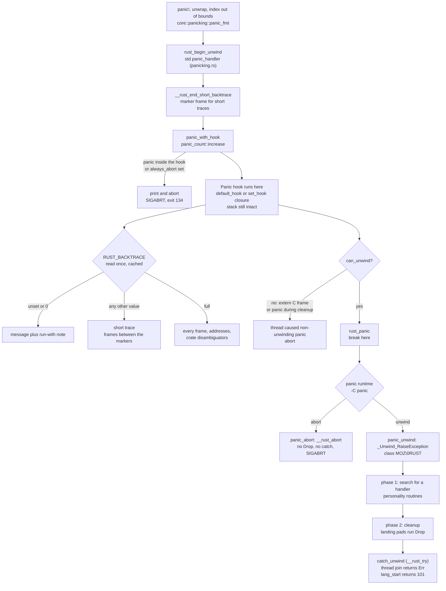

# Rust GDB, LLDB, Panics, and Backtraces

> [!summary] Claim:
> A Rust panic is a library-level event that runs the panic hook first, while the faulting stack is still intact, and only then hands control to the panic runtime.
> The runtime either unwinds with the Itanium two-phase unwinder, running every `Drop` on the way to a `catch_unwind` or to the exit code 101, or aborts with SIGABRT and runs nothing.
> `RUST_BACKTRACE` only changes what the default hook prints, and a backtrace needs unwind tables to walk the stack, symbols to name frames, and line tables to print `file:line`.
> Since Rust 1.97.0 every mangled symbol uses the v0 scheme (`_R...`), which keeps generic arguments in the name, so a debugger can break on one instance such as `example::<u8, 2>`.
> An expert breaks on `rust_panic`, knows which spelling of that name each GDB version accepts, knows that `rust-lldb` adds formatters but no Rust expression parser, and knows that `rust-gdb` adds pretty-printers to a debugger that already parses Rust.



## The Mechanism

### The panic pipeline, in the order std runs it

A formatted panic in Rust 1.99.0 takes this path through `library/std/src/panicking.rs`, whatever the macro or method that started it:
1. `panic!`, `Option::unwrap`, `Result::unwrap`, a failed bounds check, or arithmetic overflow in a debug build calls `core::panicking::panic_fmt`, which calls the `#[panic_handler]`.
2. In a program that links std, the handler is `std::panicking::panic_handler` (line 612), exported as `rust_begin_unwind`.
   It wraps the rest of the work in `std::sys::backtrace::__rust_end_short_backtrace`, a marker frame for the short backtrace.
3. `panic_with_hook` (line 777) calls `panic_count::increase`.
   If the thread is already inside a panic hook, it prints `thread panicked while processing panic. aborting.` and calls `process::abort()`.
   Rust 1.71.0 made that rule explicit: "Additional panics are allowed while unwinding, as long as they are caught before escaping a `Drop` implementation, but panicking within a panic hook is now an immediate abort."
4. It reads the global `HOOK` (a `RwLock<Hook>`) and calls either `default_hook` or the closure installed with `std::panic::set_hook`.
   The hook runs before any unwinding, so every frame of the panicking code, including its locals, is still on the stack.
5. If the panic cannot unwind, because it was raised in a function that must not unwind or during cleanup, it prints `thread caused non-unwinding panic. aborting.` and aborts.
6. Otherwise it calls `rust_panic` (line 886), which std documents as "A function with a fixed suffix (through `rustc_std_internal_symbol`) on which to slap yer breakpoints."
7. `rust_panic` calls `__rust_start_panic`, which the selected panic runtime crate provides: `panic_unwind` or `panic_abort`.

Two entry points join that path late.
`std::panic::panic_any` enters at `begin_panic` (line 710), which calls `panic_with_hook` without passing `rust_begin_unwind`.
`std::panic::resume_unwind` (line 845) runs no hook and calls `rust_panic` directly, so `rust_panic` is the one frame every unwinding panic passes.

The default hook formats the first line as `\nthread '{name}' ({tid}) panicked at {location}:\n{msg}` (`default_hook`, line 240).
The OS thread ID in parentheses is new in Rust 1.91.0 ("Print thread ID in panic message"), and the message has been on its own line since the 1.73.0 format change.
An unnamed thread prints as `<unnamed>`.
A `panic_any(42u32)` payload that is neither `&str` nor `String` prints as `Box<dyn Any>`.
With backtraces off, the hook adds `note: run with RUST_BACKTRACE=1 environment variable to display a backtrace` (the variable name is in backticks in the real text) only to the first panic of the process, guarded by the `FIRST_PANIC` flag (line 285).

The `{location}` is a `&'static core::panic::Location` compiled into the binary, so it survives stripping and needs no debug information.
It is the caller's location when the panicking function is `#[track_caller]`.
`Option::unwrap` carries that attribute (`library/core/src/option.rs`), which is why a failed `unwrap()` reports the line of the call and the message ``called `Option::unwrap()` on a `None` value``, not a line inside core.

### Panic hooks

`std::panic::set_hook` replaces the global hook, and `take_hook` removes it and returns the previous one, restoring the default.
The documented contract is that "the hook will run with both the aborting and unwinding runtimes", which is why a hook is the right place for crash logging under `panic=abort`.
The argument is `std::panic::PanicHookInfo`, which Rust 1.81.0 split from `core::panic::PanicInfo`; the old `std` name is a deprecated alias.
`PanicHookInfo::payload_as_str` (stable since 1.91.0) returns the message for `&str` and `String` payloads and `None` for any other payload, and `location()` gives `file`, `line`, and `column`.
A custom hook that does not call the previous hook suppresses the default message and backtrace, so the usual pattern is `let prev = take_hook(); set_hook(Box::new(move |info| { log(info); prev(info); }))`.
`std::thread::panicking()` returns `true` inside a `Drop` that runs during unwinding, which lets a destructor skip work that could panic a second time.
`-C panic=immediate-abort` skips hooks entirely, and it is nightly-only: stable 1.99.0 rejects it with `` `-Cpanic=immediate-abort` requires `-Zunstable-options` and a nightly compiler `` (as of 2026-11).

### Unwinding: two phases over the Itanium ABI

`panic_unwind` on Unix (`library/panic_unwind/src/gcc.rs`) boxes the payload into an `_Unwind_Exception` whose `exception_class` is `u64::from_ne_bytes(*b"MOZ\0RUST")`, plus a `canary` pointer, and calls `_Unwind_RaiseException`.
The Itanium C++ ABI defines the two phases that follow:
1. Search phase: the unwinder walks the stack without changing it, calling each frame's personality routine with `_UA_SEARCH_PHASE` until one returns `_URC_HANDLER_FOUND`.
2. Cleanup phase: it walks again with `_UA_CLEANUP_PHASE`, jumping into each frame's landing pad, which runs the `Drop` glue for live locals, and stops at the handler frame.
By the ABI's convention the high four bytes name the vendor (`MOZ\0`) and the low four the language (`RUST`).
Since Rust 1.83.0 the constant is built from native-endian bytes, so memory holds the characters in the order `MOZ\0RUST` and a hex dump reads correctly, although on a little-endian target `RUST` is then the numerically high half.

Rust always provides a handler: `std::rt::lang_start_internal` runs `main` inside `panic::catch_unwind`, drops the payload carefully, and returns `101` (`rt.rs`, line 183), and spawned threads run inside a similar frame so that `JoinHandle::join` returns `Err`.
`catch_unwind` appears in backtraces as `___rust_try` on macOS and `__rust_try` on Linux: rustc's `catch_unwind_intrinsic` (`compiler/rustc_codegen_llvm/src/intrinsic.rs`) generates a `__rust_try` function that holds the landing pad, and Mach-O adds one leading underscore.
When the panic strategy does not unwind, the same intrinsic emits a plain call and returns "no panic" unconditionally, so `catch_unwind` cannot catch anything under `panic=abort`.
Three cases still abort:
- Unwinding out of an `extern "C"` function aborts with `panic in a function that cannot unwind`, the default since Rust 1.81.0 ("Abort on uncaught panics in `extern "C"` functions"); use `extern "C-unwind"` when unwinding across the boundary is intended.
- A panic that escapes a `Drop` during unwinding aborts with `panic in a destructor during cleanup`.
- Foreign exceptions caught by `catch_unwind` end in `Rust cannot catch foreign exceptions`, and a Rust panic swallowed by foreign code ends in `Rust panics must be rethrown` (`__rust_foreign_exception` and `__rust_drop_panic`).
In the first two cases the default hook prints a second panic with a full backtrace, whatever `RUST_BACKTRACE` says, because `default_hook` uses `BacktraceStyle::full()` whenever the panic count is at least 2.
In the `extern "C"` case that second panic is `panic in a function that cannot unwind` itself.
In the `Drop` case it is the destructor's own panic, and `panic in a destructor during cleanup` follows as a third message with no backtrace, because `core::panicking::panic_in_cleanup` raises it through `panic_nounwind_nobacktrace`.
A `Drop` that panics with no other panic in flight unwinds like any other panic and can be caught.
[[Rust-FFI-Boundary-Debugging-Across-Cpp-and-Python]] owns the cross-language consequences.

### panic=unwind versus panic=abort

`-C panic` (Cargo `profile.*.panic`) selects the runtime crate for the whole binary.
The rustc book states the linking rule: "If any crate in the crate graph uses `abort`, the final binary (`bin`, `dylib`, `cdylib`, `staticlib`) must also use `abort`."
`panic_abort`'s `__rust_start_panic` leaks the payload and calls `__rust_abort`, so the observable differences are:
- No destructor runs: no `Drop`, no buffered-writer flush, no lock-guard release, no temporary-file cleanup.
- `catch_unwind` never returns `Err`, so a panic inside it kills the process.
- A panic on any thread kills the process, where unwinding would kill only that thread.
- The process dies by SIGABRT, which a shell reports as status 134 (128 + 6) and which produces a core dump where core dumps are enabled.
- The hook and the backtrace still run, because both happen before `rust_panic`.

Cargo ignores the `panic` setting for tests, benchmarks, build scripts, and proc macros, because the test harness needs unwinding.
Unwind tables are needed to walk the stack even when nothing unwinds.
From Rust 1.23 until 1.92.0, `-C panic=abort` builds on Linux omitted them, and Rust 1.92.0 fixed the resulting broken backtraces "by generating unwind tables by default" (pull request 143613); `-C force-unwind-tables=no` opts out again.
In a run on linux-aarch64 (Ubuntu 24.04 container, rustc 1.99.0, 2026-11-11), the opt-out left the worked example's abort build with 663 frame description entries instead of 670, and its `RUST_BACKTRACE=full` trace stopped at `__rust_begin_short_backtrace` after 13 frames instead of 16; the short trace was unchanged.
A stack overflow is not a panic: std's SIGSEGV and SIGBUS guard-page handler prints `thread '{name}' ({tid}) has overflowed its stack` and `fatal runtime error: stack overflow, aborting`, and no hook or backtrace runs.

### How std prints a backtrace

`std::panic::get_backtrace_style` (`panic.rs`, line 509) maps `RUST_BACKTRACE` as follows: `0` is off, `full` is full, any other value, including the empty string, is short, and unset is off except on Fuchsia.
It caches the answer in an atomic on first use, so changing the variable later with `env::set_var` has no effect on that process.
`std::backtrace::Backtrace::capture` reads a separate pair: `RUST_LIB_BACKTRACE` wins if set, otherwise `RUST_BACKTRACE`, and either is enabled unless it equals `0` (`Backtrace::enabled`, line 253).
That lets a service keep panic backtraces on with `RUST_BACKTRACE=1` while turning off the cost of `Backtrace::capture` inside error types with `RUST_LIB_BACKTRACE=0`.
`Backtrace::force_capture` ignores both variables, and a captured backtrace walks frames eagerly but resolves symbols lazily, on first `Display` or `Debug`.

The printer (`library/std/src/sys/backtrace.rs`) walks the stack with the platform unwinder (`backtrace_rs::backtrace::libunwind::trace`), not with frame pointers.
In short mode it hides every frame until it sees `__rust_end_short_backtrace`, stops printing at `__rust_begin_short_backtrace`, which `lang_start` and `thread::spawn` put around user code, and strips the current directory from source paths.
Short mode also stops walking once its frame index, which counts hidden frames too, passes `MAX_NB_FRAMES = 100`, so very deep recursion is cut off.
Full mode prints every frame with its address and the crate disambiguators of v0 names, such as `std[15f51b41b433de00]::panicking::default_hook` on darwin-arm64.

Each frame's name comes from the debug information when the printer can read it for that address, and from the symbol table otherwise; `file:line` comes only from DWARF line tables.
That gives four distinct results for the same program, all recorded by the lab in the Worked Example:
- Cargo's release default (`strip=debuginfo`) prints full names from the symbol table and no locations.
- `debug = "line-tables-only"` adds locations but shortens user frames to bare names such as `checked` and `main`, because at that level rustc emits `DW_AT_name` without `DW_AT_linkage_name` or enclosing namespaces (on the recording host `dwarfdump` counted 0 linkage names in the crate's object file, against 339 with `debug = "limited"`).
- `debug = "limited"` (`-C debuginfo=1`) prints full names and locations.
- `strip = "symbols"` prints an empty short trace, because the printer never recognizes the `__rust_end_short_backtrace` marker; `full` mode then names every frame `__mh_execute_header` on macOS and `<unknown>` on Linux.
The line-tables-only and strip results reproduced on linux-aarch64 with the same toolchain (2026-11-11).

On macOS the printer has to find the DWARF outside the binary.
`backtrace-rs` first looks in the executable's directory for any `*.dSYM` bundle whose Mach-O UUID matches, and otherwise follows the debug map to the object files (`src/symbolize/gimli/macho.rs`).
A binary copied away from both keeps its names but loses `file:line` for its own crate, while standard library frames keep theirs as long as the toolchain's rlibs are still installed at the recorded path.

### Symbol mangling: legacy versus v0

The legacy scheme reuses the Itanium `_ZN` prefix and ends each name with a 16-hex-digit hash: `_ZN1g7example17h<hash>E` demangles to `g::example::h<hash>`.
RFC 2603 lists its defects: generic arguments are lost, the encoding is inconsistent with Itanium in places, names can contain `.`, and the hash depends on compiler internals.
v0 symbols start with `_R` and encode the path as a tree:
- `C` opens a crate root with a base-62 disambiguator, as in `Cs3vgaPfMLkWk_1g` for a crate `g` built by rustc 1.99.0.
- `N` plus a namespace tag opens a nested path: `Nv` is a value such as a function, `Nt` a type, and `NC` a closure.
- `I ... E` carries generic arguments: `h` is `u8`, `l` is `i32`, and `Kj2_` is the const `2usize`.
- `B` plus an offset is a back-reference to an earlier part of the same symbol, which keeps long generic names short.
- Non-ASCII identifiers are Punycode, with `-` written as `_`, so symbols stay within `[A-Za-z0-9_]`.

Rust 1.59.0 stabilized `-C symbol-mangling-version=v0` as an opt-in, and Rust 1.97.0 made it the default, warning that it "may cause some tools (such as debuggers or profilers, especially with old versions) to fail to demangle symbols".
On 1.99.0, `-C symbol-mangling-version=legacy` fails with "requires `-Z unstable-options`", so legacy names exist only on nightly (as of 2026-11).
The legacy hash is specific to the compiler build: the two instances of the Worked Example's generic function got different hash pairs from rustc 1.99.0 (run as nightly through `RUSTC_BOOTSTRAP=1`) and from a 1.101.0 nightly.
The rustc book says recent GDB and LLDB demangle Rust names natively; the Linux kernel's Rust documentation required GDB 10.2 or newer and Binutils 2.36 or newer for v0 until a 2026 patch dropped the note.
A debugger can demangle v0 and still disagree with its neighbors about the result: GDB 13.1 prints the verbose form with crate disambiguators, `__rustc[9d087a5ab36ea756]::rust_panic`, where GDB 15.1 and 16.3 print `__rustc::rust_panic`.
std-internal entry points are also mangled now, inside a `__rustc` crate root: `rust_begin_unwind` is `__RNvCsdtSMxSA38aw_7___rustc17rust_begin_unwind` on Mach-O with rustc 1.99.0 and demangles to `__rustc::rust_begin_unwind`.

### Debug information: what rustc emits and where it lives

`-C debuginfo` takes `0`/`none`, `line-directives-only`, `line-tables-only`, `1`/`limited`, and `2`/`full`, and `-g` means `2`.
Cargo's `dev` profile passes `-C debuginfo=2`, while `release` passes no debuginfo flag and, despite the profiles page listing `strip = "none"`, `-C strip=debuginfo` (Cargo 1.77.0, "Strip all debuginfo when debuginfo is not requested").
`-C strip=debuginfo` should "leave backtraces mostly-intact", while `-C strip=symbols` removes the names that backtraces, profilers, and crash reporters need.
The shipped standard library carries line tables but no variable information, so stepping into std works by line and `frame variable` in a std frame fails with `no variable information is available in debug info for this compile unit`.

Where the DWARF lives depends on `-C split-debuginfo`:
- On ELF targets rustc defaults to `off`, so `.debug_*` sections stay in the binary; `packed` writes a `.dwp` and `unpacked` writes `.dwo` files.
- On Apple targets and Windows MSVC rustc defaults to `packed`, which on Apple runs `dsymutil` and writes a `.dSYM` bundle.
- Cargo overrides macOS to `unpacked` "for profiles that have debug information otherwise enabled", so a dev binary carries only a debug map: `N_OSO` stab entries that name the `target/debug/deps/*.o` files and std rlib members holding the DWARF.
A dev binary moved away from its object files therefore loses source-level debugging until you run `dsymutil` or build with `split-debuginfo = "packed"`; [[Symbol-Servers-and-debuginfod]] owns shipping those files.
With `packed`, Cargo places `demo.dSYM` in `target/<profile>/` as a symbolic link into `deps/`, so copy it with `cp -RL`.

Frame pointers are a target default, not a Cargo default.
`rustc --print target-spec-json` on 1.99.0 reports `non-leaf` for `aarch64-apple-darwin` and for `aarch64-unknown-linux-gnu` (since Rust 1.89.0), `always` for `x86_64-apple-darwin`, and no `frame-pointer` key for `x86_64-unknown-linux-gnu`, which leaves the compiler's `MayOmit` default unless you build with `-C force-frame-pointers=yes`.
Since Rust 1.79.0 the shipped standard library is built with frame pointers.
The panic backtrace does not need them, but sampling profilers and some crash walkers do.

### rust-gdb: pretty-printers for a debugger that already speaks Rust

`rust-gdb` (`src/etc/rust-gdb`) is a POSIX shell script that runs `${RUST_GDB:-gdb}` with three additions:
1. `--directory` and `PYTHONPATH` point at `$(rustc --print sysroot)/lib/rustlib/etc`, which holds `gdb_load_rust_pretty_printers.py`, `gdb_lookup.py`, and `gdb_providers.py`.
2. `-iex "add-auto-load-safe-path ..."` lets GDB run the printer script that the binary names.
3. `-iex "set substitute-path /rustc/<commit-hash> <sysroot>/lib/rustlib/src/rust"` maps std's recorded source paths to the `rust-src` component.
rustc embeds the script reference itself: for leaf crate types (executables, dylibs, cdylibs, staticlibs) with debuginfo, it emits a `.debug_gdb_scripts` section that begins `\x01gdb_load_rust_pretty_printers.py\0`, followed by any inline printers from `#[debugger_visualizer(gdb_script_file = ...)]` (`debuginfo/gdb.rs`).
Apple targets and Windows MSVC set `emit_debug_gdb_scripts: false`, so a Mach-O binary has no such section.
The printers classify types by name and cover `String`, `OsString`, `&str`, slices, `Vec`, `VecDeque`, `BTreeMap`, `BTreeSet`, `HashMap`, `HashSet`, `Rc`, `Arc`, `Cell`, `RefCell`, `Ref`, `RefMut`, and `NonZero*`.

GDB has its own Rust language support, independent of the printers.
The GDB manual describes linespecs as resolving in "a global namespace of crates", so `break B::f` means crate `B`, and `print extern x::y` reaches crate `x` from inside another crate.
The manual's limits: no `if` or `match`, no closures, no tuple expressions, no `Drop` for objects GDB creates, no trait method calls, no operator overloading, no `Self`, and no type inference for generics, so a generic call must name its type arguments.

Which spelling of a function name GDB accepts in `break` depends on the GDB version and on whether the function has debug information.
These results come from one set of binaries, built from the Worked Example's program with rustc 1.99.0 on linux-aarch64 and opened in three GDB builds in containers on 2026-11-11:

| `break` argument | GDB 13.1 (Debian 12) | GDB 15.1 (Ubuntu 24.04) | GDB 16.3 (Debian 13) |
|---|---|---|---|
| `rust_panic`, dev or release build | resolves | `Function "rust_panic" not defined.` | not defined |
| `__rustc::rust_panic`, dev or release build | not defined | resolves | resolves |
| `std::panicking::rust_panic`, dev build | resolves | resolves | resolves |
| `std::panicking::rust_panic`, release build | not defined | not defined | not defined |
| `checked`, dev or release build | resolves | not defined | not defined |
| `demo::checked`, dev build | resolves | resolves | resolves |
| `demo::checked`, release build | not defined | resolves | resolves |
| `g::example::<u8, 2>`, built with `rustc -g` | not defined | resolves, one location | resolves, one location |

The pattern behind the table: GDB 15.1 and 16.3 match the full demangled path only, while GDB 13.1 matches the last path segment and prints v0 names in the verbose form, so a path without disambiguators does not match its symbol-table names.
`std::panicking::rust_panic` is the function's DWARF name, so it resolves in every tested version while std's line tables are present, which a default release build strips.
`rust_begin_unwind` follows the same pattern, with `std::panicking::panic_handler` as its DWARF name.

In the same runs, with `rust-gdb` stopped at `rust_panic` in the dev build (GDB 15.1 and 16.3):
- Plain `gdb` warned `Missing auto-load script at offset 0 in section .debug_gdb_scripts` and printed `book` as the raw `hashbrown` structure, while `rust-gdb` printed `book = HashMap(size=1) = {[7] = -3}` and `o.tags` as `Vec(size=1) = {"ioc"}`.
- `p o.qty as u8` printed `253`, and `p *o` printed the whole `demo::Order`, with `venue` as `core::option::Option<&str>::Some("XNAS")`.
- `p o.venue.is_some()` failed with `Could not find function named 'core::option::Option<&str>::is_some'`, and `p o.tags[0]` failed with `Cannot subscript non-array type`, the manual's "no operator overloading" in practice.
- `catch throw` and `catch catch` set catchpoints that never fired: the program ran through both panics.
- GDB reported the end of the unwinding run as `exited with code 0145`, which is 101 in octal.
- Without the `rust-src` component, GDB warned `library/std/src/panicking.rs: No such file or directory` for std frames; the wrapper's `substitute-path` only helps when that component is installed.

### rust-lldb: formatters on top of a C++ expression engine

`rust-lldb` (`src/etc/rust-lldb`) runs the toolchain's own LLDB if `lib/rustlib/<host>/bin/lldb` exists, else the system `lldb`, with `--one-line-before-file 'command script import .../lldb_lookup.py'`.
`lldb_lookup.py`'s `__lldb_init_module` creates and enables a `Rust` type category and registers synthetic children and summaries by type-name regex, for example `^(alloc::([a-z_]+::)+)String$`.
Its comment notes that the category cannot be restricted to Rust frames, so the formatters also apply to C++ types when debugging across FFI.
LLDB has no Rust language plugin: it prints `This version of LLDB has no plugin for the language "rust". Inspection of frame variables will be limited.` and evaluates `p` and `expression` as Objective-C++, noting `Expression evaluation in Rust not supported`.
Arithmetic and field access on locals work, but method calls such as `o->venue.is_some()` fail with `no member named 'is_some'`.
`frame variable` uses the formatters directly and is the reliable command; `rust-lldb` sets no `target.source-map`, so std source needs `settings set target.source-map /rustc/<commit-hash> <sysroot>/lib/rustlib/src/rust` with `rust-src` installed.

`breakpoint set -n` matches the last path segment, so `-n rust_panic` and `-n checked` work, and `-n example` sets one location per instance of a generic function.
That base-name match needs debug information: with the DWARF unreachable, `-n checked` stays pending while the full name `-n demo::checked` still resolves from the symbol table.
In batch mode (`-b`), LLDB stops running `-o` commands at the first one that fails and exits with status 1, and commands meant to run after a crash go in `-k`.

## Commands and Numbers to Know

| Item | Value | Platform | Notes |
|---|---|---|---|
| Exit status of a panicking `main` with `panic=unwind` | `101` (as of 2026-11) | Both | Returned by `lang_start_internal`, `rt.rs` line 183; GDB prints it in octal as `0145`. |
| Exit status with `panic=abort`, or any abort | SIGABRT, shell status `134` (as of 2026-11) | Both | 128 + signal 6; core dump if enabled. |
| `RUST_BACKTRACE` | unset or `0` off, `full` full, anything else short, including an empty value (as of 2026-11) | Both | Read once per process; Fuchsia defaults to full. |
| `RUST_LIB_BACKTRACE` | overrides `RUST_BACKTRACE` for `Backtrace::capture` (as of 2026-11) | Both | `0` disables capture; `force_capture` ignores both. |
| Short backtrace cap | `MAX_NB_FRAMES = 100` (as of 2026-11) | Both | `library/std/src/sys/backtrace.rs`. |
| Breakpoint on every panic, LLDB | `breakpoint set -n rust_panic` (as of 2026-11) | macOS | Hook has run, `Drop` has not. |
| Breakpoint on every panic, GDB | `b __rustc::rust_panic` on GDB 15.1 and 16.3, `b rust_panic` on GDB 13.1 (as of 2026-11) | Linux | `b std::panicking::rust_panic` works on all three while std's line tables are present. |
| Earlier panic breakpoint | `rust_begin_unwind`, spelled per debugger like `rust_panic` (as of 2026-11) | Both | Before the hook; also hit by `panic_nounwind` paths, but not by `panic_any` or `resume_unwind`. |
| C++ catchpoints on a Rust panic | `catch throw` never fires (as of 2026-11) | Linux | GDB 15.1; a panic does not pass `__cxa_throw`. |
| Default mangling | v0 (`_R`) since Rust 1.97.0 (as of 2026-11) | Both | Legacy needs nightly plus `-Z unstable-options`. |
| v0 demangling in GNU tools | GDB 10.2 or newer, Binutils 2.36 or newer (as of 2026-11) | Linux | Linux kernel Rust docs, removed in 2026 as obsolete. |
| Mach-O symbol prefix | extra `_`, so `__R...` in `nm` (as of 2026-11) | macOS | Apple `c++filt` demangles `_R...` but not `__R...`; use `nm --demangle`. |
| Cargo `dev` debuginfo | `-C debuginfo=2` (as of 2026-11) | Both | Seen in `cargo build -v`, Cargo 1.99.0. |
| Cargo `release` debuginfo | none, plus `-C strip=debuginfo` (as of 2026-11) | Both | Names without `file:line` in traces. |
| `debug = "line-tables-only"` in release | `file:line`, but bare frame names such as `checked` (as of 2026-11) | Both | `debug = "limited"` keeps `demo::checked`. |
| `strip = "symbols"` | empty short backtrace (as of 2026-11) | Both | Full mode prints `__mh_execute_header` on macOS, `<unknown>` on Linux. |
| Cargo macOS `split-debuginfo` | `unpacked` when debuginfo is on (as of 2026-11) | macOS | Binary keeps a debug map to `.o` files; no `.dSYM`. |
| rustc `split-debuginfo` default | `off` on ELF, `packed` on Apple and Windows MSVC (as of 2026-11) | Both | `packed` gives `.dSYM`, `.pdb`, or `.dwp`. |
| In-process `file:line` on macOS | needs a UUID-matched `*.dSYM` beside the executable, or the debug map's objects (as of 2026-11) | macOS | `backtrace-rs`, `macho.rs`. |
| `-C panic` values | `unwind`, `abort` stable; `immediate-abort` nightly (as of 2026-11) | Both | Any `abort` crate forces the final binary to `abort`. |
| Unwind tables with `panic=abort` | generated by default since Rust 1.92.0 (as of 2026-11) | Linux | `-C force-unwind-tables=no` omits them and truncates the trace. |
| Frame pointers by target | `non-leaf` on `aarch64-apple-darwin` and `aarch64-unknown-linux-gnu`, `always` on `x86_64-apple-darwin`, may be omitted on `x86_64-unknown-linux-gnu` (as of 2026-11) | Both | `--print target-spec-json`, rustc 1.99.0. |
| `extern "C"` panic | abort since Rust 1.81.0 (as of 2026-11) | Both | Use `extern "C-unwind"` to permit unwinding. |
| Panic exception class | `MOZ\0RUST`, native-endian since 1.83.0 (as of 2026-11) | Both | `panic_unwind/src/gcc.rs`. |
| `rust-gdb` override | `RUST_GDB=/path/to/gdb rust-gdb ./bin` (as of 2026-11) | Linux | Script default is `gdb`. |
| Thread ID in panic line | `thread 'main' (<tid>) panicked at` since Rust 1.91.0 (as of 2026-11) | Both | Scrub it before diffing logs. |

## Multi-Language Comparison

| Concern | C++ | Python | Rust |
|---|---|---|---|
| Fatal error object | Exception, or a signal such as SIGSEGV | Exception with a traceback object | Panic payload `Box<dyn Any + Send>` |
| Unwinder | Itanium `_Unwind_RaiseException`, class `C++\0` | Interpreter frame unwinding, no native unwind | Same Itanium unwinder, class `MOZ\0RUST` |
| Unhandled at top level | `std::terminate`, which calls `abort` by default: SIGABRT, status 134 | Traceback printed, exit status 1 | Hook prints, `main` returns 101 |
| Abort-only mode | `-fno-exceptions` (a `throw` does not compile) | None | `-C panic=abort`, hook still runs |
| Global hook | `std::set_terminate` | `sys.excepthook`, `threading.excepthook` | `std::panic::set_hook` |
| Stop at the throw site | GDB `catch throw`, LLDB `breakpoint set -E c++` | `pdb.post_mortem` | GDB `b __rustc::rust_panic` (15.1 and newer), LLDB `breakpoint set -n rust_panic` |
| Stack trace on crash | None by default; libc++abi prints only the exception type and message | Always; `faulthandler` for C-level crashes | Off by default; `RUST_BACKTRACE=1` |
| Mangling | Itanium `_Z` | Not applicable | v0 `_R` (legacy `_ZN...17h<hash>E` on nightly) |
| Debugger language support | Native in GDB and LLDB | `python-gdb.py` `py-bt` | GDB native plus printers; LLDB formatters only |
| Owning note | [[Cpp-GDB-and-LLDB-Expert-Guide]] | [[Python-faulthandler-and-Crash-Diagnostics]] | This note |

## Worked Example: Panic and Backtrace Lab

The lab lives at `code/03-Debugging/rust_panic_backtraces/`; `run.sh` is tagged `# requires: macos`, because it drives Apple LLDB through `rust-lldb` and reads the Mach-O debug map with `nm` and `dsymutil`.
It also needs a stable Rust toolchain from rustup, the Xcode Command Line Tools, and `python3`, and it uses no network.
Every output block in this section is copied from `code/03-Debugging/rust_panic_backtraces/expected/darwin-arm64.txt`, recorded by `make record` on darwin-arm64 (macOS 27.3, rustc and Cargo 1.99.0, Apple `lldb-2103.0.34.407`) on 2026-11-13 and re-checked by `make verify`.
The lab scrubs what changes between runs or toolchain point releases: thread and process IDs become `<tid>` and `<pid>`, addresses `0xADDR`, the rustc commit hash `<hash>`, line and column numbers inside the standard library `L:C`, instruction offsets `+ N`, crate disambiguators `<dis>`, legacy hashes `<hash>`, and the temporary work directory `<work>`.
There is no Linux lab, because the pinned lab container has no Rust toolchain; the GDB results in this note come from the dated container runs named in the rust-gdb section, not from a golden file.

The program, `demo/src/main.rs`, panics once inside `catch_unwind` and once outside it:

```rust
use std::collections::HashMap;

struct Guard(&'static str);
impl Drop for Guard {
    fn drop(&mut self) { eprintln!("drop {}", self.0); }
}

struct Order { id: u64, qty: i64, tags: Vec<String>, venue: Option<&'static str> }

#[inline(never)]
fn checked(o: &Order) -> i64 {
    let _g = Guard("checked");
    let book: HashMap<u64, i64> = HashMap::from([(o.id, o.qty)]);
    let q = book[&o.id];
    if q < 0 {
        panic!("negative qty {} for order {}", q, o.id);
    }
    q
}

fn main() {
    let o = Order { id: 7, qty: -3, tags: vec!["ioc".into()], venue: Some("XNAS") };
    let _g = Guard("main");
    let caught = std::panic::catch_unwind(|| checked(&o)).is_err();
    eprintln!("caught={caught}");
    println!("{} {:?} {:?}", checked(&o), o.tags, o.venue);
}
```

### Step 1: a debug build with RUST_BACKTRACE=1

The lab runs `cargo build` and then `RUST_BACKTRACE=1 target/debug/demo` (darwin-arm64):

```text
== 1. dev profile, RUST_BACKTRACE=1 ==
cargo flags: -C debuginfo=2 -C split-debuginfo=unpacked

thread 'main' (<tid>) panicked at src/main.rs:16:9:
negative qty -3 for order 7
stack backtrace:
   0: __rustc::rust_begin_unwind
             at /rustc/<hash>/library/std/src/panicking.rs:L:C
   1: core::panicking::panic_fmt
             at /rustc/<hash>/library/core/src/panicking.rs:L:C
   2: demo::checked
             at ./src/main.rs:16:9
   3: demo::main::{closure#0}
             at ./src/main.rs:24:46
   4: std::panicking::catch_unwind::do_call::<demo::main::{closure#0}, i64>
             at /rustc/<hash>/library/std/src/panicking.rs:L:C
   5: ___rust_try
   6: std::panicking::catch_unwind::<i64, demo::main::{closure#0}>
             at /rustc/<hash>/library/std/src/panicking.rs:L:C
   7: std::panic::catch_unwind::<demo::main::{closure#0}, i64>
             at /rustc/<hash>/library/std/src/panic.rs:L:C
   8: demo::main
             at ./src/main.rs:24:18
   9: <fn() as core::ops::function::FnOnce<()>>::call_once
             at /rustc/<hash>/library/core/src/ops/function.rs:L:C
note: Some details are omitted, run with `RUST_BACKTRACE=full` for a verbose backtrace.
drop checked
caught=true

thread 'main' (<tid>) panicked at src/main.rs:16:9:
negative qty -3 for order 7
stack backtrace:
   0: __rustc::rust_begin_unwind
             at /rustc/<hash>/library/std/src/panicking.rs:L:C
   1: core::panicking::panic_fmt
             at /rustc/<hash>/library/core/src/panicking.rs:L:C
   2: demo::checked
             at ./src/main.rs:16:9
   3: demo::main
             at ./src/main.rs:26:30
   4: <fn() as core::ops::function::FnOnce<()>>::call_once
             at /rustc/<hash>/library/core/src/ops/function.rs:L:C
note: Some details are omitted, run with `RUST_BACKTRACE=full` for a verbose backtrace.
drop checked
drop main
exit status: 101
```

Read it from the mechanism:
- The trace begins at `rust_begin_unwind` because the short printer skipped every frame up to `__rust_end_short_backtrace`, and it ends at `call_once` because the next frame is `__rust_begin_short_backtrace`.
- The message and trace print before `drop checked`, because the hook runs before `_Unwind_RaiseException`.
- `___rust_try` is the `catch_unwind` frame, and `caught=true` shows that phase 1 found it.
- The second panic finds no user handler, so unwinding runs `Guard("checked")` and then `Guard("main")` on its way to `lang_start`, which returns 101.
- Paths under the project are shortened to `./src/main.rs` because short mode strips the current directory.

### Step 2: what each RUST_BACKTRACE value selects

The lab runs the same binary with the variable unset and with six values, and classifies the first panic report (darwin-arm64):

```text
== 2. RUST_BACKTRACE values (dev build) ==
unset -> off: note: run with `RUST_BACKTRACE=1` environment variable to display a backtrace
RUST_BACKTRACE='0' -> off: note: run with `RUST_BACKTRACE=1` environment variable to display a backtrace
RUST_BACKTRACE='1' -> short
RUST_BACKTRACE='full' -> full
RUST_BACKTRACE='yes' -> short
RUST_BACKTRACE='' -> short
RUST_BACKTRACE=full, first panic, marker and demo frames only:
  std[<dis>]::sys::backtrace::__rust_end_short_backtrace::<std[<dis>]::panicking::panic_handler::{closure#0}, !>
  __rustc[<dis>]::rust_begin_unwind
  demo[<dis>]::checked
  demo[<dis>]::main::{closure#0}
  demo[<dis>]::main
  std[<dis>]::sys::backtrace::__rust_begin_short_backtrace::<fn(), ()>
```

Only the exact strings `0` and `full` are special; `yes` and the empty string both select the short trace.
The filtered full trace shows what short mode hides: the two marker frames, and the crate disambiguators that full mode keeps in every name.

### Step 3: release profiles change names and locations

The lab builds the release profile four ways, each in its own target directory, and prints the first panic with `RUST_BACKTRACE=1` (darwin-arm64):

```text
== 3. release profiles, RUST_BACKTRACE=1, first panic ==
-- release defaults --
cargo flags: -C opt-level=3 -C strip=debuginfo

thread 'main' (<tid>) panicked at src/main.rs:16:9:
negative qty -3 for order 7
stack backtrace:
   0: __rustc::rust_begin_unwind
   1: core::panicking::panic_fmt
   2: demo::checked
   3: ___rust_try
   4: demo::main
note: Some details are omitted, run with `RUST_BACKTRACE=full` for a verbose backtrace.
exit status: 101
-- debug = "line-tables-only" --
cargo flags: -C opt-level=3 -C debuginfo=line-tables-only -C split-debuginfo=unpacked

thread 'main' (<tid>) panicked at src/main.rs:16:9:
negative qty -3 for order 7
stack backtrace:
   0: __rustc::rust_begin_unwind
             at /rustc/<hash>/library/std/src/panicking.rs:L:C
   1: core::panicking::panic_fmt
             at /rustc/<hash>/library/core/src/panicking.rs:L:C
   2: checked
             at ./src/main.rs:16:9
   3: ___rust_try
   4: catch_unwind<i64, demo::main::{closure_env#0}>
             at /rustc/<hash>/library/std/src/panicking.rs:L:C
   5: catch_unwind<demo::main::{closure_env#0}, i64>
             at /rustc/<hash>/library/std/src/panic.rs:L:C
   6: main
             at ./src/main.rs:24:18
   7: call_once<fn(), ()>
             at /rustc/<hash>/library/core/src/ops/function.rs:L:C
note: Some details are omitted, run with `RUST_BACKTRACE=full` for a verbose backtrace.
exit status: 101
-- debug = "limited" --
cargo flags: -C opt-level=3 -C debuginfo=1 -C split-debuginfo=unpacked

thread 'main' (<tid>) panicked at src/main.rs:16:9:
negative qty -3 for order 7
stack backtrace:
   0: __rustc::rust_begin_unwind
             at /rustc/<hash>/library/std/src/panicking.rs:L:C
   1: core::panicking::panic_fmt
             at /rustc/<hash>/library/core/src/panicking.rs:L:C
   2: demo::checked
             at ./src/main.rs:16:9
   3: ___rust_try
   4: std::panicking::catch_unwind::<i64, demo::main::{closure#0}>
             at /rustc/<hash>/library/std/src/panicking.rs:L:C
   5: std::panic::catch_unwind::<demo::main::{closure#0}, i64>
             at /rustc/<hash>/library/std/src/panic.rs:L:C
   6: demo::main
             at ./src/main.rs:24:18
   7: <fn() as core::ops::function::FnOnce<()>>::call_once
             at /rustc/<hash>/library/core/src/ops/function.rs:L:C
note: Some details are omitted, run with `RUST_BACKTRACE=full` for a verbose backtrace.
exit status: 101
-- strip = "symbols" --
cargo flags: -C opt-level=3 -C strip=symbols

thread 'main' (<tid>) panicked at src/main.rs:16:9:
negative qty -3 for order 7
stack backtrace:
note: Some details are omitted, run with `RUST_BACKTRACE=full` for a verbose backtrace.
exit status: 101
strip = "symbols" with RUST_BACKTRACE=full, distinct frame names: __mh_execute_header
```

Four things change, and none of them is the panic location in the first line, which is a `&'static Location` constant and not debug information:
- With Cargo's defaults the frames have names but no `at` lines, and the optimizer inlined the closure into `main`, so no `{closure#0}` frame appears.
- `debug = "line-tables-only"` brings back `at` lines and shortens `demo::checked` to `checked`, `demo::main` to `main`, and the generic std frames to their DWARF spelling.
- `debug = "limited"` gives both the full names and the locations.
- `strip = "symbols"` leaves a header and a note with nothing between them, and full mode shows why: every frame resolves to the same Mach-O header symbol.

### Step 4: the same program with panic=abort

`CARGO_PROFILE_RELEASE_PANIC=abort cargo build --release` swaps the runtime, and this is the whole run (darwin-arm64):

```text
== 4. panic = "abort" (release), RUST_BACKTRACE=1, whole run ==
cargo flags: -C opt-level=3 -C panic=abort -C strip=debuginfo

thread 'main' (<tid>) panicked at src/main.rs:16:9:
negative qty -3 for order 7
stack backtrace:
   0: __rustc::rust_begin_unwind
   1: core::panicking::panic_fmt
   2: demo::checked
   3: demo::main
note: Some details are omitted, run with `RUST_BACKTRACE=full` for a verbose backtrace.
exit status: 134
```

Under abort, `catch_unwind` caught nothing, no `drop` line appeared, the second panic never happened, and `___rust_try` is gone from the trace because the intrinsic compiled to a plain call.
The hook still printed the message and the backtrace, because both happen before `rust_panic`.

### Step 5: hooks, threads, and the paths that abort

`modes.rs` runs one panic mode per argument, so each mechanism gets its own process and exit status.
The `hook` mode installs a custom hook, raises five panics inside `catch_unwind`, then calls `take_hook` and panics once more (darwin-arm64):

```text
-- modes hook --
hook: payload_as_str=Some("formatted 1") location=Some("modes.rs:50:44")
caught=true
hook: payload_as_str=Some("static str") location=Some("modes.rs:52:44")
caught=true
hook: payload_as_str=None location=Some("modes.rs:54:44")
caught=true downcast_u32=Some(42)
caught=true after resume_unwind
hook: payload_as_str=Some("called `Option::unwrap()` on a `None` value") location=Some("modes.rs:59:49")
caught=true
take_hook called

thread 'main' (<tid>) panicked at modes.rs:63:13:
after take_hook
note: run with `RUST_BACKTRACE=1` environment variable to display a backtrace
drop hook-mode (thread::panicking=true)
exit status: 101
```

The hook ran for the formatted panic, the `&'static str` panic, `panic_any(42u32)` (with `payload_as_str` returning `None`), and the failed `unwrap`, whose location is the call site in `modes.rs` because `Option::unwrap` is `#[track_caller]`.
It did not run for `resume_unwind`: no `hook:` line precedes `caught=true after resume_unwind`.
After `take_hook` the default hook was back, and the destructor that ran during the final unwind saw `thread::panicking()` return `true`.

A panic on a spawned thread ends that thread only, and the name in the report is the thread's name (darwin-arm64):

```text
-- modes thread --

thread '<unnamed>' (<tid>) panicked at modes.rs:66:49:
worker failed
note: run with `RUST_BACKTRACE=1` environment variable to display a backtrace
unnamed join is_err=true

thread 'feed' (<tid>) panicked at modes.rs:68:82:
Box<dyn Any>
named join is_err=true
main still running
exit status: 0
```

The backtrace style is cached at the first panic, and `Backtrace::capture` follows its own pair of variables (darwin-arm64):

```text
-- modes cached --

thread 'main' (<tid>) panicked at modes.rs:73:44:
first panic, backtrace style is read here
note: run with `RUST_BACKTRACE=1` environment variable to display a backtrace
caught=true
set_var RUST_BACKTRACE=1, now Ok("1")

thread 'main' (<tid>) panicked at modes.rs:77:13:
second panic, after set_var
exit status: 101
-- modes capture --
capture=Disabled force_capture=Captured
exit status: 0
-- modes capture (RUST_BACKTRACE=1) --
capture=Captured force_capture=Captured
exit status: 0
-- modes capture (RUST_BACKTRACE=1 RUST_LIB_BACKTRACE=0) --
capture=Disabled force_capture=Captured
exit status: 0
-- modes capture (RUST_BACKTRACE=0 RUST_LIB_BACKTRACE=1) --
capture=Captured force_capture=Captured
exit status: 0
```

The second panic in `cached` printed no backtrace although the variable read back as `1`, and no `note:` line either, because that note is printed once per process.
`RUST_LIB_BACKTRACE=0` turned `capture` off while `RUST_BACKTRACE=1` was set, `RUST_LIB_BACKTRACE=1` turned it on while `RUST_BACKTRACE=0` was set, and `force_capture` ignored both.

Four modes end in SIGABRT, each for a different reason (darwin-arm64):

```text
-- modes drop --

thread 'main' (<tid>) panicked at modes.rs:85:13:
first panic
note: run with `RUST_BACKTRACE=1` environment variable to display a backtrace

thread 'main' (<tid>) panicked at modes.rs:15:9:
panic raised in Drop
stack backtrace:
  (full backtrace; frames of the modes crate only)
  <modes[<dis>]::PanicsInDrop as core[<dis>]::ops::drop::Drop>::drop
  core[<dis>]::ptr::drop_glue::<modes[<dis>]::PanicsInDrop>
  modes[<dis>]::main

thread 'main' (<tid>) panicked at /rustc/<hash>/library/core/src/panicking.rs:L:C:
panic in a destructor during cleanup
thread caused non-unwinding panic. aborting.
exit status: 134
-- modes drop-alone --

thread 'main' (<tid>) panicked at modes.rs:15:9:
panic raised in Drop
note: run with `RUST_BACKTRACE=1` environment variable to display a backtrace
caught=true
exit status: 0
-- modes extern-c --

thread 'main' (<tid>) panicked at modes.rs:25:5:
panic inside extern "C"
note: run with `RUST_BACKTRACE=1` environment variable to display a backtrace

thread 'main' (<tid>) panicked at /rustc/<hash>/library/core/src/panicking.rs:L:C:
panic in a function that cannot unwind
stack backtrace:
  (full backtrace; frames of the modes crate only)
  modes[<dis>]::c_abi_callback
  modes[<dis>]::main
thread caused non-unwinding panic. aborting.
exit status: 134
-- modes hook-panics --
panicked at modes.rs:98:42:
panic inside the hook
thread panicked while processing panic. aborting.
exit status: 134
-- modes overflow --

thread 'main' (<tid>) has overflowed its stack
fatal runtime error: stack overflow, aborting
exit status: 134
```

- `drop`: three reports, with the forced full backtrace on the destructor's own panic and none on `panic in a destructor during cleanup`; the lab keeps only the frames of the `modes` crate from that trace, and they name the `Drop` impl.
- `drop-alone`: the same destructor, with no other panic in flight, unwinds and is caught.
- `extern-c`: the forced full backtrace belongs to `panic in a function that cannot unwind` and names `c_abi_callback`; `Guard("extern-c-mode")` never dropped.
- `hook-panics`: the report has no `thread '...'` prefix, and the process aborts before any unwinding.
- `overflow`: two lines from the signal handler, with no hook and no backtrace.

The same source built with `-C panic=abort` shows the two behavior changes that matter to a service (darwin-arm64):

```text
-- modes-abort hook --
hook: payload_as_str=Some("formatted 1") location=Some("modes.rs:50:44")
exit status: 134
-- modes-abort thread --

thread '<unnamed>' (<tid>) panicked at modes.rs:66:49:
worker failed
note: run with `RUST_BACKTRACE=1` environment variable to display a backtrace
exit status: 134
```

The custom hook ran once and the process died inside the first `catch_unwind`, and the worker thread's panic killed the process before `main` could print `main still running`.

### Step 6: stop at the panic in rust-lldb and inspect the frame

The lab sends the program's stderr to a file and has LLDB print that file at each stop, so the transcript shows what the program had written when it reached the breakpoint (darwin-arm64):

```text
(lldb) breakpoint set -n rust_panic
Breakpoint 1: where = demo`__rustc::rust_panic + N at panicking.rs:L:C, address = 0xADDR
(lldb) process launch -e stderr.txt -o stdout.txt
Process <pid> launched: '<work>/demo/target/debug/demo' (arm64)
Process <pid> stopped
* thread #1, name = 'main', queue = 'com.apple.main-thread', stop reason = breakpoint 1.1
       frame #0: 0xADDR demo`__rustc::rust_panic at panicking.rs:L:C [opt]
Target 0: (demo) stopped.
(lldb) platform shell cat stderr.txt

thread 'main' (<tid>) panicked at src/main.rs:16:9:
negative qty -3 for order 7
note: run with `RUST_BACKTRACE=1` environment variable to display a backtrace
(lldb) bt 8
* thread #1, name = 'main', queue = 'com.apple.main-thread', stop reason = breakpoint 1.1
   * frame #0: 0xADDR demo`__rustc::rust_panic at panicking.rs:L:C [opt]
     frame #1: 0xADDR demo`std::panicking::panic_with_hook at panicking.rs:L:C [opt]
     frame #2: 0xADDR demo`std::panicking::panic_handler::{closure#0} at panicking.rs:L:C [opt]
     frame #3: 0xADDR demo`std::sys::backtrace::__rust_end_short_backtrace::<std::panicking::panic_handler::{closure#0}, !> at backtrace.rs:L:C [opt]
     frame #4: 0xADDR demo`__rustc::rust_begin_unwind at panicking.rs:L:C [opt]
     frame #5: 0xADDR demo`core::panicking::panic_fmt at panicking.rs:L:C [opt]
     frame #6: 0xADDR demo`demo::checked(o={id:7, qty:-3, tags:size=1, venue:Some("XNAS")}) at main.rs:16:9
     frame #7: 0xADDR demo`demo::main::{closure#0} at main.rs:24:46
(lldb) frame select 6
frame #6: 0xADDR demo`demo::checked(o={id:7, qty:-3, tags:size=1, venue:Some("XNAS")}) at main.rs:16:9
   13  	    let book: HashMap<u64, i64> = HashMap::from([(o.id, o.qty)]);
   14  	    let q = book[&o.id];
   15  	    if q < 0 {
-> 16  	        panic!("negative qty {} for order {}", q, o.id);
    	        ^
   17  	    }
   18  	    q
   19  	}
(lldb) frame variable
(demo::Order *) o = 0xADDR {id:7, qty:-3, tags:size=1, venue:Some("XNAS")}
(demo::Guard) _g = {0:"checked"}
(std::collections::hash::map::HashMap<unsigned long, long, std::hash::random::RandomState, alloc::alloc::Global>) book = size=1 {
  [0] = (7, -3)
}
(long) q = -3
(lldb) p q * 2
(long) -6
(lldb) continue
Process <pid> resuming
Process <pid> stopped
* thread #1, name = 'main', queue = 'com.apple.main-thread', stop reason = breakpoint 1.1
       frame #0: 0xADDR demo`__rustc::rust_panic at panicking.rs:L:C [opt]
Target 0: (demo) stopped.
(lldb) platform shell cat stderr.txt

thread 'main' (<tid>) panicked at src/main.rs:16:9:
negative qty -3 for order 7
note: run with `RUST_BACKTRACE=1` environment variable to display a backtrace
drop checked
caught=true

thread 'main' (<tid>) panicked at src/main.rs:16:9:
negative qty -3 for order 7
(lldb) continue
Process <pid> resuming
Process <pid> exited with status = 101 (0xADDR)
```

Three details matter:
- At the first stop the panic message is already in `stderr.txt` and `drop checked` is not, and `_g` is still alive in frame 6, which proves the hook and `rust_panic` run before unwinding.
- At the second stop the file has gained `drop checked`, `caught=true`, and the second panic's message, and the final `continue` ends with status 101.
- The types print in C++ spelling (`unsigned long`, `long`, `demo::Order *` for `&Order`), because LLDB parsed the DWARF with its Clang type system, while the `Rust` formatters render `HashMap`, `Vec<String>`, and `Option<&str>`.

LLDB's limits show up as two warnings and two failing commands (darwin-arm64):

```text
-- LLDB warnings on stderr --
warning: This version of LLDB has no plugin for the language "rust". Inspection of frame variables will be limited.
warning: demo was compiled with optimization - stepping may behave oddly; variables may not be available.
-- a Rust method call in an expression --
(lldb) p o->venue.is_some()
error: no member named 'is_some' in 'core::option::Option<&str>'
note: Expression evaluation in Rust not supported. Falling back to default language. Ran expression as 'Objective C++'.
-- frame variable in a standard library frame --
(lldb) frame select 2
frame #2: 0xADDR demo`std::panicking::panic_handler::{closure#0} at panicking.rs:L:C [opt]
(lldb) frame variable
error: no variable information is available in debug info for this compile unit
```

Without a breakpoint, the unwinding release build simply exits, while the abort build stops on the signal with the whole panicking stack in place for a debugger or a core dump (darwin-arm64):

```text
-- release build, no breakpoint --
Process <pid> exited with status = 101 (0xADDR)
-- panic = "abort" build, no breakpoint --
(lldb) bt 15
* thread #1, name = 'main', queue = 'com.apple.main-thread', stop reason = signal SIGABRT
   * frame #0: 0xADDR libsystem_kernel.dylib`__pthread_kill + N
     frame #1: 0xADDR libsystem_pthread.dylib`pthread_kill + N
     frame #2: 0xADDR libsystem_c.dylib`abort + N
     frame #3: 0xADDR demo`std::sys::pal::unix::abort_internal + N
     frame #4: 0xADDR demo`std::process::abort + N
     frame #5: 0xADDR demo`__rustc::__rust_abort + N
     frame #6: 0xADDR demo`__rustc::__rust_start_panic + N
     frame #7: 0xADDR demo`__rustc::rust_panic + N
     frame #8: 0xADDR demo`std::panicking::panic_with_hook + N
     frame #9: 0xADDR demo`std::panicking::panic_handler::{closure#0} + N
     frame #10: 0xADDR demo`std::sys::backtrace::__rust_end_short_backtrace::<std::panicking::panic_handler::{closure#0}, !> + N
     frame #11: 0xADDR demo`__rustc::rust_begin_unwind + N
     frame #12: 0xADDR demo`core::panicking::panic_fmt + N
     frame #13: 0xADDR demo`demo::checked + N
     frame #14: 0xADDR demo`demo::main + N
```

### Step 7: v0 names in the symbol table

`g.rs` defines `example<T: Debug, const N: usize>(x: [T; N])` and calls it as `example([1i32])` and `example([1u8, 2])` (darwin-arm64):

```text
-- stable rustc, default mangling: nm name -> c++filt of the name without Mach-O's extra underscore --
__RINvCs<dis>_1g7examplehKj2_EB2_ -> g::example::<u8, 2>
__RINvCs<dis>_1g7examplelKj1_EB2_ -> g::example::<i32, 1>
c++filt on the name exactly as nm prints it (two underscores): unchanged
nm --demangle: g::example::<i32, 1> ; g::example::<u8, 2>
-- std entry points in the dev demo binary --
__RNvCs<dis>_7___rustc10rust_panic -> __rustc::rust_panic
__RNvCs<dis>_7___rustc17rust_begin_unwind -> __rustc::rust_begin_unwind
-- stable rustc, -C symbol-mangling-version=legacy --
error: `-C symbol-mangling-version=legacy` requires `-Z unstable-options`
exit status: 1
-- the same compiler with RUSTC_BOOTSTRAP=1 -Z unstable-options (it then accepts nightly-only flags) --
__ZN1g7example17h<hash>E -> g::example::h<hash>
__ZN1g7example17h<hash>E -> g::example::h<hash>
distinct legacy hashes: 2
-- stable rustc, -C panic=immediate-abort --
error: `-Cpanic=immediate-abort` requires `-Zunstable-options` and a nightly compiler
exit status: 1
-- rust-lldb breakpoints on a generic function --
(lldb) breakpoint set -n example
Breakpoint 1: 2 locations.
(lldb) breakpoint set -n "g::example::<u8, 2>"
Breakpoint 2: where = g`g::example::<u8, 2> + N at g.rs:5:5, address = 0xADDR
```

The two v0 names differ in their generic arguments (`h` and `Kj2_` against `l` and `Kj1_`), and they demangle to distinct instances.
Apple `c++filt` demangles a v0 name only after one of Mach-O's two leading underscores is removed.
The two legacy names differ only in their hashes, and both demangle to a name that says nothing about the instance.
The stable compiler rejects the legacy flag, so the lab sets `RUSTC_BOOTSTRAP=1`, an unsupported switch that makes a stable compiler accept nightly-only flags, to produce legacy names without a nightly toolchain.
In LLDB, `breakpoint set -n example` covers both instances, and the full v0 name selects exactly one.

### Step 8: the macOS debug map

The dev binary carries no DWARF of its own, only pointers to it (darwin-arm64):

```text
OSO entries naming objects under target/debug/deps: yes
OSO entries naming standard library rlib members: yes
OSO entries naming anything else: no
.dSYM bundles under target/debug: 0
-- target/debug/deps hidden --
(lldb) breakpoint set -n checked
Breakpoint 1: no locations (pending).
WARNING:  Unable to resolve breakpoint to any actual locations.
Process <pid> exited with status = 101 (0xADDR)
(lldb) breakpoint set -n demo::checked
Breakpoint 1: where = demo`demo::checked, address = 0xADDR
       frame #0: 0xADDR demo`demo::checked
dsymutil run now: exit status 0, distinct warnings: unable to open object file: No such file or directory
(lldb) breakpoint set -n checked
Breakpoint 1: no locations (pending).
WARNING:  Unable to resolve breakpoint to any actual locations.
-- still hidden, with the .dSYM made before the objects went away --
(lldb) breakpoint set -n checked
Breakpoint 1: where = demo`demo::checked + N at main.rs:12:14, address = 0xADDR
(lldb) frame variable o
(demo::Order *) o = 0xADDR {id:7, qty:-3, tags:size=1, venue:Some("XNAS")}
```

On the recording run the debug map held 73 `OSO` entries, 68 under `target/debug/deps/` and 5 in standard library rlibs; the lab prints only that both kinds exist, because the counts move with the toolchain.
With the object files hidden, LLDB printed no warning about them, `breakpoint set -n checked` stayed pending, and the program ran to its exit status.
The full name `demo::checked` still resolved from the symbol table, to an address with no source line.
`dsymutil` run at that point exits 0 and warns `unable to open object file` for every missing object, and its bundle does not help.
The bundle made while the objects still existed restores the breakpoint, the source line, and `frame variable`.

The panic hook's backtrace depends on the same files (darwin-arm64):

```text
-- still hidden: the panic backtrace reads the same debug map (RUST_BACKTRACE=1, frames 0 to 2) --
   0: __rustc::rust_begin_unwind
             at /rustc/<hash>/library/std/src/panicking.rs:L:C
   1: core::panicking::panic_fmt
             at /rustc/<hash>/library/core/src/panicking.rs:L:C
   2: demo::checked
-- split-debuginfo = "packed" (dev), binary copied away and target/ deleted --
cargo flags: -C debuginfo=2 -C split-debuginfo=packed
.dSYM bundles under t-packed/debug: 1
binary alone:
   0: __rustc::rust_begin_unwind
             at /rustc/<hash>/library/std/src/panicking.rs:L:C
   1: core::panicking::panic_fmt
             at /rustc/<hash>/library/core/src/panicking.rs:L:C
   2: demo::checked
binary with demo.dSYM beside it:
   0: __rustc::rust_begin_unwind
             at /rustc/<hash>/library/std/src/panicking.rs:L:C
   1: core::panicking::panic_fmt
             at /rustc/<hash>/library/core/src/panicking.rs:L:C
   2: demo::checked
             at <work>/demo/src/main.rs:16:9
```

With the objects hidden, `demo::checked` lost its `at` line while the std frames kept theirs, because their objects live in the installed toolchain.
A binary built with `split-debuginfo = "packed"` and copied away from a deleted `target/` behaves the same way when it is alone, and gets its `file:line` back when `demo.dSYM` sits beside it; the path is absolute there because the program no longer runs from the project directory.

### Step 9: the same failure in C++ and Python

The lab also runs the comparison table's two neighbors (darwin-arm64):

```text
C++ uncaught exception: libc++abi: terminating due to uncaught exception of type std::runtime_error: boom
exit status: 134
C++ -fno-exceptions: error: cannot use 'throw' with exceptions disabled
exit status: 1
Python uncaught exception: Traceback (most recent call last): ... RuntimeError: boom
exit status: 1
```

## Pitfalls

> [!warning] Pitfall 1: Running a panicking binary under the debugger without a breakpoint
> With `panic=unwind`, the debugger sees a normal exit with status 101, because unwinding popped every frame before the process ended.
> Set `breakpoint set -n rust_panic` in LLDB before `run`; the hook has printed and every local is still live.
> In GDB the accepted spelling depends on the version: `b __rustc::rust_panic` on 15.1 and 16.3, `b rust_panic` on 13.1, and `b std::panicking::rust_panic` on all three while std's line tables are present.
> Use `rust_begin_unwind` instead when a custom hook is suspected of hanging or panicking.

> [!warning] Pitfall 2: Assuming panic=abort is just a smaller binary
> Under `panic=abort` no `Drop` runs, `catch_unwind` catches nothing, and a panic on a worker thread kills the whole process with SIGABRT.
> A server that relies on `catch_unwind` around each request, or on threads that may die, changes behavior when one dependency or profile flips the setting.
> Log from a panic hook, which runs under both runtimes, and flush anything that must survive inside that hook.

> [!warning] Pitfall 3: Setting RUST_BACKTRACE from inside the program
> std reads `RUST_BACKTRACE` once and caches the style, and `Backtrace::capture` caches its own answer.
> An `env::set_var` after the first panic or capture changes nothing for that process.
> Set the variable in the service unit or container environment, or call `Backtrace::force_capture` in the hook.

> [!warning] Pitfall 4: Stripping symbols and expecting a readable trace
> `-C strip=symbols` removes the names the in-process printer and external crash reporters need, and the rustc book warns that "anything which wants crash-reporting, should usually avoid `-Cstrip=symbols`".
> The short backtrace of such a binary is empty, not degraded, because the printer cannot find its own marker frames.
> Cargo's release default, `strip=debuginfo`, keeps names but drops `file:line`.

> [!warning] Pitfall 5: Old tools and v0 names
> Since Rust 1.97.0, every symbol is `_R...`, and tools without a v0 demangler show raw strings in profiles, crash reports, and `perf` output.
> GDB before 10.2 and Binutils before 2.36 are the documented threshold for GNU tools.
> On macOS, `c++filt` does not demangle the `__R` form that `nm` prints; use `nm --demangle` or strip one underscore first.

> [!warning] Pitfall 6: Treating rust-lldb as a Rust REPL
> LLDB has no Rust language plugin, so `p` and `expression` run as Objective-C++ over C++-shaped types.
> Field access and arithmetic work; method calls, trait methods, `match`, and Rust literals do not.
> Use `frame variable` with paths such as `frame variable o->tags`, and switch to GDB on Linux when you need Rust expressions.

> [!warning] Pitfall 7: Copying a macOS dev binary to another machine or cleaning target/
> Cargo's macOS dev default is `split-debuginfo = "unpacked"`, so the binary only points at `.o` files under `target/`.
> Without them, LLDB silently fails to resolve source-level breakpoints, the program runs straight through, and the panic backtrace loses `file:line` for your own crate.
> Run `dsymutil` before the objects disappear, or set `split-debuginfo = "packed"`, and keep the `.dSYM` beside any binary that leaves the build machine.

> [!warning] Pitfall 8: A panic across extern "C" or inside Drop during unwinding
> Both abort the process, with `panic in a function that cannot unwind` or `panic in a destructor during cleanup`, after a second, full backtrace.
> The second trace is the useful one, because it names the `extern "C"` function or the `Drop` impl that caused the abort.
> In the `Drop` case that trace belongs to the destructor's own panic, and the closing `panic in a destructor during cleanup` line carries no trace.
> Use `extern "C-unwind"` only when every frame across the boundary can unwind, and never panic from `Drop`.

> [!warning] Pitfall 9: Choosing line-tables-only and grouping crashes by frame name
> `debug = "line-tables-only"` is the smallest setting that gives `file:line`, but the in-process backtrace then prints `checked`, `main`, and `call_once<fn(), ()>` instead of path-qualified names.
> A crash pipeline that groups on those strings merges unrelated functions that share a last segment.
> Use `debug = "limited"` when the in-process text is the grouping key, or group on addresses symbolicated offline against the symbol table.

> [!warning] Pitfall 10: Copying a GDB breakpoint command between machines
> `b rust_panic` works on GDB 13.1 and fails on 15.1 and 16.3, and `b __rustc::rust_panic` does the reverse.
> A `.gdbinit` or runbook that hard-codes one spelling silently sets no breakpoint on the other, and the program then exits with status 101.
> Check the answer GDB prints for the `break` command, and keep both spellings in shared scripts.

## At Scale

For one developer, the defaults are fine: `RUST_BACKTRACE=1`, a debug build, and `rust-lldb` or `rust-gdb` with a breakpoint on `rust_panic`.
For a team, the decisions move into `Cargo.toml` and the deployment environment, where they are set once and inherited by every binary.
For 1,000 to 50,000 engineers, panics become a crash-reporting data problem: thousands of reports per day are only useful if every binary has names, line tables, a stable grouping key, and a symbol file that can be found by build ID.

The costs are concrete:
- Line tables in release binaries cost disk and link time but no runtime, and they are what adds `at ./src/main.rs:16:9` under `demo::checked`.
- `debug = "limited"` costs more disk than `line-tables-only` and keeps path-qualified names in the in-process trace.
- Unwinding costs landing pads in every function with live destructors, which `panic=abort` removes, but abort turns every panic into a process restart.
- v0 names are longer than legacy names but carry generic arguments, so crash grouping can tell `parse::<u8>` from `parse::<u64>`.
- Full v0 demangling includes crate disambiguators such as `std[15f51b41b433de00]`, which change between builds and toolchains, so grouping keys must use the alternate form without them (`{:#}` in `rustc-demangle`, the form the short backtrace prints).

Decision rules:
1. Default services to `panic = "unwind"` with a `catch_unwind` boundary per request or task, and use `panic = "abort"` only where a restart is cheaper than an inconsistent process, such as single-purpose workers under a supervisor.
2. Ship release builds with `debug = "limited"`, or `"line-tables-only"` when the in-process frame names are not a grouping key, and with `strip = "none"` or `"debuginfo"`, never `"symbols"`; upload full split DWARF (`.dwp` or `.dSYM`) to a symbol server keyed by build ID, as [[Symbol-Servers-and-debuginfod]] describes.
3. Install one organization-wide panic hook that logs location, payload, thread name, and a `force_capture` backtrace as structured fields, then calls the previous hook.
4. Set `RUST_BACKTRACE=1` in every service environment and `RUST_LIB_BACKTRACE=0` where error types capture backtraces on hot paths.
5. Before a toolchain bump, check every consumer of symbol names (profilers, crash pipelines, `perf`, eBPF symbolizers) for v0 support, as the Rust 1.97.0 compatibility note warns, and re-test debugger scripts against the GDB versions in the fleet.
6. On macOS build hosts, make any binary that leaves the machine use `split-debuginfo = "packed"` or run `dsymutil`, and ship the `.dSYM` beside it, so neither the debugger nor the panic hook depends on a deleted `target/`.

> [!tip] Practice Drill: Prove where the hook runs
> Copy `code/03-Debugging/rust_panic_backtraces/` to a scratch directory on a Mac, run `bash run.sh`, and confirm the output equals `expected/darwin-arm64.txt`.
> In step 6, change the breakpoint from `rust_panic` to `rust_begin_unwind`, predict what `platform shell cat stderr.txt` prints at the first stop, and confirm.
> In `modes.rs`, change `extern "C"` to `extern "C-unwind"`, predict the exit status and which `drop` line appears, and confirm.
> Rebuild step 3's line-tables case with `debug = "limited"` and explain every name that changes.
> Then debug a mixed-language crash in [[Drill-Debugging-Mixed-Python-Rust-FFI-Segfault]].

## Interview Questions

> [!question] L5: What does RUST_BACKTRACE=1 change, and what does it not change?
> > [!success]- Answer
> > It changes only what the default panic hook prints: a short trace between the `__rust_end_short_backtrace` and `__rust_begin_short_backtrace` markers, capped at 100 frames.
> > `full` prints every frame with addresses, `0` or unset prints a one-line note, any other value is short, and the value is cached on first use.
> > It does not change whether the program unwinds or aborts, whether `Drop` runs, or the exit status.
> > A custom hook that ignores the backtrace style prints no trace at all, whatever the variable says.

> [!question] L5: How do you stop in a debugger at the moment a Rust program panics?
> > [!success]- Answer
> > Set a breakpoint on `rust_panic`, which std marks `#[inline(never)]` and gives a fixed name so that debuggers can find it, then run.
> > In LLDB that is `breakpoint set -n rust_panic`.
> > In GDB it is `b __rustc::rust_panic` on 15.1 and 16.3 and `b rust_panic` on 13.1, so read GDB's reply instead of assuming the breakpoint exists.
> > At that point the hook has already printed, but no unwinding has happened, so the panicking frame and its locals are intact.
> > `bt` shows `rust_panic`, `panic_with_hook`, the panic handler, `rust_begin_unwind`, `panic_fmt`, and then user code.
> > Without the breakpoint, an unwinding binary simply exits with status 101 and the stack is gone.

> [!question] L6: Predict the output. The worked example's program is built with panic = "abort" in release and run with RUST_BACKTRACE unset. What is printed, and what is the exit status?
> > [!success]- Answer
> > The first panic inside `catch_unwind` prints `thread 'main' (<tid>) panicked at src/main.rs:16:9:`, `negative qty -3 for order 7`, and the `note: run with RUST_BACKTRACE=1` line.
> > Then the process aborts: no `drop checked`, no `caught=true`, no second panic, and no `drop main`.
> > The shell reports status 134, SIGABRT, instead of 101.
> > The hook still ran because it runs before `rust_panic`, while `catch_unwind` and destructors need the unwinding runtime.

> [!question] L6: Predict the output. The same program is built in release with strip = "symbols" and run with RUST_BACKTRACE=1. What does the backtrace look like?
> > [!success]- Answer
> > The panic line and message are intact, including `src/main.rs:16:9`, because the location is a constant in the binary and not a symbol.
> > `stack backtrace:` is followed directly by the `note: Some details are omitted` line, with no frames between them.
> > Short mode prints only frames after `__rust_end_short_backtrace`, and without a symbol table the printer never sees that name.
> > `RUST_BACKTRACE=full` prints every frame, each named `__mh_execute_header` on macOS or `<unknown>` on Linux, and unwinding still works, so the exit status stays 101.

> [!question] L6: Why does a panic inside a Drop impl sometimes abort the whole process?
> > [!success]- Answer
> > If the `Drop` runs during unwinding from an earlier panic, the new panic would have to unwind out of a cleanup landing pad, which cannot be done safely.
> > std reports `panic in a destructor during cleanup`, prints `thread caused non-unwinding panic. aborting.`, and calls `abort`.
> > Because the panic count is 2 when the destructor panics, the default hook prints that panic with a full backtrace, which names the offending `Drop` impl.
> > The `panic in a destructor during cleanup` message that follows is a third panic, raised with backtraces suppressed.
> > A `Drop` that panics during normal scope exit, with no other panic in flight, unwinds like any other panic.

> [!question] L6: Debug this. A macOS developer copies target/debug/app to a colleague's machine; rust-lldb says "Breakpoint 1: no locations (pending)" for a function that clearly exists, and the program runs through. What happened?
> > [!success]- Answer
> > Cargo builds macOS dev profiles with `split-debuginfo = "unpacked"`, so the binary contains only a debug map of `N_OSO` entries pointing at `.o` files under the original `target/`.
> > LLDB cannot read the DWARF on the second machine, prints no warning about the missing objects, and the base-name breakpoint never resolves.
> > `nm -a app | grep OSO` shows the missing paths, and `breakpoint set -n app::function` with the full path still resolves from the symbol table, without source lines.
> > Fix it on the build machine with `dsymutil app` and ship the `.dSYM`, or set `split-debuginfo = "packed"` in the profile; `dsymutil` run after the objects are gone produces a bundle that does not help.

> [!question] L7: Compare the legacy and v0 mangling schemes, and explain what the Rust 1.97.0 switch means for a crash pipeline.
> > [!success]- Answer
> > Legacy reuses Itanium `_ZN` and appends a hash, as in `_ZN1g7example17h<hash>E`, so two instantiations of a generic differ only by an opaque hash.
> > v0 starts with `_R`, encodes crate roots with disambiguators, nested-path namespaces, generic and const arguments, and back-references, so `example::<u8, 2>` is recoverable.
> > After 1.97.0 every symbol is v0 and legacy is nightly-only, so demanglers older than GDB 10.2 or Binutils 2.36 show raw names.
> > Grouping keys must use the demangled form without crate disambiguators, because those hashes change across builds.

> [!question] L7: rust-gdb and rust-lldb look symmetric. What does each actually add, and where do they differ?
> > [!success]- Answer
> > `rust-gdb` adds the sysroot `etc` directory to GDB's script path and `PYTHONPATH`, marks it auto-load safe, and maps `/rustc/<hash>` to the `rust-src` sources; the binary's `.debug_gdb_scripts` section then loads the printers.
> > GDB already has a Rust language mode with an expression parser, with documented gaps such as no trait method calls, closures, or generic inference.
> > `rust-lldb` only imports `lldb_lookup.py`, which registers a `Rust` category of formatters; LLDB has no Rust plugin and runs expressions as Objective-C++.
> > Apple targets emit no `.debug_gdb_scripts`, and `rust-lldb` sets no source map, so std sources need a manual `target.source-map`.

> [!question] L7: A service sets panic = "abort" for smaller binaries. Six weeks later, one bad request crashes the whole fleet. Explain and redesign.
> > [!success]- Answer
> > With `abort`, the per-request `catch_unwind` boundary catches nothing, so one panic in a handler kills the process and every in-flight request.
> > Destructors do not run either, so buffered logs and metrics from the crash window can be lost.
> > Return to `panic = "unwind"` with a `catch_unwind` boundary per request or task, and treat a caught panic as a 500 plus an alert.
> > Keep a panic hook that logs location and a forced backtrace under both runtimes, and add a CI check that the final binary's `-C panic` matches the service's policy.

> [!question] L7: A team switches its release profile to debug = "line-tables-only" to get file:line in production panics. The crash dashboard then merges unrelated crashes. Why, and what are the options?
> > [!success]- Answer
> > At that level rustc emits function names without linkage names or namespaces, and the in-process printer prefers the debug-info name, so `demo::checked` prints as `checked` and every crate's `main` or `new` looks the same.
> > A dashboard keyed on frame text therefore collides across modules and crates.
> > `debug = "limited"` keeps path-qualified names with locations, at a larger artifact.
> > The alternative is to key on raw addresses plus build ID and symbolicate offline from the symbol table and the uploaded split DWARF, which also removes the dependency on what the process could read at crash time.

> [!question] L8+: Design panic and crash diagnostics for 3,000 Rust services across Linux and macOS.
> > [!success]- Answer
> > Standardize the profile: `debug = "limited"` or `"line-tables-only"` by an explicit grouping decision, no `strip = "symbols"`, split full DWARF uploaded to a debuginfod or dSYM store keyed by build ID, and `panic = "unwind"` unless a service documents why it aborts.
> > Ship one shared hook crate that logs location, payload, thread name, build ID, and a forced backtrace as structured fields, then calls the previous hook.
> > Group crashes by the panic location plus the top user frames in demangled form without crate disambiguators, and verify every symbolizer handles v0 before each toolchain bump.
> > Measure the cost of line tables on build time and artifact size per service, rather than assuming it, and keep core dumps for `abort` and stack-overflow cases, which no hook can report.

## Further Reading

- `library/std/src/panicking.rs` at 1.99.0: the exact order of panic count, hook, non-unwinding abort, and `rust_panic` that this note relies on.
- `library/std/src/sys/backtrace.rs` and `library/std/src/backtrace.rs` at 1.99.0: the short-trace markers, the 100-frame cap, and the `RUST_BACKTRACE` and `RUST_LIB_BACKTRACE` rules.
- `library/panic_unwind/src/gcc.rs`: a short, well-commented summary of two-phase unwinding and the Rust exception class.
- Itanium C++ ABI, Exception Handling: the `_Unwind_RaiseException` contract that Rust and C++ share.
- The rustc Book, Codegen Options: authoritative values for `-C debuginfo`, `-C panic`, `-C strip`, `-C split-debuginfo`, `-C force-unwind-tables`, and `-C force-frame-pointers`.
- The rustc Book, v0 Symbol Format, and RFC 2603: the grammar and the reasons legacy mangling was replaced.
- The Cargo Book, Profiles: profile defaults, including the macOS `split-debuginfo` override.
- Debugging with GDB, Rust section: what GDB's own Rust expression parser can and cannot do.
- `src/etc/rust-gdb`, `src/etc/rust-lldb`, and `src/etc/lldb_lookup.py`: the wrappers are short enough to read in full before trusting them.
- `backtrace-rs`, `src/symbolize/gimli/macho.rs`: how the in-process printer finds DWARF on macOS, which explains every missing `file:line`.
- Rust pull request 143613: the history of unwind tables under `-C panic=abort`, from Rust 1.23 to the 1.92.0 fix.
- Rust `RELEASES.md`: the compatibility notes for 1.71.0, 1.81.0, 1.91.0, 1.92.0, and 1.97.0 explain most behavior changes in this note.

## Related

- Prerequisites: [[How-Debuggers-Work-ptrace-Mach-and-Breakpoints]]
- Next: [[Rust-Miri-Sanitizers-Loom-and-Cargo-Fuzz]]
- See also: [[Cpp-GDB-and-LLDB-Expert-Guide]], [[Cpp-Debugger-Scripting-and-Pretty-Printers]], [[Debugging-Expert-Defaults-gdbinit-and-lldbinit]], [[Core-Dumps-Minidumps-and-Crash-Reporting]], [[Symbol-Servers-and-debuginfod]], [[Rust-FFI-Boundary-Debugging-Across-Cpp-and-Python]], [[Rust-Async-Debugging-tokio-console-and-tracing]], [[Python-faulthandler-and-Crash-Diagnostics]], [[Drill-Debugging-Mixed-Python-Rust-FFI-Segfault]]
- Lab: `code/03-Debugging/rust_panic_backtraces/` (requires: macos)
