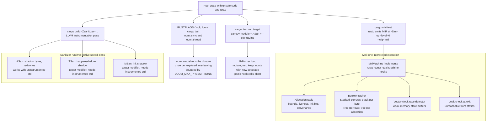
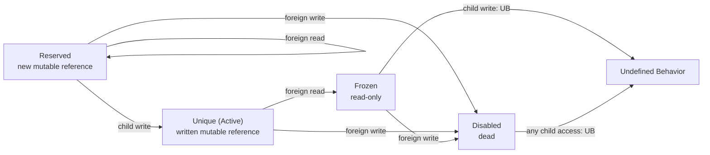

# Rust Miri, Sanitizers, Loom, and Cargo-Fuzz

> [!summary] Claim:
> Miri is an interpreter for rustc's MIR that checks every memory access of one concrete execution against a model of Rust's rules: bounds, liveness, initialization, validity, data races, leaks, and an experimental aliasing model, Stacked Borrows by default or Tree Borrows with `-Zmiri-tree-borrows`.
> Stacked Borrows keeps a per-location stack of permissions and invalidates a `&mut` the moment its parent is read; Tree Borrows keeps a tree whose new `&mut` starts `Reserved`, tolerates foreign reads until its first write, and tracks locations outside the reference's range lazily, so it accepts common patterns that Stacked Borrows rejects.
> Sanitizers instrument native code instead: ASan and LSan work with an uninstrumented std, while TSan and MSan are rustc target modifiers since 1.91 and fail the build unless std is rebuilt with `-Zbuild-std` or taken from the Tier 2 `x86_64-unknown-linux-gnu{asan,msan,tsan}` targets.
> Loom replaces `std::sync` and `std::thread` and enumerates interleavings of a closure under the C11 memory model, and cargo-fuzz drives libFuzzer with SanitizerCoverage and ASan by default; none of the four proves soundness, each only checks the executions it actually explores.



## The Mechanism

Rust's type system makes safe code free of undefined behavior (UB), and `unsafe` moves that obligation onto the programmer.
The four tools in this note check that obligation on executions, not proofs: Miri interprets, sanitizers instrument, Loom enumerates schedules, and cargo-fuzz searches inputs.
Panics and backtraces belong to [[Rust-GDB-LLDB-Panics-and-Backtraces]]; the shadow-memory internals of the LLVM sanitizers belong to [[Cpp-AddressSanitizer-and-LeakSanitizer-Internals]] and [[Cpp-ThreadSanitizer-and-MemorySanitizer-Internals]], which this note summarizes and links rather than re-derives.
Versions used here: stable rustc 1.99.0 and nightly rustc 1.101.0-nightly (12433c307 2026-10-24) with its bundled Miri, cargo-fuzz 0.13.2, on darwin-arm64 (as of 2026-11).

### 1. Miri is rustc's const-eval interpreter with a richer machine

Miri does not compile to machine code.
`cargo miri` builds the crate with extra rustc flags and then interprets the resulting MIR one statement at a time.
`MIRI_DEFAULT_ARGS` in Miri's `src/lib.rs` (master, as of 2026-11) includes `--cfg=miri`, `-Zalways-encode-mir`, `-Zextra-const-ub-checks`, `-Zmir-preserve-ub`, and `-Zmir-opt-level=0`, and it disables the `ReferencePropagation` and `GVN` MIR passes because they are not yet compatible with the aliasing models.
Optimization level 0 and `-Zmir-preserve-ub` exist so that rustc does not optimize the UB away before Miri sees it.

The interpreter core is the one rustc uses for `const` evaluation.
Miri plugs in through `impl<'tcx> Machine<'tcx> for MiriMachine<'tcx>` in `src/machine.rs`, whose hooks include `before_memory_read`, `before_memory_write`, `retag_ptr_value`, `protect_in_place_function_argument`, and `after_stack_push`.
Every pointer carries provenance (an allocation ID plus a borrow tag), every byte carries an initialization bit, and every allocation records whether it is live.
Because a pointer's provenance names its allocation, Miri can tell a dangling pointer from a valid one and reports a use-after-free as "ALLOC has been freed, so this pointer is dangling" instead of reading whatever bytes are there.

What Miri checks, per its README (as of 2026-11):

- Out-of-bounds accesses and use-after-free.
- Use of uninitialized data.
- Violated intrinsic preconditions, such as `unreachable_unchecked` being reached or `copy_nonoverlapping` with overlapping ranges.
- Misaligned accesses and references.
- Broken validity invariants, such as a `bool` that is not 0 or 1 or an invalid enum discriminant.
- Data races, plus some weak-memory effects in which an atomic load returns an outdated value.
- Memory leaks: allocations still live and unreachable from a `static` when the program exits.
- Experimental: Stacked Borrows or Tree Borrows aliasing violations.

What it cannot do, also per the README: it explores one execution per run, so schedule- and layout-dependent bugs can hide; its weak-memory emulation is incomplete, which is why the README points to Loom for complex atomic code; and it cannot prove a crate sound.
FFI is outside the model: `-Zmiri-native-lib=<path>` can call integer- and pointer-only native functions on Unix, but the README calls it experimental and unsound, and Rust code cannot access memory that the native code allocated ("only the other way around").
[[Rust-FFI-Boundary-Debugging-Across-Cpp-and-Python]] owns the debugging of that boundary.

The race detector is a vector-clock detector; `src/concurrency/data_race.rs` cites Lidbury and Donaldson's POPL 2017 dynamic race detection for C++11 and models the C++20 weakening of release sequences.
Thread scheduling is driven by Miri's RNG: preemption can happen at basic-block boundaries with a default rate of 1% (`preemption_rate: 0.01` in `src/eval.rs`), and `-Zmiri-seed` defaults to 0, so a run is reproducible until you change the seed or the program.

### 2. Stacked Borrows: a stack of permissions per byte

Stacked Borrows (Jung, Dang, Kang, Dreyer, POPL 2020) gives every pointer a tag and every memory location a stack of items, each a tag plus a permission.
The Unsafe Code Guidelines specification (`wip/stacked-borrows.md`) defines four permissions: `Unique` ("unique mutable access"), `SharedReadWrite` ("shared mutable access"), `SharedReadOnly` ("shared read-only access"), and `Disabled`, a separator between blocks of `SharedReadWrite`.

A retag, which happens when a reference is created or passed, pushes a new item above its parent:

- A `&mut T` (not two-phase) gets `Unique`.
- A `*mut T` or a two-phase borrow gets `SharedReadWrite`.
- A `&T` gets `SharedReadOnly` outside `UnsafeCell` and `SharedReadWrite` inside it.
- The new item covers exactly the bytes of the pointee type, `size_of::<T>()` from the pointer.

An access through a tag must find a granting item in the stack of every byte it touches:

- A write pops every block above the granting item.
- A read invalidates every `Unique` item above the granting item; the specification describes this as changing them to `Disabled`, and Miri's diagnostic reports the tag as no longer in the borrow stack.
- A function-entry retag adds a protector, and popping a protected item while the call is active is UB.

The rule is simple to state and has two famous costs.
First, reading through a parent kills a child `&mut` even if the child was never written yet, which rejects many real-world `unsafe` blocks and forces the specification to special-case two-phase borrows as `SharedReadWrite` instead of `Unique`.
Second, the range rule means a raw pointer derived from `&mut arr[0]` has no permission for `arr[1]`, so the C idiom of indexing from a first-element pointer is UB.
The lab shows both: `reserved_foreign_read` is invalidated "by a read access", and `write_past_element` was "created by a SharedReadWrite retag at offsets [0x0..0x1]" and then used at offset 1.

### 3. Tree Borrows: a tree of permissions per allocation

Tree Borrows (Villani, Hostert, Dreyer, Jung, PLDI 2025, Distinguished Paper) replaces the stack with a tree of tags per allocation and a small state machine per (tag, location).
Its abstract reports that on the 30,000 most widely used crates, Tree Borrows rejects 54% fewer test cases than Stacked Borrows, and that the authors proved in Rocq that it retains most Stacked Borrows optimizations and enables new ones such as read-read reordering.

An access is a child access for the accessed tag and its descendants, and a foreign access for every other tag.
The states and transitions below are quoted from `src/borrow_tracker/tree_borrows/perms.rs` (Miri master, as of 2026-11), where the paper's `Active` state is named `Unique`:

| State | Represents | Child read | Child write | Foreign read | Foreign write |
| :--- | :--- | :--- | :--- | :--- | :--- |
| `ReservedFrz` | a `&mut` not yet written | stays | becomes `Unique` | stays; sets `conflicted` if protected | becomes `Disabled` |
| `ReservedIM` | a `&mut` to interior-mutable data | stays | becomes `Unique` | stays | stays |
| `Unique` | a `&mut` that has been written | stays | stays | becomes `Frozen` (`Disabled` if protected) | becomes `Disabled` |
| `Frozen` | a `&T` | stays | UB | stays | becomes `Disabled` |
| `Disabled` | a dead pointer | UB | UB | stays | stays |
| `Cell` | a `&T` to interior-mutable data | stays | stays | stays | stays |

A protected `ReservedFrz` with `conflicted` set makes a later child write UB, which is how Tree Borrows keeps the `noalias` guarantees for function arguments.



Two differences from Stacked Borrows matter in practice:

- `Reserved` absorbs foreign reads, so `reserved_foreign_read` in the lab is accepted; a foreign write still disables it, so `reserved_foreign_write` is UB under both models, and the Tree Borrows diagnostic names the transition ("later transitioned to Disabled due to a foreign write access").
- Tree Borrows does not reborrow locations outside the pointee's range; it records enough to initialize them lazily on first access with the permission they would have had, so `write_past_element` is accepted.
  The Tree Borrows write-up (Ranges chapter, read from the 2026-05-11 Internet Archive snapshot because the live host gates automated clients) names the `&array[0] as *const _` plus `ptr.add(_)` pattern as one that was UB under Stacked Borrows in crates including `rand` and `hashbrown`.

Status (as of 2026-11, Both): Stacked Borrows is still Miri's default (`borrow_tracker: Some(BorrowTrackerMethod::StackedBorrows)` in `src/eval.rs`), and the README calls Tree Borrows "even more experimental".
Neither model is part of the Rust language specification; both are candidates, and code accepted by either today could be declared UB later.
`-Zmiri-tree-borrows-implicit-writes` makes Tree Borrows stricter by treating `&mut` arguments as written, and `-Zmiri-tree-borrows-no-precise-interior-mut` makes it more permissive.

### 4. Sanitizers in Rust: `-Zsanitizer`, target modifiers, and prebuilt std

`-Zsanitizer=<name>` is nightly-only; neither stable 1.99.0 nor nightly 1.101 accepts a `-C sanitizer` codegen option (checked locally, as of 2026-11).
The flag runs the same LLVM instrumentation passes Clang uses and links a runtime shipped in the sysroot: on darwin-arm64 nightly the directory holds `librustc-nightly_rt.asan.dylib`, `.lsan.dylib`, `.tsan.dylib`, and `.rtsan.dylib`.
The Unstable Book lists the supported targets per sanitizer, and the target spec agrees: `rustc +nightly -Z unstable-options --print target-spec-json --target aarch64-apple-darwin` reports `supported-sanitizers: [address, thread, cfi, realtime]`.

The key change for Rust users is that some sanitizers became target modifiers.
RFC 3716 defines a target modifier as a flag where "it may be unsound if you link together two compilation units that disagree on the flag", and rustc fails the build when it sees two Rust crates that disagree.
PR 138736 (merged 2025-09-05, milestone 1.91.0) made every sanitizer a target modifier "except for these: AddressSanitizer, LeakSanitizer".
The consequence, reproduced by the lab on nightly 1.101:

- `-Zsanitizer=address` builds against the prebuilt, uninstrumented std and finds the heap use-after-free; the Unstable Book says ASan "works with non-instrumented code although it will impede its ability to detect some bugs".
- `-Zsanitizer=thread` without `-Zbuild-std` fails: "error: mixing `-Zsanitizer` will cause an ABI mismatch in crate `miri_tree_borrows`".
  rustc repeats the error once per prebuilt sysroot crate built without the flag, 19 times on this nightly, from `std`, `core`, and `alloc` through `panic_unwind` (full stderr read by hand, as of 2026-11; the lab prints only the first line).
- With `-Zbuild-std --target <host>`, the TSan build links and reports the race in 5 of 5 runs.
- The escape hatch `-Cunsafe-allow-abi-mismatch=sanitizer` exists, and RFC 3716 calls it unsafe because "incorrect use of the ABI is undefined behavior".

The other route is a target whose std is already instrumented.
`x86_64-unknown-linux-gnuasan`, `-gnumsan`, and `-gnutsan` are Tier 2 targets without host tools that mirror `x86_64-unknown-linux-gnu` with the sanitizer enabled by default; their platform-support page says the goal is "a fully instrumented binary without requiring nightly features (build-std)" and that they will be removed once build-std stabilizes.
The stable dist manifests show `rust-std` for `x86_64-unknown-linux-gnuasan` first in 1.95.0 and for `-gnumsan` and `-gnutsan` first in 1.96.0, and all three are available for 1.99.1 (as of 2026-11, Linux x86-64 only).
They came out of compiler-team MCP 943, which first proposed `lib-asan/` sysroot variants and was superseded by the separate-target design.

Runtime behavior worth knowing:

- compiler-rt's `sanitizer_flags.inc` defaults `abort_on_error` to true on Apple and Android platforms and false elsewhere, and the common `exitcode` to 1, which `tsan_flags.cpp` overrides to 66.
  On darwin-arm64 a report therefore ends in SIGABRT and exit status 134; with `TSAN_OPTIONS=abort_on_error=0` the lab's TSan run exits 66.
- ASan's leak checking is on by default on Linux and needs `ASAN_OPTIONS=detect_leaks=1` on macOS, per the Unstable Book; the lab's leak case then exits 1 with "ERROR: LeakSanitizer: detected memory leaks".
  It exits 1 and not 134 because `HandleLeaks()` in compiler-rt's `lsan_common_mac.cpp` is empty: on Darwin the runtime does not call `Die()` for a leak, so `abort_on_error` never applies, and the failing `exitcode` is returned when the process exits.
- Standalone `-Zsanitizer=leak` is listed for `aarch64-unknown-linux-gnu`, `x86_64-apple-darwin`, and `x86_64-unknown-linux-gnu`, not for `aarch64-apple-darwin`.
- MemorySanitizer "requires all program code to be instrumented", including C and C++ dependencies built with Clang `-fsanitize=memory`, or it reports false positives.
- TSan does not support `std::sync::atomic::fence` or synchronization done in inline assembly.
- Always pass `--target`, so that `RUSTFLAGS` does not instrument build scripts and proc macros.

The Unstable Book's sanitizer chapter lists AddressSanitizer, LeakSanitizer, MemorySanitizer, ThreadSanitizer, and others such as HWAddressSanitizer, DataFlowSanitizer, MemTagSanitizer, and RealtimeSanitizer, but no UndefinedBehaviorSanitizer (as of 2026-11), so the C++ habit of pairing ASan with UBSan has no `-Zsanitizer` counterpart; Miri covers that ground for Rust.

Sanitizers see machine-level events, not Rust's abstract rules.
ASan cannot see any of the four aliasing cases in the lab, the uninitialized `i32`, or the data race, because none of them touches a redzone or freed memory.
Optimizations can also remove a UB access before ASan sees it, while Miri runs MIR at opt-level 0.

### 5. Loom: enumerating interleavings of a closure

Loom (`loom` 0.7.3, as of 2026-11) is a permutation tester: `loom::model(|| ...)` runs the closure many times, each under a different schedule allowed by the C11 memory model, and its README credits the state-reduction techniques of CDSChecker (Norris and Demsky) for avoiding combinatorial explosion.
It only sees operations on its own types, so code under test swaps `std::sync`, `std::sync::atomic`, `std::cell::UnsafeCell`, and `std::thread` for the `loom::` versions behind `#[cfg(loom)]`, and runs with `RUSTFLAGS="--cfg loom" cargo test --release`.

```rust
// Not executed in this note's lab: it needs the loom crate from crates.io.
#[cfg(loom)]
#[test]
fn counter_is_not_lost() {
    use loom::sync::Arc;
    use loom::sync::atomic::{AtomicUsize, Ordering};
    use loom::thread;

    loom::model(|| {
        let n = Arc::new(AtomicUsize::new(0));
        let n2 = n.clone();
        let t = thread::spawn(move || {
            let v = n2.load(Ordering::SeqCst);
            n2.store(v + 1, Ordering::SeqCst); // load then store: not a read-modify-write
        });
        let v = n.load(Ordering::SeqCst);
        n.store(v + 1, Ordering::SeqCst);
        t.join().unwrap();
        assert_eq!(n.load(Ordering::SeqCst), 2); // fails in the schedule where both loads see 0
    });
}
```

The bug is a lost update with no UB at all: every access is atomic, so Miri's race detector and TSan have nothing to report, and Miri finds the failure only if its random preemptions happen to land between a load and its store.
Loom explores the schedules systematically and fails the assertion deterministically; replacing the pair with `fetch_add(1, Ordering::SeqCst)` makes every schedule pass.
Checked outside the lab with `loom` 0.7.3 on stable 1.99.0 (as of 2026-11): the test above failed with `left: 1, right: 2` in 3 of 3 runs, and the `fetch_add` version passed.

Loom's knobs, from `src/model.rs` and `src/rt/mod.rs` (master, as of 2026-11):

- `preemption_bound`, from `LOOM_MAX_PREEMPTIONS`, default unbounded; the docs say 2 or 3 usually catches most bugs.
- `max_branches`, from `LOOM_MAX_BRANCHES`, default 1,000 thread switches per execution.
- `max_permutations` (`LOOM_MAX_PERMUTATIONS`) and `max_duration` (`LOOM_MAX_DURATION`, seconds), both unbounded by default.
- `checkpoint_file` (`LOOM_CHECKPOINT_FILE`) and `checkpoint_interval` (`LOOM_CHECKPOINT_INTERVAL`, default 20,000) for resuming long runs; both need the crate's `checkpoint` feature, and without it a set checkpoint file panics with "not compiled with `checkpoint` feature".
- `MAX_THREADS = 5`, and `LOOM_LOG` and `LOOM_LOCATION` for schedule and location tracing.

Its documented limits: it cannot produce every reordering that `Relaxed` allows, dependencies with their own concurrency must also support Loom, and the number of executions grows quickly with threads and operations.

### 6. cargo-fuzz: libFuzzer plus SanitizerCoverage plus ASan

cargo-fuzz is not a fuzzer; the Rust Fuzz Book calls it "a tool to invoke a fuzzer", and libFuzzer through the `libfuzzer-sys` crate (0.4.13) is the only supported engine.
`cargo fuzz init` creates `fuzz/Cargo.toml` (with `[package.metadata] cargo-fuzz = true` and a `libfuzzer-sys = "0.4"` dependency) and `fuzz/fuzz_targets/fuzz_target_1.rs` holding `fuzz_target!(|data: &[u8]| { ... })`.
The subcommands are `init`, `add`, `build`, `check`, `run`, `fmt`, `list`, `cmin` (minify a corpus), `tmin` (minify one test case), and `coverage` (run the corpus and produce coverage information), per `src/main.rs` (as of 2026-11).
Crashing inputs land under `fuzz/artifacts/<target>/crash-<sha1>`, and `cargo fuzz run <target> <artifact>` replays one.

`src/project.rs` in cargo-fuzz (as of 2026-11) shows what a default fuzz build adds to `RUSTFLAGS`, in this order; a failing `cargo +nightly fuzz build -s thread` on darwin-arm64 printed the same list with `-Zsanitizer=thread` in the sanitizer slot:

```text
-Cpasses=sancov-module
-Cllvm-args=-sanitizer-coverage-level=4
-Cllvm-args=-sanitizer-coverage-inline-8bit-counters
-Cllvm-args=-sanitizer-coverage-pc-table
-Cllvm-args=-sanitizer-coverage-trace-compares     (unless --no-trace-compares)
--cfg fuzzing                                       (unless --no-cfg-fuzzing)
-Cllvm-args=-simplifycfg-branch-fold-threshold=0    (unless --disable-branch-folding=false)
-Zsanitizer=address                                 (the default -s/--sanitizer)
-Cllvm-args=-sanitizer-coverage-stack-depth         (Linux targets only)
-Cdebug-assertions                                  (unless -O without -a)
-Ccodegen-units=1                                   (unless -D or --codegen-units)
```

It also sets `ASAN_OPTIONS=detect_odr_violation=0` and `TSAN_OPTIONS=report_signal_unsafe=0` when running, and passes `-Zbuild-std` only for `-s memory`, `--build-std`, or `--careful`.
The `--build-std` help text says the option "defaults to true", but `src/options.rs` declares it as a plain `bool` with no default value, so it is off unless passed (as of 0.13.2).

`libfuzzer-sys` exports `LLVMFuzzerTestOneInput`, installs a panic hook that calls `std::process::abort()`, so libFuzzer sees a panic as a crash, and maps `Corpus::Reject` to the libFuzzer return value -1, which keeps the input out of the corpus.
A typed target `fuzz_target!(|v: MyType| ...)` decodes the bytes with the `arbitrary` crate's `Arbitrary` trait (1.5.0, as of 2026-11), and `RUST_LIBFUZZER_DEBUG_PATH` makes the target write the `Debug` form of each decoded input.

The LLVM documentation states that libFuzzer's original authors stopped active work on it and moved to Centipede; it is still "fully supported in that important bugs will get fixed", without major new features.
Engine internals and AFL++ belong to [[Cpp-Clang-Tidy-Static-Analyzer-and-Fuzzing-libFuzzer-AFLPlusPlus]].

## Commands and Numbers to Know

| Item | Value | Platform and date | What it controls |
| :--- | :--- | :--- | :--- |
| Install Miri | `rustup +nightly component add miri` then `cargo miri setup` | Both (as of 2026-11) | Miri ships only on nightly; setup builds the Miri sysroot ahead of CI |
| `cargo miri test` / `cargo miri run` | same flags as `cargo test` / `cargo run` | Both (as of 2026-11) | Interprets the test or binary |
| `MIRIFLAGS` | e.g. `MIRIFLAGS=-Zmiri-tree-borrows` | Both (as of 2026-11) | How flags reach Miri |
| Default aliasing model | Stacked Borrows | Both (as of 2026-11) | `-Zmiri-tree-borrows` switches to Tree Borrows |
| `-Zmiri-disable-stacked-borrows` | aliasing checks off | Both (as of 2026-11) | Unsound; faster |
| `-Zmiri-seed` | default `0` | Both (as of 2026-11) | Addresses, `compare_exchange_weak` failures, store buffering |
| `-Zmiri-many-seeds` | default range `0..64` | Both (as of 2026-11) | Runs many seeds; README warns it can be slow |
| `-Zmiri-preemption-rate` | default `0.01` | Both (as of 2026-11) | Preemption probability per basic block |
| `-Zmiri-backtrace` | default `1` (pruned); `full`, `0` | Both (as of 2026-11) | Backtrace detail in reports |
| `-Zmiri-disable-isolation` | isolation on by default | Both (as of 2026-11) | Host env, files, clock, randomness; not a security sandbox |
| `-Zmiri-ignore-leaks` | leak check on by default | Both (as of 2026-11) | Also lets threads outlive `main` |
| `-Zmiri-strict-provenance` | off | Both (as of 2026-11) | Rejects integer-to-pointer casts |
| `cfg(miri)` | set under Miri | Both (as of 2026-11) | `#[cfg_attr(miri, ignore)]` skips slow or FFI tests |
| `-Zsanitizer=address` | nightly only, no `-Zbuild-std` required | Both (as of 2026-11) | Not a target modifier; std stays uninstrumented |
| `-Zsanitizer=thread` / `memory` | target modifiers since 1.91 | Both (as of 2026-11) | Need `-Zbuild-std` or a `*-gnu{t,m}san` target |
| `x86_64-unknown-linux-gnuasan` | Tier 2, std only, since 1.95.0 | Linux (as of 2026-11) | Prebuilt ASan std on stable |
| `x86_64-unknown-linux-gnumsan` / `-gnutsan` | Tier 2, std only, since 1.96.0 | Linux (as of 2026-11) | Prebuilt MSan and TSan std on stable |
| `abort_on_error` | `1` on Darwin | macOS (as of 2026-11) | Reports end in SIGABRT, exit 134 |
| TSan `exitcode` | `66` | Both (as of 2026-11) | Exit status when a race was reported and abort is off |
| `ASAN_OPTIONS=detect_leaks=1` | needed on macOS, default on Linux | Both (as of 2026-11) | Leak report at exit |
| `LOOM_MAX_PREEMPTIONS` | unbounded; 2 or 3 suggested | Both (as of 2026-11) | Preemption bound |
| `LOOM_MAX_BRANCHES` | `1000` | Both (as of 2026-11) | Thread switches per execution |
| Loom `MAX_THREADS` | `5` | Both (as of 2026-11) | Hard cap on threads in one model |
| `cargo fuzz run -s` | default `address`; `leak`, `memory`, `thread`, `none` | Both (as of 2026-11) | Sanitizer for the fuzz build |
| `cargo fuzz run` profile | release optimizations plus `-Cdebug-assertions` | Both (as of 2026-11) | `-O` drops debug assertions, `-D` drops optimizations |
| libFuzzer `-timeout` | `1200` seconds | Both (as of 2026-11) | Per-input timeout |
| libFuzzer `-rss_limit_mb` | `2048` | Both (as of 2026-11) | Memory cap; out-of-memory exits 71 |
| libFuzzer `-runs` / `-max_total_time` | `-1` / `0` (run forever) | Both (as of 2026-11) | Bound a CI run with `cargo fuzz run t -- -max_total_time=300` |

## Multi-Language Comparison: C++ / Python / Rust

| Concern | C++ | Python | Rust |
| :--- | :--- | :--- | :--- |
| Abstract-machine UB interpreter | No mainstream equivalent; UBSan and constexpr evaluation catch subsets | Not needed for pure Python; C extensions are C | Miri over MIR, including aliasing models |
| Aliasing rules checked | Strict aliasing is not checked dynamically | None | Stacked Borrows or Tree Borrows in Miri |
| Memory errors at native speed | `-fsanitize=address`, [[Cpp-AddressSanitizer-and-LeakSanitizer-Internals\|ASan internals]] | CPython `./configure --with-address-sanitizer` for interpreter and extensions | `-Zsanitizer=address` or `x86_64-unknown-linux-gnuasan` |
| Data races | TSan, [[Cpp-ThreadSanitizer-and-MemorySanitizer-Internals\|TSan internals]] | CPython `--with-thread-sanitizer`, relevant for free-threaded builds | Miri race detector; TSan with `-Zbuild-std` or `-gnutsan` |
| Uninitialized reads | MSan | CPython `--with-memory-sanitizer` | Miri; MSan with instrumented std |
| Schedule enumeration | Model checkers such as CDSChecker, which Loom cites | None in common use | Loom |
| Coverage-guided fuzzing | libFuzzer, AFL++ | Atheris (3.1.0 on PyPI, as of 2026-11) | cargo-fuzz over libFuzzer |
| Property-based testing | RapidCheck | Hypothesis, [[Python-Hypothesis-and-Type-Checkers-as-Bug-Prevention]] | proptest, quickcheck |

The Rust column differs in one structural way: safe Rust has no UB, so these tools only need to cover the `unsafe` code and what it reaches, and Miri can check rules that do not exist in C++ at all.

## Worked Lab Example

The lab is `code/03-Debugging/miri_tree_borrows/`; it needs the nightly toolchain with the `miri` and `rust-src` components and runs every cargo command with `--offline`.
The `-Zbuild-std` step therefore needs the standard library's dependencies in the local cargo registry cache: with an empty `CARGO_HOME` it stops with "no matching package named `cfg-if` found", and one online `cargo +nightly miri setup` downloads them (both checked, as of 2026-11).

`src/main.rs` holds eight one-function programs selected by `argv[1]`:

1. `reserved_foreign_read`: make `r = &mut *base`, read through `base`, then write through `r`.
2. `reserved_foreign_write`: the same, but write through `base` before writing through `r`.
3. `write_past_element`: write `arr[1]` through a raw pointer derived from `&mut arr[0]`.
4. `write_through_shared`: cast `&x` to `*mut` and write.
5. `use_after_free`: read a `Box` after `drop`.
6. `uninit_read`: `MaybeUninit::<i32>::uninit().assume_init()`.
7. `leak`: `std::mem::forget(Box::new(5))`.
8. `data_race`: two threads increment a `static mut`.

`run.sh` runs all eight natively, under Miri with each aliasing model, under Miri with aliasing checks turned off as a control, and under ASan; then it builds the TSan variant twice, without and with `-Zbuild-std`.
Miri's tag and allocation numbers (`<1755>`, `alloc819`) shift with any change to the program or std, so the script rewrites them to `<TAG>` and `ALLOC` and prints only the error line and the provenance notes.

```bash
cd code/03-Debugging/miri_tree_borrows
bash run.sh
```

### Verified output

Recorded by `python3 -m _harness.verify --record` on darwin-arm64 on 2026-11-08 with nightly rustc 1.101.0-nightly (12433c307 2026-10-24), then re-checked twice with `python3 -m _harness.verify`; the file is `code/03-Debugging/miri_tree_borrows/expected/darwin-arm64.txt`.

```text
== 1. Native debug build: no checker, every case runs to completion
  reserved_foreign_read: exit 0
  reserved_foreign_write: exit 0
  write_past_element: exit 0
  write_through_shared: exit 0
  use_after_free: exit 0
  uninit_read: exit 0
  leak: exit 0
  data_race: exit 0

== 2. Miri, default aliasing model (Stacked Borrows)
  reserved_foreign_read: exit 1
    error: Undefined Behavior: attempting a write access using <TAG> at ALLOC[0x0], but that tag does not exist in the borrow stack for this location
    help: <TAG> was created by a Unique retag at offsets [0x0..0x4]
    help: <TAG> was later invalidated at offsets [0x0..0x4] by a read access
  reserved_foreign_write: exit 1
    error: Undefined Behavior: attempting a write access using <TAG> at ALLOC[0x0], but that tag does not exist in the borrow stack for this location
    help: <TAG> was created by a Unique retag at offsets [0x0..0x4]
    help: <TAG> was later invalidated at offsets [0x0..0x4] by a write access
  write_past_element: exit 1
    error: Undefined Behavior: attempting a write access using <TAG> at ALLOC[0x1], but that tag does not exist in the borrow stack for this location
    help: <TAG> was created by a SharedReadWrite retag at offsets [0x0..0x1]
  write_through_shared: exit 1
    error: Undefined Behavior: attempting a write access using <TAG> at ALLOC[0x0], but that tag only grants SharedReadOnly permission for this location
    help: <TAG> was created by a SharedReadOnly retag at offsets [0x0..0x4]
  use_after_free: exit 1
    error: Undefined Behavior: memory access failed: ALLOC has been freed, so this pointer is dangling
  uninit_read: exit 1
    error: Undefined Behavior: constructing invalid value of type i32: encountered uninitialized memory, but expected an integer
  leak: exit 1
    error: memory leaked: ALLOC (Rust heap, size: 4, align: 4), allocated here:
  data_race: exit 1
    error: Undefined Behavior: Data race detected between (1) non-atomic write on thread `main` and (2) non-atomic read on thread `unnamed-1` at ALLOC

== 3. Miri, -Zmiri-tree-borrows
  reserved_foreign_read: accepted (exit 0)
  reserved_foreign_write: exit 1
    error: Undefined Behavior: write access through <TAG> at ALLOC[0x0] is forbidden
    help: the accessed tag <TAG> has state Disabled which forbids this child write access
    help: the accessed tag <TAG> was created here, in the initial state Reserved
    help: the accessed tag <TAG> later transitioned to Disabled due to a foreign write access at offsets [0x0..0x4]
  write_past_element: accepted (exit 0)
  write_through_shared: exit 1
    error: Undefined Behavior: write access through <TAG> at ALLOC[0x0] is forbidden
    help: the accessed tag <TAG> has state Frozen which forbids this child write access
    help: the accessed tag <TAG> was created here, in the initial state Frozen
  use_after_free: exit 1
    error: Undefined Behavior: memory access failed: ALLOC has been freed, so this pointer is dangling
  uninit_read: exit 1
    error: Undefined Behavior: constructing invalid value of type i32: encountered uninitialized memory, but expected an integer
  leak: exit 1
    error: memory leaked: ALLOC (Rust heap, size: 4, align: 4), allocated here:
  data_race: exit 1
    error: Undefined Behavior: Data race detected between (1) non-atomic write on thread `main` and (2) non-atomic read on thread `unnamed-1` at ALLOC

== 4. Control: Miri with -Zmiri-disable-stacked-borrows (aliasing checks off)
  reserved_foreign_read: accepted (exit 0)
  reserved_foreign_write: accepted (exit 0)
  write_past_element: accepted (exit 0)
  write_through_shared: accepted (exit 0)

== 5. AddressSanitizer (-Zsanitizer=address, std not rebuilt, ASAN_OPTIONS=detect_leaks=1)
  reserved_foreign_read: exit 0, no report
  reserved_foreign_write: exit 0, no report
  write_past_element: exit 0, no report
  write_through_shared: exit 0, no report
  use_after_free: exit 134, ERROR: AddressSanitizer: heap-use-after-free
  uninit_read: exit 0, no report
  leak: exit 1, ERROR: LeakSanitizer: detected memory leaks
  data_race: exit 0, no report

== 6. ThreadSanitizer on data_race
  without -Zbuild-std:
    build exit 101
    error: mixing `-Zsanitizer` will cause an ABI mismatch in crate `miri_tree_borrows`
  with -Zbuild-std (std rebuilt with TSan):
    exit status of the last run: 134
    runs reporting 'WARNING: ThreadSanitizer: data race': 5/5
    with TSAN_OPTIONS=abort_on_error=0: exit 66
    control, single-threaded reserved_foreign_read: exit 0, 0 reports
```

### Reading the result

- Section 1 is the reason these tools exist: all eight programs contain UB or a leak, and every one exits 0 natively.
- Sections 2 and 3 differ in exactly two rows, `reserved_foreign_read` and `write_past_element`, the two patterns Tree Borrows was designed to accept: the `Reserved` state and lazy out-of-range permissions.
- Stacked Borrows' `write_past_element` note shows the range rule directly: the raw pointer's item covers `[0x0..0x1]`, one byte, and the write is at `[0x1]`.
- The Tree Borrows diagnostics name the state machine: `Reserved` then `Disabled` after a foreign write, and `Frozen` from creation for a shared reference.
- Section 4 is the control: with the borrow tracker off, the four aliasing cases pass, so the aliasing model, not some other Miri check, produced every aliasing report in sections 2 and 3.
- The five non-aliasing cases are identical under both models, because liveness, initialization, leaks, and races do not depend on the borrow tracker.
- Section 5 shows ASan's blind spots: it catches only the freed-memory read and, with `detect_leaks=1`, the leak; the aliasing cases are in-bounds writes to live memory, which is all ASan can see.
- Exit 134 is 128 + SIGABRT from Darwin's `abort_on_error=1` default, the leak report exits 1 because Darwin's LSan does not call `Die()` for a leak and returns the common `exitcode` of 1 at process exit instead, and turning abort off restores TSan's `exitcode` of 66.
- Section 6 shows the target-modifier rule from PR 138736 in action: rustc refuses to build the TSan-instrumented crate against the uninstrumented prebuilt std crates until std is rebuilt.

## Pitfalls

> [!warning] Pitfall: reading "Miri passed" as "sound"
> Miri checks one execution with one seed, one schedule, and one set of inputs.
> Run the tests that cover the `unsafe` paths, add `-Zmiri-many-seeds` for concurrent code, and treat a pass as evidence about those paths only.

> [!warning] Pitfall: picking the aliasing model that makes the test green
> Tree Borrows accepting a pattern that Stacked Borrows rejects does not make the pattern defined Rust; neither model is normative yet.
> If code needs Tree Borrows to pass, say so in a comment and in CI, and prefer rewriting it so that it passes both, for example by deriving every pointer from one raw base pointer.

> [!warning] Pitfall: TSan or MSan without an instrumented std
> Since rustc 1.91 these are target modifiers, so a plain `RUSTFLAGS=-Zsanitizer=thread cargo build` fails with "mixing `-Zsanitizer` will cause an ABI mismatch".
> `-Cunsafe-allow-abi-mismatch=sanitizer` silences it and reintroduces false positives and UB; use `-Zbuild-std --target <triple>` or the `x86_64-unknown-linux-gnutsan` and `-gnumsan` targets.

> [!warning] Pitfall: trusting the `cargo fuzz --build-std` help text
> cargo-fuzz 0.13.2 says `--build-std` defaults to true, but the code makes it false unless passed, and only `-s memory` and `--careful` add `-Zbuild-std` on their own.
> Checked outside the lab on nightly 1.101 (as of 2026-11, macOS): `cargo +nightly fuzz build -s thread` without `--build-std` fails the same ABI check, "mixing `-Zsanitizer` will cause an ABI mismatch", while the default `-s address` build succeeds.

> [!warning] Pitfall: forgetting `--target` with sanitizer RUSTFLAGS
> Without an explicit `--target`, cargo applies `RUSTFLAGS` to build scripts and proc macros too, which then load sanitizer runtimes inside the compiler's process.
> The Unstable Book's advice is to always pass `--target`.

> [!warning] Pitfall: expecting Miri to cover FFI and inline assembly
> Miri cannot execute foreign functions except through the unsound `-Zmiri-native-lib`, so tests that cross into C or C++ must be skipped with `#[cfg_attr(miri, ignore)]` and covered by ASan instead.
> TSan likewise ignores synchronization done in inline assembly and does not support `atomic::fence`.

> [!warning] Pitfall: Loom models that leak `std` types
> Loom sees only `loom::` primitives, so a `std::sync::Mutex` or a dependency's own atomics inside the model are invisible to it and its "all schedules pass" is meaningless.
> Gate every primitive behind `#[cfg(loom)]`, and set a preemption bound before a model with many operations runs for hours.

> [!warning] Pitfall: CI scripts keyed to a single sanitizer exit code
> By compiler-rt's defaults the same ASan report exits 134 on macOS (abort, run here) and 1 on Linux (`asan_flags.cpp` sets `exitcode = 1` and `abort_on_error` is false off Apple and Android; read from source, not run here), TSan uses 66 once abort is off, and libFuzzer's out-of-memory exit is 71.
> Gate CI on "nonzero plus a sanitizer banner in stderr", or pin `abort_on_error` and `exitcode` explicitly.

## At Scale

For one developer, the right default is `cargo miri test` on any crate with `unsafe`, ASan for anything with FFI, and a fuzz target for every parser.
The cost structure changes with the fleet.

- Miri is an interpreter running unoptimized MIR, so it is much slower than native tests (this note has no measured factor), and the slowdown multiplies by `-Zmiri-many-seeds`.
  Run it on the subset of tests that exercise `unsafe`, mark the rest `#[cfg_attr(miri, ignore)]`, and use `cargo miri nextest run` when per-test isolation and parallelism outweigh per-test recompilation.
- Miri needs nightly, so pin the nightly date in CI and bump it deliberately; diagnostics text and model details change between nightlies, which is why the lab's expected output is pinned too.
- TSan and MSan builds rebuild std, which costs a full std compile per configuration; the Tier 2 `x86_64-unknown-linux-gnu{asan,msan,tsan}` targets remove that cost on stable Linux x86-64.
- Fuzzing is open-ended; a PR gate can only replay the corpus and fuzz for a bounded time, so continuous fuzzing belongs on dedicated machines with corpus storage, deduplication of crashes, and minimized reproducers (`cargo fuzz tmin`, `cargo fuzz cmin`).

Decision rules:

- Any crate with `unsafe`: Miri on every PR under the default model, plus a scheduled Tree Borrows run; a crate that passes only one model gets an owner and a ticket.
- Any concurrent data structure built on atomics: Loom models with a preemption bound of 2 or 3 in CI and an unbounded or higher-bound run on a schedule; Miri with `-Zmiri-many-seeds` as a second, cheaper net.
- Any FFI or C and C++ dependency: ASan on every PR (no std rebuild needed), TSan and MSan nightly through `-Zbuild-std` or the sanitizer targets.
- Any parser, decoder, or deserializer of untrusted bytes: a cargo-fuzz target with a round-trip or differential oracle, a checked-in seed corpus, and continuous fuzzing.
- From roughly 1,000 to 50,000 engineers, make these a paved road: a shared CI template per tier, one pinned nightly for Miri, and a policy record in [[Debugging-Decision-Records]] that says which model and which sanitizers gate merges.

## Practice Drill

> [!tip] Practice Drill:
> Copy the lab and predict, before running, the Stacked Borrows and Tree Borrows verdicts for three variants.
> First, in `reserved_foreign_read`, move the read of `base` to after `*r = 7` and before a second `*r = 8`: the `&mut` is now `Unique`, so the foreign read freezes it under Tree Borrows and the second write must fail under both models.
> Second, in `write_past_element`, derive `p` from `arr.as_mut_ptr()` instead of `&mut arr[0]`: the pointer's range is now the whole array, so both models must accept it.
> Third, wrap `x` in `std::cell::Cell` in `write_through_shared` and write with `Cell::set`: the reference starts as `Cell` in Tree Borrows and `SharedReadWrite` in Stacked Borrows, so both accept.
> Then run `MIRIFLAGS="-Zmiri-many-seeds=0..16" cargo +nightly miri run -- data_race` and confirm every seed reports the race, and explain why the race does not need a lucky schedule to be found.

## Interview Questions

> [!question] L5: What classes of bugs does Miri detect, and what is the most important limitation of a clean Miri run?
>
> > [!success]- Answer
> > Out-of-bounds and use-after-free accesses, uninitialized reads, misaligned accesses, invalid values such as a `bool` holding 2, violated intrinsic preconditions, data races and some weak-memory effects, leaks of memory unreachable from statics, and, experimentally, Stacked Borrows or Tree Borrows aliasing violations.
> > The limitation is that it checks only the execution it ran: one input, one seed, one schedule, and only Rust code, since FFI is outside the model.
> > A clean run is evidence about the paths the tests executed, not a proof that the crate is sound.

> [!question] L5: Predict the output: when `write_past_element` writes `arr[1]` through a raw pointer derived from `&mut arr[0]`, what do a native run, ASan, Miri with Stacked Borrows, and Miri with Tree Borrows report?
>
> > [!success]- Answer
> > Native: exit 0, nothing reported.
> > ASan: no report, because `arr[1]` is inside a live stack allocation and touches no redzone.
> > Stacked Borrows: UB, "attempting a write access ... at ALLOC[0x1], but that tag does not exist in the borrow stack", because the pointer was "created by a SharedReadWrite retag at offsets [0x0..0x1]", covering one byte.
> > Tree Borrows: accepted, because locations outside a reference's range are tracked lazily and initialized on first access with the permission they would have had.
> > The portable fix is `arr.as_mut_ptr()`, whose range is the whole array.

> [!question] L6: Why is `let r = &mut *base; base.read(); *r = 7;` UB under Stacked Borrows but accepted under Tree Borrows, while replacing the read with a write is UB under both?
>
> > [!success]- Answer
> > Under Stacked Borrows, `r` is a `Unique` item above `base`'s item; the read through `base` uses the lower item and invalidates every `Unique` above it, so the later write through `r` finds no granting item.
> > Under Tree Borrows, `r` starts as `Reserved`, which allows foreign reads and only becomes `Unique` (the paper's `Active`) on its first child write, so the write succeeds.
> > A foreign write moves `Reserved` to `Disabled` in Tree Borrows, and pops `r` in Stacked Borrows, so the write version fails under both, and the Tree Borrows diagnostic names the "transition to Disabled due to a foreign write access".
> > This is the two-phase-borrow pattern that motivated `Reserved`.

> [!question] L6: Debug this: CI adds `RUSTFLAGS=-Zsanitizer=thread cargo +nightly test --target x86_64-unknown-linux-gnu`, every build fails with "mixing `-Zsanitizer` will cause an ABI mismatch" while the ASan job with the same shape works, so what happened and what is the fix?
>
> > [!success]- Answer
> > Since rustc 1.91 (PR 138736), every sanitizer except AddressSanitizer and LeakSanitizer is a target modifier, so rustc refuses to build a TSan-instrumented crate against the prebuilt std crates such as `std`, `core`, and `panic_unwind`, which were built without it.
> > ASan is exempt because it tolerates uninstrumented code at the cost of missing some bugs.
> > Fix it with `-Zbuild-std` and an explicit `--target`, or, on stable Linux x86-64 from 1.96.0, build for `x86_64-unknown-linux-gnutsan`, whose std ships instrumented.
> > Do not reach for `-Cunsafe-allow-abi-mismatch=sanitizer`: RFC 3716 says incorrect use is UB, and an uninstrumented std brings back TSan false positives.

> [!question] L6: When a teammate says ASan is enough and Miri is unnecessary, which three concrete bugs does ASan miss that Miri finds, and which one does ASan find that Miri cannot?
>
> > [!success]- Answer
> > ASan misses aliasing violations such as writing through a pointer derived from `&T`, uninitialized reads such as `MaybeUninit::uninit().assume_init()`, and data races, all of which the lab shows with "no report" under ASan and an error under Miri.
> > It also misses invalid values and misaligned references, which touch valid memory.
> > Miri cannot execute FFI, so a heap overflow inside a C library called from Rust is ASan's job, and ASan runs at native speed on real workloads where Miri would be far too slow.

> [!question] L7: For a lock-free SPSC queue built on `AtomicUsize` with `Acquire` and `Release`, how do you divide the verification between Miri, TSan, and Loom, and what does each leave uncovered?
>
> > [!success]- Answer
> > Loom is the primary tool: model one producer and one consumer pushing and popping a few items under `loom::model`, with `LOOM_MAX_PREEMPTIONS` at 2 or 3 in CI, and assert FIFO order and no lost or duplicated items; it enumerates schedules under the C11 model but cannot produce every `Relaxed` reordering and sees only `loom::` types.
> > Miri runs the ordinary unit tests and checks the `unsafe` slot reads and writes for aliasing, initialization, and races on the non-atomic buffer, but it samples one schedule per seed and its weak-memory emulation is incomplete, so use `-Zmiri-many-seeds`.
> > TSan runs the real queue under load at native speed and catches races that need many operations to show up, but it reports only races, not logic errors, and needs an instrumented std.
> > What none of them gives you is a proof; the remaining gap is closed by keeping the protocol small and documented in a comment that states the happens-before edges.

> [!question] L7: Design the oracle for fuzzing a binary message decoder with cargo-fuzz, and explain how panics, rejected inputs, and typed inputs work in `libfuzzer-sys`.
>
> > [!success]- Answer
> > The strongest cheap oracles are round-trip (decode then encode then decode yields the same value), differential (compare against a reference implementation), and invariant checks on the decoded value, all of which turn wrong answers into crashes.
> > `libfuzzer-sys` installs a panic hook that calls `std::process::abort()`, so any panic, `assert!`, or debug-assertion overflow becomes a libFuzzer crash, and cargo-fuzz builds with `-Cdebug-assertions` by default.
> > Returning `Corpus::Reject` returns -1 to libFuzzer, which keeps uninteresting inputs out of the corpus.
> > A typed target `fuzz_target!(|msg: Message| ...)` decodes bytes through `Arbitrary`, which is right for structure-aware fuzzing of an API, while a `&[u8]` target is right for the decoder itself, because the attacker controls bytes, not values.
> > Set `-max_total_time` for PR runs, keep a seed corpus, and minimize crashes with `cargo fuzz tmin`.

> [!question] L8+: Write the memory-safety testing policy for a 5,000-engineer Rust organization with about 200 crates containing `unsafe`.
>
> > [!success]- Answer
> > Tier the gates by risk: every crate with `unsafe` runs its `unsafe`-reaching tests under Miri on each PR with a pinned nightly, with Stacked Borrows as the merge gate and a scheduled Tree Borrows job whose failures open tickets rather than block merges.
> > Crates with atomics-based concurrency must have Loom models in CI with a preemption bound, and a nightly job with a higher bound and checkpoints.
> > Crates with FFI run ASan on PRs and TSan and MSan nightly, using `x86_64-unknown-linux-gnu{asan,msan,tsan}` on stable where possible so most jobs avoid nightly and the std rebuild.
> > Parsers of untrusted input must ship cargo-fuzz targets with corpora, run continuously on shared infrastructure, and replay their corpus on PRs.
> > Make it a paved road: CI templates, an owner for the nightly pin, dashboards of skipped-under-Miri tests, and a decision record of which model gates merges and why, revisited when the Rust aliasing model is specified.

> [!question] L8+: With no aliasing model yet in the Rust specification, should your organization gate on Stacked Borrows, Tree Borrows, or both, and how would you justify it to a crate team whose code passes only Tree Borrows?
>
> > [!success]- Answer
> > Gate on passing both where you can, because code that passes both is robust to whichever direction the specification takes, and Stacked Borrows is still Miri's default.
> > The Tree Borrows paper's evaluation over 30,000 crates found it rejects 54% fewer test cases than Stacked Borrows, which says the patterns it accepts are common, not that they are defined.
> > For a crate that passes only Tree Borrows, accept it with an explicit exception: a CI job pinned to `-Zmiri-tree-borrows`, a comment on each pattern, and an owner, then try the cheap rewrites first, such as `as_mut_ptr()` instead of `&mut a[0]` and deriving every pointer from one raw base.
> > The cost of the exception is a future migration if the specification lands closer to Stacked Borrows, and the decision record should say that out loud.

## Further Reading

- Miri README (rust-lang/miri, as of 2026-11): the authoritative list of checks, flags, and limitations.
- Jung, Dang, Kang, Dreyer, "Stacked Borrows: An Aliasing Model for Rust" (POPL 2020): the model behind Miri's default and its optimization proofs.
- `wip/stacked-borrows.md` in rust-lang/unsafe-code-guidelines: the precise retag and access rules.
- Villani, Hostert, Dreyer, Jung, "Tree Borrows" (PLDI 2025, DOI 10.1145/3735592): the tree model, `Reserved`, lazy ranges, and the 30,000-crate evaluation.
- Neven Villani, "Tree Borrows explained": a step-by-step tutorial, including the ranges and protectors chapters.
- `src/borrow_tracker/tree_borrows/perms.rs` in Miri: the state machine in about one screen of code.
- The Unstable Book, `sanitizer` chapter: per-sanitizer target lists, build-std advice, and caveats.
- RFC 3716 and rust-lang/rust PR 138736: why TSan and MSan builds now need an instrumented std.
- rustc book, `x86_64-unknown-linux-gnuasan` platform page: the prebuilt-std sanitizer targets and their planned removal.
- Loom documentation and README: the modeling rules, environment variables, and limitations.
- Norris and Demsky, "CDSChecker" (TOPLAS 2016): the state-reduction ideas Loom cites.
- Rust Fuzz Book and cargo-fuzz `src/project.rs`: what a fuzz build actually compiles with.
- LLVM libFuzzer documentation: engine options, exit codes, and the project's maintenance status.

## See Also

- [[Rust-GDB-LLDB-Panics-and-Backtraces]]: reading the backtraces that Miri, sanitizers, and fuzz crashes print.
- [[Rust-Async-Debugging-tokio-console-and-tracing]]: async stalls and lost wakers, which none of these tools model.
- [[Rust-FFI-Boundary-Debugging-Across-Cpp-and-Python]] and [[Drill-Debugging-Mixed-Python-Rust-FFI-Segfault]]: where Miri stops and ASan takes over.
- [[Cpp-AddressSanitizer-and-LeakSanitizer-Internals]], [[Cpp-ThreadSanitizer-and-MemorySanitizer-Internals]], and [[Cpp-Sanitizers-and-Memory-Debugging-on-macOS]]: the runtimes `-Zsanitizer` links, and their Darwin behavior.
- [[Cpp-Clang-Tidy-Static-Analyzer-and-Fuzzing-libFuzzer-AFLPlusPlus]]: libFuzzer and AFL++ internals behind cargo-fuzz.
- [[Debugging-Without-a-Debugger-and-Concurrency-Bugs]]: the concurrency bug taxonomy that Loom and the race detectors target.
- [[Python-Hypothesis-and-Type-Checkers-as-Bug-Prevention]]: property-based testing, the Python counterpart of typed fuzz targets.
- [[Debugging-Decision-Records]]: where an organization records which aliasing model and sanitizers gate merges.

## Related

- Prerequisites: [[Rust-GDB-LLDB-Panics-and-Backtraces]]
- Next: [[Rust-Async-Debugging-tokio-console-and-tracing]]
- Lab: `code/03-Debugging/miri_tree_borrows/` (requires: nightly)
