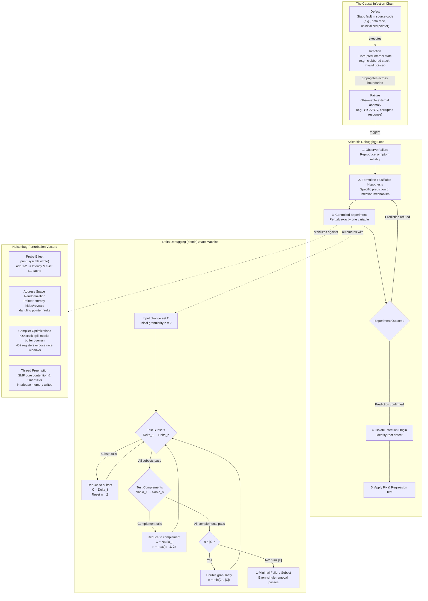

# Scientific Debugging, Delta Debugging, and Heisenbugs

> [!summary] Claim:
> Scientific debugging treats software diagnostic work as an inductive-deductive empirical science: engineers isolate defects by modeling the defect-infection-failure chain, formulating falsifiable hypotheses, and executing controlled differential experiments that perturb exactly one variable.
> Andreas Zeller's delta debugging algorithm (`ddmin`) automates failure-inducing input and change minimization, systematically evaluating subsets and complements to reduce search spaces from $O(|C|^2)$ worst-case to $O(\log |C|)$ best-case to isolate a 1-minimal trigger.
> Heisenbugs emerge when the act of probing or altering the environment mutates program execution state, caused by Address Space Layout Randomization (ASLR), probe-effect I/O latency, compiler optimization tiers, or non-deterministic thread preemption.
> Stabilizing non-deterministic faults requires eliminating environmental entropy through fixed address-space layout (`ADDR_NO_RANDOMIZE`), CPU affinity restriction (`taskset`), allocator poisoning (`MALLOC_PERTURB_`, `MallocScribble`), or deterministic hardware-counter record-and-replay engines.



## The Mechanism

Software debugging is often mischaracterized as intuitive pattern matching or unstructured trial-and-error.
In production systems, undisciplined guessing introduces secondary defects, invalidates reproduction states, and fails when confronted with non-linear failure modes.
Scientific debugging formalizes fault localization through empirical falsification, automated combinatorial reduction, and environmental stabilization.

### 1. The Scientific Method of Debugging and the Infection Chain

The foundational model of program failure, formalized by Andreas Zeller in *Why Programs Fail* (2005), separates a bug into three distinct causal phenomena:

```text
+----------------+          +-------------------+          +-------------------+
|     Defect     | -------> |     Infection     | -------> |      Failure      |
|  (Source Code) | executes |  (Program State)  | manifests| (Observable Anomaly|
+----------------+          +-------------------+          +-------------------+
```

1. **Defect (Fault):** A static error, omission, or flaw in the source code or build configuration.
   Examples include an out-of-bounds pointer calculation, an uninitialized struct member, an unprotected shared variable, or a missing memory barrier.
2. **Infection (State Divergence):** An incorrect or corrupt internal program state produced by the execution of the defect.
   The infection begins at the machine instruction executing the defect (such as writing garbage into a pointer register) and propagates through consecutive instructions, altering the stack, the heap, or processor registers.
   An infection may remain latent and unobserved for millions of CPU cycles.
3. **Failure:** An externally observable departure from expected system behavior.
   Examples include an unhandled signal (`SIGSEGV`, `SIGBUS`), a failed assertion, an infinite loop triggering a watchdog timeout, or a cryptographically invalid payload written to a network socket.

The relationship between these three states is asymmetric:
- Not every defect produces an infection: a flawed code path that is never executed, or whose operands happen to fall within safe sentinel values, will not corrupt internal state.
- Not every infection produces a failure: a corrupted variable may be overwritten before it is read, a dangling pointer may point to benign unused virtual memory, or an erroneous calculation may be masked by an arithmetic clamp (`min`/`max`).

#### The Scientific Diagnostic Loop

Scientific debugging works backward from an observed failure through the infection chain to locate the root defect.
The process is governed by the principles of empirical science, drawing directly upon Karl Popper's criterion of demarcation (*The Logic of Scientific Discovery*, 1959): a hypothesis is scientifically useful if and only if it is **falsifiable** by a concrete experiment.

The diagnostic loop consists of five strict phases:

1. **Observation and Characterization:**
   Record the precise failure mode, including core dump registers, stack unwinds, memory mappings, execution environment, compiler flags, and input payloads.
   Determine whether the failure is deterministic (a Bohrbug) or non-deterministic (a Heisenbug).
2. **Falsifiable Hypothesis Formulation:**
   Construct an explicit model explaining how a hypothetical defect produced the observed infection state.
   A valid diagnostic hypothesis must make a concrete, testable prediction.
   Statements like "there is a memory corruption somewhere" are non-falsifiable and scientifically invalid.
   A valid hypothesis states: "Function `parse_header()` reads 4 bytes past the stack buffer when the Content-Length header omits a trailing newline, corrupting the return address at `%rsp + 0x48`."
3. **Controlled Differential Experimentation:**
   Design an experiment that perturbs exactly **one** variable while holding all other system parameters constant.
   The experiment must produce one of two outcomes:
   - If the predicted outcome occurs, the hypothesis is corroborated (though not definitively proven).
   - If the predicted outcome does not occur, the hypothesis is refuted and must be discarded.
4. **Iterative Refinement (Search Space Partitioning):**
   Use binary search or differential diagnosis to partition the remaining space of possible defects in half with each iteration.
   If inspecting whether an infection exists at time $t_{mid}$ between process start $t_0$ and crash $t_{crash}$:
   - If state is clean at $t_{mid}$, the defect executes in interval $[t_{mid}, t_{crash}]$.
   - If state is infected at $t_{mid}$, the defect executed in interval $[t_0, t_{mid}]$.
5. **Fix Verification and Regression Guarding:**
   Apply the minimal correction to the source code.
   Verify that the failing test passes, that no related behavior regresses, and that an automated test case asserts the boundary condition permanently in continuous integration.

The TRAFFIC mnemonic, defined by Zeller, summarizes this operational protocol:
- **T**rack the problem in a tracking system.
- **R**eproduce the failure deterministically.
- **A**utomate the reproduction test.
- **F**ind possible infection origins.
- **F**ocus on the most likely cause.
- **I**solate the infection origin through differential experiments.
- **C**orrect the defect and verify.

---

### 2. Delta Debugging: The `ddmin` Algorithm

When a failure is triggered by a massive input (e.g., a 10 megabyte XML file, a 10,000-line preprocessed C source file, or a sequence of 500 web actions), manual isolation of the offending bytes is computationally infeasible.
In 1999, Andreas Zeller published "Yesterday, My Program Worked. Today, It Does Not. Why?" (ESEC/FSE 1999).
This was followed by the seminal 2002 paper with Ralf Hildebrandt, "Simplifying and Isolating Failure-Inducing Input" (IEEE Transactions on Software Engineering).
They formalized the **Delta Debugging** algorithm (`ddmin`).

#### Mathematical Formulation

Let $C$ be the set of all input circumstances or changes (e.g., characters, lines, AST nodes, or Git commits).
Let $\text{test}(c)$ be a testing oracle function defined over subsets $c \subseteq C$:

$$\text{test}(c) \in \{\text{PASS}, \text{FAIL}, \text{UNRESOLVED}\}$$

- $\text{FAIL}$: The test execution reproduces the specific target failure.
- $\text{PASS}$: The test execution completes successfully without exhibiting the failure.
- $\text{UNRESOLVED}$: The test execution terminates abnormally due to an unrelated error (e.g., syntax error, compiler failure, early timeout), providing no diagnostic signal.

We assume that $\text{test}(\emptyset) = \text{PASS}$ (the baseline or empty input works) and $\text{test}(C) = \text{FAIL}$ (the full input triggers the defect).

#### The Concept of 1-Minimality

The objective of `ddmin` is to find a **1-minimal** subset $C' \subseteq C$:

$$\text{test}(C') = \text{FAIL} \quad \text{and} \quad \forall e \in C': \text{test}(C' \setminus \{e\}) \neq \text{FAIL}$$

A configuration is 1-minimal if removing *any single element* causes the failure to disappear (or become unresolved).
A 1-minimal set represents a local minimum.
Finding the **globally minimal** failing subset:

$$\min_{c \subseteq C, \text{test}(c) = \text{FAIL}} |c|$$

is, with a black-box oracle, a search that Zeller and Hildebrandt (2002, Section 3) note "requires testing all $2^{|c|}$ subsets", which is exponential.
When the oracle is an explicit polynomial-time predicate, the problem is **NP-hard** (its decision version is NP-complete), because minimum vertex cover reduces to it.
Delta debugging intentionally trades global optimality for polynomial-time 1-minimality.

#### The `ddmin` Recursive Algorithm

The algorithm proceeds by recursively testing subsets and complements at varying granularities $n$, starting at $n = 2$.
Let $c'$ be the current failing set, initially $c' = C$.
Partition $c'$ into $n$ pairwise disjoint subsets $c'_1, c'_2, \dots, c'_n$ of roughly equal size $|c'|/n$, such that:

$$c' = \bigcup_{i=1}^n c'_i \quad \text{and} \quad \forall i \neq j: c'_i \cap c'_j = \emptyset$$

Define the complement $\nabla_i$ of each subset $c'_i$ with respect to $c'$:

$$\nabla_i = c' \setminus c'_i = \bigcup_{j \neq i} c'_j$$

The algorithm $\text{ddmin}_2(c', n)$ executes three sequential rules:

```text
Algorithm ddmin2(c', n):
  1. Reduce to subset:
     For each i in 1 .. n:
       If test(c'_i) == FAIL:
         Return ddmin2(c'_i, 2)

  2. Reduce to complement:
     For each i in 1 .. n:
       If test(Nabla_i) == FAIL:
         Return ddmin2(Nabla_i, max(n - 1, 2))

  3. Increase granularity:
     If n < |c'|:
       Return ddmin2(c', min(|c'|, 2 * n))
     Else:
       Return c'  // 1-minimal configuration reached
```

```text
Main Entry Point:
  ddmin(C) = ddmin2(C, 2)
```

#### Step-by-Step Execution Rules

1. **Reduce to Subset:** The algorithm first tests each coarse subset $c'_i$.
   If any individual subset reproduces the failure, the rest of the configuration is irrelevant noise.
   The algorithm discards all other subsets, replaces $c'$ with $c'_i$, and resets granularity to $n = 2$.
   This step mirrors a classical binary search.
2. **Reduce to Complement:** If no single subset causes the failure, the defect may require elements distributed across multiple chunks, or the bug may be caused by the *absence* of a chunk.
   The algorithm tests each complement $\nabla_i$.
   If $\text{test}(\nabla_i) == \text{FAIL}$, then chunk $c'_i$ is unnecessary.
   The algorithm discards $c'_i$, sets $c' = \nabla_i$, and adjusts granularity to $\max(n - 1, 2)$.
3. **Increase Granularity:** If all subsets and all complements pass (or return unresolved), the failure is caused by an interaction between smaller components located in different chunks.
   The current chunks are too coarse to isolate them.
   The algorithm doubles the granularity $n = \min(|c'|, 2n)$, splitting the input into finer partitions.
4. **Termination:** When the granularity reaches $n = |c'|$ (individual single elements) and no subset or complement fails, every remaining element is strictly required to reproduce the failure.
   The configuration is 1-minimal, and execution terminates.

#### Algorithmic Complexity

The complexity of `ddmin` depends on whether the failure behaves monotonically:

- **Best Case ($O(\log |C|)$):**
  If a single isolated element causes the failure, the algorithm finds it in the first subset test at each level.
  Granularity remains $n = 2$.
  The problem size halves on each iteration: $|C| \to |C|/2 \to |C|/4 \dots \to 1$.
  The total number of tests is bounded by $2 \log_2 |C|$ tests, the same order as binary search (Zeller and Hildebrandt 2002, Proposition 13).
- **Worst Case ($O(|C|^2)$):**
  Zeller and Hildebrandt (2002, Proposition 12) split the worst case into two phases.
  First, every test is `UNRESOLVED` until granularity reaches $n = |C|$, costing about $2(2 + 4 + \dots + |C|) \approx 4|C|$ tests.
  Second, at each step only the last complement fails, so one element is removed per round and $n$ drops by one until $n = 2$; each round tests the subsets and complements at the current granularity before reaching the failing last complement, which sums to the quadratic term.
  The total is at most:

$$t = |C|^2 + 3|C| = O(|C|^2)$$

  The paper adds that this worst case is unlikely in practice.
- **Comparison to `git bisect`:**
  `git bisect` searches the commit DAG between known good and bad revisions under the assumption of a single monotonic good-to-bad transition.
  On linear history this costs about $\lceil \log_2 N \rceil$ evaluations; merge-heavy history and skipped (untestable) commits add evaluations, so $O(\log N)$ is the linear-history figure, not a strict bound.
  Delta debugging operates on an unordered power set of size $2^{|C|}$ where multiple elements can interact; hence its complexity must scale up to $O(|C|^2)$ to evaluate non-linear element combinations.

#### Syntax-Aware and Hierarchical Reduction

Applying raw line-based or character-based `ddmin` to structured artifacts (such as C++, Rust, or Python source files) frequently fails.
Naively removing lines produces syntactically malformed code (unclosed braces, missing variable declarations, dangling commas), causing the compiler or interpreter to exit immediately with a syntax error (`UNRESOLVED`).
When too many tests are `UNRESOLVED`, `ddmin` cannot prune complements and gets stuck in bloated local minima.

To overcome this, modern toolchains use **Hierarchical Delta Debugging (HDD)** (Misherghi & Su, ICSE 2006) and AST-aware transformers:
- **HDD:** Parses input into an Abstract Syntax Tree (AST) and applies `ddmin` level-by-level, starting from the root down to the leaves.
  Pruning an AST node removes an entire syntactically valid sub-tree (e.g., a function definition or loop block), preserving grammar validity.
- **C-Reduce and cvise:** C-Reduce, developed by John Regehr et al. (PLDI 2012), combines a Clang-based AST transformation engine (`clang_delta`) with delta-style search; cvise is a later Python port of C-Reduce by a different maintainer (Martin Liska).
  It executes dozens of specialized passes: inlining functions, removing unused function parameters, replacing complex expressions with constants, flattening compound statements, and stripping typedefs.
  The PLDI 2012 paper reports outputs that are "on average, more than 25 times smaller" than those of the authors' other reducers or of Berkeley delta, the reducer most commonly used by compiler developers at the time.

---

### 3. Anatomy of a Heisenbug

The term **Heisenbug** was popularized by Jim Gray in Tandem Technical Report 85.7, "Why Do Computers Stop and What Can Be Done About It?" (June 1985, revised November 1985), which calls production software faults "Heisenbugs that go away when you look at them" and says the term "is well known to systems programmers"; the report does not claim to have coined it.
Gray's report defines only the Bohrbug and Heisenbug classes; the Mandelbug and Schrodinbug rows below paraphrase entries in the Jargon File (The New Hacker's Dictionary, Eric S. Raymond, http://www.catb.org/jargon/), not Gray:

| Bug Class | Behavior and Characteristics | Physical / Conceptual Analogy |
| :--- | :--- | :--- |
| **Bohrbug** | Deterministic, solid-state fault. Manifests reliably whenever execution reaches a specific program state and input. | Bohr model of the atom (deterministic, discrete electron orbits). |
| **Heisenbug** | Elusive, non-deterministic fault. Disappears, changes symptoms, or alters timing when probed, logged, or executed under a debugger. | Heisenberg Uncertainty Principle (the act of observing a particle alters its momentum or position). |
| **Mandelbug** | A defect whose underlying causes are so complex and obscure that its behavior appears chaotic or even non-deterministic; the speaker implies it is really a Bohrbug, not a Heisenbug. | The Mandelbrot set (Jargon File entry `mandelbug`). |
| **Schrodinbug** | A design or implementation bug that does not manifest until someone reading the source, or using the program in an unusual way, notices that it never should have worked, whereupon the program promptly stops working for everybody until fixed. | Schroedinger's Cat thought experiment (Jargon File entry `schroedinbug`, spelled with `oe`). |

#### The Four Physical Mechanisms of Heisenbugs

Heisenbugs are not supernatural phenomena; they are deterministic consequences of physical hardware, operating system kernel abstractions, and compiler transformations.
They are caused by four distinct mechanisms:

#### 1. The Observer Effect (Probe Perturbation)

The most common Heisenbug occurs when an engineer attempts to debug an intermittent failure by inserting `printf()`, `std::cout`, or logging statements.
A standard user-space print operation is not a passive inspection:

- **System Call Overhead:** `printf()` writes into the stdio buffer and invokes the `write(2)` system call only when that buffer flushes: on every newline when standard output is a terminal (line buffered), but only when the buffer fills when it is a pipe or file (fully buffered).
  A user-to-kernel mode switch is cheap per call but not free: a loop of 2,000,000 `getppid()` calls measured 81 ns per call on an Apple M3 Pro (macOS 27.2) and 97 ns per call in a Linux 7.2 aarch64 VM, and a 1-byte `write(2)` to `/dev/null` measured 781 ns and 112 ns (best of five loops, host under load, 2026-11-08; no cycle count is claimed because clock frequency varies).
  A `write(2)` to a terminal or pipe does real work in the terminal or pipe layer and costs more than that `/dev/null` floor.
- **Cache and Pipeline Eviction:** Formatting strings and writing to terminal or file buffers pollutes the L1 instruction cache (L1i) and L1 data cache (L1d), evicting cache lines holding active thread state.
- **Thread Preemption and Race Serialization:** If two threads race across a 10-nanosecond critical window, adding a `write(2)` system call (illustratively 5 microseconds, a terminal or pipe costing more than the measured `/dev/null` floor of 112 to 781 ns) inside or immediately before the critical section expands the execution time by orders of magnitude.
  The thread holding the race condition completes its operation long before the contending thread arrives, eliminating the race and hiding the bug.
- **Debugger Breakpoints (`int3` / `brk`):**
  When GDB or LLDB sets a software breakpoint, it rewrites the instruction at the target address with a trap instruction (`int3`, opcode `0xCC`, on x86-64; `brk #0` on AArch64).
  Hitting this instruction causes a CPU hardware exception, transitioning control to the kernel.
  The kernel halts the thread, generates `SIGTRAP`, and notifies the tracer via `ptrace(2)` or Mach task exception ports.
  This stalls execution for milliseconds, completely destroying real-time concurrency timing and eliminating thread contention.

#### 2. Virtual Memory Entropy and Address Space Layout Randomization (ASLR)

On modern operating systems, Address Space Layout Randomization (Linux `kernel.randomize_va_space`, macOS dyld ASLR) randomizes the virtual address offsets of the stack, the heap (`brk`), dynamic memory allocations (`mmap`), and executable code segments on every process execution.

- **Uninitialized Pointers:** If a pointer is allocated on the stack without initialization, its value reflects whatever bit pattern was left behind by previous stack frames.
  With ASLR enabled, virtual addresses span wide 48-bit or 52-bit address spaces.
  An uninitialized pointer might point into unmapped memory (causing an immediate `SIGSEGV`) on run 1, but point into valid heap memory (silently corrupting live data) on run 2.
- **Pointer Hashing and Set Ordering:** If code uses raw pointer addresses as hash keys (e.g., `std::unordered_set<Object*>` or a Python `set` of objects using the default identity-based hash), ASLR causes iteration order across the hash table to be randomized on every process restart (Python `dict` iteration follows insertion order, so it is not affected).
  If the application possesses an implicit dependency on iteration order, it will manifest non-deterministic logic bugs.
- **The Debugger ASLR Trap:**
  By default, both GDB and LLDB **disable ASLR** when launching a process (`set disable-randomization on` in GDB, implemented on GNU/Linux and equivalent to running under `setarch $(uname -m) -R`, which sets `ADDR_NO_RANDOMIZE` via `personality(2)`; `target.disable-aslr` defaults to `true` in LLDB, checked with `settings show target.disable-aslr` on lldb-2103 (as of 2026-11, macOS)).
  Consequently, the address-space layout is the same on every run inside the debugger (stack contents and environment can still differ from a shell launch).
  A production crash whose manifestation depends on address bits (an uninitialized or dangling pointer that lands on an unmapped page only under some layouts, an address-keyed hash ordering, an alignment-dependent fault) can therefore vanish, or reproduce on every run, inside the debugger, because only one layout is ever sampled.
  Disabling ASLR does not move 64-bit Linux mappings below 4 GiB: in a Linux aarch64 container under `setarch -R`, the heap sat at `0xaaaaaaaf1000` and libc at `0xfffff7d50000`, both above the 32-bit range (measured 2026-11-08, Linux).

#### 3. Compiler Optimization Discrepancies (`-O0` vs `-O2`/`-O3`)

Developers frequently build with `-O0 -g` to debug, yet the production binary is compiled with `-O2` or `-O3 -flto`.
The differences in generated machine code alter bug manifestation completely:

- **Stack Allocation vs Register Spilling:**
  At `-O0`, the compiler treats memory conservatively: every local variable is allocated an explicit slot on the stack frame (`%rbp`-relative or `%rsp`-relative).
  Reads and writes explicitly load and store to RAM.
  Stack memory padding between variables often masks off-by-one buffer overwrites.
  At `-O2`, the compiler performs register allocation via graph coloring.
  Variables are kept in hardware registers (`%rax`, `%rbx`, `%r12-%r15` on x86-64; `x0-x30` on AArch64).
  A buffer overflow that previously stomped on benign stack padding now overwrites the adjacent variable or clobbers the preserved stack base pointer.
- **Undefined Behavior and Strict Aliasing:**
  At `-O2`, the compiler assumes that undefined behavior (UB) never occurs in valid code.
  Under `-fstrict-aliasing`, pointers of incompatible types are assumed never to point to the same memory location.
  The compiler can reorder memory writes across such pointers.
  If code violates strict aliasing, `-O0` will execute the sequential writes faithfully in memory order, whereas `-O2` will reorder or eliminate them, causing state corruption.
- **Loop Invariant Hoisting and Dead Store Elimination:**
  If a variable is accessed concurrently by two threads without `std::atomic` or `volatile`, the compiler at `-O2` will hoist the read out of a loop, loading it into a register once and creating an infinite loop.
  At `-O0`, the register reload happens on every loop iteration, allowing the thread to see the memory update and terminate normally.

#### 4. Hardware Memory Models and SMP Concurrency

On Symmetric Multiprocessing (SMP) architectures, thread interleaving is governed by operating system scheduling quanta (for example the Linux EEVDF base slice, which `kernel/sched/fair.c` on torvalds/linux master, fetched 2026-11-08, sets to 0.70 ms times (1 + ilog2(min(ncpus, 8))), so 0.7 ms to 2.8 ms by default) and CPU hardware memory models:

- **Store Buffering and Reordering:**
  On x86-64, the processor implements Total Store Order (TSO).
  Loads are not reordered with other loads, and stores are not reordered with other stores.
  However, stores can be delayed in local hardware store buffers, allowing a subsequent load from a different address to execute before an earlier store becomes visible to other cores.
- **Weak Memory Ordering (ARM / Apple Silicon):**
  AArch64 implements a weakly ordered memory model.
  Hardware cores can execute loads and stores out-of-order relative to the instruction stream unless explicit memory barriers (`dmb ld`, `dmb ish`) or acquire-release semantics are enforced.
  A concurrency bug that depends on store-load or store-store reordering can therefore be rare or impossible on x86-64 and frequent on Apple Silicon or AWS Graviton.

---

### 4. Stabilization and Defeat Techniques

Debugging a Heisenbug requires converting it into a reproducible Bohrbug.
The engineer must systematically remove environmental entropy and freeze execution variables:

```text
+-----------------------------------------------------------------------------------+
|                        HEISENBUG STABILIZATION MATRIX                             |
+------------------------------+----------------------------------------------------+
| Entropy Axis                 | Stabilization Mechanism                            |
+------------------------------+----------------------------------------------------+
| Address Randomization (ASLR) | Linux: personality(ADDR_NO_RANDOMIZE) / setarch -R |
|                              | macOS: Target disabling via LLDB settings          |
+------------------------------+----------------------------------------------------+
| Uninitialized / Freed Memory | Linux: MALLOC_PERTURB_=165 / glibc.malloc.perturb  |
|                              | macOS: MallocScribble=1 (0xaa alloc, 0x55 free)    |
+------------------------------+----------------------------------------------------+
| Multicore SMP Concurrency    | CPU affinity pinning: taskset -c 0                 |
|                              | sched_setaffinity() single-core serialization      |
+------------------------------+----------------------------------------------------+
| Non-Deterministic Execution  | Record-and-Replay: hardware PMU cycle replay (rr)  |
+------------------------------+----------------------------------------------------+
| Timing & Probe Perturbation  | eBPF USDT / Ring buffers (sub-microsecond tracing) |
+------------------------------+----------------------------------------------------+
```

#### Disabling Address Space Randomization

On Linux, virtual memory randomization can be disabled without root privileges for a target process tree using the `personality(2)` system call with the `ADDR_NO_RANDOMIZE` execution domain flag (`0x0040000`):

```bash
# Launch program under a fixed virtual memory mapping
setarch $(uname -m) -R ./failing_binary
```

System-wide ASLR on Linux can be controlled via `sysctl`:
- `kernel.randomize_va_space = 0`: Disables all virtual address randomization.
- `kernel.randomize_va_space = 1`: Randomizes the mmap base, stack, and VDSO page (and the code start of PIE binaries); the kernel default when `CONFIG_COMPAT_BRK` is enabled.
- `kernel.randomize_va_space = 2`: Additionally randomizes the heap (`brk`); the kernel default when `CONFIG_COMPAT_BRK` is disabled, and the value read in the Linux 7.2 aarch64 lab container (2026-11-08).
  The value `0x0040000` for `ADDR_NO_RANDOMIZE` matches `/usr/include/linux/personality.h` in that container.

#### Memory Allocator Poisoning

Uninitialized memory access and use-after-free bugs can be forced into immediate, deterministic crashes by poisoning memory during `malloc()` and `free()`.

- **Linux (glibc):**
  Glibc provides the `MALLOC_PERTURB_` environment variable (and the equivalent `glibc.malloc.perturb` tunable).
  When set to a nonzero value (only its least significant byte $N$ is used), per `mallopt(3)`:
  - Bytes of allocated memory, other than allocations via `calloc()`, are initialized to the bitwise complement `~N` ($N \oplus \text{0xFF}$).
  - Freed bytes are set to $N$.
  Programmatically, this is set via `mallopt(M_PERTURB, N)` in `<malloc.h>`.
  `MALLOC_PERTURB_=165` (`0xA5`) made a 4-byte uninitialized heap field read `0x5a5a5a5a` under glibc 2.39 (measured 2026-11-08, Linux aarch64 container).
- **macOS:**
  Apple's system allocator documents diagnostic environment variables in `malloc(3)`:
  - `MallocScribble=1`: Fills newly allocated memory with `0xaa` bytes and freed memory with `0x55` bytes (the man page notes the `0x55` pattern may not appear in parts of a freed block).
  - `MallocPreScribble` is not documented in the macOS 27.2 SDK `malloc(3)` page, and setting it left an uninitialized field at `0` on macOS 27.2 arm64, while `MallocScribble=1` produced `0xaaaaaaaa` (measured 2026-11-08).
  - `MallocGuardEdges=1`: Adds a guard page before and after each large block; small and tiny allocations are not guarded.

#### Serializing Concurrency via CPU Pinning

If a bug is triggered by multi-core SMP race conditions, the race can often be stabilized by restricting execution to a single core using `taskset` (which invokes `sched_setaffinity(2)`):

```bash
# Pin process and all spawned threads to core 0
taskset -c 0 ./multithreaded_binary
```

Restricting execution to a single CPU core eliminates true parallel execution, forcing threads to share a single uniprocessor run-queue governed exclusively by scheduler preemption timer interrupts.
Conversely, if an engineer wishes to **amplify** a race condition to force a Heisenbug to manifest reliably, they should run under multi-core stress testing tools (such as `stress-ng --cpu $(nproc)`) or inject deliberate `sched_yield(2)` calls into suspect synchronization paths.

#### Deterministic Record-and-Replay

The ultimate weapon against Heisenbugs is hardware-counter-based deterministic execution record and replay.
Tools like `rr` (Lightweight Record and Replay for Linux) record the execution of all threads by intercepting all non-deterministic inputs (system calls, signals, RDTSC, CPUID) and counting retired conditional branches (RCB) with a hardware Performance Monitoring Unit (PMU) counter, and by running only one thread at a time.
During replay, `rr` identifies an execution point by pairing the RCB count with the full general-purpose register state including the program counter, which the rr paper reports works reliably in practice though it does not identify every point uniquely (O'Callahan et al., arXiv:1705.05937).
This completely transforms a transient Heisenbug into an eternally reproducible Bohrbug.
Deterministic record-and-replay mechanisms are owned by [[Record-and-Replay-rr-UDB-and-Pernosco]].

## Commands and Numbers to Know

Reference environment variables, system configuration tunables, and algorithmic complexity metrics governing scientific debugging and Heisenbug stabilization (as of 2026-11):

| Tool / Mechanism | Command / Parameter | Default | Target Platform | Operational Significance |
| :--- | :--- | :--- | :--- | :--- |
| **Linux ASLR Disable** | `setarch $(uname -m) -R <cmd>` | ASLR enabled | Linux | Launches `<cmd>` with `ADDR_NO_RANDOMIZE` flag via `personality(2)`. |
| **Linux Kernel ASLR** | `sysctl -w kernel.randomize_va_space=0` | `2` | Linux | Disables ASLR globally: `0`=disabled, `1`=stack/vdso/mmap, `2`=full heap brk. |
| **GDB ASLR Control** | `set disable-randomization on\|off` | `on` | Linux | GDB defaults to disabling ASLR (implemented only on some targets, including GNU/Linux), masking address-dependent Heisenbugs. |
| **LLDB ASLR Control** | `settings set target.disable-aslr true\|false` | `true` | Both | LLDB disables ASLR by default on launched targets; default confirmed on lldb-2103, macOS 27.2. |
| **glibc Allocator Poison** | `export MALLOC_PERTURB_=<1-255>` | `0` (off) | Linux | Allocations initialized to `~val`; freed memory overwritten with `val`. |
| **glibc Tunables API** | `GLIBC_TUNABLES=glibc.malloc.perturb=<N>` | `0` (off) | Linux | Canonical tunable syntax superseding `MALLOC_PERTURB_` in modern glibc. |
| **macOS Pre-Alloc Poison** | `export MallocScribble=1` | unset (off) | macOS | Fills newly allocated memory with `0xaa`; `MallocPreScribble` is undocumented in `malloc(3)` and had no effect on macOS 27.2. |
| **macOS Post-Free Poison** | `export MallocScribble=1` | unset (off) | macOS | The same variable fills freed memory with `0x55` to expose use-after-free reads. |
| **macOS Allocator Guard** | `export MallocGuardEdges=1` | unset (off) | macOS | Adds a guard page before and after each large block only. |
| **CPU Core Pinning** | `taskset -c <cpu_list> <cmd>` | All cores | Linux | Restricts process thread execution mask via `sched_setaffinity(2)`. |
| **macOS Affinity Pinning** | `thread_policy_set(THREAD_AFFINITY_POLICY)` | OS scheduled | macOS | Mach thread policy hint for cache affinity, Intel Macs only; returns `KERN_NOT_SUPPORTED` on Apple silicon; no hard core pinning CLI exists. |
| **Git Binary Search** | `git bisect start <bad> <good>` | None | Both | Automates binary search over the commit DAG; about $\log_2 N$ evaluations on linear history, more with merges or skips. |
| **Git Bisect Run** | `git bisect run <script> [args]` | None | Both | Executes automated bisection. Exit 0 = good, 1-124/126/127 = bad, 125 = skip. |
| **C-Reduce Minimization** | `creduce <test.sh> <source.c>` | None | Both | AST-aware multi-pass C/C++ test case reducer; invokes `clang_delta`. |
| **`ddmin` Best-Case Tests** | $2 \log_2(|C|)$ | N/A | Both | Upper bound when a single element triggers the failure (Zeller and Hildebrandt 2002, Proposition 13). |
| **`ddmin` Worst-Case Tests** | $|C|^2 + 3|C|$ | N/A | Both | Upper bound when every test is unresolved until $n = |C|$, then only the last complement fails each round (Proposition 12). |

## Multi-Language Comparison: C++ / Python / Rust

Debugging methodologies and Heisenbug mechanics manifest differently across compiled systems languages, interpreted runtimes, and borrow-checked systems:

| Dimension | C++ (Clang / GCC) | Python (CPython 3.12+) | Rust (rustc / LLVM) |
| :--- | :--- | :--- | :--- |
| **Primary Heisenbug Vector** | Uninitialized pointers, data races (missing mutex/atomic), stack padding buffer overflow, undefined behavior optimization at `-O3`. | GIL preemption thread switches, `set` iteration order of `str`/`bytes` keys (`PYTHONHASHSEED`; `dict` order is insertion order), unawaited async coroutines, garbage collector cycle sweeps. | Concurrency data races in `unsafe` blocks, raw pointer dereferences, non-deterministic `HashMap` SipHash iteration order, channel buffer timing. |
| **Memory Poisoning Tool** | glibc `MALLOC_PERTURB_`, macOS `MallocScribble`, AddressSanitizer (`-fsanitize=address`). | Custom allocator hooks (`PYTHONMALLOC=debug`), tracemalloc snapshot differential comparison. | AddressSanitizer (`-Zsanitizer=address`, nightly only), Miri MIR interpreter execution (`cargo miri test`, nightly only). |
| **Input Delta Debugging Tool** | C-Reduce (`creduce`), cvise, `halfempty`, afl-tmin for binary crashes. | Hypothesis test-case shrinker (`Conjecture`), delta debugging scripts over JSON/text. | `cargo-fuzz` test-case minimization (`cargo fuzz tmin`), tree-sitter AST reduction passes. |
| **Concurrency Perturbation Tool** | ThreadSanitizer (`-fsanitize=thread`), Helgrind (`valgrind --tool=helgrind`), dynamic `sched_yield()` injection. | `sys.setswitchinterval(interval)`, Hypothesis `RuleBasedStateMachine`. | Loom concurrency permutation testing (`loom::model`), ThreadSanitizer (`-Zsanitizer=thread`, nightly only). |
| **Optimization Debug Trap** | `-O0` stack spilling masks buffer overruns; `-O3` vectorization and strict aliasing eliminate writes. | Bytecode quickening and adaptive specialization (PEP 659, CPython 3.11+) plus the experimental JIT (PEP 744, CPython 3.13+, off by default) re-optimizing active functions. | Release builds (`opt-level=3`) inline aggressively, stripping stack frames and reordering instructions. |
| **Typical Diagnostic Mistake** | Adding `printf()` which converts nanosecond thread contention into microsecond system call serialization. | Inserting `print()` statements, whose blocking I/O releases the GIL and forces thread switches that reshape the interleaving. | Adding `println!()` which acquires a global lock on standard output (`io::Stdout::lock`), synchronizing threads. |

## Worked Example: Automated Delta Debugging and Heisenbug Stabilization

This worked example has two parts.
The `ddmin` trace in Part 1 is backed by the lab `code/03-Debugging/delta_debugging_ddmin/`, which `make verify LAB=03-Debugging/delta_debugging_ddmin/` re-runs and diffs against `expected/darwin-arm64.txt` and `expected/linux-aarch64.txt`; the lab also replays the L6 interview trace, a single-culprit subset trace, and the Practice Drill.
The race demonstration in Part 2 is inline only, because its counter values are nondeterministic by nature, so `make verify` does not check it:
1. An implementation of Andreas Zeller's `ddmin` delta debugging algorithm written from first principles in Python, executed against a structured 16-character payload with an interacting multi-variable failure oracle.
2. A multi-threaded C demonstration exposing a Heisenbug caused by the observer effect (`printf` probe perturbation), followed by its stabilization through ThreadSanitizer instrumentation.

### Part 1: Delta Debugging (`ddmin`) Implementation

The following self-contained script implements the formal recursive `ddmin` algorithm:

```python
#!/usr/bin/env python3
"""
ddmin.py - Implementation of Andreas Zeller's Delta Debugging Minimization Algorithm.
Formalized in: Zeller & Hildebrandt, IEEE TSE 28(2):183-200, 2002.
"""

import sys

def ddmin(circumstances, test_fn):
    """
    Minimizes a list of circumstances to find a 1-minimal subset that causes test_fn to FAIL.
    """
    n = 2
    step = 0
    c = list(circumstances)
    
    print(f"[*] Initial configuration ({len(c)} elements): {''.join(c)}")
    initial_status = test_fn(c)
    if initial_status != 'FAIL':
        raise ValueError(f"Initial configuration must fail, got: {initial_status}")

    while len(c) >= 2:
        subset_len = len(c) // n
        subsets = []
        for i in range(n):
            start = i * subset_len
            end = (i + 1) * subset_len if i < n - 1 else len(c)
            subsets.append(c[start:end])
        
        # 1. Test Subsets
        reduced = False
        for i, delta in enumerate(subsets):
            step += 1
            res = test_fn(delta)
            print(f"Step {step:02d}: Test subset {i+1}/{n} (len {len(delta)}: {''.join(delta)}) -> {res}")
            if res == 'FAIL':
                c = delta
                n = 2
                reduced = True
                print(f"    -> Reduced to subset! New configuration length: {len(c)}")
                break
        if reduced:
            continue
            
        # 2. Test Complements
        for i, delta in enumerate(subsets):
            step += 1
            nabla = [x for j, chunk in enumerate(subsets) if j != i for x in chunk]
            res = test_fn(nabla)
            print(f"Step {step:02d}: Test complement {i+1}/{n} (len {len(nabla)}: {''.join(nabla)}) -> {res}")
            if res == 'FAIL':
                c = nabla
                n = max(n - 1, 2)
                reduced = True
                print(f"    -> Reduced to complement! New configuration length: {len(c)}")
                break
        if reduced:
            continue
            
        # 3. Increase Granularity
        if n < len(c):
            new_n = min(len(c), 2 * n)
            print(f"[*] Subsets and complements passed. Increasing granularity from n={n} to n={new_n}")
            n = new_n
        else:
            print(f"[*] Granularity n={n} equals configuration size {len(c)}. Search complete.")
            break
            
    print(f"[+] 1-Minimal failure configuration reached in {step} evaluations: {''.join(c)}")
    return c

if __name__ == '__main__':
    # Test Payload: 16 characters
    payload = list("abcdefghijklmnop")
    
    # Failure Oracle: The bug manifests IF AND ONLY IF both 'f' and 'k' are present simultaneously
    def failure_oracle(candidate):
        if 'f' in candidate and 'k' in candidate:
            return 'FAIL'
        return 'PASS'

    minimized = ddmin(payload, failure_oracle)
    assert minimized == ['f', 'k'], f"Expected ['f', 'k'], got {minimized}"
```

#### Execution Output

Executing the script yields the following deterministic trace (re-run byte-identical with `python3` on macOS 27.2 arm64, 2026-11-08):

```text
[*] Initial configuration (16 elements): abcdefghijklmnop
Step 01: Test subset 1/2 (len 8: abcdefgh) -> PASS
Step 02: Test subset 2/2 (len 8: ijklmnop) -> PASS
Step 03: Test complement 1/2 (len 8: ijklmnop) -> PASS
Step 04: Test complement 2/2 (len 8: abcdefgh) -> PASS
[*] Subsets and complements passed. Increasing granularity from n=2 to n=4
Step 05: Test subset 1/4 (len 4: abcd) -> PASS
Step 06: Test subset 2/4 (len 4: efgh) -> PASS
Step 07: Test subset 3/4 (len 4: ijkl) -> PASS
Step 08: Test subset 4/4 (len 4: mnop) -> PASS
Step 09: Test complement 1/4 (len 12: efghijklmnop) -> FAIL
    -> Reduced to complement! New configuration length: 12
Step 10: Test subset 1/3 (len 4: efgh) -> PASS
Step 11: Test subset 2/3 (len 4: ijkl) -> PASS
Step 12: Test subset 3/3 (len 4: mnop) -> PASS
Step 13: Test complement 1/3 (len 8: ijklmnop) -> PASS
Step 14: Test complement 2/3 (len 8: efghmnop) -> PASS
Step 15: Test complement 3/3 (len 8: efghijkl) -> FAIL
    -> Reduced to complement! New configuration length: 8
Step 16: Test subset 1/2 (len 4: efgh) -> PASS
Step 17: Test subset 2/2 (len 4: ijkl) -> PASS
Step 18: Test complement 1/2 (len 4: ijkl) -> PASS
Step 19: Test complement 2/2 (len 4: efgh) -> PASS
[*] Subsets and complements passed. Increasing granularity from n=2 to n=4
Step 20: Test subset 1/4 (len 2: ef) -> PASS
Step 21: Test subset 2/4 (len 2: gh) -> PASS
Step 22: Test subset 3/4 (len 2: ij) -> PASS
Step 23: Test subset 4/4 (len 2: kl) -> PASS
Step 24: Test complement 1/4 (len 6: ghijkl) -> PASS
Step 25: Test complement 2/4 (len 6: efijkl) -> FAIL
    -> Reduced to complement! New configuration length: 6
Step 26: Test subset 1/3 (len 2: ef) -> PASS
Step 27: Test subset 2/3 (len 2: ij) -> PASS
Step 28: Test subset 3/3 (len 2: kl) -> PASS
Step 29: Test complement 1/3 (len 4: ijkl) -> PASS
Step 30: Test complement 2/3 (len 4: efkl) -> FAIL
    -> Reduced to complement! New configuration length: 4
Step 31: Test subset 1/2 (len 2: ef) -> PASS
Step 32: Test subset 2/2 (len 2: kl) -> PASS
Step 33: Test complement 1/2 (len 2: kl) -> PASS
Step 34: Test complement 2/2 (len 2: ef) -> PASS
[*] Subsets and complements passed. Increasing granularity from n=2 to n=4
Step 35: Test subset 1/4 (len 1: e) -> PASS
Step 36: Test subset 2/4 (len 1: f) -> PASS
Step 37: Test subset 3/4 (len 1: k) -> PASS
Step 38: Test subset 4/4 (len 1: l) -> PASS
Step 39: Test complement 1/4 (len 3: fkl) -> FAIL
    -> Reduced to complement! New configuration length: 3
Step 40: Test subset 1/3 (len 1: f) -> PASS
Step 41: Test subset 2/3 (len 1: k) -> PASS
Step 42: Test subset 3/3 (len 1: l) -> PASS
Step 43: Test complement 1/3 (len 2: kl) -> PASS
Step 44: Test complement 2/3 (len 2: fl) -> PASS
Step 45: Test complement 3/3 (len 2: fk) -> FAIL
    -> Reduced to complement! New configuration length: 2
Step 46: Test subset 1/2 (len 1: f) -> PASS
Step 47: Test subset 2/2 (len 1: k) -> PASS
Step 48: Test complement 1/2 (len 1: k) -> PASS
Step 49: Test complement 2/2 (len 1: f) -> PASS
[*] Granularity n=2 equals configuration size 2. Search complete.
[+] 1-Minimal failure configuration reached in 49 evaluations: fk
```

In 49 evaluations out of $2^{16} = 65,536$ possible subsets, the algorithm automatically pruned 14 irrelevant characters and isolated the exact 1-minimal combination `fk`.

---

### Part 2: Demonstrating and Defeating a Heisenbug

The following C program is meant to illustrate a concurrency Heisenbug that disappears when probed with `printf`; as the measured output shows, this particular probe (five `printf` calls per thread) is too sparse to mask the race on the recording host:

```c
// heisenbug_demo.c
#include <pthread.h>
#include <stdio.h>
#include <stdlib.h>

#define ITERATIONS 500000

static volatile long g_shared_counter = 0;

void *worker_silent(void *arg) {
    (void)arg;
    for (int i = 0; i < ITERATIONS; i++) {
        // Data race: read-modify-write without synchronization
        g_shared_counter++;
    }
    return NULL;
}

void *worker_probed(void *arg) {
    (void)arg;
    for (int i = 0; i < ITERATIONS; i++) {
        if (i % 100000 == 0) {
            // Probe effect: I/O write(2) system call serializes execution
            printf("[probe] Thread %p at iteration %d\n", (void*)pthread_self(), i);
        }
        g_shared_counter++;
    }
    return NULL;
}

int main(int argc, char **argv) {
    pthread_t t1, t2;
    int use_probe = (argc > 1);

    void *(*func)(void *) = use_probe ? worker_probed : worker_silent;

    pthread_create(&t1, NULL, func, NULL);
    pthread_create(&t2, NULL, func, NULL);

    pthread_join(t1, NULL);
    pthread_join(t2, NULL);

    printf("Target Sum: %ld | Actual Counter: %ld | Lost Updates: %ld\n",
           (long)(ITERATIONS * 2), g_shared_counter,
           (long)(ITERATIONS * 2) - g_shared_counter);
    return 0;
}
```

#### Compilation and Execution Comparison

Compile and run the program on macOS / Linux:

```bash
# 1. Compile with -O2
"${CC:-cc}" -O2 -pthread heisenbug_demo.c -o heisenbug_demo

# Run silent version (unobserved)
./heisenbug_demo
# Output (one run; Apple clang 21, macOS 27.2 arm64, 2026-11-08; varies run to run):
# Target Sum: 1000000 | Actual Counter: 500000 | Lost Updates: 500000
# Symptom: Catastrophic failure (about 50% of updates lost due to race condition)

# Run probed version (an engineer adds printf logging to investigate)
./heisenbug_demo --probe
# Output (one run, same host, stdout a terminal):
# [probe] Thread 0x... at iteration 0
# ...
# Target Sum: 1000000 | Actual Counter: 553596 | Lost Updates: 446404
# Symptom: The race persists; ten probed runs lost 437,711 to 492,214 updates, against 488,903 to 500,000 in five unprobed runs.
```

A probed figure of 1,058 lost updates (a 99.8% drop) did not reproduce in ten probed runs on the recording host, with stdout either a pipe or a terminal.
A probe masks a race only when it executes inside or next to the racing window on most iterations; a `printf` every 100,000 iterations does not, so the demonstration above shows the race, not the probe effect.
Changing the probe condition to `i % 1 == 0` (a `printf` on every iteration, stdout a pipe, same host, 2026-11-08) does show it: six runs lost 0, 1, 0, 0, 4, and 1 of 1,000,000 updates, against 191,818 to 465,577 in six unprobed runs, at a cost of about 40 times the wall-clock time (median of seven runs, 176.3 ms against 4.4 ms, with the host under heavy load).
The probe removed the symptom without fixing the defect, which is the definition of a Heisenbug.

#### Stabilizing and Eliminating the Heisenbug with ThreadSanitizer

Instead of adding print probes, the engineer compiles with ThreadSanitizer (TSan), which reports the race from the happens-before relation rather than from a lucky interleaving (output from Apple clang 21 on macOS 27.2 arm64, 2026-11-08; addresses, pids, and tids vary):

```bash
# Compile with ThreadSanitizer
"${CC:-cc}" -fsanitize=thread -g heisenbug_demo.c -o heisenbug_tsan

./heisenbug_tsan
```

```text
==================
WARNING: ThreadSanitizer: data race (pid=42866)
  Write of size 8 at 0x000100db8000 by thread T2:
    #0 worker_silent heisenbug_demo.c:14 (heisenbug_tsan:arm64+0x1000006dc)

  Previous write of size 8 at 0x000100db8000 by thread T1:
    #0 worker_silent heisenbug_demo.c:14 (heisenbug_tsan:arm64+0x1000006dc)

  Location is global 'g_shared_counter' at 0x000100db8000 (heisenbug_tsan+0x100008000)

  Thread T2 (tid=38632912, running) created by main thread at:
    #0 pthread_create <null> (libclang_rt.tsan_osx_dynamic.dylib:arm64e+0x33bac)
    #1 main heisenbug_demo.c:38 (heisenbug_tsan:arm64+0x100000894)

  Thread T1 (tid=38632911, running) created by main thread at:
    #0 pthread_create <null> (libclang_rt.tsan_osx_dynamic.dylib:arm64e+0x33bac)
    #1 main heisenbug_demo.c:37 (heisenbug_tsan:arm64+0x10000087c)

SUMMARY: ThreadSanitizer: data race heisenbug_demo.c:14 in worker_silent
==================
Target Sum: 1000000 | Actual Counter: 512709 | Lost Updates: 487291
ThreadSanitizer: reported 1 warnings
```

ThreadSanitizer instruments every memory access and checks it against per-location shadow state and per-thread vector clocks, so it flags the unsynchronized pair the first time both accesses execute, whichever way they happen to interleave (it can still miss races whose earlier access has aged out of its bounded history).

## Pitfalls

> [!warning] Pitfall: Confirmation bias in hypothesis testing
> An engineer observes a crash, hypothesizes that a network timeout triggered it, and writes a test that simulates a timeout.
> The service fails, and the engineer declares the bug found.
> This is classic confirmation bias: testing whether a condition *can* cause a failure does not prove that it *caused the observed failure in production*.
> A rigorous diagnostic experiment must test the inverse (falsification): eliminate the hypothetical cause while holding the production environment constant.
> If the crash still occurs without the timeout, the hypothesis is refuted.

> [!warning] Pitfall: Confusing 1-minimality with global minimality in Delta Debugging
> Delta debugging guarantees that the output configuration $C'$ is **1-minimal** (removing any single element makes the test stop failing).
> It does **not** guarantee that $C'$ is the global minimum subset.
> If a bug is triggered by either `{A, B}` or `{C, D, E, F}`, `ddmin` will return `{C, D, E, F}` if it encounters that branch first.
> Furthermore, if an input contains two independent bugs triggering identical crash symptoms, `ddmin` will minimize against whichever bug's complement fails first, masking the second defect.
> To isolate multiple defects, the testing oracle must check for distinct stack traces or crash signatures rather than generic exit codes.

> [!warning] Pitfall: The `git bisect` merge base and untestable commit exit code trap
> When automating bisection via `git bisect run <script>`, a script that exits with non-zero on compilation failures ruins the bisection.
> In Git bisection protocol:
> - Exit code `0` marks the commit **good**.
> - Exit codes `1` to `124`, `126`, and `127` mark the commit **bad**.
> - Exit code `125` marks the commit **untestable / skip** (equivalent to `git bisect skip`).
> - Exit code `128` or above aborts the bisection run entirely.
> If an intermediate commit in the history has a broken build, returning `1` marks that commit as the regression origin, blaming an innocent commit for a bug introduced 100 commits later.
> Automated bisection scripts must explicitly trap compilation failures and exit with `125`.

> [!warning] Pitfall: Debugging in GDB with ASLR disabled when hunting address-dependent bugs
> GDB defaults to disabling address randomization for the programs it starts (`set disable-randomization on`, equivalent to `setarch $(uname -m) -R` on GNU/Linux).
> On 64-bit Linux this fixes the layout but does not move it below 4 GiB: under `setarch -R` the heap and libc stayed above `0xaaaa00000000` in a Linux aarch64 container (measured 2026-11-08).
> A pointer truncated to a 32-bit `uint32_t` or `int` is therefore broken with or without ASLR; what disabling ASLR changes is that every debugger run samples the same single layout.
> A bug that only fires under some layouts (a dangling or uninitialized pointer that hits an unmapped page, an address-keyed ordering, an alignment-dependent path) then either never reproduces or always reproduces inside GDB.
> To reproduce address-dependent crashes, run `set disable-randomization off` inside GDB and repeat the run many times.

> [!warning] Pitfall: Using `printf` or interactive breakpoints to diagnose race conditions
> Adding print statements or attaching an interactive debugger can stretch the code around the racing window enough to hide the race (a `printf` on every iteration slowed the demo about 40 times and cut 191,818 to 465,577 lost updates down to 0 to 4, measured on macOS 27.2 arm64, 2026-11-08).
> A flushing `write(2)` enters the kernel and may block or reschedule the thread, which can invalidate the delicate timing window required to trigger the concurrency defect; a sparse probe may change nothing (a `printf` every 100,000 iterations left the counter race intact on macOS 27.2 arm64, measured 2026-11-08).
> To debug races without perturbation, use hardware performance-counter record-and-replay (`rr`), thread sanitizers (`-fsanitize=thread`), or non-blocking eBPF / USDT tracepoints that write to ring buffers in tens of nanoseconds.

## At Scale

At the scale of 1,000 to 50,000 engineers and tens of millions of lines of code, debugging transitions from an individual cognitive craft to an automated infrastructure challenge.
Unchecked Heisenbugs degrade developer velocity, pollute continuous integration pipelines with flaky test runs, and cause intermittent production outages.

### Flaky Test Management and Quarantine Architecture

In large-scale continuous integration (CI) fleets, a test that fails intermittently without code changes is an enterprise Heisenbug.
Common causes include unseeded random number generators, system clock drift, race conditions under CPU oversubscription, and resource leaks across test runner containers.

Organizations at scale employ automated statistical triage; the numeric thresholds below are illustrative policy parameters that each organization tunes, not published constants:
1. **Flake Telemetry and Wilson Score Confidence Intervals:**
   When a test fails on an otherwise passing merge queue commit, CI does not immediately fail the build.
   It executes $N$ retries (e.g., $N = 10$) across distinct worker nodes.
   If the test passes on retry, it is flagged as flaky.
   Telemetry tracks failure probability $p$ using the Wilson score confidence interval to differentiate genuine low-frequency regressions from high-variance flakes.
2. **Automated Quarantine Paved Roads:**
   Tests exceeding a flake threshold (e.g., $p > 0.005$) are automatically quarantined out of the blocking merge queue path.
   The test continues to run in an asynchronous shadow suite, but its failure does not block pull request merges.
   A task is automatically generated and assigned to the owning team via `CODEOWNERS`.
3. **Automated Continuous Bisection Clusters:**
   When a test begins flaking across historical commits, CI orchestrates distributed `git bisect` jobs on dedicated machines.
   Because manual bisection of a large repository is slow, the runner executes binary search across commits compiled by centralized artifact caches, repeating the test enough times per revision (a design parameter, for example 50) to detect the commit that increased the flake rate.

### Automated Test-Case Reduction Pipelines

When a fuzzing farm (e.g., ClusterFuzz, libFuzzer) or production crash collection pipeline captures a crash, the reproducing input is often megabytes of raw bytes or gigabytes of memory dumps.
Distinguished engineering teams never forward a 10 megabyte reproducer to a development team.

Instead, automated reduction workers execute in background clusters:
- For compiler, parser, and language runtime crashes: Workers spin up containerized `cvise` or `creduce` instances running in parallel across 64-core compute nodes.
  Reduction time depends on the size of the input and the cost of one interestingness test, so a team should measure its own reduction latency before promising a turnaround.
- For structured JSON, RPC payloads, and network protocols: Specialized delta debugging engines (`halfempty` or in-house HDD implementations) prune fields, arrays, and headers.
- The resulting GitHub or Jira issue is filed automatically, containing the exact 1-minimal payload, the deterministic reproduction script, and the isolated commit from `git bisect`.

### Decision Matrix for Systematic Fault Isolation

| Scenario / Symptom | Primary Diagnostic Tool | Secondary Validation Tool | Action Boundary / Rule |
| :--- | :--- | :--- | :--- |
| **Deterministic Regression on Mainline** | `git bisect run <script>` | `git log -p -S<symbol>` | Use bisection when commit boundaries are clean; ensure script exits `125` on build errors. |
| **Crash Triggered by Massive Complex Input** | `creduce` (C/C++) / `ddmin` (Data) | AFL `afl-tmin` / `halfempty` | Never inspect massive payloads manually; run automated reduction to reach 1-minimality first. |
| **Intermittent Concurrency Crash on Linux** | `rr record` / ThreadSanitizer | `taskset -c 0` | If reproducible on Linux x86-64, record under `rr`; otherwise compile with `-fsanitize=thread`. |
| **Crash Disappears Inside GDB / LLDB** | `set disable-randomization off` | `MALLOC_PERTURB_=165` | Check for layout-dependent dangling or uninitialized pointers and uninitialized memory reads. |
| **Memory Corruption Disappears on Log Addition** | AddressSanitizer (`-fsanitize=address`) | `valgrind --tool=memcheck` | Cease adding `printf`; use compile-time shadow memory instrumentation to catch accesses directly. |
| **High CI Flake Rate Under CPU Oversubscription** | `stress-ng --cpu` load testing | Single-core container pinning | Isolate whether flake is caused by timeout thresholds or genuine thread race conditions. |

## Practice Drill

> [!tip] Practice Drill: Delta Debugging a Corrupted Configuration and Stabilizing an Uninitialized Read
> In this hands-on drill, you will:
> 1. Construct an automated shell reproduction script that runs delta debugging on a 50-line configuration payload to isolate a multi-variable crash trigger (63 test runs to isolate `PARAM_14` and `PARAM_37`, measured 2026-11-08).
> 2. Compile a single-threaded C program exhibiting an uninitialized heap read Heisenbug, demonstrate that it passes under default execution, and force it into a deterministic failure using allocator poisoning (verified with glibc 2.39 on Linux aarch64 and on macOS 27.2 arm64, 2026-11-08).

Execute the following commands in an isolated directory:

```bash
#!/usr/bin/env bash
set -euo pipefail

WORK_DIR=$(mktemp -d)
cd "$WORK_DIR"
echo "[*] Working in: $WORK_DIR"

# ---------------------------------------------------------
# Step 1: Delta Debugging a 50-line Configuration Payload
# ---------------------------------------------------------
cat << 'EOF' > generate_payload.py
with open("config.cfg", "w") as f:
    for i in range(1, 51):
        f.write(f"PARAM_{i:02d}=VALUE_{i:02d}\n")
EOF
python3 generate_payload.py

# Failure condition: The parser crashes IF AND ONLY IF both PARAM_14 and PARAM_37 are active
cat << 'EOF' > test_oracle.sh
#!/usr/bin/env bash
grep -q "PARAM_14=" "$1" && grep -q "PARAM_37=" "$1" && exit 1
exit 0
EOF
chmod +x test_oracle.sh

# Run pure-Python ddmin over file lines
cat << 'EOF' > run_ddmin.py
import subprocess, sys

def test_config(lines):
    with open("current.cfg", "w") as f:
        f.writelines(lines)
    res = subprocess.run(["./test_oracle.sh", "current.cfg"])
    return "FAIL" if res.returncode != 0 else "PASS"

with open("config.cfg") as f:
    lines = f.readlines()

n = 2
c = lines
step = 0

while len(c) >= 2:
    chunk_len = len(c) // n
    subsets = [c[i*chunk_len : (i+1)*chunk_len if i < n-1 else len(c)] for i in range(n)]
    
    # 1. Subsets
    reduced = False
    for sub in subsets:
        step += 1
        if test_config(sub) == "FAIL":
            c = sub
            n = 2
            reduced = True
            break
    if reduced:
        continue
        
    # 2. Complements
    for i, sub in enumerate(subsets):
        step += 1
        comp = [x for j, chunk in enumerate(subsets) if j != i for x in chunk]
        if test_config(comp) == "FAIL":
            c = comp
            n = max(n - 1, 2)
            reduced = True
            break
    if reduced:
        continue
        
    # 3. Increase granularity
    if n < len(c):
        n = min(len(c), 2 * n)
    else:
        break

print(f"[+] ddmin isolated {len(c)} lines in {step} test runs:")
for line in c:
    print(f"    {line.strip()}")
EOF

python3 run_ddmin.py

# ---------------------------------------------------------
# Step 2: Stabilizing an Uninitialized Memory Read Heisenbug
# ---------------------------------------------------------
cat << 'EOF' > uninitialized_demo.c
#include <stdio.h>
#include <stdlib.h>

struct Context {
    int auth_token;
    int is_admin;
};

void check_access(void) {
    // Heap allocated without memset or calloc
    struct Context *ctx = (struct Context *)malloc(sizeof(struct Context));
    
    // Bug: is_admin is never initialized!
    // Poison patterns: glibc MALLOC_PERTURB_=165 gives 0x5a5a5a5a (> 1000),
    // macOS MallocScribble gives 0xaaaaaaaa (negative as int).
    if (ctx->is_admin < 0 || ctx->is_admin > 1000) {
        printf("[CRASH] Detected corrupted state! ctx->is_admin = 0x%x\n", ctx->is_admin);
        free(ctx);
        exit(1);
    }
    printf("[PASS] Normal execution. ctx->is_admin = %d\n", ctx->is_admin);
    free(ctx);
}

int main(void) {
    check_access();
    return 0;
}
EOF

# -O0: at -O2 Apple clang 21 proves the read is undefined and emits a trap (brk #0x1),
# so the binary crashes with SIGTRAP whether or not memory is poisoned.
"${CC:-cc}" -O0 uninitialized_demo.c -o uninitialized_demo

echo "[*] Standard Run (often passes or reads residual 0):"
./uninitialized_demo || true

echo "[*] Stabilized Run under Allocator Poisoning:"
if [[ "$OSTYPE" == "darwin"* ]]; then
    # macOS MallocScribble fills new allocations with 0xaa (MallocPreScribble is undocumented and had no effect)
    MallocScribble=1 ./uninitialized_demo || echo "[SUCCESS] Heisenbug forced into deterministic crash on macOS!"
else
    # Linux glibc MALLOC_PERTURB_
    MALLOC_PERTURB_=165 ./uninitialized_demo || echo "[SUCCESS] Heisenbug forced into deterministic crash on Linux!"
fi

cd /
rm -rf "$WORK_DIR"
```

## Interview Questions

### L5 Questions

> [!question] L5: What is the formal difference between a Defect, an Infection, and a Failure in systems debugging?
>
> > [!success]- Answer
> > A **Defect** (or fault) is an incorrect syntactic construct, logic error, or omission in the static source code or configuration (e.g., an uninitialized pointer variable, an off-by-one loop limit, or a missing mutex lock).
> > An **Infection** is an invalid internal program state caused by the execution of a defect (e.g., a register containing an out-of-bounds memory address, corrupted bits in a heap chunk header, or an inconsistent variable state across threads).
> > A **Failure** is the externally observable manifestation of an infection at a system boundary (e.g., a `SIGSEGV` crash signal, an assertion failure, a corrupted network payload, or a process deadlock).
> > Not all defects produce infections (unexecuted code causes no harm), and not all infections produce failures (a corrupted memory byte may be overwritten or ignored before it affects system outputs).
> > Debugging is the process of tracing backward from the observable Failure through the causal chain of Infection states to pinpoint the root Defect.

> [!question] L5: Why does `git bisect` achieve $O(\log N)$ algorithmic complexity, while Andreas Zeller's `ddmin` can require $O(N^2)$ evaluations?
>
> > [!success]- Answer
> > `git bisect` searches the commit DAG between a good and a bad revision under the strict assumption of monotonicity (history transitions from passing to failing at a single discrete point).
> > On linear history, evaluating the midpoint partitions the candidates in half, bounding the search to about $\lceil \log_2 N \rceil$ tests; merges and skipped commits can add tests.
> > Conversely, `ddmin` operates on an unordered power set of size $2^N$, where failures may be triggered by non-linear interactions between multiple arbitrary elements (e.g., character $A$ and character $B$ must both be present, while chunk $C$ must be absent).
> > In the worst case (Zeller and Hildebrandt 2002, Proposition 12), every test is unresolved until `ddmin` reaches single-element granularity ($n = N$), and from then on only the last complement fails each round, so one element is removed per round of $O(N)$ tests.
> > That gives at most $N^2 + 3N = O(N^2)$ tests.

---

### L6 Questions

> [!question] L6: Predict the output: Given an input string `S = "12345678"` and a failure oracle that returns `FAIL` if and only if both `'2'` and `'7'` are present, trace the granularity $n$, the tested subsets, and the resulting 1-minimal output under `ddmin`.
>
> > [!success]- Answer
> > Initial configuration: `c = "12345678"`, length 8, starting granularity $n = 2$.
> > 1. **Granularity $n = 2$:**
> >    - Subsets: $\Delta_1 = \text{"1234"}$, $\Delta_2 = \text{"5678"}$.
> >    - Test $\Delta_1$: Missing `'7'` $\to$ `PASS`.
> >    - Test $\Delta_2$: Missing `'2'` $\to$ `PASS`.
> >    - Complements: $\nabla_1 = \text{"5678"}$ $\to$ `PASS`. $\nabla_2 = \text{"1234"}$ $\to$ `PASS`.
> >    - All pass $\to$ Double granularity: $n = \min(8, 2 \times 2) = 4$.
> > 2. **Granularity $n = 4$:**
> >    - Subsets of length 2: $\Delta_1 = \text{"12"}$, $\Delta_2 = \text{"34"}$, $\Delta_3 = \text{"56"}$, $\Delta_4 = \text{"78"}$.
> >    - All subsets lack both `'2'` and `'7'` $\to$ All 4 subsets `PASS`.
> >    - Complements of length 6:
> >      - $\nabla_1 = c \setminus \Delta_1 = \text{"345678"}$ (missing `'2'`) $\to$ `PASS`.
> >      - $\nabla_2 = c \setminus \Delta_2 = \text{"125678"}$ (contains `'2'` and `'7'`!) $\to$ `FAIL`!
> >    - Complement 2 failed!
> >      Reduce to complement: $c = \text{"125678"}$ (length 6).
> >    - Adjust granularity: $n = \max(4 - 1, 2) = 3$.
> > 3. **Granularity $n = 3$ on `c = "125678"`:**
> >    - Subsets of length 2: $\Delta_1 = \text{"12"}$, $\Delta_2 = \text{"56"}$, $\Delta_3 = \text{"78"}$.
> >    - Subsets test: All lack both $\to$ `PASS`.
> >    - Complements of length 4:
> >      - $\nabla_1 = \text{"5678"}$ (missing `'2'`) $\to$ `PASS`.
> >      - $\nabla_2 = \text{"1278"}$ (contains `'2'` and `'7'`!) $\to$ `FAIL`!
> >    - Complement 2 failed!
> >      Reduce to complement: $c = \text{"1278"}$ (length 4).
> >    - Adjust granularity: $n = \max(3 - 1, 2) = 2$.
> > 4. **Granularity $n = 2$ on `c = "1278"`:**
> >    - Subsets: $\Delta_1 = \text{"12"}$, $\Delta_2 = \text{"78"}$. Both `PASS`.
> >    - Complements: $\nabla_1 = \text{"78"}$, $\nabla_2 = \text{"12"}$. Both `PASS`.
> >    - Double granularity: $n = 4$.
> > 5. **Granularity $n = 4$ on `c = "1278"`:**
> >    - Subsets of length 1: $\Delta_1 = \text{'1'}$, $\Delta_2 = \text{'2'}$, $\Delta_3 = \text{'7'}$, $\Delta_4 = \text{'8'}$. All `PASS`.
> >    - Complements of length 3:
> >      - $\nabla_1 = \text{"278"}$ (has `'2'` and `'7'`!) $\to$ `FAIL`!
> >    - Reduce: $c = \text{"278"}$, $n = \max(4 - 1, 2) = 3$.
> > 6. **Granularity $n = 3$ on `c = "278"`:**
> >    - Subsets: $\text{'2'}$, $\text{'7'}$, $\text{'8'}$. All `PASS`.
> >    - Complements:
> >      - $\nabla_1 = \text{"78"}$ $\to$ `PASS`.
> >      - $\nabla_2 = \text{"28"}$ $\to$ `PASS`.
> >      - $\nabla_3 = \text{"27"}$ (has `'2'` and `'7'`!) $\to$ `FAIL`!
> >    - Reduce: $c = \text{"27"}$, $n = \max(3 - 1, 2) = 2$.
> > 7. **Granularity $n = 2$ on `c = "27"`:**
> >    - Subsets: $\text{'2'}$, $\text{'7'}$. Both `PASS`.
> >    - Complements: $\text{'7'}$, $\text{'2'}$. Both `PASS`.
> >    - Termination: $n == |c| == 2$.
> > Final output: `"27"`, 1-minimal.
> > The lab script `l6_trace.py` reproduces these steps (34 evaluations) and is checked by `make verify`.

> [!question] L6: Walk through the exact kernel, CPU cache, and pipeline mechanisms that cause adding a `printf()` statement to mask a multi-threaded race condition.
>
> > [!success]- Answer
> > A race condition occurs when two or more threads access a shared memory location concurrently without synchronization, and at least one access is a write, requiring a microsecond- or nanosecond-scale interleaving window.
> > When an engineer inserts `printf()`:
> > 1. **System Call Context Switch:** `printf()` formats into the stdio buffer and, when the buffer flushes (each newline on a terminal, when full on a pipe or file), triggers a user-to-kernel transition via `write(2)`.
> >    Entering the kernel traps out of user mode and saves architectural registers; a trivial system call measured 81 to 97 ns and a 1-byte `write(2)` to `/dev/null` 112 to 781 ns (Apple M3 Pro, macOS 27.2, and a Linux 7.2 aarch64 VM, 2026-11-08), with a terminal or pipe costing more.
> > 2. **Cache Pollution:** Execution of the C runtime formatting routines (`vfprintf`) and kernel console drivers loads hundreds of instructions and data structures into L1i and L1d caches, evicting the user thread's hot working set.
> > 3. **Scheduler Preemption:** Entering kernel mode via an I/O system call frequently causes the kernel scheduler (e.g., Linux CFS/EEVDF) to evaluate thread priority.
> >    If the standard output file buffer blocks, the thread is moved to the wait queue, yielding its time slice.
> > 4. **Timing Window Destruction:** Expanding a 10-nanosecond memory access window by 5 microseconds (a 500x slowdown, illustrative numbers) allows the contending thread on another core to complete its entire critical section uncontested.
> > The concurrent interleaving is serialized, and the failure can disappear, but only if the probe runs on most passes through the window; a probe every 100,000 iterations left a counter race intact on macOS 27.2 arm64 (measured 2026-11-08).

> [!question] L6: In automated `git bisect run`, what happens if a build script exits with code 1 upon encountering a syntax error caused by a broken merge commit?
> How does exit code 125 resolve this?
>
> > [!success]- Answer
> > The Git bisection protocol interprets return codes from the test runner strictly:
> > - Return code `0`: Current commit is good / clean.
> > - Return codes `1` to `124`, `126`, and `127`: Current commit is **bad** (reproduces the defect).
> > - Return code `125`: Current commit is **untestable** and must be skipped (`git bisect skip`).
> > - Return codes `128` to `255`: Abort bisection immediately.
> > If an intermediate commit in the repository contains a broken build or unrelated syntax error, and the build script exits with standard failure (`exit 1`), `git bisect` incorrectly records that commit as possessing the regression.
> > The bisection narrows down to this innocent, uncompilable commit, completely misidentifying the true root cause.
> > To prevent this, the automated wrapper script must separate compilation from test execution.
> > If the compilation step fails, the script must trap the error and `exit 125`.
> > Git will then traverse around the broken commit to an adjacent commit in the DAG, preserving bisection integrity.

---

### L7 Questions

> [!question] L7: Debug this scenario: A C++ microservice crashes in production with an intermittent `SIGSEGV` once every 10,000 requests.
> When launched under GDB on the production host, the service handles 5,000,000 requests without a single crash.
> What is the root cause, and how do you prove it?
>
> > [!success]- Answer
> > **Root Cause Diagnosis:**
> > The leading hypothesis is a Heisenbug masked by GDB's default execution configuration, which disables Address Space Layout Randomization (ASLR).
> > By default, GDB starts inferior processes with `set disable-randomization on`, equivalent on GNU/Linux to `setarch $(uname -m) -R` (the `ADDR_NO_RANDOMIZE` personality flag).
> > On 64-bit Linux, disabling ASLR fixes the layout at one deterministic set of addresses; it does not move the stack, libraries, or heap below 4 GiB (under `setarch -R` in a Linux aarch64 container the heap sat at `0xaaaaaaaf1000`, measured 2026-11-08).
> > In production, full ASLR (`kernel.randomize_va_space = 2`) draws a fresh layout per process, so a layout-dependent defect fires in a fraction of processes or requests.
> > The underlying defect is likely an **address-dependent memory error**:
> > - An uninitialized or dangling pointer whose stale value lands on an unmapped page under some layouts and on benign mapped memory under others; under GDB's single fixed layout it always lands on mapped memory.
> > - Address-keyed logic (hash tables keyed by pointer, ordering by address, alignment-dependent fast paths) that reaches a buggy path only for some address values.
> > - A competing hypothesis to rule out in parallel: GDB also changes timing and the environment (environment variables, stack start), so a race or stack-layout bug can hide for the same reason.
> >
> > **Proof and Isolation Procedure:**
> > 1. Start GDB and explicitly enable randomization:
> >    ```gdb
> >    (gdb) set disable-randomization off
> >    (gdb) run
> >    ```
> >    Repeat the run many times; if ASLR is the variable, the crash rate under GDB should move toward the production rate.
> > 2. Inspect the crashing instruction and register:
> >    Check whether the faulting address in `%rdi` or `%rax` is a stale value from freed or never-initialized memory (compare with poisoned runs under `MALLOC_PERTURB_` or ASan).
> > 3. Conversely, launch the binary outside GDB using `setarch $(uname -m) -R ./binary` across many processes.
> >    If the crash rate falls to zero (or rises to every run) under a fixed layout, ASLR dependency is corroborated, not mathematically proven; one controlled variable changed.
> > 4. Fix the underlying memory error, confirmed by AddressSanitizer, rather than the layout.

> [!question] L7: Why does line-based delta debugging fail when applied to modern C++ or Rust compilers, and how does Hierarchical Delta Debugging (HDD) solve the problem?
>
> > [!success]- Answer
> > Line-based delta debugging treats input as an unstructured array of text lines.
> > When reducing code written in strongly typed, grammar-heavy languages like C++ or Rust, randomly deleting line subsets or complements almost always produces syntactically malformed programs:
> > - Unbalanced curly braces `{}` or parentheses `()`.
> > - Variables referenced after their declarations have been pruned.
> > - Dangling template parameters or broken macro invocations.
> >
> > When the compiler runs against such an input, it rejects the file during lexical or syntactic analysis, exiting with a parse error (`UNRESOLVED`).
> > Because `ddmin` requires tests to return `FAIL` (reproducing the specific compiler crash) to prune chunks, receiving `UNRESOLVED` forces `ddmin` to keep the chunk and increase granularity.
> > The algorithm stalls and terminates with a massive, bloated file.
> >
> > **Hierarchical Delta Debugging (HDD)** solves this by lifting delta debugging from raw text to the Abstract Syntax Tree (AST):
> > 1. It constructs a full AST of the source file using a language frontend (e.g., Clang).
> > 2. It applies `ddmin` hierarchically, level by level, starting at the root nodes (e.g., translation units, top-level classes, functions).
> > 3. Pruning an AST node prunes an entire syntactically valid sub-tree, ensuring the remaining program continues to conform to the language grammar.
> > 4. C-Reduce goes beyond both ddmin and HDD, which only remove chunks or subtrees, by executing domain-specific semantic transformations (`clang_delta`): inlining functions, replacing expressions with constants (`0`), stripping unused arguments, and collapsing namespaces; its PLDI 2012 evaluation reports outputs "on average, more than 25 times smaller" than Berkeley delta's.

---

### L8+ Questions

> [!question] L8+: Design an automated failure minimization and flaky test quarantine pipeline for an engineering organization with 25,000 developers and 500,000 daily CI runs.
>
> > [!success]- Answer
> > At this scale, manual test maintenance collapses developer productivity.
> > The architecture must decouple developer workflows from non-deterministic faults while driving automated root-cause isolation.
> >
> > ```text
> > [Merge Queue PR] ---> [Fast Presubmit Matrix]
> >                              | (Failure Detected)
> >                              v
> >                 [Statistical Retry Engine (N=5)]
> >                    |                       |
> >             (Fails 5/5: Bohrbug)     (Fails 1-4/5: Heisenbug)
> >                    |                       |
> >                    v                       v
> >             [Block Merge PR]       [Pass PR & Send to Flake Queue]
> >                                            |
> >                                            v
> >                               [Quarantine Paved Road]
> >                                            |
> >                     +----------------------+----------------------+
> >                     |                                             |
> >                     v                                             v
> >         [Distributed Auto-Bisect]                     [Automated Input Reducer]
> >       (Run on dedicated bare-metal,                (Cluster of cvise / halfempty
> >       isolate commit in Git DAG)                   minimize payload to 1-minimal)
> >                     |                                             |
> >                     +----------------------+----------------------+
> >                                            |
> >                                            v
> >                             [File JIRA / GitHub Issue]
> >                             - 1-minimal reproduction script
> >                             - Offending commit SHA & CODEOWNERS
> >                             - ASAN / TSAN diagnostic trace
> > ```
> >
> > **Key Architectural Components** (the retry counts and probability thresholds are illustrative design parameters, not published constants):
> > 1. **Statistical Verification Layer (Retries & Wilson Bounds):**
> >    When a test fails on an otherwise clean PR, the CI runner automatically triggers $N = 5$ parallel retries across distinct host pools with different CPU architectures and memory topologies.
> >    If the test fails $5/5$ times, it is categorized as a deterministic regression (Bohrbug) and blocks the PR.
> >    If it fails between $1/5$ and $4/5$ times, it is classified as a Heisenbug.
> >    The PR is allowed to merge (preventing pipeline blockages), but the test is immediately routed to the Flake Pipeline.
> > 2. **Automated Quarantine Paved Road:**
> >    Tests whose historical flake probability exceeds $0.5\%$ are stripped of their blocking status in the merge queue and moved to an asynchronous shadow execution pool.
> >    This maintains trunk velocity while preserving test telemetry.
> > 3. **Distributed Autonomous Bisection Clusters:**
> >    A dedicated worker pool pulls quarantined tests and runs automated `git bisect` over pre-built binary artifact caches.
> >    To evaluate a commit, the worker runs the target test 50 times in a tight loop under `stress-ng` CPU throttling, measuring the change in failure probability.
> >    The script identifies the exact merge commit that introduced the timing window.
> > 4. **Automated Cloud Reduction Workers:**
> >    If the failure is accompanied by a crash dump or heavy payload, distributed `cvise` or `halfempty` container clusters reduce the reproducer in the background.
> > 5. **Actionable Ownership Attribution:**
> >    The system files an issue tagging the author of the bisected commit, embedding the 1-minimal repro payload, the ThreadSanitizer or AddressSanitizer trace, and a copy-pasteable Docker reproduction command.

> [!question] L8+: Prove mathematically why finding the globally minimal failure-inducing input subset is NP-hard, and explain why `ddmin` settles for 1-minimality.
>
> > [!success]- Answer
> > **Proof of NP-Hardness (Reduction from Vertex Cover):**
> > Let $C = \{c_1, c_2, \dots, c_n\}$ be an input configuration, and let $\text{test}(c) \in \{\text{PASS}, \text{FAIL}\}$ be a black-box testing oracle.
> > We wish to find a subset $C^* \subseteq C$ such that $\text{test}(C^*) = \text{FAIL}$ and $|C^*|$ is minimized.
> >
> > Consider the known NP-complete decision problem **Vertex Cover**:
> > Given an undirected graph $G = (V, E)$ and an integer $k$, does there exist a subset $V' \subseteq V$ with $|V'| \le k$ such that for every edge $(u, v) \in E$, either $u \in V'$ or $v \in V'$?
> >
> > We reduce Vertex Cover to Minimal Test Case Selection:
> > 1. Let the configuration set $C$ be the vertices $V$: $C = V$.
> > 2. Define the test oracle $\text{test}(c)$ for any subset of vertices $c \subseteq V$:
> >    $\text{test}(c) = \text{FAIL}$ if and only if $c$ covers all edges $E$ in $G$.
> >    Otherwise, $\text{test}(c) = \text{PASS}$.
> > 3. Evaluating $\text{test}(c)$ takes polynomial time (checking whether each edge has at least one endpoint in $c$).
> > 4. Finding a minimal failure-inducing input $C^*$ such that $|C^*| \le k$ directly answers whether $G$ has a vertex cover of size at most $k$.
> >
> > Because Vertex Cover is NP-complete, finding the globally minimal failure-inducing input configuration is NP-hard (its decision version, "is there a failing subset of size at most $k$?", is NP-complete when the oracle runs in polynomial time).
> > With a pure black-box oracle the situation is worse: Zeller and Hildebrandt (2002, Section 3) note that relying on `test` alone to find a global minimum "requires testing all $2^{|c|}$ subsets", which is exponential.
> >
> > **Why `ddmin` Settles for 1-Minimality:**
> > Andreas Zeller's `ddmin` algorithm intentionally sacrifices global minimality.
> > Instead of searching for the globally smallest subset, it searches for a **1-minimal** subset: a local minimum where removing *any single element* causes the failure to vanish.
> > By restricting the search space to subsets and complements at doubling granularities, `ddmin` guarantees finding a 1-minimal subset in at most $|C|^2 + 3|C|$ evaluations (Proposition 12) and at most $2 \log_2 |C|$ in the single-cause best case (Proposition 13).
> > In practical software engineering, a 1-minimal input (e.g., reducing a 10,000-line crash file to 5 lines) is more than sufficient for a human engineer to diagnose the root defect immediately, making polynomial 1-minimality the optimal engineering trade-off.

## Further Reading

- Andreas Zeller and Ralf Hildebrandt, "Simplifying and Isolating Failure-Inducing Input" (IEEE TSE, 2002): the foundational paper introducing and formalizing the `ddmin` delta debugging algorithm.
- Andreas Zeller, *Why Programs Fail: A Guide to Systematic Debugging* (2nd Edition, 2009): the definitive textbook on the scientific method of software debugging, the TRAFFIC workflow, and cause-effect chains.
- Jim Gray, "Why Do Computers Stop and What Can Be Done About It?" (Tandem TR 85.7, June 1985): the classic paper that popularized the Bohrbug and Heisenbug distinction and established software fault-tolerance principles such as process pairs.
- John Regehr, Yang Chen, Pascal Cuoq, Eric Eide, Chucky Ellison, and Xuejun Yang, "Test-Case Reduction for C Compiler Bugs" (PLDI 2012): the paper detailing C-Reduce and demonstrating why syntax-aware AST transformations are required for C/C++ reduction.
- Ghassan Misherghi and Zhendong Su, "HDD: Hierarchical Delta Debugging" (ICSE 2006): introduced grammar- and AST-aware delta debugging to prevent syntactically invalid reduction states.
- Karl Popper, *The Logic of Scientific Discovery* (1959): the philosophical foundation of empirical science and the criterion of falsifiability underlying systematic debugging.
- Git Contributors, `git-bisect` documentation (Git 2.56.0): the normative manual for Git automated binary search, commit ranges, and exit code conventions.
- Michael Kerrisk, `personality(2)` and `mallopt(3)` man-pages (Linux man-pages 6.19): technical specifications for execution domains (`ADDR_NO_RANDOMIZE`) and memory perturbation tunables.
- Apple Inc., `malloc(3)` manual page in the macOS SDK: the primary reference for `MallocScribble`, `MallocGuardEdges`, and the other allocator debugging variables.
- Apple Inc., *Diagnosing Memory, Thread, and Crash Issues Early*: Apple Developer guide that covers Xcode's Address Sanitizer, Thread Sanitizer, Main Thread Checker, and Undefined Behavior Sanitizer (it does not document the `Malloc*` environment variables; those are in `malloc(3)`).

## Related

- Prerequisites: none
- Next: [[Debugging-Without-a-Debugger-and-Concurrency-Bugs]]
- See also: [[How-Debuggers-Work-ptrace-Mach-and-Breakpoints]], [[Record-and-Replay-rr-UDB-and-Pernosco]], [[Core-Dumps-Minidumps-and-Crash-Reporting]], [[Cpp-AddressSanitizer-and-LeakSanitizer-Internals]], [[Cpp-ThreadSanitizer-and-MemorySanitizer-Internals]], [[Python-Hypothesis-and-Type-Checkers-as-Bug-Prevention]], [[Rust-Miri-Sanitizers-Loom-and-Cargo-Fuzz]]
- Lab: `code/03-Debugging/delta_debugging_ddmin/` (requires: none)
