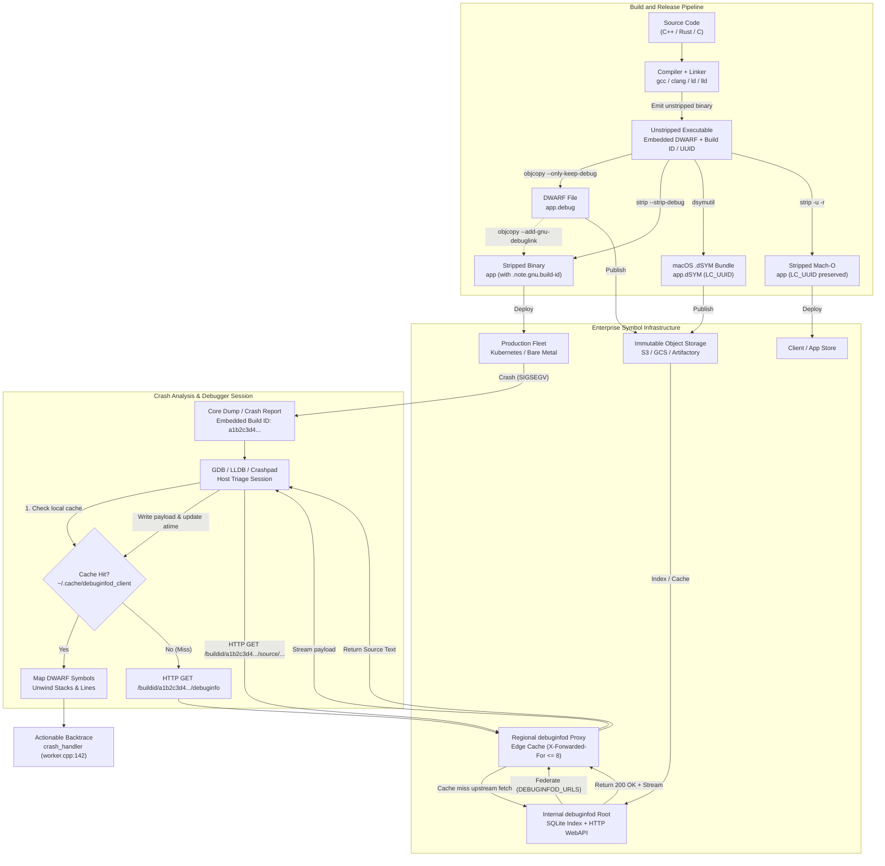

# Symbol Servers and debuginfod

> [!summary] Claim:
> Production binaries strip DWARF debugging sections to minimize artifact transfer size, container cold starts, and memory footprint, but crash triage and backtrace unwinding require exact DWARF symbols and source listings.
> Linux ELF binaries link stripped executables to their external DWARF counterparts through cryptographic hashes in `.note.gnu.build-id` and IEEE 802.3 CRC32 checksums in `.gnu_debuglink`, while macOS Mach-O binaries pair stripped executables with companion `.dSYM` bundles through 128-bit `LC_UUID` load commands.
> The `debuginfod` HTTP protocol standardizes on-demand, build-ID-keyed artifact retrieval (`/buildid/{id}/debuginfo`, `/buildid/{id}/executable`, `/buildid/{id}/source/{path}`, `/buildid/{id}/section/{name}`) with transparent multi-tier server federation, loop prevention via `X-Forwarded-For` hop counts, and local disk caching under `~/.cache/debuginfod_client`.
> Debuggers query these services dynamically via `set debuginfod enabled on` in GDB and `symbols.enable-external-lookup` in LLDB, replacing manual multi-gigabyte debuginfo package installations with on-demand downloads that are served from the local cache after the first fetch.



## The Mechanism

Every software binary running in production requires a trade-off between deployment efficiency and post-mortem debuggability.
Compiling with full DWARF debugging information (`-g` or `-g3`) adds `.debug_info`, `.debug_line`, `.debug_loclists`, `.debug_rnglists` (`.debug_ranges` before DWARF 5), and `.debug_str` sections that can dwarf the executable machine code itself.
The ratio varies with language, templates, and optimization level, so treat it as something to measure, not a constant.
One measured data point (as of 2026-11, macOS): a 10-line C++20 program using `<iostream>`, `<map>`, `<string>`, and `<vector>`, compiled with Apple clang 21.0.0 as `clang++ -g -c`, linked, then run through `dsymutil`.
At `-O0` it had 19,692 bytes of `__text` and 269,177 bytes of `__debug_*` sections (about 14 times).
At `-O2` it had 2,836 bytes of `__text` and 242,277 bytes of `__debug_*` sections (about 85 times), so the debug sections barely shrank while the code did.
Shipping monolithic unstripped binaries to production inflates container image layers, increases network transit overhead across deployment clusters, exhausts host page cache memory during cold-start dynamic linking, and exposes internal proprietary symbols to unauthorized reverse engineering.
Conversely, running completely stripped binaries strips away function names, parameter types, variable locations, and source line associations, rendering core dumps, crash tracebacks, and sampling profilers nearly useless during production incidents.
Symbol servers and the `debuginfod` protocol resolve this tension by decoupling the stripped runtime artifact from its debugging metadata, indexing debuginfo and source code by immutable cryptographic identity, and fetching required debug sections over HTTP on demand.

### 1. GNU Build IDs and ELF Note Sections

The foundation of modern separate debug information on Linux is the GNU Build ID.
Prior to the invention of build IDs, debuggers attempted to match stripped binaries with separate debug files using filesystem paths or timestamps.
This approach was brittle: moving a file, recompiling a target without altering its timestamp, or mounting filesystems across disparate machines resulted in mismatched symbol information and erroneous backtraces.

The GNU linker (`ld`), `gold`, `lld`, and `mold` generate a unique build identifier when passed the `--build-id` flag; most Linux distributions configure GCC with `--enable-linker-build-id` so the compiler driver passes it on every link.
The linker writes this identifier into an allocated ELF note section named `.note.gnu.build-id` (`SHT_NOTE`, flags `SHF_ALLOC`).
Because `.note.gnu.build-id` has the `SHF_ALLOC` flag set, it is covered by a `PT_NOTE` program header and sits inside the first loadable segment, so it is mapped into the process at runtime.
The kernel does not write a build-ID note into core files; instead the core carries an `NT_FILE` note listing file mappings, and with `coredump_filter` bit 4 ("Dump ELF headers", set by default when the kernel is built with `CONFIG_CORE_DUMP_DEFAULT_ELF_HEADERS`) it dumps the first page of each ELF mapping, which is where debuggers and `eu-unstrip -n --core` recover each module's build ID (source: core(5)).

The format of the `.note.gnu.build-id` section is governed by the standard 64-bit ELF note header (`Elf64_Nhdr`), defined in `<elf.h>`:

```c
typedef struct {
    Elf64_Word n_namesz; /* Length of the note owner name including null terminator */
    Elf64_Word n_descsz; /* Length of the descriptor / payload */
    Elf64_Word n_type;   /* Note type identifier */
} Elf64_Nhdr;
```

For a standard 160-bit SHA-1 build ID, the section consists of exactly 36 contiguous bytes:

```text
Offset  Field       Value               Description
0x00    n_namesz    0x00000004          Length of "GNU\0" (4 bytes)
0x04    n_descsz    0x00000014          20 bytes (0x14) for SHA-1 payload
0x08    n_type      0x00000003          NT_GNU_BUILD_ID (3)
0x0C    name        "GNU\0"             4-byte ASCII string identifying owner
0x10    desc        <20 bytes>          Cryptographic SHA-1 digest payload
```

The linker computes the descriptor digest by performing a cryptographic hash over the normalized contents of the output ELF binary.
During the link pass, the linker populates all section headers, symbol tables, and code segments, initializes the descriptor bytes to zero, runs the SHA-1 or MD5 hashing algorithm over the entire ELF image (excluding the `.note.gnu.build-id` payload itself), and writes the resulting digest into the descriptor field.
Because the build ID is derived directly from the binary bits, two builds produced from identical sources and deterministic linker inputs yield identical build IDs, whereas any code change, compiler flag change, or dependency update produces a completely different digest.

The canonical filesystem layout for storing debug files by build ID is:

```text
/usr/lib/debug/.build-id/xx/yyyyyyyyyyyyyyyyyyyyyyyyyyyyyyyyyyyyyy.debug
```

The first two hexadecimal characters (`xx`) form an intermediate directory to bound directory entry counts, while the remaining 38 hexadecimal characters (`yyyyyyyy...`) form the file stem.
The companion executable can be linked into the same hierarchy without the `.debug` extension:

```text
/usr/lib/debug/.build-id/xx/yyyyyyyyyyyyyyyyyyyyyyyyyyyyyyyyyyyyyy
```

### 2. The Legacy `.gnu_debuglink` Mechanism and CRC32 Verification

Before the widespread adoption of build IDs, GNU tools established separate debug files via the `.gnu_debuglink` section.
The `.gnu_debuglink` mechanism is maintained for backward compatibility and as a secondary validation link.
When an engineer runs `objcopy --only-keep-debug app app.debug` followed by `objcopy --add-gnu-debuglink=app.debug app`, `objcopy` inserts a `.gnu_debuglink` section into the runtime executable.

The `.gnu_debuglink` section format consists of:
1. The null-terminated ASCII basename of the debug file, stripped of any leading directory path components (for example, `app.debug\0`).
2. Zero to three zero bytes of padding to align the subsequent checksum field to a 4-byte boundary.
3. A 4-byte unsigned 32-bit Cyclic Redundancy Check (CRC) checksum stored in the endianness of the target binary.

The CRC algorithm specified by GDB is the standard IEEE 802.3 32-bit CRC (polynomial `0x04C11DB7` normal, `0xEDB88320` reversed).
The computation processes the separate debug file byte by byte, least-significant bit first, initialized with a seed of `0xFFFFFFFF`, and inverts the final accumulated register value with `~crc`:

```c
unsigned long gnu_debuglink_crc32(unsigned long crc, unsigned char *buf, size_t len) {
    static const unsigned long crc32_table[256] = { /* Standard IEEE 802.3 table */ };
    crc = ~crc;
    while (len--) {
        crc = (crc >> 8) ^ crc32_table[(crc & 0xFF) ^ *buf++];
    }
    return ~crc;
}
```

GDB first tries the build-ID path (`/usr/lib/debug/.build-id/xx/yyyy....debug`); if that fails, or the executable lacks a build ID, it reads the filename from `.gnu_debuglink` and searches three distinct locations in order (source: GDB manual, section 18.3):
1. The exact directory containing the executable binary (`./app.debug`).
2. A subdirectory named `.debug` located within the binary directory (`./.debug/app.debug`).
3. Global debug directories configured in GDB (`show debug-file-directory`, defaulting to the `--with-separate-debug-dir` configure value, typically `/usr/lib/debug`), appended with the absolute path of the executable (`/usr/lib/debug/usr/bin/app.debug`).

At each candidate location, GDB reads the candidate file, computes its IEEE 802.3 CRC32, and compares it to the checksum recorded in `.gnu_debuglink`.
If the CRC matches, GDB loads the symbol table.
If the CRC differs, GDB discards the candidate file and prints (text from `gdb/symfile.c`):

```text
warning: the debug information found in "/usr/lib/debug/usr/bin/app.debug" does not match "/usr/bin/app" (CRC mismatch).
```

While functional for local developer builds, `.gnu_debuglink` exhibits fatal scalability defects in distributed environments:
- The section contains only a basename, requiring directory-structured filesystem layouts on the debugging workstation.
- A 32-bit CRC provides only 4.29 billion distinct states; birthday paradox collisions occur with 50% probability across a corpus of roughly $\sqrt{2 \ln 2 \cdot 2^{32}} \approx 77,000$ files (about $1.18 \cdot 2^{16}$), risking mismatched symbol binding.
- It provides no protocol or addressing mechanism for network-based symbol discovery.

### 3. macOS Mach-O Debug Maps, dSYM Bundles, and `LC_UUID`

Apple's macOS and iOS toolchains operate on an entirely different debugging paradigm derived from NeXTSTEP STABS.
When `clang` compiles a source file on macOS (`clang -g -c worker.c -o worker.o`), the compiler writes full DWARF sections (`__debug_info`, `__debug_line`, `__debug_abbrev`) directly into the intermediate object file `worker.o`.
However, when the Apple linker (`ld64` or `lld`) links these object files into a dynamic library or executable, it deliberately does not merge or copy the DWARF sections into the output Mach-O binary.

Instead, the linker constructs a "debug map" inside the Mach-O symbol table (`LC_SYMTAB`).
The debug map consists of specialized STABS symbol entries:
- `N_SO`: The source directory and source file name.
- `N_OSO`: The absolute path to the object file on disk (`/path/to/worker.o`) along with its filesystem modification timestamp (`mtime`) encoded in the `n_value` field.
- `N_FUN`: Function symbols marking code addresses and function scopes.

Linking `clang -g` objects with Apple LLVM 21.0.0 on macOS arm64 confirms this: `nm -pa` on the executable lists `SO`, `OSO` (with the object's `mtime` in `n_value`), and `FUN` entries, and the executable carries no DWARF sections (as of 2026-11, macOS).
During local development, LLDB reads the debug map from the linked executable, follows the `N_OSO` pointers, verifies that the object file timestamps match `n_value` on disk, and reads DWARF information directly from the scattered `.o` files.
This optimization makes Mach-O linking extraordinarily fast because the linker never copies megabytes of DWARF data.
However, this architecture fails when shipping software: if the developer cleans their build tree (`rm *.o`) or deploys the binary to another machine, all debug info is severed.

To produce standalone, portable debug symbols on Apple platforms, the build pipeline must run `dsymutil`:

```bash
dsymutil worker -o worker.dSYM
```

`dsymutil` performs the following operations:
1. It reads the debug map from the Mach-O binary.
2. It parses each referenced `.o` file and compares the file modification time with the `N_OSO` timestamp; on a mismatch it prints `timestamp mismatch between object file (...) and debug map (...)` as a warning and, with Apple LLVM 21.0.0, still links that object's DWARF (measured locally, as of 2026-11, macOS).
3. It extracts the DWARF sections from every object file.
4. It performs virtual address relocation, translating object-local offsets into final linked addresses.
5. It performs ODR-based type uniquing (disabled with `--no-odr`), keeping one copy of each identical C++ struct and class definition across translation units instead of emitting DWARF type units.
6. It writes the consolidated DWARF payload into a standardized directory bundle:

```text
worker.dSYM/
\-- Contents/
    |-- Info.plist
    \-- Resources/
        \-- DWARF/
            \-- worker
```

The executable inside `worker.dSYM/Contents/Resources/DWARF/worker` is itself a Mach-O file containing DWARF sections but no executable code sections.
To guarantee that the stripped runtime binary matches the `.dSYM` bundle, Apple toolchains embed a 128-bit UUID into every Mach-O header via the `LC_UUID` load command.
The `LC_UUID` load command is defined in `<mach-o/loader.h>` (checked against the macOS SDK header; `otool -l` reports `cmdsize 24`):

```c
struct uuid_command {
    uint32_t cmd;      /* LC_UUID (0x1b) */
    uint32_t cmdsize;  /* sizeof(struct uuid_command) == 24 bytes */
    uint8_t  uuid[16]; /* 128-bit unique identifier */
};
```

Both the stripped production binary and the inner DWARF binary in the `.dSYM` bundle carry identical 128-bit `uuid` bytes.
You inspect the UUID using `dwarfdump`:

```bash
dwarfdump --uuid worker
dwarfdump --uuid worker.dSYM
```

On macOS, symbol location is coordinated by the system framework `DebugSymbols.framework`.
When LLDB or the macOS crash reporter processes a binary or crash log, it queries `DebugSymbols.framework` with the binary's `LC_UUID`.
The framework queries macOS Spotlight metadata indexes with `com_apple_xcode_dsym_uuids == <UUID>` (the same query LLDB's `crashlog.py` issues through `mdfind`).
Additionally, `DebugSymbols.framework` reads user preferences from the `com.apple.DebugSymbols` defaults domain (`defaults read com.apple.DebugSymbols`), including `DBGFileMappedPaths` and `DBGSpotlightPaths`.
If configured with the `DBGShellCommands` key, it executes an external script (historically named `dsymForUUID`), passing the UUID as an argument to fetch or download the matching `.dSYM` bundle from internal network storage.

### 4. The debuginfod Architecture and WebAPI Specification

The `debuginfod` project, first released in `elfutils 0.178` ("All the build-id you can count!") in November 2019, transformed Linux symbol management by creating an open, vendor-neutral, HTTP-based symbol federation standard.
`debuginfod` treats debug information as a content-addressed distributed key-value store, where the key is the lowercase hexadecimal GNU Build ID.

The `debuginfod` server exposes a minimal, cache-friendly REST API over HTTP/1.1:

| HTTP Request Path | HTTP Success | Content-Type | Payload Description |
| :--- | :--- | :--- | :--- |
| `GET /buildid/{BUILDID}/debuginfo` | `200 OK` | `application/octet-stream` | The unstripped ELF binary or separate DWARF debug file matching `{BUILDID}`. |
| `GET /buildid/{BUILDID}/executable` | `200 OK` | `application/octet-stream` | The stripped or unstripped executable ELF binary matching `{BUILDID}`. |
| `GET /buildid/{BUILDID}/source/{PATH}` | `200 OK` | `application/octet-stream` | The original source code file referenced by DWARF compilation units at canonical path `{PATH}` (the server sends every file response as `application/octet-stream`; `debuginfod.cxx`). |
| `GET /buildid/{BUILDID}/section/{NAME}` | `200 OK` | `application/octet-stream` | The raw binary bytes of a specific ELF section named `{NAME}` (such as `.debug_line` or `.gdb_index`). |
| `GET /metrics` | `200 OK` | `text/plain` | Prometheus-formatted operational telemetry counters and histograms. |
| `GET /metadata?key=K&value=V` | `200 OK` | `application/json` | JSON array containing file paths, package names, and build IDs matching metadata queries. |

The client function `debuginfod_find_section` arrived in elfutils 0.188 and the metadata query API in 0.192 (NEWS); the man page warns that the set of `/metrics` names may change between versions (as of 2026-11, Linux).
Successful file responses also carry `X-DEBUGINFOD-FILE`, `X-DEBUGINFOD-SIZE`, and, for archive members, `X-DEBUGINFOD-ARCHIVE` headers.
If a requested build ID or path does not exist on the server or any of its upstream federated peers, the server responds with `404 Not Found`.

#### Source Path Canonicalization and RFC 3986

When a debugger steps through code or formats a stack frame, it reads the compilation unit directory (`DW_AT_comp_dir`) and the source filename (`DW_AT_name`) from the DWARF line table.
To retrieve the exact source file from `debuginfod`, the client concatenates `DW_AT_comp_dir` with the source path.
Because `DW_AT_comp_dir` is typically an absolute path such as `/home/builder/src/` and the source path is `engine/core.cpp`, the resulting URL path becomes:

```text
/buildid/0123456789abcdef0123456789abcdef01234567/source/home/builder/src/engine/core.cpp
```

When `DW_AT_name` is itself an absolute path such as `/usr/include/stdlib.h`, concatenating `DW_AT_comp_dir/` and `/usr/include/stdlib.h` produces a double slash (`//`).
The debuginfod(8) WEBAPI section states that the server canonicalizes incoming source paths according to RFC 3986 section 5.2.4 ("Remove Dot Segments"), collapsing `.` and `..` components, "plus reducing any `//` to `/` in the path"; it also asks clients to %-escape characters outside the RFC 3986 "unreserved" set.
This guarantees that clients can construct queries deterministically without pre-normalizing compiler path artifacts.

#### Server Indexing and SQLite Storage

The `debuginfod` daemon continuously scans designated directories, compressed archives, and package managers.
The administrator configures indexing targets via CLI flags:
- `-F`: Scan standalone filesystem directories for raw ELF and DWARF files.
- `-R`: Scan RPM package archives (`.rpm`), parsing internal payload archives via `libarchive` (equivalent to `-Z .rpm=cat`).
- `-U`: Scan Debian package archives (`.deb`, `.ddeb`, `.ipk`).
- `-d FILE`: Path to the internal SQLite database (defaulting to `$HOME/.debuginfod.sqlite`).
- `-p PORT`: TCP port for the HTTP server (default `8002`).
- `-t SECONDS`: Rescan interval for the file and archive directories (default 300 seconds); `SIGUSR1` forces a rescan.
- `-c NUM`: Concurrency limit for the scanning queue threads.
- `-g SECONDS`: Grooming pass interval (default 86,400 seconds); the groomer removes entries whose underlying files were deleted or changed, and `SIGUSR2` forces a pass.

Internally, `debuginfod` stores the index inside an SQLite database configured in Write-Ahead Logging (`pragma journal_mode = wal`) mode.
The schema maintains tables linking build IDs to file paths, archive members, and source paths.
For ordinary archives `debuginfod` re-reads the archive through `libarchive` on a request and keeps recently extracted members in a file-descriptor cache (`--fdcache-*` options) with prefetching of sibling members; only multi-block xz-compressed RPM payloads get a `_r_seekable` table of member offsets that lets the server seek directly to the requested file (`debuginfod.cxx`, as of 2026-11, Linux).

#### Client-Side Operation and Cache Lifecycle

The client side of `debuginfod` is encapsulated in `libdebuginfod.so`, part of `elfutils`.
Client applications initialize the library using the C API:

```c
#include <elfutils/debuginfod.h>

debuginfod_client *client = debuginfod_begin();
char *path = NULL;
int fd = debuginfod_find_debuginfo(client, build_id_bytes, build_id_len, &path);
if (fd >= 0) {
    /* File successfully retrieved; path contains absolute path in local cache */
    close(fd);
    free(path);
}
debuginfod_end(client);
```

When `debuginfod_find_debuginfo` is invoked, the library executes the following sequence:
1. It reads the `DEBUGINFOD_URLS` environment variable, which contains a space-separated list of server URLs (for example, `DEBUGINFOD_URLS="https://debuginfod.elfutils.org https://symbols.corp.internal"`).
   If `DEBUGINFOD_URLS` is empty or unset, the library returns `-ENOSYS` without even accessing the cache (`debuginfod-client.c`).
2. It constructs the local cache path.
   The root cache directory is governed by `DEBUGINFOD_CACHE_PATH`, defaulting to `$XDG_CACHE_HOME/debuginfod_client` or `~/.cache/debuginfod_client` (a pre-existing legacy `~/.debuginfod_client_cache` is still honored).
3. It checks for a local cache hit under `~/.cache/debuginfod_client/{BUILDID}/debuginfo`.
   If the file exists and has a non-zero length, it updates the file's access time (`atime`, via `futimens` with `UTIME_NOW`) and returns an open file descriptor.
4. It checks for a **negative cache hit**.
   If `~/.cache/debuginfod_client/{BUILDID}/debuginfo` exists as a **zero-byte file**, the library inspects its modification time (`mtime`).
   The cache directory contains a control file named `cache_miss_s` defining the negative cache expiration threshold (defaulting to 600 seconds / 10 minutes).
   If the zero-byte file is no older than `cache_miss_s`, the library immediately returns `-ENOENT` without opening a network socket; an older sentinel is unlinked and the query proceeds.
5. If the file is not cached, the client queries the URLs in `DEBUGINFOD_URLS` in parallel through a libcurl multi handle, and the first server to start delivering the file wins.
   It enforces `DEBUGINFOD_TIMEOUT` (default 90 seconds) per connection: a server is skipped if it fails to connect within the timeout or fails to deliver at least 100 KB within it (`CURLOPT_CONNECTTIMEOUT_MS` plus `CURLOPT_LOW_SPEED_LIMIT`/`_TIME`; debuginfod-client-config(7)).
6. Upon receiving a `200 OK` response, the client streams the payload into a temporary file in the cache directory, atomically renames it to `~/.cache/debuginfod_client/{BUILDID}/debuginfo` via `rename()`, sets file permissions, and returns the open file descriptor.
7. If all upstream servers return `404 Not Found`, the client creates the zero-byte sentinel file to record the negative result.

Cache cleanup is fully automated.
Before executing queries, `libdebuginfod` checks the timestamp of the control file `cache_clean_interval_s` (default 86,400 seconds / 1 day).
If the file's `mtime` indicates that a day has passed since the last cleanup pass, the client traverses the cache tree, unlinks any regular file whose `atime` is older than `max_unused_age_s` (default 604,800 seconds / 1 week), and updates `cache_clean_interval_s` to reset the timer.

#### Upstream Federation and Loop Prevention

A critical architectural feature of `debuginfod` is transparent server federation.
When an intermediate or regional `debuginfod` server receives a request for a build ID not present in its local storage or SQLite database, it acts as a client itself: it inspects `DEBUGINFOD_URLS` in its own environment and queries its configured upstream servers.
If an upstream server provides the artifact, the intermediate server streams the bytes back to the requesting client while simultaneously caching the file in its own `DEBUGINFOD_CACHE_PATH`.
Subsequent requests from any developer or crash analysis worker in that region are served directly from the local intermediate cache.

To bound circular forwarding storms in complex corporate network topologies (such as Server A proxying to Server B while Server B proxies back to Server A), `debuginfod` enforces a hop limit on the standard HTTP `X-Forwarded-For` header; it is a TTL, not cycle detection (the source comment reserves the header "for future cyclicity detection").
Every server proxying a request upstream appends the incoming client's numeric IP address to `X-Forwarded-For`.
Before delegating a cache miss upstream, `debuginfod` counts the entries already present in the incoming `X-Forwarded-For` header.
If the count reaches or exceeds `--forwarded-ttl-limit` (default **8 hops**, configurable), the server does not query upstream and returns `404 Not Found` with the message "not found, --forwared-ttl-limit reached and will not query the upstream servers" (`debuginfod.cxx`, as of 2026-11, Linux).

## Commands and Numbers to Know

The following table provides reference operational parameters, configuration flags, default timeouts, and section sizes across Linux and macOS symbol management systems.

| Parameter / Configuration / Flag | Default Value | Target Platform | Description & Mechanical Context |
| :--- | :--- | :--- | :--- |
| `DEBUGINFOD_URLS` | Unset / empty | Both (as of 2026-11) | Space-separated list of HTTP/HTTPS debuginfod server URLs queried by `libdebuginfod` and LLDB. |
| `DEBUGINFOD_CACHE_PATH` | `~/.cache/debuginfod_client` | Linux (as of 2026-11) | Root local directory path for storing cached debuginfo, executables, source files, and cache control files. |
| `DEBUGINFOD_TIMEOUT` | `90` seconds | Linux (as of 2026-11) | Per-connection commencing timeout: a server is skipped if it cannot connect, or deliver at least 100 KB, within this many seconds. Zero or negative disables it. |
| `DEBUGINFOD_MAXTIME` | `0` (unlimited) | Linux (as of 2026-11) | Maximum total transfer duration in seconds for completing an entire download. |
| `DEBUGINFOD_MAXSIZE` | `0` (unlimited) | Linux (as of 2026-11) | Upper limit on downloadable artifact size in bytes; larger downloads are rejected by client. |
| `cache_clean_interval_s` | `86400` (1 day) | Linux (as of 2026-11) | Client cache control file specifying how often the background cache grooming pass sweeps unaccessed files. |
| `max_unused_age_s` | `604800` (7 days) | Linux (as of 2026-11) | Maximum time an unused cached symbol artifact is retained without being touched before deletion. |
| `cache_miss_s` | `600` (10 minutes) | Linux (as of 2026-11) | Duration in seconds that zero-byte negative cache sentinel files are honored before retrying remote servers. |
| `--forwarded-ttl-limit` | `8` hops | Linux (as of 2026-11) | Server option: when the incoming `X-Forwarded-For` already lists this many hops, a local miss is not delegated upstream and the server returns 404. |
| `set debuginfod enabled` | `ask` (interactive) / `off` (non-interactive) | Linux (as of 2026-11) | GDB setting controlling symbol server queries: `on`, `off`, or `ask` (which prompts user at first lookup). |
| `plugin.symbol-locator.debuginfod.server-urls` | Inherited from env | Both (as of 2026-11) | LLDB setting array containing upstream debuginfod server URLs; when empty, LLVM's debuginfod client falls back to `DEBUGINFOD_URLS`. |
| `symbols.enable-external-lookup` | `true` | Both (as of 2026-11) | LLDB global setting controlling external symbol lookups via Spotlight, `/usr/lib/debug`, and symbol-locator plugins; the debuginfod locator returns nothing when it is `false`. |
| `symbols.enable-background-lookup` | `false` | Both (as of 2026-11) | LLDB backward-compatibility alias; `true` is equivalent to `symbols.auto-download background`. |
| `Elf64_Nhdr` size | `12` bytes | Linux (as of 2026-11) | Structure size of 64-bit ELF note header (`n_namesz` + `n_descsz` + `n_type`). |
| `.note.gnu.build-id` total size | `36` bytes | Linux (as of 2026-11) | Total size for standard SHA-1 build ID: 12 B header + 4 B `"GNU\0"` name + 20 B hash payload. |
| `struct uuid_command` size | `24` bytes | macOS (as of 2026-11) | Size of Mach-O `LC_UUID` load command: 4 B `cmd` (`0x1b`) + 4 B `cmdsize` (`24`) + 16 B UUID payload. |
| `.gnu_debuglink` CRC polynomial | `0x04C11DB7` | Linux (as of 2026-11) | Standard IEEE 802.3 CRC-32 polynomial used to compute the trailing checksum in `.gnu_debuglink`. |

## Multi-Language Comparison: Symbol Management Across C++, Python, and Rust

Symbol generation, stripping, and on-demand retrieval mechanisms vary significantly across compiled and interpreted language runtimes.
The table below contrasts how C++, Python, and Rust generate build identities, separate debug metadata, and interface with symbol servers.

| Capability / Concern | C++ (GCC / Clang) | Python (CPython / Extensions) | Rust (rustc / Cargo) |
| :--- | :--- | :--- | :--- |
| **Debuginfo Format & Generation** | DWARF 4 or DWARF 5 embedded directly in ELF sections or Mach-O `.o` object debug maps via `-g`. | Interpreted bytecode (`.pyc`) contains code objects (`co_code`, `co_firstlineno`, `co_filename`). C extensions contain standard DWARF. | DWARF 4 / 5 generated via `-C debuginfo=line-tables-only`, `-C debuginfo=1` (`limited`: no type or variable-level information), or `-C debuginfo=2` (full variables and types). |
| **Unique Build Identity** | Linker generates `.note.gnu.build-id` (ELF) via `-Wl,--build-id=sha1` or `LC_UUID` (Mach-O). | Python `.pyc` files use a 16-byte header (PEP 552: magic, flags word, then mtime and source size or an 8-byte source hash). C extension `.so` inherits ELF build ID. | rustc does not pass `--build-id` itself on Linux (only its Fuchsia target spec does); the build ID comes from the system `cc` driver default. Apple `ld` emits `LC_UUID` by default. |
| **Symbol Separation Tooling** | `objcopy --only-keep-debug` followed by `strip --strip-debug` or `strip -s`. macOS uses `dsymutil`. | `auditwheel repair` strips `.so` files only when given `--strip` (default off). Python bytecode is not stripped. | Cargo configuration: `[profile.release] split-debuginfo = "packed"` (creates `.dwp` or `.dSYM`) and `strip = "debuginfo"`. |
| **Symbol Server Protocol** | Native debuginfod support in GDB (`set debuginfod enabled on`) and LLDB (`plugin.symbol-locator.debuginfod`). | Native debuginfod retrieves DWARF for `libpython3.x.so` and compiled C extensions; Python frames require `python-gdb.py`. | Fully supported by debuginfod; GDB and LLDB download Rust unstripped binaries and demangle `v0` symbol names. |
| **Source Path Normalization** | Path remapping via compiler flags: `-fdebug-prefix-map=$PWD=.` or `-ffile-prefix-map`. | Controlled via installation paths and `PYTHONPATH`. Frame objects store runtime filesystem paths in `f_code.co_filename`. | Remapping via rustc flag `--remap-path-prefix=$PWD=.` prevents leaking build-machine absolute directory paths into DWARF. |
| **Crash Triage Integration** | Core dumps contain register states and memory maps; debuginfod resolves instruction pointer to file and line. | `faulthandler` dumps Python backtrace to `stderr`; C extension crashes emit core dumps requiring debuginfod for C stack. | Panics format backtraces via `RUST_BACKTRACE=1`; fatal aborts emit core dumps symbolicated via debuginfod. |

## Worked Example: End-to-End Build ID Generation, Symbol Stripping, and debuginfod Protocol

The lab in `code/03-Debugging/symbol_server_model/` is a model of the build-ID lookup path, not the elfutils server.
It needs only `python3` and loopback networking, so it runs on macOS and Linux alike; run it with `cd code && make verify LAB=03-Debugging/symbol_server_model/`.

1. `build_elf` writes a 156-byte ELF64 image: a 64-byte header, one 56-byte `PT_NOTE` program header, and a 36-byte `NT_GNU_BUILD_ID` note (12-byte `Elf64_Nhdr`, the owner `GNU\0`, and 20 digest bytes).
   `parse_build_id` walks the program headers back to the note and returns the digest as hex.
   The lab also compares the note bytes with a hand-written literal, so a writer and parser that share one mistake cannot pass together.
2. Two `http.server` tiers run on ephemeral loopback ports: a root holding the debuginfo and source, and an edge with an empty store that delegates a local miss to the root.
   The client asks only the edge; the root's request log shows the edge appended the client address to `X-Forwarded-For`.
3. The client keeps one cache directory per build ID.
   A non-empty `debuginfo` file is a hit that sends no request, and an empty file is a negative result that also sends no request until its `mtime` is older than `cache_miss_s` (600 seconds in the lab, the libdebuginfod default).
4. A transport failure (connection refused) raises and writes no sentinel, so an outage is never remembered as "this build ID does not exist".
5. The source route collapses `//` and `.`/`..` segments before the lookup, as RFC 3986 section 5.2.4 prescribes for the path.
6. The hop limit mirrors `debuginfod.cxx`: the server counts the entries in the incoming `X-Forwarded-For` header and, at 8 or more, refuses to delegate a local miss and answers `404`.
   A request the server can answer from its own store is still served at 8 hops.

What the output proves and what it does not:
- Each cache line is backed by the servers' request counters, not by a message: the lab fails if a cache hit or a negative hit sends any request, or if an expired sentinel does not trigger exactly one new query.
- The lab proves the protocol shape (routes, status codes, cache rules, TTL rule) of the model.
  It does not prove elfutils behavior: the real client also checks `DEBUGINFOD_URLS`, races several servers in parallel, enforces timeouts, and reads `cache_miss_s` and its two sibling control files from the cache directory, none of which the model implements.
- The lab does not touch real ELF section headers, `.gnu_debuglink`, or any Mach-O structure; those claims in this note rest on the cited manuals and sources, and the Practice Drill below exercises the real tools.

### Verified output

Recorded by `make record` on darwin-arm64 on 2026-11-08; the file is `code/03-Debugging/symbol_server_model/expected/darwin-arm64.txt`, and the block below is a byte-for-byte copy.
The output holds no ports, temporary paths, or timestamps, so it is the same on every run.

```text
== Step 1: ELF build-id note
image bytes: 156
note bytes: 36
build id: 0123456789abcdef0123456789abcdef01234567
== Step 2: federation through the edge
downloaded bytes: 412
edge requests: 1, root requests: 1
root saw X-Forwarded-For entries: 1
== Step 3: positive cache hit
requests after second lookup: edge 1, root 1
== Step 4: negative cache
sentinel bytes: 0
requests added by repeat lookup: 0
requests added after the sentinel aged past cache_miss_s: 1
== Step 5: transport errors are not negative results
unreachable server raised RuntimeError
sentinel written: no
== Step 6: source path canonicalization
source/usr/src/app/main.cpp: 200
source//usr/src/app/main.cpp: 200
source/usr/src/app/../app/main.cpp: 200
source/usr/src/app/other.cpp: 404
== Step 7: forwarded-ttl limit applies to delegation only
7 hops, local miss: 200 (delegated)
8 hops, local miss: 404 (not delegated)
8 hops, local hit: 200
all checks passed
```

## Pitfalls

> [!warning] Pitfall 1: Stripping `.note.gnu.build-id` with Aggressive Linker or Strip Flags
> Running `strip --remove-section=.note.gnu.build-id` or invoking aggressive third-party binary minifiers/packers strips the ELF note section.
> Without `.note.gnu.build-id`, the executable becomes an anonymous byte sequence.
> Production crash handlers (such as Crashpad or systemd-coredump) and host debuggers cannot determine which DWARF package corresponds to the crashing process.
> Always preserve `.note.gnu.build-id` by restricting strip invocations to `strip --strip-debug` or `strip --strip-unneeded`, and verify with `readelf -n <binary>` in CI deployment stages.

> [!warning] Pitfall 2: The `dsymutil` Stale Object File Race on macOS
> On macOS, `clang` and `ld64` construct a debug map containing absolute paths and timestamps of intermediate `.o` object files.
> If a build script deletes the intermediate object directory (`rm -rf build/*.o`) before running `dsymutil`, `dsymutil` warns `unable to open object file: No such file or directory` and `no debug symbols in executable`, still exits 0, and writes a `.dSYM` bundle (with the correct UUID) containing zero DWARF subprogram entries (measured with Apple LLVM 21.0.0, as of 2026-11, macOS).
> Similarly, if a caching build system (like ccache) mutates an object file's timestamp on disk without re-linking, `dsymutil` warns `timestamp mismatch between object file (...) and debug map (...)`; in the same measurement it still linked that object's DWARF, so if the object's contents also changed, the `.dSYM` silently describes code that differs from the executable.
> Because both failures exit 0, gate CI on the warnings or on a `dwarfdump --debug-info` entry count, and run `dsymutil` immediately after the link step while `.o` files remain untouched on disk.

> [!warning] Pitfall 3: 404 Negative Cache Poisoning During CI Deployment Races
> When a new service binary is deployed to a production canary, a crash may occur within seconds of rollout.
> If automated crash symbolication daemons query `debuginfod` before the CI/CD pipeline has completed uploading the corresponding `.debug` file to the symbol repository, `debuginfod` returns `404 Not Found`.
> The client library immediately writes a zero-byte negative cache file with a 10-minute time-to-live (`cache_miss_s = 600`).
> For the next 10 minutes, all subsequent triage attempts on that machine fail with negative cache hits, even after the CI pipeline successfully finishes publishing symbols.
> Mitigate this race by configuring CI to upload debuginfo to symbol servers *before* deploying runtime binaries to production fleets, or temporarily wipe `$DEBUGINFOD_CACHE_PATH/{BUILDID}` during automated incident response.

> [!warning] Pitfall 4: GDB Startup Freezes from Unreachable `DEBUGINFOD_URLS`
> If a developer's dotfiles configure `DEBUGINFOD_URLS="https://symbols.internal.corp"` and the developer launches GDB while off-VPN or disconnected from the corporate network, GDB hangs.
> For every shared library mapped by the dynamic loader (frequently 30 to 80 libraries per process), `libdebuginfod` initiates a connection and, when packets are silently dropped rather than refused, waits up to `DEBUGINFOD_TIMEOUT` (default 90 seconds per query; the URLs in one query are tried in parallel).
> A process with 40 shared libraries can therefore freeze GDB startup for up to an hour (40 x 90 s = 3,600 s); a refused connection fails immediately instead.
> Guard against this in `.gdbinit` by checking network reachability before exporting `DEBUGINFOD_URLS`, or reduce the timeout by setting `export DEBUGINFOD_TIMEOUT=3`.

> [!warning] Pitfall 5: Inconsistent Source Path Prefixes (`-fdebug-prefix-map` Mismatches)
> Hermetic containerized builds compile software under ephemeral paths such as `/workspace/src/` or `/build/agent-01/`.
> When GDB requests source code via `debuginfod`, it requests `/buildid/{id}/source/workspace/src/app.cpp`.
> If the symbol server indexes sources relative to the repository root without recording or remapping compiler path prefixes, source queries fail with 404 errors despite full symbol table resolution.
> Address this by passing `-ffile-prefix-map=$PWD=.` during compilation and configuring `debuginfod` with the base source directory trees.

> [!warning] Pitfall 6: Infinite Proxy Loops in Federated debuginfod Topologies
> In multi-cluster setups, deploying a regional debuginfod caching proxy that lists an upstream server which inadvertently delegates back to the regional proxy creates a circular query storm.
> While `debuginfod` enforces an 8-hop ceiling (`--forwarded-ttl-limit`) via `X-Forwarded-For`, an 8-hop cascade across high-concurrency crash triages can exhaust server thread pools and saturate WAN connections.
> Design federation hierarchies strictly as Directed Acyclic Graphs (DAGs); `debuginfod` exports no dedicated loop metric (as of 2026-11, Linux), so watch the 404 share of `http_responses_total` on `/metrics` and grep the server log for "--forwared-ttl-limit reached".

## At Scale

At enterprise scale (1,000 to 50,000+ engineers, hundreds of daily service deployments, and millions of daily crash reports), symbol management shifts from a local developer convenience to mission-critical infrastructure.
The economics and operational patterns evolve drastically across organizational tiers:

```text
Team Size    Symbol Storage Strategy      Distribution Model         Network / Cache SLA
1 - 10       Local unstripped binaries    Direct filesystem paths    Zero network latency;
             or local .dSYM bundles       or shared NFS directory    disk-bound builds.

10 - 500     Central debuginfod server    HTTP debuginfod backed     Single server, 1-2 TB disk,
             scanning build artifact      by internal artifact       100 Mbps WAN, default
             repositories (Nexus/Artif.)  repository (RPM/DEB)      client-side caching.

500 - 50k+   Multi-tier federated CDN +   Content-addressed S3/GCS   Sub-10ms edge cache hits,
             regional debuginfod caches   backed by Kafka ingestion  petabyte storage, automated
             with source code ACLs        and Anycast routing        tiering, SOC 2 / ITAR ACLs.
```

### 1. Build and Ingestion Pipelines

At hyperscale, continuous integration systems cannot afford to let debuginfod crawl filesystem directories or scan monolithic package archives periodically.
Filesystem scanning (`-F`) and periodic grooming (`-g`) over millions of files saturates storage I/O and creates a multi-hour delay between compilation and symbol availability.
Modern production pipelines implement event-driven symbol ingestion:
1. **Compilation & Extraction:** CI workers compile binaries with `-Wl,--build-id=sha1`.
   A post-build step runs `eu-strip -f app.debug app` (or `objcopy --only-keep-debug` and `strip`).
2. **Object Store Ingestion:** The build system pushes `app.debug` directly to an object storage bucket (Amazon S3 or Google Cloud Storage) under the key `debuginfo/{BUILDID}`.
   Because build IDs are cryptographically unique and immutable, the object store bucket is configured with immutable object locking (WORM - Write Once, Read Many).
   Duplicate uploads of identical builds are naturally deduplicated.
3. **Event Notification:** The upload completion triggers an event (via Amazon SQS or Apache Kafka) received by a fleet of horizontally scaled `debuginfod` ingest workers.
   The workers insert the metadata directly into the indexing database without executing disk crawls.
4. **Binary Deployment:** The stripped runtime binary is packaged into a container image and deployed.
   Because the symbol store is populated before deployment, zero 404 negative cache poisoning occurs during production rollouts.

### 2. Multi-Region Federation and Caching Topology

In globally distributed engineering organizations, engineers in North America, Europe, and Asia debug production crashes across multi-region datacenters.
Directing global GDB or LLDB sessions to a single central symbol repository across transoceanic WANs introduces hundreds of milliseconds of round-trip latency, stalling debugger interactions.

The paved road architecture deploys a hierarchical caching tree:
- **Central Storage Layer:** Durable, multi-region object storage holding petabytes of compressed debuginfo.
- **Root debuginfod Cluster:** Stateless autoscaling containers sitting behind a Network Load Balancer, reading metadata from an Aurora or Cloud Spanner database and streaming payloads from object storage.
- **Regional Edge Caches:** Lightweight `debuginfod` servers or standard HTTP caching reverse proxies (such as Nginx, Varnish, or Envoy) deployed inside regional developer datacenters and Kubernetes clusters.
- **Client Tier:** Workstations and automated crash processors maintain local caches under `~/.cache/debuginfod_client`, absorbing repeat symbol lookups, so the share of requests that reach a server depends on how many distinct build IDs the fleet crashes on, which only your own `/metrics` can tell you.

### 3. Automated Lifecycle Policies and Storage Economics

Retaining every DWARF file indefinitely across tens of thousands of daily microservice builds is economically unsustainable.
A 500 MB DWARF file generated 20,000 times per day equates to 10 terabytes of new debug metadata daily, or 3.65 petabytes annually.

Distinguished-level infrastructure implements automated tiering:
- **Production Canary and Production Release Binaries:** Any binary deployed to production environments is tagged as an authoritative release.
  Authoritative DWARF files are retained indefinitely (or for 3 to 7 years to satisfy regulatory compliance and financial audit trails).
- **Development and Ephemeral CI Feature Builds:** DWARF artifacts generated by pull request testing or local ephemeral builds are tagged with an expiration TTL (typically 14 to 30 days).
  Object lifecycle policies transition these artifacts to cheaper archival storage (such as S3 Glacier or GCS Coldline) after 7 days, and delete them after 30 days.

### 4. Security, Access Control, and Source Redaction

While symbol tables (`.symtab` and `.debug_line`) pose minimal security risk, source code files (`/buildid/{id}/source/{path}`) expose raw intellectual property, algorithmic trade secrets, and embedded configuration metadata.
Allowing unauthenticated access to `debuginfod` source endpoints can violate corporate security policies, SOC 2 compliance, and regulatory frameworks (such as ITAR or HIPAA).

Production symbol servers enforce strict endpoint separation:
- **Public / Unauthenticated Tier:** Endpoints for `/debuginfo`, `/executable`, and `/section` are exposed to internal developer networks without credentials, allowing debuggers, profilers (`perf`), and crash loggers to resolve stack traces without authentication hurdles.
- **Authenticated / Authorized Tier:** The `/source` endpoint requires mTLS (mutual TLS) with developer certificates or an OAuth 2.0 / OIDC Bearer token validated via reverse proxy.
  If an engineer lacks read access to the underlying git repository, the proxy rejects the source request with `403 Forbidden` while still permitting symbol unwinding.

## Practice Drill

> [!tip] Practice Drill: Stand Up a Local debuginfod Server and Symbolicate a Stripped Core Dump
> Compile a crashing C program with an explicit GNU build ID, strip all DWARF sections to induce symbol starvation in GDB, and deploy an isolated `debuginfod` HTTP daemon to restore full symbol unwinding dynamically.

### Step 1: Write and Compile the Crashing Target

Create a target file `crash_target.c` containing a deliberate null pointer dereference:

```c
/* crash_target.c */
#include <stdio.h>
#include <stdlib.h>

void execute_transaction(int *balance, int delta) {
    *balance += delta; /* Segfaults when balance is NULL */
}

void process_request(int user_id) {
    int *account_balance = NULL;
    execute_transaction(account_balance, 500);
}

int main(int argc, char **argv) {
    printf("Starting transaction processor...\n");
    process_request(1001);
    return 0;
}
```

Compile with full debug information, optimizations enabled, and an explicit GNU build ID:

```bash
gcc -g -O2 -Wl,--build-id=sha1 crash_target.c -o crash_target
```

Extract the build ID using `readelf`:

```bash
BUILD_ID=$(readelf -n crash_target | grep "Build ID" | awk '{print $3}')
echo "Target Build ID: ${BUILD_ID}"
```

### Step 2: Separate Symbols and Strip the Executable

Create a dedicated symbol repository directory and split the binary:

```bash
mkdir -p /tmp/symbol_store
objcopy --only-keep-debug crash_target /tmp/symbol_store/crash_target.debug
strip --strip-debug --strip-unneeded crash_target
```

Verify that `crash_target` no longer contains DWARF sections:

```bash
readelf -S crash_target | grep debug
# Output is empty: all .debug_* sections have been stripped
```

### Step 3: Generate the Core Dump and Observe Symbol Starvation

Enable core dump generation and run the stripped binary:

```bash
ulimit -c unlimited
./crash_target
# Segmentation fault (core dumped)
```

Locate the generated core file (typically `core` or via `/var/lib/systemd/coredump` / `/proc/sys/kernel/core_pattern`).
Launch GDB without configuring symbol servers:

```bash
gdb --batch -ex "set debuginfod enabled off" -ex "bt" ./crash_target core
```

Observe the degraded output.
Recorded in a container on 2026-11-08 (Ubuntu 24.04.5 LTS, linux-aarch64, gcc 13.3.0, gdb 15.1, elfutils debuginfod 0.190); this block is not covered by `make verify`, and the addresses change on every run because of ASLR:

```text
[New LWP 2493]
[Thread debugging using libthread_db enabled]
Using host libthread_db library "/lib/aarch64-linux-gnu/libthread_db.so.1".
Core was generated by `./crash_target'.
Program terminated with signal SIGSEGV, Segmentation fault.
#0  0x0000aaaad56c0658 in ?? ()
#0  0x0000aaaad56c0658 in ?? ()
#1  0x0000ffffa3f484c4 in ?? () from /lib/aarch64-linux-gnu/libc.so.6
#2  0x0000ffffa3f48598 in __libc_start_main () from /lib/aarch64-linux-gnu/libc.so.6
#3  0x0000aaaad56c06b0 in ?? ()
```

The first `#0` line is GDB announcing the selected frame when the core loads, and the second is the first line of `bt`.

Because symbols were stripped, function names, source filenames, line numbers, and parameters display as `?? ()`.

### Step 4: Launch debuginfod and Verify Automatic Symbolication

Start a local `debuginfod` daemon indexing the separate debug file directory:

```bash
debuginfod -F -p 8002 -d /tmp/debuginfod.sqlite /tmp/symbol_store &
DEBUGINFOD_PID=$!
sleep 2 # Allow server to index files
```

Query the server directly using `curl` to verify availability:

```bash
curl -s -i "http://127.0.0.1:8002/buildid/${BUILD_ID}/debuginfo" | head -n 5
# Output: HTTP/1.1 200 OK, Content-Type: application/octet-stream
```

Now launch GDB with `DEBUGINFOD_URLS` pointing to the local symbol server:

```bash
DEBUGINFOD_URLS="http://127.0.0.1:8002" gdb --batch \
  -iex "set debuginfod enabled on" \
  -ex "bt full" \
  ./crash_target core
```

Use `-iex`, not `-ex`: GDB loads `./crash_target` and the core before it runs `-ex` commands, and with `DEBUGINFOD_URLS` set and `debuginfod enabled` still at its default of `ask`, it prompts at that point.
In batch mode the prompt is answered `N`, debuginfod is disabled for the session, and `bt full` prints the same `?? ()` frames as Step 3 (observed with gdb 15.1 on 2026-11-08).
`-iex` runs the command before any file is loaded.

GDB contacts `debuginfod`, streams the debug file into `~/.cache/debuginfod_client/`, and renders source frames.
Recorded in the same container run as Step 3 (not covered by `make verify`; addresses vary per run):

```text
Downloading separate debug info for /work/crash_target...
[New LWP 2493]
Downloading separate debug info for /lib/aarch64-linux-gnu/libc.so.6...
Downloading separate debug info for /lib/ld-linux-aarch64.so.1...
Downloading separate debug info for system-supplied DSO at 0xffff829dd000...
[Thread debugging using libthread_db enabled]
Using host libthread_db library "/lib/aarch64-linux-gnu/libthread_db.so.1".
Core was generated by `./crash_target'.
Program terminated with signal SIGSEGV, Segmentation fault.
#0  0x0000aaaaea540658 in execute_transaction (delta=500, balance=0x0) at crash_target.c:6
6	    *balance += delta; /* Segfaults when balance is NULL */
#0  0x0000aaaaea540658 in execute_transaction (delta=500, balance=0x0) at crash_target.c:6
No locals.
#1  process_request (user_id=1001) at crash_target.c:11
        account_balance = 0x0
#2  main (argc=<optimized out>, argv=<optimized out>) at crash_target.c:16
No locals.
```

At `-O2` GCC inlined both callees into `main`, so frames `#1` and `#2` carry no address and `main` reports its arguments as `<optimized out>`.
The `Downloading` lines for libc, the loader, and the vDSO are lookups for the system libraries (they miss the local server, which holds only `crash_target.debug`); only the first one is the lookup this drill exercises.
Afterwards `~/.cache/debuginfod_client/` held a directory named by the build ID of `crash_target` plus one per library lookup and the `cache_clean_interval_s` control file.

Kill the background server and clean up temporary files:

```bash
kill ${DEBUGINFOD_PID}
rm -rf /tmp/symbol_store /tmp/debuginfod.sqlite crash_target crash_target.c core
```

## Interview Questions

### Question 1 (L5): Build IDs vs. debuglink Mechanics
When GDB loads a stripped binary accompanied by a separate `.debug` file, how does it determine whether the debug file corresponds to the binary, and what failure modes distinguish `.note.gnu.build-id` from `.gnu_debuglink`?

> [!success]- Answer
> GDB checks two distinct identity mechanisms:
> 1. **GNU Build ID (`.note.gnu.build-id`):** GDB reads the cryptographic hash (typically SHA-1 or MD5) from the binary's allocated note section.
>    It searches for a matching file under `/usr/lib/debug/.build-id/xx/yyyy...debug` or queries `debuginfod`.
>    Because the build ID is a 160-bit hash of the binary bits, identity verification is immune to file renames, timestamp changes, and directory path mutations.
> 2. **Debuglink (`.gnu_debuglink`):** If no build ID exists, GDB inspects the `.gnu_debuglink` section, which contains an ASCII filename (e.g. `app.debug`) and a 4-byte IEEE 802.3 CRC32 checksum.
>    GDB searches candidate directories (`./`, `./.debug/`, `/usr/lib/debug/path/`) and computes the CRC32 of the candidate file.
> 
> **Failure modes:**
> - `.gnu_debuglink` relies on relative filenames and fixed search paths; moving the `.debug` file or renaming it breaks lookup.
> - CRC32 is 32 bits wide, allowing accidental collisions across large corporate artifact repositories.
> - `.gnu_debuglink` provides no protocol for automated remote network retrieval, whereas the build ID functions as an immutable key across distributed `debuginfod` servers.

---

### Question 2 (L5 - Predict the Output): CRC Mismatch Warning
A developer builds an executable `app` with `objcopy --add-gnu-debuglink=app.debug app`.
Later, another developer recompiles `app.c` to produce a new `app.debug`, but forgets to update the executable `app`.
What exact warning does GDB emit when launched with `gdb ./app`, and how does GDB treat the debug symbols?

> [!success]- Answer
> GDB computes the IEEE 802.3 CRC32 of the file `app.debug` found on disk and compares it to the 4-byte CRC recorded in the `.gnu_debuglink` section of `app`.
> Because `app.debug` was recompiled, its bytes and CRC32 changed, causing a mismatch.
> GDB prints:
> ```text
> warning: the debug information found in "/path/to/app.debug" does not match "/path/to/app" (CRC mismatch).
> ```
> GDB completely discards `app.debug` and falls back to whatever symbols exist in the stripped executable's `.symtab` or `.dynsym`.
> Stack traces will display raw hex addresses or minimal exported linker symbols without line numbers or variable types.

---

### Question 3 (L6): Mach-O Debug Maps and dSYM Generation
Explain why Mach-O executables built with `clang -g` do not contain DWARF debugging sections, and explain the precise operational sequence performed by `dsymutil`.
What occurs if `.o` files are unlinked prior to running `dsymutil`?

> [!success]- Answer
> Unlike ELF linkers, Apple's `ld64` linker does not copy DWARF sections into the output binary during linking to maximize link speed.
> Instead, `ld64` writes a "debug map" into the symbol table (`LC_SYMTAB`) using STABS directives: `N_SO` records source file names, `N_FUN` records function boundaries, and `N_OSO` records the absolute path and filesystem modification timestamp (`mtime`) of each intermediate `.o` object file.
> 
> When `dsymutil` is invoked:
> 1. It parses the debug map from the linked Mach-O executable.
> 2. It opens each `.o` file referenced by `N_OSO` and compares its filesystem `mtime` with the timestamp stored in the debug map, warning `timestamp mismatch` on stale object files (Apple LLVM 21.0.0 still links the stale object's DWARF).
> 3. It extracts the raw DWARF sections (`__debug_info`, `__debug_line`, etc.) from each object file.
> 4. It relocates local object addresses to final executable virtual memory addresses.
> 5. It uniques C++ type definitions across translation units using the One Definition Rule (`--no-odr` disables this).
> 6. It creates a `.dSYM` bundle containing a companion Mach-O binary holding the unified DWARF data and a matching `LC_UUID`.
> 
> If `.o` files are deleted before `dsymutil` runs, `dsymutil` fails to open the object files, emits warnings (`unable to open object file: No such file or directory`, then `no debug symbols in executable`), exits 0, and outputs a `.dSYM` bundle with the matching UUID but no DWARF symbols (measured with Apple LLVM 21.0.0, as of 2026-11, macOS).

---

### Question 4 (L6 - Debug This): GDB Multi-Minute Attach Freezes
During an incident, engineers report that attaching GDB to a production service or opening a core dump causes GDB to freeze for 10 to 30 minutes before accepting input.
Inspecting network traffic reveals bursts of outbound HTTP requests to an internal IP that is timing out.
Diagnose the root cause and provide the exact remediation commands for both the workstation and the corporate environment.

> [!success]- Answer
> **Root Cause:**
> The developer's environment has `DEBUGINFOD_URLS` configured with an internal or on-premise symbol server URL (e.g. `https://symbols.internal.corp`), but the developer is working off-VPN or the symbol server is experiencing an outage.
> For every shared library loaded by the target process (often 50+ DSOs in large microservices), GDB queries `debuginfod`.
> Each query waits for `DEBUGINFOD_TIMEOUT` (default 90 seconds) before aborting:
> $$50 \text{ libraries} \times 90 \text{ seconds} = 4500 \text{ seconds} = 75 \text{ minutes}$$
> 
> **Immediate Workstation Remediation:**
> Disable `debuginfod` for the session:
> ```bash
> gdb -ex "set debuginfod enabled off" -p <PID>
> ```
> Or unset the environment variable:
> ```bash
> unset DEBUGINFOD_URLS
> ```
> Or reduce the timeout in the developer's shell:
> ```bash
> export DEBUGINFOD_TIMEOUT=2
> ```
> 
> **Corporate Paved-Road Remediation:**
> 1. In `~/.gdbinit`, wrap the `DEBUGINFOD_URLS` export in a rapid network pre-flight check (such as a 100ms TCP socket ping).
> 2. Set `set debuginfod enabled ask` in default GDB configurations so users can decline remote queries when off-network.

---

### Question 5 (L6): 404 Negative Caching and CI Deployment Races
How does `libdebuginfod` prevent hammering upstream servers when a requested build ID does not exist, and how can this mechanism produce a 10-minute triage blackout during production canaries?

> [!success]- Answer
> `libdebuginfod` implements negative caching using zero-byte sentinel files:
> 1. When all servers listed in `DEBUGINFOD_URLS` return `404 Not Found`, the client creates a zero-byte file at `$DEBUGINFOD_CACHE_PATH/{BUILDID}/debuginfo`.
> 2. On subsequent lookups, the client checks the file size.
>    If the file is 0 bytes, it checks its modification time (`mtime`).
> 3. The control file `cache_miss_s` (default 600 seconds / 10 minutes) defines the validity window.
>    If the sentinel is younger than 600 seconds, the client immediately aborts with `-ENOENT` without making any network request.
> 
> **The CI Deployment Race:**
> If a canary deployment rolls out to production and crashes within seconds, automated triage or an on-call engineer opens the core dump *before* the CI/CD pipeline finishes uploading unstripped debuginfo to the symbol server.
> The initial lookup receives a 404 and writes the 0-byte sentinel file.
> Even when the CI pipeline finishes publishing the symbols 30 seconds later, the engineer's workstation and crash processors continue returning "Symbol not found" for the remainder of the 10-minute window.
> 
> **Fix:**
> Ensure CI/CD publishing is synchronous and completes *prior* to activating production traffic, or delete the sentinel file via `rm -rf ~/.cache/debuginfod_client/{BUILDID}`.

---

### Question 6 (L7): Enterprise Symbol Infrastructure Architecture
Design a globally scalable symbol management platform for an engineering organization with 15,000 developers, 50,000 daily builds across 5 global regions, and automated crash processors triaging 100,000 daily core dumps.

> [!success]- Answer
> A distinguished-level architecture comprises four tiers:
> 1. **Ingestion & Storage Tier:**
>    - Builds compile with `-Wl,--build-id=sha1` (Linux) and run `dsymutil` (macOS).
>    - CI extracts `.debug` and `.dSYM` files and writes them directly to an S3/GCS bucket partitioned as `s3://symbols-corp/{build_id}/debuginfo`.
>    - The bucket enforces Object Lock (WORM) and lifecycle rules (30-day retention for PR builds, 5-year retention for release builds).
>    - S3 ObjectCreated events publish to an Apache Kafka topic.
> 2. **Metadata Indexing Tier:**
>    - Horizontally scaled ingest microservices consume Kafka events and insert build IDs, source paths, and object keys into a distributed database (CockroachDB or Cloud Spanner).
>    - No filesystem crawling or disk scanning is permitted.
> 3. **Federated Serving & Caching Tier:**
>    - A central debuginfod cluster runs behind an Anycast CDN.
>    - Each of the 5 regional datacenters runs a regional debuginfod proxy cache backed by local NVMe SSDs.
>    - Proxies populate local SSD caches on first miss and serve all subsequent regional requests with sub-5ms latency.
> 4. **Security & Source Isolation:**
>    - DWARF sections and stripped executables are unauthenticated on the corporate intranet.
>    - The `/source` endpoint terminates at an Envoy reverse proxy that validates mTLS developer certificates and OAuth OIDC tokens against internal GitHub/GitLab repository ACLs, preventing source code exfiltration while preserving crash triage capabilities.

---

### Question 7 (L7): debuginfod Loop Prevention and Hop Count Limits
Describe how debuginfod prevents infinite request recursion when servers are configured in a circular proxy topology.
What HTTP header is evaluated, what is the default threshold, and what status code is emitted upon loop detection?

> [!success]- Answer
> `debuginfod` prevents infinite forwarding storms using the HTTP `X-Forwarded-For` header:
> 1. When an intermediate `debuginfod` server experiences a local cache miss and delegates a query upstream to servers in its `DEBUGINFOD_URLS`, it appends the client's numeric IP address to the `X-Forwarded-For` header.
> 2. Before delegating upstream, the server counts the entries already present in the incoming `X-Forwarded-For` header.
> 3. If the number of hops is greater than or equal to `--forwarded-ttl-limit` (default **8 hops**, configurable), the server does not delegate.
> 4. The server responds to the downstream client with `404 Not Found` and the message "not found, --forwared-ttl-limit reached and will not query the upstream servers"; there is no dedicated loop status code or Prometheus loop counter (`debuginfod.cxx`, as of 2026-11, Linux).
> This mechanism ensures that accidental circular configurations (Server A -> Server B -> Server A) terminate after at most 8 hops rather than exhausting thread pools and network sockets; it is a TTL, not true cycle detection.

---

### Question 8 (L8+): Data Governance, Security Boundaries, and Symbol Server Policy
As Principal Toolchain Architect, formulate an organizational policy balancing developer productivity during crash triage against intellectual property (IP) protection, GDPR, and export control (ITAR) restrictions.
How should symbol servers handle source listings versus binary symbols?

> [!success]- Answer
> An executive policy must enforce architectural separation between **Symbolic Metadata (DWARF)** and **Source Code (Text)**:
> 1. **Classification & Risk Profile:**
>    - *DWARF Debuginfo:* Contains function names, struct field layouts, and line number matrices.
>      It cannot reconstruct raw proprietary algorithms without significant reverse-engineering effort and carries low IP leakage risk.
>    - *Source Code:* Contains raw proprietary algorithms, internal comments, and potentially embedded secrets.
>      It carries high IP, GDPR, and export-control risk.
> 2. **Endpoint Bifurcation:**
>    - Configure debuginfod to serve `/debuginfo`, `/executable`, and `/section` across the internal corporate VPN with zero authentication hurdles.
>      This allows automated crash ingestion engines, profilers (`perf`), and developer debuggers to symbolicate backtraces transparently.
>    - Disable the native `debuginfod` `/source` endpoint entirely, or gate it behind an enterprise OAuth2 proxy with strict repository-level RBAC.
> 3. **Source Link Alternative:**
>    - Instead of hosting source files on symbol servers, configure compilers with deterministic source repository mapping (similar to Microsoft SourceLink, the LLVM vendor extension `DW_LNCT_LLVM_source` that embeds source text in the line table, or git commit hashes embedded in compilation units; DWARF 5 itself defines only `DW_LNCT_path`, `DW_LNCT_directory_index`, `DW_LNCT_timestamp`, `DW_LNCT_size`, and `DW_LNCT_MD5`, section 6.2.4.1).
>    - The debugger displays the git commit hash and prompts the developer to view source code through authenticated developer portals or local clones where their IAM permissions are already enforced.
> 4. **Sanitization in CI:**
>    - Enforce compiler flags `-fdebug-prefix-map` to strip absolute build-host directory structures (e.g. `/home/jenkins/agent-42/...` remapped to `/usr/src/debug`).
>    - Run automated secret scanners prior to publishing DWARF to ensure macro definitions (`-g3`) do not embed build-time secrets or private tokens.

## Further Reading

- Aaron Merey, *Introducing debuginfod, the elfutils debuginfo server* (Red Hat Developer blog, 2019-10-14): The original public introduction of on-demand build-ID indexing and HTTP federation; Frank Ch. Eigler and Merey proposed the merge into elfutils on the elfutils-devel list on 2019-10-28.
- Free Software Foundation, *Debugging with GDB: Section 18.3 - Debugging Information in Separate Files* (GDB 18.1, 2026): The normative specification for `.gnu_debuglink` CRC32 calculation and `.build-id` search paths.
- Free Software Foundation, *Debugging with GDB: Appendix K.1 - Debuginfod Settings* (GDB 18.1, 2026): Details client configuration commands including `set debuginfod enabled` and `set debuginfod urls`.
- LLVM Project, *LLDB Documentation: Symbol Locators and debuginfod Integration* (LLVM 23.1.5, 2026): Explains LLDB's native plugin architecture for querying debuginfod and resolving dSYM bundles.
- Apple Inc., *Building Your App to Include Debugging Information* (Xcode Documentation, 2026): Apple's reference for producing and preserving dSYM bundles in Xcode builds.
- Tool Interface Standard (TIS) Committee, *Executable and Linking Format (ELF) Specification Version 1.2* (1995): Defines standard ELF note segment (`SHT_NOTE`) layout and descriptor alignment rules.
- H.J. Lu et al., *System V Application Binary Interface: AMD64 Architecture Processor Supplement* (2024): Normative specification for ELF relocation, section attributes, and processor-specific ABI conventions.

## Related

- Prerequisites: [[Core-Dumps-Minidumps-and-Crash-Reporting]]
- Next: [[Record-and-Replay-rr-UDB-and-Pernosco]]
- See also: [[02-Programming-Languages/C++/CPP_Zero_to_Godhood/Volume_08_Advanced_Systems/Chapter_102_Linking_Loading_ABI/Chapter_102_Linking_Loading_ABI_and_WPO|Chapter_102_Linking_Loading_ABI_and_WPO]], [[Cpp-GDB-and-LLDB-Expert-Guide]], [[Debug-a-Production-Crash-From-a-Core-Dump]], [[DWARF-Debug-Information-and-Symbol-Bundles]], [[Dynamic-Linking-PLT-GOT-and-Loaders]]
- Lab: `code/03-Debugging/symbol_server_model/`
