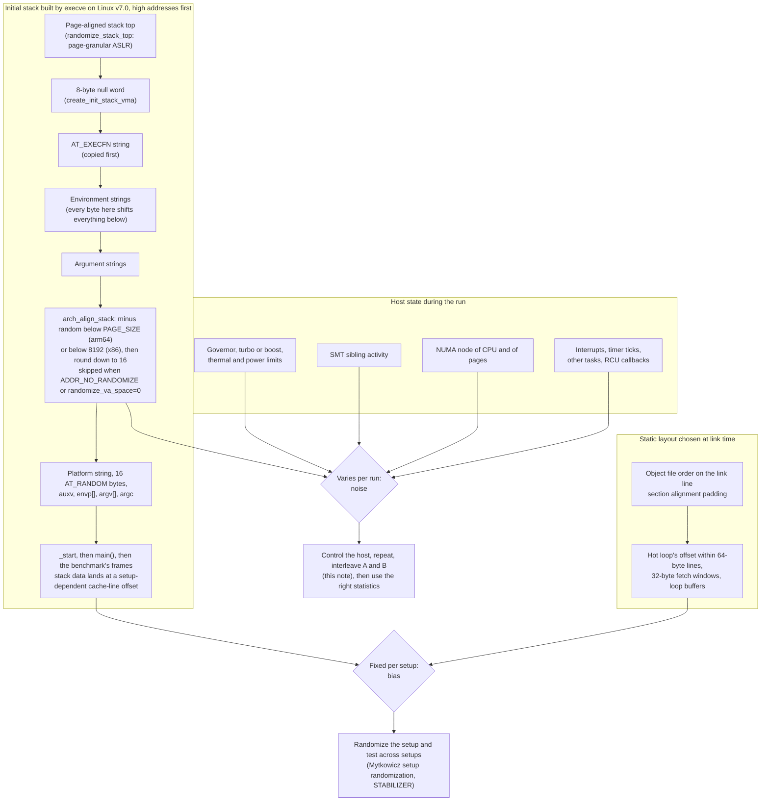

# Benchmark Methodology: Noise and Environment Control

> [!summary] Claim:
> A benchmark result is a sample from a distribution over machine states, and two different things distort it: noise, which varies from run to run (frequency, SMT siblings, interrupts, page placement), and bias, which is fixed for one setup and changes the answer when the setup changes (environment size, link order, memory layout).
> Pinning frequency, isolating cores, and quieting the host lower noise; they do nothing about bias, and LLVM's own benchmarking guide says low noise "does not exclude measurement bias."
> On Linux the environment strings sit above the initial stack, so every byte of environment shifts every stack frame, and the kernel then adds a random 16-byte-granular sub-page shift (`arch_align_stack`) that turns that fixed bias into per-launch noise unless ASLR is disabled.
> Mytkowicz et al. (ASPLOS 2009) showed that environment size alone moved lbm's measured O3 speedup from 0.88 to 1.09 and link order moved perlbench's from 0.92 to 1.10, so an expert controls noise on the host and controls bias by measuring across many randomized layouts.



## The Mechanism

A benchmark answers a comparative question, usually "is B faster than A", and the answer is only as good as the claim that A and B differed in nothing but the change.
This note owns the environment side of that claim: which parts of the machine and the process setup leak into a timing, how each one works, and which control removes or randomizes it.
[[Sampling-vs-Instrumentation-Skid-and-Safepoint-Bias]] owns how a measurement tool distorts what it observes, and [[Statistics-for-Benchmarks-Coordinated-Omission-and-HDR-Histograms]] owns how to summarize and compare the resulting samples.

### 1. Noise and bias are different failures

Noise is variation between runs of one setup.
It widens the distribution, and more repetitions shrink the uncertainty of its mean.
Bias is a systematic offset that one setup applies to every run.
Repeating a biased setup a thousand times gives a tight, reproducible, wrong answer.

Mytkowicz, Diwan, Hauswirth, and Sweeney call the second failure measurement bias, after the term in the natural and social sciences, and their abstract states the finding: measurement bias "is significant and commonplace in computer system evaluation."
They ran on a Core 2 workstation (Linux 2.6.25, gcc 4.1.3 and icc 10.1), a Pentium 4 (Linux 2.4.21, gcc 4.2.1), and the m5 O3CPU simulator, used the 12 C programs of SPEC CPU2006, and followed the usual best practices: minimal environment, minimally loaded machines, local disks, repeated runs, and stack randomization disabled (Section 3.3).
The bias they found survived all of that.

The LLVM benchmarking guide puts the same point in one line: "Note that low noise is required, but not sufficient. It does not exclude measurement bias."
Every control in sections 4 to 7 below reduces noise; sections 2, 3, and 8 are about bias.

### 2. Environment size moves the stack

On Linux, `execve` builds the new program's initial stack before any user code runs, and the order of that construction is what makes environment size matter.
At Linux v7.0:

1. `create_init_stack_vma()` (mm/vma_exec.c) sets `vma->vm_end = STACK_TOP_MAX` and starts the copy cursor at `vma->vm_end - sizeof(void *)`, so the first 8 bytes below the top hold a null word on a 64-bit system.
2. `do_execveat_common()` (fs/exec.c) copies strings downward in this order: `copy_string_kernel(bprm->filename, ...)`, then `copy_strings(bprm->envc, envp, ...)`, then `copy_strings(bprm->argc, argv, ...)`.
3. `setup_arg_pages()` moves the whole block to its final top with `stack_top = arch_align_stack(stack_top); stack_top = PAGE_ALIGN(stack_top);`, so the final top is page-aligned and the strings keep their offset within the page.
4. `create_elf_tables()` (fs/binfmt_elf.c) then calls `p = arch_align_stack(p)` again, below the strings, and pushes the platform string, the 16 `AT_RANDOM` bytes, the auxiliary vector, and the `envp`, `argv`, and `argc` words; `_start` and `main` build their frames below that.

The consequence is exact: every byte added to the environment moves the argument strings, the auxiliary vector, and every stack frame of the program down by one byte before alignment.
The kernel rounds the initial stack pointer to 16 bytes and the ABIs keep that alignment at calls ([[Calling-Conventions-System-V-AMD64-and-AAPCS64]]), so stack data moves in 16-byte steps and visits each of the four 16-byte slots of a 64-byte cache line as the environment grows.
[[Program-Startup-C-Runtime-Init-and-Auxiliary-Vectors]] owns the full layout of this block; this note uses only its effect on alignment.

Things that change environment size without anyone noticing include the user name in `USER` and `HOME`, the working directory in `PWD`, a terminal or CI runner that exports different variables, and the program's own path, which appears both as `AT_EXECFN` and as `argv[0]`.

Mytkowicz et al. measured the effect directly (Section 4.2).
They grew an unused environment variable from 0 to 4096 bytes in 63-byte steps and measured the O3-over-O2 speedup of each SPEC program at each size:

- perlbench's speedup ranged from 0.91 to 1.07, so the same compiler change was a 9% slowdown or a 7% speedup depending only on the environment.
- lbm ranged from 0.88 to 1.09: "we may think we have a 12% slowdown when in fact we have a 9% speedup!"
- The median spread across benchmarks was 0.01 on the Core 2 and 0.04 on the Pentium 4, and four of the violins on the Core 2 straddled 1.0.
- An unoptimized micro-kernel that only increments three global counters in a loop changed run time "frequently by about 33% and once by almost 300%" as the environment grew (Section 2).

They then confirmed the mechanism by intervention (Section 7.2): when they fixed the stack's start address regardless of environment size, the speedup no longer depended on environment size for every benchmark except perlbench, which copies the environment to the heap; fixing the heap start as well removed most of the remaining effect.
Of 340 Core 2 performance events, one, `LOAD_BLOCK.OVERLAP_STORE` (loads blocked by preceding overlapping stores), changed 10-fold between the fastest and slowest environment sizes, which points at the hardware's alignment-based load-store overlap heuristics.
The authors call that cause "probably," because the hardware could not attribute the event to stack locations.

### 3. ASLR turns the bias into noise

The second `arch_align_stack()` call is where address space layout randomization reaches below page granularity.
At Linux v7.0, the x86 version subtracts `get_random_u32_below(8192)` and the arm64 version subtracts `get_random_u32_below(PAGE_SIZE)`, both followed by `sp & ~0xf`, and both skip the subtraction when the task has `ADDR_NO_RANDOMIZE` in its personality or `randomize_va_space` is 0.
The comment above the call in `create_elf_tables()` gives the original reason: "In some cases (e.g. Hyper-Threading), we want to avoid L1 evictions by the processes running on the same package. One thing we can do is to shuffle the initial stack for them."
Page-level randomization comes separately from `randomize_stack_top()` (mm/util.c), which offsets the top by a page-aligned random value masked by `STACK_RND_MASK`.

With randomization on, the environment still shifts the frames, but a uniformly random multiple of 16 is added on top, so the cache-line slot of a stack buffer is random on every launch.
That is the Mytkowicz bias converted into noise, and noise is the tractable failure: launch many processes and the layout effect averages out instead of picking one side.
With randomization off, which is what `setarch -R`, `echo 0 > /proc/sys/kernel/randomize_va_space`, the `norandmaps` boot parameter, GDB's default, and Google Benchmark's `MaybeReenterWithoutASLR()` all do, every launch gets the same slot, run-to-run variance drops, and the remaining layout effect is a fixed bias chosen by the environment size.

`randomize_va_space` values at Linux v7.0 (`Documentation/admin-guide/sysctl/kernel.rst`):

- `0`: no randomization; also the effect of the `norandmaps` boot parameter.
- `1`: randomize mmap base, stack, VDSO, shared libraries, and PIE code.
- `2`: also randomize the heap (`brk`); the default when `CONFIG_COMPAT_BRK` is disabled.

The tools disagree about which side to take (as of 2026-11, Linux):

- The LLVM guide says "Disable frequency scaling, Turbo Boost and address space randomization."
- Google Benchmark's reporter prints `***WARNING*** ASLR is enabled, the results may have unreproducible noise in them.`, its v1.9.3 release added "Automatic ASLR disablement", and its variance guide recommends calling `benchmark::MaybeReenterWithoutASLR(argc, argv)` first in `main()`.
- pyperf's `system tune` instead checks that `randomize_va_space` is `2` (full randomization), and its `Runner` spawns 20 worker processes by default.
- pyperf also builds each worker's environment from scratch: `create_environ()` in `pyperf/_utils.py` copies only `PATH`, `HOME`, `TEMP`, `COMSPEC`, `SystemRoot`, `SystemDrive`, `PYTHONPATH`, `PYTHON_CPU_COUNT`, `PYTHON_GIL`, three pyperf variables, and optionally the locale, unless `--copy-env` or `--inherit-environ` is given, which removes most accidental environment-size differences between runs.

The two positions are consistent once noise and bias are separated.
Disabling ASLR is right for a single-binary microbenchmark when you are hunting a small effect and want a stable number from one layout, and wrong when you compare two binaries, because each binary then sits at one fixed, arbitrary layout.
Keeping ASLR on and spawning many processes, as pyperf does, samples layouts for free and is the cheap half of setup randomization.

### 4. Link order and code alignment

The linker lays out input sections in command-line order, padding each one to its section alignment.
Adding, removing, or reordering any object file therefore moves every function that follows it, and GCC's `-falign-functions` documentation states the alignment rule: align function starts to a power of two, "skipping up to m-1 bytes", which GCC enables at `-O2` and `-O3` with a machine-dependent default, and which "is ignored for functions considered cold."

Mytkowicz et al. measured link order too (Section 4.1).
perlbench linked in 33 orders (the default, alphabetical, and 31 random orders) gave O3 speedups from 0.92 to 1.10, so "we may think we have a 7% slowdown when in fact we have an 8% speedup!"
The median spread was 0.02 on the Core 2 and 0.08 on the Pentium 4, and on the m5 simulator bzip2's speedup ranged from 0.8 to 1.1 because a hot loop either did or did not fit in one cache line.
On the Core 2 they suspected the loop stream detector but could not confirm it, because Intel does not document it and provides no event that counts it.

Code alignment interacts with front-end structures that fetch in fixed windows, so it is not only a cache-line question.
The Jump Conditional Code erratum is the best-documented recent case: H. J. Lu's binutils patch series states that the microcode update for the erratum "may cause performance loss for some workloads", and GNU as added `-mbranches-within-32B-boundaries`, which "aligns conditional jumps, fused conditional jumps and unconditional jumps within 32 byte boundary" and is off by default.
A benchmark that spans a microcode update, or compares a binary assembled with and without that option, can therefore move for reasons unrelated to the source change.

### 5. Frequency: governors, turbo, power, and heat

Wall-clock time is cycles divided by frequency, and on a modern CPU the frequency is a control loop, not a constant.

Linux exposes the policy through cpufreq (`Documentation/admin-guide/pm/cpufreq.rst`, Linux v7.0):

- `performance` requests the highest frequency allowed by `scaling_max_freq`.
- `powersave` requests the lowest frequency allowed by `scaling_min_freq`.
- `schedutil` picks frequencies from the scheduler's CPU utilization data.
- `ondemand` jumps to the maximum when load exceeds `up_threshold`, and `conservative` steps one level at a time.
- `userspace` lets a process write `scaling_setspeed`.

The global `/sys/devices/system/cpu/cpufreq/boost` file permits (1) or forbids (0) frequency boost, and is absent when the driver has its own control.
`intel_pstate` is such a driver: writing 1 to `/sys/devices/system/cpu/intel_pstate/no_turbo` stops it from setting any turbo P-state.
In `intel_pstate` active mode with HWP, `performance` is not the generic governor: it writes 0 ("performance") to the Energy-Performance Preference and restricts the processor's P-state range "to the upper boundary (that is, the maximum P-state that the driver is allowed to use)."
With turbo allowed, that upper boundary is in the turbo range, and the same document says turbo P-states "are not sustainable": the processor raises cores into them only while power and the thermal envelope allow, and the highest turbo P-state "generally depends on the number of cores running concurrently."
So "governor = performance" does not mean "fixed frequency" on that hardware; setting `no_turbo` keeps the range below the turbo threshold, where the document calls P-states "generally sustainable", and pinning `scaling_min_freq` to `scaling_max_freq`, which `pyperf system tune` does, closes the rest of the range.

Frequency also depends on things no sysfs file controls.
Mytkowicz et al. note that room temperature affects the clock speed (Section 3).
A laptop on battery changes speed as the battery drains, which is why `pyperf system tune` checks that the power cable is plugged in.
nanobench checks the same family at startup on Linux: it warns when `scaling_min_freq` differs from `scaling_max_freq`, when `cpu0`'s governor is not `performance`, and when `intel_pstate/no_turbo` is 0, then recommends `pyperf system tune`.

### 6. SMT siblings

Two SMT threads on one core share its execution units and private caches, so the timing of a benchmark on one thread depends on whatever runs on the other.
The kernel comment quoted in section 3 is an admission of exactly this coupling: the sub-page stack shuffle exists to reduce L1 conflicts between processes on the same core.
Linux reports a CPU's siblings in `/sys/devices/system/cpu/cpuN/topology/thread_siblings_list`.
It can disable SMT at runtime through `/sys/devices/system/cpu/smt/control` (`on`, `off`, a thread count, or the read-only states `forceoff`, `notsupported`, `notimplemented`), or at boot with `nosmt`.
The LLVM guide takes the narrower route: take the benchmark CPU's sibling offline with `echo 0 > /sys/devices/system/cpu/cpuX/online`.

### 7. Placement: NUMA, the scheduler, and interrupts

On a multi-socket or multi-die system, memory latency depends on which node holds a page relative to the CPU that touches it.
The default Linux policy is "local allocation": `set_mempolicy(2)` documents that pages are allocated "on the node of the CPU that triggered the allocation."
A benchmark whose initialization runs on one node and whose timed loop migrates to another therefore measures remote memory on some runs and local memory on others.
`numactl --cpunodebind=N --membind=N` fixes both sides; `--interleave` spreads pages round-robin, and `--localalloc` restates the default.

The scheduler and interrupt handlers steal time from the benchmark's CPU and, worse, evict its caches.
The controls, from coarse to fine:

- `taskset -c N` pins the process to a CPU list, and `chrt -f 80` gives it a real-time priority (both from Google Benchmark's variance guide).
- cpusets (`cset shield -c N1,N2 -k on` in the LLVM guide, which also moves kernel threads off the shielded CPUs) reserve CPUs at runtime.
- The `isolcpus=` boot parameter removes CPUs from scheduler load balancing; at Linux v7.0 it is marked "Deprecated - use cpusets instead", its `domain` isolation is irreversible, and its `managed_irq` flag keeps managed interrupts off isolated CPUs.
- `nohz_full=` stops the scheduler tick on listed CPUs when one task runs and offloads their RCU callbacks as `rcu_nocbs=` would; pyperf warns that it is incompatible with `intel_pstate` and requires a fixed frequency.
- IRQ affinity: `pyperf system tune` stops `irqbalance` and rewrites `/proc/irq/default_smp_affinity` and `/proc/irq/N/smp_affinity` so device interrupts land elsewhere.

### 8. Controlling bias: setup randomization and causal analysis

Host controls cannot remove a bias that the setup itself defines, so Mytkowicz et al. borrow two techniques from experimental science (Section 7).

Setup randomization measures A and B in many setups and compares the two distributions.
For perlbench they used 484 setups (22 link orders times 22 environment sizes), three runs each, and a t-test, and found an O3 speedup of 1.007 plus or minus 0.003 at 95% confidence: a real but tiny effect, where single setups had ranged from 0.91 to 1.07 across environment sizes and from 0.92 to 1.10 across link orders.
They also showed that a benchmark suite is not a substitute: across 66 layouts, the suite-average speedup still varied by 7%, because what cancels bias is diversity of layouts, not number of programs.

Causal analysis checks a conclusion by intervention: change the suspected cause while holding everything else, and see whether the effect follows.
Fixing the stack start address and re-measuring across environment sizes is the example from section 2.

STABILIZER (Curtsinger and Berger, ASPLOS 2013) automates setup randomization inside one run.
An LLVM pass and runtime place functions at random addresses, shuffle heap allocations, and insert a random pad of up to 4096 bytes in 16-byte steps between stack frames, and the runtime re-randomizes code and stack every 500 ms by default.
Because each run is a sum of many independently randomized layout periods, its execution time is approximately normal by the Central Limit Theorem, which licenses parametric tests such as the t-test and ANOVA.
They report a median overhead under 7% and, on SPEC CPU2006 with LLVM, that "the performance impact of -O3 over -O2 optimizations is indistinguishable from random noise."
Their own measurements also found link order alone changing performance by as much as 57%.

### 9. What remains after all of this

Mytkowicz et al. surveyed 133 papers from ASPLOS 2008, PACT 2007, PLDI 2007, and CGO 2007; 88 had an experimental methodology section, none addressed measurement bias satisfactorily, and the median reported speedup was 10%, a size their data shows bias can manufacture.
Brendan Gregg's "active benchmarking" is the practical complement: analyze the system with `vmstat`, `mpstat`, `perf`, and similar tools while the benchmark runs, to confirm it is limited by what you think it is limited by.
[[USE-RED-and-Systems-Performance-Methodologies]] owns that method, and [[Hardware-Performance-Counters-Top-Down-TMA-and-Roofline]] owns the counters that explain a layout effect once one is found.

## Commands and Numbers to Know

| Item | Value or command | Platform and date | What it controls |
| :--- | :--- | :--- | :--- |
| `randomize_va_space` | `0` off, `1` stack, mmap, VDSO, PIE; `2` also heap | Linux (as of 2026-11) | Global ASLR level; `/proc/sys/kernel/randomize_va_space` |
| Sub-page stack shift | random below 8192 (x86) or `PAGE_SIZE` (arm64), then `& ~0xf` | Linux v7.0 (as of 2026-11) | `arch_align_stack()`; why a frame's cache-line slot varies per launch |
| `setarch $(uname -m) -R cmd` | sets `ADDR_NO_RANDOMIZE` (`0x0040000`) | Linux (as of 2026-11) | ASLR off for one process tree |
| `norandmaps` | boot parameter | Linux v7.0 (as of 2026-11) | Same as `randomize_va_space=0` |
| Docker default seccomp `personality` | allows only `0`, `8`, `0x20000`, `0x20008`, `0xffffffff` | Linux (as of 2026-11) | `setarch -R` and GDB's ASLR disable fail with EPERM in a default container |
| GDB `set disable-randomization` | `on` by default | Linux (as of 2026-11) | Programs started under GDB run without ASLR |
| LLDB `target.disable-aslr` | `true` by default (lldb-2103.0.34.407) | macOS (as of 2026-11) | Programs launched by LLDB run without ASLR |
| `cpupower frequency-set --governor performance` | governor for all CPUs | Linux (as of 2026-11) | cpufreq policy; check with `cpupower frequency-info -o proc` |
| `/sys/devices/system/cpu/cpufreq/boost` | `0` forbids boost, `1` permits it | Linux (as of 2026-11) | Generic boost switch; absent under `intel_pstate` |
| `/sys/devices/system/cpu/intel_pstate/no_turbo` | `1` forbids turbo P-states | Linux, Intel (as of 2026-11) | Turbo off under `intel_pstate` |
| `/sys/devices/system/cpu/smt/control` | `on`, `off`, `<N>`, `forceoff`, `notsupported`, `notimplemented` | Linux (as of 2026-11) | Runtime SMT switch; `nosmt` at boot |
| `cpuN/topology/thread_siblings_list` | sibling CPU list | Linux (as of 2026-11) | Which CPU to offline or keep idle |
| `isolcpus=`, `nohz_full=` | boot parameters; `isolcpus` deprecated in favor of cpusets | Linux v7.0 (as of 2026-11) | Scheduler isolation and tick suppression |
| `taskset -c N`, `chrt -f 80`, `nice -n -20` | pin and prioritize | Linux (as of 2026-11) | Scheduler placement and priority |
| `numactl --cpunodebind=N --membind=N` | bind CPU and memory to one node | Linux (as of 2026-11) | Removes local versus remote memory variation |
| `perf stat -r N cmd` | repeat and print mean and stddev; max 100 | Linux (as of 2026-11) | Cheapest repeated whole-process measurement |
| `python3 -m pyperf system tune` | governor, min freq, turbo, IRQ affinity, `perf_event_max_sample_rate=1` | Linux (as of 2026-11) | One-shot host preparation; `system reset` undoes most of it |
| pyperf `Runner` defaults | 20 processes, 3 values each, 1 warmup, 100 ms minimum per value | Both (as of 2026-11) | Multi-process layout sampling; `--rigorous` doubles processes |
| Google Benchmark `--benchmark_repetitions` | default `1` | Both, v1.10.0 (as of 2026-11) | Repetitions in one process |
| Google Benchmark `--benchmark_enable_random_interleaving` | default `false` | Both, v1.10.0 (as of 2026-11) | Interleaves repetitions; docs claim 40% lower run-to-run variance on average |
| `-falign-functions=64` | align function starts to 64 bytes | Both, GCC (as of 2026-11) | Removes link-order dependence of a function's line offset |
| `-Wa,-mbranches-within-32B-boundaries` | off by default | Linux, x86 GNU as (as of 2026-11) | JCC erratum mitigation by branch padding |
| Mytkowicz env-size spread | lbm 0.88 to 1.09, perlbench 0.91 to 1.07 | Core 2, Linux 2.6.25, 2009 | Bias from environment size alone |
| Mytkowicz link-order spread | perlbench 0.92 to 1.10 over 33 orders | Core 2, Linux 2.6.25, 2009 | Bias from link order alone |

## Multi-Language Comparison: Harness Defaults That Touch Noise and Bias

| Concern | C++ (Google Benchmark v1.10.0, nanobench master) | Python (pyperf) | Rust (criterion.rs master, `std::hint`) |
| :--- | :--- | :--- | :--- |
| Processes per benchmark | One process; `--benchmark_repetitions` default 1 | 20 worker processes, 3 values each (`--rigorous`: 40) | One process |
| Layout sampling | None by default; random interleaving is opt-in | Each worker is a fresh `exec` with a minimal environment, so ASLR re-randomizes per worker and `PYTHONHASHSEED`, which is not copied, is random per worker | None in the defaults |
| ASLR stance | Warns when ASLR is on; `MaybeReenterWithoutASLR()` re-execs with `ADDR_NO_RANDOMIZE` (since v1.9.3) | `system tune` checks that `randomize_va_space` is 2 | No setting in the defaults |
| Host checks | Google Benchmark warns on CPU scaling; nanobench warns on min/max frequency, governor, `no_turbo` | `system tune` sets governor, min frequency, turbo, IRQ affinity | None in the defaults |
| Warmup | `--benchmark_min_warmup_time` default 0 | 1 warmup value per worker | `warm_up_time` 3 s |
| Measurement budget | `--benchmark_min_time` (iterations `Nx` or seconds `Ns`) | Loops calibrated to at least 100 ms per value | `measurement_time` 5 s, `sample_size` 100 |
| Decision rule | Mean and stddev of repetitions; comparison via `compare.py` | `pyperf compare_to` | `noise_threshold` 0.01, `significance_level` 0.05, 100,000 bootstrap resamples |
| Dead-code barrier | `benchmark::DoNotOptimize` | Not applicable to interpreted code | `std::hint::black_box`, stable since Rust 1.66.0, documented as "best-effort" |
| Language-specific noise | Link order, `-falign-*` flags, PGO and LTO layout | `PYTHONHASHSEED` changes `str` and `bytes` hashes per process unless set | Codegen units and inlining change layout between builds |

`PYTHONHASHSEED` deserves a sentence: the Python documentation says that when it is unset or `random`, "a random value is used to seed the hashes of str and bytes objects", so dictionary and set iteration order, and with it memory access patterns, change per process.
pyperf does not copy `PYTHONHASHSEED` into its workers, so each worker draws its own seed and the many-process design turns that into sampled noise; a single-process Python benchmark freezes one draw.

## Worked Lab Example

The lab is `code/04-Measurement-Methodology/env_alignment_bias/`, tagged `# requires: linux`, because it reads the stack layout that the Linux `execve` path builds.
It times nothing; it prints where the kernel and the linker put things, as offsets within pages and cache lines, so the output is deterministic while the layout mechanism it shows is exactly the one that makes timings move.

`run.sh` compiles three C files with `"${CC:-cc}" -O2` and runs `driver.py`, which launches each binary with an explicit environment, `{"PAD": "x" * n}`, so the parent shell cannot leak in:

- `probe.c` has four modes: `strings` prints `argv[0]`'s offset in its page and the offset predicted from the layout in section 2 (`4096 - (8 + strlen(AT_EXECFN) + 1 + sum of env strings + 1 + sum of argv strings + 1)`); `frame` prints the page offset of a 16-byte-aligned 64-byte buffer in a callee; `shift` calls the same callee after `alloca(k)`; `code` prints `hot_loop`'s offset in its 64-byte line and its distance from `lab_pad`.
- `hot.c` holds `hot_loop`, the stand-in for the benchmarked function; it is compiled once by default and once with `-falign-functions=64`.
- `pad.c` holds `lab_pad`, exactly 40 bytes of code emitted with `.fill 10, 4, 0`, standing in for an unrelated function that grew.

```bash
cd code/04-Measurement-Methodology/env_alignment_bias
bash run.sh                      # on a Linux host
cd ../.. && make verify LAB=04-Measurement-Methodology/env_alignment_bias/   # elsewhere, in the pinned container
```

### Verified output

Recorded by `python3 -m _harness.verify --record` on 2026-11-08 in the pinned container `toolchain-labs:f39efe0ff57b` (Ubuntu 24.04, GCC 13.3.0, kernel 7.2.12, aarch64) and re-checked by `make verify`; the file is `code/04-Measurement-Methodology/env_alignment_bias/expected/linux-aarch64.txt`.

```text
== A. Environment bytes move the exec string area by exactly that many bytes ==
PAD chars  argv[0] page offset  moved mod 4096  layout prediction
        0                 4059               0  matches
        1                 4058               1  matches
       15                 4044              15  matches
       16                 4043              16  matches
       63                 3996              63  matches
       64                 3995              64  matches
     4095                 4060            4095  matches
     4096                 4059               0  matches
argv[0] offset equals the page-aligned-top prediction for every size: yes

== B. The same binary and environment, launched 64 times ==
buffer address mod 16 identical in every launch: yes
distinct 16-byte slots used within a 64-byte line: 4 of 4
distinct page offsets seen: more than one: yes
64-byte buffer fits in one cache line in some launches: yes
64-byte buffer straddles two cache lines in some launches: yes

== C. A harness can move the frame itself: alloca(k) in the caller ==
k bytes  frame moved by  cache-line slot change
      0               0                       0
      8              16                       1
     16              16                       1
     24              32                       2
     32              32                       2
     48              48                       3
     64              64                       0

== D. Link order moves an unchanged function ==
 default alignment, pad_first: hot_loop offset within its 64-byte line = 16, hot_loop - lab_pad =   44 bytes
 default alignment, hot_first: hot_loop offset within its 64-byte line = 48, hot_loop - lab_pad =  -52 bytes
 align64 alignment, pad_first: hot_loop offset within its 64-byte line =  0, hot_loop - lab_pad =   92 bytes
 align64 alignment, hot_first: hot_loop offset within its 64-byte line =  0, hot_loop - lab_pad =  -52 bytes
default build: line offset depends on link order: yes
-falign-functions=64 build: offset 0 in both orders: yes
```

### Reading the result

- Part A confirms the kernel layout byte for byte.
  With an empty `PAD`, the strings below the page-aligned top are the 8-byte null word, `./probe` (8 bytes with its NUL, as `AT_EXECFN`), `PAD=` (5), `./probe` (8), and `strings` (8), 37 bytes in all, so `argv[0]` sits at 4096 - 37 = 4059, and each added character moves it down by one.
  Adding 4096 characters returns it to the same page offset, so environment size acts modulo the page, and modulo 64 for cache lines, which is why Mytkowicz's sweep up to 4096 bytes covers every alignment.
  The prediction is computed independently from `getauxval(AT_EXECFN)`, `environ`, and `argv`; a different layout would print `MISMATCH`.
- Part B shows ASLR's sub-page shuffle at work in the container, which runs with `randomize_va_space=2`.
  The buffer keeps its 16-byte alignment, but over 64 launches it landed in all four 16-byte slots of a 64-byte line, so in some launches it fits in one line and in others it straddles two.
  On a host with ASLR disabled the same part prints `1 of 4` and one of the last two lines turns to `no`: the layout becomes fixed, and the environment decides which slot.
- Part C is the harness-side control: reserving `k` bytes on the stack before calling the benchmark moves its frame by `k` rounded up to 16, so a harness can sweep all four slots on purpose, which is the stack half of setup randomization and what STABILIZER's per-frame pad does.
- Part D isolates link order.
  On this toolchain `hot.o`'s `.text` is 16-byte aligned and `pad.o`'s is byte-aligned, so with `pad.o` first `hot_loop` starts 44 bytes after `lab_pad` (40 bytes of pad plus 4 bytes of alignment padding) at line offset 16, and with `hot.o` first it starts at line offset 48 and `lab_pad` follows its 52 bytes.
  Recompiling `hot.c` with `-falign-functions=64` puts it at offset 0 in both orders, paying 52 bytes of padding in the `pad_first` order (92 - 40), which is the trade the flag makes.

In a reviewer run in the same container (not part of the golden file), `setarch $(uname -m) -R true` failed with `setarch: failed to set personality to aarch64: Operation not permitted`, and `gdb -batch -ex run /bin/true` printed `warning: Error disabling address space randomization: Operation not permitted`, matching the Docker seccomp allowlist in the table.
That is why the lab demonstrates the ASLR-off case by reasoning rather than by running it.

## Pitfalls

> [!warning] Pitfall 1: Treating low variance as correctness
> A tuned host with ASLR off gives tight, repeatable numbers from one layout.
> If the change under test also moves code or stack data, the comparison mixes the change with a layout lottery, and repetition cannot reveal it.
> Measure across several layouts (environment sizes, link orders, or many processes with ASLR on) before claiming a small effect.

> [!warning] Pitfall 2: Different environments for A and B
> Running A from one shell and B from another, from different directories, as different users, or through different wrappers changes `PWD`, `USER`, `HOME`, `argv[0]`, and `AT_EXECFN`, and therefore every stack address.
> Launch both through the same harness with `env -i` plus an explicit, identical variable list and the same path length.

> [!warning] Pitfall 3: Benchmarking under a debugger or in a container without noticing
> GDB disables ASLR by default (`set disable-randomization on`), and so does LLDB (`target.disable-aslr` is `true` on lldb-2103.0.34.407).
> Inside a default Docker container the same request fails with EPERM because the seccomp profile does not allow `personality(ADDR_NO_RANDOMIZE)`, so GDB warns and continues with ASLR on.
> The same harness can therefore run with and without ASLR depending on where it runs; log `cat /proc/self/personality` and `randomize_va_space` with every result.

> [!warning] Pitfall 4: Assuming `performance` means a fixed clock
> Under `intel_pstate` with HWP, the `performance` policy sets the energy preference to performance and asks for the top of the allowed range, which includes turbo P-states that the processor holds only while power and thermal limits allow.
> Disable turbo (`no_turbo` or `boost`) and pin `scaling_min_freq` to `scaling_max_freq` if you need a fixed clock, and record both files.

> [!warning] Pitfall 5: Pinning to a CPU whose SMT sibling is busy
> `taskset -c 3` isolates nothing if CPU 3's sibling runs the build, the browser, or the other benchmark.
> Read `thread_siblings_list` and either offline the sibling or keep it in the same cpuset with nothing scheduled on it.

> [!warning] Pitfall 6: Comparing runs across time instead of interleaving
> Running all A repetitions and then all B repetitions turns any drift (thermal soak, a background job, a firmware or microcode update) into an apparent difference between A and B.
> Interleave A and B, as `--benchmark_enable_random_interleaving` does for Google Benchmark repetitions, and alternate the order of whole-process runs.

> [!warning] Pitfall 7: First-touch NUMA placement
> Allocating and initializing a buffer on one node and timing it from a thread on another measures remote memory.
> Initialize on the timing thread, or bind both with `numactl --cpunodebind=N --membind=N`.

> [!warning] Pitfall 8: Trusting a single build as "the" binary
> Adding a log line, reordering objects, or toggling an unrelated flag moves `hot_loop`, as part D shows.
> Before attributing a small regression to a commit, rebuild the parent with a different link order or with `-falign-functions=64` on the hot file and see whether the regression survives.

## At Scale

For one developer, the practical goal is to know which controls were in force: record governor, boost, SMT, ASLR, kernel, compiler, and environment with each result, and do not trust a difference from one process and one build until it exceeds the spread you see when only the layout changes.

For a team of tens to hundreds of engineers, benchmark noise becomes a shared resource problem.
Laptops and shared CI runners cannot be tuned, and cloud instances add hypervisor scheduling and neighbors that no guest setting removes.
The usual answer is a small pool of dedicated bare-metal benchmark hosts, prepared once by a script (`pyperf system tune` or its equivalent), with a reservation system so two jobs never share a host.
[[Design-a-Low-Noise-Benchmark-Harness-Playbook]] owns that preparation procedure.

At 1,000 to 50,000 engineers, the bottleneck is false alarms: every noisy benchmark that pages someone teaches the organization to ignore the system.
[[Performance-Regression-Detection-in-CI]] owns the gating statistics; this note contributes the inputs those gates assume.

Decision rules:

- Separate the question first: a microbenchmark used to understand one mechanism may run with ASLR off on a tuned host; a comparison between two builds must sample layouts.
- Never compare two builds with one launch each, whatever the host tuning; use many processes with ASLR on, or an explicit sweep of environment sizes and link orders, and report the spread across layouts.
- Treat any effect smaller than the layout spread you measured for that benchmark as unproven, the standard Mytkowicz et al. applied to the 10% median speedup in the papers they surveyed.
- Pin the benchmark host's firmware, microcode, kernel, and toolchain, and treat changes to any of them as a baseline reset, because the JCC microcode update alone moved some workloads.
- For CI on shared runners, prefer instruction or cycle counts from a simulator or from counters for gating, and keep wall-clock measurements on dedicated hosts; the choice is recorded in [[Measurement-Methodology-Decision-Records]].
- Store an environment manifest (governor, boost, SMT state, `randomize_va_space`, personality, CPU model, microcode, kernel, compiler, flags, `env` hash) next to every stored result, so a later reader can tell a regression from a host change.

> [!tip] Practice Drill:
> Run the lab on a Linux host where you are root, then repeat part B under `setarch $(uname -m) -R` and confirm that it prints `1 of 4` slots.
> Still with ASLR off, sweep `PAD` from 0 to 63 characters and record which slot the `frame` mode lands in for each size, then write a 20-line microbenchmark whose inner loop reads and writes a 64-byte stack buffer with unaligned 8-byte accesses and time it at each slot with `perf stat -r 20`.
> Decide, before looking, whether you expect a difference, and then check whether the difference survives turning ASLR back on and launching 50 processes per configuration.
> Finish with [[Drill-Measurement-Methodology-Environment-Size-Bias]], which builds the full Mytkowicz-style sweep.

## Interview Questions

> [!question] L5: What is the difference between noise and bias in a benchmark, and which one do more repetitions fix?
>
> > [!success]- Answer
> > Noise is run-to-run variation within one setup, from frequency changes, interrupts, SMT siblings, or page placement; more repetitions shrink the uncertainty of its mean.
> > Bias is a fixed offset that one setup applies to every run, such as the stack alignment chosen by the environment size or the code alignment chosen by the link order.
> > Repetitions do not fix bias: they make a biased number more precise, not more correct.
> > Bias is handled by changing the setup, either by randomizing it across runs or by intervening on the suspected cause.

> [!question] L5: You set the governor to `performance` on an Intel laptop and still see 10% run-to-run variation. What else do you check?
>
> > [!success]- Answer
> > Turbo: under `intel_pstate` the `performance` policy asks for the highest allowed P-state, which is a turbo P-state when turbo is enabled, and turbo P-states are not sustainable: they depend on power, temperature, and how many cores are busy; set `intel_pstate/no_turbo` to 1, or the generic `cpufreq/boost` to 0 on other drivers.
> > Power: on battery the frequency changes as the battery drains, which is why `pyperf system tune` checks for the power cable.
> > SMT and placement: pin with `taskset` and make sure the sibling from `thread_siblings_list` is idle.
> > Background load: browsers and desktop timers, which Google Benchmark's variance guide tells you to close.
> > Then record those settings with the result, because a laptop cannot be made into a benchmark host, only into a better-described one.

> [!question] L6: Predict the output. In the lab, `PAD` holds 4096 characters instead of none; what page offset does `argv[0]` get, and why? And how far does `alloca(8)` move the callee frame?
>
> > [!success]- Answer
> > It gets 4059, the same offset as with an empty `PAD`.
> > The strings are copied downward from a page-aligned top, so 4096 extra bytes move `argv[0]` by exactly one page and leave its offset within the page unchanged; the lab prints `moved mod 4096` as 0 for that row.
> > `alloca(8)` moves the frame by 16 bytes, not 8, because the stack pointer must stay 16-byte aligned, so the buffer moves one 16-byte slot within its cache line.
> > Both answers say the same thing: the alignment that matters repeats every 64 bytes for cache lines and every page for 4 KiB effects, and the stack moves in 16-byte steps.

> [!question] L6: Explain how adding an unused environment variable can change the speed of a loop that never reads the environment.
>
> > [!success]- Answer
> > On Linux, `execve` copies the executable name, the environment strings, and the argument strings downward from the top of the new stack before building the auxiliary vector and the pointer arrays, so every environment byte moves every later stack frame down.
> > After 16-byte rounding, the loop's stack variables land in a different 16-byte slot of their cache line, and accesses that used to stay within a line, or not alias with nearby stores, now behave differently.
> > Mytkowicz et al. saw this as perlbench's O3 speedup ranging from 0.91 to 1.07 across environment sizes, with Core 2's `LOAD_BLOCK.OVERLAP_STORE` count changing 10-fold between the extremes.
> > They confirmed the cause by fixing the stack start address, after which environment size stopped mattering for every benchmark except perlbench, which also copies the environment to the heap.

> [!question] L6: Debug this. A benchmark is consistently 4% faster when run under `gdb` than from the shell, and the difference disappears inside your CI container. What is going on?
>
> > [!success]- Answer
> > GDB disables ASLR by default, so under GDB every launch uses one fixed layout, and that layout happens to be a good one; from the shell, ASLR gives a different sub-page stack offset each launch, and the average includes the bad slots.
> > Inside a default Docker container GDB cannot disable ASLR, because the seccomp profile allows `personality()` only with a few values that do not include `ADDR_NO_RANDOMIZE`, so GDB warns and runs with ASLR on, and the difference vanishes.
> > Confirm by running from the shell under `setarch $(uname -m) -R` on the host and sweeping environment size: if the 4% follows the layout, it is bias, not a property of the code.
> > The fix is methodological: compare builds across many randomized launches, and log the personality and `randomize_va_space` with each result.

> [!question] L7: Google Benchmark can re-exec itself with ASLR disabled, and pyperf insists ASLR stays on. Which is right?
>
> > [!success]- Answer
> > Both, for different questions.
> > Google Benchmark runs every repetition in one process, so ASLR can only add between-run variance across separate invocations; disabling it gives a stable number from one layout, which is useful for studying one mechanism or one binary.
> > pyperf runs 20 worker processes by default with a stripped environment, so keeping ASLR on samples 20 layouts and 20 hash seeds while the environment itself stays nearly constant, which is a cheap form of setup randomization and the right default for comparing builds.
> > The danger is using the Google Benchmark style for an A/B comparison of two builds: each sits at one arbitrary layout, and the difference may be the layouts.
> > A staff-level harness supports both modes and labels results with which one was used.

> [!question] L7: A compiler engineer reports that a new pass gives a 1.5% speedup on a benchmark suite, measured carefully on a tuned host. How do you decide whether to believe it?
>
> > [!success]- Answer
> > First, measure the layout spread: rebuild the baseline with several link orders and run it with several environment sizes or many ASLR-on processes, and see how large the speedup range is with no compiler change at all.
> > Mytkowicz et al. found link order alone moving perlbench's apparent O3 speedup from 0.92 to 1.10, so a 1.5% claim from one layout says nothing until it exceeds that spread.
> > Then measure A and B across the same randomized set of setups and compare distributions with a test whose assumptions hold, which is what setup randomization and STABILIZER provide; STABILIZER found O3 over O2 indistinguishable from noise on SPEC CPU2006.
> > Finally, apply causal analysis: if the pass claims to remove a specific stall, show the relevant counter moving in the expected direction across layouts, not just the time.

> [!question] L7: Design the host preparation for a dedicated two-socket Linux benchmark machine, and say what each step buys.
>
> > [!success]- Answer
> > Frequency: governor `performance`, turbo or boost off, `scaling_min_freq` equal to `scaling_max_freq`, so cycles map to time at a fixed rate.
> > SMT: off through `smt/control`, or the benchmark CPUs' siblings offline, so no other thread shares the core's caches and ports.
> > Isolation: a cpuset or `cset shield` with kernel threads moved off, `nohz_full` and RCU callback offload on those CPUs if the kernel supports it and the frequency is fixed, and IRQ affinity steered to housekeeping CPUs.
> > NUMA: run each benchmark with `numactl --cpunodebind=N --membind=N`, so all memory is local and every run sees the same latency.
> > Storage: inputs and outputs on tmpfs, as the LLVM guide suggests.
> > Layout: leave ASLR on for comparisons and launch many processes, or provide an explicit environment-size and link-order sweep; host tuning cannot remove that bias.
> > Record the whole state in a manifest with each result, and recheck it before each run, because a reboot or a package update silently undoes sysfs settings.

> [!question] L8+: Your organization's performance dashboard shows a 3% fleet-wide regression after a release that changed no hot code. How do you structure the investigation and the policy that follows?
>
> > [!success]- Answer
> > Separate host changes from code changes first: compare the environment manifests of the before and after runs for kernel, microcode, firmware, compiler, flags, and benchmark-host configuration, because a microcode update such as the JCC erratum fix can move unchanged code.
> > Then test for layout bias: rebuild the old and new versions with varied link orders and run them across layouts; if the 3% disappears or flips sign across layouts, the release moved code, it did not slow it.
> > If the regression survives layout randomization, bisect with the same randomized protocol so each step's verdict is about the code, not one layout.
> > The lasting policy is that comparative results are only accepted from randomized multi-layout runs with a recorded manifest, that dashboards show layout spread next to the mean, and that toolchain or firmware changes reset baselines explicitly.

> [!question] L8+: Is a quiet, perfectly tuned benchmark host enough to make performance claims you would publish?
>
> > [!success]- Answer
> > No.
> > Host tuning addresses noise; it leaves bias from the experimental setup intact, which the LLVM guide states and Mytkowicz et al. demonstrated on machines that already followed best practices.
> > Publishable claims need layout diversity (setup randomization or a STABILIZER-like runtime), a comparison of distributions rather than single numbers, and a causal check that the mechanism you claim actually moved.
> > They also need the full setup disclosed: Mytkowicz et al. found none of 88 methodology-bearing papers handled this adequately, and their median reported speedup of 10% was within reach of the bias they measured.

## Further Reading

- Mytkowicz, Diwan, Hauswirth, and Sweeney, "Producing Wrong Data Without Doing Anything Obviously Wrong!" (ASPLOS 2009): the environment-size and link-order measurements, the survey of 133 papers, and the setup randomization and causal analysis remedies.
- Curtsinger and Berger, "STABILIZER: Statistically Sound Performance Evaluation" (ASPLOS 2013): runtime re-randomization of code, stack, and heap, and why it makes parametric statistics valid.
- Linux v7.0 `fs/exec.c`, `mm/vma_exec.c`, and `fs/binfmt_elf.c`: the exact order in which the initial stack is built, and `arch_align_stack()` in the x86 and arm64 `process.c` files for the sub-page shuffle.
- Linux v7.0 `Documentation/admin-guide/pm/cpufreq.rst` and `intel_pstate.rst`: what each governor and the turbo controls actually guarantee.
- Linux v7.0 `Documentation/admin-guide/kernel-parameters.txt`: `isolcpus`, `nohz_full`, `nosmt`, and `norandmaps`, with their caveats.
- LLVM, "Benchmarking tips": a short, concrete host preparation list, and the reminder that low noise does not exclude bias.
- Google Benchmark, "Reducing Variance" and "Random Interleaving": the C++ harness's view of host preparation and its ASLR re-exec.
- pyperf, "System" and "Runner" documentation: the most complete one-command host tuning tool and the multi-process default.
- Brendan Gregg, "Active Benchmarking" (2014): analyze while the benchmark runs, so you know what it measured.

## Related

- Prerequisites: [[Sampling-vs-Instrumentation-Skid-and-Safepoint-Bias]]
- Next: [[Statistics-for-Benchmarks-Coordinated-Omission-and-HDR-Histograms]]
- See also: [[02-Programming-Languages/C++/CPP_Zero_to_Godhood/Volume_08_Advanced_Systems/Chapter_103_Microbenchmarking_and_Tail_Latency/Chapter_103_Microbenchmarking_and_Tail_Latency|Chapter_103_Microbenchmarking_and_Tail_Latency]], [[Design-a-Low-Noise-Benchmark-Harness-Playbook]], [[Drill-Measurement-Methodology-Environment-Size-Bias]], [[Performance-Regression-Detection-in-CI]], [[Hardware-Performance-Counters-Top-Down-TMA-and-Roofline]], [[Program-Startup-C-Runtime-Init-and-Auxiliary-Vectors]], [[Virtual-Memory-Mmap-and-Process-Address-Space]], [[Linkers-LTO-PGO-AutoFDO-and-BOLT]], [[Linux-perf-in-Depth-and-perf-c2c]]
- Lab: `code/04-Measurement-Methodology/env_alignment_bias/` (requires: linux)
