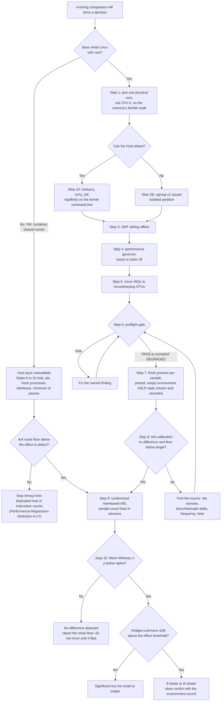
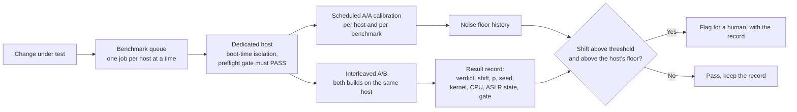

# Design a Low-Noise Benchmark Harness Playbook

> [!summary] Claim:
> A benchmark harness is a measuring instrument, and an instrument is trusted only after it has measured its own error: run A against A first, and issue no A/B verdict until that run reports no difference and a noise floor below the effect you care about.
> Noise is removed in three layers, in this order: the host (one isolated physical core, a fixed frequency, interrupts routed elsewhere), the process (a fresh pinned process per sample with a fixed environment and a recorded ASLR state), and the experiment (randomized interleaving of A and B, a sample count fixed in advance, and a Mann-Whitney U test combined with an effect-size threshold).
> Interleaving needs no privileges and is the control that prevents wrong answers: in this playbook's lab a 3% drift across a session makes an all-A-then-all-B schedule report a regression in 200 of 200 sessions where A and B are identical, and the interleaved schedule reports none.
> Low noise is necessary and not sufficient, so the harness stores every control it applied next to every number it reports.

The mechanisms behind each noise source (environment size, ASLR, link order, governors, SMT, NUMA) are owned by [[Benchmark-Methodology-Noise-and-Environment-Control]].
Summaries, percentiles, and bootstrap intervals are owned by [[Statistics-for-Benchmarks-Coordinated-Omission-and-HDR-Histograms]].
Gating policy on shared CI runners is owned by [[Performance-Regression-Detection-in-CI]].
This playbook owns the procedure: configure one Linux host, write the harness, and prove the result with an A/A run.

## Trigger and Symptoms

Activate this playbook when a timing comparison is about to drive a decision and any of these holds.

- An A/A comparison (the same binary and arguments in both arms) reports a statistically significant difference, or its spread is larger than the smallest change you need to detect.
- The sign of a measured speedup changes between sessions, hosts, or times of day.
- Benchmarks that run later in a suite are systematically slower than the ones that run first, which is the signature of thermal or frequency drift.
- Google Benchmark prints `***WARNING*** CPU scaling is enabled, the benchmark real time measurements may be noisy and will incur extra overhead.` or `***WARNING*** ASLR is enabled, the results may have unreproducible noise in them.`
- Google Benchmark's `compare.py` appends `WARNING: Results unreliable! 9+ repetitions recommended.` to its U test row.
- `benchstat` prints `~` for a change you believe is real, which says the change is not distinguishable from noise, not that it is absent.

Use a different note when the question is a different one.

- Tail latency of a service under load is a load-generator problem first: see [[Drill-Measurement-Methodology-Coordinated-Omission-Trap]].
- A shared or virtualized CI runner cannot be tuned at the host layer at all: see [[Performance-Regression-Detection-in-CI]] for instruction counts and change-point detection.
- A result that is stable but changes with the length of an environment variable is bias, not noise: see [[Drill-Measurement-Methodology-Environment-Size-Bias]].

## Decision Tree



## Prerequisites

The host layer needs a bare metal Linux machine and root.
The process and experiment layers need neither, which is why they also apply inside a virtual machine or a container.

```bash
command -v taskset setarch chrt lscpu python3 cc cpupower
uname -r
cat /sys/fs/cgroup/cgroup.controllers
```

- `taskset`, `setarch`, `chrt`, and `lscpu` are part of util-linux.
- `cpupower` is maintained in the kernel tree under `tools/power/cpupower`; its package name varies by distribution.
- `rtla`, documented under `Documentation/tools/rtla` in the kernel tree, is optional and is used only to hunt noise in Step 8.
- `cgroup.controllers` must list `cpuset` for Step 2B.

Permissions:

- Writing under `/sys/devices/system/cpu/` and `/proc/irq/` needs root.
- Per taskset(1), a user can change the CPU affinity of a process belonging to the same user without any capability, and needs `CAP_SYS_NICE` only for another user's process.
- Per chrt(1), changing scheduling attributes needs `CAP_SYS_NICE`.
- `setarch -R` needs no capability, but a seccomp profile can forbid the `personality(2)` call it makes, as Docker's default profile does.

The commands below use one example host with 8 logical CPUs on 4 cores, where `cpuN` and `cpuN+4` are SMT siblings.
The benchmark runs on `cpu7`, and the whole physical core (`cpu3` and `cpu7`) is taken away from the rest of the system.

```bash
BENCH_CPU=7           # runs the benchmark
SIBLING_CPU=3         # its SMT sibling
ISOLATED=3,7          # the whole physical core
HOUSEKEEPING=0-2,4-6  # everything else: kernel threads, IRQs, the harness itself (Step 2A)
```

**Verification:** `lscpu --extended=CPU,CORE,SOCKET,NODE,ONLINE` lists one row per logical CPU, and on the example host `cat /sys/devices/system/cpu/cpu7/topology/core_cpus_list` prints `3,7`.
`core_cpus_list` is the current name of the attribute; `thread_siblings_list` is its deprecated alias.

## Commands and Numbers to Know

| Item | Platform | Value `(as of 2026-11)` | Why it matters |
| :--- | :--- | :--- | :--- |
| `isolcpus=[flag-list,]<cpu-list>` | Linux v7.0 | Flags `domain` (the default), `nohz`, `managed_irq`; the parameter is marked "Deprecated - use cpusets instead" | `domain` removes CPUs from scheduler load balancing and is irreversible until reboot. |
| `nohz_full=<cpu-list>` | Linux v7.0 | Needs `CONFIG_NO_HZ_FULL=y`; the boot CPU is forced out of the list; listed CPUs get RCU callback offload as with `rcu_nocbs=` | Stops the scheduler tick while exactly one task is runnable on the CPU. |
| `irqaffinity=<cpu-list>` | Linux v7.0 | Sets the default IRQ affinity mask | Keeps newly requested interrupts on housekeeping CPUs from boot. |
| `/sys/devices/system/cpu/isolated`, `nohz_full` | Linux v7.0 | Read-only CPU lists set by the boot parameters | The check that the command line took effect. |
| `cpuset.cpus.partition` | Linux v7.0, cgroup v2 | Accepts `member`, `root`, `isolated`; reads back `isolated invalid (<reason>)` when it did not take | `isolated` means no load balancing and exclusion from unbound workqueues, without a reboot. |
| `/sys/fs/cgroup/cpuset.cpus.isolated` | Linux v7.0, cgroup v2 | Read-only, root cgroup only | Lists every CPU in an isolated partition. |
| `AllowedCPUs=`, `CPUSetPartition=` | Linux, systemd | Added in systemd 244 and 261; unified hierarchy only; `CPUSetPartition=` requires `AllowedCPUs=` | The systemd spelling of `cpuset.cpus` and `cpuset.cpus.partition`. |
| `cset shield` | Linux | Supports cpuset v1 only, per its maintainers | Fails on a cgroup v2 host although the LLVM guide still recommends it. |
| `cpuN/cpufreq/scaling_governor` | Linux v7.0 | Read-write; value must be listed in `scaling_available_governors` | `performance` requests the highest allowed frequency. |
| `cpufreq/boost` | Linux v7.0 | `0` forbids boost; absent when the driver has its own control | Generic frequency boost switch. |
| `intel_pstate/no_turbo` | Linux v7.0, Intel | `1` forbids turbo P-states; default `0` | Replaces `boost` under `intel_pstate`. |
| `cpuX/cpufreq/boost` | Linux v7.0, AMD | `0` disables boost for that policy | The `amd-pstate` per-policy boost control. |
| `cpuN/online` | Linux v7.0 | `0` logically shuts the CPU down, `1` brings it back | Takes the SMT sibling out of play; the CPU also disappears from `/proc/interrupts`. |
| `/proc/irq/N/smp_affinity_list` | Linux v7.0 | CPU list an IRQ may target; cannot be empty | Per-IRQ routing; managed interrupts cannot be changed here. |
| `IRQBALANCE_BANNED_CPULIST` | Linux, irqbalance | Defaults to the isolated and adaptive-tick CPUs | A running irqbalance respects `isolcpus` and `nohz_full` but rewrites manual affinities elsewhere. |
| `ADDR_NO_RANDOMIZE` | Linux v7.0 | `0x0040000`; set by `setarch -R`; part of `PER_CLEAR_ON_SETID` | Per-process ASLR off; a setuid exec clears it again. |
| Docker default seccomp `personality` | Linux | Allows only `0`, `8`, `0x20000`, `0x20008`, `0xffffffff` | `setarch -R` fails with `Operation not permitted` in a default container. |
| Affinity inheritance | Linux | Inherited across `fork(2)`, preserved across `execve(2)` | Why setting the mask between fork and exec pins the benchmark. |
| Smallest two-sided U test p-value | Both | `0.1` for 3+3 samples, `0.0286` for 4+4, `0.00794` for 5+5, `1.08e-05` for 10+10 | With 3 runs per side no result can reach `p < 0.05`. |
| `compare.py` U test | Both, Google Benchmark v1.10.0 | Two-sided, `--alpha` default `0.05`, needs 2 repetitions, warns below 9 | The reference C++ A/B decision rule. |
| `benchstat` | Both | Mann-Whitney U, alpha `0.05`, "at least 10, ideally 20" runs | The reference Go A/B decision rule. |
| `pyperf compare_to` | Both | Student's two-sample, two-tailed t-test at the 95% level | A parametric rule; it assumes more about the distribution than a rank test. |
| SciPy `mannwhitneyu(method="auto")` | Both | Exact when one sample has at most 8 values and there are no ties, else asymptotic | Why small-sample p-values differ between tools. |
| LLVM guide's stated result | Linux | "you can expect perf variations of less than 0.1%" after its full recipe | A published target for a tuned host; it is the guide's claim, not a measurement made here. |

## Step-by-Step Execution

Each step ends with a check.
Do not continue past a failed check; go to Failure Modes of the Procedure.
Steps 1 to 5 change the host and need root; Steps 6 to 10 are the harness and run as an ordinary user.
The write commands of Steps 2 to 5 follow the cited kernel and tool documentation and were not executed for this note, because the lab host is a virtual machine guest; every read-only command and all of Steps 6 to 10 were run in the lab container.

### Step 0: Save the state you are about to change

```bash
STATE=/var/tmp/bench-host-state
mkdir -p "$STATE"
cat /proc/cmdline > "$STATE/cmdline"
for f in /sys/devices/system/cpu/cpu*/cpufreq/scaling_governor; do echo "$f $(cat "$f")"; done > "$STATE/governors"
cat /sys/devices/system/cpu/cpufreq/boost > "$STATE/boost" 2>/dev/null
cat /sys/devices/system/cpu/intel_pstate/no_turbo > "$STATE/no_turbo" 2>/dev/null
for f in /proc/irq/*/smp_affinity_list; do echo "$f $(cat "$f")"; done > "$STATE/irq_affinity"
cat /proc/irq/default_smp_affinity > "$STATE/default_smp_affinity"
systemctl is-active irqbalance > "$STATE/irqbalance"
```

Whichever of `boost` and `no_turbo` does not exist on the host leaves an empty file, which is the record that the control was absent.

**Verification:** `wc -l "$STATE"/*` shows one `governors` line per CPU with a cpufreq policy and one `irq_affinity` line per IRQ.
These commands only read, so they also run unprivileged; in the lab container they produced one line per CPU and per IRQ.

### Step 1: Choose the benchmark core

```bash
lscpu --extended=CPU,CORE,SOCKET,NODE,ONLINE
cat "/sys/devices/system/cpu/cpu${BENCH_CPU}/topology/core_cpus_list"
```

Three rules pick the CPU.

1. Not CPU 0: the kernel forces the boot CPU out of the `nohz_full=` range to keep timekeeping, and CPU hotplug documentation notes that CPU0 "is often special".
2. A whole physical core: both SMT threads of one core share its execution units, so isolating one thread and leaving its sibling in general use isolates nothing.
3. On the NUMA node that holds the benchmark's memory; [[Benchmark-Methodology-Noise-and-Environment-Control]] owns `numactl` binding.

**Verification:** the `core_cpus_list` output equals `$ISOLATED` (`3,7` on the example host), and both CPUs show the same `NODE` in `lscpu`.

### Step 2A: Isolate at boot (preferred when the host can reboot)

Add the parameters to the kernel command line and reboot.

```bash
# Debian and Ubuntu: edit GRUB_CMDLINE_LINUX in /etc/default/grub, then
sudo update-grub
# Fedora and RHEL family
sudo grubby --update-kernel=ALL --args="isolcpus=domain,managed_irq,3,7 nohz_full=3,7 irqaffinity=0-2,4-6"
sudo reboot
```

`GRUB_CMDLINE_LINUX` holds "command-line arguments to add to menu entries for the Linux kernel", and `update-grub` is a stub that runs `grub-mkconfig -o /boot/grub/grub.cfg`.

What each parameter buys, from `kernel-parameters.txt` at Linux v7.0:

- `isolcpus=domain,...` removes the CPUs "from the general SMP balancing and scheduling algorithms", so no task lands there unless it is placed with the affinity system calls or a cpuset.
- `managed_irq` keeps managed interrupts whose mask includes housekeeping CPUs away from the isolated ones, on a best-effort basis.
- `nohz_full=` stops the tick on those CPUs "whenever possible" and offloads their RCU callbacks "just as if they had also been called out in the rcu_nocbs= boot parameter", so a separate `rcu_nocbs=` is redundant.
- `irqaffinity=` sets the default IRQ affinity mask to the housekeeping CPUs.

The `nohz` flag of `isolcpus` is documented as equivalent to `nohz_full`, and a residual 1 Hz tick is offloaded to workqueues, which by default run on all CPUs and must be affined to housekeeping CPUs through `/sys/devices/virtual/workqueue/cpumask` or by also using the `domain` flag.
`isolcpus` is marked deprecated in favor of cpusets and its `domain` isolation cannot be undone at runtime, which is the reason to use it only on a dedicated benchmark host.

**Verification:**

```bash
cat /sys/devices/system/cpu/isolated
cat /sys/devices/system/cpu/nohz_full
ps -eLo psr,pid,comm | awk -v c="$BENCH_CPU" '$1 == c'
```

The first two commands print `3,7` on the example host.
The `ps` line lists every thread whose last CPU was `cpu7`; with isolation in effect only per-CPU kernel threads remain, with names such as `ksoftirqd/7` and `kworker/7:0`.
An absent or empty `nohz_full` file means no CPU is in adaptive-tick mode, which is what the lab container shows.

### Step 2B: Isolate at runtime with a cpuset partition (no reboot)

```bash
cat /proc/self/cgroup > "$STATE/cgroup"                  # one line, 0::/path, for the rollback
echo "+cpuset" | sudo tee /sys/fs/cgroup/cgroup.subtree_control
sudo mkdir /sys/fs/cgroup/bench
echo "$ISOLATED" | sudo tee /sys/fs/cgroup/bench/cpuset.cpus
echo isolated | sudo tee /sys/fs/cgroup/bench/cpuset.cpus.partition
echo $$ | sudo tee /sys/fs/cgroup/bench/cgroup.procs    # move this shell, and the harness it starts, inside
```

Per the cgroup v2 documentation, a partition has exclusive access to its CPUs, and in the `isolated` state those CPUs are "without any load balancing from the scheduler and excluded from the unbound workqueues".
Because nothing balances inside the partition, the same document says tasks in it "should be carefully distributed and bound to each of the individual CPUs", so the harness still pins each process in Step 7.
The harness itself must then run inside the partition too, not on the housekeeping CPUs: sched_setaffinity(2) fails with `EINVAL` for a mask that holds no CPU permitted by the caller's cpuset, so a harness outside `bench` cannot pin a child to `cpu7`; it sleeps in `waitpid` while a sample runs.
A cpuset partition does not stop the tick: `nohz_full` is set only by the boot parameter.
On a systemd host the same two files are exposed as the unit properties `AllowedCPUs=` (since systemd 244) and `CPUSetPartition=` (since systemd 261, and it requires `AllowedCPUs=` to be set as well).
Do not reach for `cset shield`: the cpuset project's maintainers state in its issue 40 that the tool supports only cpuset v1.

**Verification:**

```bash
cat /sys/fs/cgroup/bench/cpuset.cpus.partition
cat /sys/fs/cgroup/cpuset.cpus.isolated
```

The first prints `isolated`; `isolated invalid (<reason>)` means the partition did not form and the reason is in the parentheses.
The second lists the isolated CPUs, `3,7` on the example host.

### Step 3: Take the SMT sibling offline

```bash
echo 0 | sudo tee "/sys/devices/system/cpu/cpu${SIBLING_CPU}/online"
```

The sibling is already isolated, so nothing is scheduled there, but an offline CPU cannot take an interrupt or a stray pinned task either.
`/sys/devices/system/cpu/smt/control` accepts `off` to disable SMT on every core, which is simpler when the whole machine is dedicated.

**Verification:** `cat /sys/devices/system/cpu/online` prints `0-2,4-7` on the example host.

### Step 4: Lock the frequency

```bash
sudo cpupower frequency-set --governor performance
echo 0 | sudo tee /sys/devices/system/cpu/cpufreq/boost           # drivers with the generic boost file
echo 1 | sudo tee /sys/devices/system/cpu/intel_pstate/no_turbo   # intel_pstate
```

Only one of the two boost controls exists on a given host: the generic `boost` file is absent when the driver provides its own, as `intel_pstate` does.
Under `amd-pstate` the boost control is per policy, at `/sys/devices/system/cpu/cpuX/cpufreq/boost`.
`python3 -m pyperf system tune` performs this step and Step 5 together (governor, minimum frequency, turbo, irqbalance, and IRQ affinities).
`python3 -m pyperf system reset` puts back pyperf's defaults, for example the `powersave` governor, which are not necessarily the values the host had.
Frequency also follows temperature and power limits that no sysfs file fixes, so run the workload for a few minutes before the first measured sample and keep the session short enough that the machine stays in one thermal state.

**Verification:**

```bash
cat "/sys/devices/system/cpu/cpu${BENCH_CPU}/cpufreq/scaling_governor"
cat /sys/devices/system/cpu/cpufreq/boost /sys/devices/system/cpu/intel_pstate/no_turbo 2>/dev/null
```

Expect `performance`, then `0` for `boost` or `1` for `no_turbo`.

### Step 5: Move interrupts to the housekeeping CPUs

```bash
sudo systemctl stop irqbalance
for irq in /proc/irq/[0-9]*; do
    echo "$HOUSEKEEPING" | sudo tee "$irq/smp_affinity_list" > /dev/null 2>&1 || echo "not movable: IRQ ${irq##*/}"
done
echo 77 | sudo tee /proc/irq/default_smp_affinity    # bits 0-2 and 4-6
```

`smp_affinity_list` takes a CPU list and `default_smp_affinity` takes a hexadecimal mask; `77` is binary `0111 0111`.
Some writes fail by design: the affinity of managed interrupts "is handled by the kernel and cannot be changed via the /proc/irq/* interfaces", which is the case the `managed_irq` flag of Step 2A covers.
A running irqbalance bans the isolated and adaptive-tick CPUs by default but rewrites other affinities, so either stop it, as `pyperf system tune` does, or set `IRQBALANCE_BANNED_CPULIST` yourself.

**Verification:** count the interrupts delivered to the benchmark CPU over ten seconds.

```bash
snap() { awk -v cpu="CPU${BENCH_CPU}" 'NR == 1 { for (i = 1; i <= NF; i++) if ($i == cpu) col = i + 1; next } col && NF >= col { print $1, $col }' /proc/interrupts; }
diff <(snap) <(sleep 10; snap)
```

The column is found from the `CPUn` header rather than computed as `BENCH_CPU + 2`, because `/proc/interrupts` prints a column only for each online CPU (`for_each_online_cpu()` in `kernel/irq/proc.c`): after Step 3 takes `cpu3` offline, `cpu7` is the eighth field, and a computed column would read the interrupt-chip name, which never changes, so the check would pass on a CPU that is still taking interrupts.
Every line of output is an interrupt source that fired on `cpu7` during the window.
On an idle isolated CPU the output is empty, as it was for the isolated CPU of the lab virtual machine.
While a benchmark runs there, the local timer line still moves unless `nohz_full` is active and the benchmark is the only runnable task.

### Step 6: Run the preflight gate

The harness reads the controls from Steps 2 to 5 for the CPU it is about to use and refuses to call an unverified host quiet.

```bash
cd code/04-Measurement-Methodology/low_noise_harness
python3 -c 'import pathlib, lownoise as ln
found = ln.preflight(pathlib.Path("/"), 7)
print(ln.gate(found))
for f in found: print(f)'
```

`gate()` returns `PASS` when every required control was read and is right, `DEGRADED` when a control is not exposed at all (a virtual machine with no boost file), and `FAIL` when a control is readable and wrong.
A host that exposes nothing still fails, because isolation is judged from files that must exist: the gate fails closed.

**Verification:** the gate prints `PASS`.
The lab's fixture `tuned-host` shows the six `ok` lines to expect, and its fixture `tuned-but-sibling-online` shows the single `fail` line that a skipped Step 3 produces.

### Step 7: Confine each sample to a fresh, pinned process

The shell form of one sample is:

```bash
env -i /usr/bin/taskset -c "$BENCH_CPU" /usr/bin/setarch "$(uname -m)" -R ./bench_a
```

- `env -i` starts the benchmark with an empty environment, so the environment block on the initial stack has the same size and contents on every launch and for both variants (the auxiliary vector still carries per-exec values such as the `AT_RANDOM` bytes).
- `taskset -c` sets the affinity mask, which sched_setaffinity(2) documents as inherited across `fork` and preserved across `execve`.
- `setarch -R` sets `ADDR_NO_RANDOMIZE`, which turns address space layout randomization off for that process tree.

The lab's `run_sample()` does the same without spawning helpers, between `fork` and `exec`:

```python
    def confine() -> None:
        os.sched_setaffinity(0, {cpu})
        if disable_aslr and libc.personality(ADDR_NO_RANDOMIZE) == -1:
            raise OSError(ctypes.get_errno(), "personality(ADDR_NO_RANDOMIZE) failed")

    done = subprocess.run(cmd, env={}, preexec_fn=confine, capture_output=True, text=True, check=True)
```

Python documents `preexec_fn` as not safe in a program that has threads, so the harness is single threaded.

Three design rules belong to this step.

1. One process per sample.
   A new process draws a new heap, a new page placement, and (with ASLR on) a new layout, so process-level effects are sampled instead of frozen into one run.
2. Decide the ASLR state and record it.
   With ASLR off every launch has the same layout, which lowers spread and makes A/A runs repeatable, but the answer then holds for that one layout.
   With ASLR on, each fresh process is a new layout, so layout effects widen the spread of both arms instead of biasing one.
   The sources disagree on purpose: the LLVM guide and Google Benchmark turn ASLR off, while pyperf, whose design is many fresh processes, states "ASLR must not be disabled manually!".
   Use the per-process switch, never `echo 0 > /proc/sys/kernel/randomize_va_space` as a habit, since that file changes the whole system.
3. Keep the two command lines the same length.
   Argument strings sit on the initial stack next to the environment, so the lab passes `300000` and `390000`, two arguments with the same number of digits.

`chrt -f` is not a substitute for isolation.
A `SCHED_FIFO` benchmark still shares the core with interrupts, and per sched(7) a share of CPU time (5% by default) is reserved for non-real-time tasks, which arrives as periodic preemption.

**Verification:** run a probe through the same launch line and read back what the process actually has.

```bash
env -i /usr/bin/taskset -c "$BENCH_CPU" /usr/bin/setarch "$(uname -m)" -R \
    /bin/sh -c 'grep Cpus_allowed_list /proc/self/status; cat /proc/self/personality'
```

On a host that permits the call, `Cpus_allowed_list` shows only `$BENCH_CPU` and the personality has the `ADDR_NO_RANDOMIZE` bit (`0x0040000`, from `personality.h`) set.
Under Docker's default seccomp profile the same command fails with `setarch: failed to set personality to aarch64: Operation not permitted`, and the harness must then record the layout as randomized.

### Step 8: Calibrate with an A/A run

Run the harness with the same command in both arms, with the sample count and schedule of the real experiment.

A calibration passes when all three hold:

1. The verdict is `no difference detected`.
2. The estimated shift is smaller in magnitude than the effect threshold you will use in Step 10.
3. The spread of one arm (coefficient of variation, and the median absolute deviation as the outlier-resistant figure) is below your target, for example 1%.

If it fails, measure the host instead of adding repetitions.

```bash
sudo rtla osnoise top -c "$BENCH_CPU" -d 60s -q
```

`rtla osnoise top` runs a kernel thread on each listed CPU that reads the time in a loop and attributes every gap to an NMI, an IRQ, a softirq, another thread, or the hardware, then prints per-CPU totals and the available CPU percentage.
The interrupt delta from Step 5 and a look at `scaling_cur_freq` during the run cover the two other usual sources.

**Verification:** the harness prints the three calibration facts and they pass; the lab prints them on stderr in a line that begins `[live] A/A:`.

### Step 9: Interleave A and B in a random order, with a fixed sample count

```python
def interleaved_order(pairs: int, rng: random.Random) -> list[str]:
    """Randomized block design: each block holds one A and one B, in an order drawn per block."""
    order: list[str] = []
    for _ in range(pairs):
        order.extend(("A", "B") if rng.random() < 0.5 else ("B", "A"))
    return order
```

Blocks of two keep A and B within one step of each other in time, so anything that changes slowly (temperature, page cache, a background job) reaches both arms equally.
Drawing the order inside each block removes a fixed "A always runs first" effect.
The seed goes into the result record so the schedule can be reproduced.

Choose the number of pairs before the first sample and do not change it afterwards.
`benchstat` recommends "at least 10, ideally 20" runs and warns against rerunning until a difference appears: at alpha 0.05 a difference is expected 5% of the time when there is none.
Google Benchmark's `compare.py` warns below 9 repetitions.

**Verification:** each variant appears exactly `pairs` times and the mean position of B minus the mean position of A is close to zero.
For 15 pairs the lab prints `+0.07` for the interleaved order and `+15.00` for the sequential one.

### Step 10: Decide with a Mann-Whitney U test and an effect threshold

The U statistic for sample A counts the pairs `(a, b)` in which `a` is greater than `b`, with ties counting one half.
Under the null hypothesis that a value drawn from one sample is equally likely to be below or above a value drawn from the other, every ordering of the pooled values is equally likely, so the p-value is a count of orderings and needs no assumption about the shape of the timing distribution.
The test is due to Mann and Whitney (1947) and is equivalent to Wilcoxon's rank-sum test (1945).

```python
def compare(a: list[float], b: list[float], alpha: float = 0.05, min_effect_pct: float = 1.0) -> Comparison:
    u_a, p, method = u_test(a, b)
    shift = 100 * hodges_lehmann(a, b) / statistics.median(a)
    if p >= alpha:
        verdict = "no difference detected"
    elif abs(shift) < min_effect_pct:
        verdict = "significant but below the effect threshold"
    else:
        verdict = "B slower" if shift > 0 else "B faster"
    return Comparison(len(a), len(b), u_a, p, method, shift, verdict)
```

- `u_test()` computes the exact two-sided p-value when there are no ties and the product of the sample sizes is at most 1000, and otherwise uses the normal approximation with tie correction and a continuity correction.
- `hodges_lehmann()` is the median of all pairwise differences `b - a`, the shift estimate that belongs to the U test.
- The effect threshold exists because a quiet host makes tiny differences significant; `benchstat`'s documentation makes the same point about low-noise data.

**Verification:** check the implementation against published values before trusting it.
The lab reproduces the SciPy documentation example (`U = 17` and `U = 3`, exact `p = 0.1111111111`, asymptotic `p = 0.1113468865`) and prints the smallest p-value each sample size can reach.

## Worked Example: Low-Noise Harness Lab

The lab in `code/04-Measurement-Methodology/low_noise_harness/` is tagged `# requires: linux`.
`run.sh` compiles `workload.c` with `"${CC:-cc}" -O2` and runs `lab.py`, which drives the harness library `lownoise.py`.
Facts that never vary go to stdout and are diffed against the recording; this host's preflight findings and all timings go to stderr.

1. **Preflight on fixtures.**
   `lab.py` builds four fake `/sys` and `/proc` trees and runs `preflight()` on each, so every branch of the gate is exercised without root.
2. **Schedule.**
   It prints the sequential and the interleaved order for 15 pairs and the seed.
3. **U test.**
   It checks `u_test()` against the SciPy documentation example, prints the null distribution those numbers come from, and prints the smallest reachable p-value for six sample sizes.
4. **Drift simulation.**
   It generates 200 synthetic sessions per scenario, each 20+20 samples with 0.3% Gaussian noise and a 1 to 3% upward spike on 5% of samples, and compares the two schedules with and without a 3% upward drift across the session.
5. **Live run.**
   It picks an isolated CPU if the process is allowed on one (otherwise the highest allowed CPU), probes whether `personality(ADDR_NO_RANDOMIZE)` is permitted, and runs an A/A and an A/B experiment of 15+15 fresh processes each.
   `workload` runs one warm-up pass and fifty timed passes of a xorshift loop and reports, besides the times, the size of its affinity mask, the CPU at the start and end of the timed region, its personality flags, a checksum, and the address of a stack variable.
   The B arm does 30% more iterations.

The harness takes the minimum of the fifty timed passes as the value for a process.
That choice fits noise that only adds time, which is the kind this lab cannot remove; Python's `timeit` documentation makes the same argument for the minimum.
The passes are short on purpose: a short pass is more likely to fit between two preemptions, so the minimum finds an undisturbed one.
The lab uses fifty short passes rather than a few long ones for this reason, and the recorded verdict does not depend on it.
Use the median instead when slow passes belong to the workload itself, such as allocation or I/O, and see [[Statistics-for-Benchmarks-Coordinated-Omission-and-HDR-Histograms]] for what a minimum hides.

### Verified output

Recorded with `python3 -m _harness.verify --record` on 2026-11-10 from a darwin-arm64 host, which dispatched the lab to the pinned container (Ubuntu 24.04, gcc 13.3.0, Python 3.12.3, kernel 7.2.12 under OrbStack); the file is `code/04-Measurement-Methodology/low_noise_harness/expected/linux-aarch64.txt`.
Only stdout is recorded; the timings go to stderr and differ on every run, so they are not part of the recording.
An independent run on 2026-11-13 in container image `toolchain-labs:1192e7ee37dc` matched the recording (`PASS`), and Parts 1 to 4 also print the same lines when run natively on macOS.

```text
== 1. Preflight gate on fixture hosts (benchmark CPU 7 of 8) ==
default-desktop: FAIL
  [fail   ] governor: cpu7 governor is schedutil, want performance
  [fail   ] boost: frequency boost is allowed
  [fail   ] smt: cpu7 shares a core with online cpu 3
  [fail   ] isolation: cpu7 takes part in scheduler load balancing
  [fail   ] irq: 6 of 6 IRQs may be delivered to cpu7
  [note   ] tick: cpu7 is not in nohz_full, the scheduler tick still fires
tuned-host: PASS
  [ok     ] governor: cpu7 governor is performance
  [ok     ] boost: frequency boost is off
  [ok     ] smt: cpu7 has no online SMT sibling
  [ok     ] isolation: cpu7 is isolated at boot (isolcpus)
  [ok     ] irq: 0 of 6 IRQs may be delivered to cpu7
  [ok     ] tick: cpu7 is in nohz_full
tuned-but-sibling-online: FAIL
  [ok     ] governor: cpu7 governor is performance
  [ok     ] boost: frequency boost is off
  [fail   ] smt: cpu7 shares a core with online cpu 3
  [ok     ] isolation: cpu7 is isolated at boot (isolcpus)
  [ok     ] irq: 0 of 6 IRQs may be delivered to cpu7
  [ok     ] tick: cpu7 is in nohz_full
nothing-exposed: FAIL (4 controls unknown, isolation fails closed)
cpulist '0-2,6,10-11' parses to [0, 1, 2, 6, 10, 11]

== 2. Schedule for 15 pairs (seed 20261109) ==
sequential : AAAAAAAAAAAAAAABBBBBBBBBBBBBBB
interleaved: AB AB BA AB AB BA BA BA AB AB BA AB BA BA AB
sequential: A runs 15, B runs 15, mean position of B minus A = +15.00
interleaved: A runs 15, B runs 15, mean position of B minus A = +0.07
blocks that run A first: 8 of 15

== 3. Mann-Whitney U against published values ==
SciPy documentation example: U_males = 17, U_females = 3
  exact two-sided p = 0.1111111111 (SciPy prints 0.1111111111111111)
  normal two-sided p = 0.1113468865 (SciPy prints 0.11134688653314041)
null distribution for n=5,4: 126 orderings (C(9,4) = 126), counts for U=0..3: [1, 1, 2, 3]
  exact p from those counts: 2 * 7 / 126 = 1/9
complete separation, n =  3 + 3 : smallest possible p = 0.1
complete separation, n =  4 + 4 : smallest possible p = 0.0286
complete separation, n =  5 + 5 : smallest possible p = 0.00794
complete separation, n = 10 + 10: smallest possible p = 1.08e-05
complete separation, n = 15 + 15: smallest possible p = 1.29e-08
complete separation, n = 20 + 20: smallest possible p = 1.45e-11
ties force the normal method: U_a = 4.5, p = 0.1116
Hodges-Lehmann shift of [10, 11, 12] to [11, 13, 15]: 2

== 4. Drift simulation: 200 sessions of 20+20 samples per scenario ==
noise 0.3% Gaussian plus a 1-3% spike on 5% of samples; alpha 0.05, effect threshold 0.5%
A and B identical, no drift:
  sequential : B slower   0, B faster   0, below threshold   7, no difference 193; median estimated shift +0.01%
  interleaved: B slower   0, B faster   0, below threshold  12, no difference 188; median estimated shift -0.01%
A and B identical, 3% upward drift over the session:
  sequential : B slower 200, B faster   0, below threshold   0, no difference   0; median estimated shift +1.55%
  interleaved: B slower   0, B faster   0, below threshold   0, no difference 200; median estimated shift +0.00%
B truly 1% faster, 3% upward drift over the session:
  sequential : B slower 113, B faster   0, below threshold  51, no difference  36; median estimated shift +0.53%
  interleaved: B slower   0, B faster 192, below threshold   0, no difference   8; median estimated shift -1.00%

== 5. Live A/A and A/B run on this host (timings are on stderr) ==
samples collected: A/A 15+15, A/B 15+15, one fresh process each
every process was confined to exactly one CPU: yes
every process started and ended its timed region on the chosen CPU: yes
workload checksums: identical within a variant and different between variants: yes
ADDR_NO_RANDOMIZE flag in every child matches what the harness requested: yes
recorded ASLR state agrees with observed stack addresses (one address only when ASLR is off): yes
A/B verdict: B slower; p < 0.01: yes; shift above +15%: yes
A/A shift is smaller in magnitude than the A/B shift: yes
result record fields: aa_cv_pct, aa_shift_pct, ab_p, ab_shift_pct, alpha, aslr, cpu, cpu_isolation, gate, kernel, min_effect_pct, pairs, seed
```

### What the output proves and what it does not

- **Part 1** proves the gate's logic, not a host: each control fails in `default-desktop`, each passes in `tuned-host`, and one skipped step (the sibling left online) turns `PASS` into `FAIL`.
- **Part 2** shows why interleaving works before any timing exists: the sequential order puts B 15 positions later than A on average, the interleaved order 0.07.
- **Part 3** ties the implementation to an external reference and to arithmetic you can do by hand: 7 of the 126 orderings have `U <= 3`, so the two-sided p-value is `2 * 7 / 126 = 1/9`.
  It also shows the floor on p: three runs per side can never beat `0.1`, and four per side can never beat `0.0286`.
- **Part 4, no drift:** 7 and 12 of 200 identical comparisons were significant at alpha 0.05, close to the 10 that alpha predicts, and every one of them was below the 0.5% effect threshold.
  That is the threshold doing its job.
- **Part 4, drift with identical arms:** the sequential schedule called B slower in 200 of 200 sessions with a median shift of +1.55%, which is the drift between the first and second half of the session and nothing else.
- **Part 4, drift with a real 1% improvement:** the sequential schedule never once reported B as faster and reported it slower in 113 sessions; the interleaved schedule reported B faster in 192 and estimated -1.00%.
- **Part 4, the count of zero:** under drift the interleaved schedule produced 0 false positives, fewer than alpha predicts.
  Blocking cancels the drift from the difference between the arms but leaves it in the spread of each arm, so the unpaired U test becomes conservative and loses power.
  The remedy is to remove the drift (Step 4) or to analyze the blocks as pairs, for example with Wilcoxon's signed-rank test on the within-block differences.
- **Part 5** proves the process-level controls on a real kernel: every child had a one-CPU affinity mask and started and ended its timed region on the chosen CPU.
  Removing the `os.sched_setaffinity` call from `run_sample()` turned both lines to `no` in a test run.
- **Part 5, ASLR:** under the container's default seccomp profile `personality(ADDR_NO_RANDOMIZE)` is denied, the harness records the layout as randomized, and the launches did not share a stack address.
  The check compares the recorded ASLR state with the observed stack addresses, so it holds in both cases; the permitted branch (same stack address on every launch) is not exercised by the recording.
- **Part 5 does not prove a noise floor.**
  The container is a virtual machine guest, its preflight gate reports `FAIL` on stderr (interrupts are not routed away and no boost control is exposed), and the measured spread differs on every run, so no timing figure appears in the recording.
  The 30% difference between the arms is large on purpose so that the verdict is stable on a noisy guest.

## Rollback Procedure

1. **Boot parameters.**
   Remove the added arguments and reboot; `domain` isolation cannot be reversed on a running kernel.
   On the Fedora and RHEL family: `sudo grubby --update-kernel=ALL --remove-args="isolcpus=domain,managed_irq,3,7 nohz_full=3,7 irqaffinity=0-2,4-6"`.
   On Debian and Ubuntu: restore `GRUB_CMDLINE_LINUX` in `/etc/default/grub` and run `sudo update-grub`.
   **Check:** after the reboot `cat /proc/cmdline` equals `"$STATE/cmdline"` and `/sys/devices/system/cpu/isolated` is empty.
2. **Cpuset partition.**
   Move the shell back to the cgroup saved in Step 2B with `echo $$ | sudo tee "/sys/fs/cgroup$(cut -d: -f3 "$STATE/cgroup")/cgroup.procs"`, write `member` to `/sys/fs/cgroup/bench/cpuset.cpus.partition`, and `sudo rmdir /sys/fs/cgroup/bench`.
   **Check:** `/sys/fs/cgroup/cpuset.cpus.isolated` is empty.
3. **SMT sibling.**
   `echo 1 | sudo tee "/sys/devices/system/cpu/cpu${SIBLING_CPU}/online"`.
   **Check:** `/sys/devices/system/cpu/online` shows the full range again.
4. **Frequency.**
   Write each saved governor back: `while read -r f g; do echo "$g" | sudo tee "$f" > /dev/null; done < "$STATE/governors"`.
   Write the saved value back to `boost` or `no_turbo`, whichever file is not empty in `$STATE`.
   If `pyperf system tune` made the change, `python3 -m pyperf system reset` restores pyperf's defaults; compare with `$STATE` afterwards.
   **Check:** the loop from Step 0 reproduces `"$STATE/governors"` exactly.
5. **Interrupts.**
   Write each saved list back: `while read -r f cpus; do echo "$cpus" | sudo tee "$f" > /dev/null 2>&1; done < "$STATE/irq_affinity"`, restore `default_smp_affinity` from its saved file, and start irqbalance again if `"$STATE/irqbalance"` says `active`.
   **Check:** the loop from Step 0 reproduces `"$STATE/irq_affinity"`.
6. **Process-level controls** need no rollback: the affinity mask and the personality flag die with the benchmark process.

## Failure Modes of the Procedure

| Failure | How it shows up | Recovery |
| :--- | :--- | :--- |
| Boot parameters did not apply | `/sys/devices/system/cpu/isolated` is empty after reboot | Compare `/proc/cmdline` with what you wrote; the bootloader entry in use may not be the one you edited. |
| `nohz_full` has no effect | The file is absent or empty, or the timer line in `/proc/interrupts` keeps counting during a run | The kernel needs `CONFIG_NO_HZ_FULL=y`; a second runnable task on the CPU also restarts the tick; POSIX CPU timers prevent adaptive-tick mode. |
| Cpuset partition is invalid | `cpuset.cpus.partition` reads `isolated invalid (<reason>)` | Read the reason; the parent must be a valid partition root and the CPUs must not be claimed by a sibling cgroup. |
| `cset shield` fails | `mount of cpuset filesystem failed` on a cgroup v2 host | Use Step 2B or the systemd properties; the tool supports cpuset v1 only. |
| Interrupts still arrive | Step 5's delta is not empty on an idle CPU | The IRQ is managed or per-CPU; use `managed_irq` at boot, or accept it and record it. |
| irqbalance undoes the affinities | Affinity files change back within seconds | Stop the service or set `IRQBALANCE_BANNED_CPULIST`. |
| `setarch -R` is refused | `failed to set personality ...: Operation not permitted` | A seccomp profile forbids it; run outside the container, relax the profile, or record the layout as randomized and rely on fresh processes. |
| ASLR comes back silently | Stack addresses differ although the harness asked for `-R` | The benchmark is setuid or setgid: `ADDR_NO_RANDOMIZE` is in `PER_CLEAR_ON_SETID`. |
| Pinning is ignored | The process reports more than one allowed CPU | The affinity call ran in the parent after the child started, or a wrapper reset it; set it between `fork` and `exec` and read `Cpus_allowed_list` in the child. |
| A/A is significant | Step 8 reports a difference between identical arms | The schedule is not interleaved, the two arms differ in command length or environment, or the host drifted; fix that before any A/B run. |
| Quiet guest, noisy numbers | No involuntary context switches, isolated CPU, yet passes within one process differ widely | A hypervisor preempts the virtual CPU without the guest scheduler seeing it; move to bare metal or to instruction counts. |
| Every timed pass reads 0 ns | Division by zero in the statistics, or absurd speedups | The compiler proved the benchmarked function pure and reused the warm-up result; make each call's input differ and consume its output. |

## Pitfalls

> [!warning] Running all of A, then all of B
> Any slow change in the machine becomes a difference between the arms.
> In the lab, a 3% drift produced a false regression in 200 of 200 sessions and hid a real 1% improvement in every session.
> Interleave in randomized blocks, even on a tuned host.

> [!warning] Three runs and a p-value
> With 3 samples per side the smallest possible two-sided U test p-value is 0.1, and with 4 per side it is 0.0286.
> A harness that defaults to three repetitions cannot detect anything at alpha 0.05, however large the effect.
> Fix the sample count at 10 or more per side before the first run.

> [!warning] Rerunning until it is significant
> At alpha 0.05, one comparison in twenty is significant with no real difference, and a suite of many benchmarks produces such results in proportion.
> `benchstat`'s documentation names this "multiple testing" and tells you to pick a run count and stick to it.
> Report the noise floor with a null result instead of repeating the experiment.

> [!warning] Statistical significance without an effect size
> A quiet host makes a 0.1% difference significant, and layout effects of that size are not a property of your change.
> The lab's no-drift scenario shows 7 and 12 of 200 identical comparisons significant, every one below the 0.5% threshold.
> Require both `p < alpha` and a shift above a threshold agreed in advance.

> [!warning] Pinning without isolating
> `taskset -c 7` restricts where your process may run and says nothing about what else runs there.
> Other tasks, kernel threads, and interrupts still share the CPU unless Steps 2 to 5 removed them.
> Read back the isolated list and the interrupt delta, not just the affinity mask.

> [!warning] Isolating one hardware thread
> The SMT sibling of an isolated CPU shares its core.
> If the sibling stays in general use, the scheduler places ordinary work on it and the benchmark slows down with no scheduling event on its own CPU.
> Isolate both threads and take one offline.

> [!warning] Treating a container as a host
> A container sees the host's `/sys/devices/system/cpu` files but cannot write them, and its view of processes and cgroups is its own.
> In the lab container the isolated CPU list is readable, the write paths are not available, and `personality()` is filtered.
> Tune the machine that owns the kernel, and let the harness report `DEGRADED` or `FAIL` anywhere else.

> [!warning] Benchmarked code that the compiler removed
> The first version of this lab's workload called a fixed-seed function for the warm-up and for each timed pass.
> GCC at `-O2` proved the function pure, reused the warm-up result, and every timed pass measured 0 ns.
> Vary an input per call, consume the result (the lab adds it to a printed checksum), and treat a checksum that does not change with the workload size as a failed run.

## At Scale

One developer needs Steps 6 to 10 and a laptop on mains power.
A team that gates merges on timing needs a small pool of dedicated hosts, and an organization of 1,000 to 50,000 engineers needs the harness to be a service with rules that do not depend on who runs it.



Decision rules:

- **Never compare across hosts.**
  A baseline measured on one machine and a candidate on another differ by the machines; run both arms interleaved on the same host in the same session.
- **Make the gate mandatory.**
  A job on a host whose preflight is not `PASS` produces a record marked `DEGRADED` or `FAIL`, and such records are excluded from decisions automatically.
- **Calibrate on a schedule.**
  Run A/A for every benchmark on every host regularly, store the floor, and alert when it rises, because a kernel update or a new daemon changes it without any code change.
- **Budget the false positives.**
  With alpha 0.05 and hundreds of benchmarks per change, about 5% of unchanged benchmarks are flagged by chance, so require the effect threshold as well and confirm a flag with a second, independent run.
- **Use isolation that survives reboots and upgrades.**
  Put the boot parameters and IRQ policy in configuration management, and treat a host that reboots without them as out of the pool until the gate passes.
- **Know when to stop timing.**
  When hosts are virtual or shared, or the effect of interest is far below the best floor the pool reaches, wall-clock A/B is the wrong instrument; [[Performance-Regression-Detection-in-CI]] covers instruction counts and change-point detection, and [[Measurement-Methodology-Decision-Records]] records which benchmarks use which.
- **Keep bias in view.**
  A pool of identical quiet hosts shares one layout per build, so periodically vary link order and environment size as [[Benchmark-Methodology-Noise-and-Environment-Control]] describes, and look at [[Hardware-Performance-Counters-Top-Down-TMA-and-Roofline]] when a shift has no source-level explanation.

## Practice Drill

> [!tip] Practice Drill: Break the harness one control at a time
> Copy `code/04-Measurement-Methodology/low_noise_harness/` to a scratch directory on a Linux host, run `bash run.sh`, and confirm stdout equals `expected/linux-aarch64.txt`.
> Then make one change at a time, predict the output first, and explain the difference.
> 1. In `lab.py`, change `PAIRS` to 3: the A/B line becomes `no difference detected; p < 0.01: no; shift above +15%: yes`; explain how a 30% slowdown goes undetected.
> 2. In `run_sample()`, replace the `os.sched_setaffinity` line with `pass`: two lines of Part 5 turn to `no`; explain why both still read `yes` in a container that is limited to one CPU.
> 3. In `part_live()`, pass `ln.sequential_order(PAIRS)` for the A/A run and compare the `[live] A/A:` shift on stderr over ten runs with the interleaved version.
> 4. In `simulate()`, set the spike probability to 0.5 and predict which summary (`cv_pct` or `mad_pct`) moves more, then check with a print.
> 5. In `workload.c`, call `kernel(iters, 0)` in the timed loop instead of `kernel(iters, (uint64_t)r + 1)`: the run fails with `ZeroDivisionError`; read the generated assembly to see the call that disappeared, using [[Reading-Assembly-and-Optimization-Remarks]].
> 6. On a host where you have root, apply Steps 2B, 4, and 5 to one core and watch the stderr gate line go from `FAIL` to `PASS`.
> 7. Stretch: add a paired analysis (the sign of each within-block difference, or Wilcoxon's signed-rank test), rerun Part 4, and compare its false-positive count under drift with the unpaired test's zero and its detections of the real 1% effect with the unpaired test's 192.
> Target time: 30 minutes for steps 1 to 5, then continue with [[Drill-Measurement-Methodology-Environment-Size-Bias]].

## Interview Questions

> [!question] L5
> Why does a benchmark harness interleave runs of A and B instead of running all of A and then all of B?
>
> > [!success]- Answer
> > Machines drift during a session: temperature and frequency change, caches fill, background work comes and goes.
> > A sequential schedule puts all of that drift into the difference between the arms.
> > In the lab's 15-pair schedule the sequential order runs B 15 positions later than A on average, and the interleaved order 0.07.
> > With a 3% drift and identical arms, the sequential schedule reported a regression in 200 of 200 simulated sessions and the interleaved schedule in none.
> > Randomizing the order inside each pair also removes a constant "first runner" effect.

> [!question] L5
> What does `taskset -c 7 ./bench` guarantee, and what does it not?
>
> > [!success]- Answer
> > It sets the process's affinity mask to CPU 7 before the program starts, and the mask is inherited by children and kept across `execve`, so the process and its threads run only there.
> > It guarantees nothing about other users of CPU 7: other tasks, per-CPU kernel threads, interrupts, the scheduler tick, and the SMT sibling's workload all remain.
> > Isolation (`isolcpus` or a cpuset isolated partition), IRQ affinity, and taking the sibling offline handle those.
> > Verify the mask with `Cpus_allowed_list` in `/proc/PID/status` and the rest with `/sys/devices/system/cpu/isolated` and a `/proc/interrupts` delta.

> [!question] L5 (predict the output)
> A benchmark is run 3 times on build A and 3 times on build B, and every B time is larger than every A time.
> A two-sided Mann-Whitney U test at alpha 0.05 is applied.
> What p-value does it report, and is the difference significant?
>
> > [!success]- Answer
> > The p-value is 0.1 and the result is not significant.
> > There are C(6,3) = 20 equally likely orderings of six values under the null hypothesis, and complete separation in one direction is one of them, so the two-sided p-value is 2/20.
> > No outcome of a 3+3 experiment can go lower, whatever the size of the effect.
> > Four runs per side allow 2/70 = 0.0286, which is why tools ask for 9 or 10 repetitions as a minimum.

> [!question] L6 (debug this)
> A harness runs `for i in 1..20: time ./old` and then `for i in 1..20: time ./new`, pinned with `taskset`, and reports that `new` is 1.5% slower with p below 0.001.
> The diff between the builds is a comment.
> What is wrong and how do you prove it?
>
> > [!success]- Answer
> > The schedule is sequential, so a drift of a few percent across the session appears as a difference between the builds; the lab reproduces exactly this, a median false shift of +1.55% from a 3% drift.
> > Prove it with an A/A run of `old` against `old` on the same schedule: it reports the same "regression".
> > Then plot or print time against run index: a slope across both halves is drift, a step at the boundary is a real difference.
> > Fix the schedule with randomized blocks, and fix the cause by checking the governor, boost, and thermal state.
> > Also check that the two commands have the same length and environment, since the names `./old` and `./new` here happen to match in length but real paths often do not.

> [!question] L6
> Compare `isolcpus=`, a cgroup v2 `isolated` cpuset partition, and `nohz_full=`.
> What does each remove?
>
> > [!success]- Answer
> > `isolcpus=domain` removes CPUs from scheduler load balancing at boot, so only explicitly placed tasks run there; it is irreversible until reboot and marked deprecated in favor of cpusets.
> > Its `managed_irq` flag additionally steers managed interrupts away on a best-effort basis.
> > An `isolated` cpuset partition gives the same absence of load balancing at runtime, plus exclusion from unbound workqueues, and can be created and destroyed without a reboot.
> > `nohz_full=` is about the tick, not placement: it stops the scheduler tick on a CPU with one runnable task and offloads RCU callbacks, and it exists only as a boot parameter on kernels built with `CONFIG_NO_HZ_FULL`.
> > None of them moves device interrupts that are not managed; that is IRQ affinity.

> [!question] L6
> Should a harness disable ASLR?
>
> > [!success]- Answer
> > It depends on what the run is for, and the harness must record the choice either way.
> > With ASLR off, every launch has the same layout: spread drops and A/A runs repeat, but the result is conditional on one layout, which is bias if the layout favors one build.
> > With ASLR on and a fresh process per sample, each sample draws a new layout, so layout effects widen both arms equally.
> > That is why pyperf, built on many processes, says not to disable it, while the LLVM guide and Google Benchmark, which reason about one process, disable it.
> > Use the per-process switch (`setarch -R` or `personality(ADDR_NO_RANDOMIZE)`), not the global sysctl, and expect a default container's seccomp profile to refuse it.

> [!question] L6
> Why does the lab's harness take the minimum of fifty short timed passes in each process, and when is that the wrong summary?
>
> > [!success]- Answer
> > The noise left after pinning is additive and one-sided: preemption, interrupts, and hypervisor steal only make a pass longer.
> > The minimum of several passes is then the pass least affected, and many short passes give more chances of one that fits between two interruptions.
> > It is wrong when slow passes are part of the workload, for example a garbage collection, an allocation path, or bimodal code, because the minimum reports only the fast mode.
> > It also says nothing about tails, so latency work uses full distributions instead.

> [!question] L7
> In the lab's drift scenario with identical arms, the interleaved schedule gave 0 false positives in 200 sessions at alpha 0.05, not about 10.
> Explain, and say whether that is good.
>
> > [!success]- Answer
> > The blocked order balances the drift between the arms, so the difference between them carries no drift.
> > The drift is still inside each arm's values, and it is ten times the noise, so the pooled ranks are dominated by position in the session rather than by arm.
> > The unpaired U test assumes any assignment of values to arms was possible, but blocking excluded the unbalanced ones, so the test is conservative: fewer false positives than alpha, and also less power.
> > That is safe but wasteful; the lab still detected a real 1% effect in 192 of 200 sessions only because the effect was large relative to the noise.
> > Remove the drift at its source, or analyze within blocks with a paired test, to get the power back.

> [!question] L7
> Design an organization-wide benchmarking service that enforces interleaved A/B execution.
>
> > [!success]- Answer
> > Hosts: a small pool of dedicated bare metal machines with boot-time isolation in configuration management and a preflight gate that must pass before a job starts.
> > Jobs: both builds run on the same host in one session, in randomized blocks, one fresh pinned process per sample, with the sample count fixed by policy.
> > Decision: Mann-Whitney U at a fixed alpha plus an effect threshold per benchmark, and a confirmation run before a human is paged.
> > Calibration: scheduled A/A runs per host and benchmark, with the floor stored and alerted on.
> > Records: every result carries seed, kernel, CPU, ASLR state, and gate status, and results with a failed gate are excluded automatically.
> > Escape hatch: benchmarks whose effects sit below the pool's floor move to instruction counts.

> [!question] L8+
> A team reports that pinning and isolating a CPU inside their cloud VM did not reduce variance.
> What is happening, and what policy do you set?
>
> > [!success]- Answer
> > The guest's CPU is a thread on the hypervisor's scheduler, so guest-side pinning and isolation control only the guest kernel's own noise.
> > Host preemption, sibling tenants on the same core, and host frequency decisions are invisible to the guest: it can report no involuntary context switches while its passes still vary.
> > The policy has three parts.
> > First, wall-clock gating runs only on hosts where the organization controls the kernel that owns the hardware.
> > Second, everything else uses measures that do not depend on time, such as instruction counts, or runs as a canary with change-point detection over many samples.
> > Third, every published number carries its environment record, so a result from an untuned guest cannot be compared with one from a tuned host by accident.

## Further Reading

- LLVM Project, Benchmarking tips, https://llvm.org/docs/Benchmarking.html.
  The shortest complete host recipe, and the sentence that low noise does not exclude measurement bias.
- Linux kernel, `kernel-parameters.txt`, https://github.com/torvalds/linux/blob/v7.0/Documentation/admin-guide/kernel-parameters.txt.
  The authoritative text for `isolcpus`, `nohz_full`, `rcu_nocbs`, and `irqaffinity`, including the deprecation note.
- Linux kernel, Control Group v2, https://github.com/torvalds/linux/blob/v7.0/Documentation/admin-guide/cgroup-v2.rst.
  The cpuset partition states and the conditions under which a partition is valid.
- Linux kernel, NO_HZ: Reducing Scheduling-Clock Ticks, https://github.com/torvalds/linux/blob/v7.0/Documentation/timers/no_hz.rst.
  What adaptive ticks cost and what prevents a CPU from entering that mode.
- Linux kernel, Reducing OS jitter due to per-cpu kthreads, https://github.com/torvalds/linux/blob/v7.0/Documentation/admin-guide/kernel-per-CPU-kthreads.rst.
  Each kernel thread that can still run on an isolated CPU and how to quiet it.
- rtla-osnoise-top(1), https://github.com/torvalds/linux/blob/v7.0/Documentation/tools/rtla/rtla-osnoise-top.rst.
  The tool that attributes remaining noise to NMIs, IRQs, softirqs, threads, or hardware.
- pyperf, Tune the system for benchmarks, https://pyperf.readthedocs.io/en/latest/system.html.
  A maintained implementation of the host steps, with `tune` and `reset`.
- Google Benchmark, Reducing Variance and Random Interleaving, https://github.com/google/benchmark/blob/main/docs/reducing_variance.md.
  The C++ harness's host advice, its ASLR re-exec, and its interleaving option.
- Google Benchmark, Benchmark Tools, https://github.com/google/benchmark/blob/main/docs/tools.md.
  How `compare.py` applies the U test and why it wants at least 9 repetitions.
- benchstat documentation, https://github.com/golang/perf/blob/master/cmd/benchstat/main.go.
  A compact statement of interleaving, fixed run counts, and multiple testing.
- H. B. Mann and D. R. Whitney, On a Test of Whether one of Two Random Variables is Stochastically Larger than the Other, 1947, https://doi.org/10.1214/aoms/1177730491.
  The original U test.
- SciPy, `scipy.stats.mannwhitneyu`, https://docs.scipy.org/doc/scipy/reference/generated/scipy.stats.mannwhitneyu.html.
  A reference implementation with the worked example the lab reproduces.

## Related

- Prerequisites: [[Benchmark-Methodology-Noise-and-Environment-Control]], [[Statistics-for-Benchmarks-Coordinated-Omission-and-HDR-Histograms]]
- Next: [[Drill-Measurement-Methodology-Environment-Size-Bias]]
- See also: [[02-Programming-Languages/C++/CPP_Zero_to_Godhood/Volume_08_Advanced_Systems/Chapter_103_Microbenchmarking_and_Tail_Latency/Chapter_103_Microbenchmarking_and_Tail_Latency|Chapter_103_Microbenchmarking_and_Tail_Latency]]
- Lab: `code/04-Measurement-Methodology/low_noise_harness/` (requires: linux)
