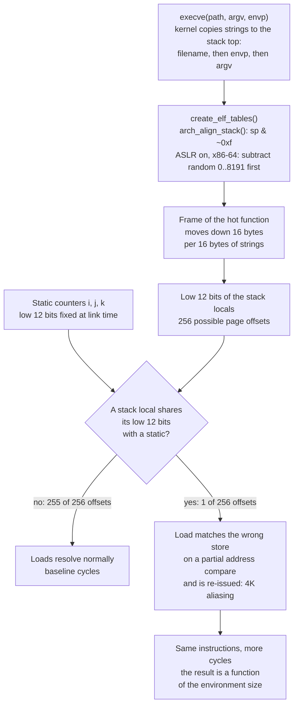

# Drill: Environment Size and Code Alignment Bias

> [!summary] Scope
> This problem note is a hands-on drill that reproduces an execution-time swing of at least 15% caused only by the size of the environment strings, which shifts where the stack lands.
> It challenges the engineer to measure the stack-placement effect with PMU counters, rule out L1 data cache misses, attribute the swing to 4K address-aliasing load blocks, and stabilize the harness.
> It grounds the first experiment of Mytkowicz et al. in a runnable lab.

The general theory of layout bias, ASLR, and host preparation is owned by [[Benchmark-Methodology-Noise-and-Environment-Control]].
Counter mechanics, multiplexing, and Top-Down attribution are owned by [[Hardware-Performance-Counters-Top-Down-TMA-and-Roofline]].
The paper itself is distilled in [[Paper-Producing-Wrong-Data-Measurement-Bias]].
This drill takes one benchmark, one binary, and one command line, changes nothing but the number of bytes in an unused environment variable, and asks the engineer to explain where the time went.



## 1. Reproduction

The scenario is a performance gate.
Two CI runners build the same commit into the same binary and run the same benchmark command.
One runner reports a slowdown large enough to fail the gate, every time, and the other never does.
The machines are the same model, both are idle, both pin the benchmark to one core, and both disable ASLR as the team's benchmarking guide tells them to.
The only difference anyone can find is that one runner exports a longer value in a variable the benchmark never reads.

The lab lives in `code/04-Measurement-Methodology/drill_env_size_bias/`.

| File | Role |
| :--- | :--- |
| `kernel.c` | The benchmark under test and its measurement harness: the loop, `perf_event_open(2)` counters around it, ASLR control, and an in-process stack-offset sweep. |
| `drill.py` | The driver: runs the binary under 256 environment sizes, analyzes the counters, and prints one verdict line per check. |
| `run.sh` | Entry point: builds `kernel.c` with `"${CC:-cc}" -O2` and runs the driver. |

The loop is Figure 1(a) of Mytkowicz et al.: three static counters and two stack locals.
The paper compiled it with optimizations disabled so that every variable lives in memory.
The lab makes the five variables `volatile` instead, which keeps the same loads and stores at `-O2`.

```c
struct statics {
	volatile uint32_t i, j, k;
};
static struct statics statics __attribute__((aligned(64)));

struct frame {
	volatile uint32_t g, inc;
};

__attribute__((noinline)) static void kernel(struct frame *f, uint32_t iters)
{
	for (f->g = 0; f->g < iters; f->g++) {
		statics.i += f->inc;
		statics.j += f->inc;
		statics.k += f->inc;
	}
}
```

The `struct frame` is a 16-byte-aligned local of the function that calls `kernel()`, so its address is a stack address.
`kernel naive` measures the loop once at whatever stack address the process was given.
`kernel sweep` measures it at 256 stack offsets, 16 bytes apart, by placing an `alloca()` hole above the frame.
Each measurement runs the loop 1,000,000 times, five times over, and keeps the repetition with the fewest cycles.
The counters are opened on the calling thread with `exclude_kernel = 1` and enabled only around the loop, so process startup and the harness itself are outside the window.

The lab needs two things a container does not give it, which is why it is tagged `linux, pmu`.

- A hardware PMU that `perf_event_open(2)` can reach: `kernel.perf_event_paranoid` of 2 or lower, or `CAP_PERFMON`.
- Permission to call `personality(2)` with `ADDR_NO_RANDOMIZE`, which the Google Benchmark documentation notes is forbidden by seccomp "by default if you are running in a Docker container".

Run it on a bare-metal Linux host:

```bash
cd code && TOOLCHAIN_LABS_PMU=1 python3 -m _harness.verify 04-Measurement-Methodology/drill_env_size_bias/
```

To see the per-position numbers of your own machine on stderr, run the lab directly:

```bash
cd code/04-Measurement-Methodology/drill_env_size_bias && DRILL_RAW=1 bash run.sh
```

> [!warning] Recording status
> This draft ships no `expected/<platform>.txt`.
> The lab was written on a macOS arm64 host whose Linux container VM exposes no hardware counters, so the harness skips it there.
> UNVERIFIED: the size of the swing on any current CPU, and that the lab's 15% bar is met; the integrator records the lab on a bare-metal Linux PMU host.
> UNVERIFIED: whether cores other than the Intel families listed in the technical reference penalize this loop at all.
> Every number in this note is therefore either quoted from a cited source or derived from cited source code, never a measurement of this lab.

## 2. Observed Symptom

### Symptom 1: The paper's micro-kernel

Mytkowicz et al. ran the same loop on a Core 2 while growing an unused environment variable.
They report that the change "can dramatically (frequently by about 33% and once by almost 300%) change the performance of our program".
On full benchmarks the same knob changed conclusions, not just magnitudes.

| Observation in the paper (Core 2, gcc, SPEC CPU2006) | Value |
| :--- | :--- |
| O3 speedup of perlbench as the environment grows in 63-byte steps | ranges from 0.91 to 1.07 |
| O3 speedup of lbm across environment sizes | ranges from 0.88 to 1.09 |
| The paper's reading of the lbm range | "a 12% slowdown when in fact we have a 9% speedup" |
| Benchmarks whose O3 speedup straddles 1.0 across environment sizes | 4: libquantum, perlbench, sphinx, lbm |
| Median range of the speedup across environment sizes | 0.01 on Core 2, 0.04 on Pentium 4 |
| Papers surveyed from ASPLOS, PACT, PLDI, and CGO that adequately considered this bias | none of 133 |

### Symptom 2: What the lab's Reproduce stage reports

The driver runs `kernel naive` 256 times.
Run `n` has an environment that holds exactly one variable, `PAD`, with `16 * n` bytes of value.
The binary, the argument vector, the CPU, and the iteration count never change.
The stage prints one line per check, and the drill fails (exit status 3) if any check answers `no`.

| Check printed by the Reproduce stage | What it establishes | What would make it fail |
| :--- | :--- | :--- |
| stack frame moved down 16 bytes for every 16 bytes of environment | the environment size is the only input to the frame address | ASLR still on, or a kernel that places strings elsewhere |
| distinct page offsets visited by the frame: N of 256 | the sweep covers one full 4096-byte period | a step that is not 16 bytes |
| instructions per iteration, the same at every position within 0.1% | the program did the same work every time | a code path that depends on the environment |
| positions at least 15% slower than the median, in cycles per iteration: K of 256 | some environment sizes cost more cycles for the same instructions | a CPU with no alignment-dependent penalty on this loop (K is 0) |

The shape of the symptom is the important part.
The slowdown is not noise: repeating a slow environment size gives the slow result again.
It is not monotonic: adding 16 more bytes makes it disappear.
It is not work: the instruction count per iteration is identical.

## 3. Progressive Hint Ladder

> [!tip]- Hint 1: Decide whether you are looking at noise or bias
> Noise changes when you repeat the same setup; bias changes only when you change the setup.
> Run one slow environment size ten times and one fast size ten times.
> If the two groups do not overlap, more repetitions will never fix it, and the mean of a thousand runs in one setup is still a sample of size one in the dimension that matters.

> [!tip]- Hint 2: Find what the environment actually touches
> The program never reads `PAD`, so the effect cannot come from program logic.
> Print the address of a local variable in the hot function's caller for two environment sizes, with ASLR disabled.
> Then ask where `execve(2)` puts the environment strings relative to the stack.

> [!tip]- Hint 3: Separate work from time
> Count `instructions:u` and `cycles:u` for a fast and a slow environment size.
> If instructions match and cycles do not, the program is stalling, and the next question is which stall.
> [[Hardware-Performance-Counters-Top-Down-TMA-and-Roofline]] gives the hierarchy to walk.

> [!tip]- Hint 4: Test the obvious suspect and let it fail
> Moving the stack changes which cache sets the frame occupies, so L1 data cache misses are the first guess.
> Count `L1-dcache-load-misses:u` at both sizes.
> A loop that touches two cache lines does not start missing because one of them moved by 16 bytes.

> [!tip]- Hint 5: Compare the low 12 bits
> Print the page offset (address modulo 4096) of the stack locals and of the static counters.
> At the slow environment sizes, look for a stack local and a static with the same page offset.
> Then count the model-specific event for loads blocked by a partial address match: `ld_blocks_partial.address_alias` or `ld_blocks.address_alias`.

> [!tip]- Hint 6: Do not fix the environment
> Pinning the environment to one size makes the result repeatable, and it is still one arbitrary point of 256.
> A harness is stable when its answer does not depend on the setup, which means the harness has to vary the setup itself and report what it finds.

## 4. Model Solution

> [!success]- Solution: Stack placement, 4K aliasing, and a harness that sweeps its own layout
>
> ### Root cause, part 1: the environment sets the stack address
>
> In Linux v6.12, `do_execveat_common()` in `fs/exec.c` copies three groups of strings onto the top of the new process's stack, in this order: the filename (`copy_string_kernel(bprm->filename, bprm)`), the environment (`copy_strings(bprm->envc, envp, bprm)`), and the arguments (`copy_strings(bprm->argc, argv, bprm)`).
> Everything the program later pushes sits below them.
> `create_elf_tables()` in `fs/binfmt_elf.c` then calls `arch_align_stack()`, pushes the platform string and 16 random bytes for `AT_RANDOM`, and rounds the pointer for the auxiliary vector with `STACK_ROUND`, which masks with `~15UL`.
>
> On x86-64, `arch_align_stack()` in `arch/x86/kernel/process.c` is three lines:
>
> ```c
> unsigned long arch_align_stack(unsigned long sp)
> {
> 	if (!(current->personality & ADDR_NO_RANDOMIZE) && randomize_va_space)
> 		sp -= get_random_u32_below(8192);
> 	return sp & ~0xf;
> }
> ```
>
> With ASLR off, the random term is gone and the function only rounds down to a multiple of 16.
> The stack pointer handed to the program is then a pure function of the string bytes above it.
> Adding 16 bytes to one environment value moves every later frame down by exactly 16 bytes.
> Adding fewer than 16 bytes moves it by 0 or 16, depending on where the total sits relative to a 16-byte boundary.
> The paper confirmed the same relationship empirically: "when we changed UNIX environment size by b bytes, the address of stack variables also shifted by b bytes (modulo appropriate alignment)".
>
> Sixteen-byte steps over a 4096-byte page give 256 distinct page offsets, which is why the lab sweeps 256 environment sizes.
>
> ### Root cause, part 2: a partial address compare
>
> The Intel Optimization Reference Manual, section 15.8, defines the hazard:
> "4-KByte memory aliasing occurs when the code stores to one memory location and shortly after that it loads from a different memory location with a 4-KByte offset between them."
> It gives the condition as the load and the store having "the same value for bits 5 - 11 of their addresses" with accessed byte offsets that partially or completely overlap.
> It gives the cost:
> "4K aliasing may have a five-cycle penalty on the load latency.
> This penalty may be significant when 4K aliasing happens repeatedly and the loads are on the critical path."
> Section 22.4.3.8 of the same manual calls it a "false store forwarding" case "where the addresses only match in the lower 12 address bits".
>
> The perf event tables in Linux v6.12 describe the same event from the hardware side: "False dependencies in MOB due to partial compare on address", where MOB is the memory order buffer.
> A load is first matched against older in-flight stores on part of the address, and a full comparison follows.
> When the partial check matches and the full check does not, the load has waited on a store that never fed it; section 22.5.4.4 of the Intel manual says the conflict "causes a reissue on the load".
>
> In the lab's binary the static counters are 64-byte aligned and the frame is 16-byte aligned.
> Exactly one of the 256 stack positions puts `g` at the same page offset as `i`, which also puts `inc` at the same page offset as `j`.
> At that position each iteration stores `g` and then loads `i`, and stores `i` and then loads `g`.
> Both loads are on loop-carried chains: every counter is a load, an add, and a store through memory, and the next iteration's load waits for this iteration's store.
> That is the manual's condition for a significant penalty, repeated aliasing with the loads on the critical path, met by construction.
> On a core that pays this penalty, the loop executes the same instructions and takes more cycles; the Recording status callout in the Reproduction section states what has been measured for this lab so far.
>
> The paper reached the same suspect from the other direction.
> Comparing the fastest and slowest environment sizes for perlbench across all 340 Core 2 performance events, 42 events differed by more than 25%, and one "stood out with a 10-fold increase in its event count": `LOAD_BLOCK:OVERLAP_STORE`.
> Section 22.8.4.2 of the Intel manual states that on that microarchitecture 4K aliasing and store forwarding blocks "are detected by the same event: LOAD_BLOCK.OVERLAP_STORE".
>
> ### Diagnosis with counters
>
> The lab opens four counters on the measuring thread and reads them around the loop.
>
> | Counter | perf_event_open encoding | What it tells you |
> | :--- | :--- | :--- |
> | cycles | `PERF_TYPE_HARDWARE`, `PERF_COUNT_HW_CPU_CYCLES` | the cost that moved |
> | instructions | `PERF_TYPE_HARDWARE`, `PERF_COUNT_HW_INSTRUCTIONS` | the work, which did not move |
> | L1D load misses | `PERF_TYPE_HW_CACHE`, L1D, read, miss | the suspect to eliminate |
> | load blocked by alias | `PERF_TYPE_RAW`, model specific | the mechanism |
>
> The Diagnose stage turns them into four statements.
>
> | Check printed by the Diagnose stage | Why it is there |
> | :--- | :--- |
> | L1D load misses stay under 1 per 1000 iterations at every position | eliminates the cache-miss explanation with a number instead of an argument |
> | positions where a stack local and a static share their low 12 address bits: A of 256 | a prediction made from addresses alone, before looking at any timing |
> | the slow positions are exactly those positions | the prediction and the measurement agree on which environments are slow |
> | the alias event per iteration is at least 0.5 at those positions and under 0.01 elsewhere | the hardware itself reports the blocked loads where the addresses say they should be |
>
> The second and third lines are the causal core.
> The set of slow environments is predicted from two addresses and one rule, and only then compared with the timing.
> A diagnosis that only correlates a counter with the slowdown is weaker than one that predicts which setups will be slow.
>
> By hand, with the perf tool, the same investigation on any benchmark binary looks like this:
>
> ```bash
> # Same binary, two environment sizes, ASLR off, user-mode counts, five launches each.
> for n in 0 512; do
>   env -i PATH=/usr/bin:/bin PAD="$(head -c "$n" /dev/zero | tr '\0' x)" \
>     setarch "$(uname -m)" -R \
>     perf stat -r 5 -e cycles:u,instructions:u,L1-dcache-load-misses:u,ld_blocks_partial.address_alias:u ./bench
> done
> ```
>
> Use `ld_blocks.address_alias:u` on Alder Lake, Sapphire Rapids, and later cores.
> When the installed perf predates the CPU, the raw form is `r0107` or `r0403`, as the technical reference table lists.
>
> ### Stabilizing the harness
>
> Three responses are available, and only two of them are fixes.
>
> 1. Pin the environment (`env -i`).
>    This makes runs repeatable and leaves the result biased.
>    The pinned size is one of 256 positions and nobody chose it; it may be the slow one.
>    Treat it as hygiene, never as the fix.
> 2. Intervene to confirm the cause.
>    The paper's causal analysis fixed the starting address of the stack regardless of environment size (up to 4096 bytes) and checked that the environment no longer affected the O3 speedup, which held for every benchmark except perlbench, a program that also copies its environment to the heap.
>    The lab's `sweep` mode is the same intervention turned inside out: it moves the frame while the environment stays fixed, and the slow offsets are the address-aliased ones in every environment.
> 3. Randomize or sweep the setup and report a distribution.
>    The paper calls this experimental setup randomization: 484 setups (22 link orders times 22 environment sizes), three runs each, and a t-test, which gave an O3 speedup for perlbench of 1.007 plus or minus 0.003 at 95% confidence.
>    For the stack dimension the space is small enough to enumerate, so the lab sweeps all 256 offsets instead of sampling them.
>
> The sweep is one function.
> The hole is allocated above the frame under test, and the write after the call keeps the hole live so the compiler cannot turn the call into a tail call and release it early.
>
> ```c
> __attribute__((noinline)) static void measure_at_offset(size_t pad, struct sample *best)
> {
> 	volatile char *hole = alloca(pad + STEP);
>
> 	hole[0] = 0;
> 	measure(best);
> 	hole[0] = 1;
> }
> ```
>
> The Stabilize stage runs `kernel sweep` in three different environments: the slowest one found by the Reproduce stage, the fastest, and one 2048 bytes away from the slowest.
>
> | Check printed by the Stabilize stage | Why it is there |
> | :--- | :--- |
> | naive result differs by at least 15% between them | the three environments really are a biased set for the naive harness |
> | each in-process sweep visited 256 distinct page offsets | the hole moves the frame in exact 16-byte steps |
> | slow offsets found by each sweep: one count per environment | the sensitivity is a property of the benchmark, visible from any environment |
> | each sweep flags exactly its address-aliased offsets | the same rule explains the slow offsets regardless of the environment |
> | median cycles per iteration agrees across the 3 environments within 2% | the reported result no longer depends on the environment |
>
> A stabilized harness reports two things: the median over layouts, and the fact that the benchmark has a layout it is sensitive to.
> The second is a finding about the code, and hiding it by pinning the layout is how wrong conclusions get published.
>
> ### When the code should change
>
> If the aliasing pair has a fixed relative offset in production, such as an input and an output buffer a multiple of 4096 bytes apart, it is a real cost and worth fixing.
> Section 15.8 of the Intel manual lists the remedies in order: align data to 32 bytes, then change the offsets between input and output buffers.
> If the pair is a stack slot against a static, as in this drill, production samples a different stack offset on every process start once ASLR is on, and the durable fix is to remove the memory round trip: keep loop state in registers instead of in address-taken or volatile locals.

## 5. Core Takeaway

A benchmark result is a function of the code and of the memory layout the code happened to get, and the layout is set by inputs nobody thinks of as inputs: the environment strings, the argument strings, the path the binary was launched by, and the link order.
Repetition inside one layout measures that layout's noise, and says nothing about the others.
The Stabilizer authors state it in one sentence: "A single binary constitutes just one sample from the space of program layouts, regardless of the number of runs."

The practical rules follow.

1. Disabling ASLR does not remove layout sensitivity.
   It converts a random per-process layout into a fixed one chosen by the environment, which turns variance into bias.
2. Identical instruction counts with different cycle counts mean a stall, and the first suspect to eliminate with a counter is the cache.
3. A diagnosis is strong when it predicts which setups are slow before the timing is consulted.
4. A harness is stable when it varies the layout itself and reports the distribution, including the sensitivity it found.

The owning concept note for layout bias, ASLR, and host preparation is [[Benchmark-Methodology-Noise-and-Environment-Control]].
The harness procedure that applies these rules is [[Design-a-Low-Noise-Benchmark-Harness-Playbook]].

## Technical Reference and Commands to Know

### Numbers and encodings

| Fact | Value | Platform | Source |
| :--- | :--- | :--- | :--- |
| Order of strings at the stack top | filename, environment, arguments (as of 2026-11) | Linux v6.12 | `fs/exec.c`, `do_execveat_common()` |
| Initial stack alignment | 16 bytes: `sp & ~0xf` and `STACK_ROUND` (as of 2026-11) | Linux v6.12 | `arch_align_stack()`, `fs/binfmt_elf.c` |
| Sub-page stack randomization, ASLR on | 0 to 8191 bytes before the 16-byte rounding (as of 2026-11) | Linux v6.12 x86-64 | `arch/x86/kernel/process.c` |
| Sub-page stack randomization, ASLR on | 0 to `PAGE_SIZE - 1` bytes before the 16-byte rounding (as of 2026-11) | Linux v6.12 arm64 | `arch/arm64/kernel/process.c` |
| Page-granular stack randomization | `STACK_RND_MASK` pages, applied by `randomize_stack_top()` (as of 2026-11) | Linux v6.12 | `mm/util.c` |
| Distinct stack page offsets | 4096 / 16 = 256 | Linux | derived from the two rows on alignment |
| `ADDR_NO_RANDOMIZE` | `0x0040000`, available since Linux 2.6.12, cleared on a setuid or setgid exec | Linux | `personality.h`, personality(2) |
| `kernel.perf_event_paranoid` default | 2: user-space measurement only without `CAP_PERFMON` (as of 2026-11) | Linux v6.12 | `Documentation/admin-guide/sysctl/kernel.rst` |
| 4K aliasing condition | address bits 5 to 11 equal and byte offsets overlapping (as of 2026-11) | Intel | Optimization Manual 248966-051US, section 15.8 |
| 4K aliasing cost estimate | five cycles of load latency (as of 2026-11) | Intel | Optimization Manual, sections 15.8 and 22.5.4.4 |
| Cost formula | `100 * LD_BLOCKS_PARTIAL.ADDRESS_ALIAS * 5 / CPU_CLK_UNHALTED.THREAD` (as of 2026-11) | Intel | Optimization Manual, section 22.5.4.4 |
| `LD_BLOCKS_PARTIAL.ADDRESS_ALIAS` | EventCode `0x07`, UMask `0x01`, raw `r0107`: Sandy Bridge through Rocket Lake tables (as of 2026-11) | Linux v6.12 perf, Intel | `pmu-events/arch/x86/*/pipeline.json` |
| `LD_BLOCKS.ADDRESS_ALIAS` | EventCode `0x03`, UMask `0x04`, raw `r0403`: Alder Lake, Meteor Lake, Sapphire Rapids, Emerald Rapids, Granite Rapids, Sierra Forest, Grand Ridge tables (as of 2026-11) | Linux v6.12 perf, Intel | `pmu-events/arch/x86/*/pipeline.json` |
| `LD_BLOCKS.4K_ALIAS` | EventCode `0x03`, UMask `0x04`: Goldmont, Goldmont Plus, Snow Ridge, Elkhart Lake tables (as of 2026-11) | Linux v6.12 perf, Intel | `pmu-events/arch/x86/*/pipeline.json` |
| `tma_4k_aliasing` | `LD_BLOCKS_PARTIAL.ADDRESS_ALIAS / tma_info_thread_clks`, flagged above 0.2 only when its parents are also flagged (as of 2026-11) | Linux v6.12 perf, Skylake | `skl-metrics.json` |
| Longest single environment string | 32 pages (`MAX_ARG_STRLEN`) | Linux | execve(2) |
| Google Benchmark ASLR handling | `benchmark_main` calls `benchmark::MaybeReenterWithoutASLR(argc, argv)`, which re-executes without ASLR; a custom `main()` must call it itself; "Automatic ASLR disablement" shipped in v1.9.3 on 2025-05-07 and v1.9.4 (2025-05-19) fixed it under Docker (as of 2026-11) | Linux | `docs/reducing_variance.md`, release notes |

### Diagnostic commands

```bash
# 1. Is the result a function of the environment size? One variable, two sizes, ASLR off.
env -i PATH=/usr/bin:/bin PAD="$(head -c 512 /dev/zero | tr '\0' x)" setarch "$(uname -m)" -R ./bench

# 2. Same work, different time? User-mode instructions and cycles over five launches.
perf stat -r 5 -e cycles:u,instructions:u ./bench

# 3. Eliminate the cache.
perf stat -r 5 -e L1-dcache-load-misses:u ./bench

# 4. Count loads blocked by a partial address match (pick the name your CPU has).
perf stat -e ld_blocks_partial.address_alias:u ./bench
perf stat -e ld_blocks.address_alias:u ./bench

# 5. May this process open counters at all?
cat /proc/sys/kernel/perf_event_paranoid

# 6. The lab's own single measurement: prints the page offsets and the four counters.
"${CC:-cc}" -O2 -std=gnu11 -o /tmp/kernel kernel.c && env -i PAD=xxxxxxxxxxxxxxxx /tmp/kernel naive
```

## Pitfalls

> [!warning] Pitfall: Treating ASLR-off as noise control and stopping there
> With ASLR on, x86-64 Linux subtracts a random 0 to 8191 bytes before rounding the stack to 16 bytes, so each of the 256 page offsets is equally likely on every launch and an aliased layout shows up as an occasional slow process.
> With ASLR off, the same layout is chosen by the environment and shows up on every launch or on none.
> The second state has less variance and more bias, and bias is the one that statistics on repeated runs cannot see.
> Google Benchmark's `benchmark_main` has disabled ASLR automatically since v1.9.3 (as of 2026-11), so the fixed-layout state is the default for every benchmark on Linux that links it.

> [!warning] Pitfall: Forgetting the other strings on the stack
> The environment is one of three string groups the kernel copies above the stack.
> The filename passed to `execve(2)` and every argument string sit in the same region.
> Launching `./bench` instead of an absolute path, running from a directory with a longer name when the shell exports `PWD`, or passing a longer `--filter` argument moves the stack exactly as an environment variable does.

> [!warning] Pitfall: Concluding from the counter alone
> The perf description of `tma_4k_aliasing` warns that "the short re-issue duration is often hidden by the out-of-order core and HW optimizations; hence a user may safely ignore a high value of this metric unless it manages to propagate up into parent nodes of the hierarchy".
> A high alias count is evidence of the mechanism, and the cycle count at matched instructions is the evidence of cost.
> Report both, and act only when the second one moved.

> [!warning] Pitfall: Comparing two binaries in one environment
> A change that adds or removes a local, reorders functions, or changes the link order moves code and data in the candidate and not in the baseline.
> The paper measured the O3 speedup of perlbench ranging from 0.92 to 1.10 across link orders alone.
> An A/B result from one layout of each binary measures the change plus an unknown layout term of the same size as many real optimizations.

> [!warning] Pitfall: Letting the measurement move the stack
> A wrapper that adds its own variables to the environment, or a harness flag that lengthens the command line, changes the layout it is trying to observe.
> The lab re-executes itself through `/proc/self/exe` with a fixed argument vector so that the directory it was copied to cannot change the result.

## At Scale

The decision changes with the number of people who consume the number.

| Scale | What goes wrong | Decision rule |
| :--- | :--- | :--- |
| One engineer, one laptop | A speedup measured before lunch disappears after opening a new shell with a different environment. | Before believing a small effect, rerun both sides with the environment padded by 16, 64, and 512 extra bytes; if the answer changes, it was layout. |
| A team with a CI performance gate | Runners differ in exported variables, and variables such as branch names and build numbers differ in length between the baseline and the candidate by construction. | The harness owns the layout: it clears the environment, then sweeps or randomizes the stack offset and compares distributions, as [[Performance-Regression-Detection-in-CI]] describes for the statistics. |
| An organization with a shared benchmarking standard | A guide that says "disable ASLR" is followed everywhere, and every team inherits a fixed layout chosen by its own environment. | The standard states the pair of rules together: ASLR off for repeatability, layout randomization for validity, recorded in [[Measurement-Methodology-Decision-Records]]. |
| A fleet measured in production | Production runs with ASLR on, so each process samples a layout and fleet-wide profiles average over layouts; lab benchmarks with ASLR off do not. | Treat a lab result that disagrees with fleet telemetry as a layout question first, and prefer the fleet number for go or no-go decisions on small effects. |

Three costs decide which response to use.

- Sweeping the stack offset inside the process multiplies the measurement time by the number of offsets and needs no extra launches.
  It covers only the stack dimension.
- Randomizing across process launches covers the stack, and with link-order shuffling the code layout too, at the price of one build or launch per sample.
  The paper used 484 setups for one benchmark.
- Runtime re-randomization of code, stack, and heap is the most complete answer.
  Stabilizer re-randomizes every 500 ms by default and reports a median overhead under 7%; its evaluation concludes that the effect of `-O3` over `-O2` on SPEC CPU2006 "is indistinguishable from random noise".

The organizational failure mode is not the missed regression.
It is the optimization that was merged, celebrated, and never existed.

## Practice Drill

> [!tip] Practice Drill: Extend the lab
> 1. Run the lab with `DRILL_RAW=1` on a bare-metal Linux host and plot cycles per iteration against position from the stderr table; mark the address-aliased position.
> 2. Move the stack with the argument vector instead of the environment: keep `PAD` fixed and append a growing dummy argument, and predict the slow position before measuring.
> 3. Turn ASLR back on by deleting the `ensure_no_aslr()` call, launch `kernel naive` 2000 times in one fixed environment, and compare the fraction of slow launches with the 1 in 256 that `arch_align_stack()` predicts.
> 4. Remove `volatile` from the frame, confirm in the disassembly that `g` and `inc` moved to registers, and rerun: state which check fails and why that is the correct outcome.
> 5. Reproduce the paper's other axis: build a two-file program in both link orders and measure the difference with the stack offset swept, so that only the code layout varies.

## Interview Questions

### Level 5 (L5)

> [!question] L5: A benchmark never reads its environment, yet growing an unused variable changes its run time.
> Explain the path from the variable to the clock.
>
> > [!success]- Answer
> > `execve(2)` copies the filename, the environment strings, and the argument strings onto the top of the new stack, and the program's frames start below them.
> > More environment bytes push every frame to a lower address.
> > The kernel rounds the initial stack pointer to 16 bytes, so the frames move in 16-byte steps and visit 256 different page offsets as the environment grows by 4096 bytes.
> > Hardware structures that index or compare on low address bits then see different inputs: in this drill, the store-to-load disambiguation logic compares the low 12 bits first, and a stack local that shares them with a static in the same loop causes loads to be blocked and re-issued.
> > The instruction count is unchanged; the cycle count is not.

> [!question] L5: Predict the output:
> A program prints `(unsigned)((uintptr_t)&local & 0xfff)` for a local in `main`.
> It is launched four times on Linux with ASLR disabled and an otherwise empty environment, with `PAD` holding 0, 4, 16, and 32 bytes of value.
> What can you say about the four printed values, and what can you not say?
>
> > [!success]- Answer
> > The 16-byte and 32-byte runs print values exactly 16 apart, and the 0-byte and 16-byte runs print values exactly 16 apart, each lower than the one before (modulo 4096).
> > `arch_align_stack()` rounds the pointer below the strings down to a multiple of 16, so adding 16 bytes of string always moves the stack by exactly 16.
> > The 4-byte run prints either the same value as the 0-byte run or a value 16 lower.
> > Which one depends on where the total string size sits relative to a 16-byte boundary, and that depends on the filename and argument strings, which the question does not give.
> > You also cannot predict the absolute values without knowing the kernel's auxiliary vector size and the C runtime's frames above `main`.

> [!question] L5: Two runs of the same binary show identical `instructions:u` and a 20% difference in `cycles:u`.
> What do you measure next, and in what order?
>
> > [!success]- Answer
> > Identical instructions rule out a different code path, a different input, and a different iteration count.
> > The difference is stalls, so the next step is to find which resource stalled.
> > Count L1 data cache load misses first because it is the cheapest hypothesis to kill; then branch mispredictions; then the load-block events (`ld_blocks_partial.address_alias` or `ld_blocks.address_alias`, and the store-forward block event).
> > On Intel cores the Top-Down hierarchy does this systematically: 4K aliasing is a child of L1 Bound under Memory Bound, because the blocked load is eventually served by L1 without ever missing it.
> > In parallel, check that the two runs really had the same setup: environment size, argument strings, launch path, and ASLR state.

### Level 6 (L6)

> [!question] L6: Debug this issue:
> A CI performance gate fails a pull request that changes only a comment in a README.
> The benchmark binary is byte-identical to the baseline's.
> Rerunning the job fails again; rerunning the baseline job passes again.
> The harness disables ASLR and pins the CPU.
> `perf stat` on the runner shows the same instruction count for both jobs.
> Find the cause and state the fix.
>
> > [!success]- Answer
> > A byte-identical binary with identical instructions and a repeatable difference is bias from the setup, not noise and not code.
> > With ASLR off, the stack address is a deterministic function of the exec strings, so diff the two jobs' environments by total byte count, not by content.
> > CI systems export the branch name, the pull request number, the commit message, or a job URL, and those differ in length between the baseline job and the pull request job.
> > Confirm by intervention: run the baseline binary under the pull request job's environment size, padded with a dummy variable, and watch the slowdown follow the size.
> > Then locate the mechanism: compare the low 12 bits of the hot stack addresses with the hot statics or buffers, and count the alias load-block event at both sizes.
> > The fix belongs in the harness: clear the environment, then sweep or randomize the stack offset for both sides of the comparison and gate on the distributions.
> > Pinning the environment alone would make this pull request pass and leave the gate measuring one arbitrary layout.

> [!question] L6: Should a benchmark harness run with ASLR on or off?
> Defend the answer with the kernel's behavior.
>
> > [!success]- Answer
> > Neither setting is correct by itself.
> > With ASLR on, `arch_align_stack()` on x86-64 subtracts a uniform random 0 to 8191 bytes before rounding to 16, so the stack's page offset is redrawn on every exec, and `randomize_stack_top()` and the mmap base randomization move everything else by whole pages.
> > Layout effects then appear as launch-to-launch variance, which is honest and expensive: many launches are needed, and in-process repetitions do not help because the layout is fixed for the life of the process.
> > With ASLR off, the layout is repeatable and chosen by the exec strings, so layout effects become bias that no number of runs reveals.
> > The defensible design is ASLR off for repeatability plus explicit, controlled layout variation inside the harness: a stack-offset sweep, shuffled link order, or a tool that re-randomizes at run time.
> > That gives the same coverage as ASLR with the sampling under the experimenter's control and recorded in the result.

> [!question] L6: Why does 4K aliasing slow this loop substantially when the perf metric description says the penalty is "often hidden by the out-of-order core"?
>
> > [!success]- Answer
> > A re-issued load costs a few cycles of latency on that load.
> > If nothing waits on the load, the out-of-order window absorbs the delay and throughput is unchanged, which is the common case the description refers to.
> > The Intel manual's condition for a significant penalty is that the aliasing "happens repeatedly and the loads are on the critical path".
> > In this loop every counter is updated through memory: load, add, store, and the next iteration's load depends on this iteration's store.
> > Those loads are the loop-carried dependency chain, so latency added to them is added to every iteration.
> > When the stack local `g` shares its low 12 bits with the static `i`, the store to one sits between the store and the load of the other in program order, and the load's early partial-address check matches the wrong store.
> > The general lesson is that a counter measures occurrences, and the cost depends on whether the occurrences sit on the critical path.

### Level 7 (L7+)

> [!question] L7: A team reports that a compiler flag gives a 2% speedup on the service's hot benchmark, measured with 50 runs of each binary and a tight confidence interval.
> What is wrong with the evidence, and what experiment would you require before rollout?
>
> > [!success]- Answer
> > The 50 runs sample noise within one layout of each binary, so the confidence interval is about run-to-run variance and says nothing about layout.
> > The flag changes code size and placement, so the candidate and the baseline differ in layout as well as in optimization, and the paper measured layout-only swings of 0.92 to 1.10 on a real benchmark.
> > A 2% effect is well inside that range.
> > Require an experiment in which layout is a randomized factor for both binaries: several link orders, a swept or randomized stack offset, and enough setups for a test on the two distributions.
> > Require a causal check as well: an intervention that removes the claimed mechanism, such as disabling the specific transformation in the hot function, should remove the speedup.
> > If the organization has fleet profiling, a canary comparison under production ASLR is the cheapest randomized trial available.
> > The decision rule is that a small speedup is accepted only when it survives layout randomization, and otherwise is recorded as not demonstrated.

> [!question] L7: Design the layout-bias policy for an organization-wide benchmarking framework used by a thousand engineers.
> State what the framework does by default and what it refuses to do.
>
> > [!success]- Answer
> > By default the framework launches every benchmark with a cleared environment and a fixed argument vector, with ASLR off, so results are repeatable across machines and users.
> > By default it also varies layout itself: it sweeps or randomizes the stack offset in process, and for A/B comparisons it builds each side in more than one link order.
> > It reports the median across layouts and a sensitivity figure, the ratio of the slowest layout to the median, and it flags any benchmark whose sensitivity exceeds the effect size being claimed.
> > It records the environment byte count, the argument bytes, the launch path, and the ASLR state in every result so that two results can be compared for setup equality.
> > It refuses to gate on a single-layout comparison when the claimed effect is below a configured threshold, and it refuses to compare results whose recorded setups differ.
> > The cost is run time, so the policy tiers it: a quick single-layout mode for local iteration, labelled as not valid for claims, and the full mode for CI gates and published numbers.
> > The policy lives in a decision record with the evidence that motivated it, so that the next proposal to "just disable ASLR and pin the environment" is answered once.

> [!question] L7+: A benchmark shows a 4K aliasing slowdown at one stack offset.
> Under what conditions do you change the production code, and when do you change only the harness?
>
> > [!success]- Answer
> > The question is whether production can be in the aliased state persistently.
> > If the two addresses have a fixed relative offset, such as source and destination buffers allocated a multiple of 4096 bytes apart, or two fields of large page-aligned objects, the alias is structural and every process pays it on every call.
> > That is a code defect: change the offset or the alignment, as the Intel manual recommends, and verify with the alias counter and the cycle count together.
> > If one address is on the stack and the other is static or heap, production with ASLR on draws a new relative offset on each process start, so roughly 1 process in 256 per aliasing pair is affected for its lifetime.
> > Whether that matters depends on the service: for a fleet of short-lived workers it averages out, and for a small number of long-lived latency-critical processes it is a tail-latency lottery worth removing by keeping the loop state out of memory.
> > In both cases the harness changes, because a harness that reports only one layout cannot tell these situations apart.
> > The measurement that decides it is the sensitivity across layouts, weighed against how production samples layouts.

## Further Reading

- Todd Mytkowicz, Amer Diwan, Matthias Hauswirth, Peter F. Sweeney, *Producing Wrong Data Without Doing Anything Obviously Wrong!*, ASPLOS 2009.
  The source of the micro-kernel, the environment-size and link-order experiments, and the two remedies: setup randomization and causal analysis.
- Charlie Curtsinger, Emery D. Berger, *STABILIZER: Statistically Sound Performance Evaluation*, ASPLOS 2013.
  Turns the paper's remedy into a tool that re-randomizes code, stack, and heap layout at run time so that standard statistical tests apply.
- Intel, *Intel 64 and IA-32 Architectures Optimization Reference Manual: Volume 1*, section 15.8 "4K Aliasing" and section 22.5.4.4 "Other Memory Access Issues".
  The vendor's definition of the hazard, its condition on address bits, its cost estimate, and the event that counts it.
- Linux kernel v6.12, `fs/exec.c`, `fs/binfmt_elf.c`, and `arch/x86/kernel/process.c`.
  The code that decides where the stack starts; `arch_align_stack()` is short enough to memorize.
- Linux man-pages, `perf_event_open(2)` and `personality(2)`.
  The two system calls the lab is built on: self-monitoring counters and per-process ASLR control.
- Google Benchmark, `docs/reducing_variance.md`.
  Documents the automatic ASLR disablement that makes a fixed layout the default for benchmarks that link `benchmark_main` on Linux.

## Related

- Prerequisites: [[Benchmark-Methodology-Noise-and-Environment-Control]], [[Hardware-Performance-Counters-Top-Down-TMA-and-Roofline]]
- Next: [[Drill-Measurement-Methodology-Coordinated-Omission-Trap]]
- See also: [[Paper-Producing-Wrong-Data-Measurement-Bias]], [[Design-a-Low-Noise-Benchmark-Harness-Playbook]], [[Program-Startup-C-Runtime-Init-and-Auxiliary-Vectors]], [[Linux-perf-in-Depth-and-perf-c2c]], [[Statistics-for-Benchmarks-Coordinated-Omission-and-HDR-Histograms]]
- Lab: `code/04-Measurement-Methodology/drill_env_size_bias/` (requires: linux, pmu)
