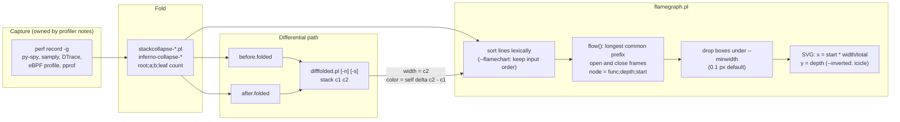

# Flame Graphs, Differential Flame Graphs, and Visualizations

> [!summary] Claim:
> A flame graph is a rendering of a set of stack samples, each folded to one line `root;...;leaf count`, then sorted lexically and merged by longest common prefix into a tree whose box widths are inclusive counts.
> The x-axis is the sample population sorted alphabetically, not time; the self cost of a frame is the part of its top edge with nothing stacked on it; colors carry no data unless a palette or a differential says so.
> A red/blue differential (`difffolded.pl` then `flamegraph.pl`) takes widths from the second profile and colors each frame by the change in its self count only, so a parent whose children shifted stays white, and a path that vanished from the second profile cannot be drawn at all.
> Most misreadings come from the input, not the renderer: period-weighted counts labeled "samples", broken stacks from missing frame pointers that pile up as a separate tower, recursion that repeats a function at every depth, and differences smaller than sampling noise.



## The Mechanism

### 1. What the picture encodes

Brendan Gregg built the first flame graph while working on a MySQL performance problem, and released it in December 2011; `flamegraph.pl` records its creation as 10 September 2011 and credits Neelakanth Nadgir's `function_call_graph.rb` as the inspiration.
Gregg moved from tracing every function call to timed stack sampling because tracing cost too much and produced pictures too dense to read, and dropping the time axis is what made merging possible.

The reading rules, from the CPU Flame Graphs page and the `flamegraph.pl` header:

- Each box is one stack frame, and the box beneath a frame is its caller.
- The y-axis is stack depth from zero at the bottom; the top edge is what was on-CPU when the sample fired.
- The x-axis "spans the sample population"; left to right "has no meaning", because frames are sorted alphabetically to maximize merging.
- Width is the number of samples in which the frame was present at that position, which is its inclusive (total) cost at that call path.
- Self cost is the exposed top edge: width minus the widths of the boxes directly above it.
- Width cannot distinguish an expensive call from a frequent one, because sampling records no call counts.
- The sample count can exceed elapsed time multiplied by the sample rate, because multiple threads running at once are sampled concurrently (CPU Flame Graphs page).
- Default colors are random warm hues that only separate neighbours; `--colors=java` and the `_[k]`, `_[j]`, `_[i]`, `_[w]` annotations encode kernel, JIT, inlined, and waker frames as hue.

`perf report` computes the same two quantities from the same samples: its `Self` column adds the period values of samples whose leaf is the symbol, and its `Children` column adds the period values of samples whose call chain passes through the symbol, which is why `Children` sums past 100% (`callchain-overhead-calculation.txt`).
A flame graph is the `Children` view drawn per call path rather than per symbol.

### 2. The folded stack format

Every flame graph tool accepts the same interchange format: one line per distinct stack, frames root first and separated by `;`, then whitespace and a count.
`flamegraph.pl` and `difffolded.pl` parse each line with the regular expression `^(.*)\s+?(\d+(?:\.\d*)?)$`, so the count is the trailing number and the stack is everything before the one whitespace character that precedes it, which is how frame names containing spaces survive; because `.*` is greedy, extra spaces before the count stay in the stack (`a b  5` parses as stack `a b ` and count 5), so they can break byte-exact matching.
A second trailing number turns the line into differential input: `stack count1 count2`.

The folding step is where most semantic decisions are made, and `stackcollapse-perf.pl` at commit 41fee1f makes these:

- It reverses `perf script`'s leaf-first listing into root-first order and prepends the process name (`comm`) as the root frame; `--pid` and `--tid` append the IDs to it.
- It weights each sample by the event `period` printed in the record header when present, and by 1 otherwise, so the "samples" in the tooltip are event counts, such as nanoseconds of `cpu-clock`, whenever the period field is in the input.
- It keeps only the first event type it sees and prints "Filtering for events of type" when it drops others, because merging cycles with instructions is meaningless.
- It strips `+0x...` offsets, replaces `;` inside a function name with `:`, and drops everything after the first `(` unless the name looks like a Go method (such as `net/http.(*Client).Do`) or the parenthesis opens `(anonymous namespace)`, which removes C++ parameter lists.
- An `[unknown]` symbol in a known module becomes the module's file name in brackets, such as `[libc.so.6]` (or `[unknown]` when the module is also unknown), and `--addrs` appends the raw address inside the brackets, such as `[libc.so.6 <7f00bbbb4444>]`.
- `--inline` runs `addr2line` to expand inlined frames, and `--kernel`, `--jit`, or `--all` add the `_[k]` and `_[j]` annotations.

The folded file is deliberately separate from rendering: it can be filtered with `grep`, edited, diffed, stored, and rendered by any of the implementations in section 5.

### 3. Merging: sort, then a prefix stack machine

`flamegraph.pl` builds the tree without building a tree.
It reads every line, sorts them with Perl's `sort` (lexical byte order), and walks the sorted lines with `flow($last, $this, $time, $delta)`:

1. Find the length of the common prefix between the previous stack and this one.
2. Close every frame of the previous stack beyond the prefix, deepest first, by recording a node keyed `"func;depth;end_time"` with its saved start time.
3. Open every frame of this stack beyond the prefix at the current `$time`.
4. Advance `$time` by this line's count (by the second count, for differential input).

Because lexical sort makes every set of lines sharing a prefix string contiguous, adjacent identical frames merge into one node whose width is `end - start`.
A final `flow($last, [])` closes the remaining frames.
Cost is O(L log L) comparisons for L folded lines plus O(F) for F total frames, and memory is one hash entry per merged node.

Layout is then arithmetic.
`widthpertime = (imagewidth - 2 * xpad) / total`, so with the default `--width 1200` and `xpad 10` each sample of a 100,000-sample profile is 0.0118 px wide.
Any node narrower than `--minwidth` (default 0.1 px, or a percentage when suffixed with `%`) is deleted before drawing, so a frame with 5 of 100,000 samples silently disappears from the SVG and from its search.
Depth sets the y coordinate, `--inverted` flips it into an icicle graph, and `--reverse` reverses each stack before sorting so that merging starts from the leaf, which groups all callers of a hot leaf such as `memcpy` under one root box.
If the total is below 100 and `--countname` is left at `samples`, the script warns "Stack count is low".

The merge is lexical, not structural, and that leaks.
The separator `;` is byte `0x3B`, and the count separator is a space, `0x20`.
A frame that is a leaf on one line (`run 50`) and a parent on another (`run;step 20`) is split into two adjacent boxes whenever a sibling's name starts with the same text followed by a byte between `0x21` and `0x3A`, for example `run::{{closure}}`, `run.cold`, or `run(int)`, because that sibling sorts between the two `run` lines and closes the first one.
The worked example reproduces the split with Rust-style closure names.

### 4. Time-ordered flame charts and other layouts

A flame chart keeps time on the x-axis.
Gregg's page credits the WebKit Web Inspector in Google Chrome with introducing them, and notes that "some analysis tools have implemented flame charts and mistakingly called them flame graphs."
`flamegraph.pl --flamechart` produces one by skipping the sort, so only consecutive identical stacks merge; it expects input in time order, one line per sample or per run of samples.
A chart answers "what happened first, and what ran during this stall", but a single chart cannot sensibly show many threads at once, while a merged graph can.

| Layout | Ordering | Merging | Best question | Where |
| :--- | :--- | :--- | :--- | :--- |
| Flame graph | Alphabetical | All identical prefixes | Where does the cost go in aggregate? | `flamegraph.pl`, `inferno-flamegraph` |
| Icicle graph | Alphabetical or by size, root on top | All identical prefixes | Same, top-down | `--inverted`, d3-flame-graph `inverted`, pprof, py-spy SVG |
| Reversed (merge from leaf) | Alphabetical | Identical suffixes | Who calls the hot leaf? | `--reverse` |
| Left heavy | Heaviest child first | All identical prefixes | Same as a flame graph, largest first | speedscope view 2 |
| Flame chart | Input (time) order | Consecutive identical stacks only | What happened when? | `--flamechart`, speedscope Time Order, Chrome Web Inspector (per Gregg) |
| Sandwich | Table by self or total | Callers and callees of one function | Everything about one function | speedscope view 3 |
| Subsecond-offset heat map | Time on both axes | Flame graph of a selected range | When did the perturbation happen? | FlameScope |

pprof's web flame graph is an icicle graph: its README says "caller boxes are directly above callee boxes" and children are laid out "in decreasing size order", and selecting a function re-roots the view on the stacks that reach it.

### 5. Differential flame graphs

Gregg introduced red/blue differentials on 2014-11-09 for non-regression testing.
The pipeline is two folded profiles and one join:

```text
$ ./difffolded.pl out.folded1 out.folded2 | ./flamegraph.pl > diff2.svg
```

`difffolded.pl` reads both files into a hash keyed by the exact stack string, fills a missing side with 0, and prints `stack count1 count2` for the union.
`flamegraph.pl` then uses `count2` for widths and `delta = count2 - count1` for color.

The delta is attached only to the leaf frame of each line: in `flow()`, a frame opened by a line gets `$i == $len_b ? $d : 0`, and frames on the shared prefix get nothing.
A frame's color is therefore the change in its self count, which the blog states as "the difference that function directly contributed (eg, being on-CPU), not its children."
In the worked example, `sort` grows from 20 to 50 inclusive samples because a new child `compare` appears, yet `sort` is drawn pure white with a tooltip delta of `0.00%`; only `compare` is red and `hash` is blue.

The color ramp is `color_scale()`:

- A positive delta d draws `rgb(255, g, g)` with `g = int(210 * (maxdelta - d) / maxdelta)`, and a negative delta draws `rgb(g, g, 255)` with `g = int(210 * (maxdelta + d) / maxdelta)`.
- `maxdelta` is the largest absolute delta of any single line, at least 1.
- A delta of exactly 0 is white, and any nonzero delta starts at 210 or below, so the ramp is discontinuous: in the worked example a one-sample change against a maximum of 30 draws `rgb(255,203,203)`, a visible pink.
- The tooltip percentage is delta divided by the second profile's total, not by the frame's own before count.

Four mechanics decide whether the picture is honest:

1. **Widths come from the second profile.**
   A stack present only in profile 1 has `count2 = 0` and therefore zero width, so removed code cannot be colored blue.
   Gregg's answer is to also render `difffolded.pl folded2 folded1 | flamegraph.pl --negate > diff1.svg`, whose widths are the before profile "colored by what WILL happen", alongside diff2.svg, whose widths are the after profile "colored by what DID happen".
   Netflix's internal FlameCommander, per the same post, shows an "X% elided" link to a separate graph of vanished paths.
2. **Totals must be comparable.**
   Without normalization, a busier second profile makes everything red.
   `-n` scales count1 by `total2 / total1` and truncates with `int()`, so small counts lose up to one sample per line: counts 3 and 4 scaled by 10/7 become 4 and 5, not 4.29 and 5.71.
3. **Stack strings must match byte for byte.**
   Unsymbolized hex addresses, ASLR-dependent names, JIT symbol churn, line numbers, and changed process names all turn one path into a removed path plus an added path.
   `-s` rewrites `0x[0-9a-fA-F]+` to `0x...`; the 2014 blog calls this option `-x`, but the script at commit 41fee1f parses only `-n` and `-s` (`getopts('ns')`, with `-h` documented in the usage text), and `-x` fails with "Unknown option: x", prints the usage, and exits 2.
4. **Small deltas are sampling noise.**
   A frame with true fraction p of N samples has a count with standard deviation about `sqrt(N * p * (1 - p))`.
   For N = 10,000 and p = 0.05 that is about 21.8 samples, and the difference of two independent profiles has about 30.8, so a delta under about 60 samples is within two standard deviations of zero, yet the ramp tints it pink or blue.
   [[Statistics-for-Benchmarks-Coordinated-Omission-and-HDR-Histograms]] owns the statistics, and [[Performance-Regression-Detection-in-CI]] owns deciding whether a delta is a regression.

Other tools chose different semantics, so a red box does not mean the same thing everywhere:

| Tool | Width in diff view | Color | Base for percentages |
| :--- | :--- | :--- | :--- |
| `flamegraph.pl` with `difffolded.pl` | Second profile's inclusive count | Self delta, red more, blue less | Second profile total |
| `flamegraph.pl --negate` with swapped inputs | First profile's inclusive count | Self delta, hues swapped | First profile total |
| pprof `-diff_base` | Sum of absolute increases and decreases in the subtree | Shaded region for net change, red increase, green decrease | Diff base total |
| pprof `-base` | Source minus base, for cumulative profiles of one process | As above | Difference of totals |
| Robert Mustacchi's approach (per Gregg's post) | The difference only | Red added, blue removed | Not stated |

pprof's `-normalize` scales the source profile to the base total before subtracting, and its README reserves `-base` for subtracting an earlier cumulative profile, such as a Go block profile, from a later one of the same program.

### 6. Why the input lies, and how it looks

These mechanisms are owned elsewhere; this section is only about how each one shows up in the picture.

- **Broken stacks from missing frame pointers.**
  When a library on the stack was compiled without frame pointers, a frame-pointer walk stops or derails there, and the partial stacks all start at that library frame, so they merge into a separate tower beside the real code, often rooted at `[unknown]` or a bracketed module name.
  Gregg's 2024 example shows 15% of samples "in the wrong place and missing frames" above `[unknown]` because the system libc lacked frame pointers.
  [[Stack-Unwinding-CFI-and-Exception-ABI]] and [[Linux-perf-in-Depth-and-perf-c2c]] own the frame pointer, DWARF, and LBR unwinders.
- **Missing inlined frames.**
  An inlined callee has no frame, so its cost appears as self time of the caller unless the folding step expands inline records (`stackcollapse-perf.pl --inline`, `perf script --inline`); pprof marks inlining by drawing no border between caller and callee.
- **Tail calls and leaf functions.**
  A tail call replaces its caller's frame, and a leaf without a frame record may hide its caller, so an edge can appear to skip a level; Apple's arm64 rule that x29 "must always address a valid frame record" explicitly allows leaf functions and tail calls not to add one.
- **Recursion.**
  Direct recursion produces a tower with one copy of the function per depth, each box inclusive at its depth, so summing boxes overcounts: four `fib` boxes of 100, 90, 70, and 40 samples describe 100 samples, not 300.
  `stackcollapse-recursive.pl` (ported as `inferno-collapse-recursive`) collapses consecutive identical frames into one, and speedscope's `r` key collapses recursion in the view; `stackcollapse-recursive.pl` leaves mutual recursion (`a;b;a;b`) untouched, because it compares each frame only with the previous one.
- **Interrupt hair.**
  Gregg describes thin "strands" across the top of a graph as typical of interrupts: the same interrupt stack lands on top of random application stacks, so it cannot merge.
- **Lockstep sampling.**
  Gregg samples at 99 Hz and 199 Hz rather than 100 Hz and 200 Hz "to avoid sampling in lockstep with other activity and producing misleading results"; a 100 Hz sampler can repeatedly land on work driven by a 10 ms timer and over-weight it.
- **Sampling skid and safepoint bias.**
  A sample attributed to the wrong instruction or delayed to a safepoint is still drawn with full confidence; [[Sampling-vs-Instrumentation-Skid-and-Safepoint-Bias]] owns that error.
- **On-CPU only.**
  A CPU flame graph cannot show time blocked on locks, I/O, or the scheduler; [[Off-CPU-Analysis-Thread-States-and-Causal-Profiling]] owns off-CPU and wakeup graphs.

## Commands and Numbers to Know

| Item | Value | Platform and date | Why it matters |
| :--- | :--- | :--- | :--- |
| FlameGraph repository head | commit `41fee1f`, 2024-10-20 | Both (as of 2026-11) | Every `flamegraph.pl` and `difffolded.pl` fact in this note is pinned here |
| `flamegraph.pl --width` | 1200 px | Both (as of 2026-11) | With `xpad` 10, sets pixels per sample |
| `flamegraph.pl --height` | 16 px per frame | Both (as of 2026-11) | Deep stacks make tall SVGs |
| `flamegraph.pl --minwidth` | 0.1 px, or `N%` of total | Both (as of 2026-11) | Narrower frames are deleted, not just unlabeled |
| `flamegraph.pl --colors` | `hot` default; `mem`, `io`, `wakeup`, `chain`, `java`, `js`, `perl`, `red`, `green`, `blue`, `aqua`, `yellow`, `purple`, `orange` | Both (as of 2026-11) | Palettes with meaning need annotated input |
| `--hash`, `--cp` | Color by name hash; consistent palette in `palette.map` | Both (as of 2026-11) | Stable colors across graphs being compared side by side |
| `--inverted`, `--reverse`, `--flamechart`, `--negate` | Icicle; merge from leaf; time order; swap differential hues | Both (as of 2026-11) | The layouts in section 4 |
| `--countname`, `--total`, `--factor` | Label, fixed total, count multiplier | Both (as of 2026-11) | `--total` makes widths comparable across graphs |
| Low count warning | Total below 100 with default `--countname` | Both (as of 2026-11) | Usually a broken capture |
| `difffolded.pl` options | `-n` normalize, `-s` strip hex; no `-x` | Both (as of 2026-11) | The 2014 blog's `-x` is now `-s` |
| `perf record -F 99 -a -g -- sleep 60` | Gregg's documented capture | Linux (as of 2026-11) | Odd rate avoids lockstep sampling |
| `perf record --call-graph` | Default `fp` for user space (`dwarf` on s390); also `dwarf`, `lbr` | Linux (as of 2026-11) | `fp` breaks on code built without frame pointers |
| `--call-graph dwarf` stack dump | 8192 bytes default, `dwarf,SIZE` to change | Linux (as of 2026-11) | Stacks deeper than the dump are truncated |
| `kernel.perf_event_max_stack` | 127 | Linux (as of 2026-11) | Longer chains are cut; Gregg notes it was added for a Netflix workload with stacks over 1000 frames deep |
| `perf report --max-stack` | 127 | Linux (as of 2026-11) | Parsing-side depth limit |
| `perf script report flamegraph` | `flamegraph.py`, d3-flame-graph 4.1.3 HTML template | Linux; `tools/perf/scripts/python/flamegraph.py` through v7.3, where `perf script report <script>` is the invocation; on master (v7.4-rc2) moved to `tools/perf/python/flamegraph.py`, a standalone script on the `perf` Python module, and `perf script report` now exits with "The 'report' subcommand is no longer supported" in favor of `perf script flamegraph [args]`, which resolves `<exec-path>/python/flamegraph.py` (`find_script()` in `builtin-script.c`, master, as of 2026-11) | perf's built-in HTML flame graph; may prompt to download the template; check `perf --version` and use the form your perf accepts |
| GCC and Clang flags | `-fno-omit-frame-pointer -mno-omit-leaf-frame-pointer` | Linux (as of 2026-11) | Fedora Linux 38 made both default; Ubuntu 24.04 LTS enables frame pointers on 64-bit platforms |
| Apple arm64 ABI | x29 "must always address a valid frame record" | macOS (as of 2026-11) | Frame-pointer walks work on Apple silicon by default |
| `rustc -C force-frame-pointers=yes` | Not forced by default; the default depends on the target | Both (as of 2026-11) | Needed for `fp` unwinding of Rust code on Linux |
| JVM `-XX:+PreserveFramePointer` | Added in JDK 8u60 | Linux (as of 2026-11) | Lets perf walk JIT frames; symbols still need a `/tmp/perf-PID.map` |
| CPython `-X perf` or `PYTHONPERFSUPPORT=1` | Since Python 3.12 | Linux; macOS via samply from 3.15 (as of 2026-11) | Python function names in perf stacks via perf map trampolines |
| CPython `-X perf_jit` or `PYTHON_PERF_JIT_SUPPORT=1` | Needs perf newer than 6.8, or 6.7.2 | Linux (as of 2026-11) | For interpreters built without frame pointers; uses `--call-graph dwarf` |
| py-spy 0.4.3 `record` | `--rate` 100; `--format` flamegraph (default), raw, speedscope, chrometrace; `-F/--function`, `--nolineno` | Both (as of 2026-11) | `raw` is folded stacks; frames carry `(file:line)` by default |
| samply 0.13.1 `record` | `--rate` 1000 Hz; output `profile.json.gz` | Both (as of 2026-11) | Loads the profile into the Firefox Profiler web UI |
| cargo-flamegraph | `-F/--freq` default 997 | Both (as of 2026-11) | Uses perf on Linux, `xctrace` on macOS |
| inferno 0.12.8 | `inferno-collapse-*`, `inferno-flamegraph`, `inferno-diff-folded` | Both (as of 2026-11) | Rust port; README claims about 20x faster collapse than the Perl scripts |
| pprof | `-diff_base`, `-base`, `-normalize`, `-http` | Both (as of 2026-11) | Different diff semantics from `difffolded.pl` |
| speedscope v1.25.0 | Keys `1` Time Order, `2` Left Heavy, `3` Sandwich, `r` collapse recursion | Both (as of 2026-11) | One tool for chart, graph, and per-function views |

## Multi-Language Comparison: C++ / Python / Rust

| Concern | C++ | Python (CPython) | Rust |
| :--- | :--- | :--- | :--- |
| Typical capture to folded | `perf record -g` then `stackcollapse-perf.pl` or `inferno-collapse-perf`; samply or Instruments on macOS | `py-spy record --format raw`, or `perf record -g python -X perf` then `stackcollapse-perf.pl` | `cargo flamegraph`, or `perf record` then `inferno-collapse-perf` |
| Frame pointers | Build with `-fno-omit-frame-pointer -mno-omit-leaf-frame-pointer`, or use `--call-graph dwarf` | py-spy reads interpreter frames from memory, so the walk does not depend on frame pointers; perf mode needs an interpreter built with them (the 3.15 docs say CPython builds with `-fno-omit-frame-pointer` on supported GCC-compatible toolchains unless configured `--without-frame-pointers`; check `python -m sysconfig`) or `-X perf_jit` | `-C force-frame-pointers=yes`, or `--call-graph dwarf` with `debug = true` in the release profile |
| Frame names | Demangled names; `stackcollapse-perf.pl` removes parameter lists, so overloads merge | `func (file.py:LINE)` in py-spy by default, so a moved line is a new frame; `-F` aggregates by the function's first line, and `--nolineno` drops line numbers | Monomorphized generics and `{{closure}}` names, whose `:` bytes sort below `;` |
| Inlining | Lost unless inline records are expanded | Not applicable to Python frames; native frames need `--native` in py-spy | Heavy; same as C++ |
| Recursion and towers | Template recursion and parsers | Deep interpreter recursion | Iterator adapters and async state machines produce very deep, repetitive stacks |
| Diff hazard | ASLR addresses for unsymbolized frames (`-s`) | Line numbers change between commits | Closure and generic names change with code shape |
| Default SVG orientation | Flame (root at bottom) in `flamegraph.pl` | Icicle: py-spy calls inferno with `Direction::Inverted` | Flame in cargo-flamegraph, which uses inferno |

[[Cpp-CPU-Profiling-perf-samply-Callgrind-and-llvm-mca]], [[Python-CPython-perf-Trampoline-and-Tachyon-Internals]], and [[Rust-CPU-Profiling-cargo-flamegraph-samply-and-Frame-Pointers]] own each language's capture details.

## Worked Example

This note has no harness lab.
The script below was run by hand for this draft on darwin-arm64 (macOS 27.2, Perl 5.34.1, Python 3.15.2) against FlameGraph commit 41fee1f, twice, with byte-identical output.
An independent re-run on 2026-11-13 (darwin-arm64, Perl 5.34.1) against scripts fetched fresh at that commit reproduced `worked_example.darwin-arm64.txt` byte for byte.
Every number in it is a deterministic result of fixed toy inputs, not a measurement.
It feeds two folded profiles through `flamegraph.pl` and `difffolded.pl`, reads the SVG `<title>` tooltips back, and compares them with a small Python aggregator, `fold_tree.py`, that computes inclusive and self counts per node; its core is shown below.

The two profiles:

```text
before.folded                   after.folded
main;parse;tokenize 30          main;parse;tokenize 30
main;parse 10                   main;parse 10
main;compute;hash 40            main;compute;hash 10
main;compute;sort 20            main;compute;sort 20
                                main;compute;sort;compare 30
```

The aggregator:

```python
from collections import defaultdict

def read_folded(path):
    counts = defaultdict(int)
    for line in open(path):
        stack, _, count = line.rstrip("\n").rpartition(" ")
        if stack:
            counts[tuple(stack.split(";"))] += int(count)
    return counts

def aggregate(counts):
    inclusive, self_count = defaultdict(int), defaultdict(int)
    for frames, count in counts.items():
        for depth in range(1, len(frames) + 1):
            inclusive[frames[:depth]] += count   # every prefix is on the stack
        self_count[frames] += count              # only the leaf is on-CPU
    return inclusive, self_count
```

The commands, with `FG` pointing at a FlameGraph checkout:

```bash
titles() { grep -o '<title>[^<]*</title>' | sed 's/<title>//; s/<\/title>//' | LC_ALL=C sort; }
perl "$FG/flamegraph.pl" before.folded | titles
perl "$FG/difffolded.pl" before.folded after.folded | LC_ALL=C sort > diff2.txt
perl "$FG/flamegraph.pl" diff2.txt > diff2.svg && titles < diff2.svg
perl "$FG/difffolded.pl" after.folded before.folded | LC_ALL=C sort > diff1.txt
perl "$FG/flamegraph.pl" --negate diff1.txt | titles
printf 'main;run 50\nmain;run::{{closure}};work 30\nmain;run;step 20\n' | perl "$FG/flamegraph.pl" | titles
```

### Output (darwin-arm64, hand run)

The blocks are excerpts of `worked_example.darwin-arm64.txt`: lines that read as plain descriptions (such as `--flamechart on: ...`) label a case and are not program output, and the `all` and `main` tooltip rows are dropped where they repeat the total.

Merged frames of `before.folded` and the aggregator's view of the same data:

```text
all (100 samples, 100%)
compute (60 samples, 60.00%)
hash (40 samples, 40.00%)
main (100 samples, 100.00%)
parse (40 samples, 40.00%)
sort (20 samples, 20.00%)
tokenize (30 samples, 30.00%)

node                          incl  self
main                           100     0
main;compute                    60     0
main;compute;hash               40    40
main;compute;sort               20    20
main;parse                      40    10
main;parse;tokenize             30    30
```

The differential, diff2.svg, against inclusive and self deltas:

```text
main;compute;hash 40 10
main;compute;sort 20 20
main;compute;sort;compare 0 30
main;parse 10 10
main;parse;tokenize 30 30

all (100 samples, 100%)
compare (30 samples, 30.00%; +30.00%)
compute (60 samples, 60.00%; 0.00%)
hash (10 samples, 10.00%; -30.00%)
main (100 samples, 100.00%; 0.00%)
parse (40 samples, 40.00%; 0.00%)
sort (50 samples, 50.00%; 0.00%)
tokenize (30 samples, 30.00%; 0.00%)
-- fill colors used
   1 fill="rgb(0,0,255)"
   1 fill="rgb(255,0,0)"
   6 fill="rgb(255,255,255)"

node                         incl1 incl2 d_incl d_self
main                           100   100     +0     +0
main;compute                    60    60     +0     +0
main;compute;hash               40    10    -30    -30
main;compute;sort               20    50    +30     +0
main;compute;sort;compare        0    30    +30    +30
main;parse                      40    40     +0     +0
main;parse;tokenize             30    30     +0     +0
```

diff1.svg (before widths, `--negate`), the lexical split, normalization truncation, and the color ramp near zero:

```text
all (100 samples, 100%)
compute (60 samples, 60.00%; 0.00%)
hash (40 samples, 40.00%; -30.00%)
main (100 samples, 100.00%; 0.00%)
parse (40 samples, 40.00%; 0.00%)
sort (20 samples, 20.00%; 0.00%)
tokenize (30 samples, 30.00%; 0.00%)

all (100 samples, 100%)
main (100 samples, 100.00%)
run (20 samples, 20.00%)
run (50 samples, 50.00%)
run::{{closure}} (30 samples, 30.00%)
step (20 samples, 20.00%)
work (30 samples, 30.00%)

a;b 4 5
a;c 5 5

a (101 samples, 23.49%; +0.23%)	fill="rgb(255,203,203)"
b (130 samples, 30.23%; +6.98%)	fill="rgb(255,0,0)"
c (100 samples, 23.26%; 0.00%)	fill="rgb(255,255,255)"
d (99 samples, 23.02%; -0.23%)	fill="rgb(203,203,255)"
```

Recursion, flame chart, period weighting, and `--minwidth`:

```text
fib (100 samples, 100.00%)
fib (40 samples, 40.00%)
fib (70 samples, 70.00%)
fib (90 samples, 90.00%)
-- after stackcollapse-recursive.pl
main;fib 100

--flamechart on: main;load, main;load, main;compute, main;load (1 each)
compute (1 samples, 25.00%)
load (1 samples, 25.00%)
load (2 samples, 50.00%)

stackcollapse-perf.pl on three cpu-clock samples with period 10101010:
app;[libc.so.6];__memmove_avx_unaligned_erms 10101010
app;main;compute;hash 20202020
-- same samples with the period field removed
app;[libc.so.6];__memmove_avx_unaligned_erms 1
app;main;compute;hash 2

main;hot 99995 and main;cold 5 at the default --minwidth:
all (100,000 samples, 100%)
hot (99,995 samples, 100.00%)
main (100,000 samples, 100.00%)
```

### Reading the result

- `compute` keeps width 60 and color white in diff2.svg although its work moved from `hash` to `sort;compare`: inclusive unchanged, self unchanged, so nothing to color.
- `sort` is white while its inclusive count rose by 30, because `flamegraph.pl` colors by self delta; the aggregator's `d_incl` column is the number a reviewer usually wants and the SVG never shows.
- `compare` is absent from diff1.svg because it has zero samples in the before profile; diff1 can only show what will shrink, diff2 only what did grow, so review both.
- `run` appears twice, 50 and 20, instead of once at 70, because `run::{{closure}}` sorts between `run 50` and `run;step 20`.
- `-n` scaled 3 and 4 by 10/7 and truncated them to 4 and 5, so the normalized before total is 9, not 10.
- A one-sample change is already `rgb(255,203,203)` when the largest change is 30, so noise is tinted.
- The period-weighted fold reports 20,202,020 "samples" for two samples, and the broken libc stack (leaf `__memmove_avx_unaligned_erms`, caller `[unknown]`) becomes its own root-level tower under `[libc.so.6]` instead of sitting under `main`.
- `cold` vanished: 5 of 100,000 samples is 0.059 px at width 1200, under the 0.1 px default.

The full script, the aggregator, and the recorded output are in this note's job directory as `scratch/worked_example.sh`, `scratch/fold_tree.py`, and `scratch/worked_example.darwin-arm64.txt`, ready to become a harness lab.

## Pitfalls

> [!warning] Pitfall: reading the x-axis as time
> In a flame graph left to right is alphabetical.
> A box on the left did not happen first; for ordering, render a flame chart (`--flamechart`, speedscope Time Order) from time-ordered input.

> [!warning] Pitfall: trusting a white parent in a differential
> Colors are self deltas, so a parent whose children traded cost, or whose new child added cost, can be white.
> Before concluding "no change under X", compare X's widths in diff1.svg and diff2.svg, or compute inclusive deltas from the folded files.

> [!warning] Pitfall: reviewing only diff2.svg
> Widths come from the second profile, so code that disappeared has zero width and cannot be blue.
> Render diff1.svg with swapped inputs and `--negate`, and check the elided percentage, before claiming a change only added cost.

> [!warning] Pitfall: comparing unnormalized profiles
> If the second capture ran longer or under more load, every frame is red.
> Use `difffolded.pl -n`, a fixed duration and rate, or pprof `-normalize`, and remember that `-n` truncates scaled counts with `int()`.

> [!warning] Pitfall: the 2014 `-x` flag
> The blog documents `difffolded.pl -x` to strip hex addresses; the current script uses `-s` and rejects `-x` with a usage message.
> In a pipeline without `set -o pipefail`, that failure feeds an empty or partial input to `flamegraph.pl`, which then renders an error SVG or a misleading graph.

> [!warning] Pitfall: "samples" that are not samples
> `stackcollapse-perf.pl` sums the `period` field when `perf script` prints it, so counts can be nanoseconds or event counts while the tooltip still says "samples".
> Set `--countname` to the real unit, and never mix folded files weighted by period with files weighted by count in one differential.

> [!warning] Pitfall: a tower rooted at `[unknown]` or a library
> A wide tower whose base is `[unknown]`, `[libc.so.6]`, or another library frame, instead of `main` or a thread entry point, is almost always broken stacks, not a hot library.
> Fix the unwinding (frame pointers, DWARF, or debuginfo) and re-capture; do not optimize the library.

> [!warning] Pitfall: summing recursive boxes
> Each recursion level is a separate box, inclusive at its depth, so adding them counts the same samples repeatedly.
> Read the bottom-most box of the tower, or collapse recursion with `stackcollapse-recursive.pl` or speedscope's `r`.

> [!warning] Pitfall: frames that vanish under `--minwidth`
> Boxes narrower than 0.1 px are deleted, so a function present in thousands of tiny call paths can be invisible and unsearchable.
> Use `--minwidth 0`, a percentage threshold you chose, a reversed graph, or `grep` the folded file.

> [!warning] Pitfall: names that do not match across builds
> py-spy line numbers, unsymbolized addresses, JIT map churn, and process names with PIDs make identical code look like removed plus added paths.
> Normalize names in the folded files (`sed`, `-s`, py-spy `-F` or `--nolineno`, `stackcollapse-perf.pl` without `--pid`) before diffing.

> [!warning] Pitfall: calling a delta a regression
> Two profiles of the same build differ by sampling noise of roughly `sqrt(2 * N * p * (1 - p))` samples per frame, and the color ramp makes that noise visible.
> Gate on repeated measurements with a statistical test, as [[Performance-Regression-Detection-in-CI]] describes, and use the differential to explain a confirmed change, not to detect one.

## At Scale

For one engineer a flame graph is a local artifact: capture, fold, render, look.
At 1,000 to 50,000 engineers the folded stack becomes a data format that crosses teams, and the problems are consistency, storage, and trust.

- **Unwindability is a platform decision.**
  If the fleet's base images and toolchains omit frame pointers, every team's graphs have broken towers, and no viewer can repair them.
  Fedora 38 and Ubuntu 24.04 LTS changed their build defaults for this reason; Canonical estimated the cost at 1-2% in most cases on 64-bit and kept exceptions such as the Python interpreter, and Gregg reports usually under 1% at Netflix, with one 10% outlier.
  [[Measurement-Methodology-Decision-Records]] is where that trade-off should be recorded.
- **Folded stacks are the storage format.**
  Text folded files compress well, diff with `difffolded.pl` or pprof, and can be filtered by `grep`; continuous profilers store profiles in their own formats (pprof protobuf, OpenTelemetry Profiles), which [[Continuous-Profiling-GWP-Parca-Pyroscope-and-OTel-Profiles]] owns.
- **Name canonicalization must be shared.**
  A differential across two services, two builds, or two weeks is only valid if both sides fold with the same collapser, the same options, the same symbol versions, and the same unit.
  Publish one canonical fold step and refuse to diff files that did not come from it.
- **Differentials explain, gates decide.**
  A CI job that posts a diff2.svg for every pull request without a statistical gate trains reviewers to ignore pink noise.
  Gate on instruction counts or repeated timings first, and attach diff1.svg and diff2.svg only when the gate fires.
- **Pick the viewer by question, not by habit.**
  Use a merged flame graph for aggregate cost, a reversed graph or sandwich view for "who calls this", a flame chart or FlameScope for time-local stalls, and an off-CPU graph for waiting.

Decision rules:

- Use `flamegraph.pl` or `inferno-flamegraph` when the folded file must be archived, grepped, or diffed reproducibly; use speedscope, the Firefox Profiler (through samply), or pprof's web UI for interactive exploration.
- Use `difffolded.pl` semantics (widths from after, self delta color) for "what got slower in the code I own"; use pprof `-diff_base` when the reviewer needs to see where change happened even when it nets to zero.
- Always render both diff1.svg and diff2.svg, with `-n`, from captures of equal duration and rate.
- Treat any tower rooted at a non-entry frame as a capture defect and fix the unwinder before analysis.
- Require at least two baseline captures of the same build, and treat any frame whose before-before delta is as large as the before-after delta as noise.

## Practice Drill

> [!tip] Practice Drill:
> Write two folded files by hand where `parse` keeps the same inclusive count but its work moves from `tokenize` to a new child `validate`, and predict every box's color in diff2.svg and diff1.svg before rendering them.
> Then make a third file identical to the first except that every count is doubled, and predict what diff2.svg looks like with and without `difffolded.pl -n`.
> Extend `fold_tree.py` to print, for each node, inclusive delta, self delta, and a two-sigma noise band `2 * sqrt(c1 + c2)` (a Poisson approximation), and list the nodes whose inclusive change exceeds the band.
> As a stretch, patch a copy of `flamegraph.pl` so that differential colors use inclusive deltas (add `$d` to every frame of the line, not just the leaf), render the same diff, and decide which view you would ship to reviewers and why.
> On Linux with perf, capture the same program twice with `perf record -F 99 -g`, render a before-before differential, and record how much pink and blue appears with no code change at all.

## Interview Questions

> [!question] L5: What do the x-axis, the y-axis, the width, and the color of a flame graph mean?
>
> > [!success]- Answer
> > The y-axis is stack depth, with the on-CPU frame at the top edge and its callers beneath it.
> > The x-axis is the sample population sorted alphabetically to maximize merging, not time, so left and right carry no meaning.
> > Width is the number of samples in which that frame was on the stack at that call path, its inclusive cost; the exposed top edge of a box is its self cost.
> > Color is random by default and only separates neighbours, unless a palette with annotations or a differential assigns meaning.

> [!question] L5: Predict the output: given `main;a;b 30`, `main;a 10`, and `main;c 60`, what widths does `flamegraph.pl` draw for `main`, `a`, `b`, and `c`, and what is `a`'s self cost?
>
> > [!success]- Answer
> > The lines sort to `main;a 10`, `main;a;b 30`, `main;c 60`, and the prefix merge yields `main` 100, `a` 40, `b` 30, and `c` 60 samples.
> > `a`'s self cost is 40 minus 30 = 10, the part of its top edge with nothing above it.
> > `a` is drawn left of `c` only because `a` sorts before `c`.

> [!question] L6: In a red/blue differential, `sort` is pure white although its box got much wider; how is that possible, and what do you check next?
>
> > [!success]- Answer
> > `flamegraph.pl` attaches each line's delta only to the line's leaf frame, so a frame's color is the change in its self count, not its inclusive count.
> > If `sort`'s new cost is in a child, such as a new `compare` frame, the child is red and `sort` stays white while its width grows.
> > Next, compare `sort`'s width in diff1.svg (before widths) and diff2.svg (after widths), or compute inclusive deltas from the folded files.

> [!question] L6: Why does Gregg recommend generating both diff1.svg and diff2.svg?
>
> > [!success]- Answer
> > diff2.svg takes widths from the second profile, so a path that vanished has zero width and cannot be colored blue.
> > diff1.svg swaps the inputs and uses `--negate`, so widths come from the first profile and the colors show what will change; a path that is new in the second profile is absent there.
> > Each view hides one direction of change, so reviewing both is the only way to see additions and removals, and Netflix's FlameCommander adds an elided-paths view for the same reason.

> [!question] L6: Debug this: a differential of two releases of a Python service, each captured with `py-spy record --format raw`, is a sea of red and blue in nearly identical stacks; what is wrong?
>
> > [!success]- Answer
> > py-spy names frames `func (file.py:LINE)` by default, and `difffolded.pl` joins stacks by exact string.
> > Any edit that moves lines changes every frame below it, so the same code appears as removed stacks (blue, with zero width in diff2.svg) plus added stacks (red).
> > Re-capture with `--nolineno` to drop line numbers or `-F` to aggregate by the function's first line, or strip the `:LINE` suffix with `sed` from both folded files before diffing, and normalize totals with `-n`.

> [!question] L6: Debug this: a C++ service's flame graph has a wide tower on the far left rooted at `[unknown]` with `__memmove_avx_unaligned_erms` on top, and `main` looks smaller than expected; diagnose it.
>
> > [!success]- Answer
> > The frame-pointer walk reached a libc frame built without frame pointers and could not find the caller, so each of those stacks ends at libc and the collapser roots it at the process name followed by `[unknown]` or `[libc.so.6]`.
> > Those partial stacks merge into a separate tower, and their samples are missing from under `main`, which makes the real callers look cheaper.
> > Fix the capture, not the library: use a libc with frame pointers (Fedora 38 and later, Ubuntu 24.04 and later), or record with `--call-graph dwarf` and matching debuginfo, then re-render.

> [!question] L7: A colleague says "`difffolded.pl -n` makes the two profiles comparable, so any colored frame is a real change." What is wrong with that?
>
> > [!success]- Answer
> > Normalization only rescales profile 1's total to profile 2's; it does nothing about sampling variance, and it truncates each scaled count with `int()`.
> > A frame's count varies by roughly `sqrt(N * p * (1 - p))` samples, about 21.8 for N = 10,000 and p = 0.05, and a difference of two profiles by about 30.8.
> > The color ramp jumps from white to a visible tint for a one-sample delta, so noise is colored.
> > Real changes need repeated captures and a statistical test; the differential then explains a confirmed change.

> [!question] L7: Your Rust profile shows `run` twice side by side, 50 and 20 samples, with `run::{{closure}}` between them; explain the mechanism.
>
> > [!success]- Answer
> > `flamegraph.pl` sorts whole folded lines lexically and merges only adjacent common prefixes.
> > `main;run 50` ends `run` with a space (`0x20`), `main;run;step 20` continues with `;` (`0x3B`), and `main;run::{{closure}};work 30` continues with `:` (`0x3A`), which sorts between them.
> > The closure line therefore closes the first `run` node, and the third line opens a new one, so one function is drawn as two boxes.
> > Read the tooltips or the folded file, or rename the frame in the fold step; the same happens with `.cold` or `(int)` suffixes.

> [!question] L7: When would you use a flame chart instead of a flame graph, and how do you produce one from folded data?
>
> > [!success]- Answer
> > Use a flame chart when the question involves order or time locality: a startup sequence, a periodic stall, or what ran during one slow request.
> > A flame graph merges across time and cannot show sequence; a flame chart keeps time on the x-axis and merges only consecutive identical stacks.
> > `flamegraph.pl --flamechart` skips the sort, so the input must already be in time order, typically one line per sample; speedscope's Time Order view does the same from its own formats.
> > For many threads, use one chart per thread, or FlameScope to pick a time range and render a flame graph of just that range.

> [!question] L8+: You are asked to add automatic differential flame graphs to every pull request across a 5,000-engineer monorepo; what do you build, and what do you refuse to build?
>
> > [!success]- Answer
> > Build a canonical capture and fold step: fixed rate and duration, frame pointers on in the base toolchain, one collapser with pinned options, a stable unit in `--countname`, and name normalization for addresses, line numbers, and PIDs.
> > Run a statistical gate first, on instruction counts or repeated timings, and attach diff1.svg and diff2.svg, plus a before-before noise differential, only when the gate fires.
> > Refuse to make the colored differential itself the gate, because its colors are self deltas, it tints sampling noise, and it cannot show vanished code in one view.
> > Store folded files with build IDs so any differential can be regenerated, and record the frame pointer and capture policy in a decision record.

> [!question] L8+: Leadership asks whether to keep frame pointers enabled fleet-wide given a reported 1-2% cost; how do you frame the decision?
>
> > [!success]- Answer
> > The benefit is that every on-CPU and off-CPU profile walks complete stacks cheaply in the kernel, so flame graphs have no broken towers and continuous profiling works without per-team work.
> > The cost reported by Canonical is 1-2% in most cases on 64-bit, Gregg reports usually under 1% at Netflix with one 10% outlier, and costs concentrate in a few hot functions and interpreters.
> > Measure on your own workloads with cycle-level analysis, keep frame pointers as the default, and allow documented per-package opt-outs, as Fedora's `%_include_frame_pointers` macro and Ubuntu's exceptions do.
> > Revisit when cheaper unwinders such as SFrame become available in the toolchain and kernel you ship.

## Further Reading

- Brendan Gregg, "Flame Graphs" (brendangregg.com): the project page, variations, and the list of implementations.
- Brendan Gregg, "CPU Flame Graphs": capture instructions per platform and the reading rules quoted in this note.
- Brendan Gregg, "Differential Flame Graphs" (2014): the red/blue design, diff1 versus diff2, `-n`, and the alternatives it rejected.
- Brendan Gregg, "The Flame Graph", ACM Queue and CACM (2016), https://queue.acm.org/detail.cfm?id=2927301: the magazine article on the visualization, linked from the FlameGraph README.
- Brendan Gregg, "The Return of the Frame Pointers" (2024): why broken stacks looked normal for 20 years and what Fedora and Ubuntu changed.
- `flamegraph.pl` and `difffolded.pl` at commit 41fee1f: `flow()`, `color_scale()`, and the leaf-only delta, in under 1,500 lines of Perl.
- `stackcollapse-perf.pl` at commit 41fee1f: period weighting, event filtering, name tidying, and `[unknown]` handling.
- pprof `doc/README.md`: icicle layout, caller re-rooting, and a different diff semantics.
- speedscope README: Time Order, Left Heavy, and Sandwich views in one tool.
- `callchain-overhead-calculation.txt` in Linux perf: the `Self` and `Children` definitions that flame graph widths mirror.

## Related

- Prerequisites: [[Sampling-vs-Instrumentation-Skid-and-Safepoint-Bias]]
- Next: [[Performance-Regression-Detection-in-CI]]
- See also: [[15-Technical-Whitepapers/01-Systems-Performance-and-Tracing/Brendan-Gregg-Performance-Canon|Brendan Gregg Performance Canon]], [[Off-CPU-Analysis-Thread-States-and-Causal-Profiling]], [[Statistics-for-Benchmarks-Coordinated-Omission-and-HDR-Histograms]], [[Linux-perf-in-Depth-and-perf-c2c]], [[Stack-Unwinding-CFI-and-Exception-ABI]], [[Rebuild-Lab-Sampling-Profiler-to-Folded-Stacks]]
