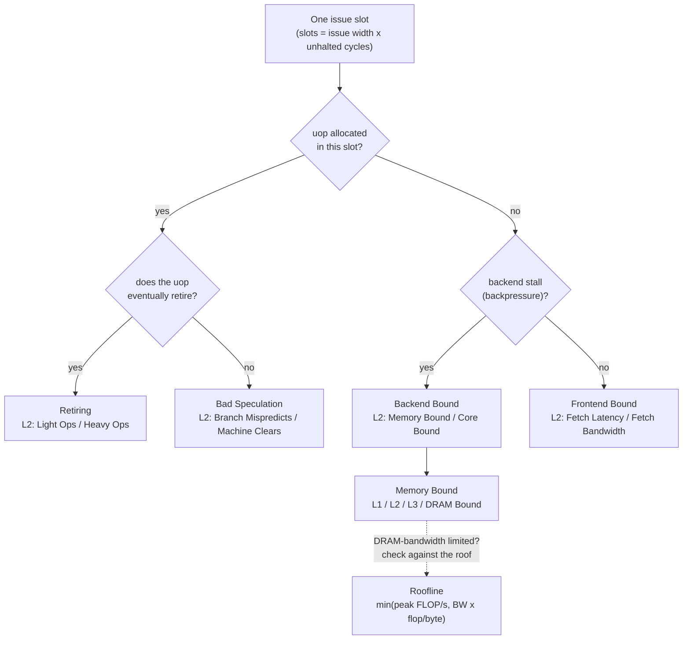

# Hardware Performance Counters, Top-Down TMA, and Roofline

> [!summary] Claim:
> A core's PMU has a handful of programmable counters (4 general-purpose on Skylake, 8 on Ice Lake, per Linux v7.3's perf event tables) plus a few fixed ones, and Linux exposes them through `perf_event_open(2)`; when more events are requested than fit, the kernel time-slices flexible groups once per tick and reports `time_enabled` and `time_running` so the reader can scale.
> Top-Down Microarchitecture Analysis (Yasin, ISPASS 2014) divides every issue slot (issue width times cycles) into exactly one of Retiring, Bad Speculation, Frontend Bound, or Backend Bound, which makes the four level-1 fractions sum to 1 and lets you drill down one branch at a time.
> The Roofline model (Williams, Waterman, and Patterson, CACM 2009) bounds a kernel by `min(peak compute, DRAM bandwidth x operational intensity)`, where operational intensity is flops per byte of DRAM traffic after the caches.
> TMA tells you which pipeline resource is the bottleneck now; Roofline tells you how far the kernel can go before memory bandwidth or peak compute stops it; both are only as good as the counts they are fed, which is why groups, pinning, and hybrid-core PMU selection matter.



## The Mechanism

[[Sampling-vs-Instrumentation-Skid-and-Safepoint-Bias]] owns sampling: overflow interrupts, skid, PEBS and IBS, and attribution of samples to instructions.
This note owns counting: what a counter measures, how Linux schedules and scales counters, how TMA turns a few counts into a bottleneck classification, and how Roofline turns flop and byte counts into a bound.

### 1. The PMU and the perf_event_open(2) ABI

A performance monitoring unit (PMU) is a set of per-core counter registers, each programmed with an event selector (cycles, retired instructions, branch misses, a model-specific occupancy event) and incremented by hardware.
Fixed counters count one hard-wired event; general-purpose counters count whichever event is programmed.
Linux v7.3's perf event tables list 3 fixed and 4 general-purpose core counters for Skylake and 4 fixed and 8 general-purpose for Ice Lake (`counter.json` in each model directory, as of 2026-11, Linux).
Ice Lake's fourth fixed counter is SLOTS, which the Ice Lake and later TMA subsection needs.

User space reaches counters through one system call; glibc provides no wrapper, so programs call `syscall(SYS_perf_event_open, ...)` (perf_event_open(2), man-pages 6.19).
The call takes a `struct perf_event_attr`, a `pid` and `cpu` pair that selects what is counted, a `group_fd`, and flags, and returns a file descriptor.
The fields this note relies on:

- `type` and `config` pick the event.
  `PERF_TYPE_HARDWARE` with `config = PERF_COUNT_HW_*` selects a generic event that the kernel maps to the model's own selector: CPU_CYCLES, INSTRUCTIONS, CACHE_REFERENCES, CACHE_MISSES, BRANCH_INSTRUCTIONS, BRANCH_MISSES, BUS_CYCLES, STALLED_CYCLES_FRONTEND and STALLED_CYCLES_BACKEND (since Linux 3.0), and REF_CPU_CYCLES (since 3.3).
  `PERF_TYPE_RAW` passes a model-specific encoding through; a dynamic PMU's numeric type is read from `/sys/bus/event_source/devices/<pmu>/type`.
- `disabled`, `exclude_kernel`, `exclude_hv` choose when and where counting happens.
  Counting only user space is what `kernel.perf_event_paranoid = 2` (the default since Linux 4.6) allows an unprivileged process to do on itself.
- `read_format` decides what `read()` returns.
  `PERF_FORMAT_TOTAL_TIME_ENABLED` and `PERF_FORMAT_TOTAL_TIME_RUNNING` append two 64-bit times; `PERF_FORMAT_GROUP` makes one `read()` on the leader return `nr`, the two times, and every member's value, so all values describe the same interval.
- `pinned` asks for a group that must always be on the PMU; if it cannot be scheduled it enters an error state in which `read()` returns end-of-file (0 bytes) until it is re-enabled.

The read layout, from the comment in `include/uapi/linux/perf_event.h`:

```c
/* without PERF_FORMAT_GROUP */          /* with PERF_FORMAT_GROUP */
struct read_one {                        struct read_group {
    u64 value;                               u64 nr;
    u64 time_enabled; /* if requested */     u64 time_enabled; /* if requested */
    u64 time_running; /* if requested */     u64 time_running; /* if requested */
};                                           u64 values[nr];   /* plus id, lost if requested */
                                         };
```

`ioctl(fd, PERF_EVENT_IOC_ENABLE | DISABLE | RESET, PERF_IOC_FLAG_GROUP)` acts on the whole group, and `prctl(PR_TASK_PERF_EVENTS_ENABLE)` enables every event the calling task owns, in a loop over its event list (`perf_event_task_enable()` in `kernel/events/core.c`).
`PERF_EVENT_IOC_RESET` zeroes only the count: `_perf_event_reset()` at v7.3 sets `event->count` to 0 and leaves `time_enabled` and `time_running` alone, so a reset counter still remembers how long it ran before.

### 2. Groups and multiplexing

A group is a leader plus members that the kernel schedules onto the PMU all at once or not at all.
That is the only way to get counts that describe the same instructions; two counters opened separately can be on the PMU at different times.

When the requested events do not fit, the kernel multiplexes.
At v7.3, `perf_mux_hrtimer_handler()` fires every `perf_event_mux_interval_ms` (a per-PMU sysfs file under `/sys/bus/event_source/devices/<pmu>/`, default `PERF_CPU_HRTIMER = 1000 / HZ`, so 4 ms at HZ=250), and `perf_rotate_context()` schedules out the flexible groups, moves the first one to the tail (`rotate_ctx()`), and schedules them in again in list order.
Pinned groups are scheduled first and are never rotated.
Each event accumulates `time_enabled` whenever it is enabled and `time_running` only while it is actually on a counter, and the standard estimate is:

$$\widehat{\text{count}} = \text{value} \times \frac{\text{time\_enabled}}{\text{time\_running}}$$

The estimate is unbiased only if the event rate in the slices the counter saw equals the rate in the slices it missed.
Three consequences follow from the rotation mechanism:

1. Rotation moves one group per tick, so with G flexible groups a full cycle takes about G ticks; with 48 single-event groups at HZ=250 that is about 190 ms.
2. A region shorter than one tick is never rotated, so groups that did not fit at enable time read `time_running = 0` and have no estimate at all.
3. Ratios computed from events in different groups (instructions from one slice, cycles from another) mix phases, and in TMA that can produce a negative category, as the lab's model part shows.

`perf stat` prints the running fraction in parentheses after a scaled count, for example `(0.43%)` in the hybrid example of `intel-hybrid.txt`, and its CSV mode (`-x`) carries "run time of counter" and "percentage of measurement time the counter was running" as columns (perf-stat(1)).

Counters are also a shared resource outside your process.
The x86 NMI watchdog (hard-lockup detector) "utilizes CPU performance counter registers" and is disabled by default in KVM guests (`kernel.rst`), and any other perf user, such as a fleet-wide profiler, competes for the same registers.

### 3. Top-Down Microarchitecture Analysis

Before TMA, tools estimated stall cycles as `Stall_Cycles = sum(Penalty_i * MissEvent_i)`.
Yasin's paper rejects this for out-of-order cores for three reasons: stalls overlap (a data-cache miss can be serviced while a later instruction misses the instruction cache), speculative execution counts events on paths that never retire, and penalties depend on the workload rather than being fixed.

TMA instead classifies issue slots at the issue (allocation) point, "the natural border that splits the frontend and backend portions of machine".
A slot is the capacity to issue one uop in one cycle, so a W-wide core has `W x cycles` slots.
The decision in the opening flowchart is applied per slot:

- A uop was issued and later retired: Retiring.
- A uop was issued and later cancelled, or the slot was lost recovering from a misprediction: Bad Speculation.
- No uop was issued and the backend was asserting backpressure (for example no load buffer entries): Backend Bound, because a ready frontend could not have helped.
- No uop was issued and the backend could have accepted one: Frontend Bound.

Because every slot lands in exactly one category, the four fractions sum to 1, and the hierarchy gives a safety rule: a lower-level node matters only if every node on its path from the root is flagged.
The paper implements level 1 on Ivy Bridge, a 4-wide machine, with these events (Table 7):

| Metric | Intel Core events (Yasin 2014, Table 7) |
| :--- | :--- |
| Slots | `4 * CPU_CLK_UNHALTED.THREAD` |
| Frontend Bound | `IDQ_UOPS_NOT_DELIVERED.CORE / Slots` |
| Bad Speculation | `(UOPS_ISSUED.ANY - UOPS_RETIRED.RETIRE_SLOTS + 4 * INT_MISC.RECOVERY_CYCLES) / Slots` |
| Retiring | `UOPS_RETIRED.RETIRE_SLOTS / Slots` |
| Backend Bound | `1 - (Frontend Bound + Bad Speculation + Retiring)` |

Level 1 needs five events; the paper's counter-architecture proposal adds "just eight simple new events" to a conventional PMU to support the hierarchy.
At level 2, Backend Bound splits into Memory Bound and Core Bound using execution-stall cycles, and Memory Bound splits into L1, L2, L3, and external-memory bound; Frontend Bound splits into Fetch Latency and Fetch Bandwidth; Bad Speculation splits into Branch Mispredicts and Machine Clears.
Linux perf ships these formulas per model; `skl-metrics.json` at v7.3 uses the same level-1 expressions, with `INT_MISC.RECOVERY_CYCLES_ANY / 2` in place of `INT_MISC.RECOVERY_CYCLES` when SMT is on (as of 2026-11, Linux).

#### Ice Lake and later: SLOTS and PERF_METRICS

On Ice Lake, fixed counter 3 counts SLOTS ("cycles multiplied by core issue width"), and a model-specific metrics register reports level 1 directly as four 8-bit fractions that "add up to 0xff (= 100%)" (`topdown.txt`, v7.3).
Byte 0 is Retiring, byte 1 Bad Speculation, byte 2 Frontend Bound, byte 3 Backend Bound; from Sapphire Rapids, bytes 4 to 7 add Heavy Operations, Branch Mispredicts, Fetch Latency, and Memory Bound, and the other level-2 nodes follow by subtraction (Light Operations = Retiring - Heavy Operations, and so on).
The rules that come with it:

- All TopDown metric events must be in one group with SLOTS as the leader, each with `PERF_FORMAT_GROUP`.
- With raw encodings, SLOTS is `PERF_TYPE_RAW` config `0x0400` and the Retiring metric is config `0x8000`; the kernel names are `slots`, `topdown-retiring`, `topdown-bad-spec`, `topdown-fe-bound`, `topdown-be-bound`, and on Sapphire Rapids and later `topdown-heavy-ops`, `topdown-br-mispredict`, `topdown-fetch-lat`, `topdown-mem-bound`.
- The fractions are of the whole time since the counters were last reset, so a region needs both endpoints: multiply each fraction by the SLOTS value read at the same instant, subtract, and divide by the SLOTS delta.
- An 8-bit field resolves 1/255, about 0.39% of the slots it covers, and loses precision over long intervals, so perf reads and resets them often; `topdown.txt` recommends `perf stat -I` with an interval of "a few seconds at most", and warns that the kernel resets these counters after each system call read, so `rdpmc` reads must not be mixed with `read()`.

perf's `icl-metrics.json` at v7.3 does not use the register bytes unmodified: Frontend Bound subtracts `INT_MISC.UOP_DROPPING / slots`, Backend Bound adds `5 * INT_MISC.CLEARS_COUNT / slots`, and Bad Speculation is the clamped remainder `max(1 - (FE + BE + Retiring), 0)`.
From Granite Rapids, Timed PEBS (TPEBS) adds a 16-bit retire latency to PEBS records for metrics that need it (`perf stat -M <metric> --record-tpebs`).

#### Other vendors and hybrid parts

| PMU (perf v7.3 metric file) | Slots per cycle | Level-1 formula shape | Notes |
| :--- | :--- | :--- | :--- |
| Intel Skylake (`skl-metrics.json`) | 4 | Yasin's Table 7 events | Backend Bound is the remainder |
| Intel Ice Lake (`icl-metrics.json`) | from `TOPDOWN.SLOTS` | PERF_METRICS bytes, normalized, with two corrections | Bad Speculation is the clamped remainder |
| Intel Alder Lake `cpu_core` (`adl-metrics.json`) | from `TOPDOWN.SLOTS` | PERF_METRICS bytes | Backend Bound has no `INT_MISC.CLEARS_COUNT` term |
| Intel Alder Lake `cpu_atom` (`adl-metrics.json`) | 5 | `TOPDOWN_{FE,BE}_BOUND.ALL`, `TOPDOWN_RETIRING.ALL` over `5 * CPU_CLK_UNHALTED.CORE` | Bad Speculation is the remainder |
| AMD Zen 4 (`amdzen4/pipeline.json`) | 6 (`6 * ls_not_halted_cyc` dispatch slots) | `de_no_dispatch_per_slot.*`, `de_src_op_disp.all`, `ex_ret_ops` | Adds a fifth level-1 group member, `smt_contention`; group name `PipelineL1` |
| Arm (`arm64/sbsa.json`) | `#slots`, read from the PMU's `caps/slots` (PMMIR_EL1.SLOTS) | `stall_slot_frontend`, `stall_slot_backend`, `op_retired / op_spec` | Group `TopdownL1`; Retiring and Bad Speculation split the non-stalled slots |

On an Intel hybrid part the two core types are two PMUs, `cpu_core` and `cpu_atom`, each with its own event list and a `cpus` file under `/sys/bus/event_source/devices/`, and the table shows that their TMA formulas differ in events, slot width, and corrections.
`perf stat -e cycles` opens one event per PMU and prints `cpu_core/cycles/` and `cpu_atom/cycles/` separately; a raw `perf_event_open` caller chooses the PMU by putting its type in `config[63:32]` (`PERF_PMU_TYPE_SHIFT = 32`), for example `0x400000000` for `cpu_core` type 4 in `intel-hybrid.txt`, whose atom type is not fixed and must be read from sysfs.
A generic event with zero in those bits goes to `PERF_TYPE_RAW` (`perf_init_event()` at v7.3), and on hybrid x86 the big-core PMU is the one registered as `PERF_TYPE_RAW` (`init_hw_perf_events()` in `arch/x86/events/core.c`), so a naive per-thread counter counts only while the thread runs on a P-core; `intel-hybrid.txt` shows a task on an atom CPU whose `cpu_core/cycles/` ran 0.43% of the time.

### 4. The Roofline model

Williams, Waterman, and Patterson start from the claim that "off-chip memory bandwidth will often be the constraining resource" and define operational intensity as "operations per byte of DRAM traffic", measured "between the caches and memory rather than between the processor and the caches", which is why they avoid the terms arithmetic intensity and machine balance.
The bound is:

$$\text{Attainable GFLOP/s} = \min\left(\text{Peak FLOP/s},\ \text{Peak DRAM bandwidth} \times \text{Operational intensity}\right)$$

On log-log axes this is a 45-degree bandwidth line meeting a flat compute line.
The ridge point, where they meet, is the smallest operational intensity that can reach peak; in the paper it moves from 1.0 on the dual-core Opteron X2 to 4.4 flops per byte on the quad-core Opteron X4, which had the same DRAM channels, so only kernels above 1 flop per byte could gain from the newer chip.
The roof is built once per machine (peak from a compute microbenchmark, bandwidth from STREAM), not once per kernel.

Ceilings refine the roof.
Computational ceilings sit below peak for missing ILP or SIMD and for unbalanced multiply and add; bandwidth ceilings sit below the STREAM line for missing software prefetching or NUMA affinity.
A kernel cannot break through a ceiling without doing the optimization it represents, and the ceiling order suggests the optimization order.
The paper evaluates SpMV, LBMHD, a 7-point stencil (8 flops per 24 bytes of compulsory traffic), and 3-D FFT on four multicores, and notes that no-allocate (streaming) stores raise LBMHD's intensity by removing write-allocate traffic.

Roofline and TMA answer different questions.
TMA says a kernel is Memory Bound, but a pointer chase is Memory Bound at a tiny fraction of the bandwidth roof because it is latency bound, with one miss in flight; a STREAM triad is Memory Bound on the roof itself.
Placing the measured point on the roofline separates those cases: far below the bandwidth line means latency or parallelism, on the line means only fewer bytes will help.

### 5. Derived metrics: IPC, miss ratios, and what moves the denominator

Most day-to-day counter work is arithmetic on a few generic events, and each ratio has a trap in its denominator.

- IPC is `instructions / cycles`, and CPI is its inverse.
  Both events must come from one group, as the Groups and multiplexing subsection explains.
- Branch miss ratio is `branch-misses / branches`, a fraction of branches; cache miss ratio is `cache-misses / cache-references`, whose meaning the man page leaves model-specific ("Usually" last-level-cache accesses, "may vary depending on your CPU").
- MPKI is `misses * 1000 / instructions`; it normalizes by work done, so it compares two builds of one program better than a miss ratio, whose denominator also changes when the code changes.
- `PERF_COUNT_HW_CPU_CYCLES` carries the man-page warning "Be wary of what happens during CPU frequency scaling" (perf_event_open(2), man-pages 6.19): it counts core clock cycles, so a ratio of cycles to wall time moves with the frequency, while `PERF_COUNT_HW_REF_CPU_CYCLES` (since Linux 3.3) is "not affected by CPU frequency scaling".
  IPC is frequency independent because both terms scale with the clock; cycles per second, cycles as a proxy for time, and any comparison of cycle counts across runs at different frequencies are not.
- `PERF_COUNT_HW_INSTRUCTIONS` is documented as something that can be "affected by various issues, most notably hardware interrupt counts", so counts include whatever the kernel runs on your behalf unless `exclude_kernel` is set.
- With SMT on, two hardware threads share one core's slots.
  A thread's own counters then describe its slice of a shared pipeline, and perf's Skylake metrics use `INT_MISC.RECOVERY_CYCLES_ANY / 2` in place of `INT_MISC.RECOVERY_CYCLES` when SMT is on (the TMA subsection quotes this).
  AMD Zen 4's `smt_contention` level-1 member makes the same effect a named category.
  A TMA fraction measured with a noisy sibling thread is not the fraction the code would show alone; [[Benchmark-Methodology-Noise-and-Environment-Control]] owns how to isolate it.

## Commands and Numbers to Know

| Item | Value | Platform and date | Why it matters |
| :--- | :--- | :--- | :--- |
| `perf stat --topdown` | prints level-1 TMA, implies `--metric-only`; `--td-level=N` picks a level | Linux (as of 2026-11, perf 2026-03-27) | Fastest way to a level-1 breakdown |
| `perf stat -M TopdownL1` / `-M PipelineL1` | metric group names in Intel and Arm JSON / AMD Zen 4 JSON | Linux (as of 2026-11, v7.3) | Opens the metric's events as one group |
| `perf stat -x,` | CSV: value, unit, event, run time, running percentage | Linux (as of 2026-11) | Scripts must check the running percentage |
| `perf stat -e cpu_core/cycles/` | pick one hybrid PMU | Linux, Intel hybrid (as of 2026-11) | Avoids per-PMU event duplication |
| `kernel.perf_event_paranoid` | default `2`: user-space measurement only for unprivileged users | Linux (default since 4.6; as of 2026-11) | `-1`, `0`, `1` loosen it; Debian added an out-of-tree level 3 in 2015 |
| `CAP_PERFMON` | capability for privileged perf use | Linux 5.8+ (as of 2026-11) | Grant this, not `CAP_SYS_ADMIN` |
| `perf_event_mux_interval_ms` | default `1000 / HZ` ms | Linux (as of 2026-11, v7.3) | Rotation period; one flexible group rotated per tick |
| Core counters, Skylake | 3 fixed, 4 general-purpose | Linux perf tables (as of 2026-11, v7.3) | Level 1 on Skylake already needs 5 events |
| Core counters, Ice Lake | 4 fixed (incl. SLOTS), 8 general-purpose | Linux perf tables (as of 2026-11, v7.3) | SLOTS plus PERF_METRICS give level 1 without multiplexing |
| SLOTS raw encoding | `PERF_TYPE_RAW`, config `0x0400`; metrics `0x80XX` | Linux, Intel Ice Lake+ (as of 2026-11) | Must be the group leader |
| PERF_METRICS resolution | 8 bits, 1/255 of slots per field | Intel Ice Lake+ (as of 2026-11) | Small level-2 differences are noise |
| Hybrid PMU type field | `config[63:32]`, `PERF_PMU_TYPE_SHIFT = 32` | Linux (as of 2026-11) | Type 0 means the big-core PMU on hybrid x86 |
| perf event table versions | Skylake v59, Ice Lake v1.24, Sapphire Rapids v1.39, Alder Lake v1.40 | Linux v7.3 `mapfile.csv` (as of 2026-11) | Metric formulas change between table versions |
| VTune expected range, tuned client hotspot | Retiring 20-50%, Backend 20-40%, Frontend 5-10%, Bad Spec 5-10% | Intel cookbook 2023.0 | Values above the top of a range warrant a look |
| `PERF_COUNT_HW_REF_CPU_CYCLES` | cycles "not affected by CPU frequency scaling" | Linux 3.3+ (as of 2026-11, man-pages 6.19) | Use for time-like normalization; core cycles for IPC |
| Roofline ridge point | `peak FLOP/s / DRAM bytes/s` | Both | Kernels left of it cannot reach peak |

## Multi-Language Comparison: Reading Counters From C, Python, and Rust

| Concern | C | Python | Rust |
| :--- | :--- | :--- | :--- |
| System call | `syscall(SYS_perf_event_open, ...)`; no glibc wrapper | No standard-library binding; `perf stat -x,` in a subprocess, or perf's own `perf` extension module (`PyInit_perf` in `tools/perf/util/python.c`) | `perf-event` crate 0.4.9 (2026-02-12, Linux only for the syscall wrappers; its README calls it "a nascent project") |
| Event names | Generic `PERF_COUNT_HW_*` or raw encodings; PAPI wraps counters behind a portable C API | perf's event parser via `perf stat -e` | Generic events through the crate; raw configs by hand |
| Groups and scaling | `PERF_FORMAT_GROUP` and the two times, by hand (this lab) | perf prints scaled counts and the running percentage | `Group` type; `Counts::time_enabled()` and `time_running()` for scaling (crate source, 2026-11) |
| TMA formulas | write them yourself, or run `perf stat -M` | parse `perf stat --topdown` output | write them yourself |
| Overhead per read | one `read()`; `rdpmc` after `mmap` for the lowest cost | process start plus parsing | one `read()` |

The interpreter matters more than the binding: Python's own instructions dominate a counted region, so count whole phases from outside rather than bracketing a few lines of Python.

## Worked Lab Example

The lab is `code/04-Measurement-Methodology/top_down_tma/`; `run.sh` declares `# requires: linux, pmu`, because its third part needs a Linux host that exposes a hardware PMU (bare metal, or a VM with a virtual PMU) and `perf_event_paranoid <= 2`.
Docker's default seccomp profile blocks `perf_event_open` ("Tracing/profiling syscall, which could leak a lot of information on the host"), and the harness's lab container has no PMU in any case.

```bash
cd code/04-Measurement-Methodology/top_down_tma
TOOLCHAIN_LABS_PMU=1 bash run.sh     # on a Linux host with a visible PMU
```

1. `tma_model.py` computes level 1 from illustrative counter values with the Skylake formulas, shows the multiplexing hazard, decodes two PERF_METRICS values over a region, and applies the Arm SBSA formulas.
2. `roofline.py` places seven FP64 kernels on a hypothetical 2,000 GFLOP/s, 200 GB/s machine.
3. `pmc_lab.c` opens real counters and prints only yes or no facts, never raw counts, so its output is stable across runs; the raw numbers go to standard error.

### Model output (parts 1 and 2)

The two Python parts are pure arithmetic and print the same text on every OS.
The blocks below are verbatim excerpts of their output from a direct `python3 tma_model.py` and `python3 roofline.py` run on darwin-arm64 on 2026-11-08, not from an `expected/` file: the lab as a whole requires `linux, pmu`, so the harness skips it on this host and no `expected/<platform>.txt` has been recorded yet.

```text
[B] multiplexing hazard: half the run is frontend-starved, half is branchy
  one group, all five events counted together
    Retiring           29.38%
    Bad Speculation    21.12%
    Frontend Bound     35.00%
    Backend Bound      14.50%
    sum               100.00%
  events from different slices, each scaled by enabled/running = 2
    Retiring           35.00%
    Bad Speculation    40.00%
    Frontend Bound     60.00%
    Backend Bound     -35.00%
    sum               100.00%
  Backend Bound below zero: yes
[C] Ice Lake and later: PERF_METRICS bytes are fractions of 0xff
  metrics_a = 0x1E050A0F7C0A1E5B: level-1 bytes sum to 0xFF
  metrics_b = 0x52030614AE050F3D: level-1 bytes sum to 0xFF
  region between the two reads: 10,000,000 slots
    Retiring             18.04%
    Bad Speculation       2.94%
    Frontend Bound        0.98%
    Backend Bound        78.04%
  level 2 by subtraction
    Light Operations      9.22%  = Retiring - Heavy Operations
    Machine Clears        1.37%  = Bad Speculation - Branch Mispredicts
    Fetch Bandwidth       0.20%  = Frontend Bound - Fetch Latency
    Core Bound           35.69%  = Backend Bound - Memory Bound
  forgetting the /0xff gives Retiring = 4,600%
```

```text
machine (hypothetical): 2000 GFLOP/s FP64 peak, 200 GB/s DRAM
ridge point: 10.00 flop/byte
no-SIMD ceiling: 250 GFLOP/s (8 FP64 lanes)

kernel                        flop/B  attainable  bound
dot   s += x[i]*y[i]          0.1250     25.0 GF  memory
daxpy y = a*x + y             0.0833     16.7 GF  memory
triad a = b + s*c             0.0625     12.5 GF  memory
triad, non-temporal store     0.0833     16.7 GF  memory
7-point stencil               0.3333     66.7 GF  memory
GEMM tile b=32                4.0000    800.0 GF  memory
GEMM tile b=128              16.0000   2000.0 GF  compute
```

Reading the model output:

- In [B] each general-purpose event saw only half the run and was scaled by 2, which is exactly what `perf` does, yet Frontend Bound came from the frontend-starved half and the other three events from the branchy half; the categories still "sum" to 100% because Backend Bound is defined as the remainder, and the remainder went negative.
- In [C] each region fraction is `(byte_b * slots_b - byte_a * slots_a) / 255 / (slots_b - slots_a)`; the Retiring byte fell from 0x5B to 0x3D between the reads, but the region's Retiring is 18.04%, not the 23.9% that `0x3D / 0xff` alone suggests, because the first 5 million slots were more retiring-heavy.
- In [C] the last line shows the pseudo-code in `topdown.txt` at v7.3, which multiplies the raw byte by SLOTS without dividing by `0xff`, read literally, inflates every ratio by 255.
- In part 2 the write-allocate (read-for-ownership) of the destination line turns the triad's 24 bytes per element into 32, and a non-temporal store recovers 0.0833 flop/byte; every streaming kernel sits two orders of magnitude left of the ridge, so SIMD width cannot help them.
- The tiled GEMM model loads two `b x b` FP64 tiles per `2 b^3` flops, so intensity is `b / 8`; `roofline.py` also prints that `b = 80` is the smallest tile that reaches the 10 flop/byte ridge.

### Live counter checks (part 3)

`pmc_lab.c` pins itself to one CPU from its allowed set (intersected with `cpu_core/cpus` on an Intel hybrid host) and opens every event with `pid = 0` and that CPU.
A CPU-bound event lets the kernel pick the right PMU: at v7.3, `x86_pmu_event_init()` on hybrid x86 and `armpmu_event_init()` on Arm return `-ENOENT` for a CPU of another core type, and `perf_init_event()` then tries the next PMU.
The multiplexing region is driven by time, not by work: it reads `perf_event_mux_interval_ms` from sysfs (10 ms if unreadable), runs an all-taken branch loop (a steady branch rate) until the region spans at least four full rotations of the 48 counters and every counter has run, and stops at 10 s regardless.
Its stdout is a fixed list of checks, each of which prints `no` if the mechanism it tests were absent:

| Check printed | What would make it `no` |
| :--- | :--- |
| retired instructions equal within 2% for sorted and random input | the compiler if-converted or vectorized the branch, so the two loops differ |
| branch-miss rate below 1% sorted, above 10% random | no branch predictor effect, or the branch was removed |
| IPC sorted above 2x IPC random | mispredictions not costing cycles |
| IPC sequential above 4x IPC pointer chase; more than 20 cycles per dependent load | the 128 MiB array fitting in cache, or a prefetcher predicting the chase |
| group ran for its whole enabled time | another perf user or the NMI watchdog forcing the group off, or a hybrid PMU mismatch |
| pinned reference ran its whole enabled time | pinned scheduling not honored |
| every flexible counter ran less than its enabled time; raw counts more than 10% low | the PMU having 48 or more free counters, so no multiplexing |
| every scaled count within 5% of the pinned reference | scaling not compensating for multiplexing, or a reference that counted zero (the checks fail closed) |
| 64 KiB region: at least one counter has `time_running == 0` | rotation happening inside a region shorter than one tick |

UNVERIFIED: no Linux host with a visible PMU was available when this note was written, so part 3 has been compiled with `gcc -O2 -Wall -Wextra -Werror` on Ubuntu 24.04 (aarch64, in the harness image) and its error path checked (EPERM under Docker's seccomp profile, ENOENT in a privileged container whose VM exposes only software PMUs), but its checks have not been run against real counters; the integrator records `expected/linux-<arch>.txt` on a PMU host.

## Pitfalls

> [!warning] Pitfall: ratios across separately scheduled counters
> IPC from `instructions` and `cycles` opened as two independent events, or TMA level 1 from events in different groups, mixes time slices.
> Put every event of one ratio in one group, or use the metric groups (`-M TopdownL1`), which perf opens together.

> [!warning] Pitfall: trusting a scaled count without its running fraction
> `perf stat` prints `(12.50%)` after a multiplexed count; a script that drops that column cannot tell an exact count from an eighth-of-the-time estimate.
> Treat any count below 100% as an estimate whose error depends on how phased the workload is, and reject counts at 0%.

> [!warning] Pitfall: PERF_EVENT_IOC_RESET does not reset the times
> `_perf_event_reset()` clears only the count, so `time_enabled` and `time_running` keep growing across resets, and a counter that ran earlier never reads `time_running == 0` again.
> Close and reopen counters, or difference both times between reads.

> [!warning] Pitfall: generic events on a hybrid CPU
> On Intel hybrid parts a `PERF_TYPE_HARDWARE` event with no PMU type in `config[63:32]` lands on `cpu_core`, so a thread migrated to an E-core stops being counted, and `cpu_atom` needs its own TMA formula with 5 slots per cycle.
> Open one event per PMU (as `perf stat` does), or pin the thread, open the events bound to that CPU, and say which core type the numbers describe.

> [!warning] Pitfall: tiny regions and PERF_METRICS
> The Ice Lake metrics register is a fraction of all slots since the last reset with 8-bit resolution, and `topdown.txt` warns that individual basic blocks are too fine grained because overlap in execution makes the result inaccurate.
> Measure regions long enough that 1/255 of their slots is below the effect you care about, and difference SLOTS-weighted values between two reads.

> [!warning] Pitfall: reading Memory Bound as "buy more bandwidth"
> A pointer chase is almost entirely Backend/Memory Bound while using a small fraction of DRAM bandwidth, because one dependent miss is outstanding at a time.
> Place the kernel on the roofline with measured bytes before deciding between latency fixes (prefetch, layout, more independent misses) and bandwidth fixes (fewer bytes).

> [!warning] Pitfall: counting cache-miss events as DRAM bytes
> Roofline's denominator is DRAM traffic after the caches, including write-allocate and writeback traffic.
> Last-level-cache miss counts times 64 bytes can miss prefetches and writebacks, so prefer memory-controller (uncore) counters or a STREAM-calibrated model, and say which you used.

> [!warning] Pitfall: no PMU and a silent fallback
> In containers, `perf_event_open` fails with EPERM under Docker's default seccomp profile; in many VMs there is no hardware PMU and generic events fail with ENOENT; with `perf_event_paranoid` above 2 (an out-of-tree distribution patch, such as the level 3 Debian added in 2015) unprivileged use fails with EACCES.
> A harness that catches these errors and reports zero or "n/a" turns a configuration problem into a silent measurement gap; fail loudly, as `pmc_lab.c` does.

> [!warning] Pitfall: comparing cycle counts across frequency states
> Core cycles shrink in wall time as the clock rises, so a turbo-boosted run and a throttled run of identical code report different cycle counts per second but the same IPC.
> Compare IPC or instruction counts, or normalize with the reference-cycle event, and record whether SMT siblings were busy.

## At Scale

One engineer on one laptop needs `perf stat`, `perf stat --topdown`, and the habit of reading the running percentage.
The problems at 1,000 to 50,000 engineers are access policy, shared counters, heterogeneous hardware, and comparability of numbers across machines and kernel versions.

- Access: a fleet must choose between `perf_event_paranoid` settings and `CAP_PERFMON` grants, and containers need a seccomp profile that allows `perf_event_open` for the workloads that are allowed to measure; a distribution level above 2 (Debian added an out-of-tree level 3 in 2015, per Ben Hutchings' 2016 upstream submission) and Docker's default profile both block it.
- Shared counters: an always-on fleet profiler, the NMI watchdog on bare metal, and an engineer's ad hoc `perf stat` share the same few registers, so a fleet profiler should use few events in one group and publish which counters it holds.
- Heterogeneity: Intel P-cores and E-cores, AMD Zen, and Arm Neoverse have different slot widths and formulas, and perf's metric tables carry a version per model (Skylake v59, Ice Lake v1.24 at v7.3), so a dashboard must record CPU model, core type, kernel, and table version next to every TMA number.
- Cloud: whether a guest sees a PMU depends on the hypervisor and instance type, so the measurement plan must probe for it rather than assume it.

Decision rules:

- Use `perf stat --topdown` or `-M TopdownL1` before any hand-picked raw event; drill to level 2 only under the flagged level-1 node.
- Never publish a ratio whose events were not counted in one group, and never publish a count below 100% running without its fraction.
- Use Roofline to decide what kind of optimization is possible, and TMA to find what limits the current code; report both with the measured bytes and flops.
- For CI regression gates, use the instruction counts from [[Performance-Regression-Detection-in-CI]] rather than TMA fractions, which move with microcode, kernel, and table versions; record the policy in [[Measurement-Methodology-Decision-Records]].
- For a hybrid or SMT host, pin the measured thread and state the core type; [[Benchmark-Methodology-Noise-and-Environment-Control]] owns the rest of host isolation.

## Practice Drill

> [!tip] Practice Drill:
> On a Linux host with a PMU, run `perf stat -e instructions,cycles,branches,branch-misses` on the lab's sorted and random branch loops and predict, before running, which of the four counts changes and by roughly how much.
> Then add events one at a time with `-e` until the running percentage drops below 100%, note how many fit, and compare with `counter.json` for your CPU in the kernel tree.
> Run `perf stat --topdown -I 1000` on a pointer chase and on a STREAM triad, and explain why both are Backend Bound yet only one is on the bandwidth roof.
> As a stretch, extend a copy of `pmc_lab.c` on an Ice Lake or later Intel host to open `slots` and `topdown-retiring` as a group with SLOTS as leader, read them twice around a region, and compute the region's Retiring fraction with the SLOTS-weighted difference from the model part.

## Interview Questions

> [!question] L5: Why is IPC alone not a diagnosis?
>
> > [!success]- Answer
> > IPC says how many instructions retired per cycle, not why the other slots were wasted.
> > A low IPC can come from mispredictions (Bad Speculation), instruction-cache or decode starvation (Frontend Bound), or cache misses and busy execution ports (Backend Bound), and each needs a different fix.
> > IPC also depends on the instruction mix: a vectorized loop can do more work at lower IPC.
> > TMA level 1 replaces the single number with four fractions of slots that sum to 1, which tells you which branch of the hierarchy to drill into.

> [!question] L5 (predict the output): The lab's branch loop runs over the same 4 MiB of bytes, first sorted, then shuffled; which of instructions, branches, branch-misses, and cycles change?
>
> > [!success]- Answer
> > Instructions and branches stay the same: both orders contain the same bytes, so the taken arm runs the same number of times, and the volatile asm keeps the branch from being if-converted or vectorized.
> > Branch-misses jump from almost none (one transition per pass in sorted data) to roughly half of the data-dependent branches for random bytes, so the miss rate over all branches goes from below 1% to above 10%.
> > Cycles grow by the misprediction penalty times the misses, so IPC falls, and the lab checks it falls by more than 2x.
> > TMA would show the cycles moving into Bad Speculation, not Backend Bound.

> [!question] L6: Why does TMA classify issue slots at the allocation point instead of adding up stall penalties?
>
> > [!success]- Answer
> > Summing `penalty x miss count` double-counts overlapping stalls in an out-of-order core, counts events on wrong-path execution, and assumes a fixed penalty that really depends on the workload; Yasin's paper lists all three.
> > The issue point is the border between frontend and backend, and every slot there either received a uop or did not, so each slot can be attributed exactly once.
> > If a uop issued, it either retired (Retiring) or was cancelled (Bad Speculation); if none issued, backpressure means Backend Bound and otherwise Frontend Bound.
> > Exclusive attribution is what makes the fractions sum to 1 and lets a user ignore every unflagged subtree.

> [!question] L6 (debug this): A script computes level-1 TMA from `perf stat -e` with ten hand-picked events on Skylake and reports Backend Bound of -12%; what happened and how do you fix it?
>
> > [!success]- Answer
> > Skylake has 4 general-purpose counters, so ten events were multiplexed and each was scaled by `time_enabled / time_running` from a different set of time slices.
> > Backend Bound is the remainder `1 - FE - BS - Retiring`, so when Frontend Bound came from a frontend-heavy phase and the uop counts from another phase, the other three overshoot and the remainder goes negative; the lab's model part reproduces this with Backend Bound at -35%.
> > The tell is the running percentage after each count, which the script dropped.
> > Fix it by collecting only the level-1 events, in one group, with `perf stat -M TopdownL1` or `--topdown`, and check that every count reads 100%.

> [!question] L6: On an Alder Lake laptop, `perf stat -e cycles ./app` prints `cpu_core/cycles/` with `(0.43%)` and `cpu_atom/cycles/` with `(99.57%)`; explain both numbers.
>
> > [!success]- Answer
> > The P-cores and E-cores are separate PMUs, so perf opened one `cycles` event per PMU.
> > Each event only runs while the task is on a CPU of its own type, so the percentage is how long the task spent on each core type: almost all of it on an atom CPU here.
> > The scaled `cpu_core` count is an extrapolation from 0.43% of the time and is close to meaningless.
> > Pin the task to one core type with `taskset` and use that PMU's TMA formula; the atom formula uses `TOPDOWN_*_BOUND.ALL` events over 5 slots per cycle, while the P-core uses SLOTS and PERF_METRICS.

> [!question] L7: A kernel runs at 0.083 flop/byte on a machine whose ridge point is 10 flop/byte, and a team proposes rewriting it with wider SIMD; evaluate the proposal.
>
> > [!success]- Answer
> > The attainable bound is bandwidth times intensity, so at 0.083 flop/byte on 200 GB/s the ceiling is about 16.7 GFLOP/s regardless of SIMD width; the kernel is two orders of magnitude left of the ridge.
> > SIMD raises only the compute ceilings, which this kernel never reaches.
> > The useful moves reduce bytes per flop: fuse loops so data is reused while in cache, use non-temporal stores to drop write-allocate traffic (the lab's triad goes from 0.0625 to 0.0833 flop/byte), use narrower data types, or block the algorithm.
> > Before any of that, measure where the kernel actually sits relative to the bandwidth line, because a latency-bound kernel far below it needs more memory-level parallelism, not fewer bytes.

> [!question] L7: Why must the Ice Lake SLOTS counter lead the TopDown group, and why does perf read the metrics every few seconds?
>
> > [!success]- Answer
> > The metrics register holds fractions, not counts: four 8-bit fields that sum to 0xff of the slots since the last reset.
> > To get a region's breakdown you need SLOTS read at the same instant to turn each fraction into a slot count, which is why the metric events must be in a group with SLOTS as leader and `PERF_FORMAT_GROUP`.
> > Each field resolves only 1/255 of the covered slots and loses precision as the interval grows, so `topdown.txt` recommends `perf stat -I` with an interval of a few seconds at most and an explicit reset for `rdpmc` users.
> > Mixing `rdpmc` with `read()` breaks the arithmetic because the kernel resets these counters after each system call read.

> [!question] L7: TMA says a service is 60% Backend Bound and mostly Memory Bound, but on the Roofline it sits at 5% of the bandwidth line; reconcile the two.
>
> > [!success]- Answer
> > Both can be true: Memory Bound counts slots lost to waiting on memory, and the Roofline point says the waiting is not caused by saturated DRAM bandwidth.
> > A kernel far below the bandwidth line is latency bound: dependent loads such as a pointer chase or a hash lookup keep only one or a few misses outstanding.
> > The fixes are latency fixes: fewer dependent misses (layout, smaller nodes, huge pages for TLB misses), software prefetch, or more independent work in flight, not fewer bytes.
> > The lab's pointer chase shows the symptom directly as more than 20 cycles per dependent load at an IPC well under a quarter of a sequential scan over the same array.

> [!question] L8+: You own the measurement policy for a fleet of mixed Intel hybrid, AMD, and Arm hosts, with containers and a continuous profiler; what do you standardize?
>
> > [!success]- Answer
> > Access: decide `perf_event_paranoid` per host class, grant `CAP_PERFMON` instead of `CAP_SYS_ADMIN`, and ship a seccomp profile that allows `perf_event_open` only for workloads approved to measure, since Docker's default blocks it.
> > Counter budget: the continuous profiler takes a small, fixed group and documents it, so engineers know how many counters remain before their `perf stat` multiplexes; the NMI watchdog's counter is part of that budget on bare metal.
> > Comparability: every published TMA or IPC number carries CPU model, core type, SMT state, kernel, and perf table version, because formulas and slot widths differ between Skylake, Ice Lake, Alder Lake's two core types, Zen 4's six dispatch slots, and Arm's `#slots`.
> > Validity: reject counts below 100% running in dashboards, require one-group collection for any ratio, and gate CI on instruction counts rather than TMA fractions.

## Further Reading

- Ahmad Yasin, "A Top-Down Method for Performance Analysis and Counters Architecture" (ISPASS 2014): the hierarchy, the issue-point classification, and the Ivy Bridge event formulas in Table 7.
- Williams, Waterman, and Patterson, "Roofline" (CACM 52(4), 2009): operational intensity, the ridge point, ceilings, and four kernels on four multicores.
- `perf_event_open(2)` (man-pages 6.19): every attribute, read format, ioctl, and error, and the `perf_event_paranoid` levels.
- `tools/perf/Documentation/topdown.txt` (Linux v7.3): SLOTS, PERF_METRICS, the group rules, region deltas, `rdpmc` use, and TPEBS.
- `tools/perf/Documentation/intel-hybrid.txt` (Linux v7.3): `cpu_core` and `cpu_atom`, the extended type in `config[63:32]`, and the running-percentage example.
- `kernel/events/core.c` at v7.3: `perf_init_event()`, `perf_rotate_context()`, `rotate_ctx()`, and `_perf_event_reset()`, the source of the scheduling and reset behavior described here.
- `tools/perf/pmu-events/arch/` at v7.3: the per-model metric formulas for Intel, AMD, and Arm, and `mapfile.csv` with each table's version.
- Intel VTune Cookbook, "Top-down Microarchitecture Analysis Method": slot definitions and the expected ranges per workload class.

## Related

- Prerequisites: [[Sampling-vs-Instrumentation-Skid-and-Safepoint-Bias]]
- Next: [[USE-RED-and-Systems-Performance-Methodologies]]
- See also: [[14-Low-Latency-Systems/07 - Time & Measurement/CPU Timestamp Counter RDTSC Mechanics|CPU Timestamp Counter RDTSC Mechanics]], [[Benchmark-Methodology-Noise-and-Environment-Control]], [[Performance-Regression-Detection-in-CI]], [[Off-CPU-Analysis-Thread-States-and-Causal-Profiling]], [[Measurement-Methodology-Decision-Records]]
- Lab: `code/04-Measurement-Methodology/top_down_tma/` (requires: linux, pmu)
