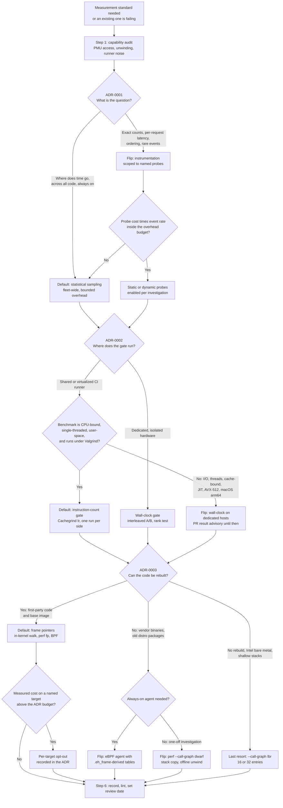
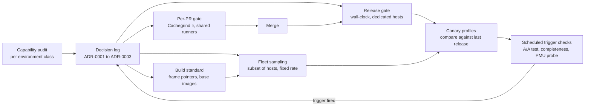

# Measurement Methodology Decision Records

> [!summary] Claim:
> A measurement method is an architectural choice: it fixes which questions an organization can answer, at what overhead, and with what error.
> Three choices recur at every scale: sampling versus instrumentation, wall-clock time versus deterministic instruction counts as the CI gate, and frame pointers versus DWARF, LBR, or SFrame as the stack unwinder.
> Each choice has a defensible default and a short list of conditions that flip it, and both belong in a decision record that is superseded, never silently edited.
> A record without a flip trigger and a verification command is an opinion; this playbook produces records that a script can check.

The bias mechanisms behind the first choice (skid, safepoint bias, observer effect) are owned by [[Sampling-vs-Instrumentation-Skid-and-Safepoint-Bias]].
Statistical tests, change-point detection, and gate thresholds for wall-clock data are owned by [[Performance-Regression-Detection-in-CI]] and [[Statistics-for-Benchmarks-Coordinated-Omission-and-HDR-Histograms]].
Host isolation for wall-clock runs is owned by [[Benchmark-Methodology-Noise-and-Environment-Control]] and [[Design-a-Low-Noise-Benchmark-Harness-Playbook]].
Unwinder internals (frame records, CFI, SFrame layout) are owned by [[Stack-Unwinding-CFI-and-Exception-ABI]], and the compiler-flag rollout for frame pointers is ADR-002 in [[Program-Execution-Decision-Records]].
Profiler product selection is owned by [[Profiling-Decision-Records]].
This playbook owns the three measurement decisions, their defaults, their flip triggers, and the procedure that turns them into checked records.

## Trigger and Symptoms

Activate this playbook when measurement results stop being comparable across teams, or when a measurement standard is about to be set for more than one team.

- Two teams report opposite conclusions about the same change because one timed it on a laptop and the other counted instructions in CI.
- A performance gate in CI flips between pass and fail on re-run, and engineers re-run until it is green.
  The benchstat documentation names this "multiple testing" and notes that at its default threshold of 0.05 a difference is expected 5% of the time even when there is none.
- Flame graphs show a tower of frames above `[unknown]`, or stacks that stop at a libc wrapper.
  Gregg's example graph has 15% of its samples in such a tower because libc was built without frame pointers.
- A fleet profiler rollout is blocked because nobody can state the acceptable overhead as a number.
- A new platform arrives (a VM type without a virtual PMU, a new distribution image, arm64 hosts) and `perf stat` prints `<not supported>` where a count used to be.
- Engineers add ad hoc timers to hot paths because no shared profile exists.
- The reason for a threshold or a build flag exists only in chat history.
  Nygard describes the result: a newcomer can only blindly accept the decision or blindly change it.

## Decision Tree



## Prerequisites

Run the audit and the gate experiments on a host that matches production or CI, not on a workstation.

### Linux

```bash
command -v perf valgrind cg_annotate readelf objdump awk python3
cat /proc/sys/kernel/perf_event_paranoid
```

On Ubuntu 24.04 the tools come from `linux-tools-generic` (perf 6.8.0 series), `valgrind` (3.22.0), `binutils` (2.42), and `python3` (packages.ubuntu.com, noble; as of 2026-11, Linux).
In a container whose kernel differs from the packaged one, call the binary under `/usr/lib/linux-tools-*/perf` directly, because the `perf` wrapper insists on a matching kernel version.
`cg_annotate` is a Python script and fails with `/usr/bin/env: 'python3': No such file or directory` when Python is absent.
This playbook has no recorded lab: every figure in it comes from the cited primary sources, and the commands are meant to be run on your own hosts before a record is accepted.

Permissions:

- `kernel.perf_event_paranoid` defaults to 2 in the kernel source, and the sysctl documentation lists the levels: `>=0` disallows raw and ftrace function tracepoints, `>=1` disallows CPU event access, and `>=2` disallows kernel profiling, each for users without `CAP_PERFMON` (as of 2026-11, Linux).
- User-space counting of your own process (`instructions:u`) therefore works at the default level when the machine exposes a PMU; system-wide sampling needs a lower level or `CAP_PERFMON`.
- The perf-security document recommends capabilities over root: `setcap "cap_perfmon,cap_sys_ptrace,cap_syslog=ep" perf`, and states that from Linux v5.9 `CAP_PERFMON` alone is enough for monitoring.
- Valgrind needs no privileges and no PMU, which is why it works on shared CI runners.

**Verification:**

```bash
perf stat -e instructions:u -- true 2>&1 | grep -E 'instructions|not supported'
valgrind --version
```

A host with a usable PMU prints an `instructions:u` count; a host without one prints `<not supported>` in the count column (the string is `CNTR_NOT_SUPPORTED` in perf's `tools/perf/util/stat-display.c`).

### macOS

```bash
command -v sample
xcrun --find xctrace
/usr/bin/time -l true
```

`/usr/bin/time -l` prints `instructions retired` and `cycles elapsed` lines on macOS 27.2 and 27.3 arm64 (as of 2026-11, macOS).
Valgrind's platform list covers AMD64/Darwin 10.8 to 13.0 and no arm64 Darwin, so the Cachegrind gate in Step 4 cannot run on Apple silicon; run it in a Linux container or VM instead (as of 2026-11, macOS).
`xcrun xctrace list templates` includes `CPU Profiler` and `CPU Counters` with xctrace 27.2, and `xctrace record --template NAME --launch -- COMMAND` records one (as of 2026-11, macOS).

**Verification:** `/usr/bin/time -l true 2>&1 | grep -c -E 'instructions retired|cycles elapsed'` prints `2`.

## Commands and Numbers to Know

| Item | Platform | Value `(as of 2026-11)` | Why it matters |
| :--- | :--- | :--- | :--- |
| `perf record` default sampling frequency | Linux | 4000 Hz (`.freq = 4000` in `tools/perf/builtin-record.c`) | A tool default, not a fleet policy; set `-F` explicitly in every standard. |
| `kernel.perf_event_max_sample_rate` | Linux | 100000 (`DEFAULT_MAX_SAMPLE_RATE` in `kernel/events/core.c`) | `-F max` uses it, and `-F` throttles down to it unless `--strict-freq` is given. |
| `kernel.perf_cpu_time_max_percent` | Linux | 25 (`DEFAULT_CPU_TIME_MAX_PERCENT`) | When samples take longer than this share of CPU, the kernel lowers the sampling frequency, so a requested rate is a ceiling. |
| `kernel.perf_event_paranoid` | Linux | 2 (kernel default; distributions may set another value) | Decides whether unprivileged engineers can count CPU events or profile the kernel. |
| `kernel.perf_event_max_stack` | Linux | 127 frames | Frame pointer walks stop here; Gregg reports a workload more than 1000 frames deep that needed this sysctl. |
| `perf record --call-graph` default | Linux | `fp` for user space; kernel side uses the kernel's own unwinder (ORC or frame pointer) | The default assumes binaries have frame pointers and produces bogus graphs otherwise, per perf-record(1). |
| `--call-graph dwarf` stack dump | Linux | 8192 bytes per sample by default; `dwarf,SIZE` changes it | Deeper stacks are cut at the copy window, and data volume scales with the dump size. |
| `--call-graph fp,defer` | Linux | Documented in perf-record(1) dated 2026-01-13 | Enables a deferred user callchain, collected when the thread returns to user space. |
| LBR depth | Linux x86 | 16 entries in the Nehalem, Sandy Bridge, and Haswell init functions; 32 in `intel_pmu_lbr_init_skl`; Arch LBR reads its depth from CPUID leaf 28 | `--call-graph lbr` cannot see deeper than the register stack. |
| Frame pointer cost, general | Linux | "usually less than 1%" (Gregg); 1 to 2% "in most cases" on 64-bit (Ubuntu); 2.4% kernel compile, 2% Blender, 1 to 10% CPython benchmarks (Fedora 37 test) | The budget line in ADR-0003 must be compared with numbers of this size. |
| Frame pointer cost, CPython 3.15 | Both | 0.1% to 2.3% geometric mean over 80 pyperformance benchmarks on eight machines (PEP 831) | The most recent first-party measurement, including arm64 and x86-64. |
| Frame pointer cost, Go | Both | About 2% on x86-64 (Go 1.7 notes), about 3% on linux/arm64 (Go 1.12 notes) | Go paid this by default to make perf and VTune work. |
| Cachegrind default events | Linux | `Ir` only; `--cache-sim=no` became the default in Valgrind 3.21.0, and `--branch-sim` defaults to `no` | The gate metric is instructions executed; the manual calls the cache simulation unlikely to reflect a modern machine. |
| Cachegrind repeatability | Linux | "repeatable to 7 or more significant digits" against "scarcely repeatable beyond one significant digit" for wall-clock (SQLite) | The whole case for instruction-count gates. |
| rustc-perf default metric | Linux | Instructions, "because it has the least variation"; 3 iterations per test, minimum used | A production example of ADR-0002's default. |
| benchstat sample size and test | Both | At least 10 runs, ideally 20; Mann-Whitney U-test; alpha 0.05 | The floor for any wall-clock comparison. |
| GWP overhead | Linux | Aggregated overhead "less than 0.01 percent"; per-machine maximum rates set so overhead is "always less than a few percent" | Two-dimensional sampling makes fleet cost far smaller than host cost. |
| OpenTelemetry eBPF profiler limits | Linux | 1% CPU and 250 MB memory are its stated upper limits in testing; minimum kernel 5.10 | The published budget of an agent that unwinds without frame pointers. |
| XRay instrumentation threshold | Both | Functions with at least 200 instructions, or containing a loop | A built-in example of bounding instrumentation cost by skipping small functions. |
| SFrame format | Linux | Version 3 in the binutils specification page (marked draft, dated July 26, 2026) and in the current `as` manual, which says `--gsframe` emits `SFRAME_VERSION_3`; ABIs AMD64, AArch64, s390x; first shipped in binutils 2.40 ("Support for the SFRAME unwind format") | The candidate replacement for frame pointers in the kernel unwinder. |
| SFrame in the kernel | Linux | `kernel/unwind/` exists from tag v6.17 and holds `Makefile`, `deferred.c`, and `user.c` on master (7.4-rc2); `arch/Kconfig` offers only `HAVE_UNWIND_USER_FP` and `user.c` only `UNWIND_USER_TYPE_FP`; no SFrame file | The user-space SFrame unwinder is not in mainline, so ADR-0003 cannot default to it. |
| Apple arm64 frame record rule | macOS | `x29` "must always address a valid frame record"; leaf functions and tail calls may skip adding a record | Frame pointer walks work on Apple silicon without any flag, though a leaf frame can be missing. |

## Step-by-Step Execution

Each step ends with a check.
A record is not accepted until its check passes on the platform it governs.
Shell variables and files created in one step are reused in later ones.

### Step 1: Audit what each environment can measure

Do this once per environment class: developer laptop, CI runner, canary host, production host.

```bash
uname -srm
cat /proc/sys/kernel/perf_event_paranoid
cat /proc/sys/kernel/perf_event_max_sample_rate /proc/sys/kernel/perf_cpu_time_max_percent /proc/sys/kernel/perf_event_max_stack
perf stat -e instructions:u,cycles:u -- true 2>&1 | grep -E 'instructions|cycles'
perf record -q --call-graph lbr -o /tmp/lbr.data -- true 2>&1 | head -n 3
valgrind --tool=cachegrind --cachegrind-out-file=/dev/null true 2>&1 | grep 'I *refs'
```

Read the output as a capability table:

- `<not supported>` for `instructions:u` means no hardware counters, which removes `perf stat` gates, LBR, and PMU-driven sampling from the options on that class.
  Software events such as `cpu-clock` still sample.
- An error from `--call-graph lbr` (perf prints `PMU Hardware or event type doesn't support branch stack sampling.`, a string in `tools/perf/util/evsel.c`) removes LBR.
  perf-record(1) limits this mode to "new Intel platforms, such as Haswell" and says it only gets the user call chain.
- An `I refs:` line from Valgrind means the instruction-count gate can run there.
- GitHub documents that each hosted runner is a new virtual machine (single-CPU runners are containers on a shared VM), so treat hosted CI as "no dedicated hardware" unless you operate the runners.

**Verification:** one row per environment class with five cells filled from command output: PMU counters (yes or no), LBR (yes or no), paranoid level, Valgrind (yes or no), dedicated hardware (yes or no).
A blank cell blocks the ADRs that depend on it.

### Step 2: Create the decision log, the template, and the lint

Keep the records in the repository that owns the build and CI configuration, so a change to a gate and a change to its record land in one review.
Nygard's format is Title, Context, Decision, Status, and Consequences, in that order; this playbook adds Flip triggers, Verification, and a review date, because a measurement decision is only valid while its environment holds.
The path `docs/decisions/NNNN-title-with-dashes.md` follows MADR; Nygard used `doc/arch/adr-NNN.md` and adr-tools defaults to `doc/adr`, so match what the repository already has.

```bash
mkdir -p docs/decisions tools
cat > docs/decisions/0000-template.md <<'EOF'
# ADR-0000: Short noun phrase

## Status

Proposed

Review by: 2027-05-01

## Context

Forces in tension, stated as facts with their source and date.

## Decision

We will ... (one default, in active voice).

## Flip triggers

Observable conditions that make this default wrong, each with the command that detects it.

## Consequences

What becomes easier, what becomes harder, and what it costs.

## Verification

The command that proves the default is in force, and its expected output.
EOF
cat > tools/adr_lint.sh <<'EOF'
#!/usr/bin/env bash
# usage: adr_lint.sh FILE...
# Fails when a measurement ADR lacks a required section, a valid status, or a review date.
set -u
rc=0
for f in "$@"; do
    for h in '## Status' '## Context' '## Decision' '## Flip triggers' '## Consequences' '## Verification'; do
        grep -qxF "$h" "$f" || { echo "$f: missing section: $h"; rc=1; }
    done
    grep -qE '^(Proposed|Accepted|Deprecated|Superseded by ADR-[0-9]{4})$' "$f" || { echo "$f: no valid status line"; rc=1; }
    grep -qE '^Review by: [0-9]{4}-[0-9]{2}-[0-9]{2}$' "$f" || { echo "$f: no Review by date"; rc=1; }
done
[ "$rc" -eq 0 ] && echo "ok: $# record(s)"
exit "$rc"
EOF
bash tools/adr_lint.sh docs/decisions/*.md
```

Rules that keep the log useful:

- One decision per record, numbered sequentially, numbers never reused (Nygard).
- A reversed decision is not edited; a new record supersedes it and the old one is marked `Superseded by ADR-NNNN` (Nygard, and `adr new -s 9 ...` in adr-tools).
- Context is value-neutral and dated; every number in it names its source.

**Verification:** the lint prints `ok: 1 record(s)` and exits 0.
Delete the `## Flip triggers` heading from a copy and it prints `missing section: ## Flip triggers` and exits 1.

### Step 3: Write ADR-0001 - sampling by default, instrumentation by exception

**Context.**
Sampling answers "where does time go" for all code at a cost that depends on the sampling rate, not on the code.
Instrumentation answers "how many" and "how long, per event" exactly, at a cost that depends on the event rate, and it changes the code it measures.
GWP sampled in two dimensions (a small subset of machines at any moment, event-based sampling on each) and reported aggregated overhead below 0.01 percent while capping per-machine rates so that overhead stayed below a few percent.

**Decision.**
We will run always-on statistical CPU sampling on every production host class that passed the Step 1 audit, at a fixed stated frequency and a stated CPU budget, with stacks unwound as ADR-0003 specifies.
We will use instrumentation only for a named question that sampling cannot answer, scoped to named probes, and removed or disabled when the question is closed.

**Sizing rule.**
A function that takes fraction `p` of CPU time receives about `N * p` of `N` samples, with relative standard error `sqrt((1 - p) / (N * p))`.
Resolving a 1% function to within 10% relative error needs `N * p` near 100, so about 10,000 samples, which is about 101 seconds of one busy CPU at 99 Hz.
This arithmetic, not habit, sets the frequency and the aggregation window in the record.

**Flip triggers.**

- The question needs an exact count, an ordering, or a per-request latency distribution: sampling gives none of these.
- The event is rare and short, so that `N * p` stays below the count needed for the error target within any affordable window.
- The runtime only yields stacks at safepoints or cannot be walked by the fleet unwinder: see [[Sampling-vs-Instrumentation-Skid-and-Safepoint-Bias]] before trusting either method.
- The time is off-CPU: CPU sampling does not see blocked threads, and scheduler tracing takes over, as [[Off-CPU-Analysis-Thread-States-and-Causal-Profiling]] describes.
- Instrumentation is denied when probe cost times event rate exceeds the same CPU budget; XRay's default of skipping functions under 200 instructions is that rule built into a compiler.

**Consequences.**
Every team gets a profile without rebuilding or reproducing, which is the Fedora proposal's argument for system-wide profiling.
The collector needs `CAP_PERFMON` or a lowered `perf_event_paranoid`, and stack traces of production code leave the host, so the record must name who can read them.
Per-request questions still need tracing, which [[Debugging-Distributed-Systems-with-Traces-and-Correlation]] covers.

Check the default on one host with the stock tool before choosing an agent:

```bash
perf record -q -F 99 -g -o /tmp/adr1.data -- ./service_bench
perf report -i /tmp/adr1.data --stdio --no-children | grep -v '^#' | head -n 20
```

**Verification:** the report lists the workload's hot function first with a call chain under it, and the record states the frequency (`-F 99` here), the CPU budget, and the measured agent overhead on that host class.
Measure the overhead as CPU time of the agent process over the same window; do not copy a vendor figure into the Decision section.

### Step 4: Write ADR-0002 - instruction counts gate pull requests, wall-clock gates releases

**Context.**
Wall-clock time is what users perceive, and the Cachegrind manual says so, but the same manual notes that running the same program on the same input can vary by several percent.
Criterion.rs tells users they probably should not run its wall-clock benchmarks in cloud CI, because virtualization noise produces apparent large changes when nothing changed.
Instruction counts under Cachegrind are precise and, for some programs, perfectly reproducible; SQLite reports 7 or more significant digits of repeatability and uses that to land optimizations of 0.1% or less.
rustc-perf makes instructions its default metric "because it has the least variation".

**Decision.**
We will block pull requests on the relative change in instructions executed (`Ir`) under Cachegrind, one run per side, for benchmarks that are CPU-bound, single-threaded, and deterministic in user space.
We will measure wall-clock time only on dedicated hardware with interleaved A/B runs and a rank test, as [[Performance-Regression-Detection-in-CI]] specifies, and that result gates releases, not individual pull requests.

Install the gate:

```bash
cat > tools/ir_gate.sh <<'EOF'
#!/usr/bin/env bash
# usage: ir_gate.sh BASE_BIN HEAD_BIN THRESHOLD_PCT [ARGS...]
# Exit 0 when HEAD executes at most THRESHOLD_PCT percent more instructions than BASE.
set -euo pipefail
base_bin="$1"; head_bin="$2"; threshold="$3"; shift 3

ir() {
    local out
    out="$(mktemp)"
    env -i valgrind --tool=cachegrind --cachegrind-out-file="$out" "$@" >/dev/null 2>&1
    awk '/^summary:/ { print $2 }' "$out"
    rm -f "$out"
}

base="$(ir "$base_bin" "$@")"
head="$(ir "$head_bin" "$@")"
awk -v b="$base" -v h="$head" -v t="$threshold" 'BEGIN {
    d = 100 * (h - b) / b
    printf "base_ir=%.0f head_ir=%.0f delta=%+.2f%% threshold=%.2f%%\n", b, h, d, t
    exit (d > t) ? 1 : 0
}'
EOF
bash tools/ir_gate.sh ./bench_base ./bench_head 0.5 200000
```

How it works:

- Cachegrind writes a `summary:` line to its output file; with the default event set the only number on it is `Ir`.
- The relative change is `100 * (head - base) / base`, the same formula rustc-perf documents for its comparisons.
- `env -i` empties the environment, because process startup code executes instructions that depend on the environment's contents; see Pitfalls.
  With `PATH` unset, `execvp` falls back to the `confstr(_CS_PATH)` default (typically `/bin:/usr/bin`), so give `valgrind` an absolute path if it is installed elsewhere.
- The gate is one-sided: an improvement passes, and a change exactly at the threshold passes.
- When it fails, `cg_annotate --diff base.cg head.cg` (Valgrind 3.21.0 and later) shows which functions and lines gained instructions.

The output has this shape (the counts are illustrative, the arithmetic is exact):

```text
base_ir=1000000 head_ir=1006000 delta=+0.60% threshold=0.50%
```

**Flip triggers.**

- The benchmark's cost is in system calls or I/O: Cachegrind counts user-space instructions, and SQLite warns that I/O time "predominates in many SQLite usage scenarios" and is not reflected.
- The regression class is memory or cache behavior: an added cache miss changes time, not `Ir`.
- The change trades instruction count against instruction cost: CodSpeed's documentation notes that equal weighting would report replacing a `div` with a multiply as almost no change.
  PEP 831 measured the reverse case: frame pointers added 5.5% instructions but 3.3% wall time on a call-heavy loop.
- The code is multi-threaded, or its instruction count depends on scheduling, time, or addresses: rustc-perf marks benchmarks with high instruction variance with a `?`.
- The binary uses instructions Valgrind does not implement: its platform page lists AMD64 support "up to and including AVX2", so AVX-512 code paths need `perf stat -e instructions:u` on bare metal instead.
- The benchmark runs on a managed runtime whose JIT, garbage collector, or scheduler threads make the instruction stream depend on timing: CodSpeed, for example, states that Go and Java benchmarks only support its walltime instrument (it does not give the reason).
- The target is macOS on Apple silicon, where Valgrind does not run.

**Consequences.**
The gate needs no PMU, no privileges, and no quiet machine, and runs once per side, which Gungraun's documentation gives as the reason its Valgrind benchmarks are faster than repeated wall-clock runs.
It runs slowly (the manual's own word) and it is a proxy: a green gate means "no more instructions", not "no slower".
A hardware `instructions:u` count is not a substitute for the simulated count without a noise band: the rr authors found that no "instructions retired" counter on any known x86 CPU model is deterministic, for example because an instruction that page-faults is restarted and counted twice.

**Verification:**

```bash
bash tools/ir_gate.sh ./bench_base ./bench_base 0.5 200000; echo "exit=$?"
bash tools/ir_gate.sh ./bench_base ./bench_head 0.5 200000; echo "exit=$?"
```

The first command is an A/A test and must print `delta=+0.00%` and `exit=0`; if it does not, the benchmark is not deterministic and fails the Decision's precondition.
The second, with `bench_head` built from a commit that adds known work, must print a positive delta and `exit=1`.
A gate that has never been seen to fail is not verified.

### Step 5: Write ADR-0003 - frame pointers by default for stack unwinding

**Context.**
The kernel's `perf_events` callchain and the BPF stack helpers walk frame pointers and nothing else; without them the kernel cannot unwind a user stack and perf falls back to copying stack memory for offline DWARF unwinding (Fedora proposal, LWN, PEP 831).
GCC and Clang omit the frame pointer at `-O1` and above on many targets, and GCC documents that `-fno-omit-frame-pointer` alone does not guarantee one in leaf functions.
Fedora 38, Ubuntu 24.04 on 64-bit platforms (with exceptions, initially including the Python interpreter), and Arch Linux rebuilt their packages with `-fno-omit-frame-pointer -mno-omit-leaf-frame-pointer`, per PEP 831 and the Fedora proposal; Go has kept frame pointers on x86-64 since 1.7 and on linux/arm64 since 1.12; Rust's precompiled standard library has them since 1.79.0; CPython enables them by default from 3.15 with `--without-frame-pointers` as the opt-out.
Measured costs are in Commands and Numbers to Know.
The user-space SFrame unwinder is not in the mainline kernel (as of 2026-11, Linux).

**Decision.**
We will build all first-party native code and choose base images so that every frame in a production stack has a frame record, and we will unwind in the kernel with frame pointers.
The flag set and its rollout are ADR-002 of [[Program-Execution-Decision-Records]]; this record sets the measurement standard that depends on it and the stack completeness threshold.

Measure stack completeness, which is the number this record governs:

```bash
perf record -q -e cpu-clock -F 999 -g -o /tmp/fp.data -- ./service_bench
perf script -i /tmp/fp.data -F ip,sym \
  | awk 'BEGIN { RS = "" } { n++ } /[ \t]main(\n|$)/ { ok++ } END { printf "%d of %d stacks reach main\n", ok, n }'
```

`perf script -F ip,sym` prints one block of frames per sample separated by blank lines, so the awk program counts samples whose chain contains the root symbol.
For a multi-threaded service, match the thread entry symbols of your runtime as well as `main`.

Run the same measurement with the fallbacks to know what each flip costs:

```bash
perf record -q -e cpu-clock -F 999 --call-graph dwarf,16384 -o /tmp/dwarf.data -- ./service_bench
ls -l /tmp/fp.data /tmp/dwarf.data
readelf -S ./service_bench | grep -E '\.sframe|\.eh_frame'
```

**Flip triggers.**

- Code that cannot be rebuilt (vendor libraries, packages from a distribution without frame pointers) breaks the chain: flip that host class to an eBPF agent that unwinds from `.eh_frame`-derived tables, such as the OpenTelemetry eBPF profiler, which states support for libraries without frame pointers.
- A one-off investigation of such code: use `--call-graph dwarf` and raise the dump size until stacks stop being cut; PEP 831 measured a 5.6 MB `perf.data` with frame pointers against 306.5 MB with DWARF for the same workload and rate.
- No rebuild, Intel bare metal, and shallow stacks: `--call-graph lbr` needs no compiler option, but holds 16 or 32 entries, and Gregg uses it only as a last resort.
- A named target measures a cost above the budget in this record: opt that target out and record it, as Fedora does per package by undefining `_include_frame_pointers`; do not opt out the fleet.
- The kernel gains a user-space SFrame unwinder and the fleet toolchain emits the version it reads: supersede this record after re-running the completeness measurement with it.
  `gcc -Wa,--gsframe` already emits a `.sframe` section and a `GNU_SFRAME` segment that `readelf --sframe` prints; binutils 2.42 defines `SFRAME_VERSION` as `SFRAME_VERSION_2` in `include/sframe.h` (the version Ubuntu 24.04 ships), while the current `as` manual states that it emits `SFRAME_VERSION_3` and the specification page describes Version 3.

**Consequences.**
One mechanism serves perf, bpftrace, BCC tools, and continuous profilers, including off-CPU stacks; perf-record(1) states that its BPF off-CPU mode collects stacks with frame pointers only.
The fleet pays the frame pointer cost listed in Commands and Numbers to Know on every function call, permanently, in exchange for profiles that Gregg credits with wins of 5% to 500%.
JIT and interpreter frames need their own switch, such as `-XX:+PreserveFramePointer` for the JVM (JDK 8u60, per Gregg) or `-X perf` for CPython 3.12 and later.

**Verification:** the completeness line reads `N of N` (or within the threshold the record sets, for example 99%) on a binary built with the fleet flags, and the same command on a binary built with `-fomit-frame-pointer` reads far lower.
No completeness figure is quoted here because it depends on the service and the toolchain; measure it on your own binaries before writing a number into the record.

### Step 6: Accept the records and wire the triggers into automation

```bash
for n in 0001-fleet-profiling-default 0002-pr-performance-gate-metric 0003-stack-unwinding-standard; do
    test -f "docs/decisions/${n}.md" || echo "missing ${n}"
done
bash tools/adr_lint.sh docs/decisions/0*.md
grep -h '^Review by:' docs/decisions/0*.md | sort
```

1. Change each record's status from `Proposed` to `Accepted` in the same change that enables the mechanism it describes.
2. Run `tools/adr_lint.sh` in CI on every change under `docs/decisions/`.
3. Turn each flip trigger that has a command into a scheduled job: the Step 1 audit per environment class, the A/A gate test, and the completeness measurement.
4. Set `Review by:` no more than 12 months out, and earlier for ADR-0003 while the SFrame kernel work is in flight.

**Verification:** the lint prints `ok: 4 record(s)` (the template plus three), the loop prints nothing, and the review dates are in the future.

## Rollback Procedure

A measurement standard is rolled back by superseding its record and disabling its mechanism in one change, never by editing history.

1. **ADR-0001 (fleet sampling).**
   Stop the collector on the affected host class and restore the previous `kernel.perf_event_paranoid` value from configuration management.
   Remove capabilities granted to a perf binary with `setcap -r /path/to/perf`.
   **Check:** `cat /proc/sys/kernel/perf_event_paranoid` shows the prior value and no collector process remains.
2. **ADR-0002 (instruction-count gate).**
   Switch the CI job from blocking to advisory (it still prints the delta) and write a superseding record that names the benchmark class that broke the precondition.
   Do not raise the threshold until it stops failing; that hides the regression class the gate exists for.
   **Check:** a pull request with a seeded regression still shows the delta in its log and merges.
3. **ADR-0003 (frame pointers).**
   Opt out the single target that exceeded the budget, following the rollback of ADR-002 in [[Program-Execution-Decision-Records]], and list it in the superseding record.
   **Check:** the completeness measurement on other services is unchanged, and on the opted-out service the profiler is switched to its DWARF or `.eh_frame` mode.
4. **Any record.**
   Mark the old file `Superseded by ADR-NNNN`, keep it in the log, and run the lint.
   **Check:** `bash tools/adr_lint.sh docs/decisions/0*.md` exits 0.

## Failure Modes of the Procedure

| Failure | How it shows up | Recovery |
| :--- | :--- | :--- |
| No PMU on the audited class | `perf stat` prints `<not supported>` | Use software-event sampling (`-e cpu-clock`) and the Cachegrind gate; record the missing capability in ADR-0001 and ADR-0002. |
| A/A gate test is not zero | `ir_gate.sh` on the same binary prints a nonzero delta | The benchmark reads time, addresses, the environment, or thread interleavings; fix the benchmark or move it to the wall-clock tier. |
| Gate passes a real slowdown | Users report a regression that `Ir` did not show | The cost moved to cache misses, system calls, or instruction mix; add that benchmark to the dedicated-hardware wall-clock tier and list the class under Flip triggers. |
| Valgrind cannot run the binary | The binary uses an instruction set beyond Valgrind's supported list, or the host is macOS arm64 | Build the benchmark for a supported instruction set, or gate on `perf stat -e instructions:u` with a noise band on bare metal. |
| `cg_annotate` fails | `/usr/bin/env: 'python3': No such file or directory` | Install Python 3; the gate itself only needs the `summary:` line. |
| Stacks still broken after the flag rollout | `[unknown]` towers or low `stacks reach main` | A library or runtime in the chain lacks frame pointers; find it from the last resolved frame, then rebuild it, change the base image, or flip that class to an `.eh_frame`-based agent. |
| DWARF stacks cut short | Deep stacks end at the same depth | The default 8192-byte dump is too small; pass `--call-graph dwarf,SIZE` and expect `perf.data` to grow with it. |
| Sampling rate lower than requested | Fewer samples than rate times duration | The kernel throttled toward `perf_cpu_time_max_percent`; lower the rate or the per-sample cost rather than disabling the limit. |
| Record rots | `Review by:` in the past, or a gate that no longer matches its record | Fail CI on expired review dates and supersede the record. |

## Pitfalls

> [!warning] Instruction counts are a proxy, and the proxy has a blind side
> `Ir` counts instructions executed in user space and weights them equally.
> It does not see cache misses, page faults, system-call time, or lock waits, and SQLite's own page warns that its counts do not always correlate well with real-world timings.
> Keep a wall-clock tier on dedicated hardware for every benchmark whose regressions could come from memory or I/O.

> [!warning] Deterministic does not mean independent of the environment
> A process executes startup instructions that depend on its environment block and arguments, so two CI jobs with different variables can report different `Ir` for the same binary.
> `ir_gate.sh` therefore runs both sides under `env -i` with identical arguments, so the only difference between the two measurements is the binary.
> The wall-clock form of this effect is owned by [[Drill-Measurement-Methodology-Environment-Size-Bias]].

> [!warning] A hardware instruction counter is not Cachegrind
> `perf stat -e instructions:u` reads a PMU counter, and the rr authors report that no "instructions retired" counter on any known x86 CPU is deterministic.
> Treat it as a low-noise measurement that still needs repeated runs and a band, not as an exact count.

> [!warning] One library without frame pointers breaks every stack through it
> The walker follows saved frame pointers; a function that uses the register for data yields a junk address and the walk stops or wanders.
> PEP 831 puts it as a chain that is only as strong as its weakest link.
> Measure completeness on the real service with its real dependencies, not on a test binary.

> [!warning] Choosing the unwinder by what debuggers do
> GDB and LLDB unwind with DWARF CFI, which proves nothing about profilers: the kernel has no DWARF unwinder, and the BPF stack helpers have no fallback.
> "We already ship `.eh_frame`" is an argument for an `.eh_frame`-based eBPF agent, with its own overhead budget, not for dropping frame pointers.

> [!warning] Re-running until green
> Re-running a wall-clock comparison until it passes is multiple testing, and at alpha 0.05 a false difference is expected 5% of the time.
> Fix the number of runs in the record (benchstat suggests at least 10, ideally 20) and gate on that one result.

> [!warning] Records without flip triggers
> A record that only states a default becomes a rule nobody dares change, which is the failure Nygard's format was written to prevent.
> Every trigger must be observable by a command, and the command belongs in the record.

## At Scale

For one developer these three choices are tool flags.
At 1,000 to 50,000 engineers they are standards that decide whether measurements made by different teams, on different hosts, in different years can be compared at all.



### How the trade-offs change with size

- **Sampling cost becomes a fleet-fraction decision.**
  GWP did not profile every machine all the time; it profiled a random subset at any moment and still produced stable profiles, so the fleet-wide cost was far below the per-host cost.
  A standard should state both: the per-host budget while a host is being profiled, and the fraction of hosts profiled.
- **Access policy becomes part of the method.**
  With a handful of engineers, `sudo perf` is the policy.
  At scale the record names the mechanism (`CAP_PERFMON` on a collector, a `perf_users` group as in the perf-security document) and who may read stacks from which services.
- **Gate tiers replace a single gate.**
  Per-PR checks must be cheap, deterministic, and runnable on whatever runner is free, which is the instruction-count tier.
  Wall-clock tiers run less often on hardware the organization controls, and fleet canaries catch what neither benchmark tier models.
- **The frame pointer cost is paid by everyone and the benefit is collective.**
  One percent of a 50,000-server fleet is 500 servers of capacity; that is the price of the standard and must be written in the record.
  The return is that any engineer can profile any process, and Gregg's range for wins found that way is 5% to 500% per finding.
- **Heterogeneity forces per-class defaults.**
  Apple silicon developer machines always have frame records but cannot run Valgrind, and cloud VMs may lack a PMU.
  The register argument differs by architecture (PEP 831 counts one register of 16 on x86-64 against 31 on AArch64), yet its CPython measurements were no lower on some arm64 servers than on x86-64, so measure per class.
  One record per decision, with a table of environment classes inside it, scales better than one record per team.

### Decision rules

| Situation | Rule |
| :--- | :--- |
| Shared or hosted CI runners | Block on instruction counts only; show wall-clock numbers as advisory. |
| Dedicated benchmark hosts exist | Gate releases on wall-clock with interleaved A/B runs and a rank test; see [[Performance-Regression-Detection-in-CI\|Performance Regression Detection in CI]]. |
| Benchmark is I/O-bound, multi-threaded, or cache-bound | Exclude it from the instruction-count tier in the record, by name. |
| First-party native code | Frame pointers on, leaf frames included; opt-outs only per target with a measured number. |
| Third-party code that cannot be rebuilt | `.eh_frame`-based eBPF agent for always-on, DWARF stack copy for one-off work. |
| Intel bare metal, no rebuild, shallow stacks | LBR call graphs as a last resort. |
| Question needs counts, ordering, or per-request latency | Instrument named probes for the duration of the question; see [[Sampling-vs-Instrumentation-Skid-and-Safepoint-Bias\|Sampling vs Instrumentation]]. |
| Kernel SFrame unwinder ships in the fleet kernel | Re-run Step 5 with it and supersede ADR-0003 if completeness and cost both hold. |

Rolling a standard out across many repositories is a migration in its own right; [[Playbook-Write-a-Toolchain-Migration-RFC]] and [[Platform-Engineering-Paved-Roads-and-Deprecation]] cover that part.
The fleet collection pipeline is described in [[Continuous-Profiling-GWP-Parca-Pyroscope-and-OTel-Profiles]] and [[Paper-Google-Wide-Profiling]].

## Practice Drill

> [!tip] Practice Drill: Make each record fail its own check
> This note has no lab; do the drill on a Linux host or container with GCC, Valgrind, and perf.
> Write a C program whose `main` calls `outer`, which calls `middle`, which calls a `leaf` function containing a short arithmetic loop, with every function marked `noinline` and the iteration count taken from `argv[1]`.
> Predict each result before running the command.
> 1. Build it twice with `-O2 -g`, the second time with an extra operation in the loop, and run `tools/ir_gate.sh` on the pair with a 0.5 threshold, then on the first binary against itself.
>    Explain why the A/A delta is exactly zero and what would have to be true of a program for it not to be.
> 2. Remove `env -i` from the script and run the A/A test from two shells, one of which has an extra exported variable.
>    Report whether the counts differ and by how much relative to your threshold.
> 3. Add a `usleep(1000)` per iteration to the second build and run the gate again.
>    Explain why the delta barely moves while wall-clock time multiplies, and which Flip trigger this is.
> 4. Build with `-O2 -fno-omit-frame-pointer -mno-omit-leaf-frame-pointer` and with `-O2 -fomit-frame-pointer`, record both with `perf record -e cpu-clock -F 999 -g`, and run the Step 5 completeness command on each.
> 5. Record the `-fomit-frame-pointer` build with `--call-graph dwarf,16384`, compare completeness and `perf.data` size with step 4, then repeat with `dwarf,512` and explain what changed.
> 6. Compile with `-Wa,--gsframe`, run `readelf --sframe`, and write down the SFrame version your assembler emits and whether your kernel can use it.
> 7. Write ADR-0002 for this program from the template, including the trigger from step 3 with its detecting command, and make `tools/adr_lint.sh` pass.
> Target time: 45 minutes.
> Then extend the benchmark into a harness with [[Design-a-Low-Noise-Benchmark-Harness-Playbook]].

## Interview Questions

> [!question] L5
> When would you choose a sampling profiler, and when instrumentation?
>
> > [!success]- Answer
> > Sampling when the question is "where does CPU time go" across code I do not want to modify: its cost is set by the sampling rate, so it can stay on in production.
> > Instrumentation when I need exact counts, ordering, or a duration per event, such as a per-request latency histogram: its cost is set by the event rate, and it changes the code it measures.
> > Sampling has a resolution limit: a function with fraction `p` of the time gets about `N * p` of `N` samples, so small or rare things need long windows.
> > A sound default is always-on sampling plus instrumentation that is scoped to a named question and turned off afterwards.

> [!question] L5: Predict the output
> A CI gate ends with this awk program, called with `b=1000000`, `h=1005000`, and `t=0.5`.
> What does it print, what is its exit status, and what happens with `h=900000`?
>
> ```bash
> awk -v b="$base" -v h="$head" -v t="$threshold" 'BEGIN {
>     d = 100 * (h - b) / b
>     printf "base_ir=%.0f head_ir=%.0f delta=%+.2f%% threshold=%.2f%%\n", b, h, d, t
>     exit (d > t) ? 1 : 0
> }'
> ```
>
> > [!success]- Answer
> > It prints `base_ir=1000000 head_ir=1005000 delta=+0.50% threshold=0.50%` and exits 0, because the comparison is strictly greater-than and 0.50 is not greater than 0.50.
> > With `h=900000` it prints `delta=-10.00%` and exits 0: the gate is one-sided, so improvements pass.
> > With `h=1006000` it prints `delta=+0.60%` and exits 1.
> > Two design points follow: the boundary case should be decided on purpose, and a large unexplained improvement deserves a look too, because it often means the benchmark stopped doing its work.

> [!question] L5
> Why does `perf record -g` give broken call graphs for some binaries, and what are the alternatives?
>
> > [!success]- Answer
> > The default call-graph method is `fp`, which follows saved frame pointers, and compilers omit them at `-O1` and above on many targets.
> > Without them the walk stops early or follows garbage, which shows up as `[unknown]` frames and truncated stacks.
> > Alternatives are `--call-graph dwarf`, which copies 8192 bytes of stack per sample by default and unwinds offline, and `--call-graph lbr`, which reads the hardware branch stack on supported Intel CPUs and holds 16 or 32 entries.
> > The durable fix is building with `-fno-omit-frame-pointer -mno-omit-leaf-frame-pointer`.

> [!question] L6
> Your team wants to gate pull requests on benchmark time using hosted CI runners.
> What do you recommend?
>
> > [!success]- Answer
> > Not wall-clock on hosted runners: each job is a fresh VM on shared hardware, and Criterion.rs itself tells users not to rely on such results.
> > Gate on instructions executed under Cachegrind, one run per side, for benchmarks that are CPU-bound, single-threaded, and deterministic; SQLite and rustc-perf both work this way.
> > Prove the gate with an A/A test that must read zero and a seeded regression that must fail.
> > Keep wall-clock for a separate tier on dedicated hardware with interleaved runs and a rank test, and list by name the benchmarks that the instruction tier cannot represent: I/O-bound, cache-bound, and multi-threaded ones.

> [!question] L6: Debug this
> An instruction-count gate fails about once a week on pull requests that do not touch the benchmarked code, with deltas of a few dozen instructions.
> How do you find the cause?
>
> > [!success]- Answer
> > Start with an A/A test in the CI environment itself: same binary on both sides, many times, and look at whether the count is constant.
> > If it is constant within one job but differs between jobs, the input differs: environment variables, argument strings, or working-directory paths that the program or its startup code processes.
> > Run under `env -i` with fixed arguments and compare.
> > If it varies within one job, the program is not deterministic in user space: it reads the clock, hashes pointer values, uses threads, or takes a data-dependent path on something like a temporary file name.
> > `cg_annotate --diff` on a passing and a failing run names the functions that differ, which usually points straight at the source.
> > Fix the nondeterminism or move the benchmark to a tier with a noise band; do not widen the threshold for every benchmark to hide one.

> [!question] L6
> A reviewer says "we ship `.eh_frame` in every binary, so frame pointers are wasted CPU".
> How do you answer?
>
> > [!success]- Answer
> > `.eh_frame` serves exception handling and debuggers, which run in user space with time to interpret CFI.
> > The kernel's perf callchain code and the BPF stack helpers do not interpret it; without frame pointers perf must copy stack memory per sample and unwind later, which multiplies data volume and cuts deep stacks at the copy window.
> > There is a legitimate version of the reviewer's idea: eBPF agents that precompute tables from `.eh_frame`, such as the OpenTelemetry eBPF profiler, and that is the right flip for code we cannot rebuild.
> > For code we can rebuild, the measured cost is around 1 to 2% in most published tests, and the record should compare that with what complete profiles are worth.
> > I would ask for the reviewer's measured overhead on the specific target and offer a per-target opt-out if it exceeds the budget.

> [!question] L7
> Design the performance regression gates for a monorepo with 2,000 engineers and no dedicated benchmark hardware today.
>
> > [!success]- Answer
> > Tier 1, per pull request, on existing runners: instruction-count benchmarks under Cachegrind with a relative threshold, restricted to deterministic CPU-bound cases, with an A/A job that alarms if determinism is lost.
> > Tier 2, post-merge: a small pool of dedicated, isolated hosts running wall-clock benchmarks with interleaved baseline and candidate runs, a fixed run count, and a non-parametric test, plus change-point detection over history.
> > Tier 3, release: canary hosts in production compared with the previous release through the fleet profiler and service-level latency.
> > Each tier catches what the one before cannot: tier 1 misses cache and I/O effects, tier 2 misses production workload shape.
> > Write one ADR for the tiering with flip triggers per benchmark class, make tier 1 blocking and tiers 2 and 3 revert-on-regression, and budget tier 2 hardware as the explicit cost of the decision.

> [!question] L7
> A new arm64 instance type has no PMU exposed to guests.
> Which of your measurement standards break, and what do you change?
>
> > [!success]- Answer
> > Hardware-counter work breaks: `perf stat` event counts, cycle-based sampling, LBR, and anything built on Top-Down analysis.
> > Timer-based sampling with a software event still works, frame pointer unwinding is unaffected, and the Cachegrind gate is unaffected because it simulates execution.
> > So ADR-0001 keeps its default with `cpu-clock` as the event, ADR-0002 keeps its per-PR tier but loses `perf stat` as a cross-check, and microarchitectural analysis moves to a host class that has counters.
> > The audit in Step 1 should have caught it before migration, and the record gains a row for the new class rather than a new rule.

> [!question] L8+
> As the owner of measurement standards for a 30,000-server fleet, would you adopt SFrame instead of frame pointers?
>
> > [!success]- Answer
> > Not as the default today, and I would write down exactly what would change that.
> > SFrame is attractive because it stores only CFA, FP, and RA recovery per code range, so a kernel can walk stacks without a DWARF interpreter and without reserving a register.
> > The gaps are concrete: the mainline kernel has the deferred user-unwind infrastructure but no SFrame unwinder, the format moved from Version 2 to Version 3 while the binutils 2.42 shipped by Ubuntu 24.04 still defines Version 2, and the BPF stack helpers do not read it.
> > Deferred unwinding also means the user stack is captured on return to user space, which changes what a sampling agent must correlate.
> > My record keeps frame pointers, sets a review date, and names the trigger: a fleet kernel that unwinds SFrame, a toolchain that emits the matching version for all our languages, and a completeness and overhead measurement on our own services that beats the frame pointer numbers.
> > Until then the engineering cost is a one-line build flag and about a percent of CPU, against re-qualifying every profiler and tracer in the fleet.

> [!question] L8+
> Two organizations merge; one gates on wall-clock time on bare metal, the other on instruction counts in the cloud.
> How do you unify the standards?
>
> > [!success]- Answer
> > I would not pick a winner; the two methods answer different questions and both belong in one tiered standard.
> > Start with the capability audit for every environment class in both organizations, because the defaults follow from what each class can measure.
> > Write one record per decision with per-class rows: instruction counts where runners are shared, wall-clock where hardware is dedicated, and an explicit list of benchmark classes each tier cannot represent.
> > Calibrate one tier against the other on a shared benchmark set, so that a known change is seen by both and thresholds are comparable.
> > Keep both histories: old records are superseded, not deleted, so a regression investigation next year can still interpret last year's numbers.
> > The political part is easier when every default comes with flip triggers, because each side can see the conditions under which its method remains the right one.

## Further Reading

- Michael Nygard, Documenting Architecture Decisions, https://cognitect.com/blog/2011/11/15/documenting-architecture-decisions.
  The five-part record format and the rule that reversed decisions are superseded, not removed.
- MADR, https://adr.github.io/madr/.
  A maintained Markdown template and file-naming convention for decision logs.
- Valgrind User Manual, Cachegrind, https://valgrind.org/docs/manual/cg-manual.html.
  Why instruction counts are precise and reproducible, and how `cg_annotate --diff` compares two runs.
- Measuring and Reducing CPU Usage in SQLite, https://sqlite.org/cpu.html.
  A long-running instruction-count workflow with its limitations stated by its owners.
- rustc-perf comparison analysis, https://github.com/rust-lang/rustc-perf/blob/master/docs/comparison-analysis.md.
  How a compiler project turns instruction-count deltas into significance and relevance decisions.
- benchstat, https://pkg.go.dev/golang.org/x/perf/cmd/benchstat.
  Run counts, interleaving, and the multiple-testing warning for wall-clock comparisons.
- Brendan Gregg, The Return of the Frame Pointers, https://www.brendangregg.com/blog/2024-03-17/the-return-of-the-frame-pointers.html.
  The history, the measured overhead, and a survey of the alternatives.
- Fedora, Changes/fno-omit-frame-pointer, https://fedoraproject.org/wiki/Changes/fno-omit-frame-pointer.
  A distribution-scale decision record with benchmarks, alternatives, and an opt-out mechanism.
- PEP 831, Frame Pointers Everywhere, https://peps.python.org/pep-0831/.
  Per-platform overhead tables and a microarchitectural breakdown of where the cost comes from.
- Jonathan Corbet, SFrame-based stack unwinding for the kernel, https://lwn.net/Articles/1029189/.
  The deferred-unwind design and the state of the kernel patch series.
- The SFrame Format, https://sourceware.org/binutils/docs/sframe-spec.html.
  The Version 3 specification and the supported ABIs; the page is marked draft (dated July 26, 2026), so pin the version you rely on.
- Ren et al., Google-Wide Profiling, https://research.google.com/pubs/archive/36575.pdf.
  Two-dimensional sampling and its overhead across a fleet.
- O'Callahan et al., Engineering Record And Replay For Deployability, https://arxiv.org/abs/1705.05937.
  Section 2.4.1 on why hardware instruction counters are not deterministic.
- Linux kernel, Perf events and tool security, https://www.kernel.org/doc/html/latest/admin-guide/perf-security.html.
  The access-control model a fleet policy has to name.

## Related

- Prerequisites: [[Sampling-vs-Instrumentation-Skid-and-Safepoint-Bias]], [[Performance-Regression-Detection-in-CI]]
- Next: [[Design-a-Low-Noise-Benchmark-Harness-Playbook]]
- See also: [[Program-Execution-Decision-Records]], [[Profiling-Decision-Records]], [[Stack-Unwinding-CFI-and-Exception-ABI]], [[Paper-Valgrind-Dynamic-Binary-Instrumentation]]
