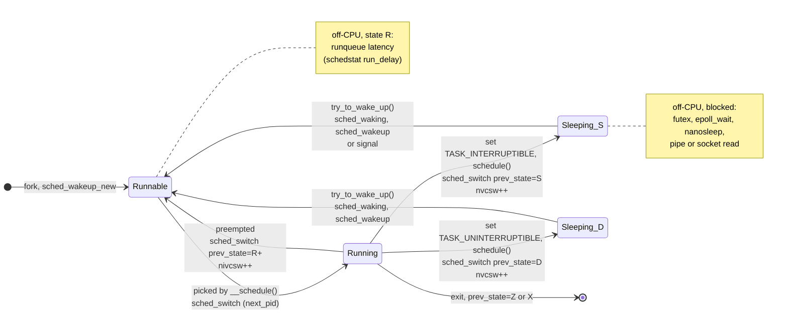

# Off-CPU Analysis, Thread States, and Causal Profiling

> [!summary] Claim:
> A thread's wall-clock time splits into running on a CPU, runnable but waiting for a CPU, and blocked; an on-CPU sampling profiler sees only the first, so a lock wait, a disk read, or a starved runqueue is invisible to it.
> On Linux every transition out of a CPU passes through `__schedule()`, which fires the `sched:sched_switch` tracepoint with the outgoing task's state (`S`, `D`, or `R+` for preempted), so timestamping switch-out and switch-in per thread ID and summing the deltas by the blocked stack gives off-CPU time with its cause.
> The blocked stack says what a thread waited in, not why; wakeup stacks from `sched_wakeup` name the thread that ended the wait, which is how lock and queue chains are followed.
> Neither on-CPU nor off-CPU profiles predict what an optimization will buy, because critical paths shift; Coz answers that question by virtually speeding up one line, pausing every other thread for `d` per sample in that line, which is exactly a `d / P` speedup of the line for sampling period `P`, and measuring the change in progress-point rate.



## The Mechanism

### 1. Why on-CPU sampling cannot see blocked time

A CPU profiler such as `perf record -F 99` or `perf record -e cpu-clock` takes a sample when a timer or counter overflows on a CPU, and the sample belongs to whatever task is running on that CPU at that instant.
A thread that is asleep on a futex is on no CPU, so it generates no samples; [[Sampling-vs-Instrumentation-Skid-and-Safepoint-Bias]] owns how those samples are taken and where they lie.
The profile's denominator is therefore CPU time, and its percentages answer "where did the CPUs go", not "where did my request's 10 ms go".

For any one thread over an interval, the accounting identity is:

$$T_{wall} = T_{on\text{-}CPU} + T_{runqueue} + T_{blocked}$$

where `T_runqueue` is time spent runnable but not running and `T_blocked` is time in any sleeping state.
Off-CPU analysis, in Brendan Gregg's definition, is "a performance methodology where off-CPU time is measured and studied, along with context such as stack traces", and it is complementary to CPU analysis "so that 100% of thread time can be understood" (Gregg, Off-CPU Analysis).
The Linux kernel exposes the first two terms per thread for free, so the third follows by subtraction; the next sections show where each term comes from.

### 2. Linux thread states

A task's state lives in `task_struct::__state`.
The values below are from `include/linux/sched.h` at Linux v7.3; the letters are the ones `ps`, `/proc/PID/status`, and the `sched_switch` tracepoint print.

| Bit value | Constant | Letter | `/proc/PID/status` text | Off-CPU meaning |
| :--- | :--- | :--- | :--- | :--- |
| `0x00` | `TASK_RUNNING` | `R` | `R (running)` | On a CPU or on a runqueue; off-CPU only when preempted or waiting for a CPU |
| `0x01` | `TASK_INTERRUPTIBLE` | `S` | `S (sleeping)` | Blocked; a signal can wake it (futex waits, `epoll_wait`, `nanosleep`, socket reads) |
| `0x02` | `TASK_UNINTERRUPTIBLE` | `D` | `D (disk sleep)` | Blocked; signals do not wake it (many block I/O and some kernel lock waits) |
| `0x04` | `__TASK_STOPPED` | `T` | `T (stopped)` | Stopped by job control (`SIGSTOP`) |
| `0x08` | `__TASK_TRACED` | `t` | `t (tracing stop)` | Stopped under a tracer such as `ptrace` |
| `0x10` | `EXIT_DEAD` | `X` | `X (dead)` | Being reaped |
| `0x20` | `EXIT_ZOMBIE` | `Z` | `Z (zombie)` | Exited, not yet waited for |
| `0x40` | `TASK_PARKED` | `P` | `P (parked)` | Kernel thread parked (CPU hotplug) |
| `0x402` | `TASK_IDLE` = `TASK_UNINTERRUPTIBLE \| TASK_NOLOAD` | `I` | `I (idle)` | Idle kernel thread; uninterruptible but excluded from load average |

Composite states matter when reading kernel stacks: `TASK_KILLABLE` is `TASK_WAKEKILL | TASK_UNINTERRUPTIBLE`, so a killable wait reports as `D`.
`__task_state_index()` deliberately reports two internal states as `D`: a task in `TASK_RTLOCK_WAIT` (a PREEMPT_RT sleeping spinlock) and a `TASK_FROZEN` task, with the source comment "We're lying here, but rather than expose a completely new task state to userspace".
Only `TASK_REPORT` bits (`R S D T t X Z P`) plus the synthetic `TASK_REPORT_IDLE` reach user space; everything else is masked.

### 3. The context switch and `sched:sched_switch`

Every switch on Linux goes through `__schedule(int sched_mode)` in `kernel/sched/core.c`.
At v7.3 the relevant logic is:

1. `switch_count` starts as `&prev->nivcsw`, the involuntary counter.
2. `preempt` is true only for `SM_PREEMPT`.
3. `prev_state = READ_ONCE(prev->__state)`.
4. If the switch is not a preemption and `prev_state` is nonzero, `try_to_block_task()` dequeues the task and `switch_count` becomes `&prev->nvcsw`, the voluntary counter.
5. After `pick_next_task()`, if `next != prev`, the counter is incremented and `trace_sched_switch(preempt, prev, next, prev_state)` fires.

So a voluntary switch is one where the task set a sleeping state before calling `schedule()`, and an involuntary switch is a preemption or a `schedule()` call made while still `TASK_RUNNING`.
The two counters appear in `/proc/PID/status` as `voluntary_ctxt_switches` and `nonvoluntary_ctxt_switches` (`fs/proc/array.c`), and `pidstat -w` reports their rates as `cswch/s` and `nvcswch/s`.

The tracepoint records `prev_comm`, `prev_pid`, `prev_prio`, `prev_state`, `next_comm`, `next_pid`, and `next_prio`.
`prev_state` is not the raw `__state`; `__trace_sched_switch_state()` re-encodes it:

- A preempted task gets `TASK_REPORT_MAX`, which is `0x100` at v7.3, and prints as `R+`.
- Otherwise the state index from `__task_state_index()` (0 to 8) becomes `1 << (index - 1)`, so `S` is `1`, `D` is `2`, and an idle kernel thread is `0x80`.
- `TP_printk` labels bit `0x80` with the `TASK_DEAD` entry but the letter `I`, so `prev_state=I` in a trace means an idle kernel thread, not a dead task.

The tracepoint fires while `prev` is still `current`, so a stack captured inside it is the outgoing thread's stack: the blocking stack.
A program attached to the raw tracepoint (BTF `tp_btf` or `raw_tp`) receives the raw `prev_state` argument instead of the re-encoded field; check which one a tool reads before trusting a `--state` filter.

Related events in `include/trace/events/sched.h` at v7.3:

- `sched_waking` fires in the waker's context at the start of `try_to_wake_up()`, and `sched_wakeup` when the task is made runnable.
- `sched_wakeup_new` fires for a newly forked task.
- `sched_stat_wait`, `sched_stat_sleep`, `sched_stat_iowait`, and `sched_stat_blocked` exist only with `CONFIG_SCHEDSTATS`, and the source notes they apply only to `SCHED_OTHER`, `SCHED_BATCH`, and `SCHED_IDLE`, not real-time classes.

### 4. Measuring off-CPU time

#### The two-timestamp algorithm

Every off-CPU tool implements the same bookkeeping:

1. On switch-out of thread `tid`, store `start[tid] = now`.
2. On switch-in of `tid`, compute `delta = now - start[tid]`, delete the entry, capture the stack, and add `delta` to a map keyed by (stack, thread name).

Capturing the stack once at switch-in is enough because, in Gregg's words, "Application stack traces don't change while off-CPU".
bcc's `offcputime` (v0.37.0) attaches a kprobe to `finish_task_switch()` (also matching the compiler-renamed `finish_task_switch.isra.N`), which runs in the context of the incoming thread with `prev` as an argument, so a single probe does both halves: it timestamps `prev` and closes the interval for `current`.
It sums microseconds in kernel, discards intervals under `-m` (default 1 us) or over `-M`, and its man page notes it "only traces off-CPU times that began and ended while tracing".

The output is folded stacks weighted by microseconds, which [[Flame-Graphs-Differential-Flame-Graphs-and-Visualizations]] renders as an off-CPU flame graph (`flamegraph.pl --color=io --countname=us`).

#### `perf record --off-cpu`

`perf record --off-cpu` (in the `perf-record` documentation from the Linux v5.19 tree onward) loads a BPF program on `sched_switch` (`SEC("tp_btf/sched_switch")` in `tools/perf/util/bpf_skel/off_cpu.bpf.c` at v7.3) and emits samples of a software event named `offcpu-time` whose period is the sleep time in nanoseconds, interleaved with ordinary CPU samples.
The v7.3 man page warns that BPF "can collect stack traces using frame pointer ("fp") only, as of now", so binaries built without frame pointers show bogus user frames.
`--off-cpu-thresh` (documented from the v6.16 tree) makes any off-CPU period longer than the threshold, default 500 ms, a direct sample instead of only an accumulated one.

#### `perf sched`

`perf sched record` captures the scheduler tracepoints to `perf.data`, and `perf sched timehist` turns them into one line per switch with three columns that map directly onto the accounting identity:

- `wait time`: time between this task's last sched-out and this sched-in, which is its whole off-CPU interval, including the `sch delay` at its end (`builtin-sched.c` at v7.3 draws `dt_delay` as the tail of `dt_wait`).
- `sch delay`: time between becoming runnable and running, which is runqueue latency.
- `run time`: time on CPU before this sched-out.

For a sleeping task, blocked time is therefore `wait time - sch delay`; for a preempted task, the whole `wait time` is runqueue time.

`--state` adds the state at switch-out, `-w` shows wakeups, `-M` migrations, and `-s` prints a per-thread summary only (v7.3 docs).
Because every event goes through the perf ring buffer to disk, this is the most expensive method; use it for seconds, not minutes.

#### Overhead

Scheduler events can reach "millions of events per second" in extreme cases (Gregg).
Gregg's published measurement on an 8-CPU Linux 4.15 system at 102k context switches per second, with numbers that are his, not this vault's: dumping every event with perf cost a 9% throughput drop during tracing and produced 224 Mbytes in 10 seconds, while in-kernel eBPF summarization cost a 6% drop.
His advice is to start with a 0.1 s trace and lengthen it while watching the workload, and to check the `cs` column of `vmstat 1` first.

#### Counters that cost nothing

Before tracing, read what the kernel already accumulates:

- `/proc/PID/task/TID/schedstat` (with `CONFIG_SCHED_INFO`): three fields, nanoseconds on CPU (`se.sum_exec_runtime`), nanoseconds waiting on a runqueue (`sched_info.run_delay`), and the number of timeslices (`pcount`); it prints `0 0 0` when schedule info is off.
  Two readings give `T_on-CPU` and `T_runqueue`, and `T_blocked = T_wall - both`.
- `voluntary_ctxt_switches` and `nonvoluntary_ctxt_switches` in `/proc/PID/status`: a high voluntary rate means the thread keeps blocking; a high involuntary rate means it keeps being preempted.
- `/proc/PID/wchan` names the kernel function a sleeping task waits in (it prints `0` to a reader that fails the `ptrace_may_access()` read check); `/proc/PID/stack` gives the whole kernel stack but is restricted to `CAP_SYS_ADMIN` because racy unwinding can leak kernel stack contents (`fs/proc/base.c`).
- Delay accounting (`CONFIG_TASK_DELAY_ACCT`; even when built in, it is disabled at boot by default; enable with the `delayacct` boot option or `sysctl kernel.task_delayacct`, which covers only tasks started afterwards) splits delay into CPU wait, synchronous block I/O, swap-in, memory reclaim, thrashing, direct compaction, write-protect copy, and IRQ/softirq, read with `tools/accounting/getdelays.c`.
- `cpu.stat` in a cgroup v2 directory reports `nr_periods`, `nr_throttled`, and `throttled_usec` (CFS bandwidth limit, non-hierarchical) when the cpu controller is enabled: a throttled group is runnable but forbidden to run, which is off-CPU time that average CPU utilization hides (Linux v7.3 `cgroup-v2.rst`).
- `/proc/pressure/{cpu,memory,io}` (PSI) reports the share of time in which `some` or `full` (all non-idle) tasks were stalled on that resource, as `avg10`, `avg60`, `avg300`, and a `total` in microseconds; it says that a fleet is stalling, not which code is.

### 5. Wakeups, locks, and why the blocked stack is half the story

An off-CPU stack ending in `futex_wait_queue` from `pthread_mutex_lock` says the thread waited for a mutex; it does not say who held it or what the holder was doing.
Gregg notes that blocked stacks often show "the blocking path, but not the full reason it was blocked".
The waker is in the trace: `sched_waking` runs in the waking thread's context, so a stack captured there is the stack that ended the wait, typically `pthread_mutex_unlock`, a `write` to a pipe, or an I/O completion interrupt.

- bcc `wakeuptime` sums sleep-to-wakeup time by the waker's stack.
- bcc `offwaketime` joins the off-CPU stack with the waker's stack, rendered with `--color=chain` and a delimiter between the two halves.
- Chain graphs follow the wakeups transitively (A waited for B, which waited for C); Gregg calls them experimental.

For kernel locks, `perf lock contention` (documented from the v6.0 tree) aggregates the `lock:contention_begin` and `lock:contention_end` tracepoints, with `-b` to summarize in BPF and `-o` to attribute contention to lock owners (BPF only).
User-space locks never reach those tracepoints; glibc's `__lll_lock_wait()` (glibc 2.42) exchanges 2 (contended) into the lock word and calls `futex_wait(futex, 2, ...)` for as long as the word it replaced was nonzero, so an uncontended `pthread_mutex_lock` never leaves user space and a contended one appears as an `S`-state futex wait in off-CPU stacks.
Lock-free spinning is the opposite case: it burns CPU, never blocks, and shows up in CPU profiles, not off-CPU ones; [[Debugging-Without-a-Debugger-and-Concurrency-Bugs]] covers the correctness side.

### 6. Causal profiling with Coz

#### The question both profiles fail to answer

The Coz paper's Figure 1 runs two threads, `a()` for about 6.7 s and `b()` for about 6.4 s, then joins both.
A conventional profiler attributes roughly half the time to each, yet removing `a()` entirely saves only (6.7 - 6.4) / 6.7, about 4.5%, because `b()` becomes the critical path, and optimizing `b()` saves nothing.
Off-CPU analysis would correctly show the main thread blocked in `join`, but it still would not say how much faster the program gets when a given line gets faster; that is a causal question, and it needs an experiment.

#### Virtual speedup

Coz (Curtsinger and Berger, SOSP 2015) cannot make a line faster, so it makes everything else slower by the same relative amount.
If every time line `f` runs, all other threads pause for `d`, the program behaves as if `f` took `t - d`, plus `n_f * d` of pure pause that can be subtracted from the measured runtime afterwards.
Pausing on every execution is too expensive, so Coz samples instead: with sampling period `P`, a line that runs `n` times for mean time `t` collects about `s = n * t / P` samples, and pausing other threads for `d` per sample in the line gives an effective mean time

$$\bar t_e = \frac{(n - s)\,\bar t + s\,(\bar t - d)}{n} = \bar t\left(1 - \frac{d}{P}\right)$$

so the virtual speedup is exactly `d / P`, independent of `n` and `t`; a delay of `P / 4` per sample is a 25% speedup of that line.

In v0.2.5, `libcoz/profiler.h` sets `SamplePeriod = 1000000` ns (1 ms), `SampleBatchSize = 10`, and `SpeedupDivisions = 20`, so speedups come in 5% steps of 50 us of delay per sample.
On Linux each thread samples `PERF_COUNT_SW_TASK_CLOCK` through `perf_event_open`, which advances only while the thread runs.
Pauses are not signals: a global counter records how many pauses every thread owes, each thread keeps a local count, and a thread that samples the selected line increments its own count instead of pausing, preserving the invariant that pauses plus samples in the line are equal for every thread.
Delays use `nanosleep`, and Coz carries any oversleep forward and subtracts it from later pauses.

Blocking needs one more rule, from Section 3.4.1 of the paper: a thread woken by another thread is credited with the delays the waker already served.
Coz implements it with two interposition rules in `libcoz/libcoz.cpp` (v0.2.5).
Before any call that may wake another thread (`pthread_mutex_unlock`, `pthread_cond_signal`, `pthread_cond_broadcast`, `pthread_barrier_wait`, `kill`, `pthread_kill`, `pthread_exit`), the caller pays all owed delays (`catch_up()`).
Around any call that may block it (`pthread_mutex_lock`, `pthread_cond_wait`, `pthread_join`, `pthread_barrier_wait`, the rwlock locks, `sigwait` and friends), it records the global delay count before the call (`pre_block()`) and, when the call returns normally, credits itself with the delays that accrued while it was suspended (`post_block(true)`), instead of serving them.
A thread blocked on I/O instead pays its accumulated delays after it unblocks, because pausing an already suspended thread delays nothing.

#### Experiments and progress points

A dedicated profiler thread runs one experiment at a time:

1. The first in-scope source line that any thread samples becomes the selected line; scope defaults to the main executable (`--binary-scope MAIN`) and all of its source files (`--source-scope %`).
2. A speedup is drawn at random: the paper says 0% is chosen with 50% probability, while the v0.2.5 source draws `r` uniformly from 0 to 27 and uses 0% when `r <= 7`, which is 8 outcomes in 28 (about 28.6%), although its comment says "~25%", and otherwise uses `(r - 7) * 5%`.
3. The experiment runs for at least `ExperimentMinTime`, 500 ms; v0.2.5 doubles the length (capped at 8 s) when fewer than `ExperimentTargetDelta` (5) progress-point visits occurred, and halves it again when visits exceed twice that; an experiment with fewer than 5 visits is not written to the profile at all.
4. A cool-off of one batch (10 ms) lets outstanding samples drain before the next experiment.

Progress points are what the speedup is measured against.
`COZ_PROGRESS` or `COZ_PROGRESS_NAMED("name")` marks the end of a unit of work for throughput; `COZ_BEGIN("name")` and `COZ_END("name")` bracket a transaction for latency, which Coz computes with Little's law, `L = lambda * W`, from the arrival rate at `BEGIN` and the number in flight (`BEGIN` count minus `END` count), valid only while the system is stable.
Command-line sampled progress points (`--progress`) are marked "[NOT SUPPORTED]" in the v0.2.5 CLI.

For each line, experiments with the same speedup are merged by summing visits and effective durations (runtime minus inserted pauses), and the program speedup is `1 - p_s / p_0`, where `p_0` and `p_s` are the periods between progress-point visits at 0% and at speedup `s`.
The two v0.2.5 views filter differently.
The browser viewer that `coz plot` opens (`viewer/ts/profile.ts`) drops lines without a 0% baseline, hides lines with fewer speedup values than its "Minimum Points" slider (default 10, lowered automatically when nothing would show), and sorts by "Impact", the normalized area under the curve.
`coz plot --text` instead falls back to the lowest speedup with at least 5 visits when there is no 0% baseline, keeps lines with a single point, and sorts by maximum speedup.
A downward slope means that speeding the line up slows the program, which the paper calls "a strong indication of contention".
Because only currently executing lines get selected, the paper (section "Adjusting for phases") rescales results for programs that run in phases, so a line that runs only part of the time is not overstated; v0.2.5 records `selected_samples` per experiment, but neither view applies that correction.

#### Costs, scope, and platforms

The paper reports a mean 17% execution-time overhead (minimum 0.1%, maximum 65%) and optimizations guided by Coz of 9% for Memcached, 25% for SQLite, and up to 68% for PARSEC programs, mostly under 10 changed lines; [[Paper-Coz-Causal-Profiling]] owns the paper's evaluation.
Coz needs DWARF line information (`-g`; DWARF 5 is supported per the README) and finds separate debug files with the same search as GDB; the paper's evaluation also used `-fno-omit-frame-pointer` so samples carry usable call chains, which Coz walks to charge out-of-scope code such as `printf` to the in-scope line that called it.
It supports C, C++, and Rust (the `coz` crate, 0.1.3 as of 2026-11), not interpreted languages such as Python.
It runs on Linux with `perf_event_open` (the README asks for `kernel.perf_event_paranoid` of 1), and since v0.2.4 (2026-02-15) on macOS through Apple's private, undocumented kperf framework, which needs elevated privileges or relaxed System Integrity Protection (as of 2026-11).

### 7. Choosing between the three views

| Question | Tool family | Answers | Cannot answer |
| :--- | :--- | :--- | :--- |
| Where do the CPUs go? | On-CPU sampling | Hot code by CPU time | Anything about waiting |
| Where does a thread's wall time go when it is not running? | Off-CPU tracing plus wakeups | Blocked stacks, states, wakers, runqueue delay | How much end-to-end gain a fix buys |
| What will speeding up line X buy end to end? | Causal profiling | Predicted throughput or latency change per line | Speedups of waits; Coz pauses and samples only running threads, so it cannot virtually shorten a `read()` or `fsync()` |

The practical sequence is: confirm with the identity in section 1 that wall time is mostly off-CPU, find the blocked stacks and their wakers, then, for CPU-bound work that sits on or near the critical path, ask Coz which lines move the progress point.
[[USE-RED-and-Systems-Performance-Methodologies]] decides which resource to look at first, and [[Playbook-Diagnose-a-Production-Tail-Latency-Spike-with-eBPF-and-perf]] sequences these steps for an incident.

## Commands and Numbers to Know

| Item | Value | Platform and date | What it tells you |
| :--- | :--- | :--- | :--- |
| `sched:sched_switch` fields | `prev_comm prev_pid prev_prio prev_state next_comm next_pid next_prio` | Linux v7.3 (as of 2026-11) | One event per context switch |
| `prev_state` encoding | `R+` = `0x100` (preempted), `S` = `1`, `D` = `2`, `I` = `0x80` | Linux v7.3 (as of 2026-11) | Re-encoded by `__trace_sched_switch_state()`, not raw `__state` |
| `TASK_IDLE` | `TASK_UNINTERRUPTIBLE \| TASK_NOLOAD` | Linux v7.3 (as of 2026-11) | Shown as `I`; not counted in load average |
| `/proc/PID/schedstat` | `run_ns runqueue_wait_ns timeslices` | Linux, `CONFIG_SCHED_INFO` (as of 2026-11) | Two of the three terms of the identity |
| `/proc/PID/status` | `voluntary_ctxt_switches`, `nonvoluntary_ctxt_switches` | Linux (as of 2026-11) | Blocking rate versus preemption rate |
| `pidstat -w 1` | `cswch/s`, `nvcswch/s` | Linux, sysstat 12.8.0 (as of 2026-11) | Per-task switch rates |
| `offcputime -df -p PID 30` | folded stacks, microseconds | Linux, bcc 0.37.0 (as of 2026-11) | Off-CPU flame graph input |
| `offcputime -m` default | `1` us | Linux, bcc 0.37.0 (as of 2026-11) | Shorter intervals are dropped |
| `offcputime --state N` | `0` = `prev->__state == 0` (`TASK_RUNNING` at switch-out: preempted or yielded), else bitmask test on `prev->__state` | Linux, bcc 0.37.0 (as of 2026-11) | `--state 2` keeps uninterruptible sleeps |
| `offwaketime -f 30`, `wakeuptime -f 30` | folded off-CPU plus waker stacks | Linux, bcc 0.37.0 (as of 2026-11) | Who ended the wait |
| `perf record --off-cpu -g -- CMD` | `offcpu-time` samples, period in ns | Linux perf from v5.19 tree (as of 2026-11) | CPU and off-CPU in one `perf.data`; frame pointers only |
| `--off-cpu-thresh` | default `500` ms | Linux perf from v6.16 tree (as of 2026-11) | Long sleeps become direct samples |
| `perf sched timehist` | `wait time`, `sch delay`, `run time` per switch; `-s` for a per-thread run-time summary | Linux perf v7.3 (as of 2026-11) | Split of the identity; blocked = `wait time - sch delay` |
| `perf lock contention -b -a` | kernel lock waits by caller | Linux perf from v6.0 tree (as of 2026-11) | Kernel locks only; user locks are futex waits |
| `/proc/pressure/cpu` | `some avg10= avg60= avg300= total=` | Linux v7.3 (as of 2026-11) | Fleet-level stall signal |
| `kernel.task_delayacct` | off by default | Linux v7.3 (as of 2026-11) | Per-task delay split by cause, new tasks only |
| Coz sampling period | 1 ms, batches of 10 | Both, Coz v0.2.5 (as of 2026-11) | Delay per 5% speedup step is 50 us |
| Coz experiment length | at least 500 ms, adaptive up to 8 s | Both, Coz v0.2.5 (as of 2026-11) | Needs at least 5 progress visits per experiment |
| Coz zero-speedup share | 8 of 28 draws (paper: 50%) | Both, Coz v0.2.5 (as of 2026-11) | Baseline experiments per line |
| `coz run --- ./prog args` | writes `profile.jsonl` | Both, Coz v0.2.5 (as of 2026-11) | `coz plot`, or `coz plot --text` in a terminal |
| `coz run --fixed-line file.c:42 --fixed-speedup 50` | one line, one speedup | Both, Coz v0.2.5 (as of 2026-11) | Tests one hypothesis repeatedly |
| `sample PID 10` | stacks of all threads every 1 ms | macOS 27.3 (as of 2026-11) | Includes blocked threads, so it is a wall-clock view |
| `xctrace record --template 'System Trace'` | thread states and scheduling | macOS 27.3 (as of 2026-11) | Apple's off-CPU view; see the Instruments note |

## Multi-Language Comparison: C++ / Python / Rust

| Concern | C++ (glibc, libstdc++) | Python (CPython 3.14) | Rust (std, Tokio) |
| :--- | :--- | :--- | :--- |
| What a contended lock looks like off-CPU | `std::mutex::lock` -> `pthread_mutex_lock` -> `__lll_lock_wait` -> `futex` wait, state `S` | `threading.Lock.acquire` blocks in the interpreter's lock wait; a thread waiting for the GIL sits in a timed condition wait inside `take_gil` | `std::sync::Mutex` is futex-based on Linux since Rust 1.62, so the kernel stack is again a futex wait |
| Runtime-level waiting the kernel cannot see | None by default | GIL handoff: a waiter times out after `sys.getswitchinterval()` (default 0.005 s, `DEFAULT_INTERVAL 5000` us) and sets a drop request, so CPU-bound threads alternate in roughly 5 ms slices | An async task awaiting I/O is not a thread state; worker threads park in `epoll_wait` or a futex, and tokio-console reports per-task `Busy`, `Sched`, and `Idle` time instead |
| Wall-clock profiler that includes blocked threads | `offcputime`, `perf record --off-cpu`, macOS `sample` | `py-spy record --idle` (v0.4.3) includes idle threads; `--gil` keeps only samples holding the GIL | `offcputime` and `perf --off-cpu` on the worker threads; tokio-console for tasks |
| Frame pointers for BPF stack walking | Build with `-fno-omit-frame-pointer` | The interpreter and C extensions need frame pointers too; check how the `python3` binary was built (`sysconfig.get_config_var("CFLAGS")`) before trusting native frames | `-C force-frame-pointers=yes` in `RUSTFLAGS` |
| Causal profiling | Coz with `#include "coz.h"` and `-ldl` | Not supported by Coz (README limitation) | Coz through the `coz` crate: `coz::progress!()`, `coz::scope!("name")`, `coz::begin!` and `coz::end!` |

## Worked Example

This note has no lab; the example below is arithmetic you can check by hand, plus two short programs that were compiled and run on darwin-arm64 to check that they work.

### A request path where the CPU profile lies

A worker thread serves one request at a time, and each request takes 10.0 ms of wall time.
Suppose its components are as follows (an illustrative model, not a measurement):

| Component | Time per request | Thread state |
| :--- | :--- | :--- |
| Parse request | 1.5 ms | Running |
| Serialize reply | 0.5 ms | Running |
| Wait for the log mutex, held by a flusher thread compressing a buffer | 7.0 ms | `S`, futex wait |
| Wait for a CPU after the flusher wakes it | 1.0 ms | `R`, runqueue |

1. The CPU profile of the worker attributes 75% of its samples to parsing, because 1.5 ms is 75% of the 2.0 ms on-CPU.
2. Halving parse time saves 0.75 ms of 10.0 ms, a 7.5% latency gain, far from the "75%" the profile suggested.
3. Over 1,000 requests (10 s), the deltas of `/proc/PID/task/TID/schedstat` would be 2.0e9 ns on CPU and 1.0e9 ns of runqueue wait, so blocked time is 10.0e9 - 3.0e9 = 7.0e9 ns, 70% of wall time; that subtraction alone says the worker is mostly waiting.
4. `offcputime -df -t TID` puts 8.0 s under a `pthread_mutex_lock` -> futex stack, not 7.0 s: an off-CPU interval runs from switch-out to switch-in, so the 1.0 ms runqueue wait after each wakeup is inside the same interval, and `--state` cannot split it; the `run_delay` field or `perf sched timehist` `sch delay` separates the two.
5. `offwaketime` pairs the futex stack with the flusher's stack ending in `pthread_mutex_unlock` after `compress()`, which names the culprit: compression inside the critical section.
6. Coz with a progress point at the end of each request would report a shallow slope for the parse line (a 50% virtual speedup of parse gives `p_s` = 9.25 ms, so `1 - 9.25 / 10.0` = 7.5%) and a steep slope for the compression line, because the worker's wait shrinks as the holder's critical section does.
7. Had the flusher held the lock across `fsync()` instead, Coz could not have tested the wait, because a thread blocked in the kernel produces no task-clock samples; the off-CPU view in steps 4 and 5 still would have found it.

### The pipeline as code

This C++17 program has the same shape: `parse` spins outside the lock, the flusher spins under the lock, then sleeps 1 ms.
Built with `c++ -std=c++17 -O2 -g -Wall -Wextra` against Coz v0.2.5's `include/coz.h`, it compiled with no warnings and ran once to completion on darwin-arm64 (macOS 27.3), printing `done 1`, in about 1.2 s of wall time; without the Coz runtime loaded, `COZ_PROGRESS_NAMED` does nothing.

```cpp
// Two-thread pipeline: a worker that parses requests and a flusher that
// compresses a shared log buffer while holding the same mutex.
#include <atomic>
#include <chrono>
#include <cstdint>
#include <cstdio>
#include <mutex>
#include <thread>

#include "coz.h"

static std::mutex log_mu;
static std::uint64_t log_state = 1;
static std::atomic<bool> running{true};

static std::uint64_t spin(std::uint64_t n) {
    volatile std::uint64_t x = 0;
    for (std::uint64_t i = 0; i < n; ++i) x = x + i;
    return x;
}

static void flusher() {
    while (running.load(std::memory_order_relaxed)) {
        {
            std::lock_guard<std::mutex> g(log_mu);
            log_state ^= spin(3000000);  // "compress" under the lock
        }
        std::this_thread::sleep_for(std::chrono::milliseconds(1));  // flush interval
    }
}

int main() {
    std::thread f(flusher);
    for (int req = 0; req < 300; ++req) {
        spin(1500000);  // "parse": on-CPU, outside the lock
        {
            std::lock_guard<std::mutex> g(log_mu);  // blocks while flusher compresses
            log_state += static_cast<std::uint64_t>(req);
        }
        COZ_PROGRESS_NAMED("request");
    }
    running.store(false);
    f.join();
    std::printf("done %llu\n", static_cast<unsigned long long>(log_state & 1));
}
```

On Linux, the experiments to run are:

```bash
c++ -std=c++17 -O2 -g -fno-omit-frame-pointer -o pipeline pipeline.cpp -ldl -pthread
./pipeline & PID=$!
sudo offcputime -df -p "$PID" 5 > out.stacks        # where the worker waits
sudo offwaketime -f -p "$PID" 5 > wake.stacks       # who wakes it
wait "$PID"
coz run --- ./pipeline && coz plot --text           # which line moves "request"
```

Remove the 1 ms sleep and the worker can starve: `std::mutex` makes no fairness promise, and a thread that unlocks and immediately relocks usually wins against a waiter that must first be woken and scheduled.

### Wall time versus CPU time in Python

A thread blocked on a lock accrues wall time but no CPU time, which is exactly what a CPU profiler cannot see.
This program prints `True` twice; it was run twice with `python3 -I` (CPython 3.15.2) on darwin-arm64 and printed `True` both times.

```python
import threading
import time

lock = threading.Lock()


def holder() -> None:
    with lock:
        time.sleep(0.2)  # holds the lock while off-CPU


def waiter(out: dict) -> None:
    w0, c0 = time.perf_counter(), time.thread_time()
    with lock:  # blocks until holder releases
        pass
    out["wall"] = time.perf_counter() - w0
    out["cpu"] = time.thread_time() - c0


out: dict = {}
h = threading.Thread(target=holder)
h.start()
time.sleep(0.01)  # let holder take the lock first
w = threading.Thread(target=waiter, args=(out,))
w.start()
h.join()
w.join()
print(f"waiter wall >= 0.15 s: {out['wall'] >= 0.15}")
print(f"waiter cpu  <  0.01 s: {out['cpu'] < 0.01}")
```

## Pitfalls

> [!warning] Pitfall: reading an off-CPU flame graph without filtering idle waits
> Thread pools spend most of their life waiting for work, so the widest towers are usually `epoll_wait`, `futex` on an empty queue, or `nanosleep` in a timer thread.
> Gregg warns that "most of the blocking time will be in stacks waiting for work"; filter to the request-handling threads, or to stacks under the request entry point, before ranking anything.

> [!warning] Pitfall: treating preemption as blocking
> An involuntary switch (`R+`) puts a thread off-CPU with whatever stack it was executing, so its off-CPU stacks look like CPU work that "waited".
> That time is runqueue latency caused by CPU saturation; separate it with `--state`, `perf sched timehist` `sch delay`, or the `run_delay` field, and fix it with capacity or priorities, not code changes.

> [!warning] Pitfall: trusting `prev_state` from the wrong layer
> The formatted tracepoint field is re-encoded (`R+` = `0x100`, `I` = `0x80` printed with the `TASK_DEAD` label), while raw tracepoint and kprobe programs see `__state` bits, and bcc's `--state` reads `prev->__state` after the switch.
> A filter written for one encoding silently selects the wrong threads in the other.

> [!warning] Pitfall: missing user frames
> `perf record --off-cpu` and the bcc tools walk user stacks with frame pointers; a binary built with `-fomit-frame-pointer` shows `[unknown]` or one-frame stacks, which look like "blocked in libc" with no caller.
> Rebuild the hot binaries and their libraries with frame pointers before concluding anything.

> [!warning] Pitfall: tracing scheduler events at full rate in production
> At tens of thousands of switches per second per host, dumping every `sched_switch` to disk with `perf sched record` perturbs the workload and fills disks quickly.
> Prefer in-kernel aggregation (bcc, `perf --off-cpu`), start with sub-second windows, and read `/proc` counters first.

> [!warning] Pitfall: expecting Coz to speed up a wait
> Coz samples task-clock time and pauses only running threads, so a line whose cost is a blocking syscall or a lock wait cannot be virtually sped up; the lock holder's on-CPU critical section can be.
> Use off-CPU analysis to find waits, and Coz to rank the CPU work that causes them.

> [!warning] Pitfall: a Coz profile with no baseline or too few points
> Experiments with fewer than 5 progress-point visits are never written, the browser viewer discards a line with no 0% experiment and hides lines with fewer than 10 speedup values by default, and `coz plot --text` silently substitutes a nonzero baseline, so short runs show few lines or misleading ones.
> Run long enough, or many times, for each candidate line to collect its baseline and spread; `--fixed-line` concentrates the experiments on one hypothesis.

> [!warning] Pitfall: placing the progress point where it does not measure the goal
> Coz optimizes the rate at the progress point, nothing else; a point inside a retry loop rewards more retries, and a point in a background thread rewards background work.
> Put `COZ_PROGRESS` where one unit of user-visible work completes, and use `COZ_BEGIN` and `COZ_END` only on a stable system, because Little's law fails when the queue grows without bound.

## At Scale

A single developer reaches for off-CPU analysis when a profile is flat but the program is slow; the cost is one root shell and a few seconds of tracing.
In a fleet, the same question arrives as "p99 went up but CPU utilization went down", and the decisions are about defaults rather than heroics.

- Build every production binary and its main libraries with frame pointers, or no BPF-based off-CPU stack will be usable; the cost is a register and a small instruction overhead, which [[Measurement-Methodology-Decision-Records]] should record as an explicit policy.
- Collect cheap counters continuously: per-service PSI, voluntary and involuntary switch rates, and `schedstat` runqueue delay; alert on runqueue delay before CPU utilization, because saturation shows up there first.
- Run off-CPU profiling continuously only as sampled, in-kernel aggregated profiles with a minimum block time; [[Continuous-Profiling-GWP-Parca-Pyroscope-and-OTel-Profiles]] owns the collection pipeline and its correlation with trace IDs.
- Reserve `perf sched record` and full event dumps for incident hosts and seconds-long windows.
- Treat Coz as a design-review tool, not a fleet agent: its overhead (17% mean in the paper) and the need for progress points and debug info make it a staging or benchmark activity, valuable before a team commits weeks to an optimization.

Decision rules:

- If `T_blocked + T_runqueue` is under about 10% of a thread's wall time, stay with CPU profiling and [[Hardware-Performance-Counters-Top-Down-TMA-and-Roofline]].
- If runqueue delay dominates, the problem is capacity, CPU limits, or priorities; do not change code first.
- If blocked time dominates, take off-CPU stacks and waker stacks, and fix the waker's critical section, the I/O, or the queue depth.
- If the critical path is unclear across several threads, put a progress point at the unit of work and let Coz rank lines before optimizing.
- For async runtimes, use the runtime's task view (tokio-console, asyncio debug mode) alongside off-CPU stacks, because a parked worker thread hides which task was waiting.

## Practice Drill

> [!tip] Practice Drill:
> On a Linux machine, build the pipeline from the Worked Example with frame pointers, then predict three numbers before measuring: the worker's share of voluntary versus involuntary switches, the ratio of its `schedstat` run time to wall time, and the widest tower in an off-CPU flame graph of the worker.
> Measure them with `/proc/PID/task/TID/status`, two readings of `/proc/PID/task/TID/schedstat`, and `offcputime -df -t TID 5`, then render the folded output with `flamegraph.pl --color=io --countname=us`.
> Next, run `offwaketime` and confirm that the waker is the flusher's unlock.
> Finally, run `coz run --- ./pipeline` several times and predict which of the two `spin` call sites has the steeper slope; move the flusher's `spin` outside the lock, re-run all three tools, and explain each change.
> As a stretch, pin both threads to one CPU with `taskset -c 0` and predict how the split between `S` time and runqueue time moves.

## Interview Questions

> [!question] L5: A service's CPU flame graph is flat and CPU utilization is 15%, yet p99 latency doubled; what do you measure next, and why will the CPU profiler never show the cause?
>
> > [!success]- Answer
> > A CPU profiler samples only threads that are on a CPU, so time a request thread spends blocked on a lock, a disk, or a downstream call generates no samples.
> > Next, measure the off-CPU side: per-thread switch counters and `schedstat` give run time and runqueue delay, and wall time minus both is blocked time.
> > If blocked time dominates, capture off-CPU stacks with `offcputime` or `perf record --off-cpu`, restricted to request threads, and waker stacks with `offwaketime`.
> > If runqueue delay dominates instead, the problem is CPU saturation or throttling despite low average utilization, for example a CPU quota.

> [!question] L5: What is the difference between `voluntary_ctxt_switches` and `nonvoluntary_ctxt_switches`, mechanically?
>
> > [!success]- Answer
> > In `__schedule()`, a switch counts as voluntary when it is not a preemption and the task had set a nonzero state, so `try_to_block_task()` dequeued it; then `nvcsw` is incremented.
> > Every other switch increments `nivcsw`: preemption at a tick or wakeup, or a `schedule()` call made while still `TASK_RUNNING`, such as `sched_yield()`.
> > A high voluntary rate means the thread blocks often (I/O, locks, condition variables); a high involuntary rate means it is being preempted, which points at CPU contention or timeslice length.

> [!question] L5: Predict the output: a `sched_switch` trace shows three lines for the same thread, with `prev_state=S`, `prev_state=R+`, and `prev_state=D`; what happened each time, and which counter moved?
>
> > [!success]- Answer
> > `S`: the thread went to an interruptible sleep, such as a futex or `epoll_wait`, and `nvcsw` was incremented.
> > `R+`: the thread was preempted while runnable; the `+` comes from `TASK_REPORT_MAX` (`0x100`), and `nivcsw` was incremented.
> > `D`: the thread entered an uninterruptible sleep, typically block I/O or a killable kernel wait, and `nvcsw` was incremented.
> > Only the `R+` interval is runqueue latency; the other two are blocked time, and their causes are in the stacks captured at those switches.

> [!question] L6: How does `offcputime` attribute off-CPU time to a stack with only one probe, and why is that stack correct?
>
> > [!success]- Answer
> > It probes `finish_task_switch()`, which runs on the incoming thread right after a switch and receives `prev` as an argument.
> > For `prev`, it stores the current time keyed by TID; for `current`, it looks up the stored switch-out time, computes the delta, deletes the entry, and adds the delta to a map keyed by user stack, kernel stack, and name.
> > The stack captured at switch-in equals the stack at switch-out because a thread's stack does not change while it is off-CPU.
> > Intervals that started before tracing began are not counted, and intervals under the `-m` threshold, 1 us by default, are dropped.

> [!question] L6: Debug this: an off-CPU flame graph of a C++ service is 90% `[unknown]` frames under `futex_wait`, and the team concludes "the kernel is slow"; what is actually wrong, and how do you get a usable answer?
>
> > [!success]- Answer
> > The kernel frames are fine; the user frames are `[unknown]` because the BPF stack walker uses frame pointers and the binary or its libraries were built with `-fomit-frame-pointer`, which `perf-record` documents for `--off-cpu`.
> > A futex wait is a user-space lock or condition-variable wait, so the real cause is in the missing user frames.
> > Rebuild with `-fno-omit-frame-pointer` (and libstdc++ or the allocator if they are on the path), then re-capture.
> > Then filter idle pool threads, and use `offwaketime` to see which thread's unlock or signal ends those waits.

> [!question] L6: Why can a Coz profile show a line with a negative slope, and what does it mean for the optimization plan?
>
> > [!success]- Answer
> > A virtual speedup makes the line's thread run relatively faster than every other thread; if that thread competes for a lock, a cache line, or a shared queue with the critical path, it now interferes more often.
> > The paper calls a downward slope "a strong indication of contention", and it found and fixed such cases in fluidanimate and streamcluster.
> > The plan is not to slow that line down but to remove the contention, for example by sharding the lock or replacing spinning with blocking, then re-run Coz to confirm the critical path moved.

> [!question] L7: Derive why Coz's virtual speedup equals `d / P`, and explain how it stays correct when threads block on mutexes.
>
> > [!success]- Answer
> > With sampling period `P`, a line that runs `n` times for mean time `t` gets about `s = n * t / P` samples; each sample in the line pauses every other thread for `d`, so the line's effective mean time is `((n - s) * t + s * (t - d)) / n`, which simplifies to `t * (1 - d / P)`.
> > Pauses are subtracted from the measured duration, so the remaining rate change reflects the line, not the inserted delay.
> > For blocking, a thread woken by another thread must be credited with delays the waker already served, or it would be delayed twice.
> > Coz enforces this by making each thread pay owed delays before any call that might wake another thread, such as `pthread_mutex_unlock`, and, around any call that might block it, such as `pthread_mutex_lock`, by recording the global delay count first and skipping the delays that accrued while it was suspended; threads blocked on I/O instead pay accumulated delays after they unblock.

> [!question] L7: A team wants to use Coz to decide whether to make a synchronous `fsync()` in the commit path asynchronous; what will Coz tell them, and what should they use instead?
>
> > [!success]- Answer
> > Very little: Coz samples task-clock time, so a thread blocked inside `fsync()` collects no samples there, and the line cannot be selected or virtually sped up, so the profile cannot predict the gain from removing the wait.
> > It can still rank the on-CPU work around the commit, such as serialization, which matters after the wait is gone.
> > Use off-CPU analysis instead: `offcputime --state 2` or `perf sched timehist` gives the time in `D` state under the `fsync` stack, and the gain bound is that time on the critical path, which a prototype measured against a latency progress point (`COZ_BEGIN` and `COZ_END`, or a benchmark) then confirms.

> [!question] L8+: Design an organization-wide policy that makes off-CPU analysis possible on any production host within minutes, and state its costs.
>
> > [!success]- Answer
> > Build policy: frame pointers in all first-party binaries and the core shared libraries, debug info shipped to a symbol server, and kernels with BTF so CO-RE BPF tools load without headers.
> > Runtime policy: always-on cheap signals (PSI per cgroup, switch rates, runqueue delay from `schedstat`), plus a continuous profiler that collects both CPU and off-CPU stacks with in-kernel aggregation and a minimum block time.
> > Access policy: a pre-approved, audited path to run `offcputime`, `offwaketime`, and `perf --off-cpu` for bounded windows, instead of ad hoc root shells.
> > Costs: a small CPU overhead from frame pointers, collector overhead that grows with switch rate, symbol storage, and the review burden of BPF on production kernels; record the trade-off in a decision record and re-measure it per kernel and compiler upgrade.

> [!question] L8+: Your trading system's p99 order latency regressed after a kernel upgrade, while every CPU profile is unchanged; walk through the investigation and the decision.
>
> > [!success]- Answer
> > Unchanged CPU profiles with worse latency point at waiting, so split each hot thread's wall time with `schedstat` before and after: a runqueue-delay increase means scheduling changed, and a blocked-time increase means a wait got longer or more frequent.
> > For runqueue delay, use `perf sched timehist` with `-w` and `-M` on a canary to see wakeup-to-run latency and migrations, and check isolation, affinity, and the scheduler's behavior under the new kernel.
> > For blocked time, compare off-CPU and waker stacks between kernels with differential flame graphs to find the wait that grew.
> > The decision is to pin the fix in configuration (CPU isolation, priorities, interrupt affinity) or roll back the kernel, gate future kernel upgrades on a latency benchmark that records these off-CPU metrics, and write the result into a decision record.

## Further Reading

- Brendan Gregg, "Off-CPU Analysis" (2017): the methodology, the `finish_task_switch()` bookkeeping, caveats, and measured tracing overheads.
- Brendan Gregg, "Off-CPU Flame Graphs" (2017): off-CPU, wakeup, off-wake, and chain flame graphs with the exact commands.
- Brendan Gregg, *Systems Performance*, 2nd Edition (2020), Chapter 5 Applications, whose table of contents lists 5.4 Methodology and 5.5 Observability Tools; Gregg's Thread State Analysis page (brendangregg.com/tsamethod.html) states that off-CPU analysis covers the Sleeping, Lock, Runnable, and Anonymous Paging states.
- Curtsinger and Berger, "Coz: Finding Code that Counts with Causal Profiling" (SOSP 2015): virtual speedups, progress points, suspended-thread handling, and the evaluation.
- Coz v0.2.5 source, `libcoz/profiler.h` and `libcoz/profiler.cpp`: the constants and selection logic actually shipped, which differ from the paper in the zero-speedup share and adaptive experiment length.
- Linux v7.3 `include/linux/sched.h`, `include/trace/events/sched.h`, and `kernel/sched/core.c`: the state bits, the `prev_state` encoding, and the voluntary versus involuntary rule.
- Linux v7.3 `Documentation/scheduler/sched-stats.rst`, `Documentation/accounting/delay-accounting.rst`, and `Documentation/accounting/psi.rst`: the counters that cost nothing to read.
- `perf-record(1)`, `perf-sched(1)`, and `perf-lock(1)` in the Linux v7.3 tree: `--off-cpu`, `timehist`, and `lock contention` options.
- bcc v0.37.0 `tools/offcputime.py`, `offwaketime.py`, and `wakeuptime.py`: short, readable implementations of the algorithms in this note.

## Related

- Prerequisites: [[Sampling-vs-Instrumentation-Skid-and-Safepoint-Bias]]
- Next: [[Flame-Graphs-Differential-Flame-Graphs-and-Visualizations]]
- See also: [[15-Technical-Whitepapers/01-Systems-Performance-and-Tracing/Brendan-Gregg-Performance-Canon|Brendan Gregg Performance Canon]], [[Paper-Coz-Causal-Profiling]], [[eBPF-bpftrace-ftrace-uprobes-and-USDT]], [[Linux-perf-in-Depth-and-perf-c2c]], [[macOS-Instruments-xctrace-and-DTrace]], [[USE-RED-and-Systems-Performance-Methodologies]], [[Playbook-Diagnose-a-Production-Tail-Latency-Spike-with-eBPF-and-perf]]
