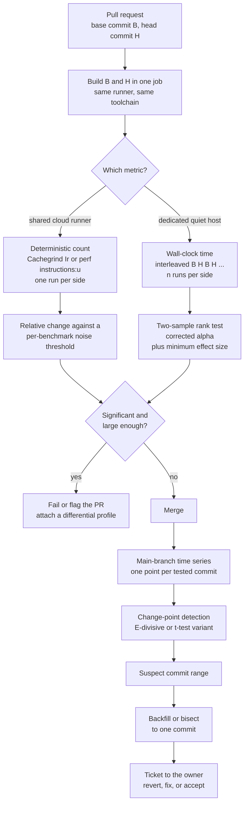

# Performance Regression Detection in CI

> [!summary] Claim:
> A CI performance gate is a statistical test wrapped in a build step: from a handful of noisy numbers it must decide whether head commit H is slower than base commit B, and both of its errors, blocking a good change and passing a bad one, cost engineering time.
> The design levers are the metric (wall-clock time, hardware instruction counts, or instruction counts from an instrumenting simulator such as Cachegrind), the layout (B and H interleaved on one machine inside one job), and the decision rule (a rank test such as Mann-Whitney U, a minimum effect size, and a correction for the number of benchmarks).
> Deterministic counts trade realism for repeatability: SQLite reports Cachegrind answers "repeatable to 7 or more significant digits" against wall-clock times "scarcely repeatable beyond one significant digit", but a count cannot see cache misses, branch mispredictions, or waiting.
> What slips under the per-change gate is caught after merge by change-point detection over the main-branch time series, which finds persistent distribution shifts (E-divisive and its t-test variants) and hands a suspect commit range to bisection.



## The Mechanism

This note owns the detection pipeline: which number to gate on, how to lay out the runs, which test decides, and how the post-merge time series is searched.
[[Benchmark-Methodology-Noise-and-Environment-Control]] owns the noise sources themselves and host preparation, and [[Statistics-for-Benchmarks-Coordinated-Omission-and-HDR-Histograms]] owns medians, bootstrap intervals, and latency distributions.

### 1. Detection is a signal-to-noise problem with two error costs

For one benchmark, the gate sees `n` measurements of base commit B and `n` of head commit H.
The true change is `delta` (for example +1 percent), and the run-to-run standard deviation is `sigma`.
The gate can be wrong in two ways:

- A false alarm (Type I error) blocks or flags a change that did nothing; its rate is the significance level `alpha`.
- A miss (Type II error) passes a real regression; its rate is one minus the power of the test.

Under a normal approximation, a two-sided test at `alpha = 0.05` with 80 percent power needs about this many runs per side:

$$n \approx 2\,(z_{0.975} + z_{0.80})^2 \left(\frac{\sigma}{\delta}\right)^2 = 2\,(1.96 + 0.84)^2 \left(\frac{\sigma}{\delta}\right)^2 \approx 15.7 \left(\frac{\sigma}{\delta}\right)^2$$

This is planning arithmetic, not a measurement, and it shows why the metric matters more than the test:

| Noise `sigma` | Regression `delta` to catch | Runs per side |
| :--- | :--- | :--- |
| 2 percent | 1 percent | 63 |
| 2 percent | 0.5 percent | 252 |
| 1 percent | 1 percent | 16 |
| 0.5 percent | 1 percent | 4 |
| 0.01 percent | 0.1 percent | 1 |

Halving the detectable regression costs four times the runs, while cutting the noise by ten cuts the runs by one hundred.
Every design choice in this note is either a way to shrink `sigma` (the metric and the layout) or a way to spend runs honestly (the test and its corrections).

### 2. Three metrics: wall-clock time, hardware counts, simulated counts

| Metric | How it is obtained | Repeatability reported by primary sources | What it cannot see |
| :--- | :--- | :--- | :--- |
| Wall-clock time | Timer around the workload | Cachegrind manual: identical runs "might vary by several percent"; MongoDB: worst-case run-to-run variation under 10 percent for most tests and 20 percent or more for sensitive ones | Nothing, which is why it is the metric users perceive |
| Hardware instruction count | PMU counter `instructions:u` through `perf_event_open(2)` | rustc-perf: "Instructions is the default because it has the least variation" | Time per instruction: cache misses, mispredictions, frequency, waiting, kernel time when counted with `:u` |
| Simulated instruction count | Cachegrind or Callgrind `Ir` under Valgrind's synthetic CPU | Cachegrind manual: "highly reproducible; for some programs they are perfectly reproducible"; SQLite: repeatable to 7 or more significant digits | Everything a hardware count misses, plus kernel work and real thread scheduling |

#### Wall-clock time on shared runners

A standard GitHub-hosted `ubuntu-latest` runner is a virtual machine with 4 CPUs and 16 GB of RAM for public repositories and 2 CPUs and 8 GB for private ones (as of 2026-11, Linux).
The CPU model, the neighbors on the host, and the frequency state are outside the job's control.
Turner-Trauring's GitHub Actions example shows both layers of noise: five runs on one VM spread by 1.5 percent, and the same code on a second VM a few minutes later averaged 4.9 percent faster (computed from the ten published timings).
The Criterion.rs FAQ answers "How Should I Run Criterion.rs Benchmarks In A CI Pipeline?" with "You probably shouldn't (or, if you do, don't rely on the results)".
Wall-clock gating therefore needs a dedicated, tuned host, which [[Design-a-Low-Noise-Benchmark-Harness-Playbook]] builds.

#### Hardware instruction counts

The kernel exposes retired instructions as `PERF_COUNT_HW_INSTRUCTIONS`, and the `u` event modifier (`instructions:u`) restricts counting to user space.
The count is nearly independent of machine load because a per-process event (`pid > 0`, `cpu == -1` in `perf_event_open(2)`) "measures the specified process/thread on any CPU", so time the task spends descheduled adds no retired instructions while its wall-clock time keeps running.
That consequence is the note's reading of the man page, not a measurement, and the interrupt caveat below still applies.
It is not exactly deterministic: `perf_event_open(2)` warns that retired-instruction counts "can be affected by various issues, most notably hardware interrupt counts", and rustc-perf marks benchmarks "known to have high instructions variance" with a `?`.
Two access conditions apply:

- `/proc/sys/kernel/perf_event_paranoid` defaults to 2 since Linux 4.6, which allows user-space measurement only; that is enough for `instructions:u` on the job's own processes.
- The virtual machine must expose a PMU, and Turner-Trauring reports that "as of February 2026 GitHub Action runners don't support giving you perf events"; GitHub's runner reference does not document PMU access either way, so this rests on one secondary report and the check is to run `perf stat -e instructions:u true` on your own runner.

rustc-perf and the LLVM compile-time tracker both headline `instructions:u` for compiler performance tracking.
[[Hardware-Performance-Counters-Top-Down-TMA-and-Roofline]] owns PMU mechanics, multiplexing, and hybrid-core counting.

#### Simulated instruction counts: Cachegrind and Callgrind

Valgrind runs the program on a simulated CPU and instruments every instruction, so Cachegrind counts executed instructions itself and needs no PMU.
`I refs` in its summary is `Ir`, "equivalent to instructions executed".
Turner-Trauring's ten Cachegrind runs of one Python benchmark across two GitHub Actions VMs ranged from 2,270,492,379 to 2,270,492,391 instructions, a spread of 12 in 2.27 billion.
The costs and limits, from the Valgrind 3.28.0 manual unless another source is named:

- Speed: rustc-perf describes Cachegrind without simulation as "Roughly 3--10x" slower, and Callgrind's manual says cache simulation costs "a further slow down approximately by a factor of 2".
- `Ir` is not the hardware count: on x86 and amd64 each iteration of a `REP`-prefixed instruction is counted separately, while "hardware counters count each such instruction just once".
- Kernel activity is not counted, and "Valgrind will schedule threads differently from how they would be when running natively".
- Results are "very sensitive": changing the size of the executable, the sizes of its shared libraries, "or even the length of their file names" perturbs them, and ASLR "also perturbs the results".

The cache and branch simulation is a separate, optional layer.
`--cache-sim` and `--branch-sim` both default to `no`; the cache default changed in Valgrind 3.21.0 (28 Apr 2023) because "the cache simulation is old and unlikely to match any real modern machine".
The model is a first-level instruction cache, a first-level data cache, and one last-level cache, sized from CPUID on x86 and indexed by virtual address, and it does not account for TLB misses or speculative execution; the manual says it "approximates the hardware of an AMD Athlon CPU circa 2002".
The branch model is an array of 16,384 2-bit saturating counters for conditional branches and a 512-entry table for indirect branches, "typical of mainstream desktop/server processors of around 2004".

Harnesses that want one number closer to time fold the simulated cache hits into an estimate.
Iai 0.1.1 computes it as:

```text
estimated_cycles = l1_hits + 5 * l3_hits + 35 * ram_hits
```

Here `ram_hits` is the count of last-level misses, `l3_hits` (Iai's name for last-level hits, whatever the real cache depth) is first-level misses minus last-level misses, and `l1_hits` is every other instruction fetch, data read, and data write (`CachegrindStats::summarize` in Iai's `src/lib.rs`).
Iai's source credits the formula to Turner-Trauring's article, whose current revision (2026-02-24) says the cache simulator "is so out of date it doesn't really seem like a useful way to get accurate data".
Gungraun (the project named iai-callgrind before version 0.17.0) still runs Callgrind with `--cache-sim=yes` by default and reports `Estimated Cycles`, but its guide says "if in doubt, the answer is `Ir`" for regression checks (as of 2026-11, Linux).

#### What a count is blind to

An instruction count measures how much work the program asked for, not how long the machine took.
By construction it reports no change for regressions that keep the instruction stream and change its cost:

- A data-layout change that adds cache misses.
- A branch that becomes unpredictable.
- Lock contention, I/O, page faults, and anything else spent waiting or in the kernel.

It also raises false alarms on changes that execute more instructions in less time, such as replacing one slow instruction with several fast ones.
Turner-Trauring puts it plainly: with instruction-level parallelism and SIMD, "merely counting the number of instructions can significantly distort the performance result for well-tuned code".
The working rule is: gate every change on counts because they are cheap and quiet, and confirm with wall-clock time on a quiet host where time is the product requirement.

### 3. The pull-request gate: a two-sample test

#### The Mann-Whitney U statistic

Benchmark timings are skewed and contaminated by outliers, so the default comparison in `benchstat` and in Google Benchmark's `compare.py` is the Mann-Whitney U test, which uses only the ordering of the measurements.
Given `m` base runs and `n` head runs, form all `m * n` cross pairs and count the pairs in which the head run is slower:

$$U = \#\{(i, j) : H_j > B_i\}$$

`U / (m n)` is the observed probability that a randomly chosen head run is slower than a randomly chosen base run; 0.5 means no difference.
SciPy states the null hypothesis as "the distribution underlying sample x is the same as the distribution underlying sample y".
Under that hypothesis every assignment of the `m + n` pooled values to the two labels is equally likely, so the exact null distribution of `U` is a count over `C(m + n, n)` arrangements, with mean `m n / 2` and, when there are no ties, variance `m n (m + n + 1) / 12`.
The two-sided p-value is the fraction of arrangements whose `U` lies at least as far from `m n / 2` as the observed one.

Three properties follow from the definition:

- It needs no distributional assumption, and one wild outlier can change at most `n` of the `m n` pair comparisons.
- It has a hard floor: the most extreme arrangement is one of `C(2n, n)`, so with `n` runs per side the smallest two-sided p-value is `2 / C(2n, n)`.
  With 3 runs per side that floor is 0.1, so no effect of any size can pass `alpha = 0.05`.
- It tests ordering, not size or tails, so a change that makes a few runs much slower and leaves the rest alone barely moves `U`.

SciPy's `mannwhitneyu`, which `compare.py` calls with `alternative="two-sided"`, uses the exact distribution when either sample has at most 8 values and there are no ties, and a normal approximation otherwise (SciPy 1.18.0).

#### Significant is not the same as large

`benchstat`'s documentation warns that statistically significant is not the same as large: "with enough low-noise data, even very small changes can be distinguished from noise and considered statistically significant".
A gate therefore needs two conditions, a p-value below `alpha` and an effect above a floor that the team cares about:

- Criterion.rs ignores changes inside its `noise_threshold`, 1 percent by default.
- pyperf's `compare_to --min-speed` sets a minimum percentage, 0 by default.
- rustc-perf separates "significant" from "relevant", where relevance also requires at least a small magnitude.

#### Many benchmarks, many chances to be wrong

A gate at `alpha = 0.05` is expected to fire on 5 percent of unchanged benchmarks.
`benchstat` says so directly: "if you compare a large number of benchmarks, you should expect that about 5% of them will report a statistically significant change even if there is no difference".
With `N` independent benchmarks the chance that at least one fires is `1 - 0.95^N`: 40 percent for 10 benchmarks and 87 percent for 40.
The simplest correction, Bonferroni, tests each benchmark at `alpha / N`, which interacts with the p-value floor: 100 benchmarks need `alpha = 0.0005` each, which is unreachable below 8 runs per side.
`benchstat` does not apply a correction; its source carries a `TODO` to add Holm-Bonferroni (as of 2026-11).
Re-running a failed gate until it passes is the same error in time instead of across benchmarks; `benchstat` names it "multiple testing" and calls it "a common statistical error".

#### Deterministic metrics need a threshold, not a test

With an instruction count there is one number per side and no sample to test.
The decision rule is a threshold on the relative change, and the engineering problem is choosing it per benchmark.
rustc-perf derives it from history (`site/src/comparison.rs`):

1. Take the results of the previous 30 master commits for the test case (`NUM_PREVIOUS_COMMITS`).
2. Compute the absolute change between each adjacent pair, relative to the result.
3. Take the first and third quartiles of those changes and set the significance threshold to `Q3 + 3 * (Q3 - Q1)` (`IQR_MULTIPLIER = 3.0`).
4. Without enough history, fall back to 0.2 percent (`DEFAULT_SIGNIFICANCE_THRESHOLD = 0.002`).

A change is significant when its relative size reaches that threshold, and its magnitude bucket averages two scales: how many times over the threshold it is (1.5, 3, 6, and 12 times) and its absolute size (0.2, 1, 2, and 5 percent for instruction counts, doubled for every other metric because the code treats them as noisy).
`benchstat` supports the same idea with `assume=exact` unit metadata, which compares single measurements and warns if a value that should be exact varies.

### 4. A/B interleaved runners

The two-sample test assumes that the only systematic difference between the samples is the commit.
Any noise that is correlated in time or space breaks that assumption, and the layout of the runs is what restores it.

- **Same job, same machine.**
  A stored wall-clock baseline from another runner compares two machines, not two commits; the 4.9 percent gap between Turner-Trauring's two VMs would read as a regression or an improvement at random.
  The Criterion.rs FAQ procedure is to build and benchmark the main branch to establish a baseline, then switch to the pull-request branch, build it, and benchmark it against that baseline; keeping both steps in one job is what makes them share a machine.
- **Interleave.**
  Running all B runs and then all H runs lets warm-up, thermal throttling, or a neighbor's burst land on one side only.
  `benchstat` says the best way to spread noise evenly "is to interleave before and after runs, rather than running, say, 10 iterations of the before benchmark, and then 10 iterations of the after benchmark".
- **Randomize the order.**
  Google Benchmark's `--benchmark_enable_random_interleaving=true` shuffles repetitions across benchmarks, and its documentation credits the technique with lowering run-to-run variance by 40 percent on average.
- **Run in parallel (duet).**
  Bulej et al. run B and H at the same time on the same machine so that interference hits both, and score the pair; they report accuracy improvements of 2.3x to 12.5x (5.03x on average) for ScalaBench and DaCapo workloads and 23.8x to 82.4x (37.4x on average) for SPEC CPU 2017 in cloud environments.

When runs are paired in time, as in B H B H or a duet, the pairs carry information that an unpaired test throws away.
SciPy's documentation draws the line: `mannwhitneyu` "is for independent samples", and for related or paired samples it points to `scipy.stats.wilcoxon`.

### 5. After merge: change-point detection on the main-branch series

A per-change gate has a floor, and regressions below it accumulate.
The second stage keeps one time series per benchmark and metric on the main branch and asks a different question: at which commit did the distribution of this series change?

#### Why a static threshold fails

MongoDB's first automated system alerted when a result moved by more than a fixed percentage, 10 percent by default.
One threshold cannot fit benchmarks with different noise levels, and the paper reports that over five months 2,393 automatically opened tickets reduced to 24 useful ones, about 100 to 1.
After switching to change points, a three-month period produced 178 commits to review, of which 126 matched a ticket; the paper summarizes this as going "from 100 notifications leading to 1 tracked issue, to 9 notifications leading to 6 worth follow-up and 4 tracked issues".

#### E-divisive

MongoDB's system is built on the E-divisive algorithm of Matteson and James, which needs no distributional assumption beyond a finite moment.
For two samples `X_n` and `Y_m` and a constant `alpha` in (0, 2), set to 1 in most of the paper's examples and in Otava, the empirical divergence is the mean distance between the samples minus the mean distances within each:

$$\hat{E}(X_n, Y_m; \alpha) = \frac{2}{mn} \sum_{i=1}^{n} \sum_{j=1}^{m} |X_i - Y_j|^{\alpha} - \binom{n}{2}^{-1} \sum_{1 \le i < k \le n} |X_i - X_k|^{\alpha} - \binom{m}{2}^{-1} \sum_{1 \le j < k \le m} |Y_j - Y_k|^{\alpha}$$

$$\hat{Q}(X_n, Y_m; \alpha) = \frac{mn}{m + n}\, \hat{E}(X_n, Y_m; \alpha)$$

For a series `Z_1 ... Z_T`, the candidate change point is the split that maximizes the scaled divergence between the points before it and a run of points after it:

$$(\hat{\tau}, \hat{\kappa}) = \operatorname*{argmax}_{1 \le \tau < \kappa \le T} \hat{Q}(\{Z_1 .. Z_{\tau}\}, \{Z_{\tau+1} .. Z_{\kappa}\}; \alpha)$$

The second index `kappa` lets the right-hand segment stop early, so a later change does not dilute the first; with at most one change point it is fixed at `T`.
Significance comes from a permutation test: shuffle the observations within each current segment, re-run the maximization, and repeat `R` times; the paper uses `R = 499` at a level of 0.05 and defines the approximate p-value as the count of permutations whose statistic is at least the observed one, divided by `R + 1`.
If the candidate is significant, the algorithm records it and repeats inside each segment, for a running time of `O(k T^2)` with `k` change points.
The paper's examples impose a minimum segment size, usually 30 observations.

#### The Hunter and Otava variant

DataStax's Hunter, whose approach Apache Otava (incubating) implements, changed three things for CI use:

- **Student's t-test instead of permutations.**
  Random permutations made results "non-deterministic and varied from run to run", and the switch cut runtime "by an order of magnitude".
  The authors also tried Mann-Whitney U and rejected it because it did not behave well on small amounts of data, "as it requires 30 points to be conclusive", while both the original E-divisive and their t-test version find changes in series of only 4 to 7 points; the exact-test p-value floor is one mechanism behind that limit, an inference the paper itself does not state.
- **Fixed-size overlapping windows.**
  A regression fixed shortly after it landed looks like a temporary anomaly to a whole-series split and disappears as the series grows; windows keep it visible.
- **Weak change points.**
  The split runs with a relaxed p-value so recursion does not stop early, then candidates are re-tested and merged bottom-up at the strict threshold.

Otava's `compute_change_points` defaults to `window_len=50`, `max_pvalue=0.001`, and `min_magnitude=0.0`, and its first pass uses ten times the configured p-value when that value is below 0.05 (as of 2026-11, Both).

#### Detection delay and the commit range

A change point is a statement about points on both sides of a commit, so the newest commit cannot be judged alone.
The Hunter paper notes that such algorithms "are unable to identify whether the most recent point in a data series is a change point", Otava's documentation says it "may not notice the regression immediately after the first run that regressed", and Mozilla's sheriffing guide answers "Why do we need 12 future data points?" with a note that collecting 12 data points takes 10 days on Mozilla-Beta.
When not every commit is tested, the detector names a range: MongoDB writes that "the algorithm cannot determine which commit caused a performance change if the commits have not run", so the commits between the change point and the previous tested build are all suspects.
Narrowing the range means backfilling runs on the skipped commits or bisecting, and a performance bisection needs the same statistical predicate as the gate at every step; [[Git-Archaeology-Log-Blame-and-Bisect]] owns the bisection mechanics.

MongoDB adds one control that every time series system needs: canary workloads that exercise the test machines and not the product.
Their results "should be constant", so a change point in a canary means the infrastructure moved and the product results from that run are suspect.

## Commands and Numbers to Know

| Item | Value | Platform and date | What it controls |
| :--- | :--- | :--- | :--- |
| `valgrind --tool=cachegrind prog` | Prints `I refs`, writes `cachegrind.out.<pid>` | Linux (as of 2026-11) | Exact instruction count without a PMU |
| Cachegrind `--cache-sim`, `--branch-sim` | Both `no`; cache default changed in Valgrind 3.21.0 | Linux (as of 2026-11) | Adds `I1mr`, `D1mr`, `DLmr`, `Bcm`, `Bim` style counts from a simplified model |
| `cg_annotate --diff file1 file2` | Reports `file2 - file1`; `cg_diff` is deprecated | Linux (as of 2026-11) | Per-function instruction deltas between two runs |
| Callgrind `--cache-sim=yes` | About 2x further slowdown | Linux (as of 2026-11) | Same model as Cachegrind plus call-graph attribution |
| Cachegrind branch model | 16,384 2-bit counters; 512-entry indirect table | Linux (as of 2026-11) | Why simulated mispredictions do not match a modern CPU |
| Iai estimated cycles | `L1 + 5 * LL + 35 * RAM` | Linux (as of 2026-11) | A single cost number from simulated cache hits |
| Gungraun `--callgrind-limits='ir=5%'` | Opt-in; exit code 3 on regression | Linux (as of 2026-11) | Soft limit on instruction growth against the baseline |
| Gungraun default `--cache-sim` | `yes` (Valgrind default is `no`) | Linux (as of 2026-11) | Enables `Estimated Cycles` at extra run time |
| `perf stat -r <n>` | Repeats and prints average and stddev; maximum 100 | Linux (as of 2026-11) | Repeated hardware-counter measurement |
| Event modifier `:u` | User-space counting only | Linux (as of 2026-11) | Excludes kernel instructions from `instructions:u` |
| `perf_event_paranoid` | `2` since Linux 4.6 | Linux (as of 2026-11) | Level 2 allows user-space measurement only |
| `setarch -R` | `--addr-no-randomize` | Linux (as of 2026-11) | Disables ASLR for one command |
| `compare.py --alpha` | `0.05` | Both (as of 2026-11) | Significance level of Google Benchmark's U test |
| `compare.py` U test repetitions | Runs from 2 per side; warns below 9 | Both (as of 2026-11) | `UTEST_MIN_REPETITIONS`, `UTEST_OPTIMAL_REPETITIONS` |
| `--benchmark_enable_random_interleaving` | Off unless set to `true` | Both (as of 2026-11) | Shuffles repetitions across benchmarks |
| `benchstat -alpha`, `-confidence` | `0.05`, `0.95` | Both (as of 2026-11) | Mann-Whitney threshold and interval level |
| `benchstat` run count | At least 10, ideally 20, fixed in advance | Both (as of 2026-11) | Sample size per side |
| Criterion.rs defaults | 100 samples, 3 s warm-up, 5 s measurement, 100,000 resamples | Both (as of 2026-11) | Cost and resolution of one benchmark |
| Criterion.rs thresholds | `significance_level` 0.05, `noise_threshold` 0.01, `confidence_level` 0.95 | Both (as of 2026-11) | When a change is reported |
| pyperf defaults (CPython) | 20 processes, 3 values each, 1 warm-up | Both (as of 2026-11) | 60 values per benchmark |
| pyperf `compare_to` | Student's two-sample, two-tailed t-test at the 95 percent level | Both (as of 2026-11) | "not significant" versus faster or slower |
| rustc-perf significance | `Q3 + 3 * IQR` of the last 30 commits' relative deltas; 0.2 percent fallback | Linux (as of 2026-11) | Per-benchmark noise threshold |
| Otava `compute_change_points` | `window_len=50`, `max_pvalue=0.001`, `min_magnitude=0.0` | Both (as of 2026-11) | Change-point sensitivity |
| E-divisive in the paper | `R = 499` permutations, level 0.05, minimum segment 30 | Both (as of 2026-11) | Reference parameters, `O(k T^2)` time |
| Exact U test floor | `2 / C(2n, n)`: 0.1 at n=3, 0.0286 at n=4, 0.0079 at n=5 | Both (as of 2026-11) | Smallest reachable two-sided p-value |
| Mozilla alert thresholds | Talos, Browsertime, build metrics at least 2 percent; AWSY at least 0.25 percent | Both (as of 2026-11) | Per-framework minimum change that alerts |
| GitHub-hosted `ubuntu-latest` | 4 CPU and 16 GB public; 2 CPU and 8 GB private | Linux (as of 2026-11) | Shared VM that wall-clock gates run on |

## Multi-Language Comparison: C++ / Python / Rust / Go

| Concern | C++ (Google Benchmark v1.10.0) | Python (pyperf 2.11.0) | Rust (Criterion.rs 0.8.2, Gungraun 0.20.0) | Go (`benchstat`) |
| :--- | :--- | :--- | :--- | :--- |
| Repeat unit | `--benchmark_repetitions=<count>` | Worker processes, 20 by default on CPython | Criterion.rs: 100 samples of growing iteration counts; Gungraun: one run under Valgrind | `go test -bench=. -count=10` |
| Compare command | `compare.py benchmarks <baseline> <contender>` | `python3 -m pyperf compare_to ref.json changed.json` | Criterion.rs compares with the saved previous run; Gungraun compares with the stored baseline | `benchstat old.txt new.txt` |
| Significance test | Two-sided Mann-Whitney U through SciPy | Student's two-sample t-test | Criterion.rs: bootstrapped t-test; Gungraun: none, counts are compared directly | Mann-Whitney U (`assume=nothing`) |
| Default level | `--alpha` 0.05 | 95 percent, fixed | Criterion.rs `significance_level` 0.05 | `-alpha` 0.05 |
| Minimum effect | None built in | `--min-speed`, default 0 | Criterion.rs `noise_threshold` 1 percent; Gungraun limits such as `ir=5%` | None built in |
| Interleaving | `--benchmark_enable_random_interleaving=true` within one binary | Not part of `compare_to`, which reads two saved result files | Not part of either comparison, which reads data saved by the previous run | Manual: alternate `old` and `new` binaries built with `go test -c` |
| Deterministic counts | `--benchmark_perf_counters=INSTRUCTIONS` with a libpfm build | Run the script under `valgrind --tool=cachegrind` | Gungraun: Callgrind `Ir`, Cachegrind, or perf events | `assume=exact` for noise-free units |
| Failing the build | `compare.py` exits non-zero only on usage and input errors, so a wrapper must parse its output | Wrapper script over `compare_to` output | Gungraun exits with code 3 when a limit is exceeded | Wrapper script over `benchstat` output |

Versions are the latest releases as of 2026-11; Google Benchmark, pyperf, and `benchstat` behavior was read from their main branches on 2026-11-10.

## Worked Example

This note has no lab, so the example is exact arithmetic on constructed inputs, not a measurement of any machine.
The script uses only the Python standard library (Python 3.10 or later for `itertools.pairwise`), prints the same text on every platform, and reproduces the p-value floor, a U test, the false-alarm arithmetic, and a single change-point search.

```python
"""Exact arithmetic behind a CI performance gate: standard library only."""

from fractions import Fraction
from itertools import pairwise
from math import comb
from statistics import median


def u_null_counts(m, n):
    """Number of rank arrangements giving each U value, for sample sizes m and n."""
    table = {}

    def f(u, a, b):
        if u < 0:
            return 0
        if a == 0 or b == 0:
            return 1 if u == 0 else 0
        if (u, a, b) not in table:
            table[(u, a, b)] = f(u - b, a - 1, b) + f(u, a, b - 1)
        return table[(u, a, b)]

    return [f(u, m, n) for u in range(m * n + 1)]


def mann_whitney(base, cand):
    """U = pairs where the candidate is slower; exact two-sided p (no ties allowed)."""
    if len(set(base) | set(cand)) != len(base) + len(cand):
        raise ValueError("the exact test needs data with no repeated values")
    m, n = len(base), len(cand)
    u = sum(1 for a in base for b in cand if b > a)
    counts = u_null_counts(m, n)
    far = abs(2 * u - m * n)
    extreme = sum(c for k, c in enumerate(counts) if abs(2 * k - m * n) >= far)
    return u, Fraction(extreme, comb(m + n, n))


def q_hat(left, right):
    """Matteson and James equations 5 and 6 with alpha = 1, for integer samples."""
    n, m = len(left), len(right)
    between = sum(abs(x - y) for x in left for y in right)
    in_left = sum(abs(left[i] - left[k]) for i in range(n) for k in range(i + 1, n))
    in_right = sum(abs(right[j] - right[k]) for j in range(m) for k in range(j + 1, m))
    e_hat = (
        Fraction(2 * between, m * n)
        - Fraction(in_left, comb(n, 2))
        - Fraction(in_right, comb(m, 2))
    )
    return Fraction(m * n, m + n) * e_hat


def best_split(series, min_size=2):
    """Largest Q-hat over every split that leaves min_size points on each side."""
    splits = range(min_size, len(series) - min_size + 1)
    return max((q_hat(series[:t], series[t:]), t) for t in splits)


def permutation_p(series, rounds=499, seed=2026):
    """Permutation p-value: shuffles whose best split matches or beats the observed."""
    observed, _ = best_split(series)
    state, hits, work = seed, 0, list(series)
    for _ in range(rounds):
        for i in range(len(work) - 1, 0, -1):  # Fisher-Yates with a fixed 64-bit LCG
            state = (state * 6364136223846793005 + 1442695040888963407) % 2**64
            j = (state >> 33) % (i + 1)
            work[i], work[j] = work[j], work[i]
        hits += best_split(work)[0] >= observed
    return hits + 1, rounds + 1


print("1. Smallest two-sided exact p-value with n runs per side: 2 / C(2n, n)")
for n in (3, 4, 5, 8, 10):
    print(f"   n={n:2d}  p_min={float(Fraction(2, comb(2 * n, n))):.6f}")

base = [1002, 998, 1015, 1009, 995, 1004, 1021, 1000, 999, 1011]
cand = [1018, 1007, 1025, 1013, 1001, 1022, 1030, 1010, 1016, 1019]
u, p = mann_whitney(base, cand)
shift = 100 * (median(cand) - median(base)) / median(base)
print("2. Mann-Whitney U, 10 runs per side")
print(f"   medians {median(base)} -> {median(cand)} ({shift:+.2f}%)")
print(f"   U={u} of {len(base) * len(cand)} pairs, exact p={float(p):.5f}")
u3, p3 = mann_whitney(base[:3], [1018, 1025, 1022])
print(f"   3 runs per side, fully separated: U={u3} of 9, exact p={float(p3):.2f}")

print("3. Unchanged suite, independent tests at alpha=0.05: chance of a false alarm")
for count in (1, 10, 40, 100):
    need = next(
        n for n in range(2, 99) if Fraction(2, comb(2 * n, n)) < Fraction(1, 20 * count)
    )
    print(
        f"   {count:3d} benchmarks: P(any)={1 - 0.95**count:.3f}"
        f"  Bonferroni alpha={0.05 / count:.5f}  needs n>={need} per side"
    )

step = [498, 503, 495, 507, 500, 496, 505, 499, 513, 518, 510, 521, 516, 512, 519, 514]
flat = [498, 503, 495, 507, 500, 496, 505, 499, 502, 497, 506, 501, 494, 504, 499, 503]
print("4. E-divisive on 16 commits, one change point at most")
for name, series in (("step", step), ("flat", flat)):
    jump = max(100 * (b - a) / a for a, b in pairwise(series))
    score, tau = best_split(series)
    hits, total = permutation_p(series)
    print(
        f"   {name}: largest commit-to-commit rise {jump:+.2f}%,"
        f" best split before index {tau}, Q={float(score):.2f}, p={hits}/{total}"
    )
```

```bash
python3 gate_stats.py
```

### Output

Computed with Python 3.15.2 on darwin-arm64 on 2026-11-10; the inputs are constructed and the arithmetic is exact, so the platform does not affect the text.
This output is not recorded by the lab harness, because the note has no lab.

```text
1. Smallest two-sided exact p-value with n runs per side: 2 / C(2n, n)
   n= 3  p_min=0.100000
   n= 4  p_min=0.028571
   n= 5  p_min=0.007937
   n= 8  p_min=0.000155
   n=10  p_min=0.000011
2. Mann-Whitney U, 10 runs per side
   medians 1003.0 -> 1017.0 (+1.40%)
   U=82 of 100 pairs, exact p=0.01469
   3 runs per side, fully separated: U=9 of 9, exact p=0.10
3. Unchanged suite, independent tests at alpha=0.05: chance of a false alarm
     1 benchmarks: P(any)=0.050  Bonferroni alpha=0.05000  needs n>=4 per side
    10 benchmarks: P(any)=0.401  Bonferroni alpha=0.00500  needs n>=6 per side
    40 benchmarks: P(any)=0.871  Bonferroni alpha=0.00125  needs n>=7 per side
   100 benchmarks: P(any)=0.994  Bonferroni alpha=0.00050  needs n>=8 per side
4. E-divisive on 16 commits, one change point at most
   step: largest commit-to-commit rise +2.81%, best split before index 8, Q=80.86, p=1/500
   flat: largest commit-to-commit rise +2.42%, best split before index 13, Q=-0.31, p=491/500
```

### Reading the result

- Block 1 is the p-value floor: three runs per side can never pass `alpha = 0.05`, and the last line of block 2 confirms it with nine of nine pairs slower and p still 0.10.
- Block 2 is a 1.4 percent shift in the median with overlapping samples: the head run is slower in 82 of 100 cross pairs, which is enough at 10 runs per side (p = 0.0147) and would not survive a Bonferroni correction for 10 benchmarks (0.005).
- Block 3 assumes independent benchmarks tested exactly at 0.05, so it is an upper bound for a discrete test; it still shows why a 40-benchmark suite with no correction alarms on most unchanged pull requests.
- The `needs n` column joins blocks 1 and 3: a corrected level is only reachable when the floor `2 / C(2n, n)` is below it.
- Block 4, `step`: the series rises about 3 percent after the eighth point, the largest single commit-to-commit rise is 2.81 percent, so a 5 or 10 percent static threshold never fires, and the divergence peaks at the correct split.
- Block 4, `flat`: the best split of an unchanged series scores below zero, which is possible in a finite sample because the statistic is a difference of averages, and 490 of 499 shuffles score at least as high.
- The permutation re-runs the maximization over every split for each shuffle; testing only the winning split would ignore that the split was chosen because it looked best, and would understate the p-value.
- The script reports `(hits + 1) / (R + 1)`, counting the observed order as one arrangement so that the p-value cannot be zero; the paper's stated formula, `hits / (R + 1)`, would print 0 for the `step` series.

## Pitfalls

> [!warning] Pitfall: comparing against a stored wall-clock baseline from another runner
> The baseline was measured on a different VM, CPU model, or day, so the comparison measures the fleet, not the change.
> Build and run B and H inside the same job on the same machine, and store baselines only for deterministic counts.

> [!warning] Pitfall: all base runs first, then all head runs
> Warm-up, thermal throttling, and neighbor load are correlated in time, so a blocked layout assigns them to one commit.
> Alternate or randomize the order, as `benchstat` and Google Benchmark's random interleaving both recommend.

> [!warning] Pitfall: three repetitions and a U test
> With 3 runs per side the smallest two-sided p-value is 0.1, so the test cannot reject at 0.05 whatever happens.
> `compare.py` runs the test from 2 repetitions and prints a warning below 9; use at least 9 there and at least 10 with `benchstat`.

> [!warning] Pitfall: no correction for the number of benchmarks
> A 40-benchmark suite at `alpha = 0.05` raises at least one false alarm on up to 87 percent of unchanged pull requests.
> Correct the level, require a minimum effect size, or gate on a deterministic metric.

> [!warning] Pitfall: retry until green
> Re-running a failed performance job until it passes is multiple testing in time, and it converts the gate into a coin that eventually lands the way the author wants.
> Fix the number of runs in advance; if a failure is suspected to be noise, rerun with more repetitions and analyze all of the data.

> [!warning] Pitfall: reading "not significant" as "no regression"
> A test with few runs or high noise has low power, so it passes real regressions.
> Report the confidence interval of the change and the smallest effect the gate can detect, not only the verdict.

> [!warning] Pitfall: treating instruction counts as time
> A count is blind to cache misses, mispredictions, contention, and I/O, and it can rise while time falls.
> Use counts to block changes cheaply and wall-clock on a quiet host to confirm what users will feel.

> [!warning] Pitfall: trusting Cachegrind's cache numbers or estimated cycles as hardware truth
> The simulator models two cache levels from a 2002-era design with virtual addresses and no speculation, and the Valgrind manual says the simulations are "unlikely to reflect the behaviour of a modern machine".
> Gate on `Ir`, and use hardware counters when cache behavior is the question.

> [!warning] Pitfall: assuming deterministic means identical across builds of the environment
> Counts move with ASLR, hash seeds, environment size, path lengths, and library versions, and Turner-Trauring's recipe sets `PYTHONHASHSEED` and disables ASLR with `setarch -R` for that reason.
> Pin the toolchain and base image, and rebuild the baseline in the same job when they change.

> [!warning] Pitfall: alerting on the newest point of a time series
> A single high point is an outlier until later points confirm a shift, and change-point algorithms cannot classify the most recent point.
> Accept a detection delay of several commits, or trigger extra runs to shorten it.

> [!warning] Pitfall: blaming the commit at the change point when commits were skipped
> If the suite runs nightly or every N commits, the change point marks the first tested commit after the regression, not the cause.
> Treat everything since the previous tested commit as suspect and backfill or bisect.

> [!warning] Pitfall: no canary benchmark
> Without a workload that should never change, a runner image update or hardware swap is indistinguishable from a product regression across every benchmark at once.
> Keep at least one fixed canary per runner pool and alert on it separately.

## At Scale

A single developer needs none of the pipeline: run B and H alternately on one quiet machine and read `benchstat` or Criterion.rs output.
The pipeline exists because, as the number of changes and benchmarks grows, the false-alarm arithmetic and the cost of attention dominate.

- **Gate latency is a budget.**
  A wall-clock gate costs `benchmarks * 2 sides * runs * seconds per run`: 50 benchmarks at 10 runs per side and 3 seconds each is 3,000 seconds, 50 minutes of machine time per pull request before any parallelism.
  A deterministic gate runs each side once but pays the instrumentation slowdown.
- **False alarms are paid in attention.**
  MongoDB's static thresholds produced about 100 notifications per useful ticket, and the fix was a better detector plus a named triage role, the "Build Baron".
  Mozilla staffs the same role as performance sheriffs, who backfill and retrigger jobs to isolate the commit.
  [[Build-and-Test-Latency-Economics-and-Flaky-Tests]] owns the cost model for a flaky blocking check.
- **Small regressions matter in proportion to fleet size.**
  Meta's FBDetect paper reports detecting regressions as small as 0.005 percent across about 800,000 production time series, and a median CPU regression of 0.048 percent in one platform.
  Regressions that small need a volume of samples that only production provides, which is why the paper argues that pre-production testing is necessary and not sufficient.
  [[Continuous-Profiling-GWP-Parca-Pyroscope-and-OTel-Profiles]] owns the fleet profiling that supplies those samples.

| Organization size | Per-change gate | Post-merge detection | Triage |
| :--- | :--- | :--- | :--- |
| One developer | Manual interleaved A/B on one machine | None | The author |
| A team on shared cloud runners | Instruction counts in one job, threshold from history, advisory comment or hard limit | Nightly wall-clock run on one dedicated host, plotted | The team channel |
| 1,000 engineers | Counts block; wall-clock on a dedicated pool is advisory | Change-point detection per benchmark, canary workloads, automatic backfill | A rotation with a ticket queue |
| 50,000 engineers | The same, with per-benchmark owners and budgets | The same, plus production detection with deduplication and root-cause ranking | Dedicated performance team and service owners |

Decision rules:

- Block merges only on signals whose false-alarm rate you have measured with A/A runs; everything else comments and files tickets.
- On shared virtual runners, gate on instruction counts; add a wall-clock gate only when you own hardware prepared as in [[Design-a-Low-Noise-Benchmark-Harness-Playbook]].
- Set the minimum effect size from the cost of the regression, and the number of runs from the noise; if the required runs do not fit the latency budget, move that benchmark to post-merge detection.
- Give every benchmark a threshold derived from its own history, as rustc-perf does, instead of one global percentage.
- Run the full suite post-merge on every commit if it is affordable, and otherwise budget for backfill, because a change point on a sparse series names a range.
- Keep a human in the loop for post-merge alerts until the detector's precision is measured; MongoDB's process is deliberately "slightly biased toward false positives".
- Record the policy, with the conditions that would flip it, in [[Measurement-Methodology-Decision-Records]].

## Practice Drill

> [!tip] Practice Drill:
> Measure your gate's false-alarm rate with an A/A test before trusting it on real changes.
> Build one commit twice into two directories, treat the first build as base and the second as head, and run your comparison 20 times.
> Predict first: with `k` benchmarks and `alpha = 0.05`, how many of the 20 comparisons should report at least one significant difference?
> Then repeat with the runs interleaved, and again with an instruction count in place of time, and compare the three false-alarm rates.
> As a stretch, inject a known regression (a loop that runs 1 percent more iterations) and find the smallest run count at which your gate catches it in 8 of 10 attempts.
> [[Drill-Measurement-Methodology-Environment-Size-Bias]] is the companion drill for the layout effects that make an A/A test fail.

```bash
# A/A check with instruction counts (Linux; cg_annotate --diff needs Valgrind 3.21 or later).
# ./base/bench and ./head/bench are two builds of the same commit.
for side in base head; do
    setarch "$(uname -m)" -R valgrind --tool=cachegrind \
        --cachegrind-out-file="$side.cgout" "./$side/bench" 2>&1 | grep 'I refs'
done
cg_annotate --diff base.cgout head.cgout | head -n 40

# A/A check with hardware counters, where the runner exposes a PMU.
perf stat -r 10 -e instructions:u ./base/bench
perf stat -r 10 -e instructions:u ./head/bench

# A/A check with wall-clock time and interleaved runs (Go).
go test -c -o base.test ./pkg && go test -c -o head.test ./pkg
for i in 1 2 3 4 5 6 7 8 9 10; do
    ./base.test -test.run='^$' -test.bench=. >> old.txt
    ./head.test -test.run='^$' -test.bench=. >> new.txt
done
benchstat old.txt new.txt
```

## Interview Questions

> [!question] L5: Why do compiler projects such as rustc and SQLite track instruction counts when users care about time?
>
> > [!success]- Answer
> > Because the gate has to distinguish a small change from noise, and instruction counts have far less noise than time.
> > SQLite reports Cachegrind results repeatable to 7 or more significant digits against wall-clock times repeatable to about one, and that lets its developers measure micro-optimizations of 0.1 percent or less.
> > rustc-perf makes instructions its default metric "because it has the least variation".
> > The trade is realism: a count cannot see cache misses, mispredictions, or waiting, so these projects also keep cycles, wall time, and memory metrics for confirmation.
> > Counts fit compilers well because their work is CPU-bound and single-process.

> [!question] L5: Predict the output: `compare.py` gets 3 repetitions per side with every new run 20 percent slower than every old run; what p-value does the U test print, and does a gate at `alpha = 0.05` fire?
>
> > [!success]- Answer
> > It prints about 0.1, and the gate does not fire.
> > `compare.py` calls SciPy's two-sided `mannwhitneyu`, which uses the exact distribution for small samples without ties.
> > With 3 and 3 values there are `C(6, 3) = 20` equally likely arrangements, and complete separation is the most extreme one in each direction, so the two-sided p-value is `2 / 20 = 0.1`.
> > The size of the slowdown is irrelevant because the test only sees ordering.
> > The tool also prints a warning that results are unreliable below 9 repetitions.

> [!question] L5: What is wrong with a benchmark job that runs all base iterations and then all head iterations?
>
> > [!success]- Answer
> > Noise that drifts over time lands on one commit only.
> > Warm-up effects, thermal throttling, frequency changes, and bursts from neighboring VMs are correlated in time, so they are confounded with the base-versus-head label.
> > The test then reports a difference that belongs to the schedule, not the code.
> > Alternating or randomizing the order spreads the drift over both sides, which is what `benchstat`'s documentation recommends and what Google Benchmark's random interleaving automates.
> > Running both sides in parallel, the duet method, goes one step further on shared machines.

> [!question] L6: Debug this: a 40-benchmark wall-clock gate at p < 0.05 fails on most pull requests, including ones that only edit documentation; what is happening, and how do you fix it?
>
> > [!success]- Answer
> > The gate is doing 40 tests per pull request with no correction, so on an unchanged suite the chance of at least one p-value below 0.05 is up to `1 - 0.95^40`, about 87 percent.
> > Confirm with an A/A run: compare two builds of the same commit and count failures.
> > Fix the decision rule first: correct the level for the number of benchmarks, require a minimum effect size such as 1 or 2 percent, and check that the run count can reach the corrected level (40 benchmarks need at least 7 runs per side for an exact U test).
> > Then reduce the noise: interleave, run both sides in one job, or move the blocking gate to instruction counts.
> > Do not add automatic retries, which hide the problem and make the gate meaningless.

> [!question] L6: When is Mann-Whitney U the wrong tool for a performance gate?
>
> > [!success]- Answer
> > When the sample is too small for its p-value floor, when the regression is in the tail, when the data are paired, and when the metric is deterministic.
> > With `n` runs per side the smallest two-sided p-value is `2 / C(2n, n)`, and the Hunter authors rejected it for change-point detection because it "requires 30 points to be conclusive", while their t-test variant works on series of 4 to 7 points.
> > It tests ordering across runs, so a regression that makes a few runs much slower barely changes `U`; gate a tail statistic per run instead.
> > For interleaved or duet runs the pairs carry information, and a paired test such as Wilcoxon signed-rank uses it.
> > For instruction counts there is one value per side and nothing to rank, so a history-derived threshold is the right rule.

> [!question] L6: How can a change point be reported at commit C when the regression was introduced by an earlier commit, and what do you do about it?
>
> > [!success]- Answer
> > The benchmark did not run on every commit, so C is only the first tested commit after the regression.
> > MongoDB's paper states that the algorithm cannot determine which commit caused a change if the commits have not run, and treats every commit since the previous tested build as a suspect.
> > Backfill runs on the skipped commits, or bisect the range with the same statistical comparison as the predicate at each step.
> > Also check a canary workload for the same date, because a simultaneous shift there means the runner changed and no commit is to blame.

> [!question] L7: Design a performance gate for a C++ service repository with 500 engineers, built on shared cloud CI runners.
>
> > [!success]- Answer
> > Split the problem into a blocking pre-merge gate and a post-merge detector.
> > Pre-merge, build base and head in one job and run a small set of CPU-bound microbenchmarks under Cachegrind or Callgrind once per side; compare `Ir` against per-benchmark thresholds derived from recent history, and fail only above them.
> > Attach the per-function instruction diff so the author sees where the growth is.
> > Post-merge, run the full suite including wall-clock and latency benchmarks on a small dedicated, tuned pool for every merged commit or batch, store one series per benchmark, and run change-point detection with a canary workload per host.
> > Route change points to a triage rotation with automatic backfill, and measure the precision of both stages with A/A runs and injected regressions.
> > The main risk is the blind spot of counts, which the wall-clock series covers with a delay of several commits.

> [!question] L7: Why did Hunter replace E-divisive's permutation test with a t-test, and what does that give up?
>
> > [!success]- Answer
> > The permutation test draws random shuffles, so the same data could yield different change points on different runs, and it dominated the runtime.
> > Switching to Student's t-test made results repeatable and cut runtime by about an order of magnitude, which matters when tens of tests each carry tens of metrics.
> > The cost is an assumption: the t-test is parametric, and the paper says it is not a robust measure for arbitrary data even though it worked well on theirs.
> > E-divisive's divergence can also detect changes in variance or shape, while a t-test on means is aimed at mean shifts.
> > Hunter added fixed windows and weak change points to recover cases the plain recursion missed.

> [!question] L7: An instruction-count gate passed a change that made production 8 percent slower; what are three possible mechanisms, and which control would have caught each?
>
> > [!success]- Answer
> > First, the change kept the instruction count and added cache misses, for example by growing a hot structure past a cache line; a wall-clock or hardware cache-miss series on a quiet host catches it.
> > Second, the cost moved into the kernel or into waiting, such as an extra system call or lock contention, which `instructions:u` and Cachegrind do not count; a latency benchmark under load catches it.
> > Third, the benchmark did not cover the affected path or input size, so no metric could have seen it; production regression detection or continuous profiling catches it, and the fix is a new benchmark.
> > In each case the count was correct and the gate's scope was too narrow, which is why counts block and time confirms.

> [!question] L8+: Your company wants to catch 0.05 percent CPU regressions across thousands of services; what can CI do, and what must production do?
>
> > [!success]- Answer
> > CI can catch regressions of that size only on deterministic metrics for code paths that benchmarks cover, because wall-clock noise in a test environment is orders of magnitude larger than the effect.
> > Production supplies the sample volume: FBDetect reports catching regressions down to 0.005 percent by monitoring about 800,000 time series with fleet-wide stack-trace sampling.
> > The production system needs anomaly detection per series, attribution to code or configuration changes, deduplication of correlated regressions, and filtering of deceptive false positives, which are the techniques the paper lists.
> > CI remains the cheap first filter and the place to reproduce and bisect what production finds.
> > The organizational piece is ownership: every alert needs a service owner and a budget that says when a regression is accepted.

## Further Reading

- Valgrind User Manual, Cachegrind chapter (Release 3.28.0): the definition of `Ir`, the simulator's stated limits, and `cg_annotate --diff`.
- "Measuring and Reducing CPU Usage in SQLite": the longest-running public example of development driven by Cachegrind counts, with its own limitations section.
- rustc-perf `docs/comparison-analysis.md` and `site/src/comparison.rs`: a production threshold rule built from each benchmark's own history.
- `benchstat` command documentation: Mann-Whitney defaults, interleaving advice, and the clearest short warning about multiple testing.
- Google Benchmark `docs/tools.md` and `docs/random_interleaving.md`: the U test in `compare.py` and randomized run order.
- Criterion.rs "Analysis Process" and FAQ: bootstrap comparison with a noise threshold, and why its author advises against cloud CI.
- Turner-Trauring, "CI for performance": a worked case for Cachegrind on shared runners, including what the author no longer recommends.
- Matteson and James, "A Nonparametric Approach for Multiple Change Point Analysis of Multivariate Data": the E-divisive statistic, permutation test, and complexity.
- Daly et al., "The Use of Change Point Detection to Identify Software Performance Regressions in a Continuous Integration System": the operational account, with before-and-after alert counts and the canary idea.
- Fleming et al., "Hunter": why a production tool replaced permutations with a t-test and added windows and weak change points.
- Bulej et al., "Duet Benchmarking": parallel paired execution as a noise control on shared machines.
- Yoon et al., "FBDetect": regression detection in production at a scale and sensitivity that CI cannot reach.

## Related

- Prerequisites: [[Statistics-for-Benchmarks-Coordinated-Omission-and-HDR-Histograms]], [[Benchmark-Methodology-Noise-and-Environment-Control]]
- Next: [[Measurement-Methodology-Decision-Records]]
- See also: [[14-Low-Latency-Systems/13 - Reliability, Ops & Testing/Latency Regression Testing in Continuous Integration|Latency Regression Testing in Continuous Integration]], [[Design-a-Low-Noise-Benchmark-Harness-Playbook]], [[Hardware-Performance-Counters-Top-Down-TMA-and-Roofline]], [[Flame-Graphs-Differential-Flame-Graphs-and-Visualizations]], [[Git-Archaeology-Log-Blame-and-Bisect]], [[Build-and-Test-Latency-Economics-and-Flaky-Tests]], [[Paper-Producing-Wrong-Data-Measurement-Bias]]
