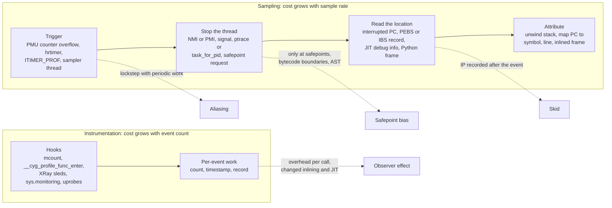

# Sampling vs Instrumentation: Skid and Safepoint Bias

> [!summary] Claim:
> A sampling profiler is a chain of four steps - a trigger fires, the program is stopped, a program counter is read, and a stack is attributed - and each step has its own way of picking a location that is not where the time went.
> PMU overflow interrupts land after the event (skid), which `precise_ip` levels 1 to 3 and Intel PEBS, AMD IBS, and Arm SPE exist to remove; managed runtimes and interpreters can only stop at safepoints or bytecode boundaries, so samples pile up at the next stopping point (safepoint bias).
> Instrumentation counts exactly, but it adds a cost per event that inflates small, frequent functions and changes what the compiler or JIT does, so its times are biased toward call-heavy code.
> Rule of thumb: sample to find where time goes, instrument to count and order events, and treat any profile as a hypothesis until a change it predicts actually helps.



## The Mechanism

### 1. Two ways to ask "where did the time go"

A sampling profiler interrupts the program at intervals and records where it is.
Its cost is set by the sampling rate, not by what the program does, and its answer is statistical: the GNU gprof manual gives the expected error of a count of n samples as the square root of n, so 100 samples carry about 10 percent error and 10,000 samples about 1 percent.
An instrumenting profiler runs code at every event of interest, such as each function entry and exit.
Its counts are exact, but its cost grows with the number of events, and every event it records makes the program slower at exactly the places it records.

The two were combined from the start.
gprof (Graham, Kessler, and McKusick, 1982) counts call arcs exactly with a compiler-inserted `mcount` call in every function compiled with `-pg`, and samples the program counter into a histogram about 100 times per second, according to the gprof manual.
To split a callee's sampled time among its callers, the paper makes "the simplifying assumption that all calls to a specific routine require the same amount of time to execute", and warns that this can disguise call sites whose calls are faster or slower than average.
That assumption is still the main reason to distrust gprof's call-graph times.

A sample is only as good as the place where it was taken.
Mytkowicz et al. (PLDI 2010) state the requirement: samples must be taken at points chosen randomly from the run.
They found that four Java profilers of the time (xprof, hprof, jprofile, yourkit) often disagreed on the hottest method of the same benchmark, and that all four took samples only at yield points.
Each failure mode in this note is a way that this randomness requirement is broken.

### 2. Trigger: periods, frequencies, and lockstep

`perf_event_open(2)` defines a sampling event as one that "generates an overflow notification every N events", where N is `sample_period`.
With the `freq` bit set, the caller gives `sample_freq` instead, and "the kernel will adjust the sampling period to try and achieve the desired rate", re-tuning once per timer tick.
`perf record` defaults to frequency mode at 4000 Hz (`.freq = 4000` in `tools/perf/builtin-record.c`, Linux v7.4-rc1).

The kernel caps the rate.
`kernel/events/core.c` defines `DEFAULT_MAX_SAMPLE_RATE` as 100000 and `DEFAULT_CPU_TIME_MAX_PERCENT` as 25, and `perf_cpu_time_max_percent` makes the kernel lower the sampling frequency when sample handling exceeds that share of CPU time.
When it throttles, `perf_sample_event_took()` lowers `kernel.perf_event_max_sample_rate` and reports it only in the kernel log (`perf: interrupt took too long ... lowering kernel.perf_event_max_sample_rate to ...`), so the profile is thinner than requested unless someone reads `dmesg`.

A fixed period can synchronize with periodic work in the program or the system.
Mytkowicz et al. give the example of a 10 ms scheduler quantum and a 10 ms sampler, which would always sample just after a thread switch, and they recommend sampling every t + r with r drawn at random from -t to t; their proof-of-concept `tprof` used t = 10 ms and r uniform in -3 ms to 3 ms.
Brendan Gregg's perf examples use 99 Hz instead of 100 Hz "to avoid accidentally sampling in lockstep with some periodic activity".

### 3. Stop and read: skid on PMU interrupts

On a counter overflow the CPU raises a performance monitoring interrupt, and the kernel records the interrupted instruction pointer.
The perf wiki describes the gap: the stored IP "designates the place where the program was interrupted to process the PMU interrupt, not the place where the counter actually overflows", and the distance "may be several dozen instructions or more if there were taken branches".
Gregg adds that micro-ops are processed in parallel and out of order, while the instruction pointer points to the resumption instruction.
This is skid.
It hardly matters for timer sampling, where a short delay does not change what the sample means, and it matters a great deal for event sampling, where the point is to find the instruction that caused a cache miss or a mispredict.

`perf_event_attr.precise_ip` (since Linux 2.6.35) states the skid the caller will accept:

| `precise_ip` | perf modifier | Meaning in `perf_event_open(2)` |
| :--- | :--- | :--- |
| 0 | none | `SAMPLE_IP` can have arbitrary skid |
| 1 | `:p` | `SAMPLE_IP` must have constant skid |
| 2 | `:pp` | `SAMPLE_IP` requested to have 0 skid |
| 3 | `:ppp` | `SAMPLE_IP` must have 0 skid; `perf-list.txt` adds "or uses randomization to avoid sample shadowing effects" |

`perf-list.txt` also defines `:P` as "use maximum detected precise level".
A sample whose IP really is the eventing instruction carries `PERF_RECORD_MISC_EXACT_IP` in its header.

### 4. Precise sampling hardware

#### Intel PEBS

With PEBS the processor itself writes a record, holding the IP and registers, into a memory buffer when a PEBS-capable counter overflows, so the IP does not depend on interrupt latency.
The legacy record's IP is the instruction after the one that caused the event; `setup_pebs_fixed_sample_data()` in `arch/x86/events/intel/ds.c` calls it "the PEBS off-by-1 IP" and handles it in three ways:

- With `precise_ip == 1` it returns the off-by-one IP unchanged, which is the constant skid that level 1 promises.
- With `precise_ip >= 2` on CPUs whose PEBS format is at least 2, it uses the record's `real_ip`; the comment says Haswell and later processors have an "eventing IP" that "fixes the off-by-1 skid in hardware".
- On older CPUs, `intel_pmu_pebs_fixup_ip()` takes the last branch target from the LBR stack, decodes instructions forward from it until it reaches the recorded IP, and reports the instruction before; if the decode does not land exactly on the IP, the sample is not marked exact.

`x86_pmu_max_precise()` in `arch/x86/events/core.c` computes the highest level a CPU can honor: 1 for working legacy PEBS, plus 1 when LBR or PEBS format 2 allows an exact IP, plus 1 when `pebs_prec_dist` is present; architectural PEBS starts at 2 and adds 1 with PDist.
`:ppp` maps to the precise distribution facility: `intel/core.c` notes that `INST_RETIRED.PREC_DIST` "has special support to minimize sample shadowing effects" but "can be only programmed on counter 1", `icl_get_event_constraints()` forces `instructions:ppp` onto fixed counter 0 because it "has less skid", and `glc_get_event_constraints()` says the Precise Distribution (PDist) facility "is only supported on the GP counter 0", so a `:ppp` event that cannot use that counter is rejected.
Only some events are PEBS-capable; `intel_pebs_aliases_precdist()` re-encodes the non-PEBS `CPU_CLK_UNHALTED.THREAD_P` cycles event as an equivalent PEBS event so that `cycles:ppp` works.

#### AMD IBS

`perf-list.txt` says the regular AMD core PMU is "inherently non-precise" and IBS is "inherently precise", so `ibs_op//` and `ibs_op//ppp` mean the same thing.
`perf-amd-ibs.txt` describes IBS Op as sampling micro-op execution: each sample carries an IP with no skid and details such as data cache and TLB hits or misses, cache miss latency, and the load or store data source.
`amd_pmu_hw_config()` in `amd/core.c` forwards a core event with `precise_ip` set to IBS (`forward_event_to_ibs()`), which accepts only levels 1 and 2 and only `cpu-cycles` (raw `0x76`) and micro-ops retired (raw `0xC1`), so `-e cpu-cycles:p` becomes `-e ibs_op//`.
Two events of the same IBS PMU cannot share a group, because only one IBS event can be active at a time (`validate_group()` in `amd/ibs.c`), and the doc says IBS needs `CAP_PERFMON` or `CAP_SYS_ADMIN` because it lacks user and kernel filtering; its examples show hardware user-only filtering (`ibs_op//u`) from Zen 6 and a software filter (`swfilt=1`) until Zen 5.

#### Arm SPE

`perf-arm-spe.txt` says the Statistical Profiling Extension, rather than being interrupt-driven, picks an operation, follows it through execution, and writes a record with the full PC, latency, and, for memory operations, the data address and data source.
Only one sampled operation is in flight, so a new sample that arrives before the previous one finishes is a collision and is dropped; the docs advise setting the period (`-c`, written to `PMSIRR.INTERVAL`) high enough to avoid collisions.
SPE records have no call graph.

### 5. When there is no PMU: the timer fallback

In a VM or container without a virtual PMU, `cycles` does not exist.
`evsel__fallback()` in `tools/perf/util/evsel.c` handles this: when opening the hardware cycles event fails with `ENODEV`, `ENOENT`, or `ENXIO`, perf switches the event to the software `task-clock` (per-task) or `cpu-clock` (CPU-wide) hrtimer event and prints "The cycles event is not supported, trying to fall back to ...".
The precise level is not reset, so on the Linux VM used for this note, `perf evlist` labeled the recorded event `task-clock:ppp` with `precise_ip:3`, a label with no hardware meaning.
Timer samples still land where the interrupt is taken.
In a pointer-chasing loop sampled during drafting on 2026-11-08 (the lab asserts only the bucketed form of this result), 79 percent of `cpu-clock` samples landed on the load that misses the cache and 15 percent on a `subs` two instructions later, while the `add` that waits for the load got at most 0.05 percent.

### 6. Stop and read in software: where a runtime lets you look

#### Signals delivered by the kernel: ITIMER_PROF

Many in-process profilers, including gperftools and `pprof-rs` (whose README says it uses `setitimer` to send `SIGPROF` "every constant interval"), arm `ITIMER_PROF` and walk the stack in the signal handler.
On Linux the signals arrive in proportion to CPU time: in a drafting run on 2026-11-08, a syscall-free phase that used 52.7 to 53.9 percent of CPU received 52.4 to 54.0 percent of the samples.
macOS behaves differently, because XNU never arms a timer for `ITIMER_PROF`.
`setitimer()` (`bsd/kern/kern_time.c`) gives `ITIMER_REAL` a delayed thread call, but for `ITIMER_PROF` it only stores the interval and sets `TASK_VTIMER_PROF` in the task's `vtimers` field through `task_vtimer_set()`.
The timer is then checked only when a thread of that task passes through the kernel:

1. On kernel entry, `task_vtimer_check()` in `osfmk/arm64/sleh.c` sets `AST_BSD` on the thread and on the CPU's pending ASTs when `task->vtimers` is nonzero; it is called from `sleh_synchronous()` (system calls, page faults, and other synchronous exceptions), from `sleh_interrupt_handler_prologue()` (IRQ and FIQ), and from `sleh_serror()`.
   On x86_64 the `TASK_VTIMER_CHECK` macro in `osfmk/i386/rtclock_asm.h` does the same in the trap, interrupt, and system call entry paths of `osfmk/x86_64/idt64.s`.
2. On the way back to user mode, `ast_taken_user()` (`osfmk/kern/ast.c`) finds `AST_BSD` and calls `bsd_ast()` (`bsd/kern/kern_sig.c`).
3. `bsd_ast()` reads the thread CPU time used since the last check with `task_vtimer_update()` (`osfmk/kern/task.c`) and subtracts it from the timer with `itimerdecr()` (`bsd/kern/kern_time.c`); when the timer expires it sends `SIGPROF` to the current thread.
4. `itimerdecr()` reloads the interval on expiry and, for intervals under one second, discards any overshoot, so one pass raises at most one `SIGPROF` however many periods have gone by.

A thread therefore gets at most one `SIGPROF` per kernel entry, and the handler sees the user PC that the entry returns to, such as the instruction after a system call.
Code that enters the kernel at least once per period is sampled at nearly the requested rate, and code that computes without system calls or page faults is sampled only as often as interrupts and preemption happen to take it into the kernel.
Measured on macOS 27.2 (darwin-arm64) on 2026-11-08, a 1 ms `ITIMER_PROF` delivered 107 to 147 signals per CPU second to a loop with no syscalls and 888 to 912 per CPU second to the same loop with one `getppid()` every 400,000 iterations.
When the two loops share a process at equal CPU, the syscall-free one received only 13.5 to 14.6 percent of the samples.
The size of the bias depends on how busy the machine is, because preemption is also a kernel entry: rerun on 2026-11-11 with a one-minute load average of about 51 on 12 cores, the syscall-free loop was preempted 1,423 to 2,017 times per run and received 543 to 591 signals per CPU second, and in the two-phase program it got 44.1 to 46.8 percent of the samples.
A page fault counts as much as a system call: in that same session, a variant of the loop that touches one fresh anonymous page per chunk, with no system calls, received 789 to 811 signals per CPU second.

#### CPython: bytecode boundaries and the GIL

The `signal` documentation says Python signal handlers run in the main thread at a later point, "for example, at the next bytecode instruction", and that "a long-running calculation implemented purely in C ... may run uninterrupted for an arbitrary amount of time, regardless of any signals received".
A profiler written in Python therefore sees a C call once, when it returns.
A sampler thread fares no better, because it needs the GIL to read `sys._current_frames()`, and a C function that does not release the GIL keeps it for its whole run.
In a drafting run on Linux (2026-11-08), `sum(range(n))` used 49.9 percent of CPU and got 0.5 percent of `SIGPROF` samples, about one sample per call; the lab asserts the same shape with `ITIMER_REAL` as one sample per `c_call()`.
External samplers avoid both limits.
Tachyon, the `profiling.sampling` module added to Python 3.15 by PEP 799 (PEP 790 dates 3.15.0 final 2026-10-09), reads the target's memory from another process "at regular intervals" with `process_vm_readv` or ptrace on Linux and `task_for_pid()` on macOS, and in a drafting run it attributed 50.7 percent of samples to the same C call.
Without `--blocking` it reads a running process, and its docs warn that a fast-changing stack can produce "reconstructed stacks that mix frames from different execution states or that never actually existed".
A cheaper sampler that needs no other process is `faulthandler.dump_traceback_later(timeout, repeat=True)`: the docs say it "is implemented using a watchdog thread", and in `Modules/faulthandler.c` that thread (`faulthandler_thread`) waits on a lock with a timeout and calls `PyUnstable_DumpTracebackThreads()` without acquiring the GIL, so it sees the frame of a C call that holds the GIL for its whole run.
The lab uses it as a GIL-independent reference sampler (as of 2026-11, Both; the lab requires a GIL-enabled CPython).

#### HotSpot: safepoints

JEP 518 states the constraint: HotSpot's metadata for parsing stack frames "is valid only when a thread is suspended at well-defined code locations known as safepoints".
When one thread asks for another thread's stack, JVMTI's `GetStackTrace` and `GetAllStackTraces` and Java's `Thread.getStackTrace()` therefore return frames only at safepoint polls; Wakart notes that a thread asking for its own stack needs no safepoint.
Wakart (2016) explains where C1 and C2 put the polls: mostly at method returns and at back edges of uncounted loops; a counted `int` loop has no poll unless loop strip mining adds one.
Samples move to the next poll the thread reaches, which may be in a caller after inlining or at a loop back edge far from the hot instructions; this is safepoint bias.
Mytkowicz et al. also measured an observer effect: when profiled with xprof the JIT placed on average 9 yield points per method in antlr's 10 hottest methods, and 7 under hprof, so different profilers saw differently biased programs.

Whether a counted loop has a poll depends on the garbage collector.
`UseCountedLoopSafepoints` defaults to false in `c2_globals.hpp`, and `g1Arguments.cpp`, `shenandoahArguments.cpp`, and `zArguments.cpp` set it to true with `LoopStripMiningIter = 1000` when they are left at their defaults, so the loop polls every 1000 iterations.
On JDK 25 (darwin-arm64), `-XX:+PrintFlagsFinal` reports true and 1000 under G1, the default collector, and false and 0 under `-XX:+UseParallelGC`.
In the `safepoint_bias_hotspot` lab, a `Thread.getStackTrace()` sampler blames at least 95 percent of samples on the caller's line `workerLoop:34` under Parallel GC and at least 95 percent on `hot:22` under G1, for the same code.

Three ways out exist:

- `AsyncGetCallTrace`, an internal and unsupported HotSpot function that walks a stack from a signal handler; JEP 518 calls it risky because its stack-parsing heuristics have no crash protection.
  async-profiler, which says it "does not suffer from the Safepoint bias problem", was built on this function and is named after it, but since version 4.2 (2025-10-20) its default on HotSpot is its own `vm` stack walker, which reads JVM internal structures inside `setjmp`/`longjmp` crash protection (as of 2026-11).
- JFR before JDK 25 suspended threads and parsed their stacks with heuristics wherever they stopped.
- JFR in JDK 25 (JEP 518, delivered) records only the PC and stack pointer when it suspends a thread, then reconstructs the stack at the thread's next safepoint, "adjusting for safepoint bias"; JEP 518 says intrinsics remain a source of bias, and native code still uses the old approach.

JFR's `jdk.ExecutionSample` blames `hot:22` for at least 95 percent of samples under both collectors in the lab.
For line numbers between safepoints the JIT must keep debug information at non-safepoint PCs, which the diagnostic flag `-XX:+DebugNonSafepoints` enables (its default in `globals.hpp` is `trueInDebug`, so false in release builds); with it, the lab sees at least 2 percent of JFR samples on the loop body (line 23) and none without it; in the drafting runs 11 to 13 percent of samples moved from the loop header to the loop body.
JEP 509 adds an experimental `jdk.CPUTimeSample` event in JDK 25, on Linux only, driven by the kernel's CPU-time timer and built on JEP 518's cooperative mechanism.

### 7. Instrumentation and the observer effect

#### Compiler-inserted hooks

`-pg` inserts a call to `mcount` as one of each function's first operations, as the gprof manual describes.
`-finstrument-functions` (GCC and Clang) calls `__cyg_profile_func_enter` and `__cyg_profile_func_exit` with the function's address and call site; the GCC manual says it "is also done for functions expanded inline in other functions", so inlined functions keep their hook calls and need an addressable copy.
Clang adds `-finstrument-functions-after-inlining` ("insert the calls after inlining"), which instruments only what remains as a real function, and GCC adds `-finstrument-functions-once`, which calls the hooks "only once per instrumented function"; because the implementation is not protected against data races, the manual guarantees only at least once per process and at most once per thread.
The drafting runs of 2026-11-08 measured all three on one loop calling a one-line inline function 100,000,000 times (the lab uses 20,000,000 calls and asserts the call counts and ratios, not these times):

- Plain `-O2`: 101.5 to 103.6 ms (Apple clang 21.0.0).
- `-finstrument-functions` with a hook that only counts: 247.7 to 258.8 ms, with 100,000,000 enter hooks reported for `mix`, a function that was inlined and never called.
- The same, with a hook that reads a clock on entry and exit as a tracing profiler would: 1847.5 to 1981.4 ms, and the hooks charged 854.1 to 917.5 ms to `mix`, eight to nine times the cost of the whole uninstrumented loop.
- `-finstrument-functions-after-inlining`: 99.0 to 104.8 ms, and `mix` does not appear at all.
- GCC 16.2.0: 123.8 to 132.5 ms plain, 287.9 to 311.2 ms with `-finstrument-functions`, and 124.0 to 134.2 ms with `-finstrument-functions-once`.

LLVM XRay is the patchable variant: Clang emits nop sleds at function entry and exit and an `xray_instr_map` section listing them, and the runtime overwrites the sleds with calls only when tracing is turned on (`patch_premain` defaults to false), so until then the instrumentation points are nops.
By default only functions with at least 200 instructions or a loop get sleds (`-fxray-instruction-threshold=`), which keeps tiny functions free of both overhead and visibility.
The XRay docs list Linux on x86_64, arm7, aarch64, powerpc64le, and MIPS, and NetBSD, FreeBSD, and OpenBSD on x86_64; macOS is not listed.

#### Interpreter hooks

CPython calls a profiler hook on every call, return, and exception, which is what the Python docs mean by "deterministic profiling".
The 3.15 docs say this adds "negligible overhead" in the C implementation, while PEP 669 (`sys.monitoring`, Python 3.12) warns that "instrumenting profilers have significant overhead and will distort the results of profiling".
The drafting runs side with PEP 669 for call-heavy code (the lab asserts over 2.5 times against under 1.5 times, and over 70 percent against 40 to 60 percent): under cProfile, a function making 2,000,000 tiny Python calls grew from 44 to 45 ms to 210 to 214 ms, a 4.66 to 4.85 times inflation, while a single `sorted()` call of the same cost stayed at 0.98 to 0.99 times, so the profile ranked the call-heavy function at 80.2 to 80.9 percent when its real share was 46.0 to 46.3 percent.
In Python 3.15, PEP 799 moves cProfile to `profiling.tracing` (with `cProfile` kept as an alias) and deprecates the pure-Python `profile` module.

#### Dynamic instrumentation

uprobes, USDT probes, and kprobes insert breakpoints or jumps into running code without recompiling, and they pay per event like other instrumentation; [[eBPF-bpftrace-ftrace-uprobes-and-USDT]] owns their mechanics.

### 8. Choosing

| Question | Use | Why |
| :--- | :--- | :--- |
| Which functions use the CPU? | Sampling at a randomized or odd rate, with frame pointers or DWARF stacks | Cost is fixed by rate; no code changes; error falls as 1/sqrt(n) |
| Which instruction misses the cache? | Precise event sampling (`:pp`, IBS, SPE) | Ordinary PMU sampling skids past the instruction |
| How many times, and in what order? | Instrumentation (counts, XRay, USDT, `sys.monitoring`) | Sampling cannot count events |
| How long is each request or span? | Instrumentation at coarse boundaries | Per-span cost is small relative to the span |
| Where does a JVM spend CPU? | JFR (JDK 25 or later) or async-profiler, plus `DebugNonSafepoints` for lines | JVMTI stack sampling is safepoint-biased |
| Where does Python spend CPU, including C code? | An external sampler (Tachyon, py-spy) | In-process samplers wait for bytecode boundaries and the GIL |

## Commands and Numbers to Know

| Item | Value | Platform and date | What it controls |
| :--- | :--- | :--- | :--- |
| `perf record` default rate | `-F 4000` Hz, frequency mode | Linux (as of 2026-11) | `.freq = 4000` in `builtin-record.c` |
| `perf record -F max` | `kernel.perf_event_max_sample_rate` | Linux (as of 2026-11) | Upper bound; `--strict-freq` fails instead of throttling |
| `kernel.perf_event_max_sample_rate` | 100000 by default | Linux (as of 2026-11) | `DEFAULT_MAX_SAMPLE_RATE`; also read on the lab VM |
| `kernel.perf_cpu_time_max_percent` | 25 by default; 0 disables | Linux (as of 2026-11) | CPU share for sample handling before the kernel lowers the rate |
| `kernel.perf_event_paranoid` | 2 by default | Linux (as of 2026-11) | At 2 or more, users without `CAP_PERFMON` cannot profile the kernel |
| `:p`, `:pp`, `:ppp`, `:P` | `precise_ip` 1, 2, 3, maximum | Linux (as of 2026-11) | Constant skid, zero skid requested, zero skid required, best available |
| `PERF_RECORD_MISC_EXACT_IP` | header flag | Linux (as of 2026-11) | Set when the sample IP is the eventing instruction |
| Intel `:ppp` | PDist or `INST_RETIRED.PREC_DIST`, one counter | Linux x86 (as of 2026-11) | Precise distribution to minimize sample shadowing |
| AMD `cpu-cycles:p`, `r076:p`, `r0C1:p` | forwarded to `ibs_op//` (`cnt_ctl=1` for `0xC1`) | Linux x86 (as of 2026-11) | Levels 1 and 2 only; `:ppp` returns `EOPNOTSUPP` |
| Arm SPE | `-e arm_spe//`, period with `-c` | Linux arm64 (as of 2026-11) | Written to `PMSIRR.INTERVAL`; collisions drop samples |
| Multiplexing scale | `raw * time_enabled / time_running` | Linux (as of 2026-11) | An estimate, not a count; `perf stat` prints the running percentage |
| No PMU fallback | `cycles` becomes `task-clock` or `cpu-clock` | Linux (as of 2026-11) | Precise level kept; measured `task-clock:ppp` with perf 6.8.12 |
| Lockstep-avoiding rates | 99 Hz, 199 Hz, 997 Hz | Both (as of 2026-11) | Gregg's choices to avoid lockstep with periodic activity |
| Randomized period | t + r, r uniform in -t to t | Both (as of 2026-11) | Mytkowicz et al.; `tprof` used 10 ms plus or minus 3 ms |
| `ITIMER_PROF` at 1 ms, no syscalls | 107 to 147 signals per CPU second; 543 to 591 on a heavily loaded machine | macOS 27.2 arm64 (as of 2026-11) | Measured; 888 to 912 with a syscall every 400,000 iterations, because XNU checks the timer only on kernel entry |
| `ITIMER_PROF` at 1 ms, same source | samples in proportion to CPU time (52.4 to 54.0 percent for 52.7 to 53.9 percent of CPU) | Linux 7.2 aarch64 (as of 2026-11) | Measured in an OrbStack VM |
| `sys.getswitchinterval()` | 0.005 s | Both (as of 2026-11) | How often a waiting thread asks the GIL holder to drop it |
| Tachyon defaults | 1 kHz, wall-clock mode, main thread only, non-blocking | Both (as of 2026-11) | `python -m profiling.sampling run`; macOS needs root or the debugger entitlement |
| JFR `jdk.ExecutionSample` period | 20 ms in `default.jfc`, 10 ms in `profile.jfc` | Both, JDK 25 (as of 2026-11) | Read from the JDK 25 `lib/jfr` files |
| JFR `jdk.CPUTimeSample` | experimental, off by default, throttle 500/s default, 10 ms in `profile.jfc` | Linux only, JDK 25 (as of 2026-11) | JEP 509; still `experimental="true"` in JDK master's `metadata.xml` |
| `UseCountedLoopSafepoints`, `LoopStripMiningIter` | true, 1000 under G1, Shenandoah, ZGC; false, 0 under Parallel | Both, JDK 25 (as of 2026-11) | Safepoint polls inside counted loops |
| `-XX:+DebugNonSafepoints` | diagnostic, default `trueInDebug` (false in release builds) | Both, JDK 25 (as of 2026-11) | Debug info at non-safepoint PCs for line-accurate samples |
| XRay sled threshold | 200 instructions, or any loop | Linux and BSDs (as of 2026-11) | `-fxray-instruction-threshold=` |
| gprof PC sampling | about 100 Hz | Both (as of 2026-11) | Error is about sqrt(n) samples for n samples |

## Multi-Language Comparison: C++ / Python / Rust / JVM

| Concern | C++ | Python (CPython 3.15) | Rust | JVM (HotSpot, JDK 25) |
| :--- | :--- | :--- | :--- | :--- |
| Where the program can be stopped | Any instruction | Next bytecode boundary for Python handlers; C calls are opaque | Any instruction | Safepoint polls for JVMTI; any PC for AsyncGetCallTrace and JFR's request |
| Hardware-precise path | `perf record -e <event>:pp`, IBS, SPE | Same, on the interpreter's C frames; mapping Python frames for perf is in [[Python-CPython-perf-Trampoline-and-Tachyon-Internals]] | Same as C++ | perf with a JIT symbol map; async-profiler with perf events |
| In-process sampler | gperftools `SIGPROF` | `signal.setitimer` handler or a thread, both blind inside long C calls | `pprof-rs`: `setitimer` and `SIGPROF`; frame-pointer unwinding needs a nightly `-Z build-std` | `Thread.getStackTrace()`, JVMTI: safepoint-biased |
| External sampler | `perf`, samply | Tachyon (`profiling.sampling`), py-spy; both need ptrace or `task_for_pid` rights | samply (perf events on Linux; on macOS a sampler thread that suspends the target and walks its stack) | async-profiler, JFR (in-VM but cooperative) |
| Compiler or runtime instrumentation | `-pg`, `-finstrument-functions`, XRay | `profiling.tracing` (cProfile), `sys.monitoring` | `-Z instrument-mcount`, `-Z instrument-xray` (nightly only, seen in rustc 1.101.0-nightly) | JVMTI method entry and exit events, bytecode agents |
| Typical distortion | Hooks on inlined functions; timer reads dominate tiny functions | Call-heavy code inflated, C calls look free | Same as C++, plus signal-unsafe libgcc unwinding noted by `pprof-rs` | Profile depends on GC choice and inlining decisions |

## Worked Lab Example

Three labs live under `code/04-Measurement-Methodology/`, and `make verify LAB=profiler_bias` or `make verify LAB=safepoint_bias` from `code/` re-runs them and diffs their output against `expected/<platform>.txt`:

- `profiler_bias_macos/` (`# requires: macos`): Steps 1 to 5 below, recorded on macOS 27.2, darwin-arm64, Apple clang 21.0.0, Homebrew CPython 3.15.2.
- `profiler_bias_linux/` (`# requires: linux`): the same sources and driver on a kernel that delivers `SIGPROF` from a CPU-time timer; its `expected/linux-<arch>.txt` is recorded by the integrator in the pinned container, so no Linux output block is shown here.
- `safepoint_bias_hotspot/`: Step 6, recorded with OpenJDK 25 (build 25+36) on darwin-arm64; it needs `java` and `javac` 25 or newer on `PATH`.

Timings and sample counts move from run to run, so the drivers print exact counts and wide buckets ("over 90 percent"), and a value outside every bucket is printed with its numbers, which fails the diff.
The output below is copied byte for byte from `profiler_bias_macos/expected/darwin-arm64.txt` (macOS, darwin-arm64):

```text
== 1. A 1 ms ITIMER_PROF handler that records the interrupted PC
   (the thread has a real-time scheduling policy, so other threads cannot preempt it)
workload (20,000 chunks)           SIGPROF per ms of CPU    share of the samples, by interrupted PC
spin() only                        under half               in spin(): over 90 percent
spin() + getppid() per chunk       over three quarters      at the return from getppid(): over 90 percent
spin() + page fault per chunk      over three quarters      at the faulting store: over 90 percent
CPU time spent in the 20,000 getppid() calls: under 5 percent
two phases of equal work in one process, compute_only and compute_with_syscalls:
  compute_only's share of the CPU:     35 to 65 percent
  compute_only's share of the samples: more than 15 points below its CPU share

== 2. Entry hooks on a loop that calls a one-line inline function 20,000,000 times
build                                             main  work       mix   call instructions to mix()
cc -O2                                               -     -         -   0
cc -O2 -finstrument-functions                        1     1  20000000   0
cc -O2 -finstrument-functions-after-inlining         1     1         0   0
every build computes the same loop result: yes
with cc -O2 -finstrument-functions, against the plain cc -O2 loop (best of several runs):
  CPU time of the loop with hooks that only count:   over 1.2 times
  time that timestamping hooks charge to mix():       over 3 times the whole plain loop

== 3. Three in-process CPython samplers; py_loop() and c_call() are calibrated to 200 ms of CPU per call
sampler                                  periods in one c_call()    samples taken in one c_call()
signal handler, ITIMER_REAL at 1 ms      200                        1
Python thread, sys._current_frames()     200                        under 10
C thread, faulthandler at 5 ms, no GIL   40                         over 20
c_call's share of the C thread's samples: 30 to 70 percent

== 4. cProfile on two functions of equal cost: 2,000,000 one-line calls against one sorted()
calls of tiny() counted by cProfile: 2000000
CPU time with the profiler on, against the same function alone:
  many_calls: over 2.5 times
  one_call:   under 1.5 times
many_calls as a share of the two functions:
  CPU time, each run alone:   40 to 60 percent
  cProfile's cumulative time: over 70 percent

== 5. Timer samples by instruction in a pointer-chasing loop: ldr, add, subs, b.ne
table                        on the load (ldr)      on the add that waits  on subs, which never waits
32 MiB, one random cycle     over 60 percent        under 2 percent        1 to 40 percent
16 KiB, stays in L1          over 60 percent        under 2 percent        1 to 40 percent
CPU time per step, 32 MiB table against 16 KiB table: over 10 times
```

- Step 1 (`sigprof_where.c`): a 1 ms `ITIMER_PROF` handler records the interrupted PC.
  On macOS the lab first gives the thread a real-time scheduling policy, so that other threads cannot preempt it and preemption stops acting as a kernel entry.
  With no kernel entry the rate is under half a signal per CPU millisecond; with one `getppid()` or one fresh-page fault per chunk it is over three quarters, and the samples sit at the return from the system call or at the faulting store.
  The 20,000 `getppid()` calls cost under 5 percent of the CPU time, so the samples are not where the time went.
  In the two-phase program the syscall-free phase gets more than 15 points fewer samples than its CPU share, which is the prediction of `task_vtimer_check()` described in the Mechanism.
- Step 2 (`instr.c`, `hooks.c`): `objdump` shows zero call instructions to `mix()` in every build, because it is inlined, yet `-finstrument-functions` reports 20,000,000 enter hooks for it and `-finstrument-functions-after-inlining` reports none.
  Hooks that only count make the loop over 1.2 times slower, and hooks that read a clock charge `mix()` over three times the whole plain loop.
- Step 3 (`samplers.py`): one `c_call()` spans 200 sampler periods, and the `ITIMER_REAL` signal handler takes exactly one sample in it, the thread sampler under 10, and the `faulthandler` watchdog over 20 with `c_call()` at 30 to 70 percent of its samples.
- Step 4 (`cprof_distort.py`): cProfile counts 2,000,000 calls of `tiny()`, slows the many-call function by over 2.5 times and the single-call function by under 1.5 times, and reports a function with 40 to 60 percent of the real CPU time as over 70 percent.
- Step 5 (`chase_pc.c`, AArch64 assembly): the handler compares the interrupted PC with the four loop instructions.
  The cache-missing load gets over 60 percent and the `add` that waits for it under 2 percent in both the 32 MiB and the 16 KiB table, so a timer sample blames the instruction that was running when the timer fired and not the one that was stalled.
  `subs`, which never waits, gets 1 to 40 percent, and a step costs over 10 times more in the large table, which confirms that the large table misses the cache.

Step 6 is `safepoint_bias_hotspot/`.
`Bias.java` runs `hot()`, a counted `int` loop over a 1 Mi-element `double` array, in a worker thread, and samples its top frame either with `Thread.getStackTrace()` every 0.5 to 1.5 ms (randomized) or with JFR's `jdk.ExecutionSample` in the `profile` configuration.
The output is `safepoint_bias_hotspot/expected/darwin-arm64.txt` (JDK 25, darwin-arm64):

```text
== 1. Does a counted int loop get a safepoint poll? (-XX:+PrintFlagsFinal)
-XX:+UseSerialGC                                     UseCountedLoopSafepoints=false LoopStripMiningIter=0
-XX:+UseParallelGC                                   UseCountedLoopSafepoints=false LoopStripMiningIter=0
-XX:+UseG1GC                                         UseCountedLoopSafepoints=true LoopStripMiningIter=1000
-XX:+UseZGC                                          UseCountedLoopSafepoints=true LoopStripMiningIter=1000
-XX:+UseG1GC -XX:-UseCountedLoopSafepoints           UseCountedLoopSafepoints=false LoopStripMiningIter=0
-XX:+UseParallelGC -XX:+UseCountedLoopSafepoints     UseCountedLoopSafepoints=true LoopStripMiningIter=1

== 2. Thread.getStackTrace() sampler: top frame in at least 95 percent of samples
   (all the work is in hot(), lines 22 and 23; workerLoop() line 34 is the call to hot())
-XX:+UseParallelGC                                   workerLoop:34
-XX:+UseG1GC                                         hot:22
-XX:+UseG1GC -XX:-UseCountedLoopSafepoints           workerLoop:34
-XX:+UseParallelGC -XX:+UseCountedLoopSafepoints     hot:22
-XX:+UseParallelGC, hot() not inlined                workerLoop:34

== 3. JFR jdk.ExecutionSample (profile settings): top frame in at least 95 percent of samples
-XX:+UseParallelGC                                   hot:22
-XX:+UseG1GC                                         hot:22

== 4. JFR samples on the loop body, hot() line 23, under -XX:+UseParallelGC
default (DebugNonSafepoints off)                     none
-XX:+DebugNonSafepoints                              at least 2 percent
```

- Section 1 reads the two C2 flags that decide whether a counted loop has a poll: false and 0 under Serial and Parallel GC, true and 1000 under G1 and ZGC, and forcing the flag on under Parallel GC gives a strip-mining interval of 1, not 1000.
- Section 2 is the bias itself: the work is in `hot()` (lines 22 and 23), and the sampler blames `workerLoop:34`, the call to `hot()`, whenever the loop has no poll, and `hot:22` when it has one.
  The last row repeats the Parallel GC result with `hot()` not inlined: the method-exit poll is charged to the caller's call line, as Wakart's rule says.
- Section 3 shows JFR finding `hot()` under both collectors, and section 4 shows `-XX:+DebugNonSafepoints` moving samples onto the loop body.

The drafting runs of 2026-11-08 and 2026-11-11 measured more than the lab asserts, and the lab does not check these, so treat them as dated observations and not as reproducible figures:

- Linux (OrbStack VM, kernel 7.2.12, aarch64, no PMU): a syscall-free phase with 52.7 to 53.9 percent of CPU received 52.4 to 54.0 percent of `SIGPROF` samples, and `perf record -e cpu-clock -F 4000` on the pointer-chasing loop (perf 6.8.12, `perf annotate`) put 79.39 percent on the load, 15.01 percent on the `subs` two instructions later, and at most 0.05 percent on the `add`.
- macOS without the real-time policy: a 1 ms `ITIMER_PROF` gave 107 to 147 signals per CPU second to the syscall-free loop on an idle machine, 543 to 591 with the machine heavily loaded (one-minute load average about 51 on 12 cores), and 888 to 912 with a `getppid()` every 400,000 iterations; a fresh-page fault per chunk gave 789 to 811.
- Tachyon (`profiling.sampling`, run as root in `python:3.15-slim` with `--cap-add SYS_PTRACE`) put the C call at 50.7 percent of its samples, and on macOS without root it exited with "Permission Error: Unable to access process memory on macOS".
- samply raised the `SIGPROF` share of `compute_only` from 13.5 to 14.6 percent to 38.5 to 39.9 percent while it was attached.

To rerun and rerecord on this machine, from `code/`:

```bash
make verify LAB=profiler_bias_macos
make verify LAB=safepoint_bias_hotspot
make verify LAB=profiler_bias_linux   # runs in the pinned container off Linux
```

Lab limits: the labs run without a hardware PMU, so skid on a PMU interrupt, PEBS, IBS, and SPE are documented from kernel sources and man pages and not exercised, and the Linux lab's expected file is recorded outside this note's job.

## Pitfalls

> [!warning] Pitfall: trusting the instruction a non-precise event blames
> With `precise_ip` 0 the sample IP is wherever the interrupt landed, often several instructions and sometimes taken branches past the event.
> For cache-miss or branch-miss attribution, use `:pp` on Intel, IBS on AMD, or SPE on Arm, and check that the samples carry `PERF_RECORD_MISC_EXACT_IP`.

> [!warning] Pitfall: reading `:ppp` in perf output as proof of precision
> When `cycles` cannot be opened, `evsel__fallback()` switches to `task-clock` or `cpu-clock` and keeps the precise level, so perf 6.8.12 labeled a pure hrtimer profile `task-clock:ppp`.
> Check `perf evlist -v` for `type: 0` (hardware) or a raw PMU type before reading an annotate view as event attribution.

> [!warning] Pitfall: treating multiplexed counts as counts
> With more events than counters, each event runs part of the time and `perf stat` reports `raw * time_enabled / time_running`.
> A phase-changing workload makes that scaling wrong in ways the output cannot show; group related events, or measure fewer events per run.

> [!warning] Pitfall: sampling in lockstep
> A 100 Hz or 1000 Hz sampler can synchronize with a 10 ms scheduler quantum or a 1 ms application tick and sample the same phase every time.
> Use 99, 199, or 997 Hz, or randomize the period as t + r.

> [!warning] Pitfall: a JVM profiler built on `getStackTrace()` or JVMTI
> Samples land on the next safepoint poll, which may be in a caller or at a loop back edge, and the answer changes with the garbage collector: the lab's profile moves from `workerLoop:34` to `hot:22` between Parallel GC and G1.
> Use JFR on JDK 25 or later, or async-profiler, and add `-XX:+UnlockDiagnosticVMOptions -XX:+DebugNonSafepoints` when lines matter.

> [!warning] Pitfall: Python-level samplers and long C calls
> A `signal.setitimer` handler or a sampler thread sees a GIL-holding C call once, when it returns, so in a drafting run on Linux the C call got 0.5 percent of `SIGPROF` samples for 49.9 percent of CPU, and the lab's signal and thread samplers each take at most a handful of samples in a whole `c_call()` of about 200 periods.
> Use Tachyon or py-spy, and give them the ptrace rights they need in containers.

> [!warning] Pitfall: `SIGPROF` profilers on macOS
> XNU arms no timer for `ITIMER_PROF`: it checks the timer when a thread enters the kernel (`task_vtimer_check()`) and raises at most one signal from `bsd_ast()` on the way back to user mode, so compute-bound code is undersampled and code that makes system calls or takes page faults is oversampled.
> The bias also changes with machine load, from 13.5 to 14.6 percent of samples for half the CPU on one day to 44.1 to 46.8 percent under heavy load, so two runs of the same binary can disagree.
> On macOS, prefer an external sampler such as samply, which suspends threads from a sampler thread, and do not compare `SIGPROF` profiles across Linux and macOS.

> [!warning] Pitfall: instrumenting tiny functions
> `-finstrument-functions` keeps hooks on inlined functions, so the profile reports 100,000,000 calls to a function that was never called and charges it with the hooks' own clock reads.
> `-finstrument-functions-after-inlining` and XRay's 200-instruction threshold remove the overhead by making the small functions invisible, which is the opposite error.

> [!warning] Pitfall: running two profilers at once
> Profilers perturb each other: samply's thread suspensions raised the `SIGPROF` share of `compute_only` in the drafting runs from about 14 percent to about 39 percent, and Mytkowicz et al. measured different JIT yield-point placement under different profilers.
> Profile with one tool at a time, and compare tools on separate runs.

## At Scale

A single engineer can rerun a profile, read the assembly, and try the fix that the profile suggests.
A fleet cannot, so profiling mistakes become policy mistakes: the same biased profiler runs on every service, and teams optimize what it blames.

- From one developer to about 100 engineers: standardize one sampler per language (perf or samply for native code, Tachyon or py-spy for Python, JFR or async-profiler for the JVM), at an odd or randomized rate, with frame pointers or DWARF unwinding as [[Stack-Unwinding-CFI-and-Exception-ABI]] describes.
- From about 1,000 engineers: profiles must carry their own metadata, at least the event actually used (from `perf evlist -v`, not the name requested), the precise level, the rate after throttling, the runtime version, and the JVM collector, because the lab and the drafting runs showed each of these changing the answer.
- At 10,000 to 50,000 engineers with continuous profiling ([[Continuous-Profiling-GWP-Parca-Pyroscope-and-OTel-Profiles]]): keep the fleet-wide sampler cheap and statistical, budget its CPU share explicitly (the kernel's own default ceiling for perf sample handling is 25 percent, far above any acceptable fleet budget), and make instrumentation opt-in per service and per span.

Decision rules:

- Use sampling to decide where to look and instrumentation to count, order, and time spans, and never use the timings of a function-level instrumenting profiler to rank small functions.
- Require a causal check before a large optimization project: Mytkowicz et al. call a profile "actionable" only when acting on it produces the predicted change, and [[Off-CPU-Analysis-Thread-States-and-Causal-Profiling]] covers Coz-style virtual speedups.
- Treat PMU access as a platform requirement: hosts or VMs that need instruction-level attribution must expose the PMU, and the OrbStack VM used while drafting, with no PMU, shows what happens otherwise.
- Pin the JVM collector and profiler in performance runs, and record both, because the lab's G1 and Parallel GC runs produce opposite `getStackTrace()` profiles of the same code.
- For Python services, grant the external sampler `CAP_SYS_PTRACE` (or the platform's equivalent) in the container spec, instead of falling back to an in-process sampler that cannot see C extensions.
- Keep [[Hardware-Performance-Counters-Top-Down-TMA-and-Roofline]] as the owner of counter interpretation, and [[Flame-Graphs-Differential-Flame-Graphs-and-Visualizations]] as the owner of how samples are aggregated and displayed.

## Practice Drill

> [!tip] Practice Drill:
> Read `safepoint_bias_hotspot/run.sh` and, before looking at section 2 of its output, predict each row, then compare with the recorded output.
> First, G1 with `-XX:-UseCountedLoopSafepoints`: does the `getStackTrace()` sampler still find `hot()`?
> Second, Parallel GC with `-XX:CompileCommand=dontinline,Bias::hot`: which line is blamed?
> Wakart's rule is that a method-exit poll is charged to the calling line.
> Third, on a Linux host with a PMU, record `chase_pc.c`'s loop with `perf record -e cycles` and again with `-e cycles:pp`, and compare which instruction gets the samples in `perf annotate`.
> Fourth, on macOS, add a mode to `sigprof_where.c` that calls `sched_yield()` once per chunk, and predict its `SIGPROF` rate from the rule that XNU checks the timer on every kernel entry.
> As a stretch, extend `samplers.py` with a third function that calls a C extension which releases the GIL, and predict what the thread sampler reports for it.

## Interview Questions

> [!question] L5: When would you choose a sampling profiler over an instrumenting one, and what does each get wrong?
>
> > [!success]- Answer
> > Sampling costs a fixed amount per sample, needs no code changes, and estimates where time goes, with error of about sqrt(n) samples for n samples.
> > It gets location wrong when the stopping point is not random: skid on PMU interrupts, safepoints in the JVM, bytecode boundaries in CPython, or kernel delivery rules such as XNU's.
> > Instrumentation counts exactly and records order and duration, which sampling cannot.
> > It gets time wrong because each event adds cost, which inflates small, frequent functions and can change inlining or JIT decisions.
> > Choose sampling for "where is CPU going" and instrumentation for "how many times, in what order, and how long per request".

> [!question] L5: `perf stat` prints `cycles` with `(33.30%)` after it; what does that mean for the number?
>
> > [!success]- Answer
> > The event was multiplexed: it was on a counter only about a third of the time the measurement was enabled.
> > perf scales the raw count by `time_enabled / time_running` to estimate the full-run value, and the perf wiki stresses that this is an estimate.
> > If the workload changes phase, the scaled value can be far off without any warning.
> > Reduce the number of events, group events that must be compared, or repeat runs with different event sets.

> [!question] L5: Predict the output: under `-XX:+UseParallelGC`, a sampler thread calls `worker.getStackTrace()` every millisecond on a thread whose time is all in an inlined counted `int` loop in `hot()`; which method does the top frame name?
>
> > [!success]- Answer
> > Not `hot()`: `getStackTrace()` only returns at a safepoint poll, and under Parallel GC C2 puts no poll inside a counted loop (`UseCountedLoopSafepoints` is false).
> > The next poll is in the caller, so the samples go to the caller's line, which in this note's lab is `workerLoop:34` for at least 95 percent of samples.
> > Under G1, loop strip mining puts a poll every 1000 iterations, and the same sampler reports `hot:22`.
> > JFR on JDK 25 reported `hot()` under both collectors, because it records the PC when it suspends the thread and resolves it at the next safepoint.

> [!question] L6: Debug this: `perf annotate` on a hot loop shows 60 percent of `cycles` samples on an `add` right after a load, and the team wants to speed up the `add`; what is going on, and how do you confirm it?
>
> > [!success]- Answer
> > The `add` is almost certainly waiting for the load; with `precise_ip` 0 the interrupt is taken some instructions after the stall and skid moves the blame forward.
> > Record again with a precise event, `cycles:pp` or a PEBS-capable load-miss event on Intel, `ibs_op//` on AMD, or `arm_spe//` on Arm, and check that samples carry `PERF_RECORD_MISC_EXACT_IP`.
> > If precise sampling is unavailable, check the event: `perf evlist -v` will show whether it is a hardware event or a `task-clock` fallback.
> > A load-latency or data-source view from PEBS, IBS, or SPE then shows whether the load misses, which is the thing to fix with layout or prefetching.

> [!question] L6: How does Linux turn an Intel PEBS record into a zero-skid sample?
>
> > [!success]- Answer
> > A legacy PEBS record holds the IP of the instruction after the eventing instruction, the "off-by-1 IP" in `ds.c`.
> > With `precise_ip >= 2`, on Haswell and later the record also holds the eventing IP (`real_ip`, PEBS format 2 or later), which the kernel uses directly and marks exact.
> > On older CPUs, `intel_pmu_pebs_fixup_ip()` takes the last branch target from the LBR, decodes instructions forward from it until it reaches the recorded IP, and reports the instruction before it; if that fails, the sample is not marked exact.
> > `precise_ip == 1` returns the off-by-one IP unchanged, which is why level 1 is "constant skid".

> [!question] L6: A cProfile run says a parsing function takes 80 percent of the time, but rewriting it saves little; why?
>
> > [!success]- Answer
> > cProfile runs a hook on every Python call and return, so a function that makes many small calls pays for each one and looks bigger than it is.
> > In the lab, a function making 2,000,000 tiny calls is inflated by over 2.5 times and ranked at over 70 percent, while its real share is 40 to 60 percent, and a single `sorted()` call of the same cost stays under 1.5 times; the drafting runs measured 4.66 to 4.85 times, about 80 percent, and about 46 percent.
> > Re-profile with a sampler that does not change the program, such as Tachyon (`python -m profiling.sampling`) or py-spy, before deciding what to rewrite.
> > Keep cProfile for exact call counts, which is what it is good at.

> [!question] L7: A Rust service profiled with `pprof-rs` on macOS shows almost all time in code that does I/O, but the same service on Linux shows a compute loop; explain the difference.
>
> > [!success]- Answer
> > `pprof-rs` uses `setitimer` and `SIGPROF`, so it depends on how the kernel delivers profiling-timer signals.
> > XNU arms no timer for `ITIMER_PROF`: `task_vtimer_check()` sets `AST_BSD` when a thread of the process enters the kernel by a system call, fault, or interrupt, and `bsd_ast()` charges the elapsed CPU time and raises the signal on the way back to user mode.
> > `itimerdecr()` discards overshoot, so at most one signal is raised per kernel entry no matter how much CPU time passed.
> > A compute loop that makes no syscalls enters the kernel only on interrupts and preemption, so it is undersampled, and code that makes syscalls is sampled after each one.
> > In the lab's macOS run, the syscall-free phase gets more than 15 points fewer samples than its CPU share; in the drafting runs a phase with 51 percent of CPU got about 14 percent of samples on macOS and its fair share on Linux, and the macOS share rose to about 45 percent when a heavily loaded machine preempted the process more often.
> > Use an external sampler such as samply on macOS, and treat the Linux profile as the reference.

> [!question] L7: How does JDK 25's JFR sample without parsing stacks at unsafe points, and where does bias remain?
>
> > [!success]- Answer
> > JEP 518's sampler thread suspends the target, records only its PC and stack pointer in a thread-local queue, asks it to stop at its next safepoint, and resumes it.
> > At that safepoint, the target thread itself reconstructs the stack for each queued request, using the recorded PC to adjust for the distance it has run, and emits the sample.
> > That avoids both the crash risk of heuristic stack parsing and most safepoint bias.
> > Bias remains where the stack cannot be parsed, such as inside HotSpot intrinsics, where the sample reflects the last Java frame, and native code still uses the old approach.
> > Line accuracy between safepoints also needs `-XX:+DebugNonSafepoints`.

> [!question] L7: You must explain a 30 percent regression in a hot loop, but your CI runners are VMs with no PMU; what can you still measure, and what can you not?
>
> > [!success]- Answer
> > Timer sampling still works (perf falls back to `task-clock` or `cpu-clock`), so function-level attribution from a randomized or odd rate is still sound.
> > Instruction-level attribution is weak: timer samples in the lab's pointer-chasing loop put over 60 percent on the load and under 2 percent on its consumer (79 percent and at most 0.05 percent in the drafting runs), and without precise events you cannot confirm which instruction stalls.
> > Counting is still possible by instrumentation or simulation, for example instruction counts from a simulator, which [[Performance-Regression-Detection-in-CI]] uses for deterministic gates.
> > For the microarchitectural question, reproduce on bare metal or a VM with a virtual PMU and use precise events.

> [!question] L8+: Design the profiling policy for a fleet of 20,000 engineers spanning C++, Python, Rust, and JVM services.
>
> > [!success]- Answer
> > Default to always-on sampling per language with tools that are not biased by their stopping points: perf or samply for native code, an external sampler for Python, and JFR or async-profiler for the JVM.
> > Run at a low, odd or randomized rate within an explicit CPU budget, and keep frame pointers or DWARF unwinding available so stacks are complete.
> > Store metadata with every profile: event actually used, precise level, effective rate, runtime version, JVM collector, and host PMU availability, because each of these changes the answer.
> > Make instrumentation opt-in, coarse-grained (spans and requests, not tiny functions), and patchable at runtime, like XRay or USDT.
> > Require a causal check before large optimization work, and run periodic audits where a known hot spot is injected and each profiler must find it.

> [!question] L8+: Two profilers disagree on the hottest method of the same service; how do you decide which to believe?
>
> > [!success]- Answer
> > If two profilers disagree, at least one is wrong, which is the starting point of Mytkowicz et al.
> > Check how each one chooses its sample points: safepoint or yield-point sampling, bytecode-boundary sampling, signal delivery rules, and fixed periods that can lock step with periodic work are all non-random.
> > Check the observer effect: whether each profiler changes inlining, JIT placement of polls, or kernel entry patterns, and run them separately.
> > Then intervene: slow down or speed up the candidate method by a known amount and see which profiler's prediction of the total runtime change holds, which is the "actionable" test.

## Further Reading

- `perf_event_open(2)`, Linux man-pages 6.19: the normative description of `sample_period`, `freq`, `precise_ip`, `PERF_RECORD_MISC_EXACT_IP`, and the multiplexing fields.
- `tools/perf/Documentation/perf-list.txt`, `perf-amd-ibs.txt`, and `perf-arm-spe.txt` (Linux v7.4-rc1): the modifier levels, IBS forwarding, and SPE collisions in the tool's own words.
- `arch/x86/events/intel/ds.c` (`setup_pebs_fixed_sample_data()`, `intel_pmu_pebs_fixup_ip()`) and `arch/x86/events/core.c` (`x86_pmu_max_precise()`): how an off-by-one PEBS IP becomes an exact sample.
- perf wiki tutorial: the clearest short explanation of interrupt skid and of multiplexing scaling.
- Brendan Gregg, Linux perf Examples: practical precise sampling and the 99 Hz convention.
- Mytkowicz, Diwan, Hauswirth, and Sweeney, "Evaluating the Accuracy of Java Profilers" (PLDI 2010): profiler disagreement, yield-point sampling, the observer effect, and the "actionable" test.
- Nitsan Wakart, "Why (Most) Sampling Java Profilers Are Fucking Terrible" (2016): worked examples of where safepoint-biased samples land.
- JEP 518 and JEP 509: how JFR samples cooperatively in JDK 25, and the experimental Linux CPU-time sampler built on it.
- Python `signal` documentation, the Python 3.15 `profiling.sampling` documentation, and PEP 669: why in-process Python samplers miss C code, how an external sampler works, and an official warning about instrumenting profilers.
- Graham, Kessler, and McKusick, "gprof: a Call Graph Execution Profiler" (1982): the original hybrid of exact call counts and sampled time, and its equal-cost-per-call assumption.
- XNU `osfmk/arm64/sleh.c` (`task_vtimer_check()`), `bsd/kern/kern_sig.c` (`bsd_ast()`), and `bsd/kern/kern_time.c` (`itimerdecr()`): where macOS arms, checks, and delivers `SIGPROF` for profiling timers.

## See Also

- [[Linux-perf-in-Depth-and-perf-c2c]]: perf's ring buffer, callchain modes, and `perf c2c`, which this note relies on but does not cover.
- [[Intel-VTune-AMD-uProf-and-Hardware-Tracing-PT-SPE]]: vendor tools and hardware tracing, the next step after precise sampling.
- [[Python-cProfile-Tachyon-and-Sampling-Profilers]] and [[Python-sys-monitoring-and-Tracing]]: the Python tools in depth.
- [[Rust-CPU-Profiling-cargo-flamegraph-samply-and-Frame-Pointers]] and [[Cpp-CPU-Profiling-perf-samply-Callgrind-and-llvm-mca]]: language-specific profiling workflows.
- [[macOS-Instruments-xctrace-and-DTrace]]: macOS's native profiling and tracing tools.
- [[Rebuild-Lab-Sampling-Profiler-to-Folded-Stacks]]: building a sampler, where every bias in this note shows up again.
- [[Statistics-for-Benchmarks-Coordinated-Omission-and-HDR-Histograms]]: the measurement-error counterpart for latency rather than location.

## Related

- Prerequisites: none
- Next: [[Benchmark-Methodology-Noise-and-Environment-Control]]
- See also: [[15-Technical-Whitepapers/01-Systems-Performance-and-Tracing/Linux-Tracing-and-Instrumentation|Linux Tracing and Instrumentation]]
