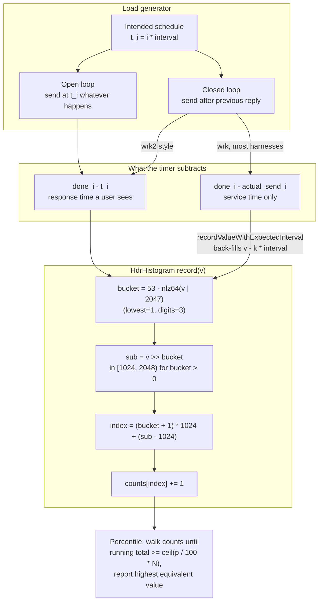

# Statistics for Benchmarks: Coordinated Omission and HDR Histograms

> [!summary] Claim:
> Benchmark latencies are skewed, multimodal, and bounded below, so a mean and standard deviation describe almost nothing; report the median with the median absolute deviation, full percentiles, and a bootstrap confidence interval for any comparison.
> A closed-loop load generator that waits for each response before sending the next one stops measuring exactly when the system stalls, so it records one slow sample where an uncoordinated user population would have seen hundreds: this is Gil Tene's coordinated omission.
> The fix is to time every request from when it should have been sent, using an open-loop arrival schedule as wrk2 does, or, as an approximation, to back-fill the missing samples with HdrHistogram's `recordValueWithExpectedInterval()`.
> HdrHistogram stores counts in power-of-two buckets of `2^ceil(log2(2 * 10^d))` linear sub-buckets, so recording is a few shifts and an increment, memory is fixed by range and precision alone (23,552 slots, 188,416 bytes for 1 us to 1 hour at 3 digits), and every slot from 2,048 units up is at most 1/1024 of its value wide.



## The Mechanism

[[Benchmark-Methodology-Noise-and-Environment-Control]] owns making the measurements quiet.
This note owns what to do with the numbers once they exist: how to summarize them, how a load generator silently deletes the worst of them, and how HdrHistogram stores millions of them in a fixed few hundred kilobytes.
Code facts below are from HdrHistogram tag `HdrHistogram-2.2.2` (`AbstractHistogram.java`) and wrk2's README unless another source is named; numbers marked as lab output come from `code/04-Measurement-Methodology/coordinated_omission/`.

### 1. Benchmark distributions are not normal

A timing has a hard floor (the work itself) and no ceiling: interrupts, page faults, cache misses, migrations, frequency changes, and garbage collection only ever add time.
The result is a tight body plus a long right tail, often with several modes, one per slow path.
Three consequences follow:

- The mean is pulled toward the tail and the standard deviation is dominated by it, so "mean +- stdev" describes neither the typical run nor the bad one.
- Two runs of the same code differ mostly in how many tail samples each happened to draw, so a difference of means mixes the effect you changed with tail luck.
- A percentile is the only summary that answers "how bad is it for the unlucky request", and which percentile matters depends on fan-out (section 6).

#### Median and median absolute deviation

The median is the 50th percentile; one sample moving from 1 ms to 10 s does not move it.
The median absolute deviation is, in NIST's definition (e-Handbook 1.3.5.6), `MAD = median(|Y_i - median(Y)|)`.
It is a median of deviations from a median, so a minority of arbitrarily bad samples cannot move it arbitrarily far, whereas a single huge sample moves the mean and the standard deviation without bound (the mean's breakdown point is 0, finite-sample 1/n; the median's is 50%, the maximum possible).

For normal data, `MAD` estimates `0.6745 * sigma`, so `1.4826 * MAD` is the consistent estimator of sigma; the constant is `1 / Phi^-1(0.75)`, which the lab computes as 1.4826 from `statistics.NormalDist().inv_cdf(0.75)`.
Tools differ on the scaling: pyperf's `median_abs_dev()` in `pyperf/_utils.py` returns the unscaled MAD, which is what `pyperf stats` prints as `Median +- MAD`.

#### Bootstrap confidence intervals

Efron's bootstrap (1979) estimates the sampling distribution of any statistic by resampling the observed data with replacement.
For a percentile interval on the median:

1. Draw `n` indices uniformly from `[0, n)`, with replacement, and take the median of those samples.
2. Repeat B times (the lab uses B = 10,000; Criterion.rs defaults to `nresamples = 100_000`).
3. Sort the B medians; the 2.5th and 97.5th percentiles are a 95% interval.

For an A/B comparison, resample A and B independently each round and record `median(B) / median(A)`; if the 95% interval of the ratio excludes 1.0, the change is detectable at that level.
The method needs no distributional assumption, but it does assume the samples are independent and identically distributed.
Benchmark samples often are not: warm-up, thermal drift, and periodic background work make neighbors correlated, and resampling single points then makes the interval too narrow.
Interleave A and B runs and discard warm-up, as [[Design-a-Low-Noise-Benchmark-Harness-Playbook]] prescribes, or resample contiguous blocks instead of points (the moving-block bootstrap of Kunsch, 1989: overlapping blocks of length `b`, `n - b + 1` of them) when drift remains.

### 2. Open and closed workload generators

Schroeder, Wierman, and Harchol-Balter (NSDI 2006) define the two models:

- Closed: a fixed number of users (the multiprogramming level, MPL) each alternate between submitting a request and thinking, so "a new request is only triggered by the completion of a previous request".
- Open: requests arrive from an outside stream at a rate that does not depend on completions.
- Partly open: users arrive as in an open system and stay for a follow-up request with some probability.

Their first principle is that, "for a given load, mean response times are significantly lower in closed systems than in open systems", and their second that closed systems approach open behavior as the MPL grows, but slowly.
The reason is feedback: when the server slows down, a closed system's users are all waiting, so the arrival rate drops exactly when the queue would grow.
The paper also finds that neither model fits every real site, and that think time is irrelevant to the choice.

Production traffic from many independent users, such as a public API, a market data feed, or an order gateway, is open: a user does not delay a request because someone else's request was slow.
A benchmark of such a system that uses a closed generator measures a different, gentler system.

k6 states the same split in its scenarios documentation: in a closed model "the next iteration doesn't start until the previous one finishes", and k6 implements the open model with its `constant-arrival-rate` and `ramping-arrival-rate` executors.
When an arrival-rate executor has no free VU for a scheduled iteration it does not send it and counts it in the `dropped_iterations` metric, so a nonzero count means the run silently became partly closed.

### 3. Coordinated omission

Coordinated omission is Gil Tene's term, as wrk2's README uses it: a generator that only "begin[s] to send a request after receiving a response" is "coordinating with the server to avoid measurement during high latency periods".
wrk computes latency "from the sending of the first byte of the request to the time the complete response was received", which is correct for the requests it sent and silent about the requests it should have sent but did not.

The lab simulates one connection, a schedule of one request every 10 ms for 100 s (10,000 requests), 1 ms of work per request, and a single 2 s server pause that begins 0.5 ms into request 5000.
It measures five ways:

| Generator and recording | What it subtracts | Samples |
| :--- | :--- | :--- |
| Closed, skip missed ticks, raw | reply time minus actual send; ticks that passed while waiting are dropped | 9,800 |
| Same, recorded with `recordValueWithExpectedInterval(v, 10 ms)` | as above, plus synthetic `v - k * 10 ms` values | 9,999 |
| Closed, catch up, from actual send | sends late requests back to back; reply minus actual send | 10,000 |
| Closed, catch up, from intended send | same events; reply minus scheduled time (wrk2's method) | 10,000 |
| Open loop | arrivals on schedule regardless of replies; reply minus arrival | 10,000 |

No closed variant sends a single request during the 2 s pause; the open loop sends 200.
The open-loop truth is that request `5000 + k` waits `2001 - 9k` ms for `k = 0..222`: each 10 ms tick adds one request and the server removes 10 ms of backlog in 1 ms of work, so the backlog drains at 9 ms per tick and 223 requests (2.23%) are delayed.
The raw p99 is 1.000 ms in both closed variants (the lab asserts it for the skip loop and the catch-up loop) against a true p99 of 1,101.823 ms, an understatement of 1,102x (lab output, computed from the catch-up histogram timed from the actual send).

#### Correcting at the source: time from the intended start

wrk2 "measures response latency from the time the transmission *should* have occurred according to the constant throughput configured for the run".
This needs a plan that gives every request's intended start time, which a constant rate (`-R`, default 1000 requests per second) makes trivial and a stochastic arrival model makes possible if the plan is stored.

In the lab, the catch-up closed loop timed from the intended send matches the open loop for 10,000 of 10,000 requests.
That exact match is a property of the model, one connection into one FIFO server: the closed loop's send time `max(t_i, done_{i-1})` equals the open loop's service start time, so only the timer's starting point differs.
With several connections, or a server that serves concurrently, a closed loop timed from the intended start is still a much better estimate than service time, but it is not identical to an open-loop run, because the generator's own backpressure still shapes what the server sees.

#### Correcting afterwards: `recordValueWithExpectedInterval()`

When the generator cannot be changed but its intended interval is known, HdrHistogram can back-fill.
`recordSingleValueWithExpectedInterval(value, interval)` records `value`, then `value - interval`, `value - 2 * interval`, and so on, while the value is still `>= interval`.
`copyCorrectedForCoordinatedOmission(interval)` applies the same rule after the fact; the Javadoc calls the two methods "mutually exclusive" and says to use only one of them on a given data set.

In the lab, the 2,001 ms sample yields 199 synthetic values (1,991 ms down to 11 ms) for the 200 dropped ticks, and the corrected p99 is 1,011.199 ms against a true 1,101.823 ms.
The correction is a model, not the truth: it assumes each missed request would have waited `value - k * interval`, which ignores the service time the backlog needs, so it decreases in 10 ms steps where the truth decreases in 9 ms steps, and it under-counts the 223 delayed requests as 200.
It is also wrong to apply it to a generator that does not drop ticks: the catch-up loop already sent all 10,000 requests, so back-filling would add 199 samples that never existed.

### 4. HdrHistogram: the bucket structure

A Histogram is configured with `lowestDiscernibleValue` (at least 1), `highestTrackableValue` (at least twice the lowest), and `numberOfSignificantValueDigits` d from 0 to 5.
`init()` derives everything else:

```text
largestValueWithSingleUnitResolution = 2 * 10^d
unitMagnitude              = floor(log2(lowestDiscernibleValue))
subBucketCountMagnitude    = ceil(log2(2 * 10^d))
subBucketCount             = 2^subBucketCountMagnitude
subBucketHalfCount         = subBucketCount / 2
subBucketMask              = (subBucketCount - 1) << unitMagnitude
leadingZeroCountBase       = 64 - unitMagnitude - subBucketCountMagnitude
bucketCount                = buckets needed so subBucketCount << (unitMagnitude + bucketCount - 1) > highest
countsArrayLength          = (bucketCount + 1) * subBucketHalfCount
```

The factor 2 is explained in the source: three digits means "+/- 1 unit at 1000" but also "NOT ok to be +/- 2 units at 1999", so the histogram needs unit resolution up to 2,000, rounded up to the power of two 2,048.
With `subBucketCount = 1024` instead, the first doubled bucket would start at 1,024 with width 2, a relative width of 1/512, which breaks the 0.1% promise.

#### Buckets overlap by half

Bucket 0 covers `[0, 2048)` in steps of 1 with all 2,048 sub-buckets.
Bucket k > 0 could cover `[0, 2048 * 2^k)` in steps of `2^k`, but its lower half is already covered at finer resolution by the earlier buckets, so only its upper 1,024 sub-buckets are stored: `[1024 * 2^k, 2048 * 2^k)`.
That is why the array holds `(bucketCount + 1) * 1024` slots: 2,048 for bucket 0 and 1,024 for each other bucket.

#### Recording is constant time

```java
int getBucketIndex(final long value) {
    return leadingZeroCountBase - Long.numberOfLeadingZeros(value | subBucketMask);
}
int getSubBucketIndex(final long value, final int bucketIndex) {
    return (int)(value >>> (bucketIndex + unitMagnitude));
}
// countsArrayIndex(bucketIndex, subBucketIndex):
//     ((bucketIndex + 1) << subBucketHalfCountMagnitude) + (subBucketIndex - subBucketHalfCount)
```

ORing in `subBucketMask` forces every value below 2,048 to have the same leading-zero count, so they all land in bucket 0.
For larger values, the bucket is how many powers of two the value sits above bucket 0's range, read off with one count-leading-zeros instruction.
Worked example at `(1, 3600000000, 3)`, where `leadingZeroCountBase = 64 - 0 - 11 = 53`:

- `v = 2,001,000` has 21 significant bits, so 43 leading zeros, and bucket `53 - 43 = 10`.
- Sub-bucket `2,001,000 >> 10 = 1954`, which lies in `[1024, 2048)` as required.
- Index `(10 + 1) * 1024 + (1954 - 1024) = 12,194`.
- The slot covers `1954 << 10 = 2,000,896` through `2,000,896 + 1024 - 1 = 2,001,919`, so a 2,001,000 us sample is reported as 2,001.919 ms.

The lab prints this row and nine others, and then walks all 23,552 slots to check that they tile `[0, 4,294,967,295]` with no gap or overlap, that the index function inverts `valueFromIndex()`, that every value below 2,048 is exact, and that the worst slot width relative to its lowest value is 1/1024.
The relative width is largest at the bottom of each bucket (`2^k / (1024 * 2^k)`) and halves toward the top, so the error bound is 1/1024, not 1/2048, and is below the 1/1000 promised by three digits.

#### Footprint

Memory depends only on range and precision, never on the sample count.
For `(1, 3600000000, 3)`, 22 buckets give 23 * 1,024 = 23,552 slots, or 188,416 bytes of 8-byte counts; the README's conservative estimate, which adds 512 bytes of fixed fields, gives 188,928 bytes, "around 185KB".
At the top of that range a slot is 2,097,152 us wide, about 2.1 s, which is within the README's "resolution of 3.6 seconds (or better)" at one hour.
A sorted array of raw samples costs 8 bytes per sample, so the histogram is smaller from about 23,552 samples on, and its percentile query cost is bounded by the slot count, not the sample count.

#### Percentiles are conservative

`getValueAtPercentile(p)` nudges p down by one ulp, computes `countAtPercentile = max(1, ceil(p * N / 100))`, walks the counts until the running total reaches it, and returns the slot's highest equivalent value (its lowest, for p = 0).
The reported value is therefore the nearest-rank percentile rounded up to the end of its slot: never below the true sample, and above it by less than one slot width.
On the lab's open-loop data the overstatement is 0.000% at p50, 0.075% at p99, 0.042% at p99.9, and 0.046% at the maximum.
The same rank rule caps what a run can say: with N samples, `ceil(p * N / 100) = N` for every p above `100 * (N - 1) / N`, so a 9,800-sample run reports its maximum as p99.99, which is exactly what the lab's raw skip loop shows.

`getMean()` and `getStdDeviation()` use each slot's median equivalent value, so they are quantized the same way.
Histograms with compatible layouts merge with `add()`, which sums counts slot by slot; the percentiles of the merged histogram are the percentiles of the combined data, which averaging per-host p99 values never gives.

## Commands and Numbers to Know

| Item | Value | Platform and date | Why it matters |
| :--- | :--- | :--- | :--- |
| HdrHistogram significant digits | 0 to 5 | Both (as of 2026-11) | `init()` rejects anything else |
| `subBucketCount` at 3 digits | 2,048 (`2^ceil(log2(2000))`) | Both (as of 2026-11) | Unit resolution up to 2,047 units |
| Worst relative slot width at 3 digits | 1/1024 | Both (as of 2026-11) | Lab: exhaustive walk of all 23,552 slots |
| Slots for 1 us to 1 hour at 3 digits | 23,552 (22 buckets) | Both (as of 2026-11) | 188,416 bytes of `long` counts |
| README footprint estimate | `512 + (word/2) * (ceil(log2(highest / subBucketCount)) + 2) * subBucketCount` | Both (as of 2026-11) | 188,928 bytes for the case above |
| `recordValueWithExpectedInterval(v, I)` | records `v`, then `v - kI` while `>= I` | Both (as of 2026-11) | Java 2.2.2, C 0.12.1, and Rust 7.6.0 agree |
| `hdrh` `record_corrected_value(v, I)` | also records the first value `<= I` | Both (as of 2026-11) | One extra sample per correction in hdrhistogram 0.10.8 |
| `getValueAtPercentile(p)` rank | `max(1, ceil(p * N / 100))`, highest equivalent value | Both (as of 2026-11) | Never under-reports |
| wrk2 `-R` / `--rate` | requests per second, default 1000 | Both (as of 2026-11) | Sets the intended schedule; latency is timed from it |
| wrk2 `--u_latency` | prints the uncorrected histogram | Both (as of 2026-11) | Shows the coordinated omission gap directly |
| k6 open-model executors | `constant-arrival-rate`, `ramping-arrival-rate` | Both (as of 2026-11) | Watch `dropped_iterations` |
| Criterion.rs 0.8.2 defaults | `sample_size` 100, `nresamples` 100,000, `confidence_level` 0.95, `significance_level` 0.05, `noise_threshold` 0.01, warm-up 3 s, measurement 5 s | Both (as of 2026-11) | Bootstrap CIs on per-sample iteration means |
| Google Benchmark v1.10.0 | `--benchmark_repetitions=N` reports mean, median, stddev, cv | Both (as of 2026-11) | `--benchmark_report_aggregates_only` drops per-run rows |
| pyperf 2.11.0 `stats` | prints `Median +- MAD`, unscaled | Both (as of 2026-11) | Multiply by 1.4826 to compare with a stdev |
| MAD consistency constant | 1.4826 = `1 / Phi^-1(0.75)` | Both (as of 2026-11) | Lab computes it |
| Python `random.Random(seed).random()` | same sequence across versions for the same seed | Both (as of 2026-11) | The documented reproducibility guarantee; other methods may change |

## Multi-Language Comparison: C++ / Python / Rust

| Concern | C and C++ | Python | Rust |
| :--- | :--- | :--- | :--- |
| HDR histogram | HdrHistogram_c 0.12.1 (as of 2026-11): `hdr_init(lowest, highest, sigfigs, &h)` | `hdrh` 0.10.8: `HdrHistogram(lowest, highest, digits)`; this lab's `hdr.py` port | `hdrhistogram` 7.6.0: `Histogram::<u64>::new_with_bounds(low, high, sigfig)` |
| Record | `hdr_record_value(h, v)` | `record_value(v)` | `record(v)`, `saturating_record(v)` |
| Coordinated omission back-fill | `hdr_record_corrected_value(h, v, interval)`: stops at `>= interval` | `record_corrected_value(v, interval)`: records one extra value `<= interval` | `record_correct(v, interval)`: stops at `>= interval` |
| Percentile | `hdr_value_at_percentile(h, p)` | `get_value_at_percentile(p)` | `value_at_percentile(p)`, `value_at_quantile(q)` |
| Microbenchmark statistics | Google Benchmark v1.10.0: mean, median, stddev, cv over repetitions | pyperf 2.11.0: mean +- stdev by default, `stats` adds median +- MAD and percentiles | Criterion.rs 0.8.2: bootstrap CIs of slope, mean, stdev, median, and MAD; Tukey fences flag outliers but keep them |
| Robust statistics in the standard library | none; `std::nth_element` for medians | `statistics.median`, `quantiles(method='exclusive')` default, `NormalDist` | none in `std`; select with `select_nth_unstable` |

The `hdrh` difference was measured here: for `record_corrected_value(2001000, 10000)` the Python package recorded 201 values where this lab's Java-faithful port records 200; its loop runs `while True`, records, and returns only after recording a value `<= expected_interval`.
Over 200,005 values the port's slot index, lowest equivalent, and highest equivalent values matched `hdrh` 0.10.8 exactly, and so did nine percentiles from p0 to p100.

## Worked Lab Example

The lab is `code/04-Measurement-Methodology/coordinated_omission/`; it needs only `python3` (3.9 or later, standard library) and has no `# requires:` line.

- `hdr.py` is a line-by-line port of the parts of `AbstractHistogram.java` the lab needs: `init()`, bucket and sub-bucket indexing, `valueFromIndex()`, equivalent-value ranges, `recordSingleValueWithExpectedInterval()`, and `getValueAtPercentile()`, including the `Math.nextAfter` nudge.
- `lab.py` part 1 simulates the five generators in integer microseconds, so there is no floating-point timing at all.
- Part 2 prints the layout for `(1, 3600000000, 3)`, walks every slot, and compares reported percentiles with exact nearest-rank percentiles.
- Part 3 draws two 200-sample timing sets from `random.Random(20261108)`, using only `random()`, which Python guarantees to reproduce across versions; B's body is exactly 3% faster than A's, and both have a 6% tail of 1.5x to 4x.

Every part ends in assertions that fail if the mechanism is absent: with the pause removed, the open loop's 200 in-pause sends and the 100x p99 gap disappear; with `subBucketCount` built from `10^d` instead of `2 * 10^d`, the slot walk finds a 1/512 width; with no tail in the timings, stdev no longer exceeds five scaled MADs.
Each of those three mutations was run here and raised `AssertionError`.

```bash
cd code/04-Measurement-Methodology/coordinated_omission
bash run.sh
```

### Verified output

Recorded with `python3 -m _harness.verify --record` on darwin-arm64 (Python 3.15.2) on 2026-11-08 and re-checked with `python3 -m _harness.verify`; the file is `code/04-Measurement-Methodology/coordinated_omission/expected/darwin-arm64.txt`.

```text
== Part 1: coordinated omission (simulated, integer microseconds)
schedule: 10000 requests, one every 10 ms; service 1 ms; one server pause of 2000 ms at t=50.0005 s

Requests sent while the server was paused:
  open loop: 200; closed catch-up: 0; closed skip: 0
  closed skip dropped 200 scheduled requests; the correction synthesized 199 values

HdrHistogram(1, 3600000000, 3) percentiles in ms (highest equivalent value):
  generator and recording                         count       p50       p90       p99     p99.9    p99.99       max
  closed, skip missed ticks, raw                   9800     1.000     1.000     1.000     1.000  2001.919  2001.919
  closed, skip, recordValueWithExpectedInterval    9999     1.000     1.000  1011.199  1911.807  2001.919  2001.919
  closed, catch up, from actual send              10000     1.000     1.000     1.000     1.000     1.000  2001.919
  closed, catch up, from intended send            10000     1.000     1.000  1101.823  1911.807  1992.703  2001.919
  open loop (ground truth)                        10000     1.000     1.000  1101.823  1911.807  1992.703  2001.919

Ground truth: 223 of 10000 requests (2.23%) waited longer than the 1 ms service time
Catch-up loop timed from intended send matches open loop for 10000/10000 requests
p99 understated by the raw closed loop: 1102x

== Part 2: HdrHistogram(lowest=1, highest=3600000000, digits=3) layout
unitMagnitude=0 subBucketCount=2048 subBucketHalfCount=1024 bucketCount=22
countsArrayLength=23552 -> 188416 bytes of long counts; README estimate 188928 bytes

         value  bucket   sub  index  lowest equiv  highest equiv   width
             1       0     1      1             1              1       1
          1000       0  1000   1000          1000           1000       1
          2047       0  2047   2047          2047           2047       1
          2048       1  1024   2048          2048           2049       2
          2049       1  1024   2048          2048           2049       2
          4095       1  2047   3071          4094           4095       2
          4096       2  1024   3072          4096           4099       4
       1000000       9  1953  11169        999936        1000447     512
       2001000      10  1954  12194       2000896        2001919    1024
    3600000000      21  1716  23220    3598712832     3600809983 2097152

Exhaustive slot walk: 23552 slots tile [0, 4294967295] with no gaps; values below 2048 are exact; worst slot width / value above that = 1/1024

Reported percentile vs exact nearest-rank on the open-loop data (us):
  p50: exact 1000, HdrHistogram 1000, over by 0.000%
  p99: exact 1101000, HdrHistogram 1101823, over by 0.075%
  p99.9: exact 1911000, HdrHistogram 1911807, over by 0.042%
  p100: exact 2001000, HdrHistogram 2001919, over by 0.046%

== Part 3: robust statistics (seeded PRNG, random.Random(20261108).random() only)
MAD consistency constant 1/Phi^-1(0.75) = 1.4826

  variant      mean    stdev   median     MAD  1.4826*MAD      max
  A          113.79    52.06   100.03    1.05        1.55   394.30
  B          104.38    37.59    97.22    0.96        1.42   374.33

Tail samples above 1.2x the median: A 15, B 9 (both drawn with a 6% tail rate)
Difference of means A-B: 9.41 us, normal 95% CI [0.51, 18.31]
Ratio of means B/A: 0.9173; ratio of medians B/A: 0.9719; true body ratio 0.9700
Bootstrap (10000 resamples) 95% percentile CI of median A: [99.75, 100.30]
Bootstrap (10000 resamples) 95% percentile CI of median B: [96.93, 97.37]
Bootstrap 95% CI of median(B)/median(A): [0.9681, 0.9751]
95% CI width as % of A's median: difference of means 17.79%, ratio of medians 0.70%
Verdict from the median ratio: B faster
```

### Reading the result

- The two raw closed loops report a p99 of 1 ms; the skip loop's own p99.99 shows the pause only because 9,800 samples make p99.99 the maximum, and the catch-up loop hides it even there, since its 200 late requests were each served in 1 ms.
- The catch-up loop is the most dangerous variant: it sends all 10,000 requests, so its request count looks healthy, and its p99.99 is still 1 ms.
- Timing the same events from the intended send recovers the truth exactly in this one-connection model; back-filling recovers the shape but undercounts, with p99 at 1,011 ms against 1,102 ms.
- Every reported value ends in a slot boundary (`1101.823`, `2001.919`): the histogram's conservative rounding, at most 0.1% here.
- In part 3, A happened to draw 15 tail samples and B 9, so the ratio of means says B is 8.3% faster when the change is 3%; the normal interval for the difference of means spans 0.51 to 18.31 us, 17.79% of the median, while the bootstrap interval of the median ratio, [0.9681, 0.9751], is 0.70% wide and contains the true 0.97.
- The standard deviations (52.06 and 37.59 us) are 34 and 26 times the scaled MADs (1.55 and 1.42 us): the stdev measures the tail, not the noise in the body.

## Pitfalls

> [!warning] Pitfall: timing from the actual send in a paced loop
> `start = now(); send(); wait(); record(now() - start); sleep_until_next_tick()` is the pattern behind the lab's two raw closed loops.
> Compute `start` from the schedule (`t0 + i * interval`) instead, and record `now() - start` even when the send itself happened late.

> [!warning] Pitfall: back-filling a generator that does not drop requests
> `recordValueWithExpectedInterval()` invents the samples a skipping generator never sent.
> On a catch-up generator, which did send them late, it double counts; on an open-loop generator it adds samples that never existed; and the Java docs say never to combine it with `copyCorrectedForCoordinatedOmission()` on the same data.

> [!warning] Pitfall: treating the back-fill as ground truth
> The correction assumes zero service time for the backlog, so it undercounts both the number and the size of delayed responses (200 synthetic values and a 1,011 ms p99, against 223 and 1,102 ms in the lab).
> Prefer an open-loop or intended-start-time generator; use the correction only when the generator cannot be changed.

> [!warning] Pitfall: averaging percentiles
> The mean of ten hosts' p99 values is not the fleet's p99 and is not any percentile of anything.
> Ship histograms (or their counts) and merge them with `add()`, then query the merged histogram.

> [!warning] Pitfall: reporting percentiles the sample count cannot support
> With N samples, every percentile above `100 * (N - 1) / N` is the maximum, so a 1,000-sample run has no p99.9 distinct from its max.
> Report the sample count next to every tail percentile, and collect at least `100 / (100 - p)` samples, preferably ten times that, before quoting percentile p.

> [!warning] Pitfall: per-iteration percentiles from a batch harness
> Criterion.rs "does not measure each individual iteration, only the complete sample", and Google Benchmark's aggregates are over repetitions of many iterations.
> Their medians and intervals describe batch means, which are close to normal by averaging; they say nothing about the tail of a single operation, which needs per-operation timestamps into a histogram.

> [!warning] Pitfall: bootstrapping correlated samples
> The bootstrap assumes independent samples; a run with drift or periodic interference gives an interval that is too narrow.
> Interleave variants, discard warm-up, plot the samples against time, and use a block bootstrap when neighbors are correlated.

> [!warning] Pitfall: mixing ports with different correction rules
> Python's `hdrh` 0.10.8 records one more corrected value than the Java, C, and Rust implementations for the same call, so corrected counts from mixed-language services do not agree exactly.
> Correct in one place, or test the port against a known input before trusting cross-language comparisons.

> [!warning] Pitfall: a histogram range that clips
> A value above `highestTrackableValue` throws in Java unless auto-resize is enabled; Rust's `saturating_record` clamps it, and its own documentation warns that this "*will* hide extreme outliers", turning a 10 s outlier into the configured maximum.
> Size the range for the worst stall you need to see (a timeout, not a typical latency), which costs only one 1,024-slot bucket per doubling.

## At Scale

For one developer, the rules are short: time from the intended start, record into an HdrHistogram, quote the median and MAD for microbenchmarks, quote p50 through p99.9 with N for latency, and bootstrap any comparison.
At 1,000 to 50,000 engineers, the numbers flow into dashboards, SLOs, capacity plans, and release gates, and one bad measurement convention gets copied into thousands of services.

Tail exposure grows with fan-out: if a page fans out to n backends and each is slow 1% of the time independently, `1 - 0.99^n` of pages see at least one slow call, 9.6% at n = 10 and 63.4% at n = 100.
That is why large services set objectives at p99.9 or p99.99 for leaf services, and why coordinated omission, which hides precisely those percentiles, is an organizational risk rather than a tooling detail.

Decision rules:

- Mandate that every load test declares its model (open, closed, or partly open), its intended rate or schedule, and whether latency is timed from the intended start; reject results that cannot answer all three.
- Standardize the paved-road load generators on open-loop arrival-rate modes (wrk2 `-R`, k6 arrival-rate executors) and alert on dropped or late sends, because a saturated open-loop generator quietly becomes a closed one.
- Store latency as mergeable histograms with a fixed fleet-wide configuration (for example `(1 us, 1 hour, 3 digits)` at about 184 KiB per histogram, or fewer digits where memory is tight), never as pre-computed percentiles.
- In microbenchmark CI, compare medians with bootstrap intervals of the ratio and a pre-agreed noise threshold; Criterion.rs bootstraps its comparison and ignores changes within its default `noise_threshold` of 1%; [[Performance-Regression-Detection-in-CI]] owns the gate, change-point detection, and instruction-count alternatives.
- Put tail percentiles and sample counts side by side on every dashboard, and forbid "average p99" panels.
- Record these as decisions with owners in [[Measurement-Methodology-Decision-Records]], and use [[USE-RED-and-Systems-Performance-Methodologies]] to place latency next to utilization and saturation.

## Practice Drill

> [!tip] Practice Drill:
> Work [[Drill-Measurement-Methodology-Coordinated-Omission-Trap]] first: it hides a coordinated omission defect in a load generator and asks you to find and correct it.
> Then extend a copy of the lab: give the open loop Poisson arrivals at the same mean rate (inverse transform of `random()` with a fixed seed), keep the 2 s pause, and predict before running whether the p99 rises or falls relative to the fixed schedule and whether `recordValueWithExpectedInterval()` with the mean interval still lands within 10% of the truth.
> Add a second connection to the catch-up closed loop and a two-worker server, and predict whether timing from the intended start still matches the open loop for every request.
> As a stretch, add `add()` to `hdr.py`, split the open-loop samples across ten simulated hosts, and show that the mean of the ten per-host p99 values differs from the p99 of the merged histogram.

## Interview Questions

> [!question] L5: Why is "mean +- standard deviation" a poor summary of benchmark timings, and what would you report instead?
>
> > [!success]- Answer
> > Timings have a hard floor and a long right tail, so the mean is dragged toward rare slow events and the standard deviation mostly measures how many tail samples the run drew.
> > In the lab, a 3% speedup appears as an 8.3% speedup in the ratio of means because one variant drew 15 tail samples and the other 9.
> > Report the median and MAD for the typical case, percentiles with the sample count for the tail, and a bootstrap confidence interval for any comparison.
> > If you need a sigma-like number, `1.4826 * MAD` estimates sigma for normal data and stays sane when the data are not normal.

> [!question] L5: What is coordinated omission, in one sentence, and how do you detect it in a load test you did not write?
>
> > [!success]- Answer
> > It is the measurement error a generator makes when it waits for responses before sending, so it sends nothing while the system is stalled and records one slow sample where an independent user population would have produced many.
> > To detect it, check whether the achieved request rate dips during slow periods, whether latency is timed from actual or intended send times, and whether a run with a known injected pause (stop the server process for a few seconds) changes the high percentiles as much as it should.
> > wrk2's `--u_latency` output next to its corrected output, or k6's `dropped_iterations`, show the gap directly.

> [!question] L6: Predict the output: an `HdrHistogram(1, 3600000000, 3)` records 9,799 values of 1,000 and one value of 2,001,000; what do `getValueAtPercentile(99.99)` and `getMaxValue()` return?
>
> > [!success]- Answer
> > Both return 2,001,919.
> > With N = 9,800, the target count is `ceil(99.99 * 9800 / 100) = ceil(9799.02) = 9800`, which is only reached in the last occupied slot, so p99.99 is the maximum.
> > The value 2,001,000 lands in bucket 10 (unit 1,024), sub-bucket 1,954, so its slot covers 2,000,896 to 2,001,919, and both queries report the slot's highest equivalent value.
> > This is the lab's "closed, skip missed ticks, raw" row.

> [!question] L6: Debug this: a team's harness reports p99 = 1.2 ms for a service whose users complain of multi-second stalls; what is wrong and how do you fix it?
>
> ```python
> next_send = time.monotonic()
> while running:
>     t0 = time.monotonic()
>     send_and_wait()
>     hist.record_value(int((time.monotonic() - t0) * 1e6))
>     next_send += INTERVAL
>     time.sleep(max(0.0, next_send - time.monotonic()))
> ```
>
> > [!success]- Answer
> > The loop is closed: it cannot send while waiting, so a stall produces one long sample, and the requests that should have gone out during it are later sent back to back and timed from their late actual send.
> > It is the lab's catch-up variant, whose p99.99 is still 1 ms around a 2 s pause.
> > Fix the timer first: record `time.monotonic() - next_send` measured before `next_send` advances, so each request is timed from when it should have been sent, as wrk2 does.
> > Better, make it open loop with enough concurrency that sends never wait for replies, and alert when the generator falls behind its schedule.
> > Do not add `record_corrected_value` to this loop: it already sends every request, so back-filling would double count.

> [!question] L6: Derive why HdrHistogram with 3 significant digits uses 2,048 sub-buckets and what its worst relative error is.
>
> > [!success]- Answer
> > Three digits promises roughly 1 part in 1,000, which means unit resolution must extend to 2,000, because two units of error are allowed only from 2,000 upward; rounding up to a power of two gives `2^ceil(log2(2000)) = 2048`.
> > Bucket k > 0 stores sub-buckets 1,024 to 2,047 with unit `2^k`, so it covers `[1024 * 2^k, 2048 * 2^k)` and the widest slot relative to its value is `2^k / (1024 * 2^k) = 1/1024`, at the bottom of each bucket.
> > Using 1,024 sub-buckets would give 1/512, which breaks the promise; the lab's slot walk confirms 1/1024 over all 23,552 slots.

> [!question] L7: When is `recordValueWithExpectedInterval()` the right tool, and when does it mislead?
>
> > [!success]- Answer
> > It fits a generator that sends on a known fixed interval and skips ticks it missed while blocked, when you cannot change the generator: it back-fills `v - I, v - 2I, ...` for the skipped ticks.
> > It misleads when the generator catches up (double counting), when the interval is not fixed (the back-fill uses the wrong spacing), and whenever backlog service time matters, because it assumes the queue drains instantly.
> > In the lab it yields 199 samples and a 1,011 ms p99 against a truth of 223 delayed requests and a 1,102 ms p99.
> > The robust fix is to time from intended start times in an open-loop or wrk2-style generator; the correction is a fallback, and only one of the two correction methods may be applied to a data set.

> [!question] L7: You must decide whether a change made a 100 us operation 3% faster, with noisy hosts. Design the statistical procedure.
>
> > [!success]- Answer
> > Interleave A and B runs on the same host and discard warm-up, so drift hits both equally, and collect a few hundred samples per variant.
> > Plot samples against time to check for drift or periodicity before computing anything.
> > Compute the median of each and bootstrap the ratio `median(B) / median(A)` by resampling each variant independently, 10,000 or more times, and take the 2.5th and 97.5th percentiles; if drift remains, resample blocks instead of points.
> > Declare a change only if the interval excludes 1.0 and the point estimate exceeds a pre-agreed noise threshold such as 1%.
> > In the lab this procedure gives [0.9681, 0.9751] for a true 0.97, while a normal interval on the difference of means is 25 times wider.

> [!question] L7+: Explain the open versus closed result from Schroeder et al. and what it means for capacity planning.
>
> > [!success]- Answer
> > In a closed system a new request waits for a previous completion, so the arrival rate falls when the server slows down; in an open system arrivals do not care.
> > At the same load, closed systems show significantly lower mean response times, and their sensitivity to service time variability and to scheduling policy is much smaller, so a closed benchmark understates queueing.
> > Closed behavior approaches open behavior as the number of users grows, but slowly, so "we used 1,000 connections" does not make a closed test open.
> > For capacity planning of a service with many independent clients, model it open: size for the arrival rate at the target percentile, and treat any test whose achieved rate fell during slow periods as invalid.

> [!question] L8+: Design fleet-wide latency telemetry for 20,000 services that supports correct p99.9 SLOs and does not hide coordinated omission.
>
> > [!success]- Answer
> > Record per-request latency at the edge and in clients, timed from when the request was issued or due, into HdrHistograms with one fleet-wide configuration, so any two histograms merge.
> > Ship interval histograms (counts per slot), not percentiles; aggregate by merging with `add()` along any dimension, and compute SLO percentiles from the merged result with the sample count attached.
> > For synthetic probes and load tests, require open-loop schedules with intended-start timing, monitor generator lag and dropped sends, and reject runs where the achieved rate dipped.
> > Choose precision per tier: for a 1 us to 1 hour range, 3 digits needs 23,552 slots (188,416 bytes of 8-byte counts) and 2 digits needs 3,328 slots (26,624 bytes), which matters when histograms are kept per endpoint and per host.
> > Budget tails by fan-out: if a page makes n independent calls and must be fast with probability q, each leaf must be fast with probability `q^(1/n)`; a page-level p99 over 100 calls needs `0.99^(1/100) = 0.99990`, a leaf p99.99, which is why leaf SLOs sit at p99.9 or beyond.

## Further Reading

- `AbstractHistogram.java` at HdrHistogram-2.2.2: the authoritative bucket math, the `+/- 2 units at 1999` comment, and the exact percentile and correction loops.
- HdrHistogram README, "Corrected vs. Raw value recording calls" and "Footprint estimation": the 100 s pause example and the memory formula.
- wrk2 README: the clearest statement of coordinated omission and of timing from the intended send time, with `--u_latency` for side-by-side output.
- Gil Tene, "How NOT to Measure Latency" (Strange Loop): the talk most engineers learn the term from, linked from pyperf's documentation.
- Schroeder, Wierman, and Harchol-Balter, "Open Versus Closed: A Cautionary Tale" (NSDI 2006): eight principles for choosing a workload model.
- Efron, "Bootstrap Methods: Another Look at the Jackknife" (1979): the original bootstrap paper.
- Kunsch, "The Jackknife and the Bootstrap for General Stationary Observations" (1989): the moving-block bootstrap for correlated samples.
- NIST e-Handbook 1.3.5.6: precise definitions of MAD and other scale estimators.
- Criterion.rs book, "Analysis Process": an industrial bootstrap pipeline for microbenchmarks, including outlier fences and noise thresholds.
- pyperf "Analyze benchmark results": when to switch from mean and stdev to median and MAD, with real output.

## Related

- Prerequisites: [[Benchmark-Methodology-Noise-and-Environment-Control]]
- Next: [[Hardware-Performance-Counters-Top-Down-TMA-and-Roofline]]
- See also: [[14-Low-Latency-Systems/07 - Time & Measurement/Coordinated Omission in Low Latency Systems|Coordinated Omission in Low Latency Systems]], [[02-Programming-Languages/C++/CPP_Zero_to_Godhood/Volume_08_Advanced_Systems/Chapter_103_Microbenchmarking_and_Tail_Latency/Chapter_103_Microbenchmarking_and_Tail_Latency|Chapter_103_Microbenchmarking_and_Tail_Latency]], [[Performance-Regression-Detection-in-CI]], [[Drill-Measurement-Methodology-Coordinated-Omission-Trap]], [[Design-a-Low-Noise-Benchmark-Harness-Playbook]]
- Lab: `code/04-Measurement-Methodology/coordinated_omission/`
