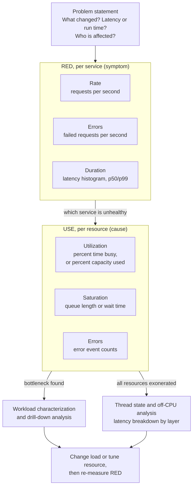

# USE, RED, and Systems Performance Methodologies

> [!summary] Claim:
> A methodology is a fixed list of questions you ask before you open a tool, so the investigation ends with known answers and known unknowns instead of whatever the familiar tools happened to show.
> The USE method asks, for every resource, how busy it is (utilization), how much work is queued on it that it cannot service (saturation), and how many error events it produced (errors); it finds resource bottlenecks and is resource-centric.
> The RED method asks, for every request-driven service, its request rate, its failed requests, and its request duration distribution; it measures the symptom the user feels and is workload-centric.
> RED tells you which service hurts, USE tells you which resource inside it is the cause, and queueing theory (Little's Law, `R = S / (1 - U)` for an M/M/1 queue) explains why latency explodes long before utilization reaches 100%.



## The Mechanism

### 1. Why a methodology at all

Brendan Gregg's methodology page names the failure modes that a methodology replaces, and calls them anti-methods (Performance Analysis Methodology, last updated 2025-01-23):

- Streetlight anti-method: run the tools you know, or that happen to be installed, and look for obvious issues; you find problems only where the light is.
- Drunk man anti-method: change things at random until the problem goes away.
- Random change anti-method: measure a baseline, pick a random attribute such as a tunable, change it in one direction and then the other, and measure each time; it is slow and finds nothing that was not already on the list of tunables.
- Blame-someone-else anti-method: hand the problem to a team that owns a component you do not, and repeat when it is disproven.
- Traffic light anti-method: treat a green dashboard as proof of health and a red indicator as the problem.

The tools method, listing the available tools and reading their metrics, is the structured form of the streetlight anti-method.
Gregg's objection is that it is bounded by the tools you have, so it gives an incomplete view and never tells you what it did not look at.
USE inverts the direction: it starts from the questions, then searches for a metric that answers each one, and writes "?" when none exists.
A "?" is a known unknown, which is strictly better than an unknown unknown.

Before any metric, the methodology page's problem statement method asks six questions, which take a minute and often solve the problem outright:

1. "What makes you think there is a performance problem?"
2. "Has this system ever performed well?"
3. "What has changed recently? (Software? Hardware? Load?)"
4. "Can the performance degradation be expressed in terms of latency or run time?"
5. "Does the problem affect other people or applications (or is it just you)?"
6. "What is the environment? What software and hardware is used? Versions? Configuration?"

Question 4 is the bridge to RED: a problem that cannot be stated as latency or run time is not yet a performance problem.

### 2. The USE method: definitions

The USE method page gives the procedure in one line: "For every resource, check utilization, saturation, and errors."
Its definitions:

- Utilization: "the average time that the resource was busy servicing work", expressed as a percent over an interval.
  A footnote allows a second, capacity-based definition, the proportion of the resource in use, where 100% means no more work can be accepted; memory capacity and file descriptors use this form.
- Saturation: "the degree to which the resource has extra work which it can't service, often queued", expressed as a queue length or as time spent waiting.
- Errors: "the count of error events", a scalar count.

A resource is anything with a finite capacity that work must pass through.
The page lists physical resources (CPUs as sockets, cores, and hardware threads; memory capacity; network interfaces; storage devices for I/O and capacity; storage and network controllers; CPU, memory, and I/O interconnects) and software resources (mutex locks, thread pools, process and thread capacity, file descriptor capacity).
Hardware caches are excluded on purpose, because a cache under high utilization improves performance; they are examined after the USE pass, which [[Hardware-Performance-Counters-Top-Down-TMA-and-Roofline]] owns.
In the cloud, hypervisor and cgroup limits on CPU, memory, network, and storage I/O are resources in their own right and get the same three questions.

### 3. The USE procedure

1. Draw a functional block diagram of the system, or list its resources, and annotate each bus and interconnect with its maximum bandwidth.
2. For each resource, check errors first, as the USE flowchart suggests, because they are cheap to read and unambiguous; the Netflix 60-second post then reads saturation before utilization for the same reason.
3. For each of the three metrics, write down the tool or monitoring source and the exact statistic; write "?" where none exists.
4. When time is short, check the subset the page recommends: CPUs, memory capacity, storage capacity, storage device I/O, and network interfaces.
5. When a resource is implicated, switch to workload characterization (who is causing the load, why, what it is, how it changes over time) and drill-down analysis, then decide whether to reduce the load or tune the resource.

The page's own claim is that the method solves "about 80%" of server issues with "5%" of the effort; that is Gregg's estimate from experience, not a measured statistic.
The method finds bottlenecks and errors only.
When every resource is exonerated (low utilization, zero saturation, zero errors) the problem is in how threads spend their time, not in any one resource, and the next step is the TSA method or off-CPU analysis, which [[Off-CPU-Analysis-Thread-States-and-Causal-Profiling]] owns.

### 4. Interpreting the three numbers

Utilization:

- 100% time-based utilization is usually a bottleneck, but confirm it with saturation, because a busy resource with no queue is merely well used.
- Gregg warns that utilization "beyond 70%" can already be a problem, for two reasons: a long-interval average hides bursts at 100% (the page cites five-minute averages hiding CPU saturation), and a non-preemptible resource such as a disk queues sooner than a preemptible one such as a CPU.
- Time-based utilization is not capacity: a device that serves requests in parallel can be busy 100% of the time and still accept more work.
  The `iostat(1)` man page says exactly this about `%util`: "for devices serving requests in parallel, such as RAID arrays and modern SSDs, this number does not reflect their performance limits."
- CPU utilization is non-idle time, not useful work: cycles stalled on memory count as busy, so 90% CPU with an IPC well below 1 is a memory problem wearing a CPU costume (Gregg, "CPU Utilization is Wrong", 2017); the PMC side belongs to [[Hardware-Performance-Counters-Top-Down-TMA-and-Roofline]].

Saturation:

- Any sustained non-zero saturation can be a problem, because it means work is waiting.
- Saturation is the metric that predicts latency; utilization only predicts it through the queueing curve below.

Errors:

- Any non-zero count deserves a look, especially a count that still rises while performance is bad.
- Errors are often the cheapest root cause: a retransmitting NIC, a disk retrying sectors, an allocator failing and falling back to a slow path.

### 5. Why latency explodes before 100%: Little's Law and M/M/1

Little's Law (Little, Operations Research 9(3), 1961) states that in a stable system the mean number of items in the system L equals the arrival rate lambda times the mean time each item spends in the system W:

$$L = \lambda W$$

It holds for any stationary system whatever the arrival process, service distribution, or service order (the requirement is that the long-run averages exist, which is the stability condition above), which makes it the one queueing result you can apply to any production system.
A service at 2,000 requests per second with a mean latency of 50 ms holds 2,000 x 0.050 = 100 requests in flight on average; if its worker pool has 64 slots, at least 36 requests are queued somewhere, which is saturation you can compute without a queue-length metric.

For the simplest queue, one server with Poisson arrivals and exponential service times (M/M/1), utilization is `rho = lambda / mu`, the mean number in the system is `rho / (1 - rho)`, and the mean response time is `1 / (mu - lambda)`, stable only while `rho < 1`.
Writing the mean service time as `S = 1 / mu` gives the form engineers remember:

$$R = \frac{S}{1 - U}$$

| Utilization U | Mean response time R as a multiple of service time S |
| :--- | :--- |
| 0.50 | 2.0 x |
| 0.70 | 3.3 x |
| 0.80 | 5.0 x |
| 0.90 | 10.0 x |
| 0.95 | 20.0 x |
| 0.99 | 100.0 x |

The table is arithmetic on the M/M/1 formula, not a measurement.
Real servers are not M/M/1: multiple servers (M/M/c) push the knee to higher utilization, and bursty arrivals or high service-time variance pull it lower.
The shape is the lesson: latency is a convex function of utilization, so the last 10 percentage points of utilization cost more latency than the first 80, and Gregg's 70% rule of thumb sits near where the curve starts to bend.

### 6. The RED method

Tom Wilkie created the RED method in 2015 and presented it at GrafanaCon EU in March 2018; the Grafana Labs write-up of that talk defines the three metrics:

- Rate: "the number of requests per second".
- Errors: "the number of those requests that are failing".
- Duration: "the amount of time those requests take", which must be kept as a distribution, not an average.

Wilkie's framing in that talk is that USE "applies to hardware, network disks, things like this" while RED is for request-driven microservices, and that the two are "two different views on the same system."
Grafana's dashboard best-practices page draws the operational consequence: alert on symptoms rather than causes, so alerts belong on RED dashboards, and USE dashboards are for diagnosis.

RED applies cleanly only where there are discrete requests with a start, an end, and a success or failure.
A batch job, a stream processor, or a training loop has no per-request duration; for those, measure throughput, lag or backlog (saturation), and failures, and use USE on the resources underneath.

Duration is where most RED implementations go wrong:

- Record successful and failed request durations separately, or with an error label; the Google SRE book notes that a fast HTTP 500 drags the average down and a slow error is worse than a fast one.
- Store a histogram, not a precomputed percentile: Prometheus documents that averaging quantiles from a summary "yields statistically nonsensical values", while histogram buckets from many instances can be summed and then turned into a quantile with `histogram_quantile()`.
- A classic histogram's quantile error is bounded by the width of the bucket the quantile lands in, so put bucket boundaries near your SLO threshold; Prometheus now recommends native histograms over both classic histograms and summaries where they are available, and their exponential buckets replace the boundary layout (which the docs call "tough") with a resolution setting (which they call "easy").
- The statistics of percentiles, tail amplification, and coordinated omission belong to [[Statistics-for-Benchmarks-Coordinated-Omission-and-HDR-Histograms]].

### 7. The four golden signals and how the three relate

Chapter 6 of Google's *Site Reliability Engineering* book (Rob Ewaschuk) names four signals for a user-facing system: latency, traffic, errors, and saturation.
They are RED plus saturation, where saturation is "how full" the service is, measured on its most constrained resource, including predicted exhaustion such as a disk filling within hours.
The chapter adds two refinements RED omits: errors may be explicit (HTTP 500), implicit (HTTP 200 with wrong content), or by policy (any response slower than a committed time counts as failed), and a rising 99th percentile over a short window, such as one minute, is often a leading indicator of saturation.

| Question | USE | RED | Four golden signals |
| :--- | :--- | :--- | :--- |
| Unit of analysis | Resource | Request-driven service | User-facing service |
| How busy | Utilization | Rate (demand, not busyness) | Traffic |
| Queueing | Saturation | none | Saturation |
| Failures | Errors (events) | Errors (failed requests) | Errors (explicit, implicit, policy) |
| Latency | none directly | Duration distribution | Latency, success and failure split |
| Best use | Diagnosis, capacity | Alerting, SLOs | Alerting, SLOs |
| Origin | Gregg, ACM Queue 2012 | Wilkie, 2015 | Google SRE book, 2016 |

### 8. The rest of the methodology toolbox

USE and RED are entry points; the methodology page lists the methods that follow them, and this note only places them:

- Workload characterization: who causes the load, why, what it consists of, and how it changes over time; often the fix is to remove load rather than speed up the resource.
- Drill-down analysis: start at the top-level view and repeatedly descend into the most interesting breakdown.
- Time division method (formerly latency analysis) and the by-layer method: split one operation's latency into synchronous parts, or measure latency at each software and hardware layer, and chase the largest part.
- TSA method: measure the time each thread spends in each state (executing, runnable, anonymous paging, sleeping, lock, idle) and investigate the largest; Gregg calls it "complementary to the USE Method", with threads instead of resources as the subject.
- CPU profile method and off-CPU analysis: on-CPU stacks as flame graphs, owned by [[Flame-Graphs-Differential-Flame-Graphs-and-Visualizations]], and blocked-time stacks, owned by [[Off-CPU-Analysis-Thread-States-and-Causal-Profiling]].
- Method R (Millsap and Holt, 2003): tune the user actions that matter most to the business and stop when the remaining gain is too small.
- Scientific method: question, hypothesis, prediction, test, analysis; [[Scientific-Debugging-Delta-Debugging-and-Heisenbugs]] covers the debugging form.
- Active benchmarking: analyze the system with other tools while a benchmark runs, to find what actually limits it; [[Benchmark-Methodology-Noise-and-Environment-Control]] owns benchmark design.

### 9. Mapping USE onto Linux and macOS

On Linux, Gregg's checklist (last updated 2013-09-29, so some column names have since changed) and the Netflix "60,000 milliseconds" post (2015) give the command-line answers.
The Netflix post's ten commands, in order, are a USE pass in one minute:

```bash
uptime
dmesg | tail
vmstat 1
mpstat -P ALL 1
pidstat 1
iostat -xz 1
free -m
sar -n DEV 1
sar -n TCP,ETCP 1
top
```

The post says to "Look for errors and saturation metrics, as they are both easy to interpret, and then resource utilization", which is the USE ordering.

Three kernel interfaces give direct saturation and error metrics; the 2013 checklist already uses the second, while PSI (Linux 4.20, 2018) and cgroup v2 postdate it:

- Pressure stall information, added in Linux 4.20, exposes `/proc/pressure/cpu`, `/proc/pressure/memory`, and `/proc/pressure/io`, each with a `some` line (at least one task stalled on the resource) and a `full` line (all non-idle tasks stalled at once), as `avg10`, `avg60`, and `avg300` percentages plus a cumulative `total` in microseconds.
  PSI is a direct saturation metric expressed as time lost, which maps onto latency more directly than a sampled queue length; the CPU `full` line is undefined at system level and reads zero, reported since Linux 5.13 for backward compatibility.
- `/proc/<pid>/schedstat` gives, per task, time on CPU and time "waiting on a runqueue", both in nanoseconds; the second field is run queue latency, which Gregg calls the best CPU saturation measure, and `/proc/schedstat` has the same two sums per CPU.
- cgroup v2 `cpu.stat` adds five fields when the cpu controller is enabled on the cgroup, `nr_periods`, `nr_throttled`, `throttled_usec`, `nr_bursts`, and `burst_usec` (they stay at zero unless a `cpu.max` quota is set), and `memory.events` counts `low`, `high`, `max`, `oom`, `oom_kill`, `oom_group_kill`, and `sock_throttled` events; these are the saturation and error metrics of a container's software limits.

macOS has no PSI, and its `iostat` reports no per-device busy percent or queue length, so an honest macOS USE table has more "?" cells:

- `iostat` on macOS reports only `KB/t`, `tps`, and `MB/s` per device, plus system-wide CPU and load average columns (verified from the man page and a run on macOS 27.2 and 27.3, arm64), so storage utilization and saturation need Instruments or `fs_usage` tracing instead.
- `vm_stat` reports compressor activity (`Compressions`, `Decompressions`) and `Swapins` and `Swapouts`, which are the memory saturation signals of a compressed-memory kernel; its man page on macOS 27.2 and 27.3 names `meminfo(1)` as "the modern, preferred tool" for physical memory usage.
- `sysctl vm.loadavg` and `sysctl hw.ncpu` give the load average and CPU count; `memory_pressure` applies or simulates memory pressure rather than only observing it, so it is not a passive USE tool.
- [[macOS-Instruments-xctrace-and-DTrace]] owns the tracing tools that fill these gaps.

## Commands and Numbers to Know

| Item | Value or command | Platform and date | What it answers |
| :--- | :--- | :--- | :--- |
| USE triage order | errors, then saturation, then utilization (USE page and Netflix 2015 post) | Both (as of 2026-11) | Cheapest and least ambiguous signals first |
| Utilization concern threshold | beyond 70% (Gregg, rule of thumb) | Both (as of 2026-11) | Bursts and queueing start before 100% |
| `iostat -xz 1` `%util` | above 60% "typically" hurts (Netflix 2015 post); meaningless for parallel devices | Linux (as of 2026-11) | Storage device time-based utilization |
| `iostat -xz 1` `aqu-sz` | above 1 can mean saturation; was `avgqu-sz` in older sysstat | Linux (as of 2026-11) | Storage device saturation |
| `iostat -xz 1` `r_await`, `w_await` | ms per request, queue time plus service time | Linux (as of 2026-11) | Device latency as the application sees it |
| `vmstat 1` `r` | greater than CPU count means CPU saturation; includes running threads | Linux (as of 2026-11) | CPU saturation, excludes I/O unlike load average |
| `vmstat 1` `si`, `so` | non-zero means memory saturation (swapping) | Linux (as of 2026-11) | Memory capacity saturation |
| `mpstat -P ALL 1` | one hot CPU among idle ones | Linux (as of 2026-11) | Per-CPU utilization imbalance, single-threaded bottleneck |
| `sar -n TCP,ETCP 1` `retrans/s` | non-zero and rising | Linux (as of 2026-11) | Network errors or an overloaded peer |
| `dmesg \| tail` | `oom-killer`, `Out of memory`, dropped requests | Linux (as of 2026-11) | Errors for memory and network |
| Load average | exponentially damped moving sums; includes `TASK_UNINTERRUPTIBLE` tasks | Linux (as of 2026-11) | System demand, not CPU demand |
| `/proc/pressure/{cpu,memory,io}` | `some`/`full` with `avg10`, `avg60`, `avg300` (%), `total` (us); since Linux 4.20 | Linux (as of 2026-11) | Saturation as percent of time stalled |
| PSI trigger window | 500 ms to 10 s; unprivileged windows must be a multiple of 2 s | Linux (as of 2026-11) | Event-driven saturation alerts |
| `/proc/<pid>/schedstat` field 2 | run queue wait, nanoseconds | Linux (as of 2026-11) | Per-task CPU saturation |
| cgroup v2 `cpu.stat` | `nr_periods`, `nr_throttled`, `throttled_usec` (present when the cpu controller is enabled) | Linux (as of 2026-11) | Saturation of a CPU quota |
| cgroup v2 `cpu.max` default | `max 100000` (no limit, 100 ms period) | Linux (as of 2026-11) | Quota and period in microseconds |
| cgroup v2 `memory.events` | `low`, `high`, `max`, `oom`, `oom_kill`, `oom_group_kill`, `sock_throttled` | Linux (as of 2026-11) | Saturation and errors of a memory limit |
| macOS `iostat` | `KB/t`, `tps`, `MB/s` only per device | macOS 27.3 arm64 (as of 2026-11) | Throughput only; utilization is "?" |
| macOS `vm_stat 1` | `Compressions`, `Swapins`, `Swapouts` deltas | macOS 27.3 arm64 (as of 2026-11) | Memory saturation |
| OTel `http.server.request.duration` | Histogram, seconds, stable; buckets `0.005` to `10` | Both (as of 2026-11) | RED duration with a standard name |
| `prometheus_client` default buckets | `.005, .01, .025, .05, .075, .1, .25, .5, .75, 1.0, 2.5, 5.0, 7.5, 10.0, +Inf` | Both (as of 2026-11) | Default RED duration buckets in Python |
| Little's Law | `L = lambda * W` | Both (as of 2026-11) | In-flight work from rate and latency |
| M/M/1 response time | `R = S / (1 - U)` | Both (as of 2026-11) | Latency multiplier from utilization |

## Multi-Language Comparison: C++ / Python / Rust

USE and RED are language-neutral, but every runtime adds software resources of its own and offers different instrumentation for RED.

| Concern | C++ | Python | Rust |
| :--- | :--- | :--- | :--- |
| Monotonic clock for Duration | `std::chrono::steady_clock` | `time.perf_counter_ns()` or `time.monotonic()` | `std::time::Instant` |
| RED histogram | prometheus-cpp `BuildHistogram()` with `Histogram::BucketBoundaries` (a `std::vector<double>`), `Observe(double)` | `prometheus_client.Histogram`, `.time()` decorator, default buckets listed in the table above | `prometheus` or `metrics` crates, or the OpenTelemetry SDK |
| Thread pool as a USE resource | No standard pool; export busy workers and queue depth yourself | `ThreadPoolExecutor` default `max_workers` is `min(32, (os.process_cpu_count() or 1) + 4)` since 3.13; no public queue-size API | tokio 1.54.1 stable `RuntimeMetrics`: `num_workers`, `global_queue_depth`, `num_alive_tasks`, and `worker_total_busy_duration` (the last only on targets with 64-bit atomics) |
| Runtime-specific lock resource | Your own mutexes; utilization is hold time, saturation is waiters | The GIL on default builds: one thread executes Python bytecode at a time, so CPU utilization of one core can saturate a multi-threaded process | Blocking calls on async worker threads starve the scheduler; saturation can show as rising `global_queue_depth` |
| Saturation signal that needs a flag | none | none | Per-worker local queue depth and poll-time histograms need `--cfg tokio_unstable` |

For C++, the useful USE resources beyond the hardware are lock hold and wait times and allocator contention, which [[Off-CPU-Analysis-Thread-States-and-Causal-Profiling]] measures.
For Python, the default interpreter's GIL is a software resource with a utilization (time held) and a saturation (threads waiting for it); a process whose `pidstat` shows about 100% of one core while its thread pool queue grows is consistent with GIL contention rather than CPU saturation of the machine; this is an inference from the GIL's one-thread-at-a-time rule, so confirm it with a profiler that reports GIL wait before acting on it.
For Rust async services, `worker_total_busy_duration` divided by elapsed time and by `num_workers` is a time-based utilization of the runtime, and `global_queue_depth` is its saturation.

## Worked Example

This note has no lab; the example is a reasoning exercise with hypothetical numbers, and every figure in it is an input or arithmetic, not a measurement.

Scenario: an order-lookup service on a Linux host alerts on p99 latency.

1. Problem statement.
   Latency rose from a p99 of 40 ms to 900 ms at 14:05; nothing was deployed; a marketing email went out at 14:00; only this service is affected.
   The answer to "what changed" is load, so the hypothesis is a resource reaching saturation.

2. RED on the service.
   Rate rose from 1,200 to 2,000 requests per second, errors stayed at 0.1%, and the duration histogram's p50 rose from 8 ms to 60 ms.
   Little's Law needs the mean latency, which for a right-skewed latency distribution is normally above the median, so using the p50 gives a conservative in-flight count: about 2,000 x 0.060 = 120 requests, before counting the tail.
   The service runs a fixed pool of 64 worker threads, so the pool alone cannot hold 120 requests: the thread pool is saturated, and requests are waiting in its queue.

3. USE on the resources behind the pool.
   Errors: `dmesg | tail` is clean, `sar -n TCP,ETCP 1` shows no retransmits.
   CPU: `mpstat -P ALL 1` shows all 16 CPUs at about 45% busy; `vmstat 1` `r` stays below 16; `/proc/pressure/cpu` `some avg10` is low.
   CPU is exonerated.
   Storage: `iostat -xz 1` shows the database volume at `%util` 98%, `aqu-sz` 30, and `r_await` 45 ms, against a 3 ms `r_await` from the morning baseline.
   `/proc/pressure/io` `some avg10` is high.
   Storage device I/O is utilized and saturated.

4. Predict with the queueing model before acting.
   Assume the volume's service time S is 2 ms and the morning load ran it at U = 0.33; M/M/1 then gives R = 2 / 0.67 = 3.0 ms, which matches the morning `r_await`.
   Requests rose only 1.67x, which would give U = 0.55 and R = 4.4 ms, far below the observed 45 ms, so disk reads must have grown faster than requests; check `iostat` `r/s` against the morning baseline.
   If `r/s` rose 2.8x, U = 0.924 and R = 2 / 0.076, about 26 ms: the same order of magnitude as the observed 45 ms, with the gap expected because M/M/1 ignores bursty arrivals.
   The model has just made a prediction that the next step must explain: something multiplied disk reads per request.
   The `%util` caveat applies: an SSD serves requests in parallel, so 98% busy does not prove it is at its limit, but `aqu-sz` 30 and the fifteenfold `r_await` increase (3 ms to 45 ms) are saturation evidence that does not depend on `%util`.

5. Workload characterization and drill-down.
   Who: the lookup handler.
   What: random reads for order history.
   Why: the email linked to a page that bypasses the cache.
   The fix is to reduce load (cache that page) rather than tune the disk, and success is defined in RED terms: p99 back under 40 ms at 2,000 requests per second.

Copy-paste version of the first-minute USE pass on Linux, with PSI added:

```bash
uptime
dmesg | tail
vmstat 1 5
mpstat -P ALL 1 3
pidstat 1 3
iostat -xz 1 3
free -m
sar -n DEV 1 3
sar -n TCP,ETCP 1 3
cat /proc/pressure/cpu /proc/pressure/memory /proc/pressure/io
```

## Pitfalls

> [!warning] Pitfall: reading the load average as CPU saturation
> Linux load averages count tasks in `TASK_UNINTERRUPTIBLE` as well as runnable ones, a 1993 change by Matthias Urlichs to make the number reflect "how busy the system is from a human point of view."
> A host with idle CPUs and many threads blocked on disk or NFS can show a load far above its CPU count.
> Use `vmstat 1` `r`, run queue latency, or `/proc/pressure/cpu` for CPU saturation, and the load average only for trends.

> [!warning] Pitfall: trusting `%util` on parallel devices
> `%util` is the "Percentage of elapsed time during which I/O requests were issued to the device" (`iostat(1)`), a busy-time measure, not a capacity measure.
> An NVMe SSD, a RAID set, or a cloud volume backed by many disks can show 100% while it still has headroom, and the Netflix post makes the same point for logical devices fronting many back-end disks.
> Judge those devices by `aqu-sz`, `await`, and PSI `io`, not by `%util`.

> [!warning] Pitfall: averages over long intervals
> A one-minute or five-minute average of 60% can hide seconds at 100% with a growing queue.
> Measure saturation directly, because a queue that formed and drained still leaves its mark in wait-time counters such as `schedstat` and PSI `total`.

> [!warning] Pitfall: utilization without saturation inside containers
> A container capped by `cpu.max` can be throttled in every period while host CPU utilization looks moderate and the container's own CPU usage sits below its nominal limit when averaged over a scrape interval.
> Read `nr_throttled` and `throttled_usec` in `cpu.stat`; they are the saturation metric for a quota and are invisible to host-level `mpstat`.

> [!warning] Pitfall: RED duration as an average or a pre-aggregated percentile
> A mean hides the tail, and averaging p99s from many pods is "statistically nonsensical" per the Prometheus documentation.
> Export histograms, aggregate buckets, then compute the quantile, and split success from failure so fast errors cannot make latency look better.

> [!warning] Pitfall: stopping when USE finds nothing
> All-green USE means no single resource is the bottleneck, not that the system is healthy.
> Locks, sleeps, remote calls, and lazy initialization show up as threads waiting, which is the subject of TSA and off-CPU analysis.

> [!warning] Pitfall: treating 100% CPU as a CPU bottleneck
> `%CPU` counts stalled cycles as busy.
> Before buying cores, check IPC with PMCs; a memory-bound workload needs locality or bandwidth, not more CPUs.

> [!warning] Pitfall: tools method masquerading as USE
> A dashboard built from whatever the agent exports is the tools method with a nicer UI.
> A real USE checklist lists the resources first and shows "?" cells where no metric exists, so the gaps are visible.

## At Scale

For one developer on one machine, USE is a mental checklist run through ten commands, and RED is the benchmark harness's latency histogram.
At 1,000 to 50,000 engineers and thousands of services, the methods become organizational contracts.

- RED becomes a platform default: the service framework, sidecar, or mesh emits rate, errors, and a duration histogram with a standard name (for HTTP, OpenTelemetry's stable `http.server.request.duration`), so every service has the same three panels without per-team work.
- USE becomes a per-host and per-container dashboard generated from a resource list, with "?" cells reviewed as observability debt.
- Alerting follows symptoms: page on RED and SLO burn, never on a USE metric alone, because a saturated resource that no user feels is a capacity ticket, not an incident.
- Capacity planning uses the queueing curve: a target utilization (for example 60% to 70% for latency-sensitive tiers) is a latency budget expressed as utilization, and Little's Law turns a forecast request rate and latency into required concurrency.
- Label cardinality is the cost of RED: every label value multiplies histogram series, so route, method, and status class are labels, and user IDs never are.

Decision rules:

- If a team cannot say which RED metric breached, they do not have a performance incident yet; start with the problem statement method.
- If RED shows one service degraded, run USE on that service's hosts and containers before reading any profile.
- If USE shows a saturated resource, characterize the workload before tuning, because removing load is usually cheaper than adding capacity.
- If USE is clean, move to thread state analysis, off-CPU profiling, and distributed traces ([[Debugging-Distributed-Systems-with-Traces-and-Correlation]]).
- If a metric is "?" on your platform, record it in the runbook and decide explicitly whether to build the metric or accept the blind spot.
- Use continuous profiling ([[Continuous-Profiling-GWP-Parca-Pyroscope-and-OTel-Profiles]]) to answer the drill-down question without needing a reproduction.

[[Playbook-Diagnose-a-Production-Tail-Latency-Spike-with-eBPF-and-perf]] turns this note's order of operations into an incident runbook, and [[Measurement-Methodology-Decision-Records]] records the organization-level choices.

## Practice Drill

> [!tip] Practice Drill:
> Build a USE checklist for your own laptop as a table with one row per resource (CPU, memory capacity, storage device I/O, storage capacity, network interface, file descriptors, one thread pool in an application you own) and three columns, filling each cell with an exact command and field or "?".
> On macOS, expect "?" for storage utilization and saturation from base tools, and decide which tracing tool would fill it.
> Then saturate one resource on purpose and predict, before running anything, which cells will move: for CPU, start one busy loop per CPU plus four more, and predict the load average, the run queue length, and CPU utilization.
> Repeat with a resource that is not CPU, such as a loop of synchronous writes with `fsync`, and predict how the load average on Linux differs from the CPU columns.
> Finally, take one service you operate, write its three RED queries, and check that its duration metric is a histogram with success and failure distinguishable.

## Interview Questions

> [!question] L5: Define utilization, saturation, and errors, and give one metric for each for a Linux CPU.
>
> > [!success]- Answer
> > Utilization is the average time the resource was busy servicing work: for CPUs, `mpstat -P ALL 1` per-CPU busy time, or `vmstat 1` `us + sy + st`.
> > Saturation is the extra work the resource cannot service yet, often queued: `vmstat 1` `r` above the CPU count, run queue latency from `/proc/<pid>/schedstat` field 2 or `perf sched`, or `/proc/pressure/cpu`.
> > Errors are counts of error events: for CPUs these are rare and come from processor-specific error events such as corrected ECC counters, which is why the CPU errors cell is often "?" in practice.
> > The load average is not on this list, because on Linux it includes tasks blocked in uninterruptible sleep.

> [!question] L5: When do you use USE and when RED, and why is RED the better alerting basis?
>
> > [!success]- Answer
> > USE is resource-centric and answers "what is the bottleneck"; RED is service-centric and answers "are users being hurt."
> > Alert on RED (and SLOs built on it) because it measures symptoms users feel; a resource at 90% that no request is waiting on is not an incident.
> > Use USE after a RED alert to find the cause, and for capacity planning.
> > For batch or streaming work without discrete requests, RED does not fit; use throughput, backlog, and failures, plus USE.

> [!question] L5 predict-the-output: A 4-CPU Linux host has 8 threads blocked in uninterruptible sleep on a hung NFS mount and nothing else running; predict `uptime`'s 1-minute load average after several minutes, `vmstat 1` `r`, and `mpstat` `%idle`.
>
> > [!success]- Answer
> > The 1-minute load average approaches about 8, because Linux counts `TASK_UNINTERRUPTIBLE` tasks; it climbs toward 8 gradually, since it is an exponentially damped moving sum, not a 60-second mean.
> > `vmstat 1` `r`, which the man page defines as runnable processes "running or waiting for run time", stays near 0 because none of the 8 threads is runnable, and `mpstat` shows the CPUs almost entirely idle.
> > Whether the threads also show in `vmstat`'s `b` column ("blocked waiting for I/O to complete") or in `%iowait` depends on how the NFS client sleeps, so do not rely on either column to spot this case.
> > The lesson: a load of twice the CPU count with idle CPUs is not CPU saturation, and USE on the storage or network resource behind the mount is where the investigation goes next.

> [!question] L6: A service runs at 2,000 requests per second with a mean latency of 80 ms on a pool of 128 workers; is the pool saturated, and what does the M/M/1 model say happens if a dependency's utilization goes from 80% to 90%?
>
> > [!success]- Answer
> > Little's Law gives the mean in-flight count: 2,000 x 0.080 = 160, which exceeds 128 workers, so on average at least 32 requests are queued and the pool is saturated even before tail effects.
> > For the dependency, `R = S / (1 - U)` gives 5 x S at 80% and 10 x S at 90%, so its mean response time doubles for a 10-point utilization increase.
> > That doubling feeds back through Little's Law: higher latency raises in-flight work at the same rate, which deepens the pool's queue.
> > The model is an approximation, since real services are multi-server with non-exponential service times, but the convexity is the point.

> [!question] L6: `iostat -xz 1` shows an NVMe device at 100% `%util`; your colleague wants to buy faster disks; what do you check first?
>
> > [!success]- Answer
> > `%util` is time-based: the percentage of elapsed time during which I/O requests were issued to the device, and the man page says it does not reflect the limits of devices that serve requests in parallel, such as modern SSDs and RAID arrays.
> > Check saturation and latency instead: `aqu-sz`, `r_await` and `w_await` against a baseline, and `/proc/pressure/io`.
> > If `await` is flat and PSI `io` is low, the device is busy but not saturated, and faster disks will not help.
> > Then characterize the workload: who issues the I/O, its size (`rareq-sz` and `wareq-sz`, average request sizes in KiB), and whether it can be cached, batched, or made asynchronous.

> [!question] L6 debug-this: A Kubernetes service's p99 latency spikes every few seconds; host CPU is 40%, the pod's average CPU usage is 70% of its limit, and `cpu.stat` shows `nr_throttled` climbing with `throttled_usec` rising; explain and fix.
>
> > [!success]- Answer
> > The pod's `cpu.max` quota is enforced per period (100 ms by default); bursts of runnable threads use the whole quota early in a period and then the cgroup is throttled for the remainder, so requests wait even though average usage is below the limit.
> > This is saturation of a software resource (the CPU quota) hidden by utilization averaged over a scrape interval; host-level `mpstat` cannot see it.
> > Confirm with `nr_throttled / nr_periods` and the cgroup's `cpu.pressure` file, then fix by raising or removing the CPU limit, reducing thread-pool parallelism to match the quota, or using a burst allowance where the platform supports it.
> > Re-check RED afterwards: success is the p99 spikes disappearing, not the throttling counter alone.

> [!question] L7: Your fleet dashboards show only utilization metrics; design a USE and RED observability standard for a 5,000-service platform.
>
> > [!success]- Answer
> > RED is emitted by the platform, not by teams: the RPC framework or proxy records rate, errors, and a duration histogram with standardized names (OpenTelemetry HTTP semantic conventions) and bounded labels (route, method, status class).
> > Duration is a histogram with bucket boundaries near the SLO thresholds, or a native or exponential histogram, so that quantiles can be computed after aggregating across instances.
> > USE dashboards are generated per host and per container from a resource list, including software limits: cgroup CPU throttling, memory events, PSI, file descriptors, and runtime pools; empty cells are tracked as observability debt.
> > Alerting pages on RED and SLO burn only; USE metrics drive tickets, capacity planning, and incident diagnosis.
> > The runbook encodes the order: problem statement, RED to localize, USE to find the resource, then workload characterization, profiling, and tracing.

> [!question] L7: Why is saturation measured as accumulated time waiting often more useful than a sampled queue length, and which Linux interfaces provide it?
>
> > [!success]- Answer
> > A queue length is a snapshot that misses queues that form and drain between samples, and it does not say how much latency the queue added; wait time accumulates in a counter, so no burst is lost between reads, and it maps directly onto latency.
> > Linux provides per-task run queue wait in `/proc/<pid>/schedstat`, per-CPU sums in `/proc/schedstat`, and pressure stall information in `/proc/pressure/*` and per-cgroup `*.pressure` files, with cumulative `total` stall time in microseconds.
> > PSI also distinguishes `some` (at least one task stalled) from `full` (all non-idle tasks stalled), which separates contention from thrashing.
> > Delay accounting and off-CPU tracing go further, attributing waits to code paths.

> [!question] L8+: A team argues that USE is obsolete because distributed tracing shows where every request spends its time; respond.
>
> > [!success]- Answer
> > Tracing is a latency-breakdown method: it tells you that a request spent 40 ms in a database call, which is the time division method applied across services.
> > It does not tell you why that call was slow: whether the database host's disk was saturated, its CPU quota throttled, or its connection pool exhausted; USE on the resources behind the slow span answers that.
> > Tracing usually samples requests, while USE counters see every event, and tracing has nothing to say about capacity planning, where utilization and saturation trends are the inputs.
> > The methods compose: RED to detect, traces to localize the service and span, USE to find the resource, and profiles to find the code.

> [!question] L8+: How would you set a utilization target for a latency-sensitive tier, and what can make the M/M/1 intuition wrong in both directions?
>
> > [!success]- Answer
> > Start from the latency SLO and the measured service time, and pick the highest utilization at which the queueing model plus headroom for bursts keeps the tail inside the SLO; then validate with a load test that measures latency without coordinated omission.
> > Multi-server pools (M/M/c) tolerate higher utilization before the knee, so M/M/1 is pessimistic for wide pools.
> > Bursty arrivals, high service-time variance, garbage collection pauses, and retries that add load under stress make it optimistic.
> > The target is therefore an empirically validated number per tier, revisited when hardware, service time, or traffic shape changes, and capacity forecasts use Little's Law to convert rate and latency into required concurrency.

## Further Reading

- Brendan Gregg, "Thinking Methodically about Performance" (ACM Queue, December 2012): the original USE paper and the anti-methods it replaces.
- Brendan Gregg, "The USE Method" page: definitions, the resource list, software resources, and interpretation rules in one place.
- Brendan Gregg, "USE Method: Linux Performance Checklist": a filled-in checklist to copy and update for current tools.
- Brendan Gregg, "Performance Analysis Methodology": the catalog of methodologies and anti-methods with their origins.
- Brendan Gregg, "Linux Performance Analysis in 60,000 Milliseconds" (Netflix Tech Blog, 2015): the first-minute command sequence with interpretation.
- Brendan Gregg, "Linux Load Averages: Solving the Mystery" (2017): why Linux load includes uninterruptible tasks and what to use instead.
- Brendan Gregg, *Systems Performance*, 2nd edition, Chapter 2 "Methodology": the full treatment, including queueing theory and capacity planning.
- Grafana Labs, "The RED Method: How to Instrument Your Services" (2018): Tom Wilkie's definitions and how RED relates to USE.
- Google, *Site Reliability Engineering*, Chapter 6 "Monitoring Distributed Systems": the four golden signals and why to worry about the tail.
- Linux kernel documentation, "PSI - Pressure Stall Information": the format and trigger interface of the most direct saturation metric on Linux.
- Prometheus, "Histograms and summaries": why RED duration must be a histogram, and how quantile error depends on bucket layout.
- John D. C. Little, "A Proof for the Queuing Formula: L = lambda W" (1961): the one queueing law that holds without distribution assumptions.

## Related

- Prerequisites: none
- Next: [[Off-CPU-Analysis-Thread-States-and-Causal-Profiling]]
- See also: [[15-Technical-Whitepapers/01-Systems-Performance-and-Tracing/Brendan-Gregg-Performance-Canon|Brendan Gregg Performance Canon]], [[Statistics-for-Benchmarks-Coordinated-Omission-and-HDR-Histograms]], [[Hardware-Performance-Counters-Top-Down-TMA-and-Roofline]], [[Playbook-Diagnose-a-Production-Tail-Latency-Spike-with-eBPF-and-perf]]
