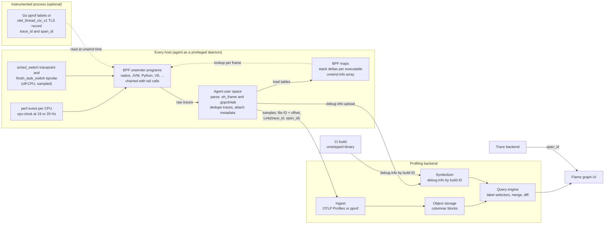

# Continuous Profiling: GWP, Parca, Pyroscope, and OTel Profiles

> [!summary] Claim:
> A continuous profiler samples every process on every host at a low fixed rate (19 or 20 Hz per logical CPU by default in Parca Agent and the OpenTelemetry eBPF profiler), ships raw stacks off the host keyed by a binary identity, and symbolizes and aggregates them centrally so that any time range, service, or version can be queried after the fact.
> Google-Wide Profiling (GWP) set the template in 2010: sample in two dimensions (a subset of machines, and events within each machine), keep collection separate from symbolization, and load the samples into a dimensional database.
> Current eBPF agents walk stacks inside the kernel: user space flattens each binary's `.eh_frame` call frame information into small sorted tables in BPF maps, and a BPF program attached to a perf event binary-searches them once per frame, so the host needs no frame pointers, no debug symbols, and no stack copies.
> pprof is the common sample format, and OTLP Profiles (Alpha since 2026-03) extends it with shared dictionaries, resource context, and a per-sample `Link` holding a `trace_id` and `span_id`, which is the field that joins one profile sample to one distributed trace span.



## The Mechanism

A one-off profile answers a question about one process on one host during one window that somebody chose in advance.
A continuous profiler removes the choosing: it records a thin, unbiased sample of everything, always, and moves the choice of process, host, version, and window to query time.
That only works when the per-host cost is small enough to leave on, which drives every design decision in this note.
[[Linux-perf-in-Depth-and-perf-c2c]] owns `perf_event_open`, sampling skid, and the `perf` tool itself, and [[eBPF-bpftrace-ftrace-uprobes-and-USDT]] owns the BPF verifier, maps, and probe types; this note uses both and re-derives neither.

### 1. The GWP template

Ren et al. describe GWP in IEEE Micro (July/August 2010) as a continuous profiling infrastructure that "samples across machines in multiple data centers and collects various events - such as stack traces, hardware events, lock contention profiles, heap profiles, and kernel events".
The paper presents it as an extension of the Digital Continuous Profiling Infrastructure (DCPI) to data centers.
Four ideas from that paper are still the architecture of every system in this note.

- **Two-dimensional sampling.**
  The paper states "GWP samples in two dimensions": at any moment only a small subset of machines is being profiled, and on each of those machines event-based sampling is used.
  Sampling in one dimension alone fails either way: profiling every machine at a normal event rate costs too much fleet-wide, and a very low event rate makes per-machine data too sparse to drill into.
- **A central collector that pulls.**
  The collector reads the list of machines from a machine database, picks a random sample, remotely activates profiling on each, and retrieves the results, taking "a few minutes to gather profiles for a specific machine".
  It monitors error conditions and stops profiling when the failure rate reaches a threshold.
- **Collection separated from symbolization.**
  Binaries are deployed stripped, so each profile carries "a unique identifier for each running binary", and GWP "stores unstripped binaries in a global repository".
  Symbolizing one day of profiles sequentially "would take weeks", so it is distributed "across a few hundred machines using MapReduce".
- **A dimensional store.**
  A record is the tuple `<event, sample counter, m-dimension vector>`, where the vector holds application name, function name, platform, compiler version, image name, data center, kernel information, build revision, and builder's name.
  A query picks `k` keys to group by and filters on the other `m - k`.

GWP collected two categories of profile.
Whole-machine profiles came from OProfile driving hardware performance monitoring events, without full call stacks, to avoid unwinding cost.
Per-process profiles came from the Google Performance Tools library linked into most applications, which exposes heap, lock contention, wall time, and CPU profilers behind a small HTTP server that the collector calls.

The overhead control is explicit in the paper: measure event-profiling overhead on benchmark applications, then "conservatively set the maximum rates to ensure the overhead is always less than a few percent" on a profiled machine.
Because only a subset of machines is profiled at any time, "the aggregated profiling overhead is negligible - less than 0.01 percent".

The paper also shows that the sampled data is trustworthy.
It measures a profile's stability with entropy and compares two profiles with a Manhattan distance over their top `k` entries:

$$H(W) = -\sum_{i=1}^{n} p(x_i)\,\log p(x_i) \qquad M(X, Y) = \sum_{i=1}^{k} \left| p_x(x_i) - p_y(x_i) \right|$$

Comparing a random subset of machines against the whole set, the distance falls with the number of samples roughly as

$$M(X) = \frac{C}{\sqrt{N(X)}}$$

where `N(X)` is the sample count and `C` depends on the profile type.
That square-root law is what lets a fleet operator trade sampling rate against precision with arithmetic instead of guesswork.

#### What GWP's profiles were used for

The paper's section on uses is the best argument for why fleet-wide data is worth its cost, and each use maps to a capability a current system must keep.

- **Hottest shared code.**
  A routine that is cold in every single application can still dominate the fleet.
  GWP found that zlib "accounted for nearly 5 percent of all CPU cycles consumed", which motivated optimizing its routines and evaluating compression alternatives.
  The paper reports that users turned such shares into estimated savings, and "dollar amount per performance change" became a popular informal metric.
- **Comparing two queries.**
  GWP diffs the profiles of two queries that share keys and events but differ in other dimensions, usually at function level.
  A large change in hot functions between daily profiles triggers a finer comparison that can point at a source revision, a compiler, or a data center.
  This is the ancestor of the diff view in Parca and Pyroscope.
- **Auditing the fleet.**
  Grouping by compiler, platform, or builder shows how fast a new compiler or hardware platform actually reaches production and how fast old platforms retire.
- **Evaluating hardware.**
  Because GWP records what fraction of cycles a kind of work consumes, it was used to judge whether a floating-point coprocessor would pay off.
- **Application-platform affinity.**
  Whole-machine HPM profiles give cycles and retired instructions per job and platform, hence CPI (cycles per instruction).
  The paper's Table 1 has two applications and two platforms: NumCrunch has CPI 1 on both, and MemBench has CPI 1 on Platform 1 but 2 on Platform 2 because of its smaller L2 cache.
  Splitting 200 instructions of each evenly costs 100 + 100 cycles on Platform 1 and 100 + 200 on Platform 2, which is 500 cycles in total.
  Sending all MemBench work to Platform 1 and all NumCrunch work to Platform 2 costs 200 cycles on each platform, which is 400.
  The paper formulates the general case as a linear program over per-application, per-platform load, solved with simulated annealing, and reports 10 to 15 percent potential improvement in most cases where many jobs run on multiple platforms.
  The same CPI data tells operators where a microarchitectural peculiarity (such as a smaller L2 cache) hurts one program, which is the fleet-scale version of the single-host triage in [[Intel-VTune-AMD-uProf-and-Hardware-Tracing-PT-SPE]].
- **Feedback-directed optimization.**
  GWP can extract a profile for one binary in a format the compiler understands.
  Such a profile comes from live data, and an aged profile still helps a fresh release when the critical sections did not change; [[Cpp-PGO-AutoFDO-and-BOLT-Workflow]] owns the loop.

Hardware-event sampling (cycles, instructions, cache misses) is what the 2026 eBPF agents give up by default.
They sample the software `cpu-clock` event (`perf.CPUClock` in the profiler's `tracer/tracer.go`), so they answer "where is time spent" and not "why is this code slow per instruction".
Fleet CPI studies in the GWP style need PMU access, which virtual machines often lack; [[Intel-VTune-AMD-uProf-and-Hardware-Tracing-PT-SPE]] covers the counters and their limits.

### 2. Sampling on a host: a perf event with a BPF program attached

The open-source agents replace OProfile and in-process HTTP handlers with one mechanism.
The Parca Agent design document says the agent attaches "an eBPF program to a `perf_event`, specifically `PERF_COUNT_SW_CPU_CLOCK` event", and samples stack traces "19 times per second per logical CPU".
The `perf_event_open(2)` manual page (man-pages 6.19) describes `PERF_COUNT_SW_CPU_CLOCK` as "the CPU clock, a high-resolution per-CPU timer", and describes the `freq` bit as selecting `sample_freq` instead of `sample_period`.
The design document gives the reason for 19: it is a prime number, which avoids collisions with other periodic activity on the machine.

The OpenTelemetry eBPF profiler does the same thing.
Its entry program is declared `SEC("perf_event/native_tracer_entry")` in `native_stack_trace.ebpf.c`, and `tracer/tracer.go` builds the event with `perfAttribute.SetSampleFreq(uint64(t.samplesPerSecond))` and opens it with `perf.Open(perfAttribute, perf.AllThreads, id, nil)`.
The receiver default is `SamplesPerSecond: 20` (`collector/factory_linux.go`).

A low fixed rate bounds the worst case.
A host with 64 logical CPUs sampled at 19 Hz produces at most 64 x 19 = 1,216 samples per second, whatever the workload does.
The agents need `CAP_PERFMON` (since Linux 5.8) or `CAP_SYS_ADMIN` for system-wide events, plus BPF privileges; the example Collector configuration lists "CAP_SYS_ADMIN, CAP_PERFMON, and/or CAP_BPF, as well as access to /proc", and `hostPID: true` on Kubernetes.

### 3. Unwinding without frame pointers: `.eh_frame` flattened into BPF maps

A sample is only useful with a call stack, and the kernel's own user-stack walker follows the frame-pointer chain.
`bpf_get_stackid()` with `BPF_F_USER_STACK` collects up to `PERF_MAX_STACK_DEPTH` frames (127 in Linux v6.12) that way.
Most distribution binaries were historically compiled without frame pointers, so that walk stops after one or two frames.

`perf record --call-graph dwarf` solves this by copying a slice of the user stack and the registers into every sample (`PERF_SAMPLE_STACK_USER` and `PERF_SAMPLE_REGS_USER`, since Linux 3.7) and unwinding later in user space.
That is too expensive to leave on, and it moves other processes' stack contents off the host; [[Linux-perf-in-Depth-and-perf-c2c]] covers that mode.

#### What `.eh_frame` contains

DWARF 5 section 6.4 defines Call Frame Information (CFI) as an abstract table with one row per code location and the columns `LOC CFA R0 R1 ... RN`.
The Canonical Frame Address (CFA) is, in the standard's words, typically "the value of the stack pointer at the call site in the previous frame".
The CFA column holds a rule that is "either a register and a signed offset that are added together, or a DWARF expression that is evaluated", and each register column says how to recover that register's value in the caller.
The table is stored compressed as a byte-coded state machine, and `.eh_frame` is the copy of it that stays in the loaded image because C++ exception unwinding needs it at run time.
The OpenTelemetry profiler's internals document notes that C, Rust, and Zig binaries typically carry `.eh_frame` too.

#### The idea: evaluate the state machine in user space, look up rows in the kernel

A BPF program cannot run an unbounded state machine or a general expression evaluator.
So the agent evaluates the CFI once per executable in user space and loads the resulting table into BPF maps, leaving the kernel side a bounded lookup.

Polar Signals described the first Parca Agent version of this in 2022.
User space produced rows of `pc` (u64), a reserved u16, `cfa_type` (u8), `rbp_type` (u8), `cfa_offset` (s16), and `rbp_offset` (s16), 16 bytes per row, sorted by `pc` so the BPF program could binary search.
The BPF side read the interrupted `rip`, `rsp`, and `rbp`, found the row covering the program counter, computed the CFA from `rsp` or `rbp`, and read the return address 8 bytes below the CFA on x86-64.
That version handled only `.eh_frame`, hard-coded two DWARF expressions, and covered x86-64.

Since Parca Agent v0.32.0 (2024-08-13) the agent is, in the release notes' words, "based on the opentelemetry-ebpf-profiler"; its `go.mod` replaces `go.opentelemetry.io/ebpf-profiler` with a Parca fork (as of 2026-11).
Grafana Alloy's `pyroscope.ebpf` component embeds a Grafana fork of the same profiler.
So the unwinder described here, read from the profiler's `main` branch in 2026-11, is the one Parca, Pyroscope's eBPF collection, and the OpenTelemetry Collector distribution all run.

#### The data structures (`support/ebpf/types.h`)

The profiler calls a flattened CFI row a stack delta.

```c
typedef struct UnwindInfo {
  u8 flags;       // flags: UNWIND_FLAG_*
  u8 baseReg;     // base register to calculate CFA from
  u8 auxBaseReg;  // base register to calculate FP (x86-64) or RA[+FP] (aarch64)
  u8 mergeOpcode; // opcode for generating next stack delta
  s32 param;      // parameter for the CFA expression
  s32 auxParam;   // parameter for the FP expression
} UnwindInfo;

typedef struct StackDelta {
  u16 addrLow;    // the low 16-bits of the ELF virtual address to which this stack delta applies
  u16 unwindInfo; // index of UnwindInfo, or UNWIND_COMMAND_* if STACK_DELTA_COMMAND_FLAG is set
} StackDelta;
```

- A `StackDelta` is 4 bytes: the low 16 bits of the address where a rule starts, and a 16-bit index.
- An `UnwindInfo` is 12 bytes and says "CFA = `baseReg` + `param`" and "saved frame pointer is at `auxBaseReg` + `auxParam`".
- Unwind rules repeat heavily across functions, so `UnwindInfo` values are deduplicated into one global array, `unwind_info_array`, with `UNWIND_INFO_MAX_ENTRIES` set to 16384; the source comment says a normal desktop's `/usr/bin` and `/usr/lib` hold about 9,700 unique values.
- The deltas of one executable live in a `BPF_MAP_TYPE_ARRAY` that is the inner map of a `BPF_MAP_TYPE_HASH_OF_MAPS` keyed by the executable's file ID.
  There are sixteen such outer maps, `exe_id_to_8_stack_deltas` through `exe_id_to_23_stack_deltas`, whose inner arrays hold 2^8 through 2^23 entries, so a small library does not reserve a large array.
- `stack_delta_page_to_info` is a hash map from `(fileID, page)` to `{firstDelta, numDeltas, mapID}`, where a page is 64 kB of address space (`STACK_DELTA_PAGE_BITS` is 16).

The page table is what makes the lookup verifiable.
Splitting the address space into 64 kB pages lets `addrLow` be 16 bits and caps the entries in one page at 65,535, so a binary search inside one page needs at most 16 steps.

#### The per-frame algorithm (`native_stack_trace.h`)

`get_stack_delta()` and `unwind_one_frame()` do this for each native frame on x86-64:

1. Compute the offset of the program counter inside its executable, subtracting 1 when the PC is a return address so the lookup lands inside the call instruction's rule.
2. Look up `(fileID, offset & ~0xFFFF)` in `stack_delta_page_to_info`.
3. Pick the outer map named by `mapID`, and get the executable's inner array from it.
4. Binary search `[firstDelta, firstDelta + numDeltas)` for the first entry whose `addrLow` is greater than `offset & 0xFFFF`, in a `for (i = 0; i < 16; i++)` loop of `bsearch_step()` calls, then step back one entry.
   Stepping back from the first entry of a page lands on the last entry of the previous page, which is the rule still in force at the page boundary.
   A page with no deltas skips the search and steps back from `firstDelta`, so it also resolves to the previous page's last rule.
   If the loop has not converged after 16 steps, the real code does not guess: it returns `ERR_NATIVE_EXCEEDED_DELTA_LOOKUP_ITERATIONS` ("Corrupt data?" in its debug message).
5. If the entry has `STACK_DELTA_COMMAND_FLAG` (0x8000) set, run the command: `UNWIND_COMMAND_STOP` ends the trace at an entry point, `UNWIND_COMMAND_PLT` applies the fixed procedure-linkage-table rule, `UNWIND_COMMAND_SIGNAL` reads the saved registers out of the signal frame, `UNWIND_COMMAND_FRAME_POINTER` walks one frame-pointer link, and two native-only Go commands (`UNWIND_COMMAND_GO_ASMCGOCALL`, `UNWIND_COMMAND_GO_MORESTACK`) cross Go runtime stack switches.
   An entry equal to `STACK_DELTA_INVALID` (the flag with command 0) ends the walk with `ERR_NATIVE_STACK_DELTA_INVALID`.
6. Otherwise fetch `unwind_info_array[unwindInfo]`, compute `cfa = regs[baseReg] + param`, and read the saved frame pointer from `regs[auxBaseReg] + auxParam` when that rule is present.
7. Read the caller's PC with `bpf_probe_read_user(&state->pc, sizeof(state->pc), (void *)(cfa - 8))`, set `sp = cfa`, and mark the new frame as a return address.

Every step is a map lookup, an add, or one user-memory read, which is why the internals document can say the unwinder uses "O(log n) algorithms at worst".

The PLT command shows how one awkward DWARF expression is handled.
Toolchains describe a whole PLT with a single expression, and the profiler hard-codes its meaning:

```c
cfa = state->sp + 8UL + ((((state->pc & 15) >= 11) ? 1UL : 0UL) << 3);
```

`elfehframe.go` recognizes that expression by its opcode sequence, plus four register-dereference patterns the comments attribute to SSE-vectorized code and OpenSSL's libcrypto.
Any other expression is rejected by the parser with the error `DWARF expression unmatched`.

#### Program size, tail calls, and stack depth

The profiler supports kernels back to 5.10 and so codes against old verifier limits.
The classic per-program limit is `BPF_MAXINSNS` (4096); the modern verifier budget is `BPF_COMPLEXITY_LIMIT_INSNS` (1,000,000) in Linux v6.12.
The native unwinder therefore unwinds `NATIVE_FRAMES_PER_PROGRAM` (5) frames per program and then tail-calls itself, or the unwinder for whichever runtime owns the next PC.

Tail calls are also bounded: `MAX_TAIL_CALL_CNT` is 33 in Linux v6.12, and the profiler's internals document plans for 32.
The profiler's `tail_call()` wrapper stops at 29, records `ERR_MAX_TAIL_CALLS`, and jumps to `PROG_UNWIND_STOP`, so that a deep stack is reported truncated instead of being lost.
A pure native stack is therefore cut at roughly 5 x 29 = 145 frames, and sooner when interpreter unwinders use some of the tail calls.
State that must survive a tail call lives in a per-CPU record (`PerCPURecord`), because BPF stack frames do not.

#### Runtimes that are not described by `.eh_frame`

- **Go.**
  The internals document says Go executables "do not come with `.eh_frame` sections unless they are built with CGo enabled", so stack deltas are extracted from `.gopclntab` instead.
- **Interpreters and JITs.**
  Each supported runtime has its own BPF unwinder program (`PROG_UNWIND_HOTSPOT`, `PROG_UNWIND_PYTHON`, `PROG_UNWIND_PHP`, `PROG_UNWIND_RUBY`, `PROG_UNWIND_V8`, `PROG_UNWIND_DOTNET`, `PROG_UNWIND_DOTNET10`, `PROG_UNWIND_PERL`, `PROG_UNWIND_BEAM`, `PROG_UNWIND_LUAJIT`) that reads the runtime's own frame structures out of process memory.
  User space detects the runtime version and writes structure offsets into maps, and the entry program dispatches on the memory region that contains the PC.
  One trace can therefore cross from kernel frames through native libraries into Python or JVM frames.

#### The alternatives: frame pointers and SFrame

The simpler fix is to keep frame pointers.
Fedora 38 added `-fno-omit-frame-pointer` and `-mno-omit-leaf-frame-pointer` to its default C and C++ flags, and its change page reports a kernel build 2.4% slower with GCC, a Blender render 2% slower, and CPython benchmarks 1-10% slower.
Ubuntu 24.04 LTS enables frame pointers on 64-bit platforms, with Canonical estimating the penalty at "between 1-2% in most cases".
A frame-pointer walk costs two reads per frame and no tables, but it only covers code that was built that way, which is why the agents keep the `.eh_frame` path.

The kernel is growing a third option.
Deferred user-space unwinding (`kernel/unwind/deferred.c`) is in mainline from Linux v6.17, and `PERF_RECORD_CALLCHAIN_DEFERRED` appears in the perf UAPI header from v6.19.
An SFrame-based unwinder is not in mainline as of v7.4-rc2 (2026-11): `kernel/unwind/` holds only `deferred.c` and `user.c`.
The v15 patch series (2026-05-20) implements SFrame V3 for x86-64 only and requires binaries built by binutils 2.46 or later with the assembler option `--gsframe-3`.
[[Profiling-Decision-Records]] owns the frame-pointer versus unwind-table policy decision.

### 4. Symbolization happens off the host

The BPF unwinder emits addresses, not names.
The profiler identifies a native executable by a file ID, `SHA256(File[:4096] + File[-4096:] + BigEndianUInt64(Len(File)))` truncated to 16 bytes, and reports each frame as a file ID plus an offset inside the file.
The internals document gives the reason: native executables in production are often stripped, and shipping symbols to every host "would be both wasteful in terms of disk usage and also a major friction point".
Interpreter and JIT frames are the exception: their symbols exist only inside the running process, so the agent symbolizes them on the host.

Parca fills in the backend half.
Its agent extracts debug information from binaries it sees and uploads it; for native mappings it prefers the GNU build ID, then the Go build ID, and falls back to the file ID hash only when neither exists (Parca Agent README).
The Parca server symbolizes asynchronously on a recurring interval that its documentation gives as 10 seconds by default.
A stripped production binary is symbolized only if its unstripped twin, or separate debug info, reached the symbol store, which usually means uploading from CI by build ID.
This is GWP's "global repository" of unstripped binaries, rebuilt in the open.

### 5. Wire formats: pprof and OTLP Profiles

**pprof** (`profile.proto`) is a gzip-compressed protocol buffer that is independent of the kind of data and of how it was sampled.
A `Profile` holds `sample_type`, `sample`, `mapping`, `location`, `function`, and a `string_table` whose first entry is the empty string.
A `Sample` is a list of `location_id` values, one `value` per sample type, and a list of `Label` messages (a `key` with a `str` or a `num`).
A `Mapping` carries `memory_start`, `memory_limit`, `file_offset`, `filename`, and `build_id`, which is the hook for off-host symbolization.
Samples with identical stacks merge by adding values, which is why profiles from thousands of hosts aggregate cheaply.

**OTLP Profiles** (`opentelemetry.proto.profiles.v1development`) keeps that model and changes four things.
Every message in the file is marked `Status: [Alpha]`.

| pprof | OTLP Profiles | Why it changed |
| :--- | :--- | :--- |
| One self-contained `Profile` per file | `ProfilesData` holds `resource_profiles` plus one shared `ProfilesDictionary` | Many profiles in one export share one set of tables |
| `string_table` is the only shared table | `mapping_table`, `location_table`, `function_table`, `link_table`, `string_table`, `attribute_table`, `stack_table`, each with a zero value at index 0 | Index 0 means "not set" everywhere, and identical stacks are stored once |
| `Sample.location_id[]` inline | `Sample.stack_index` into `stack_table`; a `Stack` lists `location_indices` leaf first | A hot stack is one integer reference instead of a repeated list |
| `Sample.value[]`, one per `sample_type` | `Sample.values[]` and `Sample.timestamps_unix_nano[]`, with one `sample_type` per `Profile` | A sample can be an aggregate, a list of timestamps, or both |
| `Sample.label[]` | `Sample.attribute_indices` into `attribute_table` (`KeyValueAndUnit`) | Attributes are OpenTelemetry `AnyValue` with an optional unit |
| No trace reference | `Sample.link_index` into `link_table`; a `Link` is a 16-byte `trace_id` and an 8-byte `span_id` | Sample-level correlation with traces |
| No resource | `ResourceProfiles` and `ScopeProfiles` wrap each `Profile` | Same resource identity as the logs, metrics, and traces of the process |

The proto defines a sample's identity as the tuple `{stack_index, set_of(attribute_indices), link_index}`, and says samples with the same identity should be combined by appending values and timestamps.
So a link is part of a sample's key: the same stack under two different spans is two samples.

The specification says profiles "MUST be linkable to logs, metrics and traces through shared resource context" and that the format "in most cases supports lossless conversions" to and from existing formats.
When a source format cannot be represented, `original_payload_format` (known values `pprof`, `jfr`, `linux_perf`) and `original_payload` carry the original bytes.

Status matters here (as of 2026-11).
The signal entered public Alpha on 2026-03-26, and the announcement says it "should not be used for critical production workloads".
The package name still ends in `v1development`, and the file carries a development version counter that is incremented on each incompatible change.
Pyroscope's documentation for OTLP ingestion says breaking changes "have occurred and may continue" and calls the feature "suitable for development and testing".

### 6. Storage and query: Parca and Pyroscope

Both are GWP's "profile database" for everyone else: label-selector queries over profile series, merged across time, hosts, and versions.

**Parca** has a server and an agent.
The server can also pull pprof profiles over HTTP from targets found by service discovery, the model Go's `net/http/pprof` endpoints made common.
Its storage documentation describes two stores: a metadata store on the embedded key-value store Badger, holding mappings, functions, and locations under UUIDs, and a sample store on FrostDB, "a columnar database specifically developed for Observability purposes".
Labels are dynamic columns, and data is sorted by those columns and then by timestamp so that a query can skip data outside its range.

The pull model is also how memory profiles arrive.
An eBPF CPU agent sees time, not allocations, so heap, goroutine, and mutex profiles come from the process itself: GWP used in-process heap and lock-contention profilers behind an HTTP server, and a Go service serves the equivalent pprof endpoints for a Parca or Pyroscope server to scrape.
The backend stores them as the same labelled pprof series as CPU profiles, so one query language and one flame graph cover both.
[[Cpp-Memory-Profiling-heaptrack-Massif-DHAT-and-Allocators]] owns allocation profiling on a single host.

**Grafana Pyroscope** is a multi-tenant microservice system built from one binary whose `-target` flag picks the component.

- The v1 architecture is distributor, ingester, querier, query-frontend, query-scheduler, compactor, and store-gateway.
  Ingesters hold a per-tenant database on local disk, and "each profile series is replicated to three ingesters", each writing its own block to object storage, which the compactor later merges and deduplicates.
- The v2 architecture is distributor, segment-writer, metastore, compaction-worker, query-frontend, and query-backend.
  Segment-writers write small segments directly to object storage, and "the metastore is the only stateful component, using Raft consensus for replication".
  Ingestion is synchronous by default: the client is blocked until the data is in object storage and indexed, with "median latency expected to be less than 500ms using default settings".
  Without compaction the object count "can reach millions per hour", so compaction-workers merge segments into larger blocks.
- Pyroscope 2.0.0 made the v2 write path the default (`-write-path` flipped from `ingester` to `segment-writer`) and added `-architecture.storage` with values `v1`, `v1-v2-dual`, and `v2`, defaulting to `v1-v2-dual`.
  The v1 documentation says v1 is no longer in active development and is planned for removal in a future 3.0 release.

The v2 design is the direction the field took after GWP: stateless writers, object storage as the only durable store, and a small consensus-backed index.

### 7. Off-CPU profiles

An on-CPU profile cannot see a thread that is blocked on a lock, a disk read, or a downstream call, because a sleeping thread is never interrupted by the CPU clock.
The OpenTelemetry profiler's `off_cpu.ebpf.c` adds the missing half with two probes.

1. `tracepoint/sched/sched_switch` fires when a thread is switched out.
   The program returns early when `bpf_get_prandom_u32() > off_cpu_threshold`, and otherwise stores `bpf_ktime_get_ns()` in the LRU hash map `sched_times` under the thread's `pid_tgid`.
2. `kprobe/finish_task_switch` fires when a thread is switched back in.
   If the thread has an entry, the program computes the elapsed nanoseconds, deletes the entry, pushes the duration as the trace's value, and runs the same unwinder chain as the CPU path.

The stack is the one the thread blocked in, and the value is how long it was off the CPU.
The sampling decision is per switch-out event, not per unit of time, so with a recording probability `p` the recorded durations sum to about `p` times the true off-CPU time and must be scaled by `1/p` for absolute numbers.
Grafana Alloy exposes the probability as `off_cpu_threshold` on `pyroscope.ebpf`, a float from 0 to 1 that defaults to 0, which disables off-CPU profiling.

OTLP Profiles encodes this cleanly: the proto's own example is `sample_type=(off_cpu, nanoseconds)` with `period_type=(context_switch, count)`.
[[Playbook-Diagnose-a-Production-Tail-Latency-Spike-with-eBPF-and-perf]] owns ad hoc off-CPU triage with bpftrace on one host.

### 8. Joining samples to trace spans

A flame graph for a whole service answers "where does this service spend CPU".
A trace answers "which span of this request was slow".
Joining them answers "what code was this span running, or waiting in", and there are three ways to make the join.

**In-process labels.**
The profiler runs inside the process and already knows the active span.
In Go, `runtime/pprof` attaches labels to goroutines, and its documentation states that "currently only the CPU and goroutine profiles utilize any labels information".
`grafana/otel-profiling-go` wraps the OpenTelemetry `TracerProvider`; on span start it calls `pprof.WithLabels` and `pprof.SetGoroutineLabels` to set `span_id` and `span_name` labels, and on span end it restores the previous labels.
By default only the local root span gets the `span_id` label and the `pyroscope.profile.id` span attribute, and child spans' samples are counted under the root.
Pyroscope then selects the samples whose `span_id` label equals the span being viewed.

**Out-of-process reads.**
A whole-system eBPF profiler is outside the process, so the process must publish its context somewhere the BPF program can read at unwind time.
The OpenTelemetry profiler reads two sources (`support/ebpf/types.h`).
For Go it reads goroutine labels, up to `MAX_GO_LABELS` (10) of them into 16-byte keys and 48-byte values.
For other runtimes it reads the thread-local record defined by OTEP 4947, published through an ELF TLS symbol named `otel_thread_ctx_v1`:

```c
typedef struct __attribute__((packed)) ThreadContextBuf {
  TraceID trace_id;
  SpanID span_id;
  // 0 while the writer is mid-update.
  u8 valid;
  u8 _reserved;
  // Payload length in bytes.
  u16 attrs_data_size;
} ThreadContextBuf;
```

The reporter (`reporter/internal/pdata/generate.go`) then appends a `Link` to `link_table` for each distinct valid `(trace_id, span_id)` pair and sets `link_index` on the sample.
OTEP 4947 calls SDK support optional, names its schema version `tlsdesc_v1_dev` for experimentation, and says the authors tested it with C/C++, Rust, and Java, so treat this path as in development (as of 2026-11).

**Resource and time.**
With no per-sample context, profiles and traces still share resource attributes such as `service.name`, `k8s.pod.uid`, and `container.id`.
Selecting the profile of one pod during one span's time window is a coarse join: it shows what the pod was doing, not what the request was doing.

All three share one hard limit, which is sampling arithmetic.
A profiler that samples every `T` milliseconds sees a span that used `c` milliseconds of CPU with probability about `c / T` when `c` is smaller than `T`.
At Go's 100 Hz, `T` is 10 ms, and the Pyroscope documentation warns that "spans shorter than 10ms may not be captured".
At 19 Hz, `T` is 52.6 ms, so a 5 ms span has about a 9.5% chance of containing any sample at all.
Span-level profiles are therefore useful for long spans and for aggregates over many spans of the same name, and nearly empty for one short span.

## Commands and Numbers to Know

Every value was read from the cited documentation or source in 2026-11; none was measured for this note.

| Item | Value | Platform and date | What it controls |
| :--- | :--- | :--- | :--- |
| Parca Agent `--profiling-cpu-sampling-frequency` | `19` | Linux (as of 2026-11) | Samples per second per logical CPU |
| Parca Agent `--profiling-duration` | `5s` | Linux (as of 2026-11) | "The agent profiling duration to use" (flag help text) |
| Parca Agent `--profiling-probabilistic-threshold` | `100` (always on); 1-99 enables per-interval coin flip | Linux (as of 2026-11) | Fraction of intervals in which this host profiles |
| Parca Agent `--profiling-probabilistic-interval` | `1m` | Linux (as of 2026-11) | Length of one on-or-off interval |
| Parca Agent `--remote-store-format=otlp` | off unless set | Linux (as of 2026-11) | Export OTLP Profiles instead of Parca's Arrow-based format |
| Parca Agent `--debuginfo-upload-disable` | off unless set | Linux (as of 2026-11) | Stops debug info upload; needed when the receiver is a Collector |
| Parca Agent kernel requirement | 5.3+ with BTF (README) | Linux (as of 2026-11) | Minimum kernel the README states |
| OTel profiler `samples_per_second` | `20` | Linux (as of 2026-11) | Samples per second per logical CPU |
| OTel profiler `reporter_interval` | `5s`, with `reporter_jitter` `0.2` | Linux (as of 2026-11) | How often traces are flushed to the pipeline |
| OTel profiler `probabilistic_threshold` | `100`; valid interval is 1 to 5 minutes | Linux (as of 2026-11) | Machine-dimension sampling, as in GWP |
| OTel profiler kernel requirement | 5.10, amd64 and arm64 | Linux (as of 2026-11) | Enforced unless `no_kernel_version_check` is set |
| Collector feature gate | `--feature-gates=+service.profilesSupport` | Linux (as of 2026-11) | Enables the profiles pipeline in the Collector |
| OTel profiler stated overhead ceiling | 1% CPU and 250 MB memory "in testing" (README) | Linux (as of 2026-11) | Project's own upper limits, not measured here |
| `StackDelta` / `UnwindInfo` size | 4 bytes / 12 bytes | Linux (as of 2026-11) | Per-rule cost of the flattened unwind tables |
| `UNWIND_INFO_MAX_ENTRIES` | `16384` | Linux (as of 2026-11) | Distinct unwind rules system-wide |
| Stack delta page | 64 kB (`STACK_DELTA_PAGE_BITS` 16), 16 search steps | Linux (as of 2026-11) | Bounds the in-kernel binary search |
| `NATIVE_FRAMES_PER_PROGRAM` | `5` | Linux (as of 2026-11) | Native frames unwound before a tail call |
| Profiler tail-call cap | `29`; kernel `MAX_TAIL_CALL_CNT` is `33` in v6.12 | Linux (as of 2026-11) | Deep stacks end with `ERR_MAX_TAIL_CALLS` |
| `PERF_MAX_STACK_DEPTH` | `127` | Linux v6.12 (as of 2026-11) | Depth limit of `bpf_get_stackid()` frame-pointer walks |
| `perf_event_max_sample_rate` | `100000` per second by default | Linux (as of 2026-11) | Kernel ceiling on any perf sampling rate |
| `perf_event_paranoid` | `2` by default since Linux 4.6 | Linux (as of 2026-11) | Unprivileged perf access; system-wide needs less than 1 or `CAP_PERFMON` |
| Alloy `pyroscope.ebpf` `sample_rate` | `19` | Linux (as of 2026-11) | Samples per second |
| Alloy `pyroscope.ebpf` `collect_interval` | `"15s"` | Linux (as of 2026-11) | How often profiles are forwarded |
| Alloy `pyroscope.ebpf` `off_cpu_threshold` | `0` (off); probability 0 to 1 | Linux (as of 2026-11) | Off-CPU event sampling |
| Pyroscope OTLP ingest | gRPC on port `4040` | Linux (as of 2026-11) | Where a Collector `otlp_grpc` exporter points |
| Pyroscope `-architecture.storage` | `v1-v2-dual` since 2.0.0 | Linux (as of 2026-11) | Which storage architecture runs |
| Pyroscope `-write-path` | `segment-writer` since 2.0.0 | Linux (as of 2026-11) | `ingester` restores the v1 write path |
| Go CPU profiler rate | 100 samples per second (Pyroscope Go span profiles page) | Both (as of 2026-11) | A span under 10 ms of CPU may have no sample |
| OTLP Profiles status | Alpha; package `...profiles.v1development`; opentelemetry-proto v1.11.1 | Both (as of 2026-11) | Wire compatibility is not yet guaranteed |
| `Link` | 16-byte `trace_id`, 8-byte `span_id` | Both (as of 2026-11) | The per-sample trace reference |
| GWP aggregated overhead | less than 0.01 percent | Linux (2010 paper) | Fleet-wide cost with two-dimensional sampling |
| Fedora 38 default flags | `-fno-omit-frame-pointer -mno-omit-leaf-frame-pointer` | Linux (as of 2026-11) | Distribution-wide frame pointers |

Commands that the cited documentation gives verbatim:

```bash
# OpenTelemetry eBPF profiler as a Collector receiver (profiler README).
sudo ./otelcol-ebpf-profiler --feature-gates=+service.profilesSupport \
    --config cmd/otelcol-ebpf-profiler/local.example.yaml

# Parca Agent exporting OTLP Profiles to a Collector (Parca Agent README).
parca-agent \
  --remote-store-format=otlp \
  --remote-store-address=otel-collector.observability.svc:4317 \
  --remote-store-insecure \
  --metadata-discovery=local \
  --debuginfo-upload-disable \
  --symbolize-go
```

## Multi-Language Comparison

How one whole-system eBPF agent sees each language, from the OpenTelemetry profiler's README, internals document, and source (as of 2026-11, Linux).

| Concern | C++ | Python | Rust |
| :--- | :--- | :--- | :--- |
| Where the unwind rules come from | `.eh_frame`, flattened to stack deltas | CPython's own frame structures, read by `PROG_UNWIND_PYTHON`; native frames around them use `.eh_frame` | `.eh_frame`, same native path as C++ |
| Change needed in the process | None | None; the README says no reconfiguration or restart of interpreters is needed | None |
| Where symbols are resolved | Backend, from file ID plus offset and uploaded debug info | On the host, by the agent, because the names live in the interpreter | Backend, same as C++ |
| Frame-pointer build switch | `-fno-omit-frame-pointer` (and `-mno-omit-leaf-frame-pointer` in Fedora's defaults) | Not applicable to Python frames; see [[Python-CPython-perf-Trampoline-and-Tachyon-Internals]] for the interpreter's own perf support | `-C force-frame-pointers=yes`; see [[Rust-CPU-Profiling-cargo-flamegraph-samply-and-Frame-Pointers]] |
| Well-known `profile.frame.type` value | `native` | `cpython` | `rust` is defined; the convention requires a more precise value than `native` when possible |
| Mangled names | `Function.system_name_strindex` carries the mangled name; Alloy's `demangle` option defaults to `none` | Not mangled | Same field as C++ |
| Per-sample trace context | `otel_thread_ctx_v1` TLS record (OTEP 4947, tested by its authors with C/C++) | In-process instead: Pyroscope's `pyroscope-otel` package registers a `PyroscopeSpanProcessor`, CPU profiles only; whether the eBPF agent can read CPython trace context is UNVERIFIED: no source for it was found | `otel_thread_ctx_v1` TLS record (OTEP 4947, tested by its authors with Rust) |

Go is the outlier worth remembering: no `.eh_frame` without cgo, unwind data from `.gopclntab`, and trace context from goroutine labels instead of a TLS record.

## Worked Lab Example

This note has no lab, because the mechanism needs a privileged Linux host with a BPF-capable kernel and a backend to send to.
The two walk-throughs in this section are hand derivations from the cited source, not recorded output, and the table values in them are invented for illustration.
[[Rebuild-Lab-Sampling-Profiler-to-Folded-Stacks]] is the runnable companion: it builds the sampling half that this note describes.

### A. One native frame, by hand

A thread is interrupted inside `libfoo.so` at file offset `0x41a37` with `sp = 0x7ffc00001000`, and this is the leaf frame, so no return-address adjustment applies.

1. Split the offset: the page is `0x41a37 & ~0xFFFF = 0x40000`, and the page offset is `0x41a37 & 0xFFFF = 0x1a37`.
2. Look up `(fileID, 0x40000)` in `stack_delta_page_to_info` and get `{firstDelta: 1200, numDeltas: 6, mapID: 12}`.
3. Fetch the inner array for this file ID from `exe_id_to_12_stack_deltas`; entries 1200 to 1205 are:

```text
index  addrLow  unwindInfo
1200   0x19f0   3
1201   0x19f4   7
1202   0x1a01   9
1203   0x1a30   7
1204   0x1a38   3
1205   0x1a60   0x8001   (STACK_DELTA_COMMAND_FLAG | UNWIND_COMMAND_STOP)
```

4. Binary search with `lo = 1200`, `hi = 1206`:

```text
step 1: pivot 1203, 0x1a37 >= 0x1a30  -> lo = 1204
step 2: pivot 1205, 0x1a37 <  0x1a60  -> hi = 1205
step 3: pivot 1204, 0x1a37 <  0x1a38  -> hi = 1204, lo == hi, stop
```

5. `hi` is the first entry greater than the target, so the rule in force is entry `hi - 1 = 1203`, with `unwindInfo = 7`.
6. Suppose `unwind_info_array[7]` is `{baseReg: UNWIND_REG_SP, param: 48, auxBaseReg: UNWIND_REG_CFA, auxParam: -16}`.
   This is the flattened form of a CFI row "CFA = rsp + 48, rbp saved at CFA - 16".
7. Compute `cfa = 0x7ffc00001000 + 48 = 0x7ffc00001030`.
8. Read the saved frame pointer from `cfa - 16 = 0x7ffc00001020` and the caller's PC from `cfa - 8 = 0x7ffc00001028`.
9. Set `sp = 0x7ffc00001030`, mark the frame as a return address, and repeat from step 1 with the new PC minus 1.

Six map lookups (the page info, the inner-array fetch, three search probes, and the rule) and two user-memory reads recovered a frame from a binary with no frame pointers and no symbols.
Two rows in the listing share `unwindInfo` 7 and two share 3, which is the deduplication that keeps `unwind_info_array` small.

### B. One span, on-CPU and off-CPU, in OTLP Profiles

A request handler runs under span `00f067aa0ba902b7` of trace `4bf92f3577b34da6a3ce929d0e0e4736`.
The process publishes that context, and the agent emits two profiles in one `ProfilesData` message that share one dictionary.
Shown in text form, with strings written out instead of string-table indexes:

```yaml
dictionary:
  link_table:
    - {trace_id: 00000000000000000000000000000000, span_id: 0000000000000000}   # index 0: no link
    - {trace_id: 4bf92f3577b34da6a3ce929d0e0e4736, span_id: 00f067aa0ba902b7}   # index 1
  stack_table:
    - {location_indices: []}                 # index 0: zero value
    - {location_indices: [7, 5, 2]}          # index 1: parse_json <- handle <- serve (leaf first)
    - {location_indices: [9, 8, 5, 2]}       # index 2: futex_wait <- pool_get <- handle <- serve
resource_profiles:
  - resource: {service.name: checkout, k8s.pod.uid: "...", container.id: "..."}
    scope_profiles:
      - profiles:
          - sample_type: {type: cpu, unit: nanoseconds}
            period_type: {type: cpu, unit: nanoseconds}
            period: 50000000                 # 20 Hz
            samples:
              - {stack_index: 1, link_index: 1, values: [150000000]}   # 3 samples in this span
              - {stack_index: 1, link_index: 0, values: [900000000]}   # same stack, no span context
          - sample_type: {type: off_cpu, unit: nanoseconds}
            period_type: {type: context_switch, unit: count}
            samples:
              - {stack_index: 2, link_index: 1, values: [412000000]}   # blocked 412 ms in this span
```

Reading it:

- The same stack appears twice in the CPU profile because `link_index` is part of a sample's identity.
- To build the span's profile, a backend selects samples whose link equals the span's IDs, in both profiles, and renders two flame graphs: 150 ms of sampled CPU in `parse_json`, and 412 ms blocked in `pool_get`.
- The trace alone said the span took about 560 ms; the join says most of it was waiting for a connection pool, not parsing.
- The off-CPU value is exact for the events that were recorded, and events are recorded with the configured probability, so a single span may have no off-CPU sample even when it blocked.
- UNVERIFIED: that a given agent release attaches links to off-CPU samples; the trace record layout in `types.h` and the reporter's link code are shared by both trace origins, but no off-CPU export was captured for this note.

The in-process route in Go reaches the same join with pprof labels, using the wrapper from the `grafana/otel-profiling-go` README:

```go
// Wrap it with otelpyroscope tracer provider.
otel.SetTracerProvider(otelpyroscope.NewTracerProvider(tp))
```

That route covers CPU profiles only, since Go attaches labels to CPU and goroutine profiles and the package README says "only CPU profiling is fully supported at the moment".

## Pitfalls

> [!warning] Pitfall: treating the profile as a census
> Nineteen samples per second per CPU is a statistical estimate, and its relative error for a function taking fraction `p` of `n` samples is about `sqrt((1 - p) / (n p))`.
> A function at 0.1% needs about 100,000 samples for a 10% relative error, so a five-minute view of one small pod usually cannot rank small functions.
> Widen the time range or the set of hosts before concluding anything about a thin frame.

> [!warning] Pitfall: expecting every span to have a profile
> The `pyroscope.profile.id` attribute marks spans that can have a profile, and the Pyroscope documentation says it does not guarantee that any samples were collected.
> A span that used less CPU than one sampling interval usually has none.
> Aggregate over many spans of the same name instead of reading one short span.

> [!warning] Pitfall: high-cardinality labels and links
> Labelling every span, or putting request IDs in sample attributes, makes almost every sample unique and defeats the dictionary and merge model.
> The `otel-profiling-go` README warns that `ScopeAllSpans` "significantly increases label cardinality", and the OTLP proto warns against attributes with unbounded values.
> Keep the default root-span scope unless a specific investigation needs more.

> [!warning] Pitfall: stripped binaries with no debug info in the symbol store
> The agent sends a file ID and an offset, and the name comes from debug info found by build ID.
> A binary stripped in CI whose debug info was never uploaded shows as hexadecimal addresses forever, because the host never had the symbols.
> Upload debug info from the build, and give every binary a GNU build ID.

> [!warning] Pitfall: truncated or broken native stacks
> A frame whose CFI uses an expression the parser does not recognize, hand-written assembly without CFI, or a JIT the agent has no unwinder for ends the trace early.
> Very deep stacks end with `ERR_MAX_TAIL_CALLS` once the profiler's cap of 29 tail calls is reached.
> Check the agent's unwind error metrics before trusting a flame graph whose towers all stop at the same odd frame.

> [!warning] Pitfall: reading off-CPU totals without the sampling probability
> Off-CPU events are recorded with a configured probability per switch-out, so raw sums understate blocked time by that factor.
> On-CPU and off-CPU values also have different units of sampling (time versus events), so never add the two profiles together.

> [!warning] Pitfall: building production dependencies on an Alpha wire format
> OTLP Profiles lives in a `v1development` package, and both the OpenTelemetry announcement and Pyroscope's documentation warn against critical production use.
> Pin the agent, Collector, and backend versions together and test upgrades as a set.

> [!warning] Pitfall: forgetting what a whole-system agent can see
> The agent runs privileged in the host PID namespace and reads other processes' memory to unwind interpreters and read thread context.
> Parca Agent marks its `--metadata-enable-process-cmdline` flag as one that "may expose sensitive information like secrets in profiling data".
> Treat the agent as a privileged security boundary and review what metadata it exports.

## At Scale

For one engineer, continuous profiling is the wrong tool.
A single `perf record` or `samply` run at a high rate answers the question faster, and [[Linux-perf-in-Depth-and-perf-c2c]] covers that.
The value appears when nobody knows in advance which process, host, or week will matter.

### What changes with size

- **Cost is bounded per host and unbounded in aggregate.**
  The agent's sample rate caps per-host work, but ingest, storage, and symbolization grow with hosts times CPUs times distinct stacks times label combinations.
- **Precision is cheap at scale.**
  With the square-root law, 100,000 samples resolve a 0.1% function to about 10% relative error.
  At 19 Hz that is about 5,260 busy core-seconds, or 88 core-minutes, which a fleet with 10,000 busy cores produces in under a second of wall time.
  So a large fleet can profile a fraction of hosts, as GWP did, and lose nothing for fleet-level questions.
- **Small services are the opposite case.**
  GWP added application-specific profiling because the default rate did not collect enough samples for applications that used few cycles fleet-wide.
  Machine-dimension sampling must therefore be per service, not one global number.
- **Symbols become a pipeline.**
  At 1,000 engineers there are thousands of builds a day, and symbolization fails silently when one team's CI does not upload debug info.
- **The data starts paying for itself.**
  GWP found that zlib accounted for "nearly 5 percent of all CPU cycles" fleet-wide, something no single application's profile showed.
  It also fed sampled profiles to feedback-directed optimization; [[Cpp-PGO-AutoFDO-and-BOLT-Workflow]] owns that loop.

### Decision rules

- **One to about 50 engineers, one cluster.**
  Run one agent as a DaemonSet at the default rate and one backend in single-binary mode.
  Do not tune anything until a query is too slow or a bill is too high.
- **About 50 to 1,000 engineers.**
  Give the profiling backend an owner, put debug info upload into the shared build templates, and set a label policy: resource attributes yes, per-request values no.
  Use object storage with a retention tier, and keep full resolution for days, not months.
- **1,000 to 50,000 engineers.**
  Sample hosts as well as events: set the probabilistic threshold per service so that each service still gathers enough samples for its smallest interesting function.
  Run the backend as stateless writers over object storage, set per-tenant limits, and expose the data through an API so cost attribution and compiler feedback can consume it.
  Report in money as well as percent; the GWP paper notes that "dollar amount per performance change" became a popular metric.
- **Frame pointers or tables.**
  If the organization controls its build flags, turn frame pointers on fleet-wide and accept a cost in the range distributions measured (about 1-2% in most cases, more for some interpreters).
  Keep the `.eh_frame` unwinder for third-party and distribution code that was not built that way.
  [[Profiling-Decision-Records]] holds the full decision record.
- **Trace correlation.**
  Turn on root-span labels for services whose spans are usually longer than a few sampling intervals, and rely on aggregates by span name elsewhere.
  Adopt the thread-context TLS mechanism only where the language SDK supports it and the organization accepts an in-development specification.
- **OTLP Profiles.**
  Use it at the edges where it removes a custom integration, keep the ability to export pprof, and do not make an Alpha format the only copy of data that anything critical depends on.
- **Parca or Pyroscope.**
  Both store label-indexed profiles in columnar form and both ingest from the same eBPF profiler lineage, so decide on operations: existing Grafana stack, multi-tenancy needs, and who will run it.
  That comparison belongs to [[Profiling-Decision-Records]].

## Practice Drill

> [!tip] Practice Drill:
> Nothing in this drill was run for this note; it is a procedure to follow on a Linux host or VM with kernel 5.10 or later and root.
> First, on paper: take the stack delta listing from the worked example and resolve page offsets `0x19f2`, `0x1a01`, and `0x1a70` by hand, writing down each `lo`, `hi`, and pivot, and say what the unwinder does with the entry it finds for `0x1a70`.
> Second, on the host: build `otelcol-ebpf-profiler` from the opentelemetry-ebpf-profiler repository with `make agent`, start a backend that accepts OTLP Profiles, and run the profiler with the command in Commands and Numbers to Know.
> Third, run one CPU-bound C or C++ program built with `-O2` and no `-fno-omit-frame-pointer`, strip a copy of it, and compare the flame graphs of the stripped and unstripped runs to see which frames lose their names and which lose their stacks.
> Fourth, compute how many samples your program should have produced from its CPU time and the sample rate, and compare with what the backend reports.
> Then do [[Rebuild-Lab-Sampling-Profiler-to-Folded-Stacks]] to build the sampler yourself.

## Interview Questions

> [!question] L5: Why do continuous profilers default to about 19 or 20 Hz when in-process profilers such as Go's sample at 100 Hz, and why 19 and not 20?
>
> > [!success]- Answer
> > The rate bounds the per-host cost: each sample costs an interrupt, a stack walk, and a map update, so samples per second per CPU is the knob that makes "always on" affordable.
> > Precision comes from aggregation instead: summing over hosts and minutes yields far more samples than one short high-rate run.
> > The Parca Agent design document gives the reason for 19 specifically: it is prime, which avoids locking onto other periodic activity, such as timers that fire every 10 or 50 ms.
> > The OpenTelemetry profiler defaults to 20, so the prime choice is a preference, not a requirement.

> [!question] L5 (predict the output): A service uses a steady 2.5 cores on an 8-CPU host for 10 seconds while the agent samples at 19 Hz per logical CPU.
> About how many on-CPU samples land in that service, and what is the most the host could produce?
>
> > [!success]- Answer
> > The clock fires 19 times per second on each CPU, and a sample is attributed to whatever is running there.
> > The service occupies 2.5 CPUs on average, so it receives about 19 x 2.5 x 10 = 475 samples.
> > The host's ceiling is 19 x 8 x 10 = 1,520 samples.
> > With 475 samples, a function taking 10% of the service has a relative standard error of about `sqrt(0.9 / 47.5)`, or 14%, so only the largest frames are trustworthy at this window.

> [!question] L5: What is in a pprof profile, and what does OTLP Profiles add?
>
> > [!success]- Answer
> > A pprof profile is a gzip-compressed protobuf holding sample types, samples, locations, functions, mappings, and a string table whose index 0 is the empty string.
> > Each sample is a list of location IDs, one value per sample type, and optional labels; each mapping can carry a build ID for later symbolization.
> > OTLP Profiles keeps the model and adds resource and scope wrappers, one dictionary shared by all profiles in a message, a stack table so each distinct stack is stored once, attributes with units, optional per-sample timestamps, and a link table of trace and span IDs.
> > It is in Alpha in a `v1development` package as of 2026-11.

> [!question] L6: Walk through how a BPF program unwinds one frame of a C++ binary that has no frame pointers.
>
> > [!success]- Answer
> > User space has already parsed the binary's `.eh_frame`, evaluated the CFI state machine, and loaded sorted 4-byte stack deltas into a per-executable BPF array, with the distinct rules in a shared unwind-info array.
> > The program converts the PC into a file ID and an offset, looks up the 64 kB page of that offset to get the range of deltas, and binary searches that range in at most 16 fixed steps.
> > The entry gives either a command, such as stop, PLT, signal frame, or frame pointer, or an index to a rule of the form "CFA = register + constant".
> > It computes the CFA, optionally reads the saved frame pointer, reads the return address at CFA minus 8 with `bpf_probe_read_user`, and sets the stack pointer to the CFA.
> > After five frames it tail-calls the next unwinder program, keeping state in a per-CPU record, until a stop entry or the tail-call cap ends the trace.

> [!question] L6 (predict the output): This Python transliterates the profiler's `bsearch_step` loop.
> What does it print?
>
> ```python
> def lookup(addr_low, first, num, page_offset):
>     lo, hi = first, first + num
>     for i in range(16):
>         pivot = (lo + hi) >> 1
>         if page_offset >= addr_low[pivot]:
>             lo = pivot + 1
>         else:
>             hi = pivot
>         if not (lo < hi):
>             return hi - 1, i + 1
>     return None
>
> deltas = [0x0010, 0x0040, 0x0044, 0x0100, 0x0180]
> for po in (0x0043, 0x0180, 0x0008):
>     print(hex(po), lookup(deltas, 0, 5, po))
> ```
>
> > [!success]- Answer
> > It prints `0x43 (1, 2)`, then `0x180 (4, 2)`, then `0x8 (-1, 3)`.
> > The search finds the first entry greater than the target and steps back one, so `0x43` resolves to the rule that starts at `0x40`, and `0x180` to the rule that starts exactly there.
> > `0x8` is below the page's first entry, so the result is one before the first index.
> > In the real code that index is `firstDelta - 1`, the last delta of the previous page, and `get_stack_delta()` adds 65,536 to the address difference to account for the page change.
> > This was checked by running the snippet with `python3`; it is a model of the C code, not the BPF program itself.

> [!question] L6 (debug this): A trace span carries `pyroscope.profile.id`, but opening its profile shows nothing.
> The service-level flame graph is fine.
> What do you check?
>
> > [!success]- Answer
> > First the arithmetic: Go's CPU profiler samples 100 times per second, so a span that used under 10 ms of CPU usually has no sample, and the attribute only marks spans that can have a profile.
> > Second, time on CPU versus wall time: a span that spent 300 ms blocked on I/O has almost no CPU samples, and the Go integration supports CPU profiles only.
> > Third, scope: by default only the local root span is labelled, so a child span's samples are filed under the root's ID.
> > Fourth, plumbing: the profiler must actually be running, and in pull mode the profile's `service_name` label must match the SDK's `service.name`.
> > The fix for the common case is to look at the aggregate for the span name over many requests, or to add off-CPU data, not to raise the sampling rate fleet-wide.

> [!question] L7 (debug this): After a release, flame graphs for one C++ service show hexadecimal addresses instead of function names, and many stacks are two frames deep.
> Other services are fine.
> Diagnose it.
>
> > [!success]- Answer
> > These are two different failures that often arrive together.
> > Addresses instead of names means symbolization failed: the backend has no debug info for this build ID, typically because the new pipeline strips the binary and no longer uploads debug info, or the binary lost its GNU build ID.
> > Check the build ID with `readelf -n` on the deployed binary and look for it in the symbol store.
> > Shallow stacks mean unwinding failed, which is independent of symbols: the agent derives unwind tables from `.eh_frame`, so check that the section still exists and that the release did not add `-fno-asynchronous-unwind-tables` or a linker script that drops it.
> > Then read the agent's unwind error metrics for this process to see which error dominates.
> > Fix the pipeline in the build templates, since history for that release stays unsymbolized until its debug info is uploaded.

> [!question] L7: GWP samples machines as well as events.
> Why is that the right design, and how do you size it?
>
> > [!success]- Answer
> > Per-machine overhead and fleet-wide cost are different budgets.
> > Event sampling keeps the profiled machine's overhead under a few percent, and machine sampling divides the fleet cost again, which is how the paper reaches an aggregate overhead under 0.01 percent.
> > Profile error falls as one over the square root of the sample count, so a fleet-level question needs a fixed number of samples regardless of fleet size.
> > To size it, pick the smallest function share you care about and the error you accept: 0.1% at 10% relative error needs about 100,000 samples, which at 19 Hz is about 88 busy core-minutes.
> > Then set the machine-sampling fraction per service so that the smallest service still reaches that count in the query window, because a single global fraction starves small services.

> [!question] L7: Design per-request CPU and off-CPU attribution for a fleet with Go, Java, C++, and Python services.
>
> > [!success]- Answer
> > Use one whole-system eBPF agent for collection so every language gets on-CPU and off-CPU stacks without code changes, and emit OTLP Profiles so each sample can carry a link.
> > For Go, have the agent read goroutine labels that the tracing wrapper sets; for C++ and Java, publish the OTEP 4947 thread-local context record; for Python, check SDK support and fall back to resource and time correlation where there is none.
> > Enable off-CPU sampling with a small probability and scale by its inverse in the backend.
> > Label root spans only, and present per-span-name aggregates by default, because a single short span rarely contains a sample.
> > Call out the risks: the format is Alpha, the thread-context mechanism is in development, and link cardinality multiplies stored samples, so roll out per service with a cardinality budget.

> [!question] L8+: Your company has 20,000 engineers and no frame pointers in its C++ and Rust builds.
> Do you mandate frame pointers, rely on `.eh_frame` unwinding in BPF, or wait for SFrame?
>
> > [!success]- Answer
> > Mandate frame pointers for first-party code and keep table-based unwinding for everything else.
> > Frame pointers make every tool work, including the kernel's own stack walker, at a cost distributions measured at about 1-2% in most cases and up to 10% for some CPython benchmarks, so exempt the measured outliers.
> > Table-based unwinding already works in the agents and needs no rebuild, but it costs agent memory and CPU, it stops at unrecognized CFI expressions, and it lives in a privileged component that must track kernel changes.
> > SFrame is not a plan for 2026: kernel support is not in mainline as of v7.4-rc2, the series covers x86-64 only, and it needs binutils 2.46 and a fleet-wide rebuild.
> > The decision record should state the measured cost on the company's own top services, the exemption process, and a date to revisit SFrame.

> [!question] L8+: You are asked to approve a privileged eBPF profiling agent on every production host.
> What do you require before saying yes?
>
> > [!success]- Answer
> > A blast-radius analysis: the agent holds perf and BPF capabilities, runs in the host PID namespace, and reads other processes' memory.
> > A data review of everything exported: stacks reveal code paths, and metadata such as command lines and environment variables can leak secrets, so those stay off by default.
> > Bounded resource use enforced from outside the agent, with cgroup limits and alerts tied to the project's stated ceilings, plus a kill switch.
> > A staged rollout with machine-dimension sampling, automatic back-off on errors as GWP's collector did, and kernel-version gating, because verifier behaviour differs across kernels.
> > Version pinning of agent, Collector, and backend as one unit while the wire format is Alpha, and a legal review of the licences and of the patent the profiler's README cites for its `.eh_frame` technique.

## Further Reading

- Ren et al., "Google-Wide Profiling: A Continuous Profiling Infrastructure for Data Centers" (IEEE Micro, 2010): the architecture, the overhead argument, and the entropy and Manhattan-distance validation that everything since has copied.
- opentelemetry-ebpf-profiler `doc/internals.md`: the clearest written account of file IDs, stack deltas, tail-call-chained unwinders, and why symbolization is a backend job.
- opentelemetry-ebpf-profiler `support/ebpf/native_stack_trace.h` and `types.h`: the actual per-frame unwinder and its data structures, short enough to read in one sitting.
- Polar Signals, "DWARF-based Stack Walking Using eBPF" (2022): the first public write-up of flattening `.eh_frame` into BPF maps, including the verifier constraints that shaped it.
- DWARF 5, section 6.4 "Call Frame Information": the definition of the CFA and the register rules that the flattened tables encode.
- `profiles.proto` in opentelemetry-proto: the normative OTLP Profiles data model, including the sample identity rule and the `Link` message.
- "OpenTelemetry Profiles Enters Public Alpha" (2026-03-26): what Alpha covers, what is still missing, and the roadmap items for symbolization and context sharing.
- OTEP 4947, "Thread Context": the proposed way for SDKs to publish trace context to out-of-process readers.
- Grafana Pyroscope, "About the Pyroscope v2 architecture": a current example of a stateless, object-storage-first profile store with a Raft-backed index.
- Parca Agent README and design document: the flags, the metadata model, the OTLP export mode, and the debug info upload protocol.
- Fedora "Changes/fno-omit-frame-pointer" and the Ubuntu 24.04 frame pointer announcement: measured costs and the reasoning behind distribution-wide frame pointers.
- `google/pprof` `proto/README.md`: the pprof data model in prose, which is still the fastest way to understand every later format.

## See Also

- [[Linux-perf-in-Depth-and-perf-c2c]]: owns `perf_event_open`, sampling, and the `perf` tool that the agents' perf events build on.
- [[eBPF-bpftrace-ftrace-uprobes-and-USDT]]: owns the BPF verifier, maps, tail calls, and probe types that the unwinder runs inside.
- [[Rebuild-Lab-Sampling-Profiler-to-Folded-Stacks]]: builds the sampling half of this pipeline as a runnable lab.
- [[Playbook-Diagnose-a-Production-Tail-Latency-Spike-with-eBPF-and-perf]]: ad hoc off-CPU triage on one host.
- [[Rust-CPU-Profiling-cargo-flamegraph-samply-and-Frame-Pointers]]: frame pointers in Rust builds.
- [[Python-CPython-perf-Trampoline-and-Tachyon-Internals]]: the interpreter's own perf support.
- [[Cpp-PGO-AutoFDO-and-BOLT-Workflow]]: where fleet profiles feed the compiler.
- [[Profiling-Decision-Records]]: the frame-pointer and backend decision records.

## Related

- Prerequisites: none
- Next: [[Profiling-Decision-Records]]
- See also: [[04-System-Design/00-Concepts/SLOs-and-Observability|SLOs and Observability]]
