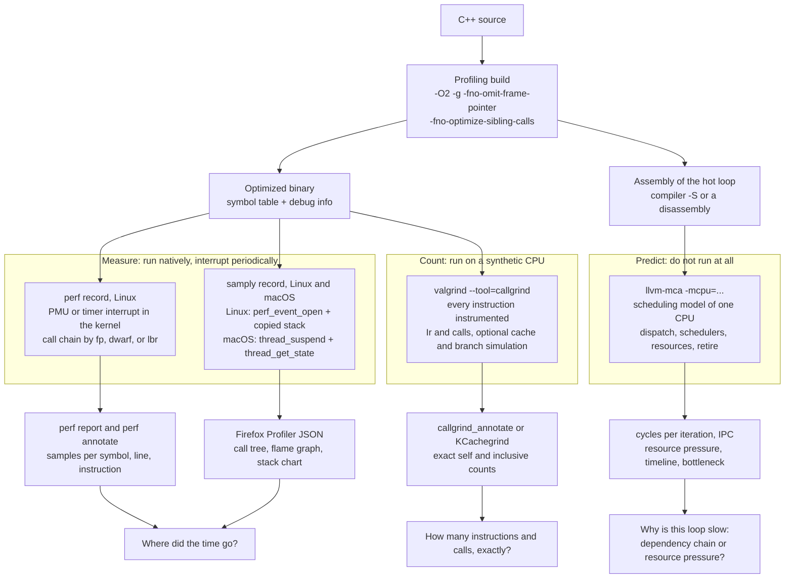

# C++ CPU Profiling: perf, samply, Callgrind, and llvm-mca

> [!summary] Claim:
> C++ CPU profiling rests on three kinds of evidence, and no single tool supplies all three.
> Sampling profilers (`perf record` on Linux, `samply` on Linux, macOS, and Windows) interrupt the real program on the real CPU and record where it was, so they measure time but only statistically, and only as well as the binary lets them unwind and name its stacks.
> Callgrind runs the program on Valgrind's synthetic CPU and counts every instruction and call exactly, so its numbers are reproducible but are counts, not time.
> `llvm-mca` never runs the program: it replays a block of assembly through LLVM's scheduling model of one CPU and reports cycles per iteration, which explains why a hot loop costs what it does but only for code that hits L1 and predicts perfectly.
> The working method is to sample to find the hot function, read its annotated instructions, and then use counts or the pipeline model to explain them, with a build (`-O2 -g -fno-omit-frame-pointer -fno-optimize-sibling-calls`) that keeps stacks and names truthful.



## The Mechanism

A profile answers "where did the cost go", and the three families of tool define "cost" differently.
The differences decide which questions each can answer, so they come first.

### 1. Three kinds of evidence

| Property | Sampling (`perf`, `samply`) | Counting (Callgrind) | Modeling (`llvm-mca`) |
| :--- | :--- | :--- | :--- |
| Runs the program | Yes, natively | Yes, on Valgrind's synthetic CPU | No |
| Unit of cost | Samples of an event or of a clock | Instructions read (`Ir`), calls, optional simulated misses | Simulated cycles for a block repeated in a loop |
| Exact or statistical | Statistical | Exact for the run | Exact for the model |
| Sees real caches and branch predictor | Yes | No, optional simulation of an old machine | No, assumes L1 hits and no mispredictions |
| Sees the kernel and other processes | Yes, with permission | No | No |
| Reproducible run to run | No | Largely: Cachegrind's manual calls instruction counts highly reproducible | Yes, for one LLVM version |
| Needs the source or debug info | For names and lines only | For names and lines only | Needs only assembly |

Sampling is the only family that measures time on the machine you care about.
Its weakness is statistical: if a function truly accounts for a fraction `p` of the samples and the profile holds `N` independent samples, the observed share has a standard error of `sqrt(p * (1 - p) / N)`.
With `N = 1000` and `p = 0.05` that is about 0.7 percentage points, so a 5% function is 5% plus or minus about 1.4 points at 95% confidence, and a 0.5% function is barely distinguishable from noise.
[[Sampling-vs-Instrumentation-Skid-and-Safepoint-Bias]] owns the systematic errors (skid, safepoint bias) that sit on top of that random error.

Counting removes the randomness and the hardware together.
Cachegrind's manual gives the reason people accept that trade: execution time "might vary by several percent" between identical runs, while "instruction counts are highly reproducible; for some programs they are perfectly reproducible", so small changes "can be measured with high precision".

Modeling removes the run itself.
It answers a different question: given these instructions on this microarchitecture, what limits their rate.

### 2. Building C++ so a profiler can tell the truth

A profiler reports addresses.
Turning an address into `function`, `file:line`, and a call chain needs three separate things from the build, and an ordinary release build removes or weakens each of them.

**Optimization level.**
Profile the optimization level you ship.
The Callgrind manual says the same for its own users: compile "with debugging info (the `-g` option) and with optimization turned on".
An `-O0` profile describes a different program: nothing is inlined, every variable lives on the stack, and the hot spots move.

**Names: the symbol table and debug info.**
The symbol table maps an address range to one function name, and that is all a stripped-of-debug-info binary offers.
An inlined function has no symbol; its instructions sit inside its caller's range.
Debug info adds two layers: the line table maps each address to `file:line`, and inlined-subroutine records say which inlined function a range of the caller came from, which is what lets a profiler print an inline stack.
[[DWARF-Debug-Information-and-Symbol-Bundles]] owns the format; on macOS the same data lives in a `.dSYM` bundle or in the object files the linker's debug map points at.
The lab proves the difference on one loop: with `-g` the hot address resolves to `hop <- chase`, and in the same source built without `-g` the name `hop` appears nowhere.

Two Clang options trade debug info size against profiler usefulness (as of 2026-11, from `Options.td` at llvmorg-23.1.5): `-gline-tables-only` ("Emit debug line number tables only") and `-fdebug-info-for-profiling` ("Emit extra debug info to make sample profile more accurate"), the second of which matters when the profile feeds the compiler, as [[Cpp-PGO-AutoFDO-and-BOLT-Workflow]] describes.

**Call chains: frame pointers and unwind tables.**
A stack walk needs to get from one frame to its caller.
With frame pointers each function stores the caller's frame pointer and its own return address as a pair, so the walker follows a linked list with two memory reads per frame.
GCC enables `-fomit-frame-pointer` "by default at `-O1` and higher", which frees a register and removes that list.
`-fno-omit-frame-pointer` restores it, with a documented gap: it "doesn't guarantee the frame pointer is used in all functions", because "several targets always omit the frame pointer in leaf functions".
On AArch64 and x86 the separate switch is `-mno-omit-leaf-frame-pointer`; GCC's AArch64 documentation says omitting it in leaf functions is the default.
When a sample lands in a leaf that kept no frame record, the frame pointer register still points at the caller's record, so the walk continues from the caller's caller and the direct caller silently drops out of the stack.
The Linux kernel's user-stack walkers for perf show this directly (as of 2026-11, `master`): the arm64 walker records `regs->pc`, then starts at `regs->regs[29]` and records only the saved `lr` of each frame record it reads, never the live link register, and the x86 walker records `regs->ip`, then reads each return address through `regs->bp`, with a code comment that without a set-up frame pointer "we'll skip immediate caller", a case it patches only for a uprobe at a function entry.

The alternative is unwinding from call frame information (`.eh_frame`, `.debug_frame`, or Apple's compact unwind info), which works without frame pointers but costs more per sample.
`perf record --call-graph dwarf` copies a slice of the user stack into every sample and unwinds later; `samply` does the same on Linux and reads the stack of a suspended thread on macOS.
[[Stack-Unwinding-CFI-and-Exception-ABI]] owns the unwind formats.

**Call chains: sibling calls.**
At `-O2` both GCC and Clang turn a call in tail position into a jump (`-foptimize-sibling-calls`, which GCC documents as "enabled at levels `-O2`, `-O3`, `-Os`").
The caller's frame is gone before the callee starts, so no unwinder of any kind can show the caller.
Clang documents the opposite flag in exactly these terms: `-fno-optimize-sibling-calls`, "Disable tail call optimization, keeping the call stack accurate".
The lab's `drive_chase_in_order` and `drive_chase_scattered` end in `return chase(...)`; in the plain `-O2` build neither appears in any stack.

The profiling build used throughout this note is therefore:

```bash
c++ -O2 -g -fno-omit-frame-pointer -fno-optimize-sibling-calls ...
# add -mno-omit-leaf-frame-pointer where the target omits leaf frame records
```

Debug info lives in sections that are not loaded for execution, or in a separate bundle, so `-g` costs disk and link time.
It is not supposed to change the instructions: GCC ships a self-check, `-fcompare-debug`, that compiles twice with debug info toggled and reports an error if the final representations differ.
The two `-fno-` flags do change generated code: one register is reserved and tail calls become real calls, so measure the profiling build against the release build before trusting small differences.

### 3. perf on Linux: the C++ workflow

[[Linux-perf-in-Depth-and-perf-c2c]] owns the mechanism: `perf_event_open`, the ring buffer, and the three call chain methods.
In two sentences: the kernel arms a counter (hardware `cycles` by default) to overflow at a chosen rate, and on each overflow it records the instruction pointer, the thread, and optionally a call chain into a per-CPU buffer that `perf record` drains to `perf.data`.
`perf report` and `perf annotate` then join those addresses with the binary's symbols and debug info.

The defaults that shape a C++ profile (as of 2026-11, Linux, perf at v7.3):

- `perf record` samples at 4000 Hz unless `-F` or `-c` says otherwise (`.freq = 4000` in `builtin-record.c`).
- `-g` records call chains with the frame pointer method; `perf-record(1)` warns that on binaries built with `-fomit-frame-pointer` this "will produce bogus call graphs".
- `--call-graph dwarf` records a user stack dump with every sample, 8192 bytes by default, changed with a size after a comma such as `--call-graph dwarf,16384`; a stack deeper than the dump is truncated.
- `--call-graph lbr` uses the hardware Last Branch Record and needs no compiler option; the man page says it is "only available on new Intel platforms, such as Haswell" and "can only get user call chain".
- `perf report` shows two columns when call chains exist: `Self`, which sums to 100%, and `Children`, which adds the cost of everything a function called and can sum to far more than 100%; `--children` is on by default and the report is sorted by it.
- `perf report --inline` is on by default: when an address belongs to an inlined function and debug info is present, the inline stack is printed.
- An event can carry a precision modifier: `cycles:p` asks for constant skid, `:pp` requests zero skid, and `:ppp` requires zero skid or randomizes to avoid sample shadowing; `perf-list(1)` says Intel implements these with PEBS and AMD with IBS.

A session on a C++ service follows a fixed order:

```bash
# 1. Is it on-CPU, and how well does the core run it? (IPC is "insn per cycle" in the output)
perf stat -e cycles,instructions,branches,branch-misses -- ./app

# 2. Where? Frame pointers if the whole stack has them, DWARF if not.
perf record -F 999 --call-graph fp -- ./app
perf record -F 999 --call-graph dwarf,16384 -- ./app

# 3. Which function owns the time (self), then which call path (children).
perf report --no-children --sort symbol
perf report --children

# 4. Which instructions inside the hot function.
perf annotate --stdio -s sum_serial

# 5. The same recording in the Firefox Profiler UI.
samply import perf.data
```

`perf annotate` prints the function's disassembly with a sample percentage on each instruction and, by default (`--source`), the source lines interleaved.
That per-instruction view is where a profile stops telling you "which function" and starts showing "which dependency chain", and it is the input you hand to `llvm-mca`.
[[Hardware-Performance-Counters-Top-Down-TMA-and-Roofline]] owns the counter side: when to ask for cache misses or branch misses instead of cycles.

### 4. samply: one sampler, two operating systems, the Firefox Profiler as UI

`samply` (v0.13.1, released 2025-02-01 and still the latest release as of 2026-11) records stacks at a fixed rate, 1000 Hz by default, and writes the Firefox Profiler's processed profile format.
It also has a Windows backend, not covered here; its macOS and Linux backends work differently enough that the same program produces different profiles on the two systems.

**macOS: suspend, read registers, walk the stack remotely.**
There is no perf subsystem to ask, so samply does the sampling itself from another process.

1. It launches the target with `DYLD_INSERT_LIBRARIES` pointing at a small preload library that it writes to a temporary directory; the library sends the child's Mach task port back to samply (`mac/process_launcher.rs`).
2. A sampler thread loops: sample every thread of every live task, then sleep until one interval after the tick started, shortening the sleep by the amount the previous sleep overshot (`mac/sampler.rs`).
3. For each thread it first reads the thread's user plus system CPU time with `thread_info(THREAD_BASIC_INFO)`; the difference from the previous tick becomes the sample's CPU delta (`sample_impl` in `mac/thread_profiler.rs`).
4. If the thread used CPU since the last tick, samply calls `thread_suspend`, reads the registers with `thread_get_state` (on arm64: `pc`, `lr`, `sp`, and `fp` from `ARM_THREAD_STATE64`, with pointer authentication bits stripped), walks the stack by reading 8-byte words out of the target's memory, and calls `thread_resume` (`get_backtrace` and `do_stackwalk` in `mac/proc_maps.rs`, which stop at 10,000 frames).
5. If the thread used no CPU, samply does not suspend it at all: it assumes the stack is unchanged and records a zero-CPU sample with the previous stack; consecutive zero-CPU ticks are merged into one sample whose `weight` counts the ticks (`add_sample_same_stack_zero_cpu`).

The consequence is that a macOS samply profile is a wall-clock profile: the README states that "on macOS and Windows, both on- and off-cpu samples are collected", so a thread blocked on a lock or in `sleep` keeps accumulating ticks under the stack it blocked in.
The per-sample CPU delta is what separates the two, and the lab checks both: the sleeping phase holds most of its ticks in a single weighted sample and almost no CPU time.

The stack walk uses the `framehop` library, which reads Apple's compact unwind info, `.eh_frame`, and `.debug_frame`, and, on x86_64 and aarch64, "falls back to frame pointer unwinding if it cannot find unwind information for an address".
samply therefore does not require frame pointers, but nothing recovers a caller that a tail call removed.

Two macOS limits come from the launch method (README, "Known issues"): system binaries are signed so that they ignore `DYLD_INSERT_LIBRARIES`, so samply cannot profile them, and attaching to a running process with `-p` needs `samply setup`, which self-signs the samply binary with the `com.apple.security.cs.debugger` entitlement.
Profiling every process (`-a`) is not supported on macOS.

**Linux: perf events with a copied stack.**
On Linux samply is a `perf_event_open` client (`linux/profiler.rs`, `linux/perf_event.rs`).

- It opens a `PERF_COUNT_HW_CPU_CYCLES` event in frequency mode at `1e9 / interval` Hz, so 1000 Hz by default.
- Each sample carries the user registers and a copy of the top of the user stack (`PERF_SAMPLE_REGS_USER | PERF_SAMPLE_STACK_USER`), 32,000 bytes per sample; the code rejects sizes above 63 KiB.
- samply unwinds those copies itself with `framehop`, the same approach as `perf record --call-graph dwarf` with a larger dump.
- If the hardware event cannot be opened, the source comment says it "is not supported in some contexts, for example in VMs", and samply retries with the software `PERF_COUNT_SW_CPU_CLOCK` event.
- It needs `kernel.perf_event_paranoid` at 1 or lower for an unprivileged user; when opening the event fails with a permission error and the level is higher, it exits with instructions (`paranoia_level` in `linux/profiler.rs`).
- The README states that "on Linux, only on-cpu samples are collected at the moment", so a blocked thread contributes nothing.

**The file and the UI.**
The output (`profile.json.gz` by default) holds column-oriented tables per thread: `samples` (stack, time, weight, CPU delta), `stackTable` (each stack is a frame plus a prefix stack), `frameTable` (an address inside a library), `funcTable`, and `resourceTable`.
samply 0.13.1 writes processed-profile version 49; the Firefox Profiler front end is at version 77 (as of 2026-11) and upgrades older files when it loads them.
Addresses are stored unsymbolicated.
After recording, samply starts a local web server (address `127.0.0.1`, port 3000 or the next free one) and opens `profiler.firefox.com`, which asks that server for symbols and source; the README says "all data is kept locally (on disk and in RAM) until you choose to upload your profile".
`--save-only` skips the server, and `samply load profile.json` starts it later.

The UI offers the same samples in several projections (Firefox Profiler UI tour): the Call Tree, which merges common ancestors and can be inverted into a bottom-up tree, the Flame Graph, the Stack Chart (a chronological view aligned with the timeline), and the Marker Chart.
The UI tour warns about the Stack Chart that sampled data "can miss short events", so it "could show a long call where it's instead a sequence of short calls".
[[Flame-Graphs-Differential-Flame-Graphs-and-Visualizations]] owns how to read them.

`--unstable-presymbolicate` writes a `.syms.json` sidecar next to the profile so that it can be loaded on a machine without the binaries.
The sidecar holds a string table and, per library, a `symbol_table` (`rva`, `size`, `symbol`, optional debug-info `frames`) plus `known_addresses`, a list of `(address, index into symbol_table)` pairs.
It keeps one `symbol_table` entry per symbol, created for the first sampled address inside that symbol (`symbol_table_map.entry(addr_info.symbol.address).or_insert_with(...)` in `symbol_precog.rs`), so the `frames` and line it stores describe that one address, not every address in the function.
The flag's own help text warns that the format "will probably change".

### 5. Callgrind: exact counts on a synthetic CPU

Callgrind is a Valgrind tool.
The Valgrind core takes over the process, translates each block of machine code into an intermediate representation, lets the tool add instrumentation, and compiles the result back to machine code that it runs in place of the original; the core manual puts it plainly: "Valgrind simulates every single instruction your program executes".
The design is described in Nethercote and Seward's PLDI 2007 paper, and Callgrind itself in Weidendorfer, Kowarschik, and Trinitis (ICCS 2004), both listed on Valgrind's publications page.

**What it counts.**
By default Callgrind collects "the number of instructions executed, their relationship to source lines, the caller/callee relationship between functions, and the numbers of such calls".
The event is `Ir`, instruction reads.
Cachegrind, whose functionality Callgrind extends, attributes each event to the function it occurred in, which is self or exclusive cost.
Callgrind adds propagation across calls: "if function `foo` calls `bar`, the costs from `bar` are added into `foo`'s costs", which is inclusive cost, and it records how many times each call edge was taken.
Call counts are something a sampling profiler cannot give you at all.

**How it knows a call happened.**
Callgrind watches the instruction stream for calls and returns.
The manual is candid that this "works best on x86 and amd64" and "does not work so well on PowerPC, ARM, Thumb or MIPS code", because those instruction sets have "no explicit call or return instructions, so Callgrind has to rely on heuristics".

**Optional simulations.**
`--cache-sim=yes` adds data reads and writes (`Dr`, `Dw`) and misses for a first-level instruction cache, a first-level data cache, and a last-level cache (`I1mr`, `D1mr`, `D1mw`, `ILmr`, `DLmr`, `DLmw`).
`--branch-sim=yes` adds conditional branches and their mispredictions (`Bc`, `Bcm`) and indirect branches and theirs (`Bi`, `Bim`).
The manual says to "expect a further slow down approximately by a factor of 2".

The simulated machine is specified in Cachegrind's manual, section 5.8, and it is old on purpose:

- The cache model "approximates the hardware of an AMD Athlon CPU circa 2002": write-allocate, bit-selection indexing, and an LL cache that behaves inclusively.
- Sizes come from the host through x86 `CPUID` where that works, and from `--I1`, `--D1`, and `--LL` (size, associativity, line size) otherwise; the number of sets must be a power of two.
- It simulates only the first and last levels, uses virtual addresses, ignores the kernel and other processes, and does not see misses "not visible at the instruction level, e.g. those arising from TLB misses, or speculative execution".
- Conditional branches use "an array of 16384 2-bit saturating counters" indexed by address and recent history; indirect branches use a 512-entry table that predicts the previous target; returns are assumed perfectly predicted.

Cachegrind's own manual concludes that "the simulations are basic and unlikely to reflect the behaviour of a modern machine", and Valgrind 3.21.0 (April 2023) made `--cache-sim=no` Cachegrind's default for that reason.
The same manual's advice is the right rule: "if you really want cache and branch information, a profiler like perf that accesses hardware counters is a better choice".

**Cost of running it.**
The core manual gives the floor: the no-instrumentation tool Nulgrind "causes in total only about a 4 times slowdown", and Callgrind's manual says a run with instrumentation switched off has "at most a slowdown of around 4".
The manuals give no single figure for a full Callgrind run; it is slower than that floor, and slower again with the simulations.
Threads are serialized: Valgrind runs "only one (kernel) thread" at a time, so "threaded apps never use more than one CPU simultaneously".

**Limiting what is collected.**
Two independent switches exist, and they differ in cost.
The instrumentation mode (`--instr-atstart=no`, `callgrind_control -i on`, `CALLGRIND_START_INSTRUMENTATION`) turns the expensive machinery off entirely, but every switch flushes Valgrind's translated code and resets the cache simulator, so it is for skipping whole phases such as startup.
The collection state (`--collect-atstart=no`, `--toggle-collect=<function>`, `CALLGRIND_TOGGLE_COLLECT`) only decides whether events are added to the counters; it is cheap to flip and is the right tool for "only inside this function".
Function arguments accept `*` and `?` wildcards, which the manual calls important for C++, because otherwise the full signature must be spelled out.

**The output.**
A run writes `callgrind.out.<pid>`, an ASCII file in the Callgrind format, which the specification calls "upwards compatible to the format used by Cachegrind".
After header lines such as `events:` and `positions:`, the body is a sequence of position specifications (`fl=` file, `fn=` function) followed by cost lines, and call edges are a two-line association: `calls=<count> <target position>` followed by a cost line holding the inclusive cost of those calls.
The format specification's own example shows the idea:

```text
# callgrind format
events: Instructions

fl=file1.c
fn=main
16 20
cfn=func1
calls=1 50
16 400
```

Here line 16 of `main` has a self cost of 20 instructions and makes one call to `func1`, whose inclusive cost is 400.
The specification says it is written for "authors of measurement or visualization tools", and that "any profiling tool could use the format", which is how other profilers come to reuse KCachegrind as their viewer.

`callgrind_annotate` prints the per-function list (self cost by default, `--inclusive=yes` for inclusive, `--tree=both` for callers and callees) and annotated source.
Instruction-level data (`--dump-instr=yes`) and jump data (`--collect-jumps=yes`) can be shown only by KCachegrind, according to the manual.
`callgrind_annotate` does no cycle detection, so for recursive programs it "can print nonsense inclusive costs way above 100%"; KCachegrind detects cycles and collapses them.

**Where it runs.**
Valgrind 3.28.0 (23 October 2026) supports Linux on x86, AMD64, ARM32, ARM64, and others, and macOS only on Intel hardware up to macOS 13.
There is no Callgrind on Apple Silicon macOS (as of 2026-11), which is why this note's lab does not run it.

### 6. llvm-mca: a pipeline model for one block of code

`llvm-mca` was added in LLVM 7.0.0 (September 2018); its documentation says the "analysis and reporting style were inspired by the IACA tool from Intel".
It "uses information available in LLVM (e.g. scheduling models) to statically measure the performance of machine code in a specific CPU".

**Input.**
It reads assembly, parses it with the target's assembler into machine instructions, and treats the whole input as one block unless comments `# LLVM-MCA-BEGIN <name>` and `# LLVM-MCA-END` mark regions.
The block is simulated "in a loop of iterations (default is 100)": instruction 0 of iteration 1 follows the last instruction of iteration 0, whatever the branches in the block say.
The right input is therefore the body of the hot loop, from its header to its back edge, and nothing else.

**The simulated pipeline.**
The default out-of-order pipeline has four stages, and each is a queue with a capacity taken from the CPU's scheduling model:

1. Dispatch: instructions enter in program order, in groups of at most the dispatch width (the model's `IssueWidth`), provided the reorder buffer (`MicroOpBufferSize`), the physical register file, and the schedulers have room.
2. Issue: an instruction waits in a scheduler until its input registers are ready, then is issued to a processor resource (an execution unit or group of units) when one is free; older instructions go first.
3. Write-back: the instruction completes after its modeled latency.
4. Retire: instructions leave in program order, which frees their physical registers.

Loads and stores pass through a simulated load/store unit with a simple rule set: a load may pass an older load when no store or barrier sits between them, a store never passes an older store or load, and with the default `-noalias=true` a load may pass an older store.

**What the model leaves out.**
The documentation lists these directly:

- "The instruction fetch and decode stages are not modeled", so front-end bottlenecks are invisible.
- It "does not model branch prediction".
- The load/store unit "does not know anything about cache hierarchy"; for loads the scheduling model provides an "optimistic" load-to-use latency, one that "usually matches the load-to-use latency for when there is a hit in the L1D".
- It "does not know when store-to-load forwarding may occur".

Every number it prints is therefore a statement about a loop that hits L1 and predicts perfectly.
The comment directive `# LLVM-MCA-LATENCY 100` lets you override the latency of the instructions that follow, which the documentation suggests "to model the cache misses that impact load latencies".

**Reading the summary.**
The first block of output gives `Iterations`, `Instructions`, `Total Cycles`, `Total uOps`, `Dispatch Width`, `uOps Per Cycle`, `IPC`, and `Block RThroughput`.
Two of them diagnose the loop:

- `Total Cycles / Iterations` is the simulated cost of one iteration.
- `Block RThroughput` is the reciprocal of "the maximum number of blocks (i.e. iterations) that can be executed per simulated clock cycle in the absence of loop carried dependencies"; it is bounded by the dispatch rate and by resource availability.

If cycles per iteration is close to `Block RThroughput`, the loop is limited by width or by a contended resource, and the resource pressure view shows which one.
If cycles per iteration is far above `Block RThroughput`, something else is holding it back, and that something is a loop-carried dependency chain.
`-bottleneck-analysis` says so explicitly: it splits the cycles with rising back-end pressure into "Resource Pressure" and "Data Dependencies" and prints the critical sequence of instructions.
`-timeline` draws each instruction's life cycle by cycle (`D` dispatched, `=` waiting, `e` executing, `E` executed, `-` waiting to retire, `R` retired), which makes a chain visible as a staircase of `=` characters.

**The model is the answer.**
"By design, the quality of the analysis conducted by `llvm-mca` is inevitably affected by the quality of the scheduling models in LLVM."
`-mcpu` selects the model, and by default it is "autodetected from the host".
In LLVM 23.1.5 every Apple CPU from `apple-a7` through `apple-m5` is defined with `CycloneModel`, the scheduling model of the Cyclone core (`cyclone` is an alias of `apple-a7`; `IssueWidth = 6`, `MicroOpBufferSize = 192`, `LoadLatency = 4`), and `apple-m1` is an alias of `apple-a14` (`AArch64Processors.td`).
On an Apple Silicon Mac, the default `llvm-mca` run therefore models an A7.
The lab shows what that means: for the same loop the Apple model reports 5.00 cycles per addition and the `neoverse-v2` model reports 2.00, because `AArch64SchedCyclone.td` gives a double-precision `fadd` a latency of 5.

Accuracy has been measured for x86.
The abstract of Abel and Reineke's uiCA paper reports that "the average error of existing models compared to measurements on the actual hardware has been shown to lie between 9% and 36%", naming `llvm-mca` among those models, and that a pipeline model with more microarchitectural detail is "usually within 1%".
Treat an `llvm-mca` number as an explanation to be confirmed by measurement, not as a measurement.

### 7. Joining the evidence

The seed for this note asks for the skill of correlating a source-level bottleneck with what the execution resources are doing.
The chain of reasoning is always the same, and the lab runs it end to end on one loop:

1. Sample, and sort by self cost: `sum_serial` dominates.
2. Read the hot instructions: eight `fadd d0, d0, ...` in a row, each consuming the result of the previous one.
3. Model the loop: 40.01 cycles per iteration against a block reciprocal throughput of 4.0, with 99.37% of the pressure attributed to data dependencies, so the chain is the limit and the adders are mostly idle.
4. Change the source to break the chain into four accumulators and model again: 5.01 cycles for four additions.
5. Measure: the four-accumulator version is at least twice as fast, and within 50% of the predicted factor.

A Callgrind run would report the opposite ranking for those two loops: the one-accumulator loop executes 16 instructions for 8 additions and the four-accumulator loop 9 instructions for 4, so by `Ir` the faster loop is the more expensive one per addition.
That is not a defect in Callgrind; instruction count and time are different quantities, and the pipeline model is what connects them.

## Commands and Numbers to Know

| Item | Value | Platform and date | What it controls or means |
| :--- | :--- | :--- | :--- |
| `perf record` default rate | 4000 Hz | Linux (as of 2026-11, v7.3) | Samples per second per CPU unless `-F` or `-c` is given |
| `perf record -g` | call chains by frame pointer | Linux (as of 2026-11) | `--call-graph` default is `fp` for user space |
| `--call-graph dwarf` stack dump | 8192 bytes per sample | Linux (as of 2026-11) | Deeper stacks are truncated; raise with `dwarf,<bytes>` |
| `perf report --children` | on | Linux (as of 2026-11) | Adds the `Children` column and sorts by it; `--no-children` sorts by `Self` |
| `perf report --inline` | on | Linux (as of 2026-11) | Prints inline stacks when debug info has them |
| Precise modifiers | `:p`, `:pp`, `:ppp` | Linux (as of 2026-11) | Constant skid, zero skid requested, zero skid required (or randomized); PEBS on Intel, IBS on AMD |
| samply release | 0.13.1, 2025-02-01 | Both (as of 2026-11) | Latest release in the repository |
| `samply record --rate` | 1000 Hz | Both (as of 2026-11) | Sampling rate; the profile's `meta.interval` is 1 ms |
| `samply record` output | `profile.json.gz` | Both (as of 2026-11) | `-o` changes it; `--save-only` skips the server and browser |
| samply server | `127.0.0.1`, port 3000 or next free | Both (as of 2026-11) | Serves symbols and source to `profiler.firefox.com` |
| samply stack copy | 32,000 bytes per sample, limit 63 KiB | Linux (as of 2026-11) | User stack bytes copied by the kernel for later unwinding |
| samply event | hardware cycles, else software cpu-clock | Linux (as of 2026-11) | The fallback is what runs in most virtual machines |
| `kernel.perf_event_paranoid` | 1 or lower | Linux (as of 2026-11) | Required by samply for an unprivileged user |
| samply off-CPU samples | recorded | macOS (as of 2026-11) | Linux records on-CPU samples only |
| samply stack depth limit | 10,000 frames | macOS (as of 2026-11) | `do_stackwalk` stops there |
| Processed profile version | 49 written by samply 0.13.1; front end at 77 | Both (as of 2026-11) | The front end upgrades older versions on load |
| Valgrind release | 3.28.0, 23 October 2026 | Linux; macOS 13 or older on Intel only (as of 2026-11) | No Apple Silicon macOS support |
| Callgrind default event | `Ir` only | Linux (as of 2026-11) | `--cache-sim=no` and `--branch-sim=no` are the defaults |
| Callgrind output | `callgrind.out.<pid>` | Linux (as of 2026-11) | `.part` and `-threadID` suffixes for extra dumps and `--separate-threads=yes` |
| `--dump-instr`, `--collect-jumps` | `no`, `no` | Linux (as of 2026-11) | Instruction-level and jump data; viewable only in KCachegrind |
| `--separate-recs`, `--skip-plt` | `2`, `yes` | Linux (as of 2026-11) | Recursion levels kept apart; PLT trampolines hidden |
| `callgrind_annotate --threshold` | 99% | Linux (as of 2026-11) | Stops listing functions once that share of cost is shown |
| Simulated branch predictor | 16384 two-bit counters; 512-entry indirect table | Linux (as of 2026-11) | Cachegrind's model of a 2004-era predictor |
| Valgrind floor | about 4 times slower with no instrumentation | Linux (as of 2026-11) | Cache and branch simulation cost about a further factor of 2 |
| `llvm-mca -iterations` | 100 | Both (as of 2026-11, LLVM 23.1.5) | How many times the block is replayed |
| `llvm-mca -timeline` limits | 10 iterations, 80 cycles | Both (as of 2026-11) | `-timeline-max-iterations`, `-timeline-max-cycles` |
| `llvm-mca -noalias` | true | Both (as of 2026-11) | Loads may pass older stores; load and store queues are unbounded |
| `llvm-mca -mcpu` | host CPU | Both (as of 2026-11) | Selects the scheduling model; always pass it explicitly |
| Apple CPU models in LLVM | `CycloneModel` for `apple-a7` through `apple-m5` | Both (as of 2026-11, LLVM 23.1.5) | `IssueWidth` 6, `MicroOpBufferSize` 192, `LoadLatency` 4 |
| `-fomit-frame-pointer` | on at `-O1` and higher | Both (as of 2026-11, GCC documentation) | Removes the frame record that `fp` unwinding follows |
| `-foptimize-sibling-calls` | on at `-O2`, `-O3`, `-Os` | Both (as of 2026-11, GCC documentation) | Turns tail calls into jumps and removes the caller's frame |

## Multi-Language Comparison: C++ / Python / Rust

| Concern | C++ | Python (CPython) | Rust |
| :--- | :--- | :--- | :--- |
| Native sampling with `perf` or `samply` | Works directly on the optimized binary | Native stacks show interpreter functions; since Python 3.12, `-X perf` or `PYTHONPERFSUPPORT=1` makes Python functions appear through perf map files, and samply on macOS is supported from Python 3.15 | Works directly; the samply README recommends a `profiling` Cargo profile that inherits `release` and sets `debug = true` |
| Frame pointers | `-fno-omit-frame-pointer`, plus `-mno-omit-leaf-frame-pointer` | Decided by how the interpreter and each extension were built | `-C force-frame-pointers=yes`; without it the default "depends on the target" |
| Inlined code in profiles | Needs `-g`; templates and lambdas inline heavily | Applies to C extensions only | Needs `debug = true`; generics and iterator chains inline heavily |
| Exact instruction counts | `valgrind --tool=callgrind ./app` | Callgrind counts the interpreter's instructions, so costs land on interpreter functions | Gungraun runs benchmarks under Callgrind, Cachegrind, and DHAT, once each |
| Pipeline model | `c++ -S` then `llvm-mca` | Not applicable to Python source; usable on a C extension's loop | `rustc --emit asm` then `llvm-mca` |
| Owner note | This note | [[Python-cProfile-Tachyon-and-Sampling-Profilers]], [[Python-CPython-perf-Trampoline-and-Tachyon-Internals]] | [[Rust-CPU-Profiling-cargo-flamegraph-samply-and-Frame-Pointers]], [[Rust-Benchmarking-Criterion-Divan-Gungraun-and-dhat]] |

The Python and Rust cells reflect the Python HOWTO, the rustc book, and the Gungraun README as of 2026-11.

## Worked Lab Example

The lab is `code/05-Profiling/samply_cpu_profile/`.
It needs macOS, `samply` on `PATH`, and `llvm-mca` (Homebrew's `llvm` formula keeps it off `PATH`, so `run.sh` also looks under the Homebrew prefix); a missing tool is a loud failure, not a skip.

```bash
cd code/05-Profiling/samply_cpu_profile
bash run.sh
```

`kernels.cpp` is a workload whose structure is known in advance, so that a profile of it can be checked instead of merely admired.
It has four phases, each timed by the program itself with both `steady_clock` and `CLOCK_THREAD_CPUTIME_ID`:

- `serial`: `drive_serial` calls `sum_serial`, which adds 4096 doubles into one accumulator, 80,000 times.
- `unrolled`: `drive_unrolled` calls `sum_unrolled4`, the same additions into four accumulators.
- `chase`: one function, `chase`, follows `next[at]` links through a 64 MiB table; `drive_chase_in_order` runs it over links that go to the next element, and `drive_chase_scattered` over a full-period linear congruential permutation whose hops land megabytes apart.
  The load is in `hop`, an always-inlined helper.
- `sleep`: `sleep_phase` sleeps for 200 ms.

`run.sh` then does four things.

1. It builds the profiling build (`-O2 -g -fno-omit-frame-pointer -fno-optimize-sibling-calls`), a plain `-O2` build, and the assembly (`-O2 -S`).
2. It records the profiling build with `samply record --save-only --unstable-presymbolicate --rate 1000`, so no browser or server starts and a symbol sidecar is written.
3. `analyze_profile.py` joins the profile's tables with the sidecar, rebuilds every stack root first, and computes self and inclusive ticks and CPU time per function.
   Counts and times vary between runs, so they go to stderr; stdout carries only banded checks, each of which prints `NO` and fails the lab when it does not hold.
4. It records the plain build's `chase` phase and checks what disappeared, then `mca_predict.py` cuts each kernel's inner loop out of the compiler's assembly (from the label the compiler marks as an inner loop header through the branch back to it) and runs `llvm-mca -iterations=1000` on it with two CPU models.

### Verified output

Recorded by `python3 -m _harness.verify --record` on darwin-arm64 in 2026-11 and re-checked by `verify`; the file is `code/05-Profiling/samply_cpu_profile/expected/darwin-arm64.txt`.
The machine was an Apple M3 Pro on macOS 27.2 with Apple clang 21.0.0, samply 0.13.1, and Homebrew LLVM 23.1.5.

Stages 1 and 2, the workload and what the profile says (darwin-arm64):

```text
== 1. Workload under samply, 1000 Hz ==
serial   checksum 3527720000.0
unrolled checksum 3527720000.0
chase    in-order end 16113920, scattered end 162208
sleep    done

== 2. What the profile says ==
Profile file
  format: Firefox Profiler processed profile, version 49, sampling interval 1 ms
  symbolicated in the JSON: false (names come from the sidecar)
  threads recorded: 1
  sample columns: stack, threadCPUDelta, time, weight
  ticks recorded are 40% to 105% of one per interval: yes
Self cost by function (innermost frame), every function with at least 5% of CPU time
  chase, sum_serial, sum_unrolled4
  sum_serial has more self CPU time than sum_unrolled4: yes
Sampled CPU time against the workload's own CLOCK_THREAD_CPUTIME_ID timers
  sum_serial self CPU is within 15% of the serial phase: yes
  sum_unrolled4 self CPU is within 15% of the unrolled phase: yes
Inclusive cost and the call tree
  drive_serial self CPU is under 5% of its inclusive CPU: yes
  drive_serial inclusive CPU covers sum_serial self CPU: yes
  drive_unrolled self CPU is under 5% of its inclusive CPU: yes
  drive_unrolled inclusive CPU covers sum_unrolled4 self CPU: yes
  main inclusive CPU is at least 95% of the thread: yes
One function, two callers
  the flat profile has one chase row, equal to the sum over both callers: yes
  chase under drive_chase_in_order is within 20% of that phase: yes
  chase under drive_chase_scattered is within 20% of that phase: yes
  a scattered hop costs at least 20 times an in-order hop: yes
Inlined code
  symbol table name for the hot loop: chase
  debug-info frames at its first sampled address, innermost first: hop <- chase
  hop, which has no symbol of its own, is named through debug info: yes
Off-CPU time
  sleep_phase holds 40% to 105% of one tick per millisecond slept: yes
  sleep_phase used under 5 ms of CPU: yes
  one sample with a weight above 1 carries at least 40% of those ticks: yes
  its innermost frame is the kernel wait, not sleep_phase itself: yes
Measured speedup of four accumulators over one
  at least 2x: yes
```

Stage 3, the same loop in an ordinary optimized build (darwin-arm64):

```text
== 3. What an ordinary -O2 build hides ==
Same loop, built with -O2 alone (no -g, sibling calls allowed)
  debug-info frames for chase: none
  chase has self samples and hop is not named anywhere: yes
  drive_chase_in_order and drive_chase_scattered are in no stack (tail calls): yes
```

Stage 4, the pipeline model (darwin-arm64):

```text
== 4. What llvm-mca predicts for the hot loops ==
sum_serial: inner loop as compiled, 16 instructions, 8 addition(s) per iteration
    LBB0_5:
    ldp     q1, q2, [x9, #-32]
    mov     d3, v1[1]
    mov     d4, v2[1]
    ldp     q5, q6, [x9], #64
    mov     d7, v5[1]
    mov     d16, v6[1]
    fadd    d0, d0, d1
    fadd    d0, d0, d3
    fadd    d0, d0, d2
    fadd    d0, d0, d4
    fadd    d0, d0, d5
    fadd    d0, d0, d7
    fadd    d0, d0, d6
    fadd    d0, d0, d16
    subs    x10, x10, #8
    b.ne    LBB0_5
  llvm-mca -mcpu=apple-m1: 40.01 cycles per iteration, 5.00 per addition, IPC 0.40, dispatch width 6, block reciprocal throughput 4.0
  llvm-mca -mcpu=neoverse-v2: 16.01 cycles per iteration, 2.00 per addition, IPC 1.00, dispatch width 6, block reciprocal throughput 3.8
  bottleneck analysis (apple-m1): data dependencies 99.37% of cycles, resource pressure 0.00%
sum_unrolled4: inner loop as compiled, 9 instructions, 4 addition(s) per iteration
    LBB1_3:
    ldp     d4, d5, [x8, #-16]
    fadd    d3, d3, d4
    fadd    d2, d2, d5
    ldp     d4, d5, [x8], #32
    fadd    d1, d1, d4
    fadd    d0, d0, d5
    add     x9, x9, #4
    cmp     x9, x1
    b.ls    LBB1_3
  llvm-mca -mcpu=apple-m1: 5.01 cycles per iteration, 1.25 per addition, IPC 1.80, dispatch width 6, block reciprocal throughput 2.0
  llvm-mca -mcpu=neoverse-v2: 2.34 cycles per iteration, 0.59 per addition, IPC 3.84, dispatch width 6, block reciprocal throughput 2.2
  bottleneck analysis (apple-m1): data dependencies 78.79% of cycles, resource pressure 0.00%
chase: inner loop as compiled, 3 instructions, 1 hop(s) per iteration
    LBB2_1:
    ldr     w0, [x8, x0, lsl #2]
    subs    x2, x2, #1
    b.ne    LBB2_1
  llvm-mca -mcpu=apple-m1: 5.00 cycles per iteration, 5.00 per hop, IPC 0.60, dispatch width 6, block reciprocal throughput 0.8
  llvm-mca -mcpu=neoverse-v2: 4.00 cycles per iteration, 4.00 per hop, IPC 0.75, dispatch width 6, block reciprocal throughput 0.5
  bottleneck analysis (apple-m1): data dependencies 97.46% of cycles, resource pressure 0.00%
Prediction against measurement
  predicted speedup of four accumulators over one, apple-m1 model: 3.99x
  predicted speedup of four accumulators over one, neoverse-v2 model: 3.42x
  measured speedup is within 50% of the apple-m1 prediction: yes
  predicted cost of one hop, apple-m1 model: 5.00 cycles for either table, because the instructions are the same
```

### Reading the result

- **Sampling measures CPU time correctly when the stacks are right.**
  The sampled self CPU time of each sum kernel agrees with the thread CPU timer inside the program to within 15%, with nothing shared between the two measurements except the kernel's accounting of the thread.
- **Self and inclusive answer different questions.**
  `drive_serial` owns under 5% of its own inclusive cost; sorted by inclusive cost it looks like the problem, sorted by self cost it vanishes and `sum_serial` appears.
- **A flat profile merges callers.**
  `chase` is one row, yet its two callers cost very different amounts per hop; only the call tree separates them.
- **A macOS samply profile contains idle time.**
  `sleep_phase` holds about one tick per millisecond of sleep, almost no CPU, in one sample with a large weight, and the innermost frame is the kernel wait.
- **The compiler vectorized the loads but not the sum.**
  `sum_serial` loads two doubles per register with `ldp q1, q2` and then extracts lanes, but all eight `fadd` instructions write `d0`: without `-ffast-math` the compiler may not reorder floating-point additions, so the chain survives.
- **The model sees the chain.**
  40.01 cycles per iteration is eight times the model's `fadd` latency of 5, the block reciprocal throughput of 4.0 says the hardware could run an iteration in a tenth of that, and bottleneck analysis attributes 99.37% of the pressure to data dependencies.
- **The model's absolute numbers belong to the model.**
  The two CPU models disagree by a factor of 2.5 on cycles per addition for identical instructions, and the `apple-m1` number is the A7's.
  The ratio between the two loops is far more stable (3.99x and 3.42x), which is why the measured speedup lands within 50% of the prediction.
- **The model cannot see memory.**
  It predicts 5.00 cycles per hop for both tables because the instructions are identical, while a scattered hop measured at least 20 times the cost of an in-order one.
- **An ordinary build hides both the helper and the callers.**
  Without `-g` nothing names `hop`, and with sibling calls allowed both drivers jump to `chase` and leave no frame.

## Pitfalls

> [!warning] Pitfall: profiling a build that is not the one you ship
> An `-O0` build, a sanitizer build, or a build with different inlining decisions has different hot spots.
> Keep `-O2` or `-O3` and the same link-time settings, and add only the profiling flags.

> [!warning] Pitfall: callers that tail calls removed
> A function whose last action is `return f(...)` jumps to `f` at `-O2`, so it is in no stack and no unwinder can restore it.
> The symptom is a hot function whose parent in the call tree is the wrong function, usually two levels up.
> Build with `-fno-optimize-sibling-calls` when the call tree matters, and remember that the flag changes the code being measured.

> [!warning] Pitfall: the missing parent of a leaf function
> `-fno-omit-frame-pointer` does not cover leaf functions on every target.
> A frame pointer walk from a leaf with no frame record skips the leaf's direct caller.
> Add `-mno-omit-leaf-frame-pointer`, or unwind with `--call-graph dwarf` or with samply, which uses unwind tables.

> [!warning] Pitfall: reading the `Children` column as self time
> `perf report` sorts by `Children` by default, so `main` and the thread entry point top the list at close to 100%.
> Those rows say "everything happened below here", not "this function is slow".
> Use `--no-children` to rank by self cost, and `--children` only to choose a subtree.

> [!warning] Pitfall: optimizing the function a flat profile names when the caller is the cause
> A flat profile merges every call path into one row per function.
> In the lab `chase` is one row, and the fix for a slow `chase` belongs in the data layout one caller built, not in the three-instruction loop.
> Look at the callers before changing the callee.

> [!warning] Pitfall: inlined code with no debug info
> Without `-g`, time spent in an inlined function is reported under its caller's name, and a C++ hot path that is "all in `process()`" may be a dozen inlined templates.
> With `-g`, the opposite surprise appears: a row can name a function that has no symbol and cannot be found with `nm`.

> [!warning] Pitfall: comparing a macOS samply profile with a Linux one
> On macOS samply records off-CPU ticks; on Linux it records on-CPU samples only.
> A lock-bound program looks dominated by its wait on macOS and looks nearly idle on Linux.
> On macOS, separate the two with the CPU delta before concluding that a wait is expensive, and see [[Off-CPU-Analysis-Thread-States-and-Causal-Profiling]] for the off-CPU method.

> [!warning] Pitfall: trusting 200 samples
> The standard error of a share is `sqrt(p * (1 - p) / N)`.
> A two-second recording at 100 Hz cannot rank functions that differ by a few percent.
> Record longer or faster, or repeat and compare.

> [!warning] Pitfall: treating `Ir` as time
> Callgrind counts instructions, and instructions do not cost the same.
> In the lab the faster loop executes more instructions per addition (9 for 4 against 16 for 8), and a scattered pointer chase executes the same three instructions per hop as an in-order one while taking at least 20 times as long.
> Use `Ir` to detect that code changed and to count calls; use sampling and counters to say what it costs.

> [!warning] Pitfall: believing the simulated cache
> Callgrind's cache model is a two-level, virtually addressed approximation of a 2002 Athlon, and its own manual says the simulation is "unlikely to reflect the behaviour of a modern machine".
> It has no TLB, no prefetcher unless `--simulate-hwpref=yes` adds a best-case one, and no kernel.
> For cache questions on real hardware, use counters as [[Hardware-Performance-Counters-Top-Down-TMA-and-Roofline]] describes.

> [!warning] Pitfall: Callgrind on threaded or timing-sensitive code
> Valgrind runs one thread at a time and slows everything, so lock contention, spin loops, timeouts, and anything that reads a clock behave differently.
> Inclusive costs inside recursion are meaningless, and `callgrind_annotate` will print totals above 100% without warning; use KCachegrind for recursive code.

> [!warning] Pitfall: feeding llvm-mca a whole function
> `llvm-mca` replays its entire input as the body of a loop.
> A function's prologue, its cold paths, and three different loops become one fictional iteration.
> Cut out the hot loop from its header to its back edge, or mark it with `# LLVM-MCA-BEGIN` and `# LLVM-MCA-END` in the assembly.

> [!warning] Pitfall: markers that change the code
> Emitting markers from C++ with inline assembly makes the compiler treat them as "real code having important side effects", in the documentation's words, which can block vectorization.
> Verify that the assembly with markers matches the assembly without them, or add the markers to the assembly instead.

> [!warning] Pitfall: the default `-mcpu`
> `llvm-mca` models the host CPU unless told otherwise, and the model for a name may not be the CPU the name suggests: every Apple CPU in LLVM 23.1.5 uses the A7's model.
> Pass `-mcpu` explicitly for the hardware you deploy on, compare ratios before absolutes, and confirm on that hardware.

> [!warning] Pitfall: per-address detail in the presymbolicated sidecar
> The `.syms.json` sidecar from `--unstable-presymbolicate` stores one debug-info record per symbol, taken at the first sampled address in it.
> Line numbers and inline stacks read from the sidecar are therefore per function, not per sample.
> For line-level attribution, load the profile with `samply load` on a machine that has the binaries and debug info.

## At Scale

For one developer the workflow is ad hoc: rebuild with the profiling flags, record, read, fix.
At 1,000 to 50,000 engineers the same four tools become four pieces of infrastructure with owners, and the questions change from "how do I profile this" to "can anyone profile anything, and can the result be trusted and shared".

- **Stacks.**
  A profile is only as good as the least profilable frame in the stack, and at scale that frame is in a library someone else built.
  The durable fix is a fleet-wide build policy on frame pointers and sibling calls, which [[Profiling-Decision-Records]] owns as a decision.
- **Symbols.**
  Engineers profile binaries they did not build, so debug info must be findable by build ID; [[Symbol-Servers-and-debuginfod]] owns that service.
- **Always-on sampling.**
  Ad hoc `perf record` on a production host is replaced by a continuous profiler that samples everything at a low rate; [[Continuous-Profiling-GWP-Parca-Pyroscope-and-OTel-Profiles]] owns the design.
  This note's tools remain the way to go deeper on one binary once the fleet view has pointed at it.
- **Regression gates.**
  Wall-clock benchmarks on shared CI runners are noisy; instruction counts under Callgrind or Cachegrind are not, which makes them usable as a merge gate for "did this change add work".
  They cannot gate "did this get slower", for the reasons in the Pitfalls section; [[Performance-Regression-Detection-in-CI]] owns the gate design.
- **Sharing.**
  A Firefox Profiler upload turns the profile into a shareable link.
  The data stays local until that upload, so the decision is a policy one: proprietary symbol names and file paths are in the profile.
- **Models.**
  `llvm-mca` output depends on the LLVM version and the `-mcpu` model, so a number quoted in a code review is meaningless without both.

Decision rules:

- One developer, one binary: start with a sampling profiler on the profiling build.
  Use `perf` on Linux for its counters and `perf annotate`, and samply on macOS or when you want the Firefox Profiler's call tree and timeline.
- If the question is "how many times is this called" or "did this commit change the amount of work", use Callgrind; if it is "how long", do not.
- If the hot spot is a short loop that stays in L1, cut it out and run `llvm-mca` with an explicit `-mcpu` for each deployed CPU family; if the loop touches memory unpredictably, skip the model and go to hardware counters.
- If stacks are broken in more than one team's profiles, stop fixing them per service and set a build policy.
- If a profile will leave the machine, decide where it may be uploaded before recording it.
- Past a few hundred services, make the first profile of any incident come from the continuous profiler, and reserve hand-run recordings for reproduction on a single host.

## Practice Drill

> [!tip] Practice Drill:
> Work in a copy of `code/05-Profiling/samply_cpu_profile/`, and write each prediction down before running anything.
> First, delete `-fno-optimize-sibling-calls` from the profiling build in `run.sh` and predict which lines of stage 2 change to `NO` and why the lab then exits with an error.
> Second, change `sum_unrolled4` to eight accumulators and predict the `apple-m1` model's cycles per addition from two numbers: the `fadd` latency of 5 visible in the lab output, and the three floating-point units of the Cyclone model (`CyUnitV` in `AArch64SchedCyclone.td`); decide whether the loop is still limited by its dependency chains or now by resource pressure, then check the bottleneck analysis line.
> Third, find the number of accumulators at which the model's limit changes from data dependencies to resource pressure, and explain why measuring on your machine may disagree.
> Fourth, add a comment line `# LLVM-MCA-LATENCY 100` before the `ldr` in the `chase` loop by hand and rerun `llvm-mca`; state what physical situation you have just described and why no single latency describes the scattered table.
> As a stretch on a Linux x86-64 machine, run `valgrind --tool=callgrind --dump-instr=yes --toggle-collect='sum_*' ./kernels t.txt serial unrolled`, compare `Ir` per addition for the two kernels with `callgrind_annotate`, and reconcile the ranking with the timer output in `t.txt`.

```bash
# The manual version of stage 4, for one loop.
c++ -std=c++17 -O2 -S kernels.cpp -o kernels.s
# Copy the inner loop (label through back edge) into loop.s, then:
llvm-mca -mtriple=arm64-apple-macos -mcpu=apple-m1 -iterations=1000 -bottleneck-analysis loop.s
llvm-mca -mtriple=arm64-apple-macos -mcpu=apple-m1 -iterations=3 -timeline loop.s
```

## Interview Questions

> [!question] L5: What is the difference between self and inclusive cost, and which do you sort by first?
>
> > [!success]- Answer
> > Self cost is what a function's own instructions cost; inclusive cost adds everything it called, directly or indirectly.
> > Self costs sum to 100% of the profile, while inclusive costs overlap, so `main` is close to 100% inclusive in any program.
> > Sort by self cost to find where time is actually spent, then use inclusive cost and the call tree to find which call path sends work there.
> > `perf report` sorts by the inclusive `Children` column by default, so its first screen answers the second question, not the first; `--no-children` gives the first.

> [!question] L5: Which flags do you add to a release build before profiling it, and what does each one fix?
>
> > [!success]- Answer
> > Keep the release optimization level, because a different level is a different program.
> > `-g` adds line tables and inlined-subroutine records, so addresses become lines and inlined functions get names.
> > `-fno-omit-frame-pointer` keeps the frame record that a frame pointer stack walk follows, and `-mno-omit-leaf-frame-pointer` extends it to leaf functions on targets that omit it there.
> > `-fno-optimize-sibling-calls` stops tail calls from removing the caller's frame.
> > `-g` is designed not to change the generated code (GCC checks that with `-fcompare-debug`); the other three do change it, so compare the profiling build's speed with the release build before trusting small effects.

> [!question] L5: Predict the output: this file is compiled with `-O2` and sampled, so which of `main`, `outer`, and `inner` appear in the stacks of samples taken inside `inner`?
>
> ```cpp
> __attribute__((noinline)) long inner(const long* p, long n) {
>     long s = 0;
>     for (long i = 0; i < n; ++i) s += p[i] * p[i];
>     return s;
> }
> __attribute__((noinline)) long outer(const long* p, long n) { return inner(p, n); }
> int main() { /* fills a large array, calls outer() in a loop, prints the sum */ }
> ```
>
> > [!success]- Answer
> > `inner` and `main` appear; `outer` does not.
> > `outer` ends in a call whose result it returns unchanged, so at `-O2` the compiler emits a jump to `inner` instead of a call.
> > `outer`'s frame is gone before `inner` runs, and the return address `inner` sees is in `main`.
> > Frame pointers, DWARF unwinding, and LBR all report the same thing, because the information no longer exists at run time.
> > The lab shows this for `drive_chase_in_order` and `drive_chase_scattered`; `-fno-optimize-sibling-calls` brings the frame back.

> [!question] L6: How does samply obtain a stack on macOS and on Linux, and what follows from the difference?
>
> > [!success]- Answer
> > On macOS it is a separate process holding the target's task port: on each tick it reads each thread's CPU time, and if the thread ran it suspends the thread, reads the registers with `thread_get_state`, walks the stack by reading the target's memory through `framehop`, and resumes it.
> > A thread that did not run is not suspended; it gets a zero-CPU sample that reuses the previous stack, and consecutive ones merge into a weighted sample.
> > On Linux it opens a `perf_event_open` cycles event at the sampling frequency, asks the kernel to attach the user registers and a 32,000-byte copy of the user stack to each sample, and unwinds those copies afterward.
> > So a macOS profile is wall-clock and includes blocked time, while a Linux profile is on-CPU only; the Linux one needs `perf_event_paranoid` at 1 or lower and falls back to a software clock in virtual machines; and the macOS one cannot profile system binaries, because they ignore the `DYLD_INSERT_LIBRARIES` variable that samply uses to get the task port.

> [!question] L6: Callgrind says loop B executes more instructions per element than loop A, yet B is several times faster; what explains it, and which tool resolves it?
>
> > [!success]- Answer
> > Callgrind counts instructions, and time depends on how many of them can execute in parallel.
> > If A carries one value through every iteration, each operation must wait for the previous one, and the loop runs at one operation per latency however wide the core is.
> > If B splits the work across independent accumulators, several chains advance at once, and a few extra instructions per element cost almost nothing.
> > In the lab, the one-accumulator loop is 16 instructions per 8 additions and the four-accumulator loop is 9 per 4, yet `llvm-mca` gives 40.01 and 5.01 cycles per iteration, and the measurement agrees on the direction and roughly on the size.
> > `llvm-mca` resolves it: cycles per iteration far above the block reciprocal throughput, with bottleneck analysis blaming data dependencies, is the signature of a latency-bound loop.

> [!question] L6: Debug this: a C++ service recorded with `perf record -g` shows most samples under stacks one or two frames deep, with hot functions parented directly by the thread start routine; what is wrong, and what are the options?
>
> > [!success]- Answer
> > `-g` uses frame pointer unwinding, and some code on the stack was built without frame pointers, which is the default at `-O1` and above; the man page calls the result "bogus call graphs".
> > The walk follows whatever happens to be in the frame pointer register, so it skips frames or stops early.
> > First check which objects lack frame pointers: the service, or the libraries under it.
> > Option one is to rebuild everything on the stack with `-fno-omit-frame-pointer` (and the leaf variant), which is cheapest per sample.
> > Option two is `perf record --call-graph dwarf`, which copies 8192 bytes of stack per sample by default and unwinds from call frame information; raise the size if deep stacks come back truncated, and expect larger files.
> > Option three, on supported Intel hardware, is `--call-graph lbr`, which needs no rebuild and no compiler option but yields user call chains only.
> > None of them restores callers removed by tail calls.

> [!question] L7: `llvm-mca` prints `IPC: 0.40`, `Dispatch Width: 6`, and `Block RThroughput: 4.0` for a 16-instruction loop body that took 40 cycles per iteration; what is the diagnosis, what change do you propose, and what did the tool assume?
>
> > [!success]- Answer
> > The core could dispatch six micro-operations per cycle and, by resource availability alone, finish an iteration in about 4 cycles, but the simulation needed 40.
> > A tenfold gap between cycles per iteration and block reciprocal throughput means a loop-carried dependency chain: some value produced in one iteration is needed by the next, and the chain's total latency is about 40 cycles.
> > `-bottleneck-analysis` would show nearly all pressure under data dependencies and print the chain; `-timeline` would show instructions waiting with `=` for their inputs.
> > The change is to shorten or split the chain: several independent accumulators combined at the end, or a reassociation the language permits, such as `-ffast-math` for floating point if the numerics allow it.
> > The assumptions are that every load hits L1, every branch is predicted, the front end always delivers, loads do not alias earlier stores, and the CPU behaves like LLVM's scheduling model for the chosen `-mcpu`.

> [!question] L7: When is Callgrind's cache simulation the right tool, and when is it the wrong one?
>
> > [!success]- Answer
> > It is right when you need a deterministic, machine-independent indicator of memory behavior: comparing two data layouts in CI, or teaching, where the same input always yields the same miss counts.
> > It is wrong for predicting behavior on a real machine.
> > The model has two cache levels, uses virtual addresses, has no TLB, sees no kernel activity, and uses a branch predictor from about 2004; the manual says the simulations are "unlikely to reflect the behaviour of a modern machine" and recommends hardware counters instead.
> > Threads are serialized, so anything involving cache-line contention between cores is invisible.
> > For real hardware use `perf stat` and `perf record` with cache and branch events, and for contention use `perf c2c`, which [[Linux-perf-in-Depth-and-perf-c2c]] covers.

> [!question] L7: A macOS samply profile of a latency-sensitive C++ service shows 45% of the main thread under `__psynch_cvwait`, and a colleague wants to replace the condition variable with a spin loop; what do you check first?
>
> > [!success]- Answer
> > On macOS samply records ticks for blocked threads, so 45% under a wait means the thread spent 45% of wall-clock time with nothing to do, not that waiting cost CPU.
> > Check the CPU delta of those samples: if it is near zero, the wait is idle time and a spin loop would convert free idle time into burned CPU.
> > The real question is whether the wake-up latency after the wait is the problem, which a sampling profile at 1 ms resolution cannot show.
> > Measure the wake-to-run delay directly, with markers in the program or with the off-CPU methods in [[Off-CPU-Analysis-Thread-States-and-Causal-Profiling]].
> > The same recording on Linux would not show the wait at all, which is a second reason not to compare percentages across the two systems.

> [!question] L8+: A team shows an `llvm-mca` report claiming their rewritten kernel is 30% faster and asks to ship it fleet-wide without benchmarking; what do you ask for?
>
> > [!success]- Answer
> > First, which model: the `-mcpu` value and the LLVM version, because the default is the developer's host and, for Apple hardware, an A7 model whatever the laptop is.
> > Second, the same report for every CPU family in the fleet; the lab's two models disagree by 2.5 times on absolute cycles for one loop.
> > Third, whether the kernel's real inputs fit the model's assumptions: data in L1, predictable branches, no store-to-load forwarding on the critical path, no front-end limits.
> > Fourth, a measurement on the deployed hardware with a noise-controlled benchmark, because published evaluations put the average error of this class of model between 9% and 36% on x86.
> > The model is good evidence for why a change should help and a poor substitute for showing that it did.

> [!question] L8+: You own performance tooling for 5,000 engineers writing C++ services; what do you standardize so that any engineer can profile any binary?
>
> > [!success]- Answer
> > A build policy first: frame pointers, including leaf functions, in every first-party and third-party object, because one library without them breaks every stack that passes through it; decide the sibling-call policy explicitly, since it trades call-tree accuracy for some speed.
> > Debug info for every released build, published to a symbol service keyed by build ID, so that profiles taken from stripped production binaries can be symbolicated later.
> > A continuous profiler as the default first view, with `perf` and samply documented as the tools for a deeper look at one binary.
> > Instruction-count benchmarks under Callgrind or Cachegrind as a CI gate for added work, alongside, not instead of, timed benchmarks on dedicated hardware.
> > A written rule for `llvm-mca` evidence: explicit `-mcpu` per fleet CPU family, pinned LLVM version, and confirmation on hardware.
> > A sharing policy for profiles, since an uploaded profile exposes symbol names and paths.
> > Each of these has a cost that someone will raise, so each belongs in a decision record with the measurement that justified it.

## Further Reading

- samply README and source at `samply-v0.13.1`: the platform differences (on-CPU against off-CPU, launch and attach limits) and the exact sampling code paths cited in this note.
- framehop Readme: which unwind formats a modern sampling profiler reads and why per-address rule caching makes unwinding cheap.
- Firefox Profiler developer and user documentation: the processed profile format, its changelog, and the UI tour of the Call Tree, Flame Graph, and Stack Chart.
- Valgrind User Manual, chapter 6 (Callgrind): inclusive cost, cycles, the collection and instrumentation switches, and every option default.
- Valgrind User Manual, chapter 5 (Cachegrind), sections 5.8.1 to 5.8.3: the simulated cache and branch predictor and the list of accuracy limits.
- Callgrind Format Specification: the file format, short enough to write an exporter in an afternoon.
- `llvm-mca` documentation at `llvmorg-23.1.5`: the pipeline stages, every view, and the explicit list of what is not modeled.
- `AArch64Processors.td` and the `AArch64Sched*.td` files in LLVM: where a `-mcpu` name turns into a scheduling model, and what that model's numbers are.
- Linux `perf-record(1)`, `perf-report(1)`, `perf-annotate(1)`, and `perf-list(1)` at v7.3: call graph methods, the overhead calculation, and the precision modifiers.
- Abel and Reineke, "uiCA: Accurate Throughput Prediction of Basic Blocks on Recent Intel Microarchitectures" (2021): measured error of static throughput predictors, including `llvm-mca`.
- Nethercote and Seward, "Valgrind: A Framework for Heavyweight Dynamic Binary Instrumentation" (PLDI 2007), and Weidendorfer, Kowarschik, and Trinitis, "A Tool Suite for Simulation Based Analysis of Memory Access Behavior" (ICCS 2004): the designs behind the Valgrind core and Callgrind.

## Related

- Prerequisites: [[Linux-perf-in-Depth-and-perf-c2c]]
- Next: [[Cpp-Memory-Profiling-heaptrack-Massif-DHAT-and-Allocators]]
- See also: [[02-Programming-Languages/C++/CPP_Zero_to_Godhood/Volume_08_Advanced_Systems/Chapter_103_Microbenchmarking_and_Tail_Latency/Chapter_103_Microbenchmarking_and_Tail_Latency|Chapter_103_Microbenchmarking_and_Tail_Latency]], [[Cpp-Google-Benchmark-and-nanobench]], [[macOS-Instruments-xctrace-and-DTrace]], [[Reading-Assembly-and-Optimization-Remarks]]
- Lab: `code/05-Profiling/samply_cpu_profile/` (requires: macos)
