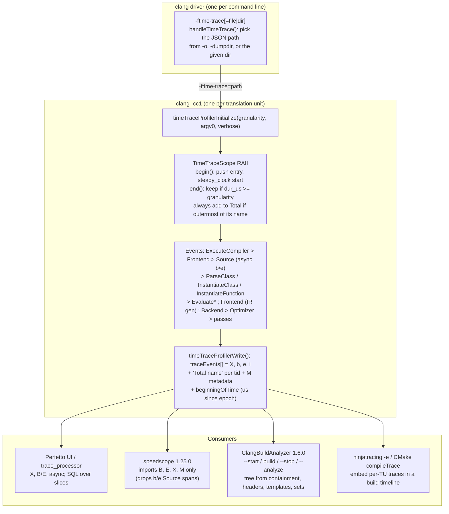

# C++ Compile-Time Profiling: ftime-trace and ClangBuildAnalyzer

> [!summary] Claim:
> `-ftime-trace` makes each clang cc1 process run LLVM's `TimeProfiler`: RAII scopes push entries on a per-thread stack, `end()` keeps an entry only if it lasted at least the granularity (default 500 us), and the process writes one Chrome Trace Event JSON file next to the object file when it finishes.
> The file holds complete (`X`) events for parsing, template instantiation, constant evaluation, IR generation and every optimizer pass, async (`b`/`e`) pairs for `Source` (header) spans since clang 19, and one `Total <name>` event per name that sums only the outermost occurrences and ignores the granularity filter.
> A trace has no parent pointers, so every consumer rebuilds the tree from time containment; ClangBuildAnalyzer does this for thousands of files at once and ranks headers by inclusive `Source` time, templates by inclusive instantiation time, and "template sets" with the arguments collapsed to `$`.
> Reading these numbers correctly is a matter of knowing what is inclusive, what is filtered, what is never traced, and which translation unit is charged for a header that several of them include.



## The Mechanism

[[Cpp-CPU-Profiling-perf-samply-Callgrind-and-llvm-mca]] owns profiling the program you built; this note owns profiling the compiler while it builds it.
A sampling profiler pointed at clang shows that time goes to `Sema::InstantiateClass`, but not which of your templates or headers caused it.
`-ftime-trace` answers the second question because clang itself labels each interval with the name of the header, class, function, or pass it is working on.
Every source-level fact below is from `llvm-project` at tag `llvmorg-23.1.5` unless another source is named, and every lab fact is from Apple clang 21.0.0 (clang-2100.4.1.1) on darwin-arm64 (as of 2026-11).

### 1. Why it exists

Aras Pranckevicius prototyped the flag in January 2019 because the existing reports, such as `-ftime-report`, were in his words "geared towards the compiler developers themselves": they total time per compiler phase or pass, but do not say which header or template paid it.
His prototype was about 350 lines on a Clang 8 era trunk, emitting the Chrome tracing JSON format so that existing viewers could draw it as a flame chart.
Anton Afanasyev landed it upstream on 2019-03-30, and Clang 9.0.0 shipped it, with release notes that describe "a flame chart style compilation time report in chrome://tracing and speedscope.app compatible format" written "next to the compiled object file".
The same machinery (`llvm/Support/TimeProfiler`) is used by lld, which is why the linker has an equivalent `--time-trace` flag.

### 2. The profiler: `llvm/lib/Support/TimeProfiler.cpp`

#### Instances and threads

`cc1_main()` calls `timeTraceProfilerInitialize(TimeTraceGranularity, Argv0, TimeTraceVerbose)` only when `FrontendOptions::TimeTracePath` is non-empty.
The profiler instance is a `LLVM_THREAD_LOCAL` pointer, so each thread has its own stack and its own entries; a worker thread calls `timeTraceProfilerFinishThread()`, which moves its instance into a global list under a mutex so the main thread can write all threads at the end.
The header states the design rule for event names: keep names generic and put specifics in the `detail` string, because `Total` events are keyed by name.
`detail` may be a closure that runs only when tracing is enabled, which keeps the disabled path cheap; the header calls string construction during tracing a source of "Heisenperf" effects.

#### begin and end

`begin()` pushes an `InProgressEntry` with `steady_clock::now()` onto a `SmallVector` stack.
`end(E)` records `steady_clock::now()`, finds `E` anywhere in the stack (not only at the top), and then does two independent things:

1. If `duration_cast<microseconds>(Duration).count() >= TimeTraceGranularity`, it appends the entry and any instant events recorded while it was open to `Entries`.
2. If no other open entry above it on the stack has the same name, it adds the full-precision duration to `CountAndTotalPerName[Name]` and increments the count.

The first rule is the granularity filter, applied when an event ends; a dropped parent always has dropped children, because a child cannot outlast its parent, so the filter never orphans an event.
The second rule is why `Total InstantiateClass` is not the sum of all `InstantiateClass` events: a recursive instantiation chain is counted once, at its outermost level, and the count ignores the granularity filter entirely.
Timestamps are cast to microseconds at both ends before subtracting ("Cast time points to microsecond precision rather than casting duration"), so an inner scope cannot appear to overrun its parent.

#### The JSON writer

`write()` emits one object with two keys:

- `traceEvents`: the main thread's entries, then every worker thread's entries, then the `Total` events, then metadata.
- `beginningOfTime`: `system_clock` microseconds since the Unix epoch at profiler start, so traces from several processes can be placed on one timeline; every `ts` inside is relative to the profiler's own `steady_clock` start.

Each event carries `pid`, `tid`, `ts`, `name`, and `args` when it has metadata:

| `ph` | Written for | Extra fields | Notes |
| :--- | :--- | :--- | :--- |
| `X` | Complete events (almost everything) | `dur` | Sorted by end time, because entries are appended when they end |
| `b`, `e` | Async events (`Source` spans since clang 19) | `cat` = name, `id` = 0 | The writer emits the `e` immediately after its `b`, at `ts + dur` |
| `i` | Instant events | none | Only `DeferInstantiation`, only with `-ftime-trace-verbose` |
| `X` named `Total <name>` | One per distinct name, sorted longest first | `args.count`, `args."avg ms"` | `ts` 0, and each one on its own `tid` starting at the highest real tid plus 1 |
| `M` | `process_name`, `thread_name` | `args.name` | `process_name` is the basename of argv0, for example `clang` or `clang-23` |

`args` holds `detail` and, in verbose mode, `file` and `line`.
`avg ms` is integer division of microseconds by count and then by 1,000, so any name whose average is under a millisecond reports `avg ms` 0.

### 3. The driver: which file, where

`handleTimeTrace()` in `clang/lib/Driver/Driver.cpp` runs for each job whose tool can emit IR, and passes `-ftime-trace=<path>` plus any `-ftime-trace-granularity=` and `-ftime-trace-verbose` to that cc1 job (`Clang::ConstructJob`).
The path rules, in order:

1. `-ftime-trace=<p>` where `<p>` is an existing directory: `<p>/<stem of the job's output>.json`, or the input's stem plus the offload prefix for an offloading device job.
2. `-ftime-trace=<p>` otherwise: exactly `<p>`.
3. Plain `-ftime-trace` with `-dumpdir <d>`: `<d><stem of the input>.json`, with no separator added.
4. Plain `-ftime-trace`, offloading device job: the `-o` directory plus the input stem and offload prefix.
5. Plain `-ftime-trace` otherwise: the job's output path with its extension replaced by `.json`.

Rule 5 is the common case: `-c tu_a.cpp -o obj/tu_a.o` writes `obj/tu_a.json`.
When one command compiles and links, the job's output is the linker's input object, and since Fangrui Song's D150282 (landed 2023-05-12, so clang 17 and later) that object, and therefore the trace, is named after `-o`: the lab's `main.cpp tu_a.cpp -o link/app -ftime-trace` writes `app-main.json` and `app-tu_a.json`.
Before D150282 those traces went to the temporary directory with the temporary objects.
The trace is written after the compilation finishes, through `createOutputFile(..., /*RemoveFileOnSignal=*/false, /*useTemporary=*/false)`, so a compiler that crashes or is killed writes no trace at all.

The linker is not traced by `-ftime-trace`.
lld (ELF and Mach-O) has its own `--time-trace`, `--time-trace=<file>`, and `--time-trace-granularity=<us>` (default 500), and without a file it writes `<output>.time-trace.json` (`TimeTraceFileExtension` in `TimeProfiler.cpp`); pass it as `-Wl,--time-trace`.
ELF lld also accepts `--plugin-opt=time-trace=<file>` as an alias, and its `LTO` scope wraps `LinkerDriver::compileBitcodeFiles()`, so link-time code generation appears in the linker's trace, not in any compile's trace.

### 4. What clang traces, and where (clang 23.1.5)

| Event name | Emitted by | `detail` | Meaning |
| :--- | :--- | :--- | :--- |
| `ExecuteCompiler` | `CompilerInstance::ExecuteAction` | none | The whole cc1 job; the root of the tree |
| `Frontend` (first) | `ParseAST()` | verbose: main file path | Lexing, parsing, Sema, and end-of-TU instantiation |
| `Frontend` (second) | `BackendConsumer::HandleTranslationUnit` | none | Emitting LLVM IR for deferred declarations |
| `Source` | `SemaPPCallbacks::FileChanged` on `EnterFile`/`ExitFile` | header path | Everything that happens while the lexer is inside an included file |
| `ParseClass` | `Parser::ParseCXXMemberSpecification` scope | class name | Parsing one class body |
| `ParseDeclarationOrFunctionDefinition`, `ParseFunctionDefinition` | `Parser.cpp` | `file:line:col` or function name | One top-level declaration or function body |
| `InstantiateClass` | `Sema::InstantiateClassImpl` | qualified specialization name | Instantiating a class template specialization's definition |
| `InstantiateFunction` | `Sema::InstantiateFunctionDefinition` | qualified function name | Instantiating a function template body |
| `PerformPendingInstantiations` | `Sema::ActOnEndOfTranslationUnitFragment` and the end-of-TU path | none | The deferred function instantiations done at end of TU |
| `CheckConstraintSatisfaction` | `SemaConcept.cpp` | source range | Evaluating C++20 constraints |
| `EvaluateAsRValue`, `EvaluateAsInitializer`, `EvaluateAsConstantExpr`, and others | `ExprConstant.cpp` | source range | The constant evaluator |
| `CodeGen Function` | `CodeGenModule::EmitGlobalDefinition` | function name | IR generation for one function |
| `Backend` | `emitBackendOutput()` in `BackendUtil.cpp` | none | Optimization plus machine code generation |
| `Optimizer`, then one event per new-pass-manager pass, such as `InstCombinePass` | `BackendUtil.cpp`, `TimeProfilingPassesHandler` | IR unit name | The middle-end pipeline |
| `CodeGenPasses`, `OptModule`, `OptFunction`, `RunPass` | `BackendUtil.cpp`, `LegacyPassManager.cpp` | module, function, or pass name | Machine code generation, which still runs on the legacy pass manager |
| `ReadAST`, `Read Loaded AST`, `Load External Specializations for ` | `ASTReader.cpp` | file or module name | Loading a PCH or module |
| `Module Compile`, `Module Load` | `CompilerInstance.cpp` | module name | Implicit Clang module builds and loads |
| `DeferInstantiation` (instant) | `InstantiateFunctionDefinition` | function name | Verbose only: a function instantiation was queued for end of TU |

Three gaps matter when reading a trace.

- There is no event for variable instantiation, including static data members of class templates; the lab's `Fib<N>::value` recursion produces 899 `InstantiateClass` events of which 0 nest inside another, because each `Fib<N>` class is complete before its `value` initializer instantiates `Fib<N-1>`.
- Overload resolution, name lookup, and most of Sema have no scopes of their own, so their time appears as self time of the enclosing `Parse*`, `Instantiate*`, or `Source` event.
- `ParseTemplate` no longer exists: it was removed in 2023 while fixing the bug described in the next section, so ClangBuildAnalyzer's handler for it never fires on current traces.

### 5. Source spans: inclusive, first-includer pays, and asynchronous

`Sema`'s preprocessor callback begins a `Source` span when the lexer enters a file whose include location is valid, and ends it when the lexer leaves.
The main file is never a `Source` span, and Apple clang 21 also emits a `<command line>` span for the predefines buffer, which Homebrew clang 23.1.5 did not emit in a one-off comparison on the same machine.
Three consequences follow from that design.

1. A `Source` span is inclusive: it covers nested headers, parsing, and every template instantiation or constant evaluation triggered while that header is being parsed; the lab's 899 `Fib` instantiations all nest inside the `heavy_meta.hpp` span because `kFib` is defined at namespace scope in that header.
2. Only the first inclusion in a TU is ever entered; an include guard or `#pragma once` makes later `#include`s skip the file, so the first includer is charged for the whole header and the others show nothing, and changing include order moves the blame.
3. Template code that a header declares but a `.cpp` instantiates is charged to the `.cpp` (or to `PerformPendingInstantiations`), not to the header, so a "cheap" header can still be the root cause of expensive instantiations elsewhere.

Before clang 19, `Source` was an ordinary scope that ended whatever event was on top of the stack.
Issue #56554 showed the failure: when a header's last declaration was a template, a `ParseTemplate` scope was still open when the lexer hit end of file, so the wrong entry ended and `2.h` appeared nested inside `1.h` although `main.cpp` included both.
PR #83778 (landed 2024-03-19) added async events, and PR #83961 (closed the issue on 2024-03-26) made `Source` one: `end(E)` removes that exact entry from anywhere in the stack, and the writer emits `ph: "b"` and `ph: "e"` so viewers do not require it to nest.
ClangBuildAnalyzer 1.6.0 knows this: "starting with clang 19, some Source events are pairs of "b" immediately followed by "e" events", and it merges each such pair back into a complete event.

### 6. Granularity

`-ftime-trace-granularity=<us>` (default `500u` in `Options.td`, `TimeTraceGranularity(500)` in `FrontendOptions`) is the minimum duration an event needs to be written.
The lab compiles one small TU twice: at granularity 0 it keeps 9,746 events, at the default it keeps fewer, and the `Total InstantiateClass` count is 902 in both, which proves the totals are computed before the filter.
The default hides "death by a thousand cuts": in the one-off ClangBuildAnalyzer cross-check described in section 8, built from default-granularity traces, no `Fib<$>` line appeared at all, because every `Fib<N>` instantiation ended in under 500 us, and only the `Build<$>` set was reported.
Granularity 0 makes files large (9,892 `X` events for that one small TU), so use it on a handful of TUs, not on a whole build.

### 7. Viewers

- Perfetto UI (`ui.perfetto.dev`) renders `X` and `B`/`E` events as slices, puts overlapping events that do not nest on an overflow track, and loads the JSON into `trace_processor` tables (`slice`, `thread`, `args`) for SQL queries.
- `chrome://tracing` is the original viewer that the format was designed for; `TimeProfiler.h` names Perfetto as its replacement.
- speedscope 1.25.0 (2025-12-03) imports only `B`, `E`, and `X` events plus `M` metadata (`filterIgnoredEventTypes()` in `src/import/trace-event.ts`), so traces from clang 19 and later show no `Source` spans in speedscope at all, and each `Total` event, being on its own `tid`, appears as a separate one-event thread profile (`partitionByPidTid()` keys profiles by pid and tid; read in the v1.25.0 source, not loaded in the app).
- [[Flame-Graphs-Differential-Flame-Graphs-and-Visualizations]] explains flame charts versus flame graphs; a trace is a flame chart (time on the x axis), and speedscope's left heavy view turns it into an aggregated flame graph.

### 8. ClangBuildAnalyzer 1.6.0

ClangBuildAnalyzer (Unlicense, 1.6.0 released 2025-01-05) aggregates one trace per TU into build-wide rankings.

#### Workflow

1. `ClangBuildAnalyzer --start <dir>` writes the current time to `<dir>/ClangBuildAnalyzerSession.txt`.
2. Build with `-ftime-trace` so the `.json` files land under `<dir>`.
3. `ClangBuildAnalyzer --stop <dir> <capture>` walks `<dir>`, keeps `.json` files whose modification time falls between start and stop, parses them in parallel (enkiTS tasks, simdjson parser), and writes a binary capture file.
4. `ClangBuildAnalyzer --analyze <capture>` prints the report, reading `ClangBuildAnalyzer.ini` from the current directory if present.

`--all <dir> <capture>` replaces steps 1 and 3 and takes every trace regardless of time, which is what you want for a CI artifact directory.

#### How it parses

- It accepts only events with `ph` `X`, `b`, or `e`, and only these names: `ExecuteCompiler`, `Frontend`, `Backend`, `Source`, `ParseTemplate`, `ParseClass`, `InstantiateClass`, `InstantiateFunction`, `OptModule`, `OptFunction`; pass events, `CodeGen Function`, constant evaluation, constraints, and `Total` events are ignored.
- A `b` immediately followed by an `e` becomes one complete event; any other `b` is dropped.
- `FindParentChildrenIndices()` sorts events by start time, longer first on ties, later index first on further ties, and assigns each event the innermost earlier event that contains it; this is the only way to recover nesting, because the format has no parent field.
- If the last event in file order does not become a root it prints "WARN: the last trace event should be root" and discards the file; clang writes `ExecuteCompiler` last among complete events because entries are appended when they end.
- An `ExecuteCompiler` event without detail is named after the `.json`, and the `.json` is replaced by the `.o` or `.obj` next to it when one exists; `OptFunction` names are demangled with LLVM's demangler.

#### What it reports

| Section | Computed from | Trap |
| :--- | :--- | :--- |
| Time summary | Sum of `Frontend` and of `Backend` durations; "Compilation (N times)" counts `Frontend` events | `SanitizeEvents()` merges a TU's two `Frontend` events into one, so N is the TU count, and IR generation is counted as "Parsing (frontend)" |
| Files that took longest to parse / codegen | Per-file `Frontend` / `Backend`, at least `minTimes.file` ms (default 10) | Wall time under build parallelism |
| Templates that took longest to instantiate | Per detail name: inclusive duration summed, count | Nested instantiations are counted at every level; a recursive chain floods the list |
| Template sets | Names with each outermost `<...>` collapsed to `<$>`; an instantiation is skipped if an ancestor is in the same set; names containing `operator` are not collapsed | One line per family, so `std::unique_ptr<$>` is the sum of every `unique_ptr` |
| Functions / function sets | `OptFunction` duration per (function, file) | Only legacy-pass-manager codegen time, not the new-PM optimizer passes |
| Expensive headers | Inclusive `Source` time summed per header path, inclusion count, merged include chains | `onlyRootHeaders` (default true) lists only headers that some chain reaches with no header before them |

The `ClangBuildAnalyzer.ini` keys and their defaults are `[counts]` `fileParse=10`, `fileCodegen=10`, `template=30`, `function=30`, `header=10`, `headerChain=5`; `[minTimes]` `file=10`; `[misc]` `maxNameLength=70`, `onlyRootHeaders=true`.
Its readme states two limitations: it does not capture linking or LTO, and it "may or may not scale to huge builds", with Unity and Blender as the largest builds the author tried.

In a cross-check outside the lab (ClangBuildAnalyzer 1.6.0 built from its `v1.6.0` tag, run on macOS arm64 over traces of the lab's five TUs compiled with `-O2 -ftime-trace` at the default granularity, as of 2026-11), the time summary read "Compilation (5 times)", and, all 30 lines of "Templates that took longest to instantiate" were `meta::Build<700, ...>`, `meta::Build<699, ...>`, down to `meta::Build<671, ...>`, each "3 times", while "Template sets" showed one line, `meta::Build<$> (3 times ...)`, and "Expensive headers" showed `src/heavy_meta.hpp (included 3 times ...)` via `3x: <direct include>` (this matches the 1.6.0 source, where `Analysis.cpp` lists per-name inclusive time and collapses sets with `CollapseName()`).
That is the reason to read the sets section first.

### 9. The other compilers

- GCC has no `-ftime-trace`; `g++-16 -ftime-trace` fails with "unrecognized command-line option" (GCC 16.2.0, Homebrew, macOS, as of 2026-11).
  GCC's `-ftime-report` prints a table of time variables such as `phase parsing`, `template instantiation`, and `preprocessing` with wall time and GGC memory, and `-ftime-report-details` "Record[s] the time consumed by infrastructure parts separately for each pass"; neither names your headers or templates.
- MSVC has C++ Build Insights: `vcperf.exe` collects ETW traces viewed in Windows Performance Analyzer, and the C++ Team Blog post of 2020-08-27 introduced `vcperf /stop <session> /timetrace <file>.json`, which writes a JSON trace viewable in a Chromium browser's tracing page; collection needs an elevated prompt.
- Clang also has `-ftime-report` (per-pass timers, with `-ftime-report=per-pass|per-pass-run` and `-ftime-report-json`) and `-fproc-stat-report`, which prints one line per subprocess in the form `clang-23: output=t.o, total=<ms> ms, user=<ms> ms, mem=<n> Kb`.

### 10. From one TU to the whole build

A per-TU trace says nothing about parallelism or the critical path; those come from the build tool.

- `.ninja_log` records each edge's start and end; [[Make-and-Ninja-Mechanics]] owns its format.
  `ninjatracing $BUILDDIR/.ninja_log > trace.json` converts it to a Chrome trace, and `-e` (`--embed-time-trace`) embeds each object's adjacent `-ftime-trace` JSON with a default `-g` (`--granularity`) of 50,000 us.
- CMake 4.3 added the instrumentation API (`cmake_instrumentation()`, `cmake-instrumentation(7)`); its `trace` option writes a Google Trace file under `<build>/.cmake/instrumentation/v1/data/trace`, and the `compileTrace` option, added with data version 1.1 in CMake 4.4, collects the JSON files produced by `-ftime-trace`.
- `cmake --profiling-format=google-trace --profiling-output=<path>` (CMake 3.18) profiles the configure step's CMake script execution, not the compiles.

### 11. What the profile tells you to change

The fix depends on which event dominates; the mechanisms belong to other notes, and the trace is how you prove a fix worked.

- An expensive header included by many TUs (`Source` time times inclusion count): forward declarations and header splitting, a precompiled header, or C++20 modules ([[Cpp-Modules-in-Build-Systems]]).
  In the lab, `-include-pch` removes the `heavy_meta.hpp` `Source` span and all 899 `Fib` instantiations from `tu_a` and adds `ReadAST` and `Read Loaded AST` events; the instantiations move into the one PCH build.
  CMake's `PCH_INSTANTIATE_TEMPLATES` (CMake 3.19, default `ON`) adds clang's `-fpch-instantiate-templates` (clang 11) so that pending function instantiations also run while building the PCH.
- One template family dominating "Template sets": change the algorithm before the build; the lab's `Build<N, List<Ts...>>` copies a growing pack at each of 700 levels and costs more than ten times the 899-step `Fib` chain.
- The same function template instantiated in every TU: an explicit instantiation declaration (`extern template`) plus one explicit instantiation definition; [[Cpp-ODR-Violations-Static-Init-and-Linker-Template-Errors]] owns the linkage rules, including the ill-formed, no diagnostic required case when the definition is missing.
  The lab shows the limit: `Widget<int>::crunch()` (defined out of class) drops from 3 instantiations to 0 in the consumers, but `Widget<int>::fast()` (defined in class, therefore inline) is still instantiated 3 times at both `-O0` and `-O2`, because [temp.explicit] paragraph 12, Note 4, says an explicit instantiation declaration of an inline function "has no other normative effect" beyond requiring a definition elsewhere.
- `Backend` dominating one file: very large generated functions, aggressive inlining, or the optimization level; per-function cost is in `OptFunction` and the new-PM pass events, and [[Cpp-PGO-AutoFDO-and-BOLT-Workflow]] covers profile-guided changes to inlining.
- Unity builds (`UNITY_BUILD`, CMake 3.16) amortize shared headers across sources at the cost of ODR errors and anonymous-namespace collisions, which the CMake documentation itself warns about.
- Compiler caches and remote execution remove compiles instead of speeding them up; see [[Compiler-Caches-ccache-and-sccache]] and [[Remote-Execution-API-and-Remote-Caching]].

## Commands and Numbers to Know

| Item | Value | Platform and date | What it controls |
| :--- | :--- | :--- | :--- |
| `-ftime-trace` | off | Both (as of 2026-11) | Writes `<output-stem>.json` next to the object (clang 9 and later) |
| `-ftime-trace=<file\|dir>` | none | Both (as of 2026-11) | Exact file, or `<dir>/<output-stem>.json` when the directory exists |
| `-ftime-trace-granularity=<us>` | `500` | Both (as of 2026-11) | Minimum event duration written; totals ignore it |
| `-ftime-trace-verbose` | off | Both (as of 2026-11) | Adds `file` and `line` to instantiation events and `file` to `Frontend`; help text says output grows "by 2-3 times" (clang 19 and later) |
| `-dumpdir <prefix>` | none | Both (as of 2026-11) | Trace becomes `<prefix><input-stem>.json` (clang 17 and later) |
| `-Wl,--time-trace[=<file>]` | `<output>.time-trace.json` | Both, lld only (as of 2026-11) | Linker and LTO trace; `--time-trace-granularity` default 500 |
| `-ftime-report`, `-ftime-report=per-pass\|per-pass-run`, `-ftime-report-json` | off | Both (as of 2026-11) | Clang's per-pass timer tables |
| `-fproc-stat-report[=<file>]` | off | Both (as of 2026-11) | Per-subprocess total time, user time, peak RSS |
| `-fpch-instantiate-templates` | off in clang; CMake PCH default `ON` | Both (as of 2026-11) | Instantiate pending templates while building a PCH |
| `-ftemplate-depth=` | `1024` | Both (as of 2026-11) | Recursive instantiation depth limit |
| `-fconstexpr-steps=` | `1048576` | Both (as of 2026-11) | Constant evaluation step limit |
| `-H` | off | Both (as of 2026-11) | Print every included header with nesting depth |
| Trace top-level keys | `traceEvents`, `beginningOfTime` | Both (as of 2026-11) | `ts` relative to profiler start; `beginningOfTime` in us since the epoch |
| `Source` encoding | `ph` `b`/`e`, `cat` `Source`, `id` 0 | Both, clang 19 and later (as of 2026-11) | Header spans that need not nest |
| `Total <name>` | `args.count`, `args."avg ms"` (integer) | Both (as of 2026-11) | Outermost occurrences only, before the granularity filter |
| ClangBuildAnalyzer | `--start`, `--stop`, `--all`, `--analyze`, `--version` | Both, 1.6.0 (as of 2026-11) | Aggregates traces; ini defaults `template=30`, `header=10`, `minTimes.file=10` |
| ninjatracing `-e -g <us>` | granularity `50000` | Both (as of 2026-11) | Embeds per-TU traces in the Ninja timeline |
| CMake `compileTrace` | instrumentation data version 1.1, CMake 4.4 | Both (as of 2026-11) | Collects `-ftime-trace` JSON per compile |
| GCC | `-ftime-report`, `-ftime-report-details`; no `-ftime-trace` | Both, GCC 16.2.0 (as of 2026-11) | Phase-level timing only |
| MSVC | `vcperf /start <s>`, `vcperf /stop <s> /timetrace <f>.json` | Windows (as of 2026-11) | Build Insights trace as JSON |

## Multi-Language Comparison: C++ / Python / Rust

| Concern | C++ (clang) | Python (CPython) | Rust (rustc and Cargo) |
| :--- | :--- | :--- | :--- |
| What "build cost" means | Compiling each TU, dominated by headers and templates | Importing modules at startup | Compiling each crate, dominated by monomorphization and LLVM |
| Per-unit attribution | `-ftime-trace` JSON per TU | `-X importtime` (3.7): per-module cumulative and self time on stderr; `-X importtime=2` (3.14) also prints `cached` for already-loaded modules | `-Z self-profile` on nightly, owned by [[Rust-Compile-Time-and-Binary-Size-Profiling]] |
| Whole-build timeline | `.ninja_log` with ninjatracing, CMake instrumentation | not applicable | `cargo build --timings` (stable since Rust 1.60) writes `target/cargo-timings/cargo-timing.html` |
| Generic code cost | `InstantiateClass` / `InstantiateFunction` and ClangBuildAnalyzer template sets | not applicable | `cargo-llvm-lines`; see [[Drill-Profiling-Rust-Monomorphization-and-Inlining-Regression]] |
| Cross-unit aggregation | ClangBuildAnalyzer | Sort the importtime lines | Cargo's timing report per unit |

## Worked Lab Example

The lab is `code/05-Profiling/ftime_trace_analysis/`; it needs a clang that accepts `-ftime-trace` and `python3`, and no harness requirements.
`run.sh` uses `${CXX:-c++}` when it accepts the flag and otherwise falls back to `clang++`, because GCC rejects it.

The sources are deliberately lopsided so that rankings hold by a wide margin:

- `heavy_meta.hpp` defines `kFib = Fib<900>::value` and `kListSize = Size<Build<700, List<>>::type>::value` at namespace scope, so every includer pays 899 `Fib` and 701 `Build` instantiations while parsing it.
- `cheap.hpp` is one inline function; `widget.hpp` is `Widget<T>` with an out-of-class `crunch()` and an in-class `fast()`, plus `extern template struct Widget<int>;` under `-DWIDGET_EXTERN`.
- `tu_a.cpp`, `tu_b.cpp`, and `tu_c.cpp` include all three headers; `widget_inst.cpp` holds `template struct Widget<int>;`; `gen_backend.py` writes `backend_heavy.cpp`, 400 loop kernels with no includes.

`run.sh` then compiles:

1. Four commands that show the driver's naming rules.
2. `tu_a.cpp` at `-O2` with granularity 0 and with the default.
3. Five TUs at `-O2`, granularity 0, as one "build".
4. The three consumers at `-O0` and `-O2`, with and without `-DWIDGET_EXTERN`, plus `widget_inst.cpp`.
5. A PCH of `heavy_meta.hpp` with its own trace, and `tu_a.cpp` with `-include-pch`.
6. `tu_a.cpp` with `-ftime-trace-verbose`.

`analyze.py` reimplements ClangBuildAnalyzer's parsing rules with the standard library: it merges `b`/`e` pairs, rebuilds the tree with the same containment sort, collapses template names the way `CollapseName()` does, and skips same-set ancestors.
Because durations change on every run, it prints counts, names, and comparisons with at least a 3x or 10x margin, and it raises an error if an async event is unpaired or the verbose `Fib<900>` event is missing.

```bash
cd code/05-Profiling/ftime_trace_analysis
bash run.sh
```

### Verified output

Recorded by `python3 -m _harness.verify --record` on darwin-arm64 with Apple clang 21.0.0 on 2026-11-12, then checked by `python3 -m _harness.verify` (PASS); the file is `code/05-Profiling/ftime_trace_analysis/expected/darwin-arm64.txt`.

```text
== 1. Where the trace file goes (clang driver rules)
-c tu_a.cpp -o obj/tu_a.o -ftime-trace                     -> obj/tu_a.json
-c tu_a.cpp -o obj/other.o -ftime-trace=tracedir           -> other.json
-c tu_a.cpp -o obj/third.o -ftime-trace=custom-name.json   -> custom-name.json
main.cpp tu_a.cpp -o link/app -ftime-trace                 -> app-main.json app-tu_a.json

== 2. Anatomy of one trace (tu_a.cpp, -O2, granularity 0)
top-level keys: beginningOfTime, traceEvents
phases: M=2 X=9892 b=4 e=4
'Total <name>' summary events: 150, each on its own tid: yes
Source spans written as async b/e pairs: 4 (speedscope 1.25.0 imports only B, E, X)
Source spans: <command line>, cheap.hpp, heavy_meta.hpp, widget.hpp
Frontend events: 2 (ParseAST, then BackendConsumer::HandleTranslationUnit)
last complete event written: ExecuteCompiler
tree roots after containment rebuild: ExecuteCompiler
InstantiateClass events by template set:
  Widget<$>: 1
  meta::Build<$>: 701
  meta::Fib<$>: 899
  meta::Size<$>: 1
every meta::Fib instantiation nests inside the heavy_meta.hpp Source span: yes
meta::Fib events nested inside another InstantiateClass: 0 of 899
deepest InstantiateClass nesting: 700 levels, under meta::Build<$>

== 3. Granularity filters events, not totals
complete and async events kept, granularity 0 us: 9746; default 500 us: fewer
Total InstantiateClass count, granularity 0: 902; granularity 500: 902; equal: yes
InstantiateClass events in the granularity-0 trace: 1602, topmost only: 902
Total count equals the topmost-only count: yes
Total InstantiateClass dur equals the sum over topmost events (within 1 us each): yes
sum of every InstantiateClass dur is more than 10x the Total (nested time counted at every level): yes

== 4. Build-wide aggregation (ClangBuildAnalyzer's algorithm over 5 traces)
dominant phase per TU (Frontend vs Backend, needs a 3x margin):
  backend_heavy: Backend
  tu_a: Frontend
  tu_b: Frontend
  tu_c: Frontend
header inclusions: cheap.hpp 3x, heavy_meta.hpp 3x, widget.hpp 3x
most expensive header by summed Source time: heavy_meta.hpp (10x ahead of every other header: yes)
heavy_meta.hpp share of all Frontend time over 50%: yes
template sets: raw instantiation events -> counted after skipping same-set ancestors:
  Widget<$>: 3 -> 3
  Widget<$>::crunch: 3 -> 3
  Widget<$>::fast: 3 -> 3
  meta::Build<$>: 2103 -> 3
  meta::Fib<$>: 2697 -> 2697
  meta::Size<$>: 3 -> 3
most expensive template set: meta::Build<$> (10x ahead of every other set: yes)

== 5. extern template: who instantiates Widget<int> members
InstantiateFunction events summed over tu_a, tu_b, tu_c:
  configuration          crunch (out of class)   fast (in class, inline)
  implicit, -O0          3                       3
  implicit, -O2          3                       3
  extern template, -O0   0                       3
  extern template, -O2   0                       3
widget_inst.cpp (explicit instantiation definition): crunch 1, fast 1

== 6. A precompiled header moves the header cost into one compile
heavy_meta.hpp Source spans: tu_a 1, tu_a with -include-pch 0
meta::Fib InstantiateClass events: tu_a 899, tu_a with -include-pch 0, PCH build 899
tu_a Frontend time is lower with the PCH: yes
AST-loading events: without PCH [], with PCH [ReadAST, Read Loaded AST]

== 7. -ftime-trace-verbose
InstantiateClass args keys: default [detail], verbose [detail, file, line]
InstantiateFunction args keys: default [detail], verbose [detail, file, line]
Frontend args keys: default [(none)], verbose [file]
meta::Fib<900> location: heavy_meta.hpp:13
```

### Reading the result

- Section 1 is the driver's rules from section 3: `-ftime-trace=tracedir` uses the output's stem (`other`), not the source's (`tu_a`), and a compile-and-link names traces `app-<input>.json`.
- The 150 `Total` events each sit on their own `tid`, which is why a viewer shows 151 "threads" for a single-threaded compiler.
- The 1,602 `InstantiateClass` events are 899 `Fib` (`Fib<900>` down to `Fib<2>`), 701 `Build` (`Build<700>` down to `Build<0>`), 1 `Size`, and 1 `Widget`; recursion is memoized per TU, so `Fib<900>` costs 899 events, not 2^900.
- `Total InstantiateClass` counts 902 = 899 + 1 + 1 + 1: every `Fib` is outermost (variable instantiation is untraced, so nothing encloses it), while the whole 700-level `Build` chain counts once.
- Template sets turn 2,103 `Build` events into 3, one per TU, while 2,697 `Fib` events stay 2,697, because no `Fib` has a `Fib` ancestor in the rebuilt tree; a sets view therefore reports `Fib` as 2,697 tiny instantiations and `Build` as 3 large ones, and `Build` costs over ten times more.
- Section 5 is the `extern template` rule: the explicit instantiation declaration removes the out-of-class member from every consumer, and the inline member stays at both optimization levels.
- Section 6 shows that a PCH does not make the work cheaper, it moves it: the 899 `Fib` instantiations now happen once, in the PCH build.

## Pitfalls

> [!warning] Pitfall: adding up nested times
> `InstantiateClass` and `Source` durations are inclusive, so summing every event double-counts each nesting level; the lab's sum of all `InstantiateClass` durations is more than ten times `Total InstantiateClass`.
> Use `Total` events within one TU, and ClangBuildAnalyzer's template sets or expensive headers across TUs.

> [!warning] Pitfall: trusting "Templates that took longest to instantiate" on recursive code
> Each level of a recursive chain is listed with its inclusive time, so one chain can fill all 30 slots, as `meta::Build<700..671, ...>` did in the cross-check.
> Read "Template sets" first, then drill into individual names.

> [!warning] Pitfall: the default granularity hides many small events
> Events under 500 us are dropped before ClangBuildAnalyzer sees them, so a family of thousands of 1 us instantiations never appears in its report, even though `Total` events count them.
> Capture a few representative TUs at `-ftime-trace-granularity=0`, or compare `Total` counts, before concluding a family is cheap.

> [!warning] Pitfall: no headers in speedscope
> Since clang 19 `Source` spans are async `b`/`e` events, and speedscope 1.25.0 drops every phase except `B`, `E`, `X`, and `M`.
> Use Perfetto, or ClangBuildAnalyzer, to see header cost.

> [!warning] Pitfall: blaming the wrong includer
> With include guards or `#pragma once`, only the first `#include` of a header in a TU enters it, so the whole cost lands on whichever file included it first.
> Across a build, look at the header's total inclusive time and count, not at which file appears to pay.

> [!warning] Pitfall: missing or stale traces
> A trace is written only when cc1 finishes, so a crashed or killed compile writes nothing; a cache hit or remotely executed action runs no local compiler, so it writes nothing new.
> `ClangBuildAnalyzer --stop` keeps only files modified after `--start`, so turn caches off for the capture, or use `--all` on a clean artifact directory.

> [!warning] Pitfall: reading wall time as CPU time
> Every duration is `steady_clock` wall time inside one process; at `-j64` on a 16-core machine, contention inflates every file's numbers.
> Profile with the parallelism you ship, compare runs only at the same `-j`, and use the build tool's timeline for critical-path questions.

> [!warning] Pitfall: expecting `extern template` to suppress inline members
> Members defined inside the class body are inline, and the lab instantiates `Widget<int>::fast()` in every consumer with and without `extern template`.
> Move expensive members out of the class body before relying on an explicit instantiation declaration.

> [!warning] Pitfall: `-fproc-stat-report` memory units on macOS
> The driver prints the raw `ru_maxrss` followed by `Kb` (`Driver.cpp`, `Unix/Program.inc`), which is right on Linux, where `ru_maxrss` is in kilobytes, but 1,024 times too large on macOS, where `getrusage` reports bytes.
> Divide the macOS figure by 1,024 again before comparing it with a Linux run.

> [!warning] Pitfall: `avg ms` of zero
> `Total` events compute `avg ms` with integer division, so every name with an average below 1 ms reports 0; divide `dur` by `count` yourself.

## At Scale

For one developer, the loop is short: add `-ftime-trace` to one slow TU, open the JSON in Perfetto, and fix the biggest `Source` or `Instantiate` block.
For a team, the cost that matters is the header tax: a header's inclusive time multiplied by how many TUs include it, which only cross-TU aggregation shows.
For an organization of 1,000 to 50,000 engineers, compile time is a shared budget that individual changes spend without seeing the bill.

Decision rules:

- Up to a few dozen engineers: run ClangBuildAnalyzer by hand on a clean build when builds feel slow; the top three template sets and the top five headers usually justify one refactor each.
- From about 100 engineers: make a traced build a scheduled CI job (clean, caches off, fixed `-j`, fixed machine type), archive the JSON and the ClangBuildAnalyzer report, and alert on changes, using the regression methods in [[Performance-Regression-Detection-in-CI]].
- From about 1,000 engineers: track per-header inclusive time times inclusion count, and per-template-set time, as time series per commit, and attribute regressions to the commit that introduced the include or instantiation, not to the TU that happens to pay.
- At 10,000 or more engineers, most compiles are cache hits or remote actions, so a local trace no longer predicts developer wait time; trace a sampled set of cache misses on the remote workers, and weigh fixes by build-wide cost per [[Build-Performance-Economics-and-Decision-Record]].
- Pick the remedy by event: PCH or modules for headers paid by many TUs, `extern template` or algorithm changes for template sets, and per-file optimization or code generation changes for `Backend`; prove every change with a before and after trace at the same granularity.
- Store traces at the default granularity fleet-wide, and use granularity 0 only for targeted investigations, because granularity 0 files are much larger.

## Practice Drill

> [!tip] Practice Drill:
> Take a real project with a `compile_commands.json`, pick its slowest TU from `.ninja_log`, and compile it alone with `-ftime-trace -ftime-trace-granularity=0`.
> Before opening the trace, predict the top `Source` span and the top template set; then check both in Perfetto and with a small script that prints the ten largest `Total` events.
> Rebuild the whole project with `-ftime-trace`, run `ClangBuildAnalyzer --all build capture.bin` and `--analyze capture.bin`, and pick one remedy from section 11 of The Mechanism.
> Apply it, rebuild at the same `-j`, and show the change in the same report section; if the header simply moved to another includer, explain why.
> As a stretch, extend the lab's `analyze.py` to print the ten most expensive include chains per header, matching ClangBuildAnalyzer's merged chain output.

## Interview Questions

> [!question] L5: After adding `-ftime-trace` to a CMake build, where do the traces go, and why might one TU have none?
>
> > [!success]- Answer
> > For a `-c` compile the driver replaces the output's extension, so `obj/foo.o` gets `obj/foo.json`; `-ftime-trace=<dir>` uses the output's stem inside that directory, and a compile-and-link command names traces after `-o`, such as `app-foo.json`.
> > A TU has no trace if its compile crashed or was killed, because cc1 writes the file only after it finishes.
> > It also has none if the compile never ran locally: a ccache or sccache hit, or a remote execution action.
> > And GCC rejects the flag, so a TU built with g++ fails the build rather than producing a trace.

> [!question] L5: Predict the output: if one TU is compiled with `-ftime-trace-granularity=0` and with the default, which changes, the number of `InstantiateClass` events or the `Total InstantiateClass` count?
>
> > [!success]- Answer
> > The event count drops at the default granularity, because `end()` keeps only events of at least 500 us.
> > The `Total InstantiateClass` count is identical, 902 and 902 in the lab, because totals are updated in `end()` whether or not the event passed the filter.
> > The total count is also not the number of events (1,602 in the lab): it counts only the outermost occurrence of each name, so a 700-level recursive chain counts once.

> [!question] L6: Why are `Source` events written as `b`/`e` pairs since clang 19, and what does that break?
>
> > [!success]- Answer
> > `Source` spans begin and end in a preprocessor callback, which does not follow the parser's own scope nesting; issue #56554 showed a `ParseTemplate` scope still open at end of file, so the wrong entry ended and one header appeared nested in another.
> > PR #83961 made `Source` an async event: `end()` removes that exact entry from anywhere in the stack, and the writer emits `ph: "b"` and `ph: "e"` with `cat: "Source"`, `id: 0`.
> > Viewers and tools that only read `X`, `B`, and `E` silently lose header spans: speedscope 1.25.0 drops them entirely.
> > ClangBuildAnalyzer 1.6.0 handles it by merging a `b` that is immediately followed by an `e` into one complete event.

> [!question] L6: Debug this: ClangBuildAnalyzer's "Templates that took longest to instantiate" lists 30 entries, `Build<700, ...>` down to `Build<671, ...>`, each with nearly the same time, so what is going on and where do you look instead?
>
> > [!success]- Answer
> > That section sums each specialization's inclusive duration, so a recursive chain lists every level with nearly the whole chain's time, and the top 30 slots are all one chain.
> > The real cost is one recursive family, which "Template sets" shows as one line, `Build<$>`, with the arguments collapsed and same-set ancestors skipped.
> > Then fix the algorithm: in the lab, `Build<N, List<Ts...>>` copies a growing pack at each level, quadratic total work; a pack expansion over an index sequence or a constexpr function does it without 700 nested specializations.

> [!question] L6: A header shows a huge `Source` time in `a.cpp` but almost none in `b.cpp`, which includes it too; is the header slow?
>
> > [!success]- Answer
> > Probably yes, and `b.cpp` most likely reaches it after something else already included it in that TU, or the time in `a.cpp` comes from instantiations triggered while parsing it.
> > Only the first inclusion in a TU is entered; include guards or `#pragma once` skip it afterwards, so whichever file is first in include order pays the whole cost.
> > A `Source` span is inclusive, so it also contains nested headers and any template instantiation or constant evaluation done while the lexer is inside that file.
> > Check the header's total inclusive time and inclusion count across the build, and its children in the tree, before blaming it.

> [!question] L7: A colleague adds `extern template class Matrix<double>;` to a header and one explicit instantiation in `matrix.cpp`, but traces show `InstantiateFunction` for several `Matrix<double>` members in every TU. Why?
>
> > [!success]- Answer
> > Those members are defined inside the class body, so they are inline, and an explicit instantiation declaration of an inline function "has no other normative effect" ([temp.explicit] paragraph 12, Note 4) beyond requiring a definition elsewhere.
> > Clang still instantiates them in each TU; the lab shows `Widget<int>::fast()` at 3 instantiations with and without `extern template`, at both `-O0` and `-O2`, while the out-of-class `crunch()` drops from 3 to 0.
> > The fix is to move the expensive members out of the class body; the trade-off is that consumers can no longer inline them.
> > Measure before and after, because losing inlining can cost run time.

> [!question] L7: Why can a TU's Frontend time drop by 70% after adding a PCH while the clean build gets no faster?
>
> > [!success]- Answer
> > A PCH moves work rather than removing it: the lab's `-include-pch` removes the header's `Source` span and its 899 instantiations from `tu_a`, but the PCH build performs the same 899.
> > The build gets faster only if many TUs reuse the PCH and the PCH build is not itself on the critical path; a PCH that depends on frequently edited headers is rebuilt often and serializes the build.
> > Loading has a cost too, visible as `ReadAST` and `Read Loaded AST` events, and deserialization is lazy, so uses of PCH declarations still cost time.
> > Check the build timeline (`.ninja_log` with ninjatracing) for the critical path, not only per-TU frontend time.

> [!question] L7: Design a CI job that catches compile-time regressions in a large C++ repository.
>
> > [!success]- Answer
> > Run a scheduled clean build with caches and remote execution off, a pinned compiler, a fixed machine type, and a fixed `-j`, all with `-ftime-trace` at the default granularity.
> > Aggregate with ClangBuildAnalyzer `--all`, or a parser that rebuilds the tree from containment and merges `b`/`e` pairs, and store per commit: total Frontend and Backend, per-header inclusive time and count, and per-template-set time and count.
> > Detect changes with the noise-aware methods of regression detection, and attribute each regression to the commit that changed an include or a template, which the per-header and per-set series make visible even when the cost shows up in other TUs.
> > Keep the raw JSON for a few weeks so engineers can open a regressed TU in Perfetto.

> [!question] L8+: Leadership asks whether to fund PCH, C++20 modules, unity builds, or a remote build cache; how do you decide with traces?
>
> > [!success]- Answer
> > Classify the build's cost from traces: header tax (inclusive `Source` time times inclusion count), template sets, and `Backend` per file, then compare the total to the build's critical path from the build tool.
> > Header tax concentrated in a few stable headers favors a PCH or modules; modules also fix macro leakage and scale better, at the cost of build system and toolchain support that [[Cpp-Modules-in-Build-Systems]] covers.
> > Unity builds amortize headers cheaply but risk ODR errors and anonymous-namespace collisions, and they make incremental builds coarser.
> > A remote cache helps when most compiles repeat across engineers and CI, which per-TU traces cannot show; it needs hit-rate data from the cache itself.
> > Usually the answer is a sequence: fix the worst template sets and headers first because that helps every option, then pick structural changes by measured header tax, and prove each with before and after aggregates.

> [!question] L8+: When most fleet builds hit a remote cache, what do per-TU traces still tell you, and what do they no longer tell you?
>
> > [!success]- Answer
> > They still tell you the cost of a cache miss, which is what an engineer pays after editing a widely included header, and that cost is header tax times the number of dependent TUs.
> > They no longer tell you developer wait time, which depends on hit rate, network, and scheduling; that comes from build event telemetry and remote execution metrics.
> > A header that makes thousands of actions miss when edited is expensive even if each compile is fast, so combine reverse-dependency counts from the build graph with per-TU trace costs.
> > Collect traces on remote workers for a sample of misses, because local traces from cached builds are biased toward whatever happened to miss.

## Further Reading

- `llvm/lib/Support/TimeProfiler.cpp` and `TimeProfiler.h` at llvmorg-23.1.5: the granularity filter, the outermost-only totals, async and instant events, and the JSON writer.
- `clang/lib/Driver/Driver.cpp` `handleTimeTrace()` at llvmorg-23.1.5: the exact trace file naming rules.
- Aras Pranckevicius, "time-trace: timeline / flame chart profiler for Clang" (2019): the motivation and the first findings from real codebases.
- ClangBuildAnalyzer v1.6.0 `readme.md`, `src/BuildEvents.cpp`, `src/Analysis.cpp`: which events it reads, how it rebuilds the tree, and how template sets are collapsed.
- LLVM issue #56554 and PR #83961: why header spans became async events.
- Perfetto, "Visualizing external trace formats": what the JSON importer supports and how it handles events that do not nest.
- speedscope `src/import/trace-event.ts` (v1.25.0): why header spans disappear there.
- Microsoft, "Get started with C++ Build Insights" and the vcperf `/timetrace` post: the MSVC equivalent.
- `cmake-instrumentation(7)`: collecting `-ftime-trace` output per compile from CMake itself.

## See Also

- [[Cpp-CPU-Profiling-perf-samply-Callgrind-and-llvm-mca]]: profiling the program rather than the compiler.
- [[Tracy-and-Perfetto-Hybrid-Profilers]]: the Perfetto UI and trace processor used to read these traces.
- [[Flame-Graphs-Differential-Flame-Graphs-and-Visualizations]]: flame charts versus flame graphs.
- [[Rust-Compile-Time-and-Binary-Size-Profiling]]: the Rust counterpart, `-Z self-profile` and `cargo build --timings`.
- [[Make-and-Ninja-Mechanics]]: `.ninja_log`, the build-level timeline.
- [[Compiler-Caches-ccache-and-sccache]] and [[Cpp-Modules-in-Build-Systems]]: two of the remedies a trace points to.
- [[Cpp-ODR-Violations-Static-Init-and-Linker-Template-Errors]]: the linkage rules behind `extern template`.
- [[Build-Performance-Economics-and-Decision-Record]]: deciding which build-time fix is worth funding.

## Related

- Prerequisites: none
- Next: [[Cpp-PGO-AutoFDO-and-BOLT-Workflow]]
- See also: [[02-Programming-Languages/C++/CPP_Zero_to_Godhood/Volume_09_Specialized_Mastery/Chapter_110_Build_Systems_and_Tooling/Chapter_110_Build_Systems_Dependency_Management_and_Tooling|Chapter_110_Build_Systems_Dependency_Management_and_Tooling]]
- Lab: `code/05-Profiling/ftime_trace_analysis/`
