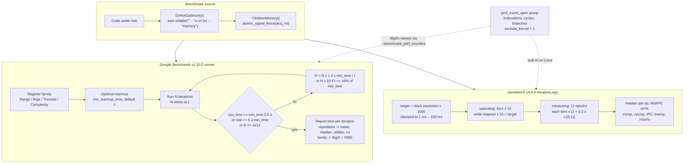

# C++ Google Benchmark and nanobench

> [!summary] Claim:
> A C++ microbenchmark measures nothing unless three things hold: the compiler cannot delete, hoist, or rewrite the code under test, the timed region is long enough that clock resolution and loop overhead vanish, and the reported statistic survives run-to-run noise.
> Google Benchmark and nanobench solve the first problem with the same trick, an empty `asm volatile` statement that claims to read and write a value (`"+r,m"`) and to clobber all memory, and both fail the same way: the barrier pins a value, not the computation that produced it.
> Google Benchmark grows the iteration count until CPU time reaches 0.5 s (multiplier 1.4x the shortfall, 10x when far off), reports means per iteration, and fits Big-O by one-parameter least squares through the origin; nanobench runs 11 epochs sized to 1000x the measured clock resolution (clamped to 1 ms to 100 ms), reports the median with its median absolute percentage error, and reads Linux PMU counters itself.
> Time is the noisy observable; retired user-mode instructions from `perf_event_open(2)` are nearly deterministic, which is why counter-based checks belong in CI and time-based ones belong on a quiet, pinned machine.



## The Mechanism

[[Cpp-CPU-Profiling-perf-samply-Callgrind-and-llvm-mca]] owns whole-program CPU profiling, and [[Linux-perf-in-Depth-and-perf-c2c]] owns `perf_event_open(2)` as a system.
This note owns the microbenchmark harness: the optimizer barriers, the iteration and statistics machinery of Google Benchmark and nanobench, their PMU counter paths, and their complexity fitting.
Every Google Benchmark fact below is from the v1.10.0 tag (released 2026-10-14) and every nanobench fact from the v4.6.0 tag (released 2026-08-14), unless a release is named.

### 1. What a harness must solve

A microbenchmark times a short piece of code, often nanoseconds long, by running it many times between two clock reads.
That design has four failure modes, and every feature of both libraries exists to close one of them:

1. **The optimizer.** The code under test usually has no observable effect, so the as-if rule lets the compiler delete it, hoist it out of the loop, constant-fold it, or replace it with a closed form.
2. **Clock granularity and overhead.** A clock read costs tens of nanoseconds on some systems and ticks in discrete steps, so a single call cannot be timed; the harness must batch enough iterations that the clock's error is negligible.
3. **Noise.** Frequency scaling, turbo, SMT siblings, interrupts, migrations, cache and branch-predictor state left by earlier code, and memory layout all move the number, and the same binary can report different results in different runs.
4. **Interpretation.** A mean of one run, a ratio of two runs taken minutes apart, and a curve fitted to five noisy points all look precise and are not.

Mytkowicz, Diwan, Hauswirth, and Sweeney showed in "Producing Wrong Data Without Doing Anything Obviously Wrong!" (ASPLOS 2009) that innocuous setup changes such as the size of the UNIX environment and the link order bias measured performance enough to flip conclusions.
Chandler Carruth's CppCon 2015 talk "Tuning C++: Benchmarks, and CPUs, and Compilers! Oh My!" popularized the empty-asm `escape` and `clobber` helpers that Google Benchmark ships as `DoNotOptimize` and `ClobberMemory`.

### 2. The optimizer is the adversary

The compiler optimizes the benchmark exactly as it would optimize production code, and a benchmark is almost always a program whose results nobody reads.
These five transformations break naive benchmarks; the listings are compiler output captured by the author with `-O2 -S` (Apple clang 21.0.0 on darwin-arm64, and GCC 13.3.0 and Ubuntu clang 18.1.3 on linux-aarch64 in the lab container image), not lab expected files.

**Dead-code elimination.** A reduction whose result is discarded is deleted, loop and all:

```cpp
void sum_discarded(const std::vector<int>& v) {
  long s = 0;
  for (int x : v) s += x * x;
  (void)s;
}
```

```text
__Z13sum_discardedRKNSt3__16vectorIiNS_9allocatorIiEEEE:
	ret
```

That is the whole function under Apple clang 21 and under GCC 13.3: the loop is finite and side-effect free, so it is dead.

**Interprocedural deletion through `noinline`.** Marking the kernel `__attribute__((noinline))` does not protect it.
The compiler still analyzes the callee, infers that it writes no memory and always returns (GCC's pure-const pass, LLVM's function-attribute inference), and deletes the call:

```cpp
__attribute__((noinline)) void sum_squares_discarded(const std::vector<int>& v);  // body as above
void caller(const std::vector<int>& v, long iters) {
  for (long i = 0; i < iters; ++i) sum_squares_discarded(v);
}
```

```text
== g++ 13.3.0 -O2
_Z6callerRKSt6vectorIiSaIiEEl:
	ret
== clang++ 18.1.3 -O2
_Z6callerRKSt6vectorIiSaIiEEl:
	ret
```

The deletion is not guaranteed: re-checked on darwin-arm64 (as of 2026-11), Apple clang 21.0.0 and Homebrew clang 23.1.5 with libc++ compiled the callee to a bare `ret` yet kept the caller's loop of calls, while GCC 16.2.0 deleted it; with a raw-pointer kernel instead of `std::vector`, all three deleted the call.
Whether the attribute inference fires depends on the library code inlined into the callee, so read the listing rather than assume either outcome.

**Closed-form replacement.** Clang's induction-variable and scalar-evolution passes replace an arithmetic-series loop by `n(n-1)/2`, even when `n` is a runtime value:

```cpp
long series(long n) { long s = 0; for (long i = 0; i < n; ++i) s += i; return s; }
```

```text
__Z6seriesl:                            ; Apple clang 21, arm64
	subs	x8, x0, #1
	b.lt	LBB2_2
	sub	x9, x0, #2
	mul	x10, x8, x9
	umulh	x9, x8, x9
	extr	x9, x9, x10, #1
	add	x0, x8, x9
	ret
```

GCC 13.3 keeps the loop (`add x0, x0, x1; add x1, x1, 1; cmp x2, x1; bne .L10`).
A benchmark of `series` is therefore O(N) under GCC and O(1) under Clang, and Google Benchmark's complexity fit reports exactly that; the lab checks it under both compilers.

**Heap elision.** Since C++14 the compiler may omit a `new`/`delete` pair whose memory does not escape ([expr.new] allows the allocation to be elided or merged), so Google Benchmark's own user-guide example compiles to nothing under Clang:

```cpp
void push_noclobber() { std::vector<int> v; v.reserve(1); v.push_back(42); }
```

```text
__Z14push_noclobberv:                   ; Apple clang 21
	ret
```

GCC 13.3 keeps the `_Znwm` call, the store of 42, and the `_ZdlPvm` call, so the same source measures an allocator round trip under one compiler and an empty function under another.
GCC 16.2.0 elides the pair as well (re-checked on darwin-arm64, as of 2026-11), so the split is a property of the compiler version, not of the compiler family.

**Hoisting and folding.** A loop-invariant computation with constant inputs (`DoNotOptimize(f(42))` where `f` is visible) is computed once, at compile time or before the loop, and the loop only re-publishes the result.

### 3. `DoNotOptimize` and `ClobberMemory` internals

Google Benchmark v1.10.0 `include/benchmark/utils.h` implements the barrier for Clang (and Intel) as follows; the `#else` arm shown is never reached by GCC 5 or later, which takes a separate branch described below:

```cpp
template <class Tp>
inline BENCHMARK_ALWAYS_INLINE
    typename std::enable_if<internal::IsValidAsmOutput<Tp>::value>::type
    DoNotOptimize(Tp& value) {
#if defined(__clang__)
  asm volatile("" : "+r,m"(value) : : "memory");
#else
  asm volatile("" : "+m,r"(value) : : "memory");
#endif
}

inline BENCHMARK_ALWAYS_INLINE void ClobberMemory() {
  std::atomic_signal_fence(std::memory_order_acq_rel);
}
```

How each part works, with the GCC Extended Asm manual as the reference:

- **The empty template.** The asm emits no instruction, so the barrier costs nothing at run time except whatever it forces: the value must be materialized in a register or a stack slot at that point.
- **`"+r,m"`.** `+` declares the operand both read and written, so the compiler must compute `value` before the statement and must assume the statement changed it afterwards; a later use cannot reuse a cached copy, and an earlier computation cannot be deleted.
  The comma separates two alternatives, register or memory, and the compiler picks the cheaper one; Clang gets `r` first and GCC gets `m` first; the source does not record why, and the GCC branch below goes further.
- **`volatile`.** It forbids deleting the statement or moving it out of a loop even though its outputs look unused; the GCC manual says it "disables these optimizations".
- **`"memory"` clobber.** It "effectively forms a read/write memory barrier for the compiler" (GCC manual): values cached from memory must be reloaded afterwards, and pending stores to memory the compiler cannot prove private must be performed before it.
  This is what makes `DoNotOptimize` also act as a barrier for global and escaped memory.
- **`ClobberMemory()`.** v1.10.0 implements it as `std::atomic_signal_fence(std::memory_order_acq_rel)` on every compiler; v1.10.0's release notes replaced MSVC's deprecated `_ReadWriteBarrier` with it, and older releases such as v1.5.0 used `asm volatile("" : : : "memory")` on GCC and Clang.
  A signal fence emits no CPU instruction; GCC and Clang treat it as a compiler barrier for all memory, which is the property the benchmark needs.
- **Escape before clobber.** A clobber only forces stores to memory the compiler believes something else could observe; a local `std::vector`'s buffer is private until its address escapes, which is why the user guide passes `v.data()` to `DoNotOptimize` first and calls `ClobberMemory()` after `push_back`.

Edge cases the source handles:

- **`const` lvalues and rvalues.** `DoNotOptimize(T const&)` uses an input-only operand (`"r,m"`), which lets the compiler compute the value once and keep reusing it, so v1.8.0 deprecated it (PR 1493) and v1.10.0's diagnostic tells you to "store it in a local variable first".
- **Types with `const` members** cannot be asm outputs; v1.10.0 routes them, through the `IsValidAsmOutput` trait, to the input-only form (issue 1997).
- **GCC versus Clang.** Under GCC (not Clang, not Intel) the overloads split on `is_trivially_copyable` and `sizeof(Tp) <= sizeof(Tp*)`: small trivial values get `"+m,r"`, larger or non-trivial ones get memory-only `"+m"`, so a large object is never forced into a register.
- **MSVC** has no GCC-style inline assembly, so the fallback passes the address to an exported out-of-line function `internal::UseCharPointer(char const volatile*)` and then calls `ClobberMemory()`; a call into another translation unit is an optimization barrier unless link-time optimization sees through it.

What the barrier does not do:

- It pins the **value**, not the **work**: `DoNotOptimize(series(n))` with a visible `series` lets Clang compute the closed form and pin only the result, and the user guide states that the expression "may even be removed entirely when the result is already known".
- It does not make the inputs opaque: a benchmark whose input is a compile-time constant can be folded before the barrier; escape the input too (`DoNotOptimize(n)` before use), as the lab does.
- It forces materialization, which is itself a cost: a `DoNotOptimize` inside an inner loop forces a register or stack round trip per iteration and can block vectorization of the loop being measured.

nanobench's `ankerl::nanobench::doNotOptimizeAway` copies the non-GCC branch of Google Benchmark's v1.7.1 barrier (`benchmark.h` lines 443-446: `"r,m"` for `T const&`, `"+r,m"` under Clang and `"+m,r"` otherwise for `T&`) and uses it on GCC too, so it lacks the GCC size split that Google Benchmark's GCC branch has carried since v1.6.2 (and still had at v1.7.1), as well as the later `IsValidAsmOutput` routing and the const-reference deprecation; its source comment says the "assembly magic is directly from what Google Benchmark is doing".
In v4.4.0 its guard changed from testing `_MSC_VER` to testing what the compiler understands (`__clang__` or `__GNUC__`), because clang-cl defines `_MSC_VER` and had silently been using the weaker function-call fallback (issue 111).

### 4. Google Benchmark: registration and the timing loop

`BENCHMARK(BM_x)` registers a family; `Arg`, `Range` (default multiplier 8), `RangeMultiplier`, `DenseRange`, `Ranges`, `ArgsProduct`, `Threads`, `ThreadRange`, and `ThreadPerCpu` expand it into instances, each run by a `BenchmarkRunner`.
The benchmark body receives a `benchmark::State&` and loops with `for (auto _ : state)`.

The range-for loop is the fast path.
`State::begin()` returns an iterator whose `cached_` copy of `max_iterations` lives in a register; `operator++` decrements it, and `operator!=` calls `FinishKeepRunning()` when it reaches zero.
`State::end()` calls `StartKeepRunning()`, which waits on a start barrier for all threads and starts the timers.
The older `while (state.KeepRunning())` form loads and stores `total_iterations_` in the `State` object every iteration, which the user guide shows as a `mov`/`lea`/`mov`/`cmp` sequence against the range-for's single `add rbx, -1; jne`.
`KeepRunningBatch(n)` lets a body consume `n` iterations at once and may overshoot, which is why the runner reads the real count from the results.

#### Iteration growth

`BenchmarkRunner::DoOneRepetition()` starts with `iters = 1` and loops:

1. Run `iters` iterations on every thread (`DoNIterations()`), with `Setup` and `Teardown` callbacks outside the timed loop.
2. Take `seconds` as the summed CPU time, or the real time with `UseRealTime()`, or the manual time with `UseManualTime()`.
3. Stop when `ShouldReportIterationResults()` holds: the benchmark was skipped, `iters >= kMaxIterations`, `seconds >= min_time`, or real time reached `5 x min_time` (except under manual time).
4. Otherwise `PredictNumItersNeeded()`: `multiplier = min_time x 1.4 / max(seconds, 1e-9)`, replaced by `10.0` when the run took no more than 10% of `min_time`, and the next count is `max(multiplier x iters, iters + 1)`, capped at `kMaxIterations`.

`min_time` defaults to `"0.5s"` (`kDefaultMinTimeStr` in `benchmark_api.h`), and `--benchmark_min_time=<integer>x` (since v1.8.0) fixes the iteration count instead.
`kMaxIterations` is `1000000000000` (1e12) since v1.8.4 ("Increase the kMaxIterations limit", PR 1668); it was 1e9 through v1.8.3, and the v1.10.0 user guide still says "not more than 1e9", so trust the source.
The 1.4 factor overshoots on purpose: an estimate from a short run tends to be low, and one more round costs more than 40% extra time.
Every repetition after the first reuses the first repetition's iteration count, so repetitions are comparable.

The 5x real-time rule is why a benchmark that sleeps or blocks on I/O still terminates: its CPU time never reaches `min_time`, but its wall clock does.
A benchmark whose body was optimized away runs until the 1e12 cap or the time limit, and a sub-nanosecond time with a huge iteration count is the signature of a deleted body.

#### Warmup and repetitions

`--benchmark_min_warmup_time` (default 0, so disabled) or `MinWarmUpTime()` runs the same growth loop first and discards the results, then restores the original iteration count, because "the warmup loops might be considerably slower" (source comment).
`--benchmark_repetitions=N` (default 1) runs the instance N times and adds `mean`, `median`, `stddev`, and `cv` aggregates; `ComputeStatistics` adds custom ones; `--benchmark_report_aggregates_only` and `--benchmark_display_aggregates_only` control what is printed and written.
v1.10.0 skips errored runs when computing repetition statistics.

#### Random interleaving

With `--benchmark_enable_random_interleaving=true`, `RunBenchmarks()` builds a list holding each runner index once per repetition and shuffles it with `std::mt19937` seeded from `std::random_device`, so repetitions of different benchmarks alternate.
Issue 1051, which introduced it, measured 40% lower run-to-run variance on one benchmark over 50 runs and about 50% on average over roughly 800 microbenchmarks (the docs summarize it as 40%), and suggests pairing it with more repetitions and a shorter `min_time` (the docs give `--benchmark_repetitions=9` and `--benchmark_min_time=0.1`) so the total time stays similar.
The mechanism is simple: drift in frequency, thermal state, or background load hits every benchmark equally instead of whichever ran during the bad interval.

#### Timers

Each thread has a `ThreadTimer` that reads two clocks around the timed region:

- Real time: `ChronoClockNow()`, which uses `high_resolution_clock` when it is steady and `steady_clock` otherwise (`ChooseSteadyClock` in `timers.h`), or plain `high_resolution_clock` when `HAVE_STEADY_CLOCK` is undefined.
- CPU time: per-thread by default, `clock_gettime(CLOCK_THREAD_CPUTIME_ID)` on Linux and `thread_info(THREAD_BASIC_INFO)` on macOS; `MeasureProcessCPUTime()` switches to process CPU time (`CLOCK_PROCESS_CPUTIME_ID`, or `getrusage(RUSAGE_SELF)` on macOS).

The console prints both `Time` (real) and `CPU`, but iteration sizing and the complexity curve choice use CPU time by default, so a benchmark that waits on locks or I/O is sized and fitted on the little CPU it burns; use `UseRealTime()` for anything that blocks or uses several threads, which fixes iteration sizing but not the curve choice (the Big-O curve is still picked on CPU time; only `UseManualTime()` changes that), and `MeasureProcessCPUTime()` when the work runs on threads the benchmark did not create.
`UseManualTime()` makes the body call `state.SetIterationTime(seconds)` once per iteration, which is how GPU kernels and externally timed operations are reported.

`PauseTiming()` and `ResumeTiming()` stop and restart both timers, plus the PMU counters when enabled, and each call reads clocks or makes system calls.
The user guide calls this "not recommended, since it has high overhead": pausing around a 20 ns operation measures the pause, so batch the untimed setup instead, or use `Setup`/`Teardown`.
v1.10.0 adds `ScopedPauseTiming`, an RAII pause, and diagnoses invalid pause and resume calls in builds without `NDEBUG`.

#### Environment checks

At startup the library prints `***WARNING*** CPU scaling is enabled` when any CPU's `/sys/devices/system/cpu/cpuN/cpufreq/scaling_governor` is not `performance`, and a warning when ASLR is enabled.
Since v1.9.3, `BENCHMARK_MAIN()` calls `benchmark::MaybeReenterWithoutASLR(argc, argv)`, which on Linux sets `ADDR_NO_RANDOMIZE` with `personality(2)` and re-executes the binary; v1.9.4 fixed it under Docker, where `personality()` can report inconsistent results, by re-checking the flag before re-executing (PR 1985), and v1.10.0 fixed an infinite re-exec loop under AppArmor.
Disabling ASLR makes code and data addresses repeat between runs, which removes one source of layout noise but does not make the layout representative.

### 5. Asymptotic complexity fitting

A family marked `->Complexity()` calls `state.SetComplexityN(n)` in each instance, and after its last instance `ComputeBigO()` (from `complexity.cc`, adapted from Ismael Jimenez Martinez's `cpp.leastsq`) fits time per iteration against n.
For a candidate curve g, `MinimalLeastSq()` computes the coefficient of the least squares line through the origin and its normalized RMS:

$$c = \frac{\sum_i t_i\, g(n_i)}{\sum_i g(n_i)^2}, \qquad \mathrm{RMS} = \frac{\sqrt{\tfrac{1}{k}\sum_i \big(t_i - c\, g(n_i)\big)^2}}{\tfrac{1}{k}\sum_i t_i}$$

With `oAuto` it starts from `o1` and tries `oLogN`, `oN`, `oNLogN`, `oNSquared`, `oNCubed` in that order, replacing the best fit only when the RMS is strictly lower.
It needs at least two instances (`BM_CHECK_GE(n.size(), 2)`) and aborts with "Did you forget to call SetComplexityN?" when n is zero.
The curve is chosen on CPU time unless the family uses manual time, and the real-time fit then reuses the same curve; `Complexity(oN)` fixes the curve and `Complexity(lambda)` supplies a custom one.
The family gets two extra rows, `BM_x_BigO` (coefficient, in the family's time unit since v1.10.0) and `BM_x_RMS` (a percentage); the JSON reporter writes them as `cpu_coefficient`, `real_coefficient`, `big_o`, and `rms`.

nanobench's `Bench::complexityBigO()` computes the same coefficient and the same normalized RMS over the six curves `O(1)`, `O(n)`, `O(log n)`, `O(n log n)`, `O(n^2)`, `O(n^3)` and sorts them by RMS; it fits the median elapsed time per op of every result that had `complexityN()` set.

The fit has no intercept, and that is its main trap.
A constant setup cost, a fixed per-call overhead, or a lower-order term is charged to the growth term, so the selected curve can be wrong by a whole class.
The lab's self-test feeds exact synthetic data through a port of `MinimalLeastSq` and shows three such misfits, over 7 sizes from 256 to 16,384 (and 7 sizes from 256 to 1,048,576 for the last):

| True cost | oAuto picks | Why |
| :--- | :--- | :--- |
| `2N + 20000` | `lgN` | The constant dominates small n, and a slowly growing curve through the origin bends to fit it |
| `N lgN + 30N` | `N` | Over 6 doublings lgN grows from 8 to 14, so the 30N term flattens the ratio |
| `5 lgN + 100` | `(1)` | The constant term is larger than the whole growth over the range |

Rules that follow: span at least two orders of magnitude of n, subtract fixed overhead or measure it as its own benchmark, prefer `Complexity(oNLogN)` with a known curve and read the RMS as a goodness-of-fit check, and never infer N versus N lgN from time over a narrow range.
Fitting time also inherits cache effects: a working set that crosses L1, L2, or LLC boundaries inside the range shows as a step, which no single-term curve fits.

### 6. Hardware counters in Google Benchmark

`--benchmark_perf_counters=CYCLES,INSTRUCTIONS` reads PMU counters at the same boundaries as the timers and reports them as user counters averaged per iteration (`kAvgIterations`).
The feature requires a build with libpfm: `-DBENCHMARK_ENABLE_LIBPFM=ON` with `libpfm4-dev` installed under CMake, or `--define pfm=1` under Bazel; v1.10.0 also adds `-lpfm` to the pkg-config `Libs.private`.
Counter names are decoded by `pfm_get_os_event_encoding()`, so they are libpfm names, platform specific, with `CYCLES` and `INSTRUCTIONS` mapped portably.

How `PerfCounters::Create()` opens them:

- Plane `PFM_PLM3`, user mode only, with `exclude_kernel = 1`, `exclude_hv = 1`, and `inherit = true` so threads created later are counted.
- The first counter is the group leader, `pinned` and `disabled`; each further counter joins the group with `group_fd = leader`, and on any `perf_event_open` failure it retries once as the leader of a new group, then drops the counter.
- `read_format = PERF_FORMAT_GROUP`, one `read(2)` per group; `PERF_FORMAT_TOTAL_TIME_ENABLED` and `TOTAL_TIME_RUNNING` are commented out, so readings are **not** scaled for multiplexing.
- At most `PerfCounterValues::kMaxCounters` = 32 counters; extra names are ignored with a message, and an unknown name logs "Unknown performance counter name".
- `perf_event_open` is retried up to 5 times on `EINTR`, a counter that cannot be opened is dropped with a warning, and benchmarks with threads get a warning that counters are combined across threads.
- Since v1.10.0 (PR 2123) a generic `PERF_TYPE_HARDWARE` event is opened on every CPU PMU, because on systems with several CPU PMUs, such as big and little clusters, the kernel creates a generic event for "an arbitrary PMU" which "can cause inaccuracies" when the thread runs on the other cluster.

The kernel gate is `/proc/sys/kernel/perf_event_paranoid`: 2, the most restrictive level the upstream kernel documents, still allows per-process, user-space-only counting, which is all both libraries ask for; containers and VMs without a virtual PMU refuse hardware events entirely.
Debian and Ubuntu kernels carry an out-of-tree patch ("security,perf: Allow further restriction of perf_event_open", in Ubuntu since 4.8.0-7.8, release 16.10) that adds level 3: "disallow all access to performance events by users without CAP_SYS_ADMIN", enforced in `perf_event_open` with `-EACCES`, so neither library can count anything as an unprivileged user there.
With `CONFIG_SECURITY_PERF_EVENTS_RESTRICT` the patch makes its restricted level the default, so read the value on the host before trusting a counter-based gate ([ALT Linux list copy of the patch](https://lists.altlinux.org/pipermail/devel-kernel/2022-June/007599.html), [Ubuntu bug 1612790](https://bugs.launchpad.net/bugs/1612790), [kernel sysctl docs](https://docs.kernel.org/admin-guide/sysctl/kernel.html), which document only -1 to 2; as of 2026-11).

### 7. nanobench: design and internals

nanobench is one MIT-licensed header, `nanobench.h`, that needs C++11; one translation unit defines `ANKERL_NANOBENCH_IMPLEMENT` before including it, and every other one includes it plainly.
There is no registration and no `main`: a benchmark is a call.

```cpp
#define ANKERL_NANOBENCH_IMPLEMENT
#include <nanobench.h>

ankerl::nanobench::Bench().minEpochIterations(1000).run("parse", [&] {
    auto r = parse(input);
    ankerl::nanobench::doNotOptimizeAway(r);
});
```

#### The measuring loop

`Bench::runImpl()` is deliberately short so the compiler can inline `op()`:

```cpp
while (auto n = iterationLogic.numIters()) {
    setupOp();
    pc.beginMeasure();
    Clock::time_point const before = Clock::now();
    while (n-- > 0) { op(); }
    Clock::time_point const after = Clock::now();
    pc.endMeasure();
    pc.updateResults(iterationLogic.numIters());
    iterationLogic.add(after - before, pc);
}
```

`Clock` is `high_resolution_clock` when it is steady, otherwise `steady_clock`.
`IterationLogic::Impl` is a four-state machine: `warmup`, `upscaling_runtime`, `measuring`, `endless`.

- The target epoch time is `clockResolution() x clockResolutionMultiple()`, where the resolution is the smallest of 20 measured clock ticks, each found by spinning until `Clock::now()` changes, and the multiple defaults to 1000; the target is clamped to `minEpochTime` (1 ms) and `maxEpochTime` (100 ms).
  The header puts a modern clock's resolution "around 20 ns", so 1000x is about 20 us and on typical hardware the 1 ms `minEpochTime` floor, not the multiple, sets the epoch length.
- In `upscaling_runtime`, while `elapsed x 10 < target` it multiplies the iteration count by 10 (with an overflow check that prints "iterations overflow. Maybe your code got optimized away?"); otherwise it predicts the count as `target / elapsed x iters`.
- An epoch counts once `elapsed x 3 >= target x 2`; from then on every epoch is measured, "even when runtime is low", because discarding short epochs would bias the result.
- Each new count is stretched by `1 + 0.2 x U(0,1)` from a fixed-seed generator, so epochs "don't get into lockstep with periodic disturbances".
- It stops after `epochs()` measured epochs, 11 by default.
- `warmup(n)` runs n untimed iterations first, `epochIterations(n)` fixes the count (v4.4.0 fixed a bug that ignored it when `warmup()` was set), `minEpochIterations(n)` raises the floor, and `batch(b)` divides results by b units per op.
- Setting the environment variable `NANOBENCH_ENDLESS=<name>` runs that benchmark forever, to attach a profiler.

#### Statistics

Each epoch contributes one sample per measure, total divided by iterations.
The table shows the **median** per op and `err%`, the median absolute percentage error (MdAPE) of the epoch samples around that median.
The median ignores a few outlier epochs instead of averaging them in, which is why nanobench needs fewer and shorter epochs than a mean-based design.
When `err%` is 5% or more and warnings are enabled, the row gets a `:wavy_dash:` marker and the hint "Unstable with ~N iters. Increase `minEpochIterations` to e.g. 10N".
v4.4.0 fixed MdAPE returning NaN for a measurement of 0.

On Linux, the first `run()` prints stability warnings when `scaling_min_freq` differs from `scaling_max_freq`, when `cpu0`'s governor is not `performance`, or when `intel_pstate/no_turbo` is 0, and recommends `pyperf system tune`; `NANOBENCH_SUPPRESS_WARNINGS=1` silences them.

#### Built-in PMU counters

On Linux (kernel 3.3 or later, unless `ANKERL_NANOBENCH_DISABLE_PERF_COUNTERS` is defined), `PerformanceCounters` opens one group through `syscall(__NR_perf_event_open, ...)`: reference cycles (`PERF_COUNT_HW_REF_CPU_CYCLES`, falling back to `CPU_CYCLES`), instructions, branch instructions, branch misses, and the software events page faults and context switches.
Each event has `exclude_kernel = 1`, `exclude_hv = 1`, and `read_format = GROUP | ID | TOTAL_TIME_ENABLED | TOTAL_TIME_RUNNING`.
The table gains `ins/op`, `cyc/op`, `IPC`, `bra/op`, and `miss%` columns.

Two corrections make the counts mean "the work" rather than "the work plus the harness":

- **Measuring overhead.** `calibrate()` measures a pair of clock reads 100 times and keeps the minimum per counter, which is subtracted from every reading.
- **Loop overhead.** It times 100,000 (plus 0 to 3, from `std::random_device`) iterations of an xorshift step, then the same count of two steps; the difference isolates the per-iteration cost of the loop itself, which is subtracted per iteration for instructions; for branches, `correctBranchInstructions()` removes the measuring loop's own branch per iteration.

v4.4.0 fixed silent under-reporting under multiplexing: readings are now scaled by `time_enabled / time_running`, "the way `perf stat` does it", which matters when the NMI watchdog holds a counter or a VM restricts the PMU.
When `perf_event_open` is refused, v4.4.0 and later say so ("Note: perf_event_open failed, so the ins/op, cyc/op, IPC, bra/op and miss% columns are missing.") instead of silently printing a narrower table.

#### Comparing alternatives

`relative(true)` uses the first result of that `Bench` as the baseline and shows later rows as `100% x (baseline / baselineBatch) / (runtime / batch)`, so 200% means twice as fast, but it compares medians from runs separated in time.
v4.6.0 added `Bench::compare(name, op, name, op, ...)`, which runs one epoch of each alternative per round, orders each block of rounds as a randomly chosen cyclic Latin square (ABBA/BAAB for two), reduces each round to `ln(t_baseline) - ln(t_alternative)`, and reports the median ratio with a sign-test interval widened so the whole table holds at 95%.
Its release notes cite a nanobench test where two identical workloads came out 38% apart on a CI runner under `relative()`, each with an `err%` of 0.5, and recommend `epochs(52)` over the default 11.
Interleaving means each alternative runs with the others' cache and branch-predictor state, which answers "which should I ship" rather than "how fast is this alone".

Results render through mustache-like templates: `templates::csv()`, `json()`, `htmlBoxplot()`, and `pyperf()`, the last producing files that `python3 -m pyperf` can compare and plot.
v4.4.0 added `setup()` (an untimed step once per epoch, not per iteration), `hideColumn()`, and `contextColumn()`; v4.5.0 added `string_view` overloads and builds without exceptions.

### 8. Deciding whether a change is real

Google Benchmark's `tools/compare.py benchmarks <base> <contender>` runs or loads both, prints relative change `(new - old) / |old|`, and with repetitions runs a two-sided Mann-Whitney U test (`scipy.stats.mannwhitneyu`) on the per-repetition times; the significance level is `--alpha`, default 0.05.
It needs at least 2 repetitions per side (`UTEST_MIN_REPETITIONS`) and prints "WARNING: Results unreliable! 9+ repetitions recommended." below `UTEST_OPTIMAL_REPETITIONS = 9`.
`compare.py filters <binary> <filter1> <filter2>` compares two benchmarks inside one binary, and `benchmarksfiltered` compares a filter across two binaries; v1.10.0 ignores skipped benchmarks in the geomean.

A U test on 9 repetitions answers "are these two distributions different", not "is the difference big enough to matter", and repetitions taken back to back on one machine share that machine's state.
For decisions, combine an effect-size threshold, interleaved repetitions (`--benchmark_enable_random_interleaving` or nanobench `compare()`), and a counter that cannot drift (instructions) when the claim is about work rather than latency.

## Commands and Numbers to Know

| Item | Value | Platform and date | What it controls |
| :--- | :--- | :--- | :--- |
| `--benchmark_min_time` | `0.5s`; `<int>x` fixes iterations (v1.8.0+) | Both (as of 2026-11) | Lower bound on CPU time (or real time) per repetition |
| Iteration growth | `1.4 x min_time / t`, or `10x` when `t <= 10%` of min_time | Both (as of 2026-11) | `PredictNumItersNeeded()` |
| Real-time escape | `5 x min_time` | Both (as of 2026-11) | Stops CPU-time benchmarks that block |
| `kMaxIterations` | `1e12` (v1.8.4+), `1e9` before | Both (as of 2026-11) | Hard cap; a deleted body hits it |
| `--benchmark_min_warmup_time` | `0` (off) | Both (as of 2026-11) | Discarded warmup phase |
| `--benchmark_repetitions` | `1` | Both (as of 2026-11) | Adds mean, median, stddev, cv |
| `--benchmark_enable_random_interleaving` | `false` | Both (as of 2026-11) | Shuffles repetitions across benchmarks |
| `--benchmark_perf_counters` | empty; up to 32 libpfm names | Linux (as of 2026-11) | Needs `BENCHMARK_ENABLE_LIBPFM` |
| `--benchmark_format` / `--benchmark_out_format` | `console` / `json` | Both (as of 2026-11) | `csv` also accepted |
| `--benchmark_filter`, `--benchmark_list_tests`, `--benchmark_dry_run` | regex; list; one iteration | Both (as of 2026-11) | Selection and smoke tests |
| `--benchmark_time_unit` | empty: each benchmark's unit, ns unless set | Both (as of 2026-11) | `ns`, `us`, `ms`, `s` |
| `Range()` multiplier | `8` | Both (as of 2026-11) | Change with `RangeMultiplier()` |
| Complexity candidates | `(1)`, `lgN`, `N`, `NlgN`, `N^2`, `N^3` | Both (as of 2026-11) | oAuto order; strict `<` on RMS |
| `compare.py --alpha` | `0.05`; 9+ repetitions recommended | Both (as of 2026-11) | Mann-Whitney U test |
| nanobench `epochs` | `11` | Both (as of 2026-11) | Samples behind the median |
| nanobench epoch target | resolution x `1000`, clamped `1 ms` to `100 ms` | Both (as of 2026-11) | `clockResolutionMultiple`, `minEpochTime`, `maxEpochTime` |
| nanobench unstable mark | `err% >= 5%` | Both (as of 2026-11) | MdAPE threshold for the warning |
| nanobench epoch jitter | `+0% to +20%` | Both (as of 2026-11) | Avoids lockstep with periodic noise |
| `NANOBENCH_ENDLESS`, `NANOBENCH_SUPPRESS_WARNINGS` | benchmark name; `1` | Both (as of 2026-11) | Profile one benchmark forever; silence warnings |
| `perf_event_paranoid` | `2` still allows per-process user-space counting | Linux (as of 2026-11) | Both libraries count user space only |
| Disable boost, pin, prioritize | `echo 0 \| sudo tee /sys/devices/system/cpu/cpufreq/boost`, `taskset -c 0`, `chrt -f 80` | Linux (as of 2026-11) | From Google Benchmark's Reducing Variance doc |
| Governor | `cpupower frequency-set --governor performance` | Linux (as of 2026-11) | Removes the CPU scaling warning |

## Multi-Language Comparison: C++ / Python / Rust

| Concern | C++ (Google Benchmark, nanobench) | Python (pyperf) | Rust (Criterion.rs, Divan) |
| :--- | :--- | :--- | :--- |
| Optimizer barrier | `DoNotOptimize`, `ClobberMemory`, `doNotOptimizeAway`: empty `asm volatile` with `"+r,m"` and `"memory"` | Not needed for pure Python, which CPython does not optimize away; needed again inside C extensions | `std::hint::black_box`, stable since Rust 1.66.0, documented as "best-effort" only |
| Sizing the run | GB: grow iterations until 0.5 s CPU; nanobench: epochs of 1000x clock resolution, at least 1 ms | Default 20 worker processes, 3 values each, 1 warmup, values of at least 100 ms | See [[Rust-Benchmarking-Criterion-Divan-Gungraun-and-dhat]] |
| Statistic | GB: mean per iteration, aggregates over repetitions; nanobench: median and MdAPE | Values pooled across worker processes; see [[Python-Benchmarking-pyperf-asv-and-NumPy-Pandas-Profiling]] | See [[Rust-Benchmarking-Criterion-Divan-Gungraun-and-dhat]] |
| Noise control | Interleaving, ASLR re-exec (GB 1.9.3+), stability warnings | Separate worker processes, `pyperf system tune` | Instruction-count runners such as Gungraun |
| Counters | GB via libpfm; nanobench built in, overhead-corrected | Not built into pyperf | Instruction counts in Gungraun |

The Python column is owned by [[Python-Benchmarking-pyperf-asv-and-NumPy-Pandas-Profiling]] and the Rust column by [[Rust-Benchmarking-Criterion-Divan-Gungraun-and-dhat]]; the shared lesson is that every language needs a barrier its optimizer respects, and a statistic that survives its runtime's noise.

## Worked Lab Example

The lab is `code/05-Profiling/google_benchmark_tuning/` (`# requires: linux, pmu`).
It needs a Linux host with hardware counters, a C++17 compiler (`${CXX:-c++}`), Google Benchmark (`apt install libbenchmark-dev`, or `BENCHMARK_ROOT=<prefix>`), and `nanobench.h` v4.4.0 or later (`NANOBENCH_INCLUDE=<dir>`).
It prints derived facts only, never raw times or counts, so its output is stable on one machine and compiler.

```bash
cd code/05-Profiling/google_benchmark_tuning
NANOBENCH_INCLUDE=/path/to/nanobench/src/include bash run.sh
```

What each part does:

1. **`rebuild.cpp`, the harness rebuilt.** `workloads.hpp` reimplements the Clang-branch `DoNotOptimize` (so under GCC it uses `"+m,r"` for every type) and the classic asm-memory-clobber `ClobberMemory`, `pmu.hpp` opens a user-mode instructions-plus-branches group with `perf_event_open(2)` (leader with `group_fd = -1`, member with `group_fd = leader`, `PERF_FORMAT_GROUP` with both time fields), and `fit.hpp` ports `MinimalLeastSq` and oAuto exactly.
   It pins the thread to its current CPU, so a CPU with big and little clusters cannot migrate it between PMUs, subtracts the instructions of an empty call, and takes the lowest of 9 readings because interrupts and faults run in kernel mode and the counter excludes them.
2. **Fitter self-test** (no counters): six exact curves must each fit as themselves, then the three no-intercept traps from section 5 print their misfits.
3. **Dead code:** the 4,096-element sum of squares with its result discarded and with `do_not_optimize`, and `push_back(42)` with and without escape plus clobber, each classified as eliminated, partial, or executed by instruction count.
   The checks assert that the barrier versions execute; the discarded versions print what the compiler did.
4. **Complexity on instructions:** `std::find` on an absent key (N), `std::sort` on shuffled data with the copy outside the counted region (NlgN), 256 `std::lower_bound` lookups (lgN), insertion sort on reversed input (N^2), and the arithmetic series with its bound escaped, which must fit `(1)` under Clang and `N` under GCC; `rebuild.cpp` then ends (`[4]`) by failing if any of its own counter readings was multiplexed (`time_running != time_enabled`).
5. **Google Benchmark, time-based:** four of the experiments (sum discarded and sunk, sort, series) as `BENCHMARK` families, `--benchmark_min_time=0.2s`, JSON reduced by `summarize_gb.py`; `BM_Sort` accepts N or NlgN, because a time-based fit over 64x of range cannot reliably separate them, which is the lesson.
6. **nanobench:** it prints and checks that `sum discarded` is under 16 ins/op after nanobench's overhead correction, checks that `doNotOptimizeAway` exceeds 1,024 ins/op, and checks that nanobench's own `BigO` class, fed median instruction counts from runs with `setup()` copies, picks `O(n log n)`.

Every check can fail: remove a barrier and the executed checks fail; break the fitter and the self-test fails; run under a different compiler family and the series check names the other result; run without a PMU and `perf_event_open` exits with an error instead of a skip.

### Recorded output

No `expected/` file exists yet: the lab needs a PMU, the author's machine is an Apple M3 Pro whose Linux container VM exposes no hardware counters, and the harness never runs `pmu` labs in containers.
The integrator records `expected/linux-<arch>.txt` on a bare-metal Linux host with `TOOLCHAIN_LABS_PMU=1`.

The two counter-free parts were exercised once in the lab container image (Ubuntu 24.04, linux-aarch64, libbenchmark-dev 1.8.3-3) to check the plumbing; this is a plumbing capture, not a recording.
`run.sh` itself stopped at `perf_event_open` as designed (`set -e` ends it there), so `gb_lab.cpp` and `summarize_gb.py` were built and run directly, outside `run.sh`, once per compiler.
The fitter self-test, from `rebuild.cpp` built with GCC 13.3:

```text
[1] fitter self-test (pure arithmetic, no counters)
  exact curves classified correctly: 6/6
  check every exact curve fits as itself                           ok
  trap 2N + 20000                     fits as lgN
  trap N lgN + 30N                    fits as N
  trap 5 lgN + 100                    fits as (1)
```

The Google Benchmark part, built once with each compiler and reduced by `summarize_gb.py`:

```text
[5] Google Benchmark, time-based (gcc)
  BM_SumDiscarded under 2 ns per iteration: yes
  BM_SumDoNotOptimize at least 50x slower : yes
  check DoNotOptimize keeps the reduction under the real library   ok
  BM_Sort    BigO is NlgN or N: yes
  BM_Series  BigO: N
  check BM_Sort fits NlgN or N (time-based fit)                    ok
  check BM_Series fits N under gcc                                 ok
[5] Google Benchmark, time-based (clang)
  BM_SumDiscarded under 2 ns per iteration: yes
  BM_SumDoNotOptimize at least 50x slower : yes
  check DoNotOptimize keeps the reduction under the real library   ok
  BM_Sort    BigO is NlgN or N: yes
  BM_Series  BigO: (1)
  check BM_Sort fits NlgN or N (time-based fit)                    ok
  check BM_Series fits (1) under clang                             ok
```

### Reading the result

- The same `BM_Series` source is O(N) under GCC and O(1) under Clang, and Google Benchmark's fit reports each faithfully: the complexity fit measures the binary, not the algorithm you wrote.
- `DoNotOptimize(n)` inside the loop did not stop Clang's closed form, because it pins `n`, and the closed form only needs `n`.
- The no-intercept traps are not bugs in the port: Google Benchmark and nanobench both fit through the origin, so a constant term moves the answer by a whole complexity class.

## Pitfalls

> [!warning] Pitfall: a body that runs in under a nanosecond
> A time below one cycle, or an iteration count at the cap (1e12 since v1.8.4, 1e9 before), means the body was deleted.
> Check with `objdump -d` or `-S`, or with an instruction counter, before reading any other number.

> [!warning] Pitfall: trusting `noinline` as a barrier
> GCC and Clang can delete a call to a `noinline` function they prove has no side effects, because interprocedural analysis infers it is pure; whether they do depends on the inlined library code (Apple clang 21 kept the `std::vector` caller's calls that GCC 13.3 and Clang 18 on Linux deleted).
> Pass the result through `DoNotOptimize`, or put the kernel in another translation unit without LTO.

> [!warning] Pitfall: `DoNotOptimize(f(x))` with a constant or visible `f`
> The barrier pins the result, not the work: the call can be folded, hoisted out of the loop, or replaced by a closed form, and v1.8.0 deprecated the const-reference overload for this reason.
> Store the result in a non-const local, escape the inputs, and look at the generated code.

> [!warning] Pitfall: `ClobberMemory()` without an escape
> A clobber forces stores only to memory the compiler cannot prove private.
> A local buffer stays private until `DoNotOptimize(ptr)` publishes its address.

> [!warning] Pitfall: `PauseTiming()` around a short operation
> Each pause and resume reads two clocks and, with counters, makes system calls, so pausing around a 20 ns body measures the pause.
> Hoist setup into `Setup()`, batch it outside the loop, or use `UseManualTime()` with your own timer.

> [!warning] Pitfall: CPU time for blocking or multithreaded code
> Iteration sizing and the complexity fit use CPU time unless told otherwise, and a benchmark that waits on a lock, a condition variable, or I/O burns little CPU, so its `CPU` column looks fast and its run is sized on the wrong clock.
> Use `UseRealTime()` to size the run on wall time, `UseManualTime()` if the Big-O curve must also be chosen on it, and `MeasureProcessCPUTime()` when work runs on threads the benchmark did not create.

> [!warning] Pitfall: comparing two runs taken minutes apart
> Frequency, thermal state, and background load drift, and nanobench's own tests saw identical workloads come out 38% apart under `relative()`.
> Interleave (`--benchmark_enable_random_interleaving`, nanobench `compare()`), repeat 9 or more times, and report the uncertainty of the ratio.

> [!warning] Pitfall: reading Big-O from a narrow range
> Through-origin fitting charges constants and lower-order terms to the growth term, and cache-boundary steps distort time.
> Span at least two orders of magnitude, check the RMS, and fit instructions when you want the algorithm rather than the memory hierarchy.

> [!warning] Pitfall: unscaled or partial counters
> Google Benchmark v1.10.0 does not request `TOTAL_TIME_RUNNING`, so a multiplexed reading is silently low; nanobench scales since v4.4.0.
> Request few counters, keep them in one group, check that the NMI watchdog is not holding one (`kernel.nmi_watchdog`), and pin the thread on hybrid CPUs.

> [!warning] Pitfall: benchmarking the hot cache and the trained predictor
> Repeating one input thousands of times leaves data in L1 and every branch predicted, which production never sees.
> Rotate through inputs larger than the cache, randomize branch outcomes, and confirm with `miss%` and `cyc/op` from nanobench or [[Linux-perf-in-Depth-and-perf-c2c]].

> [!warning] Pitfall: different flags in the benchmark and the product
> A benchmark built without `-O2`, with `DEBUG` defined (nanobench warns), without LTO or PGO when production has them, or with a different `-march`, measures another program.
> Build benchmarks from the production toolchain configuration; [[Cpp-PGO-AutoFDO-and-BOLT-Workflow]] shows how far profile-guided layout moves the numbers.

## At Scale

A single developer uses a microbenchmark to choose between two implementations on one machine in one afternoon.
At 1,000 to 50,000 engineers, microbenchmarks become a regression gate, and the economics change.

- **Hardware is the dominant noise source.** Shared CI runners differ in CPU model, frequency policy, and neighbors, so wall-clock thresholds either flake or are too loose to catch anything.
- **Most regressions are small.** A 2% change in a hot library function matters fleet-wide but is far inside the run-to-run spread of time on a shared runner.
- **Benchmarks rot.** A benchmark whose body was optimized away keeps passing forever, and a renamed or deleted benchmark silently drops coverage.

Decision rules:

- Gate pull requests on **instruction counts**, not time: nanobench's `ins/op`, Google Benchmark with `--benchmark_perf_counters=INSTRUCTIONS`, or an instruction-count runner such as the Valgrind-based tools in [[Rust-Benchmarking-Criterion-Divan-Gungraun-and-dhat]]; instructions catch algorithmic and code-size regressions with near-zero noise and say nothing about cache misses or frequency.
- Measure **time** on dedicated, quiet machines: performance governor, boost off, SMT off or sibling idle, isolated cores, fixed kernel and microcode; that is why the Reducing Variance doc notes that companies "maintain machines dedicated to performance testing".
- Require interleaving and repetitions for any time comparison (`--benchmark_enable_random_interleaving`, 9 or more repetitions, `compare.py` U test), and an effect-size threshold agreed per benchmark.
- Treat a sub-nanosecond result or an iteration count at the cap as a test failure, and run a periodic job that diffs instruction counts of every benchmark against its own history to find bodies that stopped executing.
- Keep a JSON history (`--benchmark_out`, nanobench `templates::json()`) keyed by commit, compiler, and machine, and alert on change points rather than single runs.
- Pin the library versions in the build: Google Benchmark changed `kMaxIterations` in v1.8.4, ASLR handling in v1.9.3, and counter PMU selection in v1.10.0, and nanobench changed reported counter values in v4.4.0, so a version bump can move every number.
- Microbenchmarks answer local questions; fleet questions go to [[Continuous-Profiling-GWP-Parca-Pyroscope-and-OTel-Profiles]], and the choice between them is a [[Profiling-Decision-Records]] decision.

## Practice Drill

> [!tip] Practice Drill:
> Write a Google Benchmark family that looks up keys in a `std::unordered_map<int,int>` of n entries, with `Range(1<<10, 1<<22)` and `Complexity()`, and predict the BigO line before running it.
> Run it three times with `--benchmark_repetitions=9 --benchmark_enable_random_interleaving=true`; then rewrite it so every lookup uses the same key and compare: the second version measures a trained predictor and an L1-resident bucket.
> Make the lookup's result unused and confirm in `objdump -d` that the loop body disappeared, then restore it with `DoNotOptimize` on a non-const local.
> Port the family to nanobench with `minEpochIterations` and `complexityN`, read `err%`, `ins/op`, and `miss%`, and explain why the instruction count stays almost constant across n while the time grows once the table leaves the last-level cache.
> Stretch: feed nanobench's median `instructions` into `ankerl::nanobench::BigO` as the lab does, and compare the fitted curve with the time-based `complexityBigO()`.

## Interview Questions

> [!question] L5: What does `benchmark::DoNotOptimize(x)` compile to, and why does it stop dead-code elimination?
>
> > [!success]- Answer
> > On Clang it is an empty `asm volatile("" : "+r,m"(x) : : "memory")`, which emits no instruction; GCC gets the same statement with `"+m,r"`, or memory-only `"+m"` for types that are not trivially copyable or are larger than a pointer.
> > The `+` operand says the asm reads and writes `x`, so `x` must be computed before it and cannot be assumed unchanged after it; `volatile` forbids deleting or hoisting the statement; the `"memory"` clobber makes the compiler flush pending stores and reload cached values.
> > Because the compiler cannot see into the asm, any computation that feeds `x` is live.
> > It does not stop folding of the computation itself when the inputs are known.

> [!question] L5: Why does Google Benchmark prefer `for (auto _ : state)` over `while (state.KeepRunning())`?
>
> > [!success]- Answer
> > The range-for iterator caches the remaining iteration count in a register and decrements it, so the empty loop is one `add` and one `jne`.
> > `KeepRunning()` updates `total_iterations_` inside the `State` object every iteration, a load and a store the compiler cannot keep in a register, which adds overhead to every measurement.
> > Both start timers through `StartKeepRunning()` and stop them in `FinishKeepRunning()`.

> [!question] L6 (predict the output): A family runs `long s = 0; for (long i = 0; i < n; ++i) s += i; benchmark::DoNotOptimize(s);` with `DoNotOptimize(n)` first, `Range(1<<10, 1<<20)`, and `Complexity()`; what does the BigO row say under GCC 13 and under Clang 18 at `-O2`?
>
> > [!success]- Answer
> > GCC 13 keeps the loop, so the time grows linearly and the row says `N`.
> > Clang replaces the loop with the closed form `n(n-1)/2` computed from the escaped `n`, so the time is constant and the row says `(1)`.
> > `DoNotOptimize(n)` only makes `n` unknown at compile time; the closed form needs nothing more.
> > The lab checks both outcomes, and the lesson is that the fit describes the binary, not the source.

> [!question] L6 (debug this): A benchmark reports `BM_Parse 0.312 ns` with `2243589744` iterations on v1.10.0 at the default `min_time`; the parser takes about 2 microseconds in production; what happened and how do you prove it?
>
> > [!success]- Answer
> > The time is below one cycle, so only the loop's own counter survives and the body was deleted; the iteration count is just what growth produces for such a loop (1e8 iterations take 0.031 s, under 10% of `min_time`, so 10x to 1e9; 0.312 s then gives `1.4 x 0.5 / 0.312`, about 2.24x, and 0.7 s stops the run), and the 1e12 `kMaxIterations` cap is reached only if even the loop vanishes, below 0.5 ps per iteration.
> > The body is usually deleted because the parse result was discarded, passed to a `const&` overload that let the compiler fold it, or the input was a compile-time constant.
> > Prove it with `objdump -d` or `-S` on the benchmark function, looking for an empty loop, or with `--benchmark_perf_counters=INSTRUCTIONS` or nanobench's `ins/op`, which will be a handful per iteration.
> > Fix it by escaping the input (`DoNotOptimize(input)`), storing the result in a non-const local, and passing that to `DoNotOptimize`; re-check the instruction count afterwards.

> [!question] L6: Why does nanobench report a median and MdAPE where Google Benchmark reports a mean per iteration?
>
> > [!success]- Answer
> > nanobench runs a small number of short epochs, 11 by default, each sized to 1000x the clock resolution but at least the 1 ms `minEpochTime`, and interference such as an interrupt or a migration hits individual epochs.
> > The median ignores those epochs instead of averaging them in, and MdAPE, the median absolute percentage error around the median, is a robust spread that flags instability at 5%.
> > Google Benchmark instead runs one long timed region per repetition, at least 0.5 s of CPU time, so interference is averaged inside it, and it offers median, stddev, and cv only across repetitions.
> > The trade-off is that a median hides a bimodal distribution, so look at the per-epoch values (`templates::json()` or `htmlBoxplot()`) when err% is high.

> [!question] L7: How does Google Benchmark choose a complexity class, and give two inputs where it picks the wrong one?
>
> > [!success]- Answer
> > For each candidate g it fits `t = c x g(n)` by least squares through the origin, `c = sum(t g) / sum(g^2)`, and scores it by RMS of residuals divided by the mean time; oAuto starts from `(1)` and switches to lgN, N, NlgN, N^2, or N^3 only on a strictly lower RMS.
> > With no intercept, a constant is charged to the growth term: `2N + 20000` over 256 to 16,384 fits as lgN, and `5 lgN + 100` over 256 to about one million fits as `(1)`.
> > A lower-order term also misleads: `N lgN + 30N` over 6 doublings fits as N.
> > Use wide ranges, subtract or separately measure fixed costs, fix the curve with `Complexity(oNLogN)` and read the RMS, and fit instruction counts when you want the algorithm.

> [!question] L7: Your team gates PRs on Google Benchmark wall time on shared CI runners and the gate flakes weekly; redesign it.
>
> > [!success]- Answer
> > Split the signal: gate PRs on retired instructions, which are nearly deterministic on one microarchitecture, using nanobench `ins/op`, Google Benchmark perf counters built with libpfm, or a Valgrind-based instruction counter where no PMU exists.
> > Move time measurements to a small pool of dedicated machines with the performance governor, boost and SMT off, isolated cores, pinned kernels, and pinned library versions, and run them post-merge or nightly.
> > Require interleaved repetitions (9 or more) and `compare.py`'s U test plus an effect-size threshold for time, and alert on change points across history rather than on a single run.
> > Add a guard that fails any benchmark with a sub-cycle time or an iteration count at the cap, because a deleted body passes every threshold.
> > The trade-off is that instruction counts miss cache-miss and frequency regressions, which the dedicated time pool catches later.

> [!question] L7: What do Google Benchmark's and nanobench's PMU counter paths do differently, and when does it matter?
>
> > [!success]- Answer
> > Google Benchmark decodes libpfm names, opens a pinned group leader with `inherit` and user-mode only, reads with `PERF_FORMAT_GROUP`, and does not request the enabled and running times, so a multiplexed counter reads low without warning; since v1.10.0 it replicates generic events on every CPU PMU for big and little clusters.
> > nanobench opens a fixed set (reference cycles or cycles, instructions, branches, branch misses, page faults, context switches), requests both time fields and scales by `time_enabled / time_running` since v4.4.0, and subtracts calibrated measuring and loop overhead.
> > It matters when the NMI watchdog or another tool holds a counter, on VMs with restricted PMUs, on hybrid CPUs, and whenever you compare absolute ins/op between the two tools: nanobench's numbers exclude the loop, Google Benchmark's include it.

> [!question] L8+: You own the benchmarking platform for a 20,000-engineer C++ codebase; what standards do you set?
>
> > [!success]- Answer
> > One harness per use: nanobench or Google Benchmark for microbenchmarks, with a shared helper library that escapes inputs and outputs and a lint that rejects `DoNotOptimize` on temporaries.
> > Two measurement tiers: instruction counts on every PR, and time on dedicated tuned machines with interleaving, 9 or more repetitions, U tests, and effect-size thresholds owned by each benchmark's team.
> > Pinned toolchain and library versions, recorded in every JSON result together with compiler, flags, CPU model, microcode, kernel, and governor, so numbers are comparable and version bumps are reviewed like code.
> > Automated hygiene: alerts on sub-cycle results and iteration caps, history-based change-point detection, and a quarterly audit that disassembles the top benchmarks.
> > A policy that a microbenchmark win must be confirmed by a macrobenchmark or by fleet profiles before it justifies complexity, because a microbenchmark runs hot caches and trained predictors.

## Further Reading

- Google Benchmark User Guide (v1.10.0): every registration option, timer, counter, and reporting flag, including the "Preventing Optimization" section.
- Google Benchmark `include/benchmark/utils.h`, `state.h`, `src/benchmark_runner.cc`, `src/complexity.cc`, and `src/perf_counters.cc` at v1.10.0: the barrier, the loop, the iteration growth, the fit, and the counter groups.
- Google Benchmark "Reducing Variance" and "Random Interleaving" docs, and issue 1051: what to tune on Linux and the measured effect of interleaving.
- nanobench tutorial, reference, and comparison pages, and `nanobench.h` at v4.6.0: epochs, MdAPE, counter calibration, and `compare()`.
- nanobench v4.4.0 release notes: six measurement defects found in an audit, each a lesson in how a harness can be quietly wrong.
- GCC Extended Asm manual: the semantics of `volatile`, `+`, multiple alternatives, and the `"memory"` clobber that every barrier relies on.
- `perf_event_open(2)` and the kernel's perf-security document: groups, `pinned`, `exclude_kernel`, multiplexing fields, and `perf_event_paranoid`.
- Mytkowicz et al., "Producing Wrong Data Without Doing Anything Obviously Wrong!" (ASPLOS 2009): measurement bias from environment size and link order.
- Chandler Carruth, "Tuning C++: Benchmarks, and CPUs, and Compilers! Oh My!" (CppCon 2015): the origin of the escape and clobber idiom and how to read the generated code.

## Related

- Prerequisites: none
- Next: [[Cpp-Compile-Time-Profiling-ftime-trace-and-ClangBuildAnalyzer]]
- See also: [[02-Programming-Languages/C++/CPP_Zero_to_Godhood/Volume_08_Advanced_Systems/Chapter_103_Microbenchmarking_and_Tail_Latency/Chapter_103_Microbenchmarking_and_Tail_Latency|Chapter_103_Microbenchmarking_and_Tail_Latency]], [[Cpp-CPU-Profiling-perf-samply-Callgrind-and-llvm-mca]], [[Linux-perf-in-Depth-and-perf-c2c]], [[Rust-Benchmarking-Criterion-Divan-Gungraun-and-dhat]], [[Python-Benchmarking-pyperf-asv-and-NumPy-Pandas-Profiling]], [[Cpp-PGO-AutoFDO-and-BOLT-Workflow]]
- Lab: `code/05-Profiling/google_benchmark_tuning/` (requires: linux, pmu)
