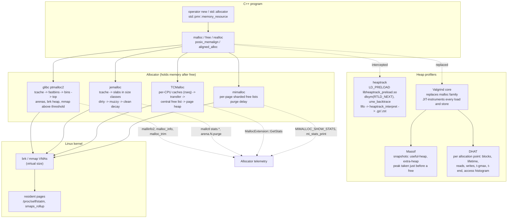
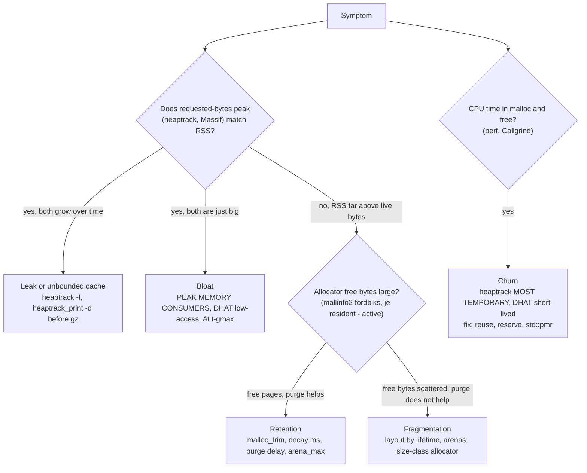

# C++ Memory Profiling: heaptrack, Massif, DHAT, and Allocators

> [!summary] Claim:
> A C++ heap has four sizes that disagree: bytes the program asked for, bytes the allocator handed out after rounding, bytes the allocator holds from the kernel, and pages the kernel counts as resident.
> heaptrack interposes `malloc`/`free` with `LD_PRELOAD`, unwinds every call, and answers "who allocates, how often, and what is live at the peak" at native speed; Massif and DHAT replace the allocator inside Valgrind and trade a large slowdown for instruction-exact snapshots, block lifetimes, and per-byte access counts.
> None of the three sees what the allocator keeps after `free`; that gap, the source of most "the heap is small but RSS is huge" incidents, is only visible through the allocator's own telemetry: `mallinfo2` and `malloc_trim` in glibc, `mallctl` statistics in jemalloc, `MallocExtension` in TCMalloc, and `mi_stats_print` in mimalloc.
> An expert names which of the four sizes moved, picks the tool that measures that size, and fixes churn with reuse or arenas, fragmentation with allocation layout or a different allocator, and retention with purge and decay settings.



## The Mechanism

### 1. Four sizes, four questions

Every heap investigation starts by naming which size changed, because each tool measures a different one.

| Size | Who knows it | Tool that reports it | Typical question |
| :--- | :--- | :--- | :--- |
| Requested bytes | The program | heaptrack, Massif useful-heap, DHAT | Which call path allocates the most, and what is live at the peak? |
| Allocated bytes after rounding | The allocator | Massif extra-heap (a model), `malloc_usable_size`, jemalloc `stats.allocated` | How much do size classes and headers cost? |
| Bytes the allocator holds from the kernel | The allocator | `mallinfo2`, `malloc_info`, jemalloc `stats.active` and `stats.resident`, TCMalloc `GetStats` | Is freed memory being kept, and is it fragmented? |
| Resident pages | The kernel | `/proc/<pid>/statm`, `smaps_rollup`, heaptrack's RSS track | What will the OOM killer and the container limit see? |

A leak raises all four over time.
Churn raises none of them much but burns CPU in the allocator and pollutes caches.
Fragmentation and retention raise the last two while the first stays flat, so a profiler of requested bytes cannot see them at all.
[[Virtual-Memory-Mmap-and-Process-Address-Space]] owns how the kernel counts resident pages; this note owns the allocator and the profilers.

### 2. What the default allocator does with a request: glibc ptmalloc2

Every fact here is from `malloc/malloc.c` and `malloc/arena.c` at glibc 2.42 unless another source is named; the lab's container runs Ubuntu 24.04's glibc 2.39, which has the same chunk layout and thresholds.

#### Chunks and rounding

`request2size()` turns a request into a chunk size: add `SIZE_SZ` (8 bytes on 64-bit) for the size header, round up to `MALLOC_ALIGNMENT` (16 on 64-bit), and never go below `MINSIZE` (32 on 64-bit, `offsetof(struct malloc_chunk, fd_nextsize)`).

```c
#define request2size(req)                                         \
  (((req) + SIZE_SZ + MALLOC_ALIGN_MASK < MINSIZE)  ?             \
   MINSIZE :                                                      \
   ((req) + SIZE_SZ + MALLOC_ALIGN_MASK) & ~MALLOC_ALIGN_MASK)
```

So on 64-bit Linux `malloc(1)` consumes a 32-byte chunk and `malloc(64)` an 80-byte chunk: 25 percent overhead on a 64-byte object, before any fragmentation.
`malloc_usable_size()` returns the chunk size minus the header, so it is 24 for `malloc(1)`; code that writes into those extra bytes is legal by glibc's rules and invisible to a profiler of requested bytes.

#### The free path: tcache, fastbins, bins, top

A freed chunk goes to the first structure that accepts it:

1. The per-thread cache (tcache, added in glibc 2.26): 64 small bins, at most `TCACHE_FILL_COUNT` = 7 chunks each, for requests up to `glibc.malloc.tcache_max` (default 1032 bytes on 64-bit, per `tunables.texi`); no lock is taken.
   glibc 2.42 adds 12 large tcache bins ("Up to 4M chunks"), and its NEWS says they are used once `glibc.malloc.tcache_max` is raised, to at most 4194304.
2. Fastbins: singly linked LIFO lists for chunks up to `DEFAULT_MXFAST` = `64 * SIZE_SZ / 4` = 128 bytes of request on 64-bit; a chunk in a fastbin keeps its "in use" bit set, so it is never coalesced with its neighbors on `free`.
3. The unsorted bin, sorted later into small bins and large bins (`NBINS` = 128, `NSMALLBINS` = 64), where neighbors coalesce.
4. The top chunk, the free space at the high end of the heap, which shrinks with `sbrk` when it exceeds `M_TRIM_THRESHOLD` (default 128 KiB).

Fastbin chunks are merged only by `malloc_consolidate()`, which runs when a large-bin request is made, when a free produces a coalesced chunk of at least `FASTBIN_CONSOLIDATION_THRESHOLD` (64 KiB), and inside `malloc_trim`.
That is why a program can free every small block it allocated and keep the whole heap resident: the free chunks sit in fastbins below a top chunk that never grows past the trim threshold.
The lab shows exactly this with 300,000 blocks of 64 bytes.

#### mmap threshold, and why it moves

A request that no bin or the top chunk can satisfy reaches `sysmalloc()`, which gives it its own `mmap` when it is at least `mp_.mmap_threshold` and fewer than `n_mmaps_max` (default 65,536) mappings exist; freeing such a chunk is a `munmap`, so it never fragments the heap.
A large request that fits in existing free space or the top chunk is carved from the heap instead.
The threshold starts at `DEFAULT_MMAP_THRESHOLD_MIN` = 128 KiB and is dynamic: `free()` of an mmapped chunk larger than the current threshold, and no larger than `DEFAULT_MMAP_THRESHOLD_MAX` (`4 * 1024 * 1024 * sizeof(long)` = 32 MiB on 64-bit), raises the threshold to that chunk's size and sets the trim threshold to twice that.

```c
if (!mp_.no_dyn_threshold
    && chunksize_nomask (p) > mp_.mmap_threshold
    && chunksize_nomask (p) <= DEFAULT_MMAP_THRESHOLD_MAX)
  {
    mp_.mmap_threshold = chunksize (p);
    mp_.trim_threshold = 2 * mp_.mmap_threshold;
```

One free of a 16 MiB buffer therefore moves every later 1 MiB allocation from `mmap` onto the brk heap, where it can pin the top and fragment.
Setting any of `M_MMAP_THRESHOLD`, `M_TRIM_THRESHOLD`, `M_TOP_PAD`, or `M_MMAP_MAX` through `mallopt` or the matching tunable sets `no_dyn_threshold` and freezes the behavior.

#### Arenas

Threads that find the main arena locked get another arena; `arena_get2()` caps the count at `glibc.malloc.arena_max` if set, else at `NARENAS_FROM_NCORES(n)` = 8 per core on 64-bit (2 on 32-bit), checked once more than `arena_test` (8 on 64-bit) arenas exist.
Each non-main arena lives in `mmap`ed heaps of up to `HEAP_MAX_SIZE` = `2 * DEFAULT_MMAP_THRESHOLD_MAX` = 64 MiB on 64-bit, and memory freed into one arena is not available to a thread bound to another.
A thread pool with uneven work on a 64-core host can therefore grow up to 512 arenas, each holding its own free space, which is the classic "RSS grows with thread count" report; `MALLOC_ARENA_MAX=2` or `glibc.malloc.arena_max` trades lock contention for footprint.

#### Telemetry and the trim call

- `mallinfo2()` (glibc 2.33, replacing `mallinfo` whose `int` fields overflow at 2 GiB): `arena`, `hblkhd` and `hblks` (mmapped chunks), `uordblks` (in use), `fordblks` (free), and `keepcost` (the releasable top chunk).
  `__libc_mallinfo2` locks and sums every arena, so `arena` is the total `system_mem` of all arenas, not only `sbrk` memory as the manual's wording suggests; `keepcost`, `hblks`, and `hblkhd` come from the main arena and global counters only.
  `int_mallinfo` counts the top chunk, fastbins, and bins as free, but not tcache, so chunks parked in tcache appear in `uordblks` as in use.
  The manual calls `smblks` and `fsmblks` unused, yet glibc 2.42's `int_mallinfo` fills them with the fastbin chunk count and bytes; `usmblks` is always 0.
  The manual marks the call MT-unsafe because the counters it reads are updated without a common lock.
- `malloc_info(0, FILE*)` prints XML with a `<heap>` element per arena, including free-chunk size histograms; it is the right call when `mallinfo2` totals hide which arena holds the free space.
- `malloc_stats()` prints per-arena system and in-use bytes to stderr.
- `malloc_trim(pad)` walks every arena (`__malloc_trim` loops `ar_ptr->next` until it returns to `main_arena`); `mtrim()` first runs `malloc_consolidate`, then calls `madvise(MADV_DONTNEED)` on every whole page inside a free chunk in the unsorted bin and in large-enough bins, and finally shrinks the main arena's top with `systrim`.
  It cannot release a page that holds even one live chunk, so it fixes retention but not fragmentation.

`MADV_DONTNEED` drops resident pages immediately for private anonymous memory, while `MADV_FREE` (Linux 4.5) only marks them reclaimable under memory pressure, so RSS stays high until the kernel needs the pages (`madvise(2)`); an allocator that purges with `MADV_FREE` looks like it is leaking in `top`.

### 3. heaptrack: interposition at native speed

heaptrack 1.5.0 is the latest release tag (commit dated 2023-09-29), and master carries 1.6 development code (as of 2026-11, Linux); Ubuntu 24.04 ships `1.5.0+dfsg1-2ubuntu3`.
It runs on Linux and FreeBSD; there is no macOS port.

#### Recording

The `heaptrack` shell script (`src/track/heaptrack.sh.cmake`) does five things:

1. Creates a named pipe `/tmp/heaptrack_fifo$$`.
2. Starts `heaptrack_interpret < fifo | gzip -c > OUTPUT.gz` in the background, or `zstd -c` and `.zst` when heaptrack was built with zstd and `zstd` is on `PATH`; `--raw` skips the interpreter and stores the raw stream.
3. Runs the program with `LD_PRELOAD=libheaptrack_preload.so` and `DUMP_HEAPTRACK_OUTPUT=<fifo>`.
4. For `--pid`, refuses to run when `/proc/sys/kernel/yama/ptrace_scope` is above 0, then drives `gdb --batch-silent -p PID` to `call (void) dlopen(...)` the inject library and `call (void) heaptrack_inject("<fifo>")`; its own help text warns that runtime attach "is UNSTABLE and can lead to CRASHES".
5. On exit, prints the `heaptrack --analyze` command; `--record-only` stops it from opening `heaptrack_gui`.

The preload library (`heaptrack_preload.cpp`) defines `malloc`, `free`, `calloc`, `realloc`, `posix_memalign`, `dlopen`, `dlclose`, and, where the platform has them, `cfree`, `valloc`, and `aligned_alloc`, plus `mi_malloc`/`mi_calloc`/`mi_realloc`/`mi_free` for programs that call mimalloc directly; a source comment marks `memalign` and `pvalloc` as not yet hooked.
Each wrapper finds the real function with `dlsym(RTLD_NEXT, name)`.
Because `dlsym` itself may call `calloc`, the library first installs `dummy_calloc`, which serves a static 1024-byte pool and aborts if it runs out, and its `free` ignores pointers from that pool.
After initialization it calls `unsetenv("LD_PRELOAD")` and `unsetenv("DUMP_HEAPTRACK_OUTPUT")`, so child processes are not traced.
`operator new` is not hooked: libstdc++'s `operator new` calls `malloc` through the PLT, and the analyzer removes the `operator new` frames from the top of each trace.

The attach path cannot use `LD_PRELOAD`, so `heaptrack_inject.cpp` walks every loaded object with `dl_iterate_phdr`, reads `DT_REL`, `DT_RELA`, and `DT_JMPREL` from `PT_DYNAMIC`, and overwrites each relocation slot whose symbol name matches a hook, after `mprotect`ing the page writable; it skips itself, `ld-linux`, and `linux-vdso.so`, re-patches after `dlopen`, and writes the originals back on `heaptrack_stop`.
A call that does not go through a relocation, such as a statically linked allocator or a direct `syscall(SYS_mmap)`, is invisible to both paths.
[[Dynamic-Linking-PLT-GOT-and-Loaders]] owns the interposition and relocation machinery itself.

On each event `libheaptrack.cpp` (v1.5.0):

- Guards against recursion with a `thread_local bool RecursionGuard::isActive`, so allocations made by heaptrack itself are not traced.
- Unwinds into a fixed array of `MAX_SIZE` = 64 frames (`trace.h`): with libunwind's `unw_backtrace()` and its per-thread cache when built with `HEAPTRACK_USE_LIBUNWIND` (the README lists libunwind as a collector dependency), otherwise with the unwind-table backend in `trace_unwind_tables.cpp`.
- Interns the backtrace in a trace tree, so each record carries a small index rather than a stack.
- Takes one process-wide `std::mutex` (master switched to a `std::timed_mutex` with 1 ms tries) and writes a text line to the pipe: `+ size trace_index pointer` for an allocation and `- pointer` for a free.
- Runs a timer thread that, every 10 ms, writes a `c` timestamp line and an `R` line with the resident page count read from `/proc/self/statm`.
- Registers `pthread_atfork` handlers so a forked child stops writing to the parent's stream.
- Registers an `atexit` handler that calls `__gnu_cxx::__freeres()`, which frees libstdc++'s internal start-up allocations (the source comment points to Valgrind's `--run-cxx-freeres` as the same idea), so they do not show up as leaks.

`heaptrack_interpret` symbolizes instruction pointers with elfutils `libdwfl`, including inlined frames, and rewrites the stream: each distinct (size, trace) pair becomes an `a` record, and `+` and `-` lines carry that pair's index instead of a pointer.
The single lock means every allocation in every thread is serialized through heaptrack, so a heavily multithreaded allocator-bound program slows down far more than a single-threaded one; heaptrack publishes no overhead figure, and none is claimed here.

#### Analysis: what "peak", "leaked", and "temporary" mean

`AccumulatedTraceData` (`src/analyze/accumulatedtracedata.cpp`) replays the stream once:

- **Leaked** is live bytes: each `+` adds the size to the allocation site's and the total `leaked` counter, each `-` subtracts it, and whatever remains at the end is reported as leaked.
  heaptrack does not scan memory for references, so a block reachable from a global at exit counts as leaked, unlike Memcheck's "still reachable" or LeakSanitizer.
- **Peak** is the maximum of total live bytes, updated on every allocation (`if (totalCost.leaked > totalCost.peak) totalCost.peak = totalCost.leaked;`); a first pass with a `PeakTracker` records the time of the peak and each site's contribution to it.
- **Peak RSS** is the largest `R` sample, which includes heaptrack's own memory.
- **Temporary** is a syntactic rule: in the `-` handler, `temporary = lastAllocationPtr == allocationInfoIndex.index`, where `lastAllocationPtr` is set by the most recent `+` and cleared after every `-`.
  `heaptrack_interpret` has already replaced each pointer with an index into a table of (size, backtrace) pairs written as `a` records, so the interpreted file holds no addresses, and the test asks whether the freed block has the same size and allocation stack as the most recent allocation, with no other free in between.
  In practice a free counts as temporary only when it releases the block allocated just before it, with no other allocation or free in between in the whole process's event stream.
  A long-lived buffer allocated once, used without other allocations, and freed counts as temporary; a short-lived object freed after an unrelated allocation does not; and in a multithreaded program another thread's events between the two break the pair.
- Traces stop at `main`, `__libc_start_main`, or `__static_initialization_and_destruction_0`.

`heaptrack_print` (v1.5.0) options and defaults, from its `boost::program_options` table:

| Option | Default | Effect |
| :--- | :--- | :--- |
| `-f, --file` | positional | Data file to read |
| `-d, --diff FILE` | none | Subtract FILE's costs, for before and after comparisons |
| `-a, --print-allocators` | true | "MOST CALLS TO ALLOCATION FUNCTIONS" |
| `-p, --print-peaks` | true | "PEAK MEMORY CONSUMERS" |
| `-T, --print-temporary` | true | "MOST TEMPORARY ALLOCATIONS" |
| `-l, --print-leaks` | false | "MEMORY LEAKS" |
| `-n, --peak-limit` | 10 | Entries per section |
| `-s, --sub-peak-limit` | 5 | Caller backtraces per merged entry |
| `-m, --merge-backtraces` | true | Merge by allocation site; its own help warns "the merged peak consumption is not correct" |
| `-t, --shorten-templates` | true | Abbreviates template arguments |
| `-F, --print-flamegraph FILE` | none | Collapsed stacks for `flamegraph.pl`, cost chosen by `--flamegraph-cost-type` (`allocations`, `temporary`, `leaked`, `peak`) |
| `-M, --print-massif FILE` | none | Massif-format file, with `--massif-threshold` 1 and `--massif-detailed-freq` 2 |
| `-H, --print-histogram FILE` | none | Allocation size histogram |
| `--filter-bt-function NAME` | none | Print only allocations whose backtrace contains NAME |
| `--suppressions FILE` | none | Leak suppressions in the LSan `leak:` format; patterns from the program's `__lsan_default_suppressions()` are embedded and applied unless disabled |

The closing summary prints `calls to allocation functions`, `temporary memory allocations`, `peak heap memory consumption`, `peak RSS (including heaptrack overhead)`, and `total memory leaked`.
Byte figures go through `formatBytes`, which divides by 1000, not 1024, and prints one unit letter: 64 MiB of live data prints as `67.11M`, and 12,000 leaked bytes as `12.00K`.

Custom pools that never call `malloc` can report their own blocks with the macros in `heaptrack_api.h` (`heaptrack_report_alloc`, `heaptrack_report_realloc`, `heaptrack_report_free`); they resolve weak symbols at run time and do nothing outside heaptrack, and the header also maps Valgrind's `VALGRIND_MEMPOOL_ALLOC` and `VALGRIND_MEMPOOL_FREE` onto them.

### 4. Massif: snapshots of a replaced heap

Massif runs inside Valgrind, whose core translates the program's machine code and replaces the `malloc` family with its own allocator; [[Cpp-Valgrind-Memcheck-Helgrind-and-DRD]] and [[Paper-Valgrind-Dynamic-Binary-Instrumentation]] own that core.
Because the allocator is replaced, Massif measures the program's requests, not glibc's behavior: fragmentation, arenas, and trimming in the real allocator do not exist under Massif.

#### Snapshots and the peak

`massif/ms_main.c` (3.27.1) takes a *normal* snapshot on allocations and frees, at most once per `min_time_interval`; the interval starts at zero and grows as the run lengthens, and when `--max-snapshots` (default 100) is reached Massif deletes half of them.
Every `--detailed-freq`-th snapshot (default 10) is *detailed*: it stores the allocation tree, with sites below `--threshold` (default 1.0 percent) merged into one "below threshold" entry.
The *peak* snapshot is taken in `unrecord_block()` just before a deallocation is applied ("de-PEAK"), and only when total memory exceeds the previous peak snapshot by more than `--peak-inaccuracy` percent (default 1.0):

```c
SizeT total_szB = heap_szB + heap_extra_szB + stacks_szB;
SizeT excess_szB_for_new_peak =
   (SizeT)((peak_snapshot_total_szB * clo_peak_inaccuracy) / 100);
if (total_szB <= peak_snapshot_total_szB + excess_szB_for_new_peak) {
   return;
}
```

So a peak that is never followed by a free (the program grows and exits) is never recorded as a peak, and the recorded peak can be up to 1 percent below the true one.
`ms_fini()` writes the snapshot array and takes no final snapshot, so the last snapshot in a file is not necessarily the state at exit.

#### useful-heap and extra-heap

Each snapshot carries `mem_heap_B` (requested bytes), `mem_heap_extra_B`, and `mem_stacks_B`.
Extra-heap is a model of allocator overhead: `--heap-admin` bytes per block (default 8) plus "slop", which `ms_main.c` computes as `VG_(cli_malloc_usable_size)(p) - req_szB`, the rounding done by Valgrind's replacement allocator.
The 8-byte figure is a stated average, not glibc's real cost: glibc spends 31 bytes on `malloc(1)` (a 32-byte chunk), and the lab prints Massif's model next to glibc's own count.

#### Options to know

`--time-unit=i|ms|B` (default `i`, instructions executed; `B` is bytes allocated and freed, best for short programs), `--depth` (30), `--alloc-fn` and `--ignore-fn` (repeatable, exact names, no wildcards; a wrapper chain must be listed in order), `--stacks=yes` (slow, and it assumes the main stack starts at size zero), `--pages-as-heap=yes` (treats every page from `mmap`, `mremap`, and `brk` as a block, so code, data, and stacks count too, and it cannot be combined with `--stacks`), and `--massif-out-file` with `%p` so a forking program does not interleave parent and child output.
`ms_print` renders the file with `--x` (72 columns) and `--y` (20 rows) and its own `--threshold`.
Valgrind 3.28.0 (2026-10-23) added `--peak-only`, which prints only the peak byte count without thousands separators, for CI scripts; its NEWS calls it a new `ms_print` option while the 3.28.0 manual lists it under Massif's command-line options, so try it on `ms_print` first and check `--help` on your version.
Massif also honors the `VALGRIND_MALLOCLIKE_BLOCK`, `VALGRIND_RESIZEINPLACE_BLOCK`, and `VALGRIND_FREELIKE_BLOCK` client requests, so a custom pool can describe its blocks, and Valgrind 3.13 added `--xtree-memory`, which writes the same data in callgrind or Massif format.

### 5. DHAT: what happens to each block after it is allocated

DHAT was rewritten in Valgrind 3.15.0 (2019-04-12): it was promoted from `exp-dhat` to `--tool=dhat`, gained the `dh_view.html` viewer, and began writing its data to a file (JSON, `dhatFileVersion` 2 in 3.27.1) instead of printing it; 3.16.0 counts `realloc`'s implicit copy in reads and writes; 3.17.0 (2021-03-19) added `--mode=copy` (profiles `memcpy`, `strcpy`, and similar) and `--mode=ad-hoc` (counts `DHAT_AD_HOC_EVENT` client requests); 3.21.0 added `DHAT_HISTOGRAM_MEMORY`.

For every *program point* (PP), meaning every distinct allocation stack of up to `--num-callers` frames (default 12), heap mode records:

- Total bytes and blocks, and total lifetime in instructions (`tb`, `tbk`, `tl` in the JSON).
- The maximum live bytes and blocks (`mb`, `mbk`).
- Bytes and blocks live at *t-gmax*, "the time when the heap size reached its global maximum (as measured in bytes)" (`gb`, `gbk`), and at *t-end* (`eb`, `ebk`).
- Bytes read and written inside the PP's blocks (`rb`, `wb`), counted by instrumenting every load and store.
- When every block at the PP has the same size of at most 1024 bytes (`HISTOGRAM_SIZE_LIMIT`), a per-byte access count array (`acc`), run-length encoded with a negative count followed by the repeated value; `DHAT_HISTOGRAM_MEMORY(p)` raises the limit for one block up to 25 KiB.

The file header carries `tuth`, the "short-lived" threshold, which `dh_main.c` writes as a constant 500 instructions, plus `tg` (t-gmax) and `te` (t-end).
The viewer's sort metrics turn these into diagnoses: "Total (blocks), short-lived" and "tiny" find churn, "zero reads or zero writes" finds buffers that are filled and never read or allocated and never touched, "low-access" finds over-allocation such as an over-reserved vector, and "At t-gmax" is the same question as Massif's peak.
DHAT counts `malloc(100)` followed by `realloc(200)` as 2 blocks and 300 bytes at the original PP, adds the copied 100 bytes to reads and writes, and raises the current heap by only 100 bytes.

Massif instruments allocation calls, plus stack-pointer changes with `--stacks=yes`, while DHAT also instruments every load and store to attribute it to a block; both run under Valgrind's translation and serialize threads, so both are tools for a reproducible test case, not for production.

### 6. Allocator telemetry

#### jemalloc

jemalloc 5.4.0 was released on 2026-09-17 and 5.3.1 on 2026-04-13, after the upstream repository was archived in June 2025 and later reopened; it is active again on `jemalloc/jemalloc` (as of 2026-11, Both).
Ubuntu 24.04 ships 5.3.0 (`libjemalloc2 5.3.0-2build1`).
Facts below are from the 5.4.0 manual.

- Configuration is read from the `--with-malloc-conf` build string, the program's global `malloc_conf`, the `/etc/malloc.conf` symlink target, and `MALLOC_CONF`, in that order, later settings overriding earlier ones.
- `opt.narenas` defaults to four arenas per CPU (one on a single-CPU system), the maximum number used to multiplex threads, which bounds contention without one arena per thread.
- Small objects live in slabs of one size class, so a 64-byte request costs 64 bytes and an 8-byte request 8 bytes, with no per-object header.
- `opt.tcache_max` is 32 KiB: smaller size classes are cached per thread.
- Freed pages become *dirty*; after `opt.dirty_decay_ms` (default 10 s) they are purged, to *muzzy* with a lazy purge such as `MADV_FREE` when `opt.muzzy_decay_ms` is nonzero, and the manual says muzzy decay "is disabled by default (with decay time 0)"; `0` purges immediately and `-1` never.
- `opt.retain` is on by default on 64-bit Linux, so virtual mappings are kept for reuse even after their pages are purged.
- `opt.background_thread` (off by default) moves purging to internal threads; the manual recommends turning it on through the `background_thread` mallctl rather than the option.

Statistics come from `mallctl()`, and are refreshed only when the program writes the `epoch` mallctl:

| mallctl | Meaning |
| :--- | :--- |
| `stats.allocated` | Bytes allocated by the application |
| `stats.active` | Bytes in active pages, a multiple of the page size, at least `stats.allocated` |
| `stats.metadata` | Bytes of allocator metadata |
| `stats.resident` | An upper bound on physically resident bytes the allocator maps, including dirty pages |
| `stats.mapped` | Bytes in active extents |
| `stats.retained` | Virtual memory retained rather than unmapped, excluded from `stats.mapped` |

`stats.active / stats.allocated` is the fragmentation ratio inside slabs, and `stats.resident - stats.active` is mostly dirty pages waiting for decay.
`arena.<i>.purge` with `<i>` = `MALLCTL_ARENAS_ALL` (4096) purges every unused dirty page now, and `arena.<i>.decay` applies the decay schedule now.
`opt.stats_print:true` prints `malloc_stats_print()` at exit, which the manual warns can deadlock in multithreaded programs.
Heap profiling needs a build with `--enable-prof`: `opt.prof` turns it on, `opt.lg_prof_sample` (default 19) samples on average once every 2^19 = 512 KiB allocated, `opt.prof_final` dumps `<prefix>.<pid>.<seq>.f.heap` at exit, `prof.dump` dumps on demand, and `jeprof` (in Ubuntu's `libjemalloc-dev`) reads the dumps.

#### TCMalloc and gperftools

Two different projects share the name.
Google's TCMalloc (`google/tcmalloc`, no tagged releases, as of 2026-11, Linux) runs its front end in per-CPU mode by default, using restartable sequences (`rseq(2)`) so a thread can pop from its CPU's cache without a lock or atomic; it has 60 to 80 size classes and TCMalloc "page sizes" of 4 KiB, 8 KiB, 32 KiB, or 256 KiB, unrelated to the hardware page size.
`tcmalloc::MallocExtension::GetStats()` returns a text report whose `MALLOC:` lines split memory into "Bytes in use by application", "Bytes in page heap freelist", "Bytes in central cache freelist", "Bytes in per-CPU cache freelist", "Bytes in transfer cache freelist", "Bytes in thread cache freelists", "Bytes in malloc metadata", "Actual memory used (physical + swap)", "Bytes released to OS (aka unmapped)", and "Virtual address space used", plus a "Realized fragmentation (%)" figure at peak demand.
`GetNumericProperty("generic.current_allocated_bytes")`, `"generic.heap_size"`, `"tcmalloc.pageheap_free_bytes"`, `"tcmalloc.pageheap_unmapped_bytes"`, and `"tcmalloc.per_cpu_caches_active"` give the same numbers to code.
Sampling is always on: on average one allocation per 2 MiB (`SetProfileSamplingInterval`) is recorded with its stack and weighted to estimate totals, and `SnapshotCurrent()` returns `ProfileType::kHeap` or `kPeakHeap` profiles, while `StartAllocationProfiling()` and `StartLifetimeProfiling()` cover a time window.

gperftools (2.19.3, released 2026-11-10; Ubuntu 24.04 ships 2.15) is the older, separately maintained TCMalloc with a heap profiler: link `-ltcmalloc`, set `HEAPPROFILE=<prefix>`, and it writes `<prefix>.0000.heap` and onward, dumping after every `HEAP_PROFILE_ALLOCATION_INTERVAL` (default 1 GB allocated) or `HEAP_PROFILE_INUSE_INTERVAL` (default 100 MB of high-water growth); `pprof --inuse_space`, `--alloc_space`, `--inuse_objects`, `--alloc_objects`, and `--base=<profile>` read them.

#### mimalloc

mimalloc keeps a free list per 64 KiB page instead of per size class ("free list sharding") and a separate list for frees from other threads, so a cross-thread free is one compare-and-swap.
v3 (3.6.1, 2026-10-30) is the recommended line, v2 (2.5.2) is stable legacy, and Ubuntu 24.04 ships 2.1.2 (as of 2026-11, Both).
`MIMALLOC_SHOW_STATS=1` prints statistics at exit, `MIMALLOC_VERBOSE=1` prints more, `mi_stats_print_out()` prints them on demand, and `MIMALLOC_PURGE_DELAY` (1000 ms in v3, `0` immediate, `-1` never) is its equivalent of jemalloc's decay.

### 7. Diagnosing the three failure classes



- **Churn** is many short-lived allocations on a hot path.
  heaptrack's "MOST CALLS TO ALLOCATION FUNCTIONS" and "MOST TEMPORARY ALLOCATIONS" rank the sites, and DHAT's "short-lived" and "tiny" sort metrics confirm them; the CPU cost shows up in a CPU profile, which [[Cpp-CPU-Profiling-perf-samply-Callgrind-and-llvm-mca]] owns.
  Fixes: hoist the container out of the loop, `reserve()`, return by reference into caller-owned storage, or route the container through `std::pmr` with a `monotonic_buffer_resource` over a stack buffer, whose `do_deallocate` does nothing and whose `release()` "resets current_buffer and next_buffer_size to their initial values at construction" ([mem.res.monotonic.buffer.mem]).
  Making `std::pmr::null_memory_resource()` the upstream, whose `allocate()` "always throws bad_alloc" ([mem.res.global]), turns a silent fallback to the heap into an exception.
- **Bloat** is live memory that is larger than it needs to be: oversized `reserve`, a `std::unordered_map` with one node allocation per element, `std::shared_ptr` control blocks, or structures with padding.
  "PEAK MEMORY CONSUMERS" names the sites, DHAT's access histogram shows unused bytes inside each block, and size-class rounding (80 bytes for a 64-byte request in glibc) is a real share of the total.
- **Fragmentation and retention** are free memory the allocator cannot or will not return.
  If an explicit purge (`malloc_trim(0)`, `arena.4096.purge`) drops RSS, it was retention and a decay setting or a periodic purge fixes it; if it does not, live blocks are scattered across pages and the fix is to group allocations by lifetime, give long-lived and short-lived data different arenas or pools, or switch to an allocator whose size-class slabs pack better.

## Commands and Numbers to Know

| Item | Value | Platform and date | What it controls |
| :--- | :--- | :--- | :--- |
| `heaptrack ./prog args` | writes `heaptrack.prog.PID.gz` or `.zst` in the working directory | Linux (as of 2026-11) | Record from start with `LD_PRELOAD` |
| `heaptrack -o FILE`, `--record-only`, `--raw`, `--use-inject` | `%h` and `%p` expand in FILE | Linux (as of 2026-11) | Output name, skip GUI, skip interpretation, GOT patching instead of preload (experimental) |
| `heaptrack --pid PID` | needs `gdb` and `ptrace_scope` = 0 | Linux (as of 2026-11) | Attach; documented as unstable |
| heaptrack unwind depth | 64 frames (`Trace::MAX_SIZE`) | Linux, v1.5.0 (as of 2026-11) | Deeper stacks are truncated |
| heaptrack timer | 10 ms | Linux, v1.5.0 (as of 2026-11) | Time and RSS sample resolution |
| heaptrack byte units | powers of 1000, one letter (`K`, `M`) | Linux, v1.5.0 (as of 2026-11) | `67.11M` is 64 MiB |
| `valgrind --tool=massif` | `massif.out.%p` | Linux (as of 2026-11) | Snapshot profile; read with `ms_print` |
| `--heap-admin` / `--threshold` / `--peak-inaccuracy` | 8 bytes / 1.0 percent / 1.0 percent | Linux (as of 2026-11) | Extra-heap model, tree pruning, peak spacing |
| `--detailed-freq` / `--max-snapshots` / `--depth` | 10 / 100 / 30 | Linux (as of 2026-11) | Snapshot detail and count |
| `--time-unit` | `i` (instructions); `ms`; `B` | Linux (as of 2026-11) | X axis of the graph |
| `--peak-only` | Valgrind 3.28.0 and later; NEWS says `ms_print`, the manual lists it under Massif | Linux (as of 2026-11) | Peak bytes only, for CI |
| `valgrind --tool=dhat` | `dhat.out.<pid>` JSON, viewer `dh_view.html` | Linux (as of 2026-11) | Lifetime and access profile |
| DHAT short-lived threshold `tuth` | 500 instructions | Linux, 3.27.1 (as of 2026-11) | "short-lived" sort metric |
| DHAT access histogram | blocks up to 1024 bytes; 25 KiB with `DHAT_HISTOGRAM_MEMORY` | Linux (as of 2026-11) | Per-byte access counts |
| DHAT stack depth | 12 frames (`--num-callers`) | Linux (as of 2026-11) | Program point granularity |
| glibc chunk for `malloc(1)` / `malloc(64)` | 32 / 80 bytes on 64-bit | Linux, glibc 2.42 (as of 2026-11) | `request2size` rounding |
| glibc tcache | 64 bins x 7 chunks, requests up to 1032 bytes | Linux, glibc 2.26 and later (as of 2026-11) | Lock-free per-thread reuse |
| glibc mmap threshold | starts at 128 KiB, rises to at most 32 MiB | Linux, 64-bit (as of 2026-11) | Which requests bypass the heap |
| glibc trim threshold | 128 KiB, then 2 x mmap threshold | Linux (as of 2026-11) | When `free` shrinks the top |
| glibc arenas | 8 x cores on 64-bit; `MALLOC_ARENA_MAX`, `glibc.malloc.arena_max` | Linux (as of 2026-11) | Contention against footprint |
| `GLIBC_TUNABLES=glibc.malloc.tcache_count=0` | disables tcache | Linux (as of 2026-11) | Isolates tcache effects |
| `mallinfo2()` | glibc 2.33 and later | Linux (as of 2026-11) | In-use, free, mmapped, top bytes |
| `malloc_trim(0)` | consolidates, `MADV_DONTNEED` on free pages, shrinks top | Linux (as of 2026-11) | Returns retained memory |
| jemalloc `MALLOC_CONF` | `stats_print:true`, `dirty_decay_ms:0`, `narenas:N` | Both, 5.4.0 (as of 2026-11) | Runtime configuration |
| jemalloc defaults | 4 arenas per CPU, tcache 32 KiB, dirty decay 10 s, muzzy 0, sample 512 KiB | Both, 5.4.0 (as of 2026-11) | Footprint and speed |
| TCMalloc sampling interval | 2 MiB average | Linux (as of 2026-11) | Always-on heap profile resolution |
| gperftools `HEAPPROFILE` | dumps every 1 GB allocated or 100 MB high-water growth | Both, 2.19 (as of 2026-11) | Heap profile files |
| `MIMALLOC_SHOW_STATS=1` / `MIMALLOC_PURGE_DELAY` | stats at exit / 1000 ms in v3 | Both (as of 2026-11) | Telemetry and purge |
| `MallocStackLogging=1` then `malloc_history PID -highWaterMark -callTree` | macOS only | macOS 27.3 (as of 2026-11) | The macOS counterpart of a heaptrack peak view |

## Multi-Language Comparison: C++ / Python / Rust

| Concern | C++ | Python | Rust |
| :--- | :--- | :--- | :--- |
| Allocation entry point | `operator new` calls `malloc`; replaceable globally or per class; `std::pmr` resources per container | `PyMem_*` and pymalloc arenas for objects up to 512 bytes, then `malloc` | `GlobalAlloc` through `#[global_allocator]`; default is the system `malloc` |
| Native-speed tracer | heaptrack (`LD_PRELOAD`) | Memray, which records native and Python-level allocations with Python stacks ([[Python-Memory-Profiling-Memray-and-Line-Profiler]]) | heaptrack works unchanged on the system allocator; `dhat-rs` as a global allocator ([[Rust-Benchmarking-Criterion-Divan-Gungraun-and-dhat]]) |
| Snapshot and lifetime analysis | Massif, DHAT | `tracemalloc` snapshots; Valgrind needs `PYTHONMALLOC=malloc` | DHAT under Valgrind; `dhat-rs` writes DHAT-format JSON for `dh_view.html` |
| Allocator swap | `LD_PRELOAD` or link jemalloc, TCMalloc, mimalloc | `LD_PRELOAD` affects only the native layer | `tikv-jemallocator`, `mimalloc` crates as `#[global_allocator]` |
| Typical churn fix | reuse, `reserve`, `std::pmr::monotonic_buffer_resource` | reuse objects, `array`/NumPy buffers, avoid per-item dicts | `Vec::with_capacity`, `clear()` and reuse, `bumpalo` arenas |

The Python and Rust columns are summaries; their owning notes carry the mechanisms.

## Worked Lab Example

The lab is `code/05-Profiling/heaptrack_profiling/`, and it declares `# requires: linux`.
It needs `heaptrack` and `heaptrack_print`, `valgrind`, `libjemalloc.so.2`, a C++17 compiler, and `python3`; the harness image gets the first three from the `heaptrack`, `valgrind`, and `libjemalloc2` packages of Ubuntu 24.04.
A missing tool fails the lab instead of skipping it.

`workload.cpp` is one binary with one mode per behavior, built `-O0 -g -fno-omit-frame-pointer` so that the compiler elides no allocation and every frame has a line number:

- `churn`: `parse_record()` builds a `std::vector<double>(8)` per call, 100,000 calls.
- `reuse`: the same loop with one vector hoisted out of it.
- `pmr`: the same loop on a `std::pmr::monotonic_buffer_resource` over a 256-byte stack buffer with `null_memory_resource()` upstream, `release()`d every iteration.
- `peakleak`: a 64 MiB `std::vector<char>` that is created and destroyed, then three `new char[4000]` whose pointers are overwritten.
- `small N`: N live `malloc(1)` blocks, then freed; `dhat N`: `churn` plus 100 calls of `write_only_buffer()`, which fills 4096 bytes and frees them unread.
- `telemetry`: no profiler; it allocates 300,000 blocks of 64 bytes, frees every other one, purges, frees the rest, purges again, and measures `malloc(1)`, printing the allocator's own counters and whether RSS moved by more than 1 or 10 MiB.
  It finds jemalloc with `dlsym(RTLD_DEFAULT, "mallctl")`, so the same binary reports glibc natively and jemalloc under `LD_PRELOAD`.

`run.sh` then runs, in order:

1. heaptrack on `none`, `churn`, `reuse`, `pmr`, and `peakleak`, and `heaptrack_print --print-leaks=true -f` on each file; `digest.py` subtracts the empty run's summary counts, so the C++ runtime's start-up allocations cancel.
   Every mode ends with `std::free(std::malloc(1))`: without it, the `__freeres()` free of libstdc++'s start-up pool at exit would directly follow that pool's allocation in the empty run only, count as temporary there, and shift every temporary delta by one.
2. Massif on `peak`, and on `small 50000` and `small 100000`; `digest.py` reads the single `heap_tree=peak` snapshot of each file and divides the difference of the two `small` peaks by 50,000 blocks, because Massif writes no final snapshot to subtract.
3. DHAT on `dhat 10000` with `--num-callers=24`; `digest.py` finds the program points whose frames contain `parse_record(` and `write_only_buffer(` in the JSON's `ftbl`.
4. `telemetry` three times: with glibc, with `LD_PRELOAD` of jemalloc, and with jemalloc and `MALLOC_CONF=dirty_decay_ms:0`.

```bash
cd code/05-Profiling/heaptrack_profiling
bash run.sh
```

### Output

This draft has no recorded output yet.
The lab needs Linux and three packages that the harness image does not contain, so it was written on darwin-arm64 and not run; the integrator records `expected/linux-aarch64.txt` from the container after adding the packages, and this section will then quote that file verbatim.
`digest.py`'s parsers were exercised on hand-made samples of each tool's documented format, which caught one bug; that is not a run of the tools.

What each check is built to show, derived from the sources above and to be confirmed by the recording:

- heaptrack: `churn` should add exactly 100,000 allocation calls and 100,000 temporary allocations over the empty run, `reuse` should add 1 and 1, because its single long-lived vector satisfies the adjacency rule, and `pmr` should add 0 and 0.
- heaptrack: the `peakleak` peak should fall between 64 and 65 MiB, and the leak entry for `leak_on_purpose` should read `12.00K leaked over 3 calls`, in heaptrack's base-1000 units.
- Massif: the peak snapshot's tree should attribute 67,108,864 bytes to `transient_peak`, and the `small` difference should give 1 useful byte per block and an extra-heap figure of 8 admin bytes plus Valgrind's rounding.
- DHAT: `parse_record` should show 10,000 blocks of 64 bytes, at most 1 live at a time, 0 at t-end, and from the code each byte written twice (value-initialization, then the fill loop) and read once, so 3 accesses per byte; `write_only_buffer` should show 0 bytes read and no access histogram, because 4096 exceeds the 1024-byte limit.
- glibc: 80 bytes per 64-byte block; no RSS drop after freeing half the blocks, none after `malloc_trim(0)` with the heap half full, none after freeing the rest (fastbins), and a drop of more than 10 MiB only after the final `malloc_trim(0)`; `malloc(1)` should report a usable size of 24 and 32 in-use bytes per block.
- jemalloc: 64 bytes per block, `stats.active / stats.allocated` near 2.0 after freeing half, no RSS drop after freeing everything under the default 10 s decay, a drop after `arena.4096.purge`, and with `dirty_decay_ms:0` a drop as soon as the rest is freed; `malloc(1)` should cost 8 bytes.

If a line in the recording differs from these predictions, the recording is right and this list is wrong.

## Pitfalls

> [!warning] Pitfall: treating heaptrack's "leaked" as a leak
> heaptrack reports bytes not freed by exit, whether or not anything still points to them.
> Singletons, `static` caches, and blocks owned by other libraries all appear; heaptrack frees only libstdc++'s own start-up allocations, through `__freeres()` at exit.
> Use `--suppressions` in the LSan `leak:` format, or compare two runs with `heaptrack_print -d`, and confirm true unreachability with LeakSanitizer ([[Cpp-AddressSanitizer-and-LeakSanitizer-Internals]]).

> [!warning] Pitfall: reading "temporary" as "short-lived"
> heaptrack's temporary rule is adjacency in one global event stream: the freed block must be the last one allocated, with nothing in between.
> A buffer allocated once at start-up and freed at exit with no other allocations in between counts; a 10-instruction-lived string freed after another allocation does not; another thread's events break every pair.
> Even exit-time cleanup can flip the count: heaptrack's `__freeres()` call frees libstdc++'s start-up pool, which is "temporary" only in a run that allocates nothing else, so baseline comparisons need an identical last event in every run.
> Use DHAT's "short-lived" metric when lifetime is the question.

> [!warning] Pitfall: comparing heaptrack bytes with MiB
> `heaptrack_print` divides by 1000: `67.11M` is 64 MiB, and `1.05G` is under 1 GiB.
> `heaptrack_gui` and other tools may use different units; convert before comparing with `/proc` or a container limit.

> [!warning] Pitfall: expecting Valgrind to show glibc's fragmentation
> Massif and DHAT replace `malloc`, so glibc's bins, arenas, trimming, and dynamic mmap threshold do not exist during the run.
> They answer "what does the program ask for", never "why is RSS high"; allocator telemetry answers the second question.

> [!warning] Pitfall: allocators that do not export `malloc`
> The Valgrind core manual says allocation functions are intercepted by default "in any shared library or in the executable if they are exported as global symbols", so a preloaded or statically linked jemalloc or TCMalloc is replaced too, and `--soname-synonyms=somalloc=...` only narrows or redirects that choice.
> What Valgrind cannot see is an allocator whose entry points are not exported under the standard names: a prefixed build (`je_malloc`), hidden symbols, or an in-house pool carving blocks out of one big buffer.
> Describe such blocks with `VALGRIND_MALLOCLIKE_BLOCK` and `VALGRIND_FREELIKE_BLOCK`, or name the wrapper with Massif's `--alloc-fn`; for heaptrack, call the `heaptrack_api.h` macros.

> [!warning] Pitfall: freeing everything and expecting RSS to fall
> In glibc, small freed chunks sit in tcache and fastbins and are not coalesced until `malloc_consolidate` runs, so a heap of small blocks can stay resident after every block is freed.
> jemalloc keeps dirty pages for `dirty_decay_ms` (10 s), and an allocator that purges with `MADV_FREE` leaves RSS high until memory pressure.
> Measure after an explicit `malloc_trim(0)` or `arena.<i>.purge` before calling it a leak.

> [!warning] Pitfall: one large free that silently moves the mmap threshold
> Freeing an mmapped block larger than the current threshold (and at most 32 MiB) raises glibc's mmap threshold to that size for the rest of the process.
> Later medium allocations then live on the brk heap, where a single live block near the top prevents trimming; set `M_MMAP_THRESHOLD` explicitly when this matters.

> [!warning] Pitfall: Massif's peak and the program that never frees
> The peak snapshot is taken just before a deallocation and only when it beats the previous one by `--peak-inaccuracy`; a program that grows and exits records no peak, and the reported peak can be 1 percent low.
> For CI, the 3.28.0 `--peak-only` output or heaptrack's peak line gives one number.

> [!warning] Pitfall: profiling a different binary than production
> `-O0` keeps allocations that `-O2` removes (compilers may elide a `new`/`delete` pair), and an `LD_PRELOAD`ed tracer, a replaced allocator, or Valgrind's serialized threads change timing, arena assignment, and therefore fragmentation.
> Profile the optimized build with `-g` and frame pointers first; drop to `-O0` only to attribute a specific site.

> [!warning] Pitfall: `opt.stats_print` and `mallinfo2` in production code paths
> jemalloc's manual warns that `stats_print` at exit can deadlock in multithreaded processes, and glibc marks `mallinfo2` MT-unsafe for consistent results.
> Read allocator statistics from a single control thread at a low rate.

## At Scale

A single developer profiles a reproducer: heaptrack for the first look, DHAT when the question is lifetime or access, Massif when a graph over time is needed.
At 1,000 to 50,000 engineers the questions change: memory regressions must be caught in CI, fleets must expose allocator statistics, and someone must own the allocator choice.

- **CI gates on one number per test.** heaptrack's summary (`calls to allocation functions`, `peak heap memory consumption`) or Massif's 3.28.0 `--peak-only` output on a fixed input gives deterministic counts for a single-threaded test; gate on allocation calls per operation, which is noise-free, rather than on RSS, which is not.
  [[Performance-Regression-Detection-in-CI]] owns the thresholding and alerting.
- **Fleets sample, they do not trace.** heaptrack's per-event unwind and global lock and Valgrind's slowdown rule them out of production; TCMalloc's always-on 2 MiB sampling, jemalloc's `prof` sampling, and eBPF uprobes on `malloc` feed continuous profilers ([[Continuous-Profiling-GWP-Parca-Pyroscope-and-OTel-Profiles]], [[eBPF-bpftrace-ftrace-uprobes-and-USDT]]).
- **Export allocator statistics as metrics.** Expose allocated, active or in-use, resident, and retained bytes per process, so that "RSS minus allocated" is a dashboard line rather than an incident discovery.
- **Choose the allocator once, deliberately.** jemalloc and TCMalloc give lower fragmentation for long-running multithreaded servers and built-in profiling; glibc gives zero integration cost and the widest compatibility; mimalloc gives a small, fast drop-in; record the choice, the decay and arena settings, and the benchmark in a decision record ([[Profiling-Decision-Records]]).

Decision rules:

- Requested bytes grow without bound: it is a leak or an unbounded cache; use heaptrack with `-d` between two points in time, and fix ownership.
- RSS is far above requested bytes and an explicit purge fixes it: tune retention (`dirty_decay_ms`, `MIMALLOC_PURGE_DELAY`, a periodic `malloc_trim`), and stop there.
- RSS stays high after a purge: it is fragmentation; change the allocation pattern or the allocator, and measure fragmentation ratio before and after.
- RSS grows with thread count under glibc: cap arenas with `MALLOC_ARENA_MAX`, then measure contention; if contention rises, move to an allocator with per-CPU or per-thread caches.
- Allocator time shows in CPU profiles: fix churn at the top heaptrack temporary sites before swapping allocators, because removing an allocation beats making it cheaper.

## Practice Drill

> [!tip] Practice Drill:
> Run the lab, then change one line at a time and predict the heaptrack and DHAT deltas before rerunning.
> First, make `parse_record()` build a `std::string` of 20 characters instead of a vector, and predict whether each iteration is still exactly one temporary allocation (libstdc++'s short-string buffer holds 15 characters).
> Second, run `churn` from two threads and predict what happens to heaptrack's temporary count while the allocation count stays the same.
> Third, rerun `telemetry` with `GLIBC_TUNABLES=glibc.malloc.tcache_count=0` and with `MALLOC_ARENA_MAX=1`, and explain each RSS line from the free path in this note.
> Fourth, rerun the jemalloc pass with `MALLOC_CONF=dirty_decay_ms:0,muzzy_decay_ms:10000` and predict whether RSS drops after freeing everything, given that muzzy purging uses `MADV_FREE`.

```bash
cd code/05-Profiling/heaptrack_profiling
c++ -std=c++17 -O0 -g -fno-omit-frame-pointer -o /tmp/workload workload.cpp
heaptrack --record-only -o /tmp/ht_churn /tmp/workload churn 100000
heaptrack_print -f /tmp/ht_churn.* --print-temporary=true --peak-limit=3
heaptrack_print -f /tmp/ht_churn.* -F /tmp/churn.stacks --flamegraph-cost-type temporary
valgrind --tool=dhat --dhat-out-file=/tmp/dhat.json /tmp/workload dhat 10000
GLIBC_TUNABLES=glibc.malloc.tcache_count=0 /tmp/workload telemetry
```

## Interview Questions

> [!question] L5: A service's RSS is 6 GiB but heaptrack reports a peak heap of 1.2G; name three explanations and how you would tell them apart.
>
> > [!success]- Answer
> > First, memory heaptrack does not see: direct `mmap`, thread stacks, file mappings, or an allocator linked statically, which `/proc/<pid>/smaps_rollup` and the mappings list expose.
> > Second, retention: the allocator holds freed memory, which shows as large free bytes in `mallinfo2` (`fordblks`) or jemalloc `stats.resident` minus `stats.active`, and drops after `malloc_trim(0)` or `arena.<i>.purge`.
> > Third, fragmentation: free bytes are scattered among live blocks, so a purge does not help and the fix is layout or allocator choice.
> > Also check units: heaptrack's `1.2G` is 10^9 bytes, so it is about 1.12 GiB, and its RSS line includes heaptrack's own overhead.

> [!question] L5: What do Massif's useful-heap and extra-heap mean, and why does extra-heap not match glibc?
>
> > [!success]- Answer
> > Useful-heap is the bytes the program requested; extra-heap is Massif's estimate of overhead, `--heap-admin` bytes per block (default 8) plus the rounding done by Valgrind's replacement allocator.
> > Under Massif the program does not run glibc's allocator at all, so the figure is a model.
> > glibc rounds `request + 8` up to 16 with a 32-byte minimum on 64-bit, so `malloc(1)` costs a 32-byte chunk and `malloc(64)` an 80-byte chunk, and only `malloc_usable_size` or `mallinfo2` measured outside Valgrind shows that.

> [!question] L5 (predict the output): `std::vector<int> v(16);` runs once per loop iteration, 1,000 iterations, single thread, under heaptrack; the loop body makes no other allocation; what do the allocation and temporary counts for that site read, and what changes if the vector is declared before the loop?
>
> > [!success]- Answer
> > 1,000 allocations and 1,000 temporary allocations: each iteration allocates the buffer and frees it at the end of the iteration, and no other event falls between the two.
> > With the vector hoisted, the site makes one allocation, and that one is also counted as temporary if nothing else is allocated or freed before it is destroyed, because heaptrack's rule is adjacency in the event stream, not lifetime.
> > The lab's `reuse` mode is built to show exactly that `+1, +1`.

> [!question] L6: How does heaptrack attach to an already running process, and what can go wrong?
>
> > [!success]- Answer
> > The script checks that `kernel.yama.ptrace_scope` is 0, then uses `gdb -p` to call `dlopen` on `libheaptrack_inject.so` inside the target and `heaptrack_inject("<fifo>")`.
> > The inject library cannot rely on `LD_PRELOAD`, so it walks loaded objects with `dl_iterate_phdr` and overwrites the GOT and PLT relocation slots for `malloc`, `free`, `realloc`, `calloc`, `posix_memalign`, `dlopen`, and `dlclose` after making them writable with `mprotect`.
> > Blocks allocated before the attach are freed through the hooks without a matching allocation, calls through function pointers cached before the patch bypass it, statically linked allocators are never patched, and stopping restores the slots but deliberately never `dlclose`s the library; the tool's own help calls attach unstable.

> [!question] L6 (debug this): After a batch job frees a 2 GiB graph of 40-byte nodes, glibc RSS stays at 2 GiB for hours, and `malloc_trim(0)` releases almost all of it; what happened, and what is the permanent fix?
>
> > [!success]- Answer
> > 40-byte requests become 48-byte chunks, which go to tcache and then fastbins on `free`; fastbin chunks keep their in-use bit and are not coalesced, so the heap's top never grows past the trim threshold and nothing is returned.
> > `malloc_trim(0)` runs `malloc_consolidate`, which merges the chunks, then `madvise(MADV_DONTNEED)`s whole free pages and shrinks the top, which is why it works.
> > Because a purge works, this is retention, not fragmentation: call `malloc_trim(0)` after the batch phase, or use an allocator whose decay returns empty slabs (jemalloc's `dirty_decay_ms`, mimalloc's purge delay), or allocate the graph from a `std::pmr::monotonic_buffer_resource` and release the whole resource at once.

> [!question] L6: When would you choose DHAT over heaptrack, and what does DHAT's access histogram reveal that no other tool here does?
>
> > [!success]- Answer
> > heaptrack answers who allocates, how often, and what is live at the peak, at near-native speed; DHAT answers what happens to each block after allocation: lifetime in instructions, bytes read and written, and liveness at t-gmax and t-end.
> > Choose DHAT for "zero reads or writes" buffers, short-lived blocks that could live on the stack, and over-allocated containers with low reads per byte.
> > For blocks up to 1024 bytes of one size, the histogram counts accesses per byte offset, which exposes cold fields, padding holes, and never-touched tails, information about layout that no sampling or interposition tool records.

> [!question] L7: A 64-core service using a glibc thread pool doubles its RSS after a traffic shift, with no change in heaptrack's peak; walk through the diagnosis.
>
> > [!success]- Answer
> > Unchanged requested bytes with higher RSS points at the allocator, so read `malloc_info()`: one `<heap>` element per arena shows how many arenas exist and how much free space each holds.
> > glibc allows up to 8 arenas per core on 64-bit, 512 here, and free space in one arena cannot serve a thread bound to another, so a shift that spreads work across more threads multiplies retained free space.
> > Confirm with `MALLOC_ARENA_MAX` (or `glibc.malloc.arena_max`) at a low value in a canary and compare RSS and allocator lock contention in a CPU profile.
> > If contention rises, move to an allocator with per-CPU or per-thread caches over shared size-class slabs, such as TCMalloc or jemalloc, and record the decision with its benchmark.

> [!question] L7: Design a CI gate that catches heap regressions without flakiness.
>
> > [!success]- Answer
> > Gate on counts, not on time or RSS: run a fixed single-threaded scenario under heaptrack and record allocation calls and temporary allocations per operation and peak live bytes, which are deterministic for a fixed binary and input.
> > Subtract an empty-run baseline so runtime start-up allocations do not move the number when the toolchain changes, and fail on an increase above a small threshold, printing `heaptrack_print -d new old` for the diff.
> > Run Massif (with the 3.28.0 `--peak-only` output) or DHAT only for targeted suites, because their slowdown is too large for every test.
> > Keep RSS and allocator statistics as fleet metrics, not as CI gates, since they depend on allocator state and thread scheduling.

> [!question] L8+: You own the memory strategy for a fleet of long-running C++ services; what do you standardize, and what do you leave to teams?
>
> > [!success]- Answer
> > Standardize one allocator with documented settings (for example jemalloc or TCMalloc, with arena counts and decay times chosen by benchmark), built-in sampling heap profiles feeding the continuous profiler, and exported allocated, active, resident, and retained bytes per process.
> > Standardize the diagnosis path: requested bytes from the profile, retention from allocator statistics, and a purge experiment to separate retention from fragmentation, so incidents start from data.
> > Standardize a CI gate on allocation counts per operation for hot paths, with a paved road for fixes: reuse, `reserve`, and `std::pmr` resources.
> > Leave data-structure choices, per-component arenas, and pool designs to teams, but require that custom pools report blocks through `heaptrack_api.h` or Valgrind client requests so they stay visible to the standard tools.
> > The cost is integration work and a second allocator to keep patched; the gain is that memory incidents become a dashboard comparison instead of a week of guessing.

> [!question] L8+: Is it ever right to ship with `MALLOC_ARENA_MAX=1` or `dirty_decay_ms:0`?
>
> > [!success]- Answer
> > Yes, for workloads where footprint is the binding constraint and allocation is not on the critical path: small sidecars, batch jobs under strict container limits, or many processes per host.
> > `MALLOC_ARENA_MAX=1` makes every thread contend on the main arena's lock (tcache absorbs some of it for small sizes), and `dirty_decay_ms:0` turns every freed page into a `madvise` and its later reuse into a page fault, so both trade CPU and tail latency for RSS.
> > Ship either only with a measured benchmark of both sides, and prefer a moderate decay or a periodic purge, which captures most of the footprint gain at a fraction of the cost.

## Further Reading

- heaptrack README and `src/track/heaptrack.sh.cmake` (v1.5.0): the recording pipeline, attach procedure, and command-line options straight from the source.
- `src/analyze/accumulatedtracedata.cpp` (v1.5.0): the exact definitions of leaked, peak, and temporary that every heaptrack report rests on.
- Valgrind User Manual, Chapter 9 (Massif) and Chapter 10 (DHAT), 3.28.0: options, snapshot semantics, metrics, and the realloc treatment.
- `massif/ms_main.c` and `dhat/dh_main.c` (3.27.1): when a peak snapshot is taken, how extra-heap is computed, and the DHAT JSON format with field-by-field comments.
- glibc `malloc/malloc.c` and `malloc/arena.c` (2.42): chunk rounding, the tcache and fastbin paths, the dynamic mmap threshold, arenas, and `mtrim`.
- glibc manual, "Memory Allocation" and "Tunables" (2.42): `mallinfo2`, `malloc_trim`, `mallopt` parameters, and every `glibc.malloc.*` tunable.
- JEMALLOC(3), 5.4.0: decay, arenas, the `stats.*` definitions, and profiling options.
- TCMalloc `docs/design.md`, `docs/stats.md`, and `docs/sampling.md`: per-CPU caches, the `GetStats` report, and the statistics behind always-on sampling.
- gperftools heap profiler documentation: the `HEAPPROFILE` workflow and `pprof` options.
- mimalloc README: free-list sharding and the environment options.
- `madvise(2)`: the difference between `MADV_DONTNEED` and `MADV_FREE` that decides whether purging lowers RSS.

## Related

- Prerequisites: none
- Next: [[Cpp-Google-Benchmark-and-nanobench]]
- See also: [[12-Performance-Engineering/02-Profiling/profiling_guide|profiling_guide]], [[Cpp-CPU-Profiling-perf-samply-Callgrind-and-llvm-mca]], [[Cpp-Valgrind-Memcheck-Helgrind-and-DRD]], [[Cpp-AddressSanitizer-and-LeakSanitizer-Internals]], [[Virtual-Memory-Mmap-and-Process-Address-Space]], [[Dynamic-Linking-PLT-GOT-and-Loaders]], [[Python-Memory-Profiling-Memray-and-Line-Profiler]], [[Rust-Benchmarking-Criterion-Divan-Gungraun-and-dhat]], [[Continuous-Profiling-GWP-Parca-Pyroscope-and-OTel-Profiles]], [[Tracy-and-Perfetto-Hybrid-Profilers]]
- Lab: `code/05-Profiling/heaptrack_profiling/` (requires: linux)
