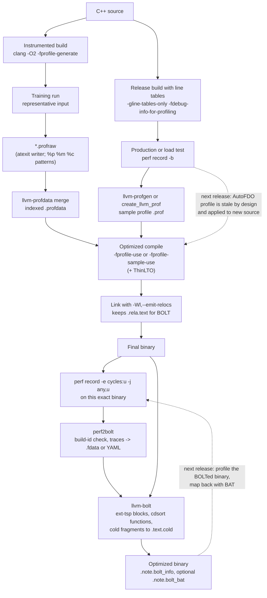

# C++ PGO, AutoFDO, and BOLT Workflow

> [!summary] Claim:
> Feedback-directed optimization replaces the compiler's static guesses about branch direction, call frequency, and indirect-call targets with measured counts, and the largest wins come from code layout in front-end-bound programs: hot paths become fall-throughs, cold blocks and functions leave the hot pages, and dominant indirect-call targets become guarded direct calls.
> Instrumentation PGO (`-fprofile-generate`, then `-fprofile-use`) gets exact edge and value counts from a slower training binary and is keyed to a hash of each function's IR CFG; AutoFDO gets approximate counts from hardware branch records (Intel LBR, AMD BRS or LBRv2, Arm BRBE or SPE) sampled on the normal binary and keyed to source line offsets, so a stale profile still applies.
> BOLT runs after the link: it disassembles the final executable, rebuilds each function's CFG, attaches a branch profile taken from that exact binary (build-id checked), and rewrites block and function layout, which is why it still finds gains on top of PGO and LTO; Propeller reaches the same layout by relinking with basic block sections instead of disassembling.
> The production order is profile-guided compile (iFDO or AutoFDO, usually with ThinLTO), link with `--emit-relocs`, sample the final binary with branch stacks, then BOLT or Propeller, and every step is judged by front-end counters (taken branches, I-cache and iTLB misses at near-constant instruction count), not by one wall-clock run.



## The Mechanism

### 1. What the compiler cannot know, and why layout is where the money is

An optimizing compiler without a profile estimates branch probabilities from static heuristics (loop back edges are likely, pointer comparisons against null are unlikely, and so on) and treats every function as equally likely to run.
Those estimates drive inlining budgets, loop unrolling, spill placement, block placement, and function splitting.
When they are wrong, the cost shows up mostly in the CPU front end: the hot path jumps over cold code, so each fetched cache line and each iTLB page carries bytes that never execute, and every taken branch is a fetch redirect.
Large server binaries tend to be front-end bound because their hot code does not fit in the L1 I-cache, the iTLB, and the branch target buffers, which is the stated motivation of both the BOLT and the Propeller papers.
The BOLT project's OptimizingClang guide gives a usable entry test: an application with more than 10 L1 I-cache misses per thousand instructions is "a good indication" that BOLT will improve it, and Clang 7 built with PGO and LTO measured about 22.
Profile feedback fixes the estimates at the source, and the most profitable consumers of the fixed estimates are the layout decisions.

The four techniques in this note differ in where the profile comes from and at which stage it is applied:

| Technique | Profile source | Profile granularity | Applied at | Profile must match |
| :--- | :--- | :--- | :--- | :--- |
| Instrumentation PGO (iFDO) | Counters compiled into a training binary | Exact edge and value counts | Compile (IR) | The same IR CFG, checked by a per-function hash |
| AutoFDO (sample PGO) | Hardware branch records sampled on a normal optimized binary | Samples per source line offset and discriminator | Compile (IR) | Source lines, so it survives code changes approximately |
| BOLT | Branch records sampled on the final linked binary, or BOLT's own instrumentation | Taken branches and fall-through ranges per instruction address | Post-link (machine code) | The exact binary (build-id checked), or BAT-mapped output of it |
| Propeller | Branch records on a binary built with a basic block address map | Per basic block | Relink (second compile of hot code and a second link) | The exact build that was profiled |

### 2. Instrumentation PGO in Clang

#### Two instrumenters

Clang has two instrumenters, and the Clang User's Manual is explicit about which to use for optimization:

- `-fprofile-instr-generate` is frontend-based: Clang inserts counters while generating IR from the AST, which gives better source correlation and is what source-based code coverage uses.
- `-fprofile-generate[=<dirname>]` is IR-based: LLVM inserts counters into the IR, which the manual says has lower instrumentation overhead, smaller raw profiles, and better runtime performance, and it is the one to use "for best performance with PGO".

Both `-fprofile-use` and `-fprofile-instr-use` accept the indexed format from either instrumenter.
`-fprofile-use=<dir>` reads `<dir>/default.profdata`.
Clang's `-fprofile-use` is spelled like GCC's but does not read GCC's `.gcda` files.
Sampling profiles and instrumentation profiles are not interchangeable, and both the Clang manual and the rustc book state there is no conversion tool between them.

#### Where the counters go: the minimum spanning tree

`PGOInstrumentation.cpp` implements Knuth and Stevenson's 1973 result ("Optimal measurement of points for program frequency counts", BIT 13(3)): for every block other than entry and exit, incoming edge counts sum to outgoing edge counts, so the counts of the edges on a spanning tree can be derived from the counts of the edges off it, and Knuth proves this instruments the minimum number of edges.
The source comment adds that the "minimal spanning tree here is actually a maximum weight tree": static estimates put the likely edges on the tree, so only the less frequently executed edges get counters, "to reduce the runtime overhead of instrumented binaries".
The same file holds both `PGOInstrumentationGen` and `PGOInstrumentationUse`, and they must see the same IR, which is why a profile is tied to the optimization level and flags of the instrumented build.

Value profiling adds a second kind of data: at each indirect call site the runtime records the targets it saw with their counts, and at each `memcpy`, `memset`, and similar intrinsic it records the sizes (`llvm-profdata show --ic-targets` and `--memop-sizes` print them).
Value nodes are allocated statically (`vp-static-alloc`, default true), sized by `vp-counters-per-site` (default 1.0 counters per site on average, `InstrumentationOptions.td`); `InstrProfiling.cpp` bumps a module total below 10 (`INSTR_PROF_MIN_VAL_COUNTS`) to `max(10, 2 * total)`, and `InstrProfData.inc` caps a site at 255 values (`INSTR_PROF_MAX_NUM_VAL_PER_SITE`).
A program with many busy indirect call sites can therefore run out of value nodes and keep only part of the target distribution.

#### The raw profile and the runtime

The instrumented binary carries per-function records (`__llvm_prf_data`), the counters themselves (`__llvm_prf_cnts`), and the function names (`__llvm_prf_names`).
`InstrProfileFormat.md` documents each record: `NameRef` is the MD5 of the function's PGO name, which prefixes local-linkage functions with their file path so that two `static` helpers stay distinct; `FuncHash` is a checksum of the IR CFG and value sites; `CounterPtr` is stored as a link-time-constant distance from the record to its counters rather than an absolute address.
The document states "There are no backward or forward version compatibility guarantees for the raw profile", so a `.profraw` must be merged by an `llvm-profdata` from the same LLVM release that built the binary.

The compiler-rt runtime registers its writer through `__llvm_profile_register_write_file_atexit()` (`InstrProfilingFile.c`), so the profile is written only when the process exits normally.
A process that calls `_exit`, dies on `SIGKILL`, or crashes writes nothing, the most common reason a training run "produced no profile".
There are three escape hatches:

- Call the runtime yourself: the manual documents `__llvm_profile_set_filename()`, `__llvm_profile_reset_counters()`, and `__llvm_profile_dump()`, for example to skip initialization or dump one region per file; declare them `__attribute__((weak))` or include `profile/instr_prof_interface.h`, which turns them into no-ops when not instrumenting.
- Continuous mode: `-fprofile-continuous` (or a `%c` in the file pattern) maps the counter section onto the profile file with `mmap`, so updates reach the file as they happen and survive abnormal termination; the runtime accepts `%c` only once and only on Mach-O, ELF, COFF, and AIX, and the manual states "Value profiling is not supported in continuous mode", so continuous mode costs indirect-call promotion data.
- Use `-fprofile-generate=<dir>`, which writes `<dir>/default_%m.profraw` and merges online, so short-lived and repeated processes accumulate into one file.

The manual warns that the `__LLVM_INSTR_PROFILE_GENERATE` and `__LLVM_INSTR_PROFILE_USE` macros can change a function's control flow between the generate and the use build, which discards that function's counters, so such hooks belong in cold code.

`LLVM_PROFILE_FILE` overrides the compile-time path (the environment variable takes precedence over `-fprofile-instr-generate=`), and `InstrProfilingFile.c` expands these patterns:

| Pattern | Expands to |
| :--- | :--- |
| `%p` | Process ID; PIDs can be reused, and one file per process multiplies storage |
| `%h` | Host name, for many hosts writing to shared storage |
| `%t` | Value of `TMPDIR` (warns and falls back to the default name if unset) |
| `%b` | Binary ID (ELF build ID); needs `--build-id` at link; Linux, Windows, and AIX |
| `%m` | An integer signature of the instrumented binary, and turns on online merging into that file; allowed once |
| `%Nm` | Same, with a pool of N files; a process writes to slot `getpid() % N` |
| `%c` | Continuous mode; allowed once |

Counters use plain increments by default: the manual says `-fprofile-update=single` is the default "unless `-fsanitize=thread` is specified", that counters "can be inaccurate under thread contention", and that `atomic` is accurate but has overhead, with `prefer-atomic` becoming `atomic` where the target supports it.

`llvm-profdata merge -o code.profdata *.profraw` converts raw profiles to the indexed format, and the manual requires this step even for a single raw file "since the merge operation also changes the file format".
Useful merge options: `--weighted-input=<weight>,<file>` scales one input's counts by an integer weight to mix training scenarios; `--sparse` drops zero-count records but defaults to false "since it can inhibit compiler optimization during PGO"; `--failure-mode=any|all` decides whether one corrupt input fails the merge; `-j` sets threads.
`show` prints totals, `--topn=<n>`, `--ic-targets`, `--memop-sizes`, and `--detailed-summary`; `overlap` compares two profiles; `order` turns temporal traces into a function order.

#### What the optimizer does with counts

`PGOInstrumentationUse` attaches branch weights and value-profile metadata to the IR.
From then on, block frequencies (BFI) and the profile summary (PSI) drive decisions.
`ProfileSummaryBuilder.cpp` sorts all counts, records 16 default percentile cutoffs from 1% to 99.9999%, and defines the hot threshold as the minimum count needed to reach 99% of total counts (`-profile-summary-cutoff-hot=990000`) and the cold threshold as the minimum count needed to reach 99.9999% (`-profile-summary-cutoff-cold=999999`).
`ProfileSummaryInfo.cpp` compares inclusively (`isHotCount` is `C >= hot`, `isColdCount` is `C <= cold`) and, when the two thresholds coincide, lowers the cold one by 1 (or raises the hot one if cold is 0) so no count is both.
The same code flags the working set as large or huge when more than 12,500 or 15,000 counters are needed to reach the hot cutoff, and some passes back off on that flag; CodeGenPrepare, for example, skips its slow-division bypass when the working set is huge.

The consumers that matter most:

- Inlining and unrolling spend code size on hot call sites and loops and save it on cold ones.
- Machine block placement makes the likely successor the fall-through and sinks unlikely blocks to the end of the function.
- Section prefixes: in `CodeGenPrepare.cpp`, a function gets `F.setSectionPrefix("hot")` if it has the `hot` attribute or `PSI->isFunctionHotInCallGraph()` is true, otherwise `"unlikely"` if PSI says it is cold in the call graph or it has the `cold` attribute, otherwise `"unknown"` only when the hidden `profile-unknown-in-special-section` option is on and the profile is a partial sample profile; the source comment calls this conservative: the hot attribute beats profile counts, and profile counts beat the cold attribute.
  With `-ffunction-sections` the function then lands in `.text.hot.<name>` or `.text.unlikely.<name>`.
- Machine function splitting: `-fsplit-machine-functions` ("late function splitting using profile information (x86 and aarch64 ELF)", `Options.td`) moves cold blocks into `.text.split.<name>` under a local symbol `<name>.cold`.
- Indirect-call promotion rewrites `call *%reg` into `if (target == hot) call hot; else call *%reg`, which turns a dominant target into a direct, inlinable call.
- Memory-intrinsic size specialization uses the `memcpy` and `memset` size profile to emit a fast path for the dominant size.

The prefixes only help if the linker groups them.
GNU ld's default ELF script template (`ld/scripttempl/elf.sc`) puts, inside the `.text` output section and in this order, `.text.unlikely .text.*_unlikely .text.unlikely.*`, then `.text.exit .text.exit.*`, then `.text.startup .text.startup.*`, then `.text.hot .text.hot.*`, then `SORT(.text.sorted.*)`, and only then `.text .text.*`, so cold code and hot code each form one contiguous run.
lld without a `SECTIONS` script maps every `.text.*` input into `.text` unless `-z keep-text-section-prefix` is given, which keeps `.text.hot`, `.text.unknown`, `.text.unlikely`, `.text.startup`, `.text.exit`, and `.text.split` as separate output sections (`LinkerScript.cpp`, `getOutputSectionName`); the source comment explains that `.text.split` exists so that split-off cold parts are not mixed with whole cold functions when the profile is imprecise.

`isFunctionHotInCallGraph()` in `ProfileSummaryInfo.h` returns true if the function has the `hot` attribute, if its entry count is hot, if the total count of calls it makes is hot, or if any of its blocks is hot.
A consequence that surprises people: a function that runs once, such as `main`, can be cold in the call graph although it is the root of all work, because its own counts are tiny.
A scratch run for this note with Homebrew clang 23.1.5 (as of 2026-11, darwin-arm64 training run, x86-64 ELF object) on a two-function C program, where `main` calls a `noinline` `process()` that loops 50,000,001 times, put `main` in `.text.unlikely.main`, and put `process` in `.text.unlikely.process` too.
The second result is the threshold arithmetic of a tiny profile: with 3 counters (1, 50,000,001, 1), `llvm-profdata show --detailed-summary` reported that one block with count >= 50,000,001 reaches both the 99% and the 99.9999% cutoffs, so the hot and cold thresholds coincide, PSI lowers the cold threshold to 50,000,000, and the loop is judged against a cold threshold just one count below its own; the most likely final step, not confirmed by dumping BFI, is that the loop block's BFI-derived count came out at or below 50,000,000.
Real programs have thousands of counters and well separated thresholds, so the lesson is about toy benchmarks: a PGO experiment with one hot loop can produce placement that a production profile never would.

#### Staleness and the hash check

Because the profile is keyed to the IR CFG, a change to a function's control flow invalidates its record, and Clang drops that function's counts.
For IR PGO the diagnostic is a backend warning; a scratch run for this note with Homebrew clang 23.1.5 (as of 2026-11, macOS host, x86-64 ELF object, the lab's `workload.cpp` with a guarded `report_bad()` call added to `run_batch`) printed exactly `warning: w3.cpp: function control flow change detected (hash mismatch) run_batch Hash = <hash> up to 2200352 count discarded [-Wbackend-plugin]`.
The same run with an edit that only added `if (type == 63) { acc ^= 1; }` printed no warning; the likely reason, not verified in the pass pipeline, is that early simplification turned the new branch into a `select` before the PGO pass computed the hash, so the hash covers the IR CFG the pass sees, not the source text.
The frontend instrumenter reports staleness through `-Wprofile-instr-out-of-date` ("profile data may be out of date: of N functions, M have mismatched data that will be ignored"), files with no data through `-Wprofile-instr-unprofiled`, and functions with no data through `-Wprofile-instr-missing`, which is `DefaultIgnore` (`DiagnosticFrontendKinds.td`).
`-Wmisexpect` reports a `__builtin_expect()` annotation that the profile contradicts ("annotation was correct on N of profiled executions"), with `-fdiagnostics-misexpect-tolerance=<N>` to ignore near misses.
The rustc book recommends `-Cllvm-args=-pgo-warn-missing-function` for the same reason: "LLVM by default does not warn if it cannot find profiling data for a given function".

#### Variants worth knowing

- Context-sensitive IR PGO: `-fcs-profile-generate` instruments again after inlining; the manual's flow builds with `-fprofile-generate`, merges to `base.profdata`, builds with `-fprofile-use=base.profdata -fcs-profile-generate=profiles/cs/`, runs, merges `base.profdata` with the CS profile into one file, and compiles with `-fprofile-use=combined.profdata`, so the base profile guides inlining and the CS profile guides the code after it.
- Temporal profiling: `-ftemporal-profile` records when each function first runs; `llvm-profdata order code.profdata -o code.orderfile` produces an order for `-Wl,--symbol-ordering-file=` (ELF) or `-order_file` (Mach-O), or lld reads the profile directly with `-Wl,--irpgo-profile=code.profdata,--bp-startup-sort=function`; the goal is fewer `.text` page faults at startup.
- Partial instrumentation: `-fprofile-list=<file>` uses the sanitizer special-case-list format with `[clang]`, `[llvm]`, `[csllvm]`, and `[sample-coldcov]` sections; `-fprofile-function-groups=<N>` with `-fprofile-selected-function-group=<i>` instruments one of N partitions per binary, so N differently built binaries jointly cover the program at lower per-binary overhead.
- Remapping: `-fprofile-remapping-file=<file>` holds `name`, `type`, or `encoding` lines that declare two mangled fragments equivalent (the manual's example maps `std` to libc++'s `std::__1` and libstdc++'s `std::__cxx11`), so a profile survives such a switch; the manual calls it best effort, notes that indirect-call targets are not remapped, supports only Itanium-ABI mangling, and recommends a fresh profile or `llvm-cxxmap` plus `llvm-profdata merge` instead.

### 3. GCC's instrumentation and AutoFDO flavors

GCC's `-fprofile-generate` must be passed to both compile and link and enables `-fprofile-arcs`, `-fprofile-values`, `-finline-functions`, and `-fipa-bit-cp`; the runtime writes one `.gcda` file per object at exit.
`-fprofile-update` accepts `single`, `atomic`, and `prefer-atomic`, and "the GCC driver automatically selects `prefer-atomic` when `-pthread` is present", a safer default than Clang's; the manual still warns that a program that does not join all its threads can corrupt the profile.
`-fprofile-use` enables `-fbranch-probabilities`, `-fprofile-values`, `-funroll-loops`, `-fpeel-loops`, `-ftracer`, `-fvpt`, `-finline-functions`, `-fipa-cp`, `-fipa-cp-clone`, `-fipa-bit-cp`, `-fpredictive-commoning`, `-fsplit-loops`, `-funswitch-loops`, `-fgcse-after-reload`, `-ftree-loop-vectorize`, `-ftree-slp-vectorize`, `-fvect-cost-model=dynamic`, `-ftree-loop-distribute-patterns`, and `-fprofile-reorder-functions`.
Two GCC behaviors differ from Clang:

- A profile that does not match the source is an error by default; `-Wno-error=coverage-mismatch` turns it into a warning, and `-Wmissing-profile` warns when profiles are absent.
- Functions the training run never executed are "optimized aggressively for size rather than speed"; `-fprofile-partial-training` ignores the profile for them instead, which the manual says performs better for unrepresentative training "at the cost of significantly bigger code".

`-fprofile-reorder-functions` orders functions by the time of their first execution to speed up startup, while `-freorder-functions` (on at `-O2`) groups functions into `.text.hot` and `.text.unlikely` subsections for the linker, using profile feedback or `hot`/`cold` attributes.
`-freorder-blocks-and-partition` splits hot and cold blocks into separate sections; it is "Enabled for x86 at levels -O2, -O3, -Os", turned off automatically with some exception-handling schemes, linkonce sections, and user section attributes.
BOLT's README states that BOLT is incompatible with it and, since GCC 8 enables it by default, asks for `-fno-reorder-blocks-and-partition`.

`-fauto-profile[=path]` is GCC's AutoFDO; it enables the same list as `-fprofile-use` except that `-fprofile-correction` replaces `-fprofile-reorder-functions`, and the profile defaults to `fbdata.afdo`.
The manual's recipe is `perf record -e br_inst_retired:near_taken -b -o perf.data -- your_program`, then `create_gcov --binary=your_program.unstripped --profile=perf.data --gcov=profile.afdo` from google/autofdo.
`-fauto-profile-inlining` (enabled by default) inlines the functions that were inlined in the profiled run before reading the profile, to improve context sensitivity.
GCC 16 added Arm SPE as a profiler to `gcc-auto-profile` and says AutoFDO is now regularly tested on AArch64.
An April 2026 RFC on the gcc list proposes a standalone AutoFDO profile tool inside GCC because the external Google tools are "not actively maintained" for GCC use; as of 2026-11 it is a proposal, not a shipped tool.

### 4. AutoFDO: sampling branch records instead of counting

#### What a branch record gives you

A last-branch-record facility keeps a ring of the most recent taken branches as (from, to) pairs.
When a sampling interrupt fires, perf copies the ring into the sample: `perf record -b` is `--branch-any`, "a shortcut for `--branch-filter any`", and `-j any,u` keeps only branches whose target is at user level (perf-record(1)).
Between the target of one recorded branch and the source of the next one in execution order the CPU ran straight-line code with no taken branch, so each pair of consecutive records also proves that a contiguous address range executed.
BOLT's `DataAggregator::parseLBRSample()` builds exactly this: the records arrive "in reverse execution order", and each becomes a trace `(From, To, NextFrom)` holding one taken branch and the fall-through range after it; the newest record has no successor and becomes a branch-only trace.
A 32-entry sample therefore yields 32 taken branches and up to 31 fall-through ranges, which is why branch-record sampling estimates block counts far better than plain IP sampling.

The hardware differs, and the differences leak into tools:

- Intel LBR: perf-record(1) notes that on Arch LBR (12th-generation client or 4th-generation Xeon server and later) the branch type is always saved.
  `DataAggregator.cpp` carries a workaround for Skylake, which "has 32 LBR entries" and "sometimes record[s] entry 32 as an exact copy of entry 31": when the input binary has BAT tables, is x86, and a sample has exactly 32 entries, perf2bolt prints `PERF2BOLT-WARNING: using Intel Skylake bug workaround` and from then on skips the first two entries of every sample, which in perf's newest-first order are the two most recent records (the source comment: "Drop first 2 entries (last two, in chronological order)").
- AMD Zen 3 Branch Sampling (BRS, `arch/x86/events/amd/brs.c`) holds the PMU interrupt until its 16 entries are full, so the driver accepts BRS only in sampling mode, only with the retired-taken-branch event (with it, "Effective P = P + 16 + X", X being skid; with any other event the correlation is looser), only with branch type `any`, never in frequency mode, and only with a period larger than the depth.
  BOLT's README command `-e cycles:u -j any,u` is therefore rejected on a BRS host; the kernel's AutoFDO recipe uses `--pfm-events RETIRED_TAKEN_BRANCH_INSTRUCTIONS` with `-c <count>`.
  Zen 4 has LBRv2 (`amd_lbr_v2` in `/proc/cpuinfo`).
- Arm BRBE (`drivers/perf/arm_brbe.c`) arranges records in banks of 32 (`BRBE_BANK_MAX_ENTRIES`); SPE supplies, per BOLT's profile documentation, only "short (1-deep) branch stacks", and perf2bolt warns that SPE brstack decoding needs Linux perf 6.14 or later; ETM is a full trace that `perf inject --itrace` can turn into synthesized branch samples.
- Virtual machines often expose none of these; BOLT's README then falls back to plain sample events with "performance gains ... expected to be lower", and [[Intel-VTune-AMD-uProf-and-Hardware-Tracing-PT-SPE]] owns the hardware-tracing alternatives.

#### From samples to a sample profile

AutoFDO maps addresses to source through DWARF line tables, so the binary is built with `-gline-tables-only` (full debug info is not needed) plus `-fdebug-info-for-profiling`, which adds discriminators that distinguish several basic blocks on one source line, such as the two calls in `if (c) foo(); else bar();`.
The Linux kernel's `scripts/Makefile.autofdo` goes further and adds flow-sensitive discriminators with `-mllvm -enable-fs-discriminator=true -mllvm -improved-fs-discriminator=true`, which `llvm-profgen` detects in the binary (`ProfiledBinary::useFSDiscriminator()`).
The converter (`create_llvm_prof` from google/autofdo, or `llvm-profgen` from LLVM) writes a profile keyed by function name, line offset from the function's first line, and discriminator.
The Clang manual's text format shows the structure; this example is from the manual:

```text
main:35504:0
1: _Z3foov:35504
  2: _Z32bari:31977
  1.1: 31977
2: 0
```

The header is `name:total_samples:head_samples` (head samples approximate the call count), a body line is `offset[.discriminator]: samples [callee:count ...]`, and indentation records the inline stack: here `foo` was inlined into `main` at offset 1 and `bar` into `foo` at offset 2.
The manual notes that a macro expanded above the function's first line would give a negative offset, so converters emit 0 and the optimizer cannot weight that code.
Because inlined code is attributed to its original function and line, the profile describes source, not machine code, which is what lets it be applied to the next release.
`SampleProfileLoader` gives each block "the maximum number of samples found in B" (`SampleProfile.cpp`) and propagates weights over the CFG; `-fsample-profile-use-profi` instead runs profi, which `Options.td` describes as fixing missing or inconsistent counts with "extended and re-engineered classic MCMF (min-cost max-flow)".

Static functions are a naming hazard: two files may each have a `static void helper()`.
`-funique-internal-linkage-names` gives internal-linkage symbols unique names derived from the source path on the command line, and the manual warns that if absolute paths change between the profiled and the optimized build, "the uniqued function names may change and result in unused profile data".

`-fprofile-sample-accurate` changes how missing data is read.
Its `Options.td` description says that with an accurate profile "callsites without profile samples are marked as cold", and that otherwise Clang treats them "as if we have no profile".
A scratch run for this note with Homebrew clang 23.1.5 (as of 2026-11, macOS host, x86-64 ELF object) and a two-function C file whose hand-written profile listed only `other` put `helper` in `.text.helper` by default and in `.text.unlikely.helper` with `-fprofile-sample-accurate`, while `other` stayed in `.text.hot.other` in both builds.

The Clang recipe, exactly as the User's Manual gives it:

```bash
clang++ -O2 -gline-tables-only -fdebug-info-for-profiling -funique-internal-linkage-names code.cc -o code
perf record -b -e BR_INST_RETIRED.NEAR_TAKEN:uppp ./code      # manual: branches:u "is probably next-best"
llvm-profgen --binary=./code --output=code.prof --perfdata=perf.data
# or: create_llvm_prof --binary=./code --out=code.prof   (add --use_lbr=false for perf data recorded without -b)
clang++ -O2 -fdebug-info-for-profiling -funique-internal-linkage-names \
    -fprofile-sample-use=code.prof code.cc -o code
```

The manual says the optimized build need not repeat the first build's arguments, only "the same debug info options and `-fprofile-sample-use`", and that `-gline-tables-only` can be dropped there if the final binary needs no debug info.

#### Inside llvm-profgen

`llvm-profgen` takes exactly one of `--perfdata`, `--perfscript`, `--unsymbolized-profile`, `--llvm-sample-profile`, or `--etm` (an Arm CoreSight trace, which needs OpenCSD 1.5.4 or later at build time), and writes `--format=text|binary|extbinary|compbinary|gcc`.
Given `--perfdata`, `PerfReader.cpp` runs perf itself: once to find the PIDs whose mmap events match the binary, then `perf script --show-mmap-events -F ip,brstack -i <file> --pid <pids>`; Intel SEP output goes in through `--perfscript`.
It then classifies the text: lines of `0x.../0x...` records alone are LBR samples, and a non-empty call stack immediately followed by an LBR line is a hybrid sample (`checkPerfScriptType`).
It warns when more than 1% of hybrid samples have a call-stack leaf that disagrees with the newest LBR target ("bogus trace"); the warning text says the profile "has high sample skid and may not be suitable for optimization".
`--kernel` (defined in `ProfiledBinary.cpp`) marks the input as a kernel image; the kernel documentation's command is `llvm-profgen --kernel --binary=<vmlinux> --perfdata=<perf_file> -o <profile_file>`.

#### Context-sensitive sample PGO (CSSPGO)

CSSPGO keeps a callee's samples per calling context instead of merging them.
Two ingredients are separate:

- Pseudo probes: `-fpseudo-probe-for-profiling` (the Clang manual's optional anchor "for accurate profile mapping") inserts probe IDs into the IR and emits `.pseudo_probe` and `.pseudo_probe_desc` sections; `ProfiledBinary::checkPseudoProbe()` finds those sections and `ProfileGenerator` then writes a probe-based profile instead of a line-based one.
- Context: when the perf input holds hybrid samples, which come from recording with call stacks (`-g`) as well as branch stacks (`-b`), `HybridPerfReader::generateUnsymbolizedProfile()` sets `ProfileIsCS = !IgnoreStackSamples` and unwinds each sample into contexts, and `CSProfileGenerator` writes a context-sensitive profile; `--ignore-stack-samples` ("Ignore call stack samples for hybrid samples and produce context-insensitive profile", `PerfReader.cpp`) turns that off.

The compile side consumes the result with the same `-fprofile-sample-use`, together with `-fpseudo-probe-for-profiling` when probes were used.

#### What the paper measured

Chen, Li, and Moseley (CGO 2016) report a geomean improvement of 10.5% on their benchmarks, 85% of the gains of traditional FDO "despite imprecision due to sampling and information lost in the compilation pipeline", an eightfold increase in FDO users at Google, a doubling of cycles spent in FDO-optimized binaries, and over half of Google's CPU cycles then running in some flavor of FDO-optimized binary.
The design decision behind those numbers is in the abstract: "Profile data is stale by design".
The profile collected from release N feeds the compile of release N+1, so the compiler must tolerate source drift, which line-offset keys do and CFG hashes do not.

#### The Linux kernel as a worked AutoFDO user

The kernel documents the whole flow (as of 2026-11, docs for 7.4.0-rc2, Linux):

- `CONFIG_AUTOFDO_CLANG=y` with Clang from LLVM 17 or later, on x86 (LBR) and arm64 (SPE or ETM); without a profile the option changes only DWARF, not runtime performance.
- Intel: `perf record -e BR_INST_RETIRED.NEAR_TAKEN:k -a -N -b -c <count> -o <perf_file> -- <loadtest>`.
- AMD Zen 3 BRS (`brs` in `/proc/cpuinfo`) or Zen 4 LBRv2 (`amd_lbr_v2`): `perf record --pfm-events RETIRED_TAKEN_BRANCH_INSTRUCTIONS:k -a -N -b -c <count> ...`.
- Arm SPE needs `CONFIG_ARM_SPE_PMU=y`, `CONFIG_PID_IN_CONTEXTIDR=y`, and `kpti=off`, then `perf record -e 'arm_spe_0/branch_filter=1,load_filter=0,store_filter=0/' -a -c <count> -N --no-switch-events ...`; ETM goes through `perf inject --itrace=i500009il`.
- The `-c` period should be a prime such as 500009, so sampling does not alias with periodic code.
- Conversion: `llvm-profgen` from LLVM 19 or later (it need not match the Clang version), or `create_llvm_prof` v0.30.1 or later with `--format=extbinary`; several profiles merge with `llvm-profdata merge`.
- Rebuild with `make LLVM=1 CLANG_AUTOFDO_PROFILE=<profile_file>`; `Makefile.autofdo` then adds `-fprofile-sample-use=<profile> -ffunction-sections -fsplit-machine-functions`, and under ThinLTO `--lto-sample-profile=<profile>` at link.

The documentation also notes that a profile from one architecture can improve a kernel built for another when the hot code is architecture-independent, because the profile is keyed to source.

### 5. BOLT: optimizing the binary after the link

#### Why after the link

PGO and AutoFDO change the compiler's decisions, but the compiler sees one translation unit (or one ThinLTO partition) at a time, and the final address of every block is decided later by the linker.
BOLT works on the executable itself, so it sees the whole program's machine code, including static libraries and hand-written assembly, and uses a profile of exactly that code.
Its paper (Panchenko, Auler, Nell, Ottoni, CGO 2019) reports, in the arXiv v2 abstract, speedups of up to 8.0% on Facebook data-center workloads "on top of profile-guided function reordering and LTO", up to 20.4% for GCC and Clang on top of FDO and LTO, and up to 52.1% for those compilers built without FDO and LTO.
BOLT lives in the llvm-project monorepo under `bolt/`.

#### Inputs BOLT needs

- An ELF binary for x86-64 or AArch64 (the README's supported set; `RewriteInstance.cpp` also has a statically linked, non-PIE-only RV32 path) with an unstripped symbol table; `strip -g` is fine, but a binary without a symbol table stops with `BOLT-ERROR: stripped binaries are not supported. If you know what you're doing, use --allow-stripped to proceed`.
  The README describes PIE and shared-object support as "added recently", and requires C/C++ code not to "rely on code layout properties, such as function pointer deltas", and assembly to separate code from data.
- Static relocations kept in the output, from linking with `--emit-relocs` (or `-q`); the README says to check for a `.rela.text` section, and the OptimizingClang guide notes the flag "does not affect the generated code in any way".
  `RewriteInstance.cpp` sets relocation mode when text relocations exist and `-relocs` is not forced off, prints `BOLT-INFO: enabling relocation mode` (or `enabling strict relocation mode` with `-strict`), and always prints `disabling relocation mode for Linux kernel` for vmlinux.
  Without relocations BOLT rewrites functions in place where the new code fits, cannot reorder functions (`--reorder-functions` "works only with relocations", and any value other than `none` stops the run with `BOLT-ERROR: function reordering only works when relocations are enabled`, so the README's command line below fails outright), refuses `-icf=safe`, disables `-split-eh`, warns that non-relocation mode is "not fully supported" on AArch64, and refuses Intel JCC-erratum mitigation (`cannot apply mitigations for Intel JCC erratum in non-relocation mode`).
- A branch profile of that binary.
  For a program: `perf record -e cycles:u -j any,u -o perf.data -- <executable> <args>`; for a running service: `perf record -e cycles:u -j any,u -a -o perf.data -- sleep 180`.
  The README needs a `perf` that supports `-F brstack` (version 4.5 or later), recommends cycle events over `BR_INST_RETIRED.*` because "Empirically we found it to produce better results", and recommends a profile covering about 1 billion instructions as reported by `-dyno-stats`.
  Without branch records, `perf2bolt -ba` aggregates plain samples at lower quality; `--itrace=<opts>` synthesizes branch stacks from Intel PT or Arm ETM; `--spe` reads Arm SPE.
- Or BOLT's own instrumentation: `llvm-bolt <exe> -instrument -o <exe.instr>` writes `/tmp/prof.fdata` at exit by default (`--instrumentation-file`), with `--instrumentation-file-append-pid` and `--instrumentation-sleep-time=<s>` for periodic dumps from services; this needs no PMU, and CPython's `--enable-bolt` build uses it.

#### perf2bolt: from perf.data to a symbolized profile

`perf2bolt -p perf.data -o perf.fdata <executable>` runs perf as subprocess jobs (`DataAggregator.cpp`): `script -F pid,brstack` for branch events (with `--itrace=` when synthesizing), `script -F pid,event,ip` for plain samples, and `script --show-mmap-events` and `script --show-task-events` to place addresses in the binary.
Each brstack entry is `FROM/TO/EVENT/INTX/ABORT/CYCLES[/TYPE/SPEC]`.
perf2bolt compares the build-id in `perf.data` with the binary and stops with `PERF2BOLT-ERROR: failed to match build-id from perf output` unless `-ignore-build-id` is given, because a profile of a different build maps onto the wrong instructions.
If every sample lacks branch stacks it warns and suggests recording with `-j any` or rerunning with `-ba`.
The README marks `llvm-bolt -p perf.data` (skipping perf2bolt) as experimental.

The profile formats (`bolt/docs/profiles.md`):

- fdata, the legacy symbolized format: one branch per line, `<is_sym_from> <sym_from> <off_from> <is_sym_to> <sym_to> <off_to> <mispreds> <branches>`, for example `1 main 3fb 0 /lib/ld-2.21.so 12 4 221`; `is_sym` is 1 for an ELF symbol, 0 for a DSO, and 2 for a local symbol, and local names are disambiguated as `<name>/<id>` or `<name>/<file>/<id>`; a `no_lbr` header marks sample-only data, and a `boltedcollection` header marks data collected on a BOLTed binary.
- YAML (`-w perf.yaml`, or `--profile-format=yaml`): per-function and per-block records with hashes (`std-hash` by default, `xxh3` recommended), successor counts, and call sites; it is "more resilient to binary changes" and is the format stale-profile matching uses.
- Pre-aggregated (`--pa`): text lines such as `T <branch> <ft_start> <ft_end> <count>` for a branch plus fall-through, `B` for a branch, `F` for a fall-through, and `S` for a basic sample, so external collectors (the docs cite an eBPF-based one) can feed BOLT without `perf.data`.

Several fdata profiles merge with `merge-fdata *.fdata > combined.fdata`.

#### llvm-bolt: disassemble, rebuild, rewrite

`RewriteInstance` reads the ELF file, discovers function boundaries from the symbol table and `.eh_frame`, disassembles each function into LLVM `MCInst`s, and rebuilds its CFG; a function it cannot fully understand (for example an indirect jump that does not match Clang or GCC jump-table patterns) is left alone.
It attaches the profile to CFG edges, runs its optimization passes, emits new code through LLVM's MC layer, and writes it into new segments: hot code in `.text`, split-off cold code in `.text.cold` (and `.text.warm` with `-split-strategy=cdsplit`).
Cold fragments get symbols `<function>.cold.<n>`, numbered from 0.
Every output gets a `.note.bolt_info` section holding "BOLT revision: ..., command line: ..."; `addBoltInfoSection()` encodes it as a GNU note of type 4 (`NT_GNU_GOLD_VERSION`) "so it is easily printable by `readelf -n`", and the README shows `readelf -p .note.bolt_info` as well.

The README's recommended optimization line:

```bash
llvm-bolt <executable> -o <executable>.bolt -data=perf.fdata \
    -reorder-blocks=ext-tsp -reorder-functions=cdsort \
    -split-functions -split-all-cold -split-eh -dyno-stats
```

The passes those flags select, with the alternatives from the command-line reference:

- `-reorder-blocks=ext-tsp`: block order inside each function by the Extended TSP model (see "The Ext-TSP objective"); other values are `none`, `reverse`, `normal`, `branch-predictor`, `cache`, `cache+`, and `cluster-shuffle`.
- `-reorder-functions=cdsort`: Cache-Directed Sort; `hfsort+` is now documented as the same algorithm, and the others are `none`, `exec-count`, `hfsort`, `pettis-hansen`, `random`, and `user` (with `-function-order`).
- `-split-functions` with the default `-split-strategy=profile2` splits only functions that have a valid and full profile and are not entirely cold, and moves every block with an execution count of 0 to the cold fragment (`SplitFunctions.cpp`); `cdsplit` makes hot, warm, and cold fragments, and `random2`, `randomN`, and `all` exist for testing; `-split-all-cold` outlines as many cold blocks as possible; `-split-eh` also moves C++ landing pads out.
- `-icf` (`all`, `safe`, default `none`) folds identical functions; `-plt=hot` optimizes PLT calls in hot code (requires `-znow` on non-x86); `-peepholes`, `-frame-opt`, and `-inline-small-functions` are smaller binary-level clean-ups.
- `-hugify` puts hot code on 2 MiB pages at run time without a manual call in the program; `-lite` skips cold functions, with `-lite-threshold-pct` and `-lite-threshold-count` choosing which, which bounds BOLT's time and memory on very large binaries.
- `-update-debug-sections` rewrites DWARF so debuggers and symbolizers follow the new layout, at some extra processing time.

`-dyno-stats` prints profile-weighted counts of executed instructions and taken branches before and after optimization.
In the OptimizingClang guide, BOLT on a PGO and LTO Clang 7 cut taken branches by 41.1% and taken conditional branches by 43.4% while executed instructions changed by only -0.6%; the guide cautions that sampling with `cycles` affects the statistics' accuracy, but the relative change still shows BOLT "was able to straighten out the code even after PGO".
Measured end to end on a 48-core Haswell machine, a Clang self-build took 180.11 s with the BOLTed compiler instead of 202.72 s (22.61 s, 12%), L1 I-cache misses fell from about 22 to about 15 per thousand instructions, and BOLT on a Clang built without PGO and LTO (253.32 s) saved over 50 s (25%) but stayed slower than PGO plus LTO plus BOLT.

#### The Ext-TSP objective

`CodeLayout.cpp` implements Newell and Pupyrev's Extended TSP layout, used by BOLT for blocks and available to LLVM's machine block placement behind the hidden `-enable-ext-tsp-block-placement` (default false).
`extTSPScore()` scores each jump of execution count C by the distance d between the end of its source block and the start of its target:

- A fall-through (d = 0) scores `1.0 * C` if conditional and `1.05 * C` if unconditional.
- A forward jump scores `0.1 * (1 - d / 1024) * C`, and 0 beyond 1,024 bytes.
- A backward jump scores `0.1 * (1 - d / 640) * C`, and 0 beyond 640 bytes.

The algorithm starts with every block as its own chain and repeatedly merges the pair of chains with the largest score gain, trying to split one chain X into X1 and X2 and glue them with Y in several orders; chains stop growing at 512 blocks (`ext-tsp-max-chain-size`), splitting is tried only for chains of up to 128 blocks (`ext-tsp-chain-split-threshold`), and chains whose densities differ by more than 100x are not merged.
The weights model fetch: a fall-through costs no redirect, a short jump probably lands in lines already fetched, and a long jump costs a new line.
The paper's point is that maximizing fall-throughs alone can hurt the I-cache and iTLB, and that the parameters were chosen with machine learning because modern cache behavior is "quite complex and often unknown".
CDSort, the function-level counterpart, models a cache of 16 entries of 2,048 bytes with chains of up to 128 functions and a distance power and frequency scale of 0.25 (`CodeLayout.h`).

#### Profiling a BOLTed binary: BAT and staleness

The BOLT profile must come from the binary BOLT is about to rewrite, but in production the running binary is the previous BOLT output.
BOLT Address Translation solves this: with `--enable-bat` BOLT writes a `.note.bolt_bat` section, and perf2bolt reads it to map samples taken on the optimized binary back to the input binary's addresses, emitting a profile with the `boltedcollection` header.
When source changes between releases, the README says BOLT reports the number of functions with a stale profile, that "The higher the number, the less performance improvement should be expected", and that it is "crucial to update `.fdata` for release branches"; `--infer-stale-profile` infers counts from stale data using the YAML block hashes.

### 6. Propeller: the relinking alternative

Propeller reaches BOLT's goal without disassembly, using basic block sections, which its paper introduces as "a novel linker abstraction".
The kernel's `scripts/Makefile.propeller` shows the exact flags (as of 2026-11, Linux):

- First build: `-fbasic-block-address-map` on Clang 20 or later, which "Emits a SHT_LLVM_BB_ADDR_MAP section" of per-block offsets (Clang manual), or `-fbasic-block-sections=labels` on older Clang, which the Makefile notes is deprecated since Clang 20; under ThinLTO the linker gets `--lto-basic-block-address-map`.
  The kernel document says this metadata section "is not part of the runtime image" and does not change the text.
- Profile: the same branch-record recording as AutoFDO, then `generate_propeller_profiles --binary=<bin> --profile=<perf.data> ...` from google/llvm-propeller (built with Clang 19 or newer), which writes a compiler profile (`cc_profile.txt`) and a linker profile (`ld_profile.txt`).
- Second build: `-fbasic-block-sections=list=<prefix>_cc_profile.txt -ffunction-sections` ("Place each function's basic blocks in unique sections (ELF Only)", `Options.td`), and at link `--symbol-ordering-file=<prefix>_ld_profile.txt --no-warn-symbol-ordering`, or `--lto-basic-block-sections=<cc_profile>` under ThinLTO.

The kernel requires LLVM 19 or later for Clang and `ld.lld`, supports x86 (LBR) and arm64 (SPE), and "strongly" recommends Propeller on top of AutoFDO, AutoFDO with ThinLTO, or iFDO, giving the full sequence as "build-afdo - train-afdo - build-propeller - train-propeller - build-optimized".
The ASPLOS 2023 paper reports 1.1% to 8% beyond PGO and ThinLTO on Google workloads, about 7% for Clang and 1% for MySQL, performance comparable to "the state of the art binary optimizer" with 30% to 70% lower memory overhead on large benchmarks, and deployment on "tens of millions of cores", because the work runs inside cached, distributed compile and link actions instead of one large rewriting process.
The cost is a second compile of the profiled code and integration with the build system, where BOLT needs only the final binary.

### 7. The end-to-end production workflow and how to measure it

The order matters because each stage needs inputs that the next stage changes:

1. Choose the compile-time profile: iFDO when a representative, deterministic training workload can run in CI; AutoFDO when the representative workload is production itself and the fleet can be sampled with branch records.
2. Build the release with that profile and ThinLTO (`-flto=thin`), so cross-module inlining can use the counts.
3. Link with `-Wl,--emit-relocs`; it changes no code, only keeps relocations for BOLT.
4. Run the release binary under representative load and record `perf record -e cycles:u -j any,u` (the BRS event with `-c` on Zen 3); the build-id ties the profile to this binary.
5. `perf2bolt`, then `llvm-bolt` with the README's flags (add `--enable-bat` if the next profile will come from this output); keep the `-dyno-stats` output as a build artifact.
6. Verify behavior (the same test suite on the BOLTed binary) and verify the front end: `perf stat -e cycles,instructions,branch-misses,L1-icache-load-misses,iTLB-load-misses`, and on Intel the top-down front-end-bound share, compared across many interleaved runs; [[Linux-perf-in-Depth-and-perf-c2c]] owns the counters and [[Cpp-Google-Benchmark-and-nanobench]] owns benchmark statistics.
7. Ship, then repeat: the next AutoFDO profile comes from this release in production, and the next BOLT profile comes from the BOLTed binary through BAT.

The evidence that a layout optimization worked is a drop in taken branches, I-cache misses, and iTLB misses at a near-constant instruction count; a wall-clock change with no front-end change is noise or something else.

## Commands and Numbers to Know

| Item | Value | Platform and date | What it controls |
| :--- | :--- | :--- | :--- |
| `-fprofile-generate[=<dir>]` | IR instrumentation; writes `<dir>/default_%m.profraw` | Both (as of 2026-11) | Recommended instrumenter for PGO |
| `-fprofile-instr-generate` | Frontend instrumentation; writes `default.profraw` | Both (as of 2026-11) | Source-accurate mapping, used by coverage |
| `-fprofile-use[=<path>]` | Indexed `.profdata`; a directory means `<dir>/default.profdata` | Both (as of 2026-11) | Branch weights, value profiles, PSI |
| `-fprofile-update=` | `single` (default unless TSan), `atomic`, `prefer-atomic` | Both (as of 2026-11) | Counter races in threaded training runs |
| GCC `-fprofile-update` default | `prefer-atomic` with `-pthread`, else `single` | Linux (as of 2026-11) | Same, GCC side |
| `LLVM_PROFILE_FILE` | `%p %h %t %b %m %Nm %c`; overrides the compile-time path | Both (as of 2026-11) | Output path, merging, continuous mode |
| Profile writer | `atexit` handler | Both (as of 2026-11) | `_exit`, `SIGKILL`, and crashes lose the profile |
| `-fprofile-continuous` | `mmap`-synced counters; no value profiling | Both (as of 2026-11) | Survives crashes, loses ICP data |
| `vp-counters-per-site` | 1.0 average; module minimum 10; 255 values per site | Both (as of 2026-11) | Indirect-call and memop value capacity |
| `-profile-summary-cutoff-hot` | `990000` (99% of total counts) | Both (as of 2026-11) | Hot count threshold, inclusive |
| `-profile-summary-cutoff-cold` | `999999` (99.9999%) | Both (as of 2026-11) | Cold count threshold, inclusive |
| Large / huge working set | More than 12,500 / 15,000 counters to reach the hot cutoff | Both (as of 2026-11) | Code-growth back-off |
| Section prefixes | `.text.hot.`, `.text.unlikely.`, `.text.unknown.`, `.text.split.` | Linux (as of 2026-11) | Hot and cold function grouping, split cold blocks |
| GNU ld default order in `.text` | unlikely, exit, startup, hot, sorted, then the rest | Linux (as of 2026-11) | Contiguous hot and cold runs |
| lld `-z keep-text-section-prefix` | Off by default | Linux (as of 2026-11) | Keeps `.text.hot` etc. as output sections |
| `-fsplit-machine-functions` | Off by default; x86 and AArch64 ELF | Linux (as of 2026-11) | Cold blocks to `.text.split.<fn>` as `<fn>.cold` |
| `-fprofile-sample-use=<file>` | Sample (AutoFDO) profile | Both (as of 2026-11) | Sample PGO |
| `-fprofile-sample-accurate` | Off by default | Both (as of 2026-11) | Unsampled call sites become cold |
| `-fsample-profile-use-profi` | Off by default | Both (as of 2026-11) | Min-cost max-flow count inference |
| `-fdebug-info-for-profiling` | Adds discriminators | Both (as of 2026-11) | Block-level sample attribution |
| `-funique-internal-linkage-names` | Path-derived unique local names | Both (as of 2026-11) | Static functions in sample profiles |
| `-fpseudo-probe-for-profiling` | `.pseudo_probe` sections | Linux (as of 2026-11) | Probe-based (CSSPGO) profiles |
| `perf record -b` | `--branch-filter any` | Linux (as of 2026-11) | Branch stacks for AutoFDO |
| Intel Skylake LBR | 32 entries; BOLT drops 2 per sample for BAT input | Linux x86 (as of 2026-11) | Branches per sample |
| AMD Zen 3 BRS | 16 entries; taken-branch event, fixed period, sampling only | Linux x86 (as of 2026-11) | Period skews by 16 plus skid |
| Arm BRBE | Banks of 32 records | Linux arm64 (as of 2026-11) | Branch stacks on Armv9 parts |
| Arm SPE in BOLT | 1-deep branch stack; perf 6.14 or later | Linux arm64 (as of 2026-11) | Weaker BOLT profile |
| Kernel AutoFDO period | Prime, for example `500009` | Linux (as of 2026-11) | Avoids sampling aliasing |
| Kernel AutoFDO / Propeller | LLVM 17 / LLVM 19 or later; `llvm-profgen` LLVM 19 or later | Linux (as of 2026-11) | Minimum toolchains |
| BOLT link flag | `-Wl,--emit-relocs` or `-Wl,-q` | Linux (as of 2026-11) | Relocation mode; check `.rela.text` |
| BOLT profile command | `perf record -e cycles:u -j any,u` | Linux (as of 2026-11) | Branch records for perf2bolt |
| BOLT profile size target | About 1 billion instructions in `-dyno-stats` | Linux (as of 2026-11) | README guidance |
| BOLT entry test | More than 10 L1 I-cache misses per 1,000 instructions | Linux (as of 2026-11) | OptimizingClang rule of thumb |
| `perf2bolt -ba` | Basic aggregation, no branch stacks | Linux (as of 2026-11) | VMs without LBR, lower quality |
| `llvm-bolt -instrument` | Profile to `/tmp/prof.fdata` | Linux (as of 2026-11) | PMU-free BOLT profiling |
| `--icf` | `none` default, `safe`, `all` | Linux (as of 2026-11) | Identical code folding |
| `--split-strategy` | `profile2` default; `cdsplit`, `random2`, `randomN`, `all` | Linux (as of 2026-11) | How functions are fragmented |
| Ext-TSP weights | Fall-through 1.0 / 1.05; jumps 0.1 | Both (as of 2026-11) | Layout score per jump |
| Ext-TSP distances | Forward 1,024 B; backward 640 B | Both (as of 2026-11) | Beyond these a jump scores 0 |
| Ext-TSP chain limits | 512 blocks; split tried up to 128 | Both (as of 2026-11) | Search cost bound |
| CDSort model | 16 entries x 2,048 B, chains up to 128 | Both (as of 2026-11) | BOLT `-reorder-functions=cdsort` |
| `.note.bolt_info` | GNU note type 4 with revision and command line | Linux (as of 2026-11) | `readelf -n` proves a binary was BOLTed |
| `.note.bolt_bat` | With `--enable-bat` | Linux (as of 2026-11) | Profile a BOLTed binary for the next run |
| Propeller first-build flag | `-fbasic-block-address-map` (Clang 20+) | Linux (as of 2026-11) | Block address map for the profile tool |
| CPython `--enable-bolt` | Since 3.12, experimental; LLVM 16 or newer strongly encouraged | Linux (as of 2026-11) | BOLT for the interpreter build |

## Multi-Language Comparison: C++ / Python / Rust

Profile feedback is a property of native code generation, so for Python it applies to the interpreter and to C extensions, not to Python bytecode.

| Concern | C++ (Clang, GCC) | Python (CPython build) | Rust (rustc) |
| :--- | :--- | :--- | :--- |
| Instrumentation PGO | `-fprofile-generate` / `-fprofile-use`; GCC writes `.gcda`, Clang writes `.profraw` merged by `llvm-profdata` | `./configure --enable-optimizations` builds an instrumented interpreter, runs `PROFILE_TASK` (default `-m test --pgo --timeout=$(TESTTIMEOUT)`), and rebuilds; since 3.13 a failing task is no longer ignored | `-Cprofile-generate=<dir>` / `-Cprofile-use=<file>`, merged with `llvm-profdata` from `llvm-tools-preview` or a recent LLVM |
| Sample PGO | `-fprofile-sample-use` (Clang), `-fauto-profile` (GCC) | Not offered by `configure` | `-Cprofile-sample-use=<file>`, with the unstable `-Zdebuginfo-for-profiling` for discriminators; the kernel's `Makefile.autofdo` uses both for Rust code |
| LTO pairing | `-flto=thin` | `--with-lto`; ThinLTO is the default on Clang since 3.12 | `-Clto=thin` or `fat` |
| BOLT | Link with `-Wl,--emit-relocs`, then `perf2bolt` and `llvm-bolt` | `--enable-bolt` (3.12, experimental) using BOLT instrumentation, tunable with `BOLT_INSTRUMENT_FLAGS` and `BOLT_APPLY_FLAGS`; needs `llvm-bolt` and `merge-fdata` | Pass `-Clink-arg=-Wl,--emit-relocs`, then the same BOLT steps on the ELF output |
| Missing-profile signal | `-Wprofile-instr-missing` (frontend PGO, off by default); hash-mismatch warning for IR PGO; GCC errors on mismatch | Profile warnings during the build are documented as harmless; Clang users can add `-Wno-profile-instr-unprofiled` | `-Cllvm-args=-pgo-warn-missing-function` recommended |
| Helper tooling | LLVM's CMake caches for building Clang itself with PGO and BOLT | `make profile-opt`; `--with-tail-call-interp` (3.14) says PGO is "highly recommended" | `cargo-pgo`, which the rustc book says supports only instrumentation PGO |

The Python and Rust sides of profiling live in [[Python-CPython-perf-Trampoline-and-Tachyon-Internals]] and [[Rust-Compile-Time-and-Binary-Size-Profiling]].

## Worked Lab Example

The lab is `code/05-Profiling/pgo_bolt_workflow/` and runs the whole workflow on one program: baseline, instrumentation PGO, AutoFDO, and BOLT on top of PGO.
It declares `# requires: linux, pmu`: AutoFDO and BOLT need branch-stack sampling, which the harness container does not expose, so the lab runs only on a Linux host with `TOOLCHAIN_LABS_PMU=1`, Clang, and an LLVM install that ships `llvm-bolt`, `perf2bolt`, and `llvm-profgen`.

The workload (`workload.cpp`, no headers, and `main.cpp`, the driver) gives each optimization a visible target:

- `run_batch()` generates messages from a xorshift stream and dispatches each through a 64-entry function-pointer table; type 3 gets 90% of messages, types 0 to 7 share 9%, and all 64 types share the last 1%, so the single indirect call site has one dominant target.
- Each handler first checks a rare validation failure (about 1 message in 1,024) and calls the bulky `report_bad()`; the rare branch is first in source, so without a profile the common path must jump over it.
- `dump_state()` is never executed by the workload.
- `train` and `eval` use different seeds with the same mix, so the profile is collected on one input and the binaries are measured on another, and every variant must print the same `eval` checksum.

What `run.sh` checks, in order, printed as facts that do not change between runs:

1. Baseline `-O2`: the eval checksum, the number of `.text.hot.`, `.text.unlikely.`, and `.text.split.` sections in a `-ffunction-sections` object (all zero without a profile), and whether `run_batch` contains a direct call to `handle_3` (it should not: the table call is indirect).
2. Instrumentation PGO: the number of `.profraw` files, the `llvm-profdata show` summary and `--topn=3` list (exact counts, because the training run is deterministic and single-threaded), the top two indirect-call targets of `run_batch`, the eval checksum against baseline, the section class of `handle_3`, `run_batch`, `report_bad`, and `dump_state`, whether indirect-call promotion produced a relocation against `handle_3` inside `run_batch`, and which handlers `-fsplit-machine-functions` split.
3. AutoFDO: `perf record -e cycles:u -j any,u` on a `-gline-tables-only -fdebug-info-for-profiling -funique-internal-linkage-names` build, `llvm-profgen`, whether `run_batch`, `handle_3`, and `dump_state` appear in the sample profile, the eval checksum, and where `dump_state` and `handle_3` land with and without `-fprofile-sample-accurate`.
4. BOLT: whether the PGO binary kept `.rela.text`, then `perf2bolt` and `llvm-bolt` with the README's flags, and whether the log says relocation mode, the output carries `.note.bolt_info`, `.text.cold`, and `<fn>.cold.0` symbols, and the BOLTed binary prints the baseline checksum.
5. Measurement: `perf stat -r 5` of all four variants, printed to stderr only, together with BOLT's dyno-stats lines.

Each check can fail: a missing profile leaves zero hot sections and no direct call, a broken BOLT run has no note or cold section, and any miscompilation changes the checksum.

```bash
cd code/05-Profiling/pgo_bolt_workflow
LLVM_BIN=/path/to/llvm/bin bash run.sh   # one LLVM release that ships clang++, llvm-bolt, perf2bolt, llvm-profgen
# AMD Zen 3 (BRS): PERF_EVENT=<retired taken branch event> PERF_PERIOD=500009 LLVM_BIN=... bash run.sh
# or, through the harness from code/: TOOLCHAIN_LABS_PMU=1 python3 -m _harness.verify 05-Profiling/pgo_bolt_workflow/
```

### Verified output

None yet.
The lab needs a Linux host with branch-stack sampling and an LLVM install that includes `llvm-bolt`, `perf2bolt`, and `llvm-profgen`; it was written on a macOS host and has not been run, so `expected/` holds no file and this section shows no output.
The integrator records `expected/linux-<arch>.txt` on such a host with `python3 -m _harness.verify --record 05-Profiling/pgo_bolt_workflow/`.

### Reading the result

A scratch instrumentation run for this note, outside the lab, with Homebrew clang 23.1.5 (as of 2026-11, darwin-arm64 host for the training run, x86-64 ELF objects for placement) shows what the PGO stage of the lab is built to expose:

- `llvm-profdata show` reported 68 functions, and `--ic-targets` listed `handle_3` as the dominant target of `run_batch`'s one indirect call site with 1,822,528 calls, shown as 91.71% of the recorded target counts, with the next two targets near 1.16% each.
  The percentage is relative to what was recorded, not to all 2,000,000 calls (of which `handle_3` is 91.1%): only 24 of the 64 targets appear, the last with a count of 1, which is consistent with the value-node capacity limit described in "Where the counters go" (reproduced by the verifier on 2026-11-15 with the same clang).
- With `-fprofile-use`, `dump_state` went to `.text.unlikely.dump_state`, and `run_batch`, `report_bad`, and 7 handlers went to `.text.hot.*`, while the remaining handlers kept plain `.text.<name>` sections, so PSI judged them neither hot nor cold.
- `report_bad` is hot, not cold, because by construction it runs about once per 1,024 messages with a 64-step loop each, far above a cold threshold set at the 99.9999% cutoff.

These observations are not the lab's recorded output, and a Linux Clang of another release may classify borderline functions differently.

## Pitfalls

> [!warning] Pitfall: a training workload that is not the production workload
> PGO optimizes for the training run, including its gaps: code the training run never executes is treated as cold (and GCC optimizes it for size), so a feature that is rare in CI but common in production can get slower than without PGO.
> Mix scenarios with `llvm-profdata merge --weighted-input`, consider GCC's `-fprofile-partial-training`, and re-check the gain on an input that was not used for training.

> [!warning] Pitfall: the profile silently stops matching
> IR PGO drops any function whose CFG hash changed, with only a `-Wbackend-plugin` warning that build logs bury, and frontend PGO's `-Wprofile-instr-missing` is off by default.
> Regenerate instrumentation profiles in CI for every release, fail the build when hash-mismatch warnings exceed a threshold, or move to AutoFDO, whose line-offset keys tolerate drift.

> [!warning] Pitfall: no `.profraw` after the training run
> The runtime writes the profile from an `atexit` handler, so a service stopped with `SIGKILL`, a process that calls `_exit`, or a crash writes nothing, and forked workers clobber one file unless the path has `%p` or `%m`.
> Stop services cleanly, call `__llvm_profile_dump()` from a shutdown hook, or use continuous mode while accepting that it drops value profiles, and put `%m` in `LLVM_PROFILE_FILE` for multi-process programs.

> [!warning] Pitfall: lost counts in multi-threaded training
> Clang's default `-fprofile-update=single` uses plain increments, so threads that hit the same counter lose updates and the profile can contradict flow conservation.
> Use `-fprofile-update=atomic` for threaded training runs, accepting a slower training binary.

> [!warning] Pitfall: mixing LLVM releases across the pipeline
> The raw profile format has no compatibility guarantees, so a `.profraw` from Clang N merged by `llvm-profdata` N-1 fails or misreads, and BOLT must understand everything the compiler and linker emitted.
> Take the compiler, `llvm-profdata`, `llvm-profgen`, and BOLT from one release and record it next to the stored profile; CPython's docs say BOLT releases before LLVM 16 "are known to crash BOLT under some scenarios".

> [!warning] Pitfall: AutoFDO names that do not survive the build
> Static functions with the same name in different files collapse in a sample profile unless `-funique-internal-linkage-names` is used, and that flag derives names from command-line source paths, so building from a different checkout path makes the profile miss them.
> Build release binaries from a fixed source path, or use path-prefix remapping consistently in the profiled and the optimized builds.

> [!warning] Pitfall: `-fprofile-sample-accurate` with an incomplete profile
> With the flag, any call site without samples is treated as cold, so a short or unrepresentative sampling window pushes real code into `.text.unlikely` and optimizes it for size.
> Turn the flag on only when the profile covers the full production mix, and diff what moved to `.text.unlikely` between releases.

> [!warning] Pitfall: the wrong perf event for the hardware
> On AMD Zen 3, BRS rejects `-e cycles:u -j any,u`, frequency mode, and branch-type filters, and on a VM `-j` fails outright; SPE gives BOLT only 1-deep branch stacks.
> Probe the host (`brs`, `amd_lbr_v2` in `/proc/cpuinfo`), use the kernel documentation's per-vendor command with a prime `-c` period, and fall back to `-ba` or BOLT instrumentation where no branch records exist.

> [!warning] Pitfall: BOLT input built the wrong way
> Without `--emit-relocs` BOLT falls back to non-relocation mode and cannot reorder functions, a binary without a symbol table is refused, and GCC's default `-freorder-blocks-and-partition` conflicts with BOLT's own splitting.
> Link with `-Wl,--emit-relocs`, strip only after BOLT (or use `strip -g`), add `-fno-reorder-blocks-and-partition` with GCC, and check for `.rela.text` and `BOLT-INFO: enabling relocation mode` in CI.

> [!warning] Pitfall: a BOLT profile from a different binary
> BOLT's profile is address-level, so a profile from yesterday's build, from the pre-PGO binary, or from BOLT output without BAT maps onto the wrong instructions; perf2bolt's build-id check catches the first case, and `-ignore-build-id` turns that protection off.
> Profile the exact binary you will rewrite, and enable `--enable-bat` when the next profile will be collected from BOLT output.

> [!warning] Pitfall: judging the result by one timing run
> A 2% wall-clock change is within the run-to-run noise of most machines, and layout changes can shift alignment-sensitive loops either way.
> Compare taken branches, I-cache misses, iTLB misses, and front-end-bound share over repeated, interleaved runs, and treat `-dyno-stats` as a profile-weighted estimate, not a measurement.

## At Scale

For one developer, feedback-directed optimization is a release-build switch: a PGO build of a CPU-bound tool is a few commands and a training script, and BOLT is one more step if the machine has branch records.
At 1,000 to 50,000 engineers the questions become who owns the profiles, how stale they may be, and how a bad profile is caught before it ships.

- Profiles are build inputs: store each one in an artifact store keyed by product, release, and toolchain version, reference it from the build definition, and never let a build fetch "the latest" profile, or the build is not reproducible and a regression cannot be bisected.
- Instrumentation PGO fits products whose representative workload runs in CI (compilers, interpreters, databases with benchmark suites); its cost is a second, slower build plus the training run on every release, and the gain is exact counts and value profiles.
- AutoFDO fits large fleets that already sample production with branch records; Google's paper reports 85% of iFDO's gain with only flag changes to the release build, because the fleet profiler supplies the data, and [[Continuous-Profiling-GWP-Parca-Pyroscope-and-OTel-Profiles]] owns the collection side.
- BOLT or Propeller on top pays most for large, front-end-bound binaries; the OptimizingClang rule of thumb (more than 10 I-cache misses per 1,000 instructions) is a cheap screening test before investing.
- BOLT is simpler to adopt (one post-link step, no build-system change) but runs as one large process per binary; Propeller distributes its work across cached compile and link actions and reports 30% to 70% less memory than a binary optimizer on large benchmarks, at the price of build-system integration and a second compile.
- Hardware decides what is possible: if the fleet runs in VMs without branch records, use instrumentation PGO and BOLT's `-instrument` mode, or basic-sample aggregation with lower gains, and know which vendor command each host class needs.

Decision rules:

- Hot code under about 1 MiB with a stable benchmark: instrumentation PGO plus ThinLTO, and skip post-link optimization until a front-end metric says it matters.
- A server binary of tens of MiB or more that is front-end bound: compile-time profile plus ThinLTO plus BOLT or Propeller, judged by I-cache and iTLB misses.
- More than one workload per binary: merge weighted profiles (`llvm-profdata merge --weighted-input`, `merge-fdata`) and verify that no scenario regresses.
- A release where the share of stale or mismatched functions jumps is a failed build input, not a warning.

[[Profiling-Decision-Records]] holds the decision-record template for choosing between these options in an organization, and [[Cpp-CPU-Profiling-perf-samply-Callgrind-and-llvm-mca]] covers finding the hot code in the first place.

## Practice Drill

> [!tip] Practice Drill:
> Run the lab on a Linux machine with branch records, then change one line in `run_batch()` so that type 5, not type 3, gets 90% of `eval` messages while `train` is unchanged.
> Before running, predict three things: whether the PGO binary still calls `handle_3` directly, whether the PGO binary is now slower than the baseline on `eval`, and how BOLT's dyno-stats taken-branch change differs from the matched case.
> Then fix the regression without changing the code: collect a second training profile with the new mix, merge both with `llvm-profdata merge --weighted-input=1,a.profraw --weighted-input=1,b.profraw -o m.profdata`, and check which indirect-call targets get promoted.
> As a stretch, add `-Wl,--emit-relocs` to the AutoFDO build and BOLT it as well, compare `.text.cold` sizes (`llvm-readelf -S`) between PGO plus BOLT and AutoFDO plus BOLT, and rerun BOLT with `--enable-bat` to profile the BOLTed binary itself.

## Interview Questions

> [!question] L5: What are the trade-offs between instrumentation PGO and AutoFDO?
>
> > [!success]- Answer
> > Instrumentation PGO compiles counters into a training binary, so its counts are exact, including indirect-call targets and memory-intrinsic sizes, but it needs a separate slower build, a representative training run, and a profile that matches the IR CFG of the code being compiled, checked by a per-function hash.
> > AutoFDO samples hardware branch records on the normal optimized binary, maps addresses to source line offsets and discriminators through DWARF line tables, and writes a profile keyed by source, so it can use production traffic and tolerates source drift between releases.
> > Its counts are approximate, it needs branch-record hardware, and it loses information where optimizations blur line tables; Google's CGO 2016 paper reports it reached 85% of the gains of traditional FDO.

> [!question] L5: Why does BOLT want the binary linked with `--emit-relocs`, and what happens without it?
>
> > [!success]- Answer
> > With static relocations kept in the output, BOLT knows every place that refers to a code address, so it can move any function and patch the references; it prints `BOLT-INFO: enabling relocation mode` and can reorder functions and split them into hot and cold sections.
> > Without them it rewrites functions in place where the new code fits, cannot reorder functions (asking for `-reorder-functions` is a hard error), disables `-split-eh`, and gets less of the benefit.
> > The flag does not change code generation, which the BOLT guide states explicitly, so it costs only file size; check for `.rela.text` in the binary and the relocation-mode line in the log.

> [!question] L5 (predict the output): A sample profile omits `helper()`, which the program does call; you build with `-ffunction-sections -fprofile-sample-use=p.prof`, then again adding `-fprofile-sample-accurate`; which section holds `helper` in each build?
>
> > [!success]- Answer
> > Without the flag, `helper` stays in a plain `.text.helper` section: missing samples mean "no information", so Clang marks it neither hot nor cold.
> > With `-fprofile-sample-accurate`, call sites without samples are treated as cold, so it moves to `.text.unlikely.helper` and is optimized as cold code, even though it runs.
> > A scratch build with Homebrew clang 23.1.5 showed exactly this split, which is why the flag is safe only when the profile covers the full workload.

> [!question] L6: How does a sampling profiler turn LBR records into basic-block counts?
>
> > [!success]- Answer
> > Each sample carries the last N taken branches as (from, to) pairs, in reverse execution order.
> > Every pair gives one taken edge, and between the target of one branch and the source of the next branch in execution order the CPU ran a straight-line range with no taken branch, so every instruction in that range executed once.
> > Summing taken edges and fall-through ranges over all samples gives edge and block counts proportional to execution frequency; BOLT's aggregator stores them as traces `(From, To, NextFrom)`, and AutoFDO converts the ranges into per-line samples through the line table.
> > Hardware quirks matter: Skylake's 32-entry LBR can record entry 32 as a copy of entry 31, which perf2bolt handles for BAT input by skipping the first two entries of each sample, and AMD Zen 3 BRS holds the interrupt for 16 entries, so the effective period is the configured period plus 16 plus skid.

> [!question] L6 (debug this): After a small refactor, the PGO release is 6% slower and the build log has `warning: ...: function control flow change detected (hash mismatch) process Hash = ... count discarded [-Wbackend-plugin]`; what happened, and how do you fix it durably?
>
> > [!success]- Answer
> > IR PGO keys each function's counts to a hash of its CFG and value sites; the refactor changed `process()`'s CFG, so Clang discarded its whole profile and compiled it with static heuristics while the rest of the program still used profile data, and the hot function lost its layout, inlining, and promotion decisions.
> > The short-term fix is to regenerate the profile from the new source with the same flags as the release build.
> > The durable fix is to make profile generation part of the release pipeline, store profiles keyed by release and toolchain, and fail the build when the number of mismatched or missing functions exceeds a threshold, or to switch the product to AutoFDO, whose line-offset keys survive small edits.
> > Not every edit trips the hash: it covers the IR CFG after early simplification, so a branch that folds into a `select` may leave it unchanged.

> [!question] L6 (predict the output): A program's `main` runs once and calls a hot loop in `process()`; after `-fprofile-use` with `-ffunction-sections`, where does `main` land?
>
> > [!success]- Answer
> > In `.text.unlikely.main`.
> > `CodeGenPrepare` assigns the `unlikely` prefix when `ProfileSummaryInfo` says the function is cold in the call graph, which looks at the function's entry count, its own call count, and its own blocks, not at the work done by its callees.
> > An entry count of 1 is far below the cold threshold (the count at the 99.9999% cutoff), so `main` is cold; Homebrew clang 23.1.5 placed `main` there in a scratch build, which is harmless because `main`'s own code runs once.
> > The twist: in that same two-function toy, `process()` also landed in `.text.unlikely`, because with only three counters the 99% and 99.9999% cutoffs fall on the same count, PSI separates them by lowering the cold threshold by one, and the loop sits right at the boundary; in a real program with thousands of counters the loop is hot, so toy PGO experiments are poor evidence about production placement.

> [!question] L7: Why run BOLT after PGO and LTO instead of relying on the compiler alone, and what does BOLT need from the build to stay effective release after release?
>
> > [!success]- Answer
> > The compiler lays out each function from estimated frequencies before the linker fixes addresses, and it cannot see code from prebuilt libraries or the final interleaving of functions; BOLT sees the final machine code and a profile of exactly that code, so it can still straighten branches and group hot code, which is why the BOLT paper reports up to 8.0% on top of profile-guided function ordering and LTO and the BOLT Clang guide shows 41.1% fewer taken branches on a PGO and LTO Clang.
> > To keep working it needs `--emit-relocs` at link, a symbol table, a branch profile whose build-id matches, and, once BOLTed binaries run in production, `--enable-bat` so the next profile can be collected from the optimized binary and mapped back.
> > It also needs one LLVM release across steps and a CI check on the stale-function count BOLT prints.

> [!question] L7: Explain the Ext-TSP layout objective and why its constants look the way they do.
>
> > [!success]- Answer
> > Ext-TSP scores a block order by summing, over all jumps, a weight times a distance factor times the jump's count: a fall-through scores 1.0 (conditional) or 1.05 (unconditional) times the count, a forward jump 0.1 times `(1 - d/1024)` times the count, and a backward jump 0.1 times `(1 - d/640)` times the count, with zero beyond those distances.
> > It models fetch: a fall-through costs nothing, a short jump probably lands in a line already fetched, and a long jump costs a new line, so the score rewards both fall-throughs and density of hot code, unlike classic layout, which only maximizes fall-throughs and can hurt the I-cache and iTLB.
> > Newell and Pupyrev chose the parameters with machine learning over real workloads because modern cache behavior is too complex to model by hand; the greedy merge with chain splitting is bounded by chain-size limits (512 blocks, splitting up to 128) to stay fast.

> [!question] L7: An instrumented training run of a multi-threaded service produced a profile, but the PGO build is no faster and some counts look impossible; what do you check?
>
> > [!success]- Answer
> > First the update mode: Clang's default `-fprofile-update=single` loses increments under contention, so rebuild the instrumented binary with `-fprofile-update=atomic`.
> > Then whether every process wrote its profile: the runtime writes from `atexit`, so workers killed with `SIGKILL` or exiting with `_exit` write nothing, and workers overwrite each other unless `LLVM_PROFILE_FILE` has `%p` or `%m`; count the `.profraw` files, and dump explicitly with `__llvm_profile_dump()` or use continuous mode, remembering that continuous mode drops value profiles and with them indirect-call promotion.
> > Finally, check that the training traffic resembles production with `llvm-profdata show --topn` and `llvm-profdata overlap` against a production-like profile, and look for hash-mismatch warnings in the optimized build.

> [!question] L8+: Design a fleet-wide feedback-directed optimization program for a company with hundreds of C++ services.
>
> > [!success]- Answer
> > Start from measurement: use the continuous profiler to rank services by fleet CPU and front-end-bound share, because the payoff is proportional to cycles saved.
> > Make AutoFDO the default for services on branch-record-capable hosts: the fleet profiler samples with branch stacks using each vendor's correct event and a prime period, a pipeline converts per-release samples with `llvm-profgen`, and release builds consume the previous release's profile, which is stale by design and tolerated by source-keyed profiles.
> > Use instrumentation PGO where production is not sampleable or where exact value profiles matter, with training workloads owned by the service team and run in CI.
> > Add BOLT or Propeller for the largest front-end-bound binaries, with `--emit-relocs` and BAT enabled so that production samples feed the next post-link run.
> > Treat profiles as versioned build inputs keyed by release and toolchain, gate releases on the mismatched or stale function share and on front-end counters from a canary, and keep a one-flag rollback to the non-FDO build.

> [!question] L8+: Your organization must pick BOLT or Propeller for post-link optimization; how do you decide?
>
> > [!success]- Answer
> > Both use branch profiles of the exact build to reorder blocks and functions and split cold code, and the published results are in the same range (BOLT up to 8.0% on top of PGO and LTO, Propeller 1.1% to 8% beyond PGO and ThinLTO).
> > BOLT needs only the final binary and a link flag, works on code from prebuilt libraries and assembly, and can be adopted per binary without touching the build system, but it disassembles and rewrites the whole binary in one process and depends on understanding every function it moves.
> > Propeller relies on the compiler and linker (a basic block address map, basic block sections, a linker symbol order), so it never disassembles and spreads its work over the existing distributed build, which its paper reports as 30% to 70% less memory on large benchmarks, but it requires a second compile and build-system integration, and in practice Clang and lld.
> > A company with a distributed build system and very large binaries leans to Propeller; a company that wants a quick per-binary win, or ships binaries it does not build from source, leans to BOLT; either way, measure front-end counters on the real workload before committing.

## Further Reading

- Clang User's Manual, "Profile Guided Optimization" and "Using Sampling Profilers": the authoritative flag list, `LLVM_PROFILE_FILE` patterns, the runtime API, and the sample profile text format.
- `llvm-profdata` and `llvm-profgen` command guides: every merge, show, overlap, and order option, and the inputs `llvm-profgen` accepts.
- `llvm/docs/InstrProfileFormat.md`: the raw and indexed profile layouts, including why the raw format has no compatibility guarantees.
- `PGOInstrumentation.cpp`, `ProfileSummaryBuilder.cpp`, `ProfileSummaryInfo.h`, `CodeGenPrepare.cpp`, and `CodeLayout.cpp`: counter placement, hot and cold thresholds, section prefixes, and Ext-TSP and CDSort.
- `ld/scripttempl/elf.sc` and lld `LinkerScript.cpp`: how GNU ld and lld place `.text.hot` and `.text.unlikely`.
- BOLT `README.md`, `docs/OptimizingClang.md`, `docs/profiles.md`, `docs/BAT.md`, and `docs/CommandLineArgumentReference.md`: the supported workflow, a fully measured example, the profile formats, and every pass option.
- Panchenko et al., "BOLT: A Practical Binary Optimizer for Data Centers and Beyond" (CGO 2019): the design and the data-center results.
- Chen, Li, and Moseley, "AutoFDO" (CGO 2016): why sampled, stale-by-design profiles work in production.
- Shen et al., "Propeller" (ASPLOS 2023): the relinking alternative and its memory argument.
- Newell and Pupyrev, "Improved Basic Block Reordering" (IEEE TC 2020): the Ext-TSP model behind BOLT's block layout.
- Linux kernel `dev-tools/autofdo` and `dev-tools/propeller`, with `scripts/Makefile.autofdo` and `scripts/Makefile.propeller`: complete per-vendor perf commands and the exact compiler and linker flags.
- `arch/x86/events/amd/brs.c`: why AMD Zen 3 branch sampling constrains the event, period, and filters.
- GCC manual, `-fprofile-use`, `-fauto-profile`, and `-freorder-blocks-and-partition`: the GCC side, including what each flag turns on.

## Related

- Prerequisites: [[Linux-perf-in-Depth-and-perf-c2c]]
- See also: [[02-Programming-Languages/C++/CPP_Zero_to_Godhood/Volume_08_Advanced_Systems/Chapter_102_Linking_Loading_ABI/Chapter_102_Linking_Loading_ABI_and_WPO|Chapter_102_Linking_Loading_ABI_and_WPO]], [[Intel-VTune-AMD-uProf-and-Hardware-Tracing-PT-SPE]], [[Continuous-Profiling-GWP-Parca-Pyroscope-and-OTel-Profiles]], [[Cpp-CPU-Profiling-perf-samply-Callgrind-and-llvm-mca]], [[Cpp-Google-Benchmark-and-nanobench]], [[Profiling-Decision-Records]], [[Python-CPython-perf-Trampoline-and-Tachyon-Internals]], [[Rust-Compile-Time-and-Binary-Size-Profiling]]
- Lab: `code/05-Profiling/pgo_bolt_workflow/` (requires: linux, pmu)
