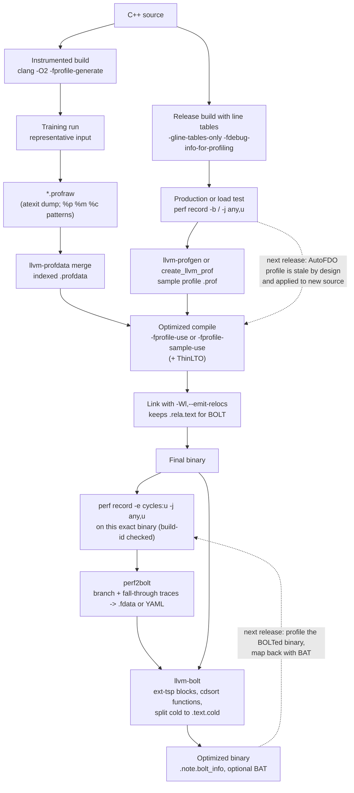

# C++ PGO, AutoFDO, and BOLT Workflow

> [!summary] Claim:
> Feedback-directed optimization replaces the compiler's static guesses about branch direction, call frequency, and indirect-call targets with measured counts, and the biggest wins come from code layout for front-end-bound programs: hot paths become fall-throughs, cold blocks and functions leave the hot pages, and dominant indirect-call targets become guarded direct calls.
> Instrumentation PGO (`-fprofile-generate` then `-fprofile-use`) gets exact edge counts from a slower training binary; AutoFDO gets approximate counts from hardware branch records (Intel LBR, AMD BRS or LBRv2, Arm BRBE) sampled on the production binary and mapped back to source lines through debug info.
> BOLT runs after the link: it disassembles the final executable, rebuilds each function's CFG, applies a branch profile taken from that exact binary, and rewrites the layout of blocks and functions, which is why it still finds gains on top of PGO and LTO.
> The production order is profile-guided compile (PGO or AutoFDO, usually with ThinLTO), link with `--emit-relocs`, sample the final binary with branch stacks, then BOLT (or Propeller), and every step is judged by a front-end metric such as I-cache misses or taken branches, not by a single wall-clock run.



## The Mechanism

### 1. What the compiler cannot know, and why layout is where the money is

An optimizing compiler without a profile estimates branch probabilities from static heuristics (loop back edges are likely, comparisons of pointers against null are unlikely, and so on) and treats every function as equally likely to run.
Those estimates drive inlining budgets, loop unrolling, register allocation spill placement, block placement, and function splitting.
When they are wrong, the cost shows up mostly in the CPU front end: the hot path jumps over cold code, so each fetched cache line and each iTLB page carries bytes that never execute, and every taken branch is a fetch redirect.
Large server binaries tend to be front-end bound because their hot code does not fit in the L1 I-cache, the iTLB, and the branch target buffers, which is why both BOLT and Propeller target code layout in data-center applications.
Profile feedback fixes the estimates at the source, and the most profitable consumers of the fixed estimates are the layout decisions.

The three tools in this note differ in where the profile comes from and at which stage it is applied:

| Technique | Profile source | Profile granularity | Applied at | Profile must match |
| :--- | :--- | :--- | :--- | :--- |
| Instrumentation PGO (iFDO) | Counters compiled into a training binary | Exact edge and value counts | Compile (IR) | The same IR CFG, checked by a per-function hash |
| AutoFDO (sample PGO) | Hardware branch records sampled on a normal optimized binary | Samples per source line offset and discriminator | Compile (IR) | Source lines, so it survives code changes approximately |
| BOLT | Branch records sampled on the final linked binary, or BOLT's own instrumentation | Taken branches and fall-throughs per instruction address | Post-link (machine code) | The exact binary (build-id checked) |
| Propeller | Branch records on a binary built with basic block address maps | Per basic block | Relink (compile and link again) | The exact build that was profiled |

### 2. Instrumentation PGO in Clang

#### Two instrumenters

Clang has two instrumenters, and the Clang User's Manual is explicit about which to use for optimization:

- `-fprofile-instr-generate` is frontend-based: Clang inserts counters while generating IR from the AST, which gives the best source correlation and is what source-based code coverage uses.
- `-fprofile-generate[=<dirname>]` is IR-based: LLVM inserts counters into the IR, which the manual says has lower overhead and smaller raw profiles, and it is the one recommended for the best PGO performance.

The profiles of the two are consumed with `-fprofile-instr-use=<file>` or `-fprofile-use[=<file>]`.
Sampling profiles and instrumentation profiles are not interchangeable, and the manual states there is no conversion tool between them.

#### Where the counters go: the minimum spanning tree

`PGOInstrumentation.cpp` implements the Knuth and Stevenson (1973) result: for every block other than entry and exit, incoming edge counts sum to outgoing edge counts, so the counts of the edges on a spanning tree can be derived from the counts of the edges off it.
LLVM builds a maximum-weight spanning tree using static edge-frequency estimates, so the edges most likely to execute are on the tree and are not instrumented; only the less frequent edges get counters.
The source comment says this instruments the minimum number of edges and is chosen "to reduce the runtime overhead of instrumented binaries".
The same file contains both passes, `PGOInstrumentationGen` and `PGOInstrumentationUse`, and the comment warns that they must run at the same point in the pipeline so that they see the same IR; that requirement is why the profile is tied to the optimization level and flags used for the instrumented build.

Value profiling adds a second kind of data: at each indirect call site the runtime records the targets it saw and their counts, and at each `memcpy`, `memset`, and similar intrinsic it records the sizes (`llvm-profdata show --ic-targets` and `--memop-sizes` print them).
Value nodes are allocated statically, sized by the hidden option `-vp-counters-per-site` (default 1.0 counters per site on average; `InstrProfiling.cpp` raises a module total below 10 to at least 10), and `InstrProfData.inc` caps a site at 255 values (`INSTR_PROF_MAX_NUM_VAL_PER_SITE`), so a site with many targets keeps only some of them.

#### The raw profile and the runtime

The instrumented binary carries three kinds of data in dedicated sections: per-function records (`__llvm_prf_data`), the counters themselves (`__llvm_prf_cnts`), and the function names (`__llvm_prf_names`).
`InstrProfileFormat.md` documents each record: `NameRef` is the MD5 of the function's PGO name, which is `[<filepath><delimiter>]<mangled-name>` so that local-linkage functions from different files stay distinct; `FuncHash` is a checksum of the IR CFG and value sites; `CounterPtr` is stored as a link-time-constant distance from the record to its counters rather than an absolute address, to keep the binary small.
The raw format has, in the document's words, "no backward or forward version compatibility guarantees", so a `.profraw` must be merged by an `llvm-profdata` from the same LLVM release that built the binary.

The compiler-rt profile runtime registers its writer with `atexit` (`__llvm_profile_register_write_file_atexit()` in `InstrProfilingFile.c`), so the profile is written only when the process exits normally.
A process that calls `_exit`, dies on `SIGKILL`, or crashes writes nothing, which is the most common reason a training run "produced no profile".
Two escape hatches exist: call `__llvm_profile_write_file()` (or `__llvm_profile_dump()`) yourself, or enable continuous mode with `-fprofile-continuous` or the `%c` pattern, which the manual describes as syncing counter updates to the file continuously so data survives abnormal termination; the runtime supports `%c` only for Mach-O, ELF, COFF, and AIX targets.

`LLVM_PROFILE_FILE` sets the output path, and `InstrProfilingFile.c` expands these patterns:

| Pattern | Expands to |
| :--- | :--- |
| `%p` | Process ID |
| `%h` | Host name |
| `%t` | Value of `TMPDIR` (warns and falls back if unset) |
| `%b` | Binary ID of the instrumented binary |
| `%m` | A binary signature, and turns on online merging into that file |
| `%Nm` | Same, with a pool of N files; a process writes to pool slot `pid % N` |
| `%c` | Continuous mode; may appear only once |

Without the variable the file is `default.profraw`, and `-fprofile-generate=<dir>` writes `<dir>/default_%m.profraw`, so merging is on by default in that mode.
Counters are updated with plain increments by default; `-fprofile-update=` accepts `single` (the default unless ThreadSanitizer is on), `atomic`, and `prefer-atomic`.
In a multi-threaded training run, `single` loses increments when threads race on a counter, which shows up as counts that violate flow conservation.

`llvm-profdata merge -o code.profdata *.profraw` converts raw profiles to the indexed format, and the manual requires this step even for a single raw file.
`merge` takes `--weighted-input=<weight>,<file>` to mix training scenarios in chosen proportions, `--sparse` to drop functions with zero counts, and `--num-threads`; `show` prints counts, summaries, `--topn=<n>`, `--ic-targets`, and `--memop-sizes`; `overlap` compares two profiles; `order` emits a function order for lld's `--symbol-ordering-file`.

#### What the optimizer does with counts

`PGOInstrumentationUse` attaches branch weights and value-profile metadata to the IR.
From then on, block frequencies (BFI) and the profile summary (PSI) drive decisions.
`ProfileSummaryBuilder.cpp` defines hotness by percentile of total counts: sort all block counts in descending order; the minimum count needed to reach 99% of the total (`-profile-summary-cutoff-hot=990000`) is the hot threshold, and the minimum count needed to reach 99.9999% (`-profile-summary-cutoff-cold=999999`) is the cold threshold, with everything at or below it cold.
The same file flags the code working set as large or huge when more than 12,500 or 15,000 blocks are needed to reach the hot cutoff, and some passes check that flag; CodeGenPrepare, for example, skips its slow-division bypass when the working set is huge.

The consumers that matter most:

- Inlining and unrolling use hot and cold call sites and loops to spend or save code size.
- Machine block placement orders blocks so the likely successor is the fall-through and moves unlikely blocks to the end of the function.
- Section prefixes: `CodeGenPrepare` calls `F.setSectionPrefix("hot")` when PSI says the function is hot in the call graph (or it has the `hot` attribute), `"unlikely"` when it is cold in the call graph (or has the `cold` attribute), and `"unknown"` for functions without data under a partial sample profile.
  With `-ffunction-sections` a function then lands in `.text.hot.<name>` or `.text.unlikely.<name>`, and the linker script can group the hot and unlikely runs; GNU ld's default script lists `.text.unlikely` and `.text.hot` input patterns before the generic `.text.*` (UNVERIFIED: linker scripts were not fetched for this note).
- Machine function splitting: `-fsplit-machine-functions` ("late function splitting using profile information (x86 and aarch64 ELF)", per `Options.td`) moves cold blocks of a function into `.text.split.<name>` under a local symbol `<name>.cold`.
- Indirect-call promotion rewrites `call *%reg` into `if (target == hot) call hot; else call *%reg`, which turns a dominant target into a direct, inlinable call.
- Memory-intrinsic size specialization uses the `memcpy` and `memset` size profile to emit a fast path for the dominant size.

`isFunctionHotInCallGraph()` in `ProfileSummaryInfo.h` returns true if the entry count is hot, if the total count of calls made from the function is hot, or if any block is hot.
A consequence that surprises people: a function that runs once, such as `main`, can be cold in the call graph even though it is the root of all work, because the work is in callees and its own counts are tiny; with Homebrew clang 23.1.5 (as of 2026-11, macOS host emitting a Linux x86-64 ELF object) a small test program put `main` in `.text.unlikely.main` after `-fprofile-use`.

#### Staleness and the hash check

Because the profile is keyed to the IR CFG, any change to a function's control flow invalidates its record.
For IR PGO, Homebrew clang 23.1.5 reports this as a backend warning and drops the function's data; the message has the shape `<file>: function control flow change detected (hash mismatch) <function> Hash = <hash> up to <count> count discarded [-Wbackend-plugin]`.
That shape was observed in a scratch experiment for this note (one `if` added inside a loop), not in the lab.
The frontend instrumenter reports the same situation through `-Wprofile-instr-out-of-date` ("profile data may be out of date: of N functions, M have mismatched data that will be ignored"), files with no data through `-Wprofile-instr-unprofiled`, and functions with no data through `-Wprofile-instr-missing`, which is off by default (`DiagnosticFrontendKinds.td`).
The rustc book recommends `-Cllvm-args=-pgo-warn-missing-function` for the same reason: LLVM does not warn by default when a function has no profile.

#### Variants worth knowing

- Context-sensitive PGO: `-fcs-profile-generate` adds a second instrumentation after inlining, so a callee's counts are kept per inlined context; the manual describes a two-stage flow whose profiles are merged.
- Temporal profiling: `-ftemporal-profile` records the order in which functions first run, and `llvm-profdata order` turns it into a startup function order for lld.
- Partial instrumentation: `-fprofile-list=<file>` selects files or functions (`[clang]`, `[llvm]`, `[csllvm]`, `[sample-coldcov]` sections with `allow`, `skip`, `forbid`), and `-fprofile-function-groups=<N>` with `-fprofile-selected-function-group=<i>` instruments one of N partitions per binary so that a fleet of N binaries jointly covers everything at lower per-binary overhead.
- Remapping: `-fprofile-remapping-file=<file>` maps renamed mangled-name fragments so a profile survives, for example, a standard-library switch; the manual calls it best effort, Itanium ABI only, and notes indirect-call targets are not remapped.

### 3. GCC's instrumentation and AutoFDO flavors

GCC's `-fprofile-generate` enables `-fprofile-arcs`, `-fprofile-values`, `-finline-functions`, and `-fipa-bit-cp`, must be passed to both compile and link, and writes one `.gcda` file per object at exit.
`-fprofile-update` defaults to `prefer-atomic` when `-pthread` is on the command line and `single` otherwise, which is a safer default than Clang's.
`-fprofile-use` turns on `-fbranch-probabilities`, `-fprofile-values`, `-funroll-loops`, `-fpeel-loops`, `-ftracer`, `-fvpt`, `-finline-functions`, `-fipa-cp`, `-fipa-cp-clone`, `-fipa-bit-cp`, `-fpredictive-commoning`, `-fsplit-loops`, `-funswitch-loops`, `-fgcse-after-reload`, `-ftree-loop-vectorize`, `-ftree-slp-vectorize`, `-fvect-cost-model=dynamic`, `-ftree-loop-distribute-patterns`, and `-fprofile-reorder-functions`.
`-fprofile-partial-training` keeps static estimates for functions the training run never executed instead of optimizing them for size as if they were dead.
GCC enables `-freorder-blocks-and-partition` (hot and cold partitioning into `.text.unlikely`) by default for x86 at `-O2`, `-O3`, and `-Os`; BOLT's README says it is incompatible with BOLT and asks for `-fno-reorder-blocks-and-partition`.

`-fauto-profile[=path]` is GCC's AutoFDO; it enables the same list as `-fprofile-use` except that it ends with `-fprofile-correction` instead of `-fprofile-reorder-functions`, and the default profile path is `fbdata.afdo`.
The GCC manual's recipe is `perf record -e br_inst_retired:near_taken -b -o perf.data -- your_program`, then `create_gcov --binary=your_program.unstripped --profile=perf.data --gcov=profile.afdo` from the google/autofdo repository.
GCC 16 added Arm SPE as a profiler to `gcc-auto-profile` and says AutoFDO is now regularly tested on AArch64.
In April 2026 an RFC on the GCC list proposed a standalone AutoFDO profile tool inside GCC, arguing that the external Google tools are "not actively maintained" for GCC use; as of 2026-11 it is a proposal, not a shipped tool.

### 4. AutoFDO: sampling branch records instead of counting

#### What a branch record gives you

A last-branch-record facility keeps a ring of the most recent taken branches as (from, to) address pairs.
When a sampling interrupt fires, perf copies the ring into the sample (`perf record -b` is shorthand for `--branch-filter any`; `-j any,u` restricts to user-space branches).
Between the target of one recorded branch and the source of the next one in execution order, the CPU executed straight-line code with no taken branch, so each pair of consecutive records also proves that a contiguous address range ran.
BOLT's `DataAggregator::parseLBRSample()` builds exactly this: records arrive in reverse execution order, and each becomes a trace `(From, To, NextFrom)` holding a taken branch and the fall-through range after it.
From one sample with 32 records a profiler therefore gets 32 taken branches and up to 31 fall-through ranges, which is why branch-record sampling estimates block counts far better than plain IP sampling.

The hardware differs, and the details leak into tools:

- Intel LBR: BOLT's aggregator notes that Skylake "has 32 LBR entries" and sometimes records entry 32 as a copy of entry 31, so it drops the two oldest entries on affected parts.
  perf-record(1) documents Arch LBR on 12th-generation client and 4th-generation Xeon server parts and later.
- AMD: Zen 3 has Branch Sampling (BRS), which `brs.c` sets to 16 entries and allows only in sampling mode; it holds the interrupt until the 16 entries are captured, so with a retired-taken-branch event the effective period is P + 16 + skid, and with any other event the correlation is looser.
  Zen 4 has LBRv2 (`amd_lbr_v2` in `/proc/cpuinfo`, whose depth the driver reads from CPUID).
- Arm: BRBE (`arm_brbe.c`) organizes records in banks of 32; SPE provides, per BOLT's profile documentation, only a 1-deep branch stack; ETM is a full trace that perf or OpenCSD can turn into synthesized branch stacks.
- Virtual machines often do not expose any of these; BOLT's documentation warns that an accurate profile "may not be possible" in a virtualized environment, and [[Intel-VTune-AMD-uProf-and-Hardware-Tracing-PT-SPE]] owns the hardware-tracing alternatives.

#### From samples to a sample profile

AutoFDO maps addresses to source through debug line tables, so the binary is built with `-gline-tables-only` (no full debug info needed) plus `-fdebug-info-for-profiling`, which adds discriminators that distinguish several basic blocks on the same source line.
The converter, `create_llvm_prof` from google/autofdo or `llvm-profgen` from LLVM, writes a profile keyed by function name, line offset from the function's first line, and discriminator.
The Clang manual's text format shows the structure; this example is from the manual:

```text
main:35504:0
1: _Z3foov:35504
  2: _Z32bari:31977
  1.1: 31977
2: 0
```

The header is `name:total_samples:head_samples`, a body line is `offset[.discriminator]: samples [callee:count ...]`, and indentation records the inline stack: here `foo` was inlined into `main` at line offset 1 and `bar` into `foo` at offset 2.
Because inlined code is attributed to its original function and line, the profile describes source, not machine code, which is what lets it be applied to the next release.
`SampleProfileLoader` turns samples into branch weights by giving each block "the maximum number of samples found in B" (`SampleProfile.cpp`) and propagating weights over the CFG; `-fsample-profile-use-profi` instead uses profi to "infer block and edge counts" (`Options.td`) where samples are missing.

Static functions are a naming hazard: two files may each have a `static void helper()`.
`-funique-internal-linkage-names` gives internal-linkage symbols unique names derived from the source path on the command line, and the manual warns that changing absolute source paths between the profiled and the optimized build can leave the profile unused.

`-fprofile-sample-accurate` changes how missing data is read.
The `Options.td` description says that with an accurate profile "callsites without profile samples are marked as cold"; without it they are treated as if there were no profile.
A scratch experiment with Homebrew clang 23.1.5 (as of 2026-11, ELF object for x86-64) and a hand-written profile that omitted three functions confirmed the effect on placement: by default the omitted functions kept a plain `.text.<name>` section, and with `-fprofile-sample-accurate` all three moved to `.text.unlikely.<name>`, including one that the program does execute but that the profile happened to miss.

The Clang recipe, with the exact commands from the User's Manual:

```bash
clang++ -O2 -gline-tables-only -fdebug-info-for-profiling -funique-internal-linkage-names code.cc -o code
perf record -b -e BR_INST_RETIRED.NEAR_TAKEN:uppp ./code      # or -e branches:u if that event is missing
llvm-profgen --binary=./code --output=code.prof --perfdata=perf.data
# or: create_llvm_prof --binary=./code --out=code.prof  (add --use_lbr=false for a profile recorded without -b)
clang++ -O2 -gline-tables-only -fdebug-info-for-profiling -funique-internal-linkage-names \
    -fprofile-sample-use=code.prof code.cc -o code
```

`llvm-profgen` accepts `--perfdata` (it runs perf to decode it), `--perfscript` (text from `perf script`), an ARM ETM trace through `--etm`, and `--kernel` for vmlinux, and writes `--format=text|binary|extbinary|compbinary|gcc`.

#### Context-sensitive sample PGO

CSSPGO combines branch records with call-stack samples ("hybrid samples" in `llvm-profgen --help`) and, optionally, pseudo probes (`-fpseudo-probe-for-profiling`) that replace line-number correlation with probe IDs inserted into the IR, so that counts survive optimizations that destroy line information.
`llvm-profgen --ignore-stack-samples` falls back to a context-insensitive profile from hybrid samples.
This note stops at the mechanism; the workflow details live in the LLVM sources and are UNVERIFIED here beyond the flag names.

#### What the paper measured

Chen, Li, and Moseley (CGO 2016) report that AutoFDO improved benchmark performance by a geomean of 10.5% and achieved 85% of the gains of traditional FDO, that it increased the number of FDO users at Google eightfold, and that over half of Google's CPU cycles were then spent in FDO-optimized binaries.
The design decision behind those numbers is that the paper's profiles are stale by design: the profile collected from release N's binary feeds the compile of release N+1, so the compiler must tolerate source drift, which line-offset keys do and CFG hashes do not.

#### The Linux kernel as a worked AutoFDO user

The kernel documents the full flow (as of 2026-11, docs for 7.4.0-rc2): `CONFIG_AUTOFDO_CLANG=y` with Clang from LLVM 17 or later on x86 (LBR) and arm64 (SPE or ETM); Intel collection with `perf record -e BR_INST_RETIRED.NEAR_TAKEN:k -a -N -b -c <count>`; AMD Zen 3 BRS or Zen 4 LBRv2 with `perf record --pfm-events RETIRED_TAKEN_BRANCH_INSTRUCTIONS:k -a -N -b -c <count>`; a prime sample period such as 500009 to avoid aliasing with periodic code; `llvm-profgen --kernel --binary=<vmlinux> --perfdata=<perf_file> -o <profile>` (LLVM 19 or later) or `create_llvm_prof` v0.30.1 or later; and `make LLVM=1 CLANG_AUTOFDO_PROFILE=<profile>` to rebuild.
Its Propeller document (`CONFIG_PROPELLER_CLANG=y`, LLVM 19 or later, `generate_propeller_profiles` from google/llvm-propeller) recommends Propeller on top of AutoFDO, AutoFDO with ThinLTO, or iFDO.

### 5. BOLT: optimizing the binary after the link

#### Why after the link

PGO and AutoFDO change the compiler's decisions, but the compiler only sees one translation unit (or one ThinLTO partition) at a time, and the final address of every block is decided later by the linker.
BOLT works on the executable itself, so it sees the whole program's machine code, including code from static libraries and hand-written assembly, and it uses a profile of that exact code.
Its paper (Panchenko, Auler, Nell, Ottoni, CGO 2019) reports speedups of up to 8.0% on Facebook data-center workloads on top of profile-guided function reordering and LTO, up to 20.4% for GCC and Clang on top of FDO and LTO, and up to 52.1% for those compilers built without FDO and LTO (arXiv v2 abstract).
BOLT was merged into the llvm-project monorepo in January 2022 (llvm-dev announcement of 2022-01-12) and lives under `bolt/`.

#### Inputs BOLT needs

- An ELF executable or shared object for x86-64 or AArch64 with a symbol table; a stripped binary stops with "BOLT-ERROR: stripped binaries are not supported" unless `--allow-stripped` is given (`RewriteInstance.cpp`).
- Static relocations kept in the output, from linking with `-Wl,--emit-relocs` (or `-Wl,-q`); the README says to check for a `.rela.text` section, and the OptimizingClang guide notes the flag "does not affect the generated code in any way".
  With relocations BOLT prints `BOLT-INFO: enabling relocation mode` and may move every function; without them it runs in non-relocation mode, rewrites functions in place where they fit, and cannot reorder functions (`--reorder-functions` "works only with relocations").
  BOLT always disables relocation mode for the Linux kernel.
- A branch profile.
  The README's commands are `perf record -e cycles:u -j any,u -o perf.data -- <executable> <args>` for a program and the same with `-a ... -- sleep 180` for a running service, aiming at roughly one billion instructions of profile as reported by `-dyno-stats`, and it recommends cycle events over `BR_INST_RETIRED.*` because they empirically produce better results.
  Without branch records, `perf2bolt -ba` (basic aggregation) builds a weaker IP-sample profile; `--itrace` synthesizes branch stacks from Intel PT or Arm ETM; `--spe` reads Arm SPE.
  BOLT can also instrument the binary itself: `llvm-bolt <exe> -instrument -o <exe.instr>` writes `/tmp/prof.fdata` at exit by default (`--instrumentation-file`, `--instrumentation-file-append-pid`, and `--instrumentation-sleep-time` for periodic dumps from long-running services), which needs no PMU at all.

#### perf2bolt: from perf.data to a symbolized profile

`perf2bolt -p perf.data -o perf.fdata <executable>` runs `perf script -F pid,brstack` for branch events (or `-F pid,event,ip` without branch stacks), plus `--show-mmap-events` and `--show-task-events` to map addresses into the binary, as the jobs in `DataAggregator.cpp` show.
Each brstack entry has the form `FROM/TO/EVENT/INTX/ABORT/CYCLES[/TYPE/SPEC]`.
BOLT verifies that the build-id recorded in `perf.data` matches the binary (`--ignore-build-id` skips the check), because a profile of a different build maps addresses onto the wrong instructions.
The legacy `.fdata` output is one branch per line, `<is_sym_from> <sym_from> <off_from> <is_sym_to> <sym_to> <off_to> <mispreds> <branches>`, for example `1 main 3fb 0 /lib/ld-2.21.so 12 4 221`; `-w perf.yaml` adds the YAML format, which carries per-block hashes and is the one stale-profile matching can use.
Several profiles merge with `merge-fdata *.fdata > combined.fdata`.

#### llvm-bolt: disassemble, rebuild, rewrite

`RewriteInstance` reads the ELF file, discovers function boundaries from the symbol table and `.eh_frame`, disassembles each function into LLVM `MCInst`s, and rebuilds its CFG; a function it cannot fully understand is marked non-simple and left alone.
It attaches the profile to CFG edges, runs its optimization passes, emits the new code through LLVM's MC layer, and writes it into new segments, with hot code in `.text` and split-off cold code in `.text.cold` (and `.text.warm` with the `cdsplit` strategy) unless `--merge-text-sections` merges them (`BinaryContext.h`).
Every output gets a `.note.bolt_info` note holding the BOLT revision and the full command line, encoded as a GNU note so `readelf -n` prints it.
Cold fragments get extra symbols named `<function>.cold.<n>`, with `n` starting at 0 (`RewriteInstance.cpp`).

The README's recommended optimization line is:

```bash
llvm-bolt <executable> -o <executable>.bolt -data=perf.fdata \
    -reorder-blocks=ext-tsp -reorder-functions=cdsort \
    -split-functions -split-all-cold -split-eh -dyno-stats
```

The passes those flags select:

- `-reorder-blocks=ext-tsp`: block order inside each function by the Extended TSP model (see "The Ext-TSP objective"); other values are `none`, `reverse`, `normal`, `branch-predictor`, `cache`, `cache+`, and `cluster-shuffle`.
- `-reorder-functions=cdsort`: function order by Cache-Directed Sort, whose defaults in `CodeLayout.h` model a cache of 16 entries of 2,048 bytes, with chains up to 128 functions and a distance power and frequency scale of 0.25; the other values are `none`, `exec-count`, `hfsort`, `hfsort+`, `pettis-hansen`, `random`, and `user` (`-function-order`).
- `-split-functions` with `-split-strategy=profile2` (the default) moves every block with an execution count of zero into a cold fragment, and only for functions with a full profile (`SplitFunctions.cpp`); `cdsplit` makes hot, warm, and cold fragments; `-split-all-cold` outlines as many cold blocks as possible; `-split-eh` also moves C++ landing pads out.
- `-icf` (`all`, `safe`, default `none`) folds identical functions; `-plt=hot` optimizes PLT calls in hot code (non-x86 targets need `-znow`); `-peepholes`, `-frame-opt`, `-simplify-conditional-tail-calls`, and `-inline-small-functions` are smaller binary-level clean-ups.
- `-hugify` places hot text on 2 MiB pages at run time, and `-lite` skips processing of cold functions (`--lite-threshold-pct` and `--lite-threshold-count` choose them), which keeps BOLT's time and memory manageable on very large binaries.
- `-update-debug-sections` rewrites DWARF so debuggers and symbolizers keep working on the new layout, at some extra processing time.

`-dyno-stats` prints profile-weighted counts of executed instructions and taken branches before and after optimization.
In the BOLT project's OptimizingClang guide, BOLT applied to a PGO and LTO Clang 7 cut taken branches by 41.1% and taken conditional branches by 43.4% while executed instructions changed by only -0.6%, and L1 I-cache misses fell from about 22 to about 15 per thousand instructions.
The guide measured Clang building itself on a 48-core Haswell machine in 180.11 s instead of 202.72 s, a 12% improvement on top of PGO and LTO.

#### The Ext-TSP objective

`CodeLayout.cpp` implements Newell and Pupyrev's Extended TSP layout, used by BOLT for blocks and available to LLVM's own machine block placement behind the hidden `-enable-ext-tsp-block-placement` option (default off).
Each jump with execution count C contributes a score that depends on the distance between the end of its source block and the start of its target:

- A fall-through (distance 0) scores `1.0 * C` if conditional and `1.05 * C` if unconditional.
- A forward jump of d bytes scores `0.1 * (1 - d / 1024) * C` and nothing beyond 1,024 bytes.
- A backward jump of d bytes scores `0.1 * (1 - d / 640) * C` and nothing beyond 640 bytes.

The algorithm starts with every block as its own chain and repeatedly merges the pair of chains with the largest score gain, trying to split one chain X into X1 and X2 and glue X1, X2, and Y in any of six orders, until no merge helps; leftover chains are sorted by density.
The weights encode the hardware: a fall-through costs no fetch redirect, and a short jump probably stays within lines already fetched, while a long jump costs a new line.

#### Profiling a BOLTed binary: BAT and staleness

The profile for BOLT must come from the binary BOLT is about to rewrite, but in production the running binary is the previous BOLT output.
BOLT Address Translation solves this: with `--enable-bat` BOLT writes a `.note.bolt_bat` section with hot and cold function translation tables, and `perf2bolt` reads it to map samples taken on the optimized binary back to the input binary's addresses; such a profile carries the `boltedcollection` header.
When source changes between releases, `--infer-stale-profile` infers counts from stale profile data, which works from the YAML format because it carries per-block hashes, `--report-stale` lists stale functions, and BOLT prints how many functions have stale profiles; the README warns that more stale functions means less improvement.

### 6. Propeller: the relinking alternative

Propeller reaches the same goal as BOLT without disassembly.
The first build records where each basic block is (Clang has `-fbasic-block-address-map` for this; UNVERIFIED that every Propeller flow uses that exact flag); a branch profile of that binary is converted by `generate_propeller_profiles` (google/llvm-propeller, where the Propeller code moved from google/autofdo in 2025Q1) into a compiler profile and a linker profile; a second build compiles hot functions with `-fbasic-block-sections=list=` ("ELF only" per `Options.td`) so each hot block is its own section, and the linker orders those sections.
The ASPLOS 2023 paper reports 1.1% to 8% beyond PGO and ThinLTO on Google workloads, about 7% for Clang and 1% for MySQL, and performance comparable to a state-of-the-art binary optimizer with 30% to 70% lower memory overhead on large benchmarks, because the work is distributed across the existing compile and link actions instead of one large rewriting process.
The cost is a second compile of the profiled code and integration with the build system, where BOLT needs only the final binary.

### 7. The end-to-end production workflow and how to measure it

The order matters because each stage needs inputs the next stage destroys or changes:

1. Choose the compile-time profile: iFDO when you can run a representative, deterministic training workload in CI; AutoFDO when the representative workload is production itself and you can sample it with branch records.
2. Build the release with that profile and ThinLTO (`-flto=thin`), so inlining across translation units can use the counts.
3. Link with `-Wl,--emit-relocs`; it changes no code, only keeps relocations for BOLT.
4. Run the release binary under representative load and record `perf record -e cycles:u -j any,u`; the build-id ties the profile to this binary.
5. `perf2bolt`, then `llvm-bolt` with the README's flags; keep `-dyno-stats` output as a build artifact.
6. Verify behavior (the same test suite on the BOLTed binary) and verify the front end: `perf stat -e cycles,instructions,branch-misses,L1-icache-load-misses,iTLB-load-misses`, and on Intel the top-down front-end-bound share, compared across many interleaved runs; [[Linux-perf-in-Depth-and-perf-c2c]] owns the counters and [[Cpp-Google-Benchmark-and-nanobench]] owns microbenchmark statistics.
7. Ship, then repeat: the next AutoFDO profile comes from this release in production, and the next BOLT profile comes from the BOLTed binary through BAT.

The evidence that a layout optimization worked is a drop in taken branches, I-cache misses, and iTLB misses at a near-constant instruction count; a wall-clock change with no front-end change is noise or something else.

## Commands and Numbers to Know

| Item | Value | Platform and date | What it controls |
| :--- | :--- | :--- | :--- |
| `-fprofile-generate[=<dir>]` | IR instrumentation; writes `<dir>/default_%m.profraw` | Both (as of 2026-11) | Recommended instrumenter for PGO |
| `-fprofile-instr-generate` | Frontend instrumentation; writes `default.profraw` | Both (as of 2026-11) | Coverage-quality source mapping, larger profiles |
| `-fprofile-use[=<file>]` | Applies an indexed `.profdata` | Both (as of 2026-11) | Branch weights, value profiles, PSI |
| `-fprofile-update=` | `single` (default unless TSan), `atomic`, `prefer-atomic` | Both (as of 2026-11) | Counter races in threaded training runs |
| GCC `-fprofile-update` default | `prefer-atomic` with `-pthread`, else `single` | Linux (as of 2026-11) | Same, GCC side |
| `LLVM_PROFILE_FILE` | `%p %h %t %b %m %Nm %c` | Both (as of 2026-11) | Output path, merging, continuous mode |
| Profile writer | `atexit` handler | Both (as of 2026-11) | `_exit`, `SIGKILL`, and crashes lose the profile |
| `-profile-summary-cutoff-hot` | `990000` (99% of total counts) | Both (as of 2026-11) | Hot count threshold |
| `-profile-summary-cutoff-cold` | `999999` (99.9999%) | Both (as of 2026-11) | Cold count threshold |
| Large / huge working set | 12,500 / 15,000 blocks to reach the hot cutoff | Both (as of 2026-11) | Code-growth back-off |
| Section prefixes | `.text.hot.`, `.text.unlikely.`, `.text.unknown.`, `.text.split.` | Linux (as of 2026-11) | Hot and cold function grouping, split cold blocks |
| `-fsplit-machine-functions` | Off by default; x86 and AArch64 ELF | Linux (as of 2026-11) | Cold blocks to `.text.split.<fn>` as `<fn>.cold` |
| `-fprofile-sample-use=<file>` | Sample (AutoFDO) profile | Both (as of 2026-11) | Sample PGO |
| `-fprofile-sample-accurate` | Off by default | Both (as of 2026-11) | Unsampled call sites become cold |
| `-fdebug-info-for-profiling` | Adds discriminators | Both (as of 2026-11) | Block-level sample attribution |
| `-funique-internal-linkage-names` | Path-derived unique local names | Both (as of 2026-11) | Static functions in sample profiles |
| `perf record -b` | `--branch-filter any` | Linux (as of 2026-11) | Branch stacks for AutoFDO |
| Intel Skylake LBR | 32 entries (BOLT drops 2 on affected parts) | Linux x86 (as of 2026-11) | Branches per sample |
| AMD Zen 3 BRS | 16 entries, sampling mode only | Linux x86 (as of 2026-11) | Period skews by 16 plus skid |
| Arm BRBE | Banks of 32 records | Linux arm64 (as of 2026-11) | Branch stacks on Armv9 parts |
| Kernel AutoFDO period | Prime, e.g. `500009` | Linux (as of 2026-11) | Avoids sampling aliasing |
| BOLT link flag | `-Wl,--emit-relocs` or `-Wl,-q` | Linux (as of 2026-11) | Relocation mode; check `.rela.text` |
| BOLT profile command | `perf record -e cycles:u -j any,u` | Linux (as of 2026-11) | Branch records for perf2bolt |
| BOLT profile size target | About 1 billion instructions | Linux (as of 2026-11) | README guidance |
| `perf2bolt -ba` | Basic aggregation, no branch stacks | Linux (as of 2026-11) | VMs without LBR, lower quality |
| `llvm-bolt -instrument` | Profile to `/tmp/prof.fdata` | Linux (as of 2026-11) | PMU-free BOLT profiling |
| `--icf` | `none` default, `safe`, `all` | Linux (as of 2026-11) | Identical code folding |
| `--split-strategy` | `profile2` default; `cdsplit`, `random2`, `randomN`, `all` | Linux (as of 2026-11) | How functions are fragmented |
| Ext-TSP weights | Fall-through 1.0 / 1.05; jumps 0.1 | Both (as of 2026-11) | Layout score per jump |
| Ext-TSP distances | Forward 1,024 B; backward 640 B | Both (as of 2026-11) | Beyond these a jump scores 0 |
| CDSort model | 16 entries x 2,048 B, chains up to 128 | Both (as of 2026-11) | BOLT `-reorder-functions=cdsort` |
| `.note.bolt_info` | BOLT revision and command line | Linux (as of 2026-11) | `readelf -n` proves a binary was BOLTed |
| `.note.bolt_bat` | With `--enable-bat` | Linux (as of 2026-11) | Profile a BOLTed binary for the next run |
| CPython `--enable-bolt` | Added in 3.12, experimental; LLVM 16 or newer strongly encouraged | Linux (as of 2026-11) | BOLT for the interpreter build |
| Clang toolchain used for checks here | Homebrew clang 23.1.5 | macOS host, ELF objects (as of 2026-11) | Scratch verification of prefixes, ICP, warnings |

## Multi-Language Comparison: C++ / Python / Rust

Profile feedback is a property of native code generation, so for Python it applies to the interpreter and to C extensions, not to Python bytecode.

| Concern | C++ (Clang, GCC) | Python (CPython) | Rust (rustc) |
| :--- | :--- | :--- | :--- |
| Instrumentation PGO | `-fprofile-generate` / `-fprofile-use`; GCC writes `.gcda`, Clang writes `.profraw` merged by `llvm-profdata` | `./configure --enable-optimizations` builds an instrumented interpreter, runs `PROFILE_TASK` (default `-m test --pgo --timeout=$(TESTTIMEOUT)`), and rebuilds; since 3.13 a failing task is no longer ignored | `-Cprofile-generate=<dir>` / `-Cprofile-use=<file>`, merged with an `llvm-profdata` from `llvm-tools-preview` or a recent LLVM |
| Sample PGO | `-fprofile-sample-use` (Clang), `-fauto-profile` (GCC) | Not offered by `configure`; possible through `CFLAGS` with Clang (UNVERIFIED: not documented by CPython) | `-Cprofile-sample-use=<file>` with the unstable `-Zdebuginfo-for-profiling`; the rustc book says it is mostly tested on x86-64 Linux |
| LTO pairing | `-flto=thin` | `--with-lto`; ThinLTO is the default on Clang since 3.12 | `-Clto=thin` or `fat` |
| BOLT | Link with `-Wl,--emit-relocs`, then `perf2bolt` and `llvm-bolt` | `--enable-bolt` (3.12, experimental) with `BOLT_INSTRUMENT_FLAGS` and `BOLT_APPLY_FLAGS`; needs `llvm-bolt` and `merge-fdata` | Pass `-Clink-arg=-Wl,--emit-relocs`, then the same BOLT steps on the ELF output |
| Missing-profile warning | `-Wprofile-instr-missing` (frontend PGO, off by default); hash-mismatch warning for IR PGO | Clang profile warnings can be silenced with `-Wno-profile-instr-unprofiled`, which the docs call harmless | `-Cllvm-args=-pgo-warn-missing-function` recommended |
| Helper tooling | CMake caches `PGO.cmake` and `BOLT.cmake` for building Clang itself | `make profile-opt` | `cargo-pgo`, which the rustc book lists as instrumentation PGO only |

## Worked Lab Example

The lab is `code/05-Profiling/pgo_bolt_workflow/` and runs the whole workflow on one program: baseline, instrumentation PGO, AutoFDO, and BOLT on top of PGO.
It declares `# requires: linux, pmu`: AutoFDO and BOLT need branch-stack sampling, which the harness container does not expose, so the lab runs only on a Linux host with `TOOLCHAIN_LABS_PMU=1`.

The workload (`workload.cpp`, no headers, and `main.cpp`, the driver) is built so that each optimization has a visible target:

- `run_batch()` generates messages from a xorshift stream and dispatches each through a 64-entry function-pointer table; type 3 gets 90% of messages, types 0 to 7 share 9%, and all 64 types share the last 1%, so the single indirect call site has one dominant target.
- Each handler first checks a rare validation failure (about 1 message in 1,024) and calls the bulky `report_bad()`; the rare branch is first in source, so without a profile the common path must jump over it.
- `dump_state()` is never executed by the workload.
- `train` and `eval` use different seeds with the same mix, so the profile is collected on one input and the binaries are measured on another, and every variant must print the same `eval` checksum.

What `run.sh` checks, in order, all printed as facts that do not change between runs:

1. Baseline `-O2`: the eval checksum, the number of `.text.hot.`, `.text.unlikely.`, and `.text.split.` sections in a `-ffunction-sections` object (all zero without a profile), and whether `run_batch` contains a direct call to `handle_3` (it should not: the table call is indirect).
2. Instrumentation PGO: the number of `.profraw` files, the `llvm-profdata show` summary and `--topn=3` list (exact counts, because the training run is deterministic and single-threaded), the top two indirect-call targets of `run_batch`, the eval checksum against baseline, the section class of `handle_3`, `run_batch`, `report_bad`, and `dump_state`, whether indirect-call promotion produced a direct call to `handle_3` (a relocation against `handle_3` inside `run_batch`), and which handlers `-fsplit-machine-functions` split.
3. AutoFDO: `perf record -e cycles:u -j any,u` on a `-gline-tables-only -fdebug-info-for-profiling` build, `llvm-profgen`, whether `run_batch`, `handle_3`, and `dump_state` appear in the sample profile, the eval checksum, and where `dump_state` and `handle_3` land with and without `-fprofile-sample-accurate`.
4. BOLT: whether the PGO binary kept `.rela.text`, then `perf2bolt` and `llvm-bolt` with the README's flags, and whether the log says relocation mode, the output carries `.note.bolt_info`, `.text.cold`, and `<fn>.cold.0` symbols, and the BOLTed binary prints the baseline checksum.
5. Measurement: `perf stat -r 5` of all four variants, printed to stderr only, together with BOLT's dyno-stats lines.

Each check can fail: a missing profile leaves zero hot sections and no direct call, a broken BOLT run has no note or cold section, and any miscompilation changes the checksum.

```bash
cd code/05-Profiling/pgo_bolt_workflow
LLVM_BIN=/path/to/llvm/bin bash run.sh   # one LLVM release that ships clang++, llvm-bolt, perf2bolt, llvm-profgen
# or, through the harness from code/: TOOLCHAIN_LABS_PMU=1 python3 -m _harness.verify 05-Profiling/pgo_bolt_workflow/
```

### Verified output

None yet.
The lab needs a Linux host with branch-stack sampling and an LLVM install that includes `llvm-bolt`, `perf2bolt`, and `llvm-profgen`; it was written on a macOS host and has not been run, so `expected/` holds no file and this section shows no output.
The integrator records `expected/linux-<arch>.txt` on such a host with `python3 -m _harness.verify --record 05-Profiling/pgo_bolt_workflow/`.

What was checked locally, outside the lab, with Homebrew clang 23.1.5 on darwin-arm64 (instrumented run native, optimized objects cross-compiled to x86-64 ELF from the same `workload.cpp`):

- The instrumented training run produced a profile that covers every function in the two source files (64 handlers, `report_bad`, `dump_state`, `run_batch`, `main`), and `--ic-targets` listed `handle_3` as the dominant target of `run_batch`'s indirect call.
- With `-fprofile-use`, `run_batch` gained a direct call to `handle_3` (an `R_X86_64_PLT32 handle_3` relocation) next to the remaining indirect call; the baseline object has only the indirect call.
- With `-fprofile-use`, `dump_state` went to `.text.unlikely.dump_state`, and `handle_3`, `run_batch`, and `report_bad` went to `.text.hot.*`; `report_bad` is hot, not cold, because by construction it runs about once per 1,024 of the 2,000,000 training messages with a 64-step loop each, far above a cold cutoff set at 99.9999% of total weight.
- With `-fsplit-machine-functions`, every handler except `handle_3` and also `run_batch` got a `.text.split.<name>` section and a `<name>.cold` symbol.

These observations explain what the lab is designed to show; they are not the lab's recorded output, and a Linux Clang of another release may classify borderline functions differently.

## Pitfalls

> [!warning] Pitfall: a training workload that is not the production workload
> PGO optimizes for the training run, including its mistakes: code the training run never executes is treated as cold, so a feature that is rare in CI but common in production can get slower than without PGO.
> Mix several scenarios with `llvm-profdata merge --weighted-input`, consider GCC's `-fprofile-partial-training` for unexecuted code, and re-check the gain on an input that was not used for training.

> [!warning] Pitfall: the profile silently stops matching
> IR PGO drops any function whose CFG hash changed, with only a `-Wbackend-plugin` warning that build logs usually bury, and frontend PGO's `-Wprofile-instr-missing` is off by default.
> Regenerate instrumentation profiles in CI for every release, fail the build on hash-mismatch warnings above a threshold, or move to AutoFDO, whose line-offset keys tolerate drift.

> [!warning] Pitfall: no `.profraw` after the training run
> The runtime writes the profile from an `atexit` handler, so a service stopped with `SIGKILL`, a process that calls `_exit`, or a crash writes nothing, and a forked worker overwrites its parent's file unless the path has `%p` or `%m`.
> Stop services cleanly, call `__llvm_profile_write_file()` from a shutdown hook, or use `%c` continuous mode, and always put `%p` or `%m` in `LLVM_PROFILE_FILE` for multi-process programs.

> [!warning] Pitfall: lost counts in multi-threaded training
> Clang's default `-fprofile-update=single` uses plain increments, so threads that hit the same counter lose updates and the profile can contradict flow conservation.
> Use `-fprofile-update=atomic` for threaded training runs, accepting a slower training binary.

> [!warning] Pitfall: mixing LLVM releases across the pipeline
> The raw profile format has no compatibility guarantees, and the indexed format evolves too, so a `.profraw` from Clang N merged by `llvm-profdata` N-1, or a BOLT older than the linker's output features, fails or misreads.
> Take the compiler, `llvm-profdata`, `llvm-profgen`, and BOLT from one release, and record that release next to the stored profile; CPython's docs report that BOLT releases before LLVM 16 crash in some scenarios.

> [!warning] Pitfall: AutoFDO names that do not survive the build
> Static functions with the same name in different files collapse in a sample profile unless `-funique-internal-linkage-names` is used, and that flag derives names from source paths, so building from a different checkout directory than the profiled build makes the profile miss those functions.
> Build release binaries from a fixed source path, or use path prefix remapping consistently between the profiled and the optimized builds.

> [!warning] Pitfall: `-fprofile-sample-accurate` with an incomplete profile
> With the flag, any function or call site without samples is treated as cold, so a short or unrepresentative sampling window pushes real code into `.text.unlikely` and optimizes it for size.
> Turn the flag on only when the profile covers the full production mix, and check what moved to `.text.unlikely` between releases.

> [!warning] Pitfall: BOLT input built the wrong way
> Without `--emit-relocs` BOLT falls back to non-relocation mode and cannot reorder functions, a stripped binary is refused, and GCC's default `-freorder-blocks-and-partition` conflicts with BOLT's own splitting.
> Link with `-Wl,--emit-relocs`, strip only after BOLT, add `-fno-reorder-blocks-and-partition` with GCC, and check for `.rela.text` and `BOLT-INFO: enabling relocation mode` in CI.

> [!warning] Pitfall: a BOLT profile from a different binary
> BOLT's profile is address-level, so a profile from yesterday's build, from the pre-PGO binary, or from the BOLTed binary without BAT maps onto the wrong instructions; perf2bolt's build-id check catches the first case, and `--ignore-build-id` turns that protection off.
> Profile the exact binary you will rewrite, and enable `--enable-bat` when the next profile will be collected from BOLT output.

> [!warning] Pitfall: judging the result by one timing run
> A 2% wall-clock change is within the run-to-run noise of most machines, and layout changes can shift alignment-sensitive loops either way.
> Compare taken branches, I-cache misses, iTLB misses, and front-end-bound share with repeated, interleaved runs, and treat `-dyno-stats` as a profile-weighted estimate, not a measurement.

## At Scale

For one developer, feedback-directed optimization is a release-build switch: a PGO build of a CPU-bound tool is a few commands and a training script, and BOLT is one more step if the machine has LBR.
At 1,000 to 50,000 engineers the questions become who owns the profiles, how stale they may be, and how a bad profile is caught before it ships.

- Profiles are build inputs: store each one in an artifact store keyed by product, release, and toolchain version, reference it from the build definition, and never let a build fetch "the latest" profile, or the build is not reproducible and a regression cannot be bisected.
- Instrumentation PGO fits products whose representative workload runs in CI (compilers, interpreters, databases with benchmark suites); its cost is a second, slower build plus the training run on every release, and the gain is exact counts.
- AutoFDO fits large fleets that already sample production with branch records; Google's paper reports 85% of iFDO's gain with only flag changes to the release build, because the fleet profiler supplies the data.
  [[Continuous-Profiling-GWP-Parca-Pyroscope-and-OTel-Profiles]] owns the collection side.
- BOLT or Propeller on top pays most for large, front-end-bound binaries; decide with measurements of front-end-bound share and I-cache misses before investing.
- BOLT is simpler to adopt (one post-link step, no build-system change) but is one large process per binary; Propeller distributes its work across compile and link actions and reports 30% to 70% less memory than a binary optimizer on large benchmarks, at the price of build-system integration.
- Hardware decides what is possible: if the fleet runs in VMs without branch records, use instrumentation PGO and BOLT's own `-instrument` mode, or basic-sample aggregation with lower gains.

Decision rules:

- Under about 1 MiB of hot code with a stable benchmark: instrumentation PGO plus ThinLTO, and skip post-link optimization until a front-end metric says it matters.
- A server binary of tens of MiB or more that is front-end bound: compile-time profile plus ThinLTO plus BOLT or Propeller, measured by I-cache and iTLB misses.
- More than one workload per binary: merge weighted profiles (`llvm-profdata merge --weighted-input`, `merge-fdata`), and verify that no scenario regresses.
- Treat a release where the share of stale or mismatched functions jumps as a failed build input, not a warning.

[[Profiling-Decision-Records]] holds the decision-record template for choosing between these options in an organization.

## Practice Drill

> [!tip] Practice Drill:
> Run the lab on a Linux machine with LBR, then change one line in `run_batch()` so that type 5, not type 3, gets 90% of `eval` messages while `train` is unchanged.
> Before running, predict three things: whether the PGO binary still calls `handle_3` directly, whether the PGO binary is now slower than the baseline on `eval`, and how BOLT's dyno-stats taken-branch change differs from the matched case.
> Then fix the regression without changing the code: collect a second training profile with the new mix and merge both with `llvm-profdata merge --weighted-input=1,a.profraw --weighted-input=1,b.profraw`, and check which indirect-call targets get promoted.
> As a stretch, add `-Wl,--emit-relocs` to the AutoFDO build and BOLT it as well, and compare `.text.cold` sizes (`llvm-readelf -S`) between PGO+BOLT and AutoFDO+BOLT.

## Interview Questions

> [!question] L5: What are the trade-offs between instrumentation PGO and AutoFDO?
>
> > [!success]- Answer
> > Instrumentation PGO compiles counters into a training binary, so its counts are exact, including indirect-call targets and memory-intrinsic sizes, but it needs a separate slower build, a representative training run, and a profile that matches the CFG of the code being compiled.
> > AutoFDO samples hardware branch records on the normal optimized binary, maps addresses to source line offsets and discriminators through debug line tables, and writes a profile keyed by source, so it can use production traffic and tolerates source drift between releases.
> > Its counts are approximate, it needs branch-record hardware, and it loses information where optimizations blur line tables; Google's CGO 2016 paper reports it reached 85% of the gains of traditional FDO.

> [!question] L5: Why does BOLT want the binary linked with `--emit-relocs`, and what happens without it?
>
> > [!success]- Answer
> > With static relocations kept in the output, BOLT knows every place that refers to a code address, so it can move any function anywhere and patch the references; it then runs in relocation mode and can reorder functions and split them into hot and cold sections.
> > Without them it runs in non-relocation mode: it rewrites functions in place where the new code fits, cannot reorder functions, and gets less of the benefit.
> > The flag does not change code generation, which the BOLT guide states explicitly, so it costs only file size; check for `.rela.text` and for `BOLT-INFO: enabling relocation mode` in the log.

> [!question] L5 (predict the output): A sample profile omits `helper()`, which the program does call; you build with `-ffunction-sections -fprofile-sample-use=p.prof`, then again adding `-fprofile-sample-accurate`; which section holds `helper` in each build?
>
> > [!success]- Answer
> > Without the flag, `helper` stays in a plain `.text.helper` section: missing samples mean "no information", so Clang does not mark it hot or cold.
> > With `-fprofile-sample-accurate`, functions and call sites without samples are treated as cold, so it moves to `.text.unlikely.helper` and is optimized as cold code, even though it runs.
> > A scratch build with Homebrew clang 23.1.5 showed exactly this split, which is why the flag is safe only when the profile covers the full workload.

> [!question] L6: How does a sampling profiler turn LBR records into basic-block counts?
>
> > [!success]- Answer
> > Each sample carries the last N taken branches as (from, to) pairs, in reverse execution order.
> > Every pair gives one taken edge, and between the target of one branch and the source of the next branch in execution order the CPU ran a straight-line range with no taken branch, so every instruction in that range, and every fall-through edge inside it, executed once.
> > Summing taken edges and fall-through ranges over all samples gives edge and block counts proportional to execution frequency; BOLT's aggregator stores them as traces `(From, To, NextFrom)`, and AutoFDO converts the ranges into per-line samples through the line table.
> > Hardware quirks matter: Skylake's 32-entry LBR can duplicate its oldest entry, which BOLT drops, and AMD Zen 3 BRS holds the interrupt for 16 entries, so the effective period is the configured period plus 16 plus skid.

> [!question] L6 (debug this): After a small refactor, the PGO release is 6% slower and the build log has `warning: ... function control flow change detected (hash mismatch) process Hash = ... count discarded [-Wbackend-plugin]`; what happened, and how do you fix it durably?
>
> > [!success]- Answer
> > IR PGO keys each function's counts to a hash of its CFG and value sites; the refactor changed `process()`'s CFG, so Clang discarded its whole profile and compiled it with static heuristics, while the rest of the program still used profile data, and the hot function lost its layout and inlining decisions.
> > The short-term fix is to regenerate the profile from the new source with the same flags as the release build.
> > The durable fix is to make profile generation part of the release pipeline, store profiles keyed by release and toolchain, and fail the build when the number of mismatched or missing functions exceeds a threshold, or to switch the product to AutoFDO, whose line-offset keys survive small edits.

> [!question] L6 (predict the output): A program's `main` runs once and calls a hot loop in `process()`; after `-fprofile-use` with `-ffunction-sections`, where does `main` land?
>
> > [!success]- Answer
> > In `.text.unlikely.main`.
> > `CodeGenPrepare` assigns the `unlikely` prefix when `ProfileSummaryInfo` says the function is cold in the call graph, which looks at the function's entry count and its own blocks and calls, not at the work done by its callees.
> > An entry count of 1 is far below the cold threshold (the count at 99.9999% of total weight), so `main` is cold, while the callee with the loop is hot; a scratch build with Homebrew clang 23.1.5 placed `main` there.
> > This is harmless, because `main`'s own code runs once.

> [!question] L7: Why run BOLT after PGO and LTO instead of relying on the compiler alone, and what does BOLT need from the build to stay effective release after release?
>
> > [!success]- Answer
> > The compiler lays out each function from estimated block frequencies before the linker fixes addresses, and it cannot see code from prebuilt libraries or the final interleaving of functions; BOLT sees the final machine code and a profile of exactly that code, so it can still straighten branches and group hot code, which is why the BOLT paper reports up to 8.0% on top of profile-guided function ordering and LTO, and the BOLT Clang guide shows 41% fewer taken branches on a PGO and LTO Clang.
> > To keep working it needs `--emit-relocs` at link, an unstripped binary, a branch profile whose build-id matches, and, once BOLTed binaries run in production, `--enable-bat` so the next profile can be collected from the optimized binary and mapped back.
> > It also needs the same LLVM release across steps and a CI check on the stale-function count it prints.

> [!question] L7: Explain the Ext-TSP layout objective and why its constants look the way they do.
>
> > [!success]- Answer
> > Ext-TSP scores a block order by summing, over all jumps, a weight times a distance factor times the jump's execution count: a fall-through scores 1.0 (conditional) or 1.05 (unconditional) times the count, a forward jump scores 0.1 times `(1 - d/1024)` times the count, and a backward jump 0.1 times `(1 - d/640)` times the count, with zero beyond those distances.
> > It models fetch: a fall-through costs nothing, a short jump probably lands in a line already fetched, and a long jump costs a new line, so the score rewards both fall-throughs and density of hot code, unlike classic TSP-style layout, which only maximizes fall-throughs.
> > The greedy algorithm merges chains with the best gain and tries six ways of gluing a split chain X1, X2 with Y, which LLVM's source comment says enlarges the search space while staying fast; the constants are tuned for large front-end-bound binaries, per the same file.

> [!question] L7: An instrumented training run of a multi-threaded service produced a profile, but the PGO build is no faster and some counts look impossible; what do you check?
>
> > [!success]- Answer
> > First the update mode: Clang's default `-fprofile-update=single` loses increments under contention, so rebuild the instrumented binary with `-fprofile-update=atomic`.
> > Then whether the profile was written by every process: the runtime writes from `atexit`, so workers killed with `SIGKILL` or exiting with `_exit` write nothing, and forked workers overwrite each other unless `LLVM_PROFILE_FILE` has `%p` or `%m`; check the number of `.profraw` files and use `%c` or an explicit `__llvm_profile_write_file()` call.
> > Finally, check that the training traffic resembles production with `llvm-profdata show --topn`, and look for hash-mismatch warnings in the optimized build.

> [!question] L8+: Design a fleet-wide feedback-directed optimization program for a company with hundreds of C++ services.
>
> > [!success]- Answer
> > Start from measurement: use the continuous profiler to rank services by fleet CPU and front-end-bound share, because the payoff is proportional to cycles saved.
> > Make AutoFDO the default for services that run on branch-record-capable hosts: the fleet profiler samples with branch stacks, a pipeline converts per-release samples with `llvm-profgen`, and release builds consume the previous release's profile, which is stale by design and tolerated by source-keyed profiles.
> > Use instrumentation PGO where production is not sampleable or where exact value profiles matter, with training workloads owned by the service team and run in CI.
> > Add BOLT or Propeller for the largest front-end-bound binaries, with `--emit-relocs` and BAT enabled so that production samples feed the next post-link run.
> > Treat profiles as versioned build inputs keyed by release and toolchain, gate releases on the mismatched or stale function share and on front-end counters from a canary, and keep a one-flag rollback to the non-FDO build.

> [!question] L8+: Your organization must pick BOLT or Propeller for post-link optimization; how do you decide?
>
> > [!success]- Answer
> > Both use branch profiles of the exact binary to reorder blocks and functions and split cold code; the published results are in the same range (BOLT up to 8.0% on top of PGO and LTO, Propeller 1.1% to 8% beyond PGO and ThinLTO).
> > BOLT needs only the final binary and a link flag, works on code from prebuilt libraries and assembly, and can be adopted per binary without touching the build system, but it disassembles and rewrites the whole binary in one process and depends on understanding every function it moves.
> > Propeller relies on the compiler and linker (basic block address maps, basic block sections, a linker ordering profile), so it never disassembles and spreads its work over the existing distributed build, which its paper reports as 30% to 70% less memory on large benchmarks, but it requires a second compile and deep build-system integration.
> > A company with a distributed build system and very large binaries leans to Propeller; a company that wants a quick per-binary win, or ships binaries it does not build from source, leans to BOLT; either way, measure front-end counters on the real workload before committing.

## Further Reading

- Clang User's Manual, "Profile Guided Optimization": the authoritative list of PGO and sample-PGO flags, `LLVM_PROFILE_FILE` patterns, and the sample profile text format.
- `llvm-profdata` and `llvm-profgen` command guides: every merge, show, overlap, and order option, and the inputs `llvm-profgen` accepts.
- `llvm/docs/InstrProfileFormat.md`: the raw and indexed profile layouts, including why the raw format has no compatibility guarantees.
- `PGOInstrumentation.cpp`, `ProfileSummaryBuilder.cpp`, `CodeGenPrepare.cpp`, and `CodeLayout.cpp` at llvm-project 7daaee96: counter placement, hot and cold thresholds, section prefixes, and Ext-TSP and CDSort.
- BOLT `README.md`, `docs/OptimizingClang.md`, `docs/profiles.md`, `docs/BAT.md`, and `docs/CommandLineArgumentReference.md`: the supported workflow, a full measured example, the profile formats, and every pass option.
- Panchenko et al., "BOLT: A Practical Binary Optimizer for Data Centers and Beyond" (CGO 2019): the design and the data-center results.
- Chen, Li, and Moseley, "AutoFDO" (CGO 2016): why sampled, stale-by-design profiles work in production.
- Shen et al., "Propeller" (ASPLOS 2023): the relinking alternative and its memory argument.
- Newell and Pupyrev, "Improved Basic Block Reordering" (IEEE TC 2020): the Ext-TSP model behind BOLT's block layout.
- Linux kernel `dev-tools/autofdo` and `dev-tools/propeller` documents: complete, hardware-specific perf commands for Intel, AMD, and Arm.
- GCC manual, `-fprofile-use` and `-fauto-profile`: the GCC side, including what each flag turns on.

## Related

- Prerequisites: [[Linux-perf-in-Depth-and-perf-c2c]]
- See also: [[02-Programming-Languages/C++/CPP_Zero_to_Godhood/Volume_08_Advanced_Systems/Chapter_102_Linking_Loading_ABI/Chapter_102_Linking_Loading_ABI_and_WPO|Chapter_102_Linking_Loading_ABI_and_WPO]], [[Intel-VTune-AMD-uProf-and-Hardware-Tracing-PT-SPE]], [[Continuous-Profiling-GWP-Parca-Pyroscope-and-OTel-Profiles]], [[Cpp-CPU-Profiling-perf-samply-Callgrind-and-llvm-mca]], [[Cpp-Google-Benchmark-and-nanobench]], [[Profiling-Decision-Records]], [[Drill-Profiling-Rust-Monomorphization-and-Inlining-Regression]]
- Lab: `code/05-Profiling/pgo_bolt_workflow/` (requires: linux, pmu)
