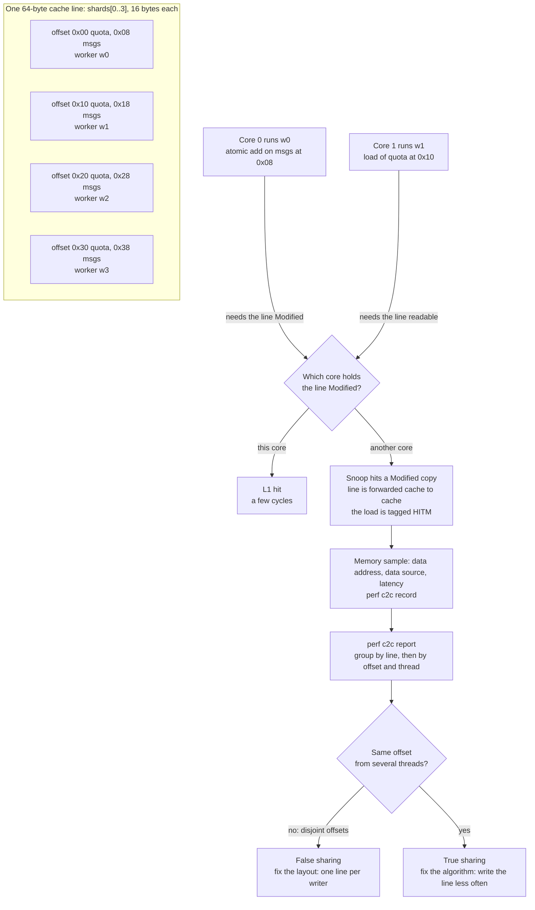

# Drill: Profiling False Sharing and Cache Contention

> [!summary] Scope
> This problem note is a timed, guided-to-blind drill on a multi-core throughput collapse caused by cache-line contention.
> One ingest loop carries three bugs that look identical on a CPU profile: adjacent per-thread counters in an array, adjacent per-thread counters on the heap, and one counter that every thread really does share.
> The engineer measures Hit-Modified (HITM) loads with `perf c2c`, maps a contended line back to source, tells false sharing from true sharing, and applies the fix that matches each one.
> It reaches the Debug rung and validates mastery of concurrent memory access and cache coherency.

How `perf` opens events, samples memory accesses, and unwinds stacks is owned by [[Linux-perf-in-Depth-and-perf-c2c]], the prerequisite of this drill.
The sampling hardware underneath (Intel PEBS, AMD IBS, Arm SPE) and the vendor profilers that read it are owned by [[Intel-VTune-AMD-uProf-and-Hardware-Tracing-PT-SPE]].
On-CPU sampling and annotation of C and C++ hot loops is owned by [[Cpp-CPU-Profiling-perf-samply-Callgrind-and-llvm-mca]].
Benchmark harness design, which this drill needs only as a consumer, is owned by [[Cpp-Google-Benchmark-and-nanobench]].
This note owns the diagnosis path: the symptom, the report reading, the three layouts, and the decision between padding and redesign.



## Reproduction

The reproduction is in `code/05-Profiling/drill_false_sharing/`.
It models the hot path of a message-ingest service: up to four worker threads, and never fewer than two, each pinned to its own physical core, each handling messages for a fixed wall-clock time.
Per message a worker reads its quota and bumps a counter.
The workers never take a lock and never make a system call inside the loop.

The files:

1. `ingest.c`: the workload, with six variants selected by the first argument.
2. `run.sh`: builds `ingest` for the machine's cache line size and runs every check; it declares `# requires: linux, pmu`.
3. `analyze.py`: pins workers to distinct physical cores, runs the variants, drives `perf c2c`, and parses its report.
4. `fixtures/`: five `perf c2c report --stdio` outputs and the generator that produced their input, used to test the parser on machines with no PMU.

Every buggy variant runs the same function:

```c
struct shard {
    _Atomic uint64_t quota; /* read on every message, written once before the workers start */
    _Atomic uint64_t msgs;  /* written on every message, by exactly one worker */
};

__attribute__((noinline)) static uint64_t ingest(struct lane *l)
{
    uint64_t handled = 0;

    while (!stopped()) {
        for (int i = 0; i < POLL; i++) {
            if (handled < atomic_load_explicit(l->quota, memory_order_relaxed))
                atomic_fetch_add_explicit(l->msgs, 1, memory_order_relaxed);
            handled++;
        }
    }
    return handled;
}
```

The variants differ only in where `l->quota` and `l->msgs` point:

| Variant | Where the hot words live | Role in the drill |
| :--- | :--- | :--- |
| `array` | `static alignas(FS_LINE) struct shard shards[MAX_WORKERS]`, 16 bytes per worker | Round 1, guided |
| `array-fixed` | `struct shard_fixed` with `alignas(FS_LINE)` on the first member, one line per worker | Fix for round 1 |
| `heap` | four consecutive `malloc(sizeof(struct shard))` calls made by the main thread | Round 2, blind |
| `heap-fixed` | four `aligned_alloc(FS_LINE, FS_LINE)` calls | Fix for round 2 |
| `total` | per-worker quota on private lines, one `msgs` counter shared by all workers and alone on its line | Round 3, the trap |
| `total-fixed` | the same shared counter, written once per 4096 messages from a private tally | Fix for round 3 |

Build and run one variant by hand:

```bash
cd code/05-Profiling/drill_false_sharing
cc -O2 -g -pthread -DFS_LINE=64 ingest.c -o ingest
./ingest array 0,1,2,3 2        # variant, one CPU per worker, seconds
```

The program prints one line of `key=value` facts: messages handled, messages counted, the slowest worker's tally, the decimal addresses of every worker's `quota` and `msgs`, and the bounds of the `[heap]` mapping.
Run the whole drill directly, or through the harness from `code/`, which skips the lab unless the PMU opt-in is set:

```bash
bash code/05-Profiling/drill_false_sharing/run.sh
cd code && TOOLCHAIN_LABS_PMU=1 make verify LAB=05-Profiling/drill_false_sharing/
```

> [!warning] Recording status
> The lab needs hardware memory sampling, so it was not recorded for this note: there is no `expected/<platform>.txt` yet, and no number in this note is a measurement from the lab.
> The revision pass of 2026-11-13 paused lab checks by instruction, so nothing was re-run beyond compiling the predict-the-output program in Question 2.
> The drafting host is an Apple silicon Mac whose Linux container has no PMU, where the harness reports the lab as `SKIP`.
> The stages that need no PMU (`FS_DRILL_STAGES=selftest,layout,throughput`) were run in that container and pass.
> The `c2c` stage has only been exercised through its parser, against reports that perf 6.8.12 produced from synthetic samples.
> UNVERIFIED: what a real recording of each variant contains, as described in Observed Symptom, Progressive Hint Ladder, and Model Solution, is a prediction from the mechanism and from those synthetic reports, because no PMU host was available.
> Record the lab on a bare-metal Linux host with `make record LAB=05-Profiling/drill_false_sharing/` before promoting this note.

What `run.sh` asserts, and what would make each fact fail:

| Stage | Fact printed on stdout | Fails when |
| :--- | :--- | :--- |
| selftest | the parser tells false sharing, true sharing, and a quiet run apart on 5 recorded reports | the report parser or classifier regresses |
| layout | every variant counted exactly the messages it handled | an update is lost |
| layout | `array`: all workers share a line; `heap`: at least two do; both fixes: none | the alignment unit is wrong or the allocator packs differently |
| layout | `total`: the shared counter has a cache line to itself | another hot word lands on the counter's line |
| throughput | the slowest worker of each fix is at least 1.3x that of its bug, best of five runs each | contention has no cost on this machine |
| c2c | `array`: at least 100 HITM or peer-snoop load samples, hottest line holds the shards, pattern is false sharing | `perf c2c` cannot see the contention |
| c2c | `array-fixed`: contended samples under 10% of `array` | the fix does not remove the bouncing |
| c2c | `heap`: hottest line holds malloc'd shards inside `[heap]`, pattern is false sharing | the heap layout or the report differs |
| c2c | `total`: hottest line holds the shared counter, pattern is true sharing | the classifier cannot tell the two apart |
| c2c | all three bugs are hot in the same function, `ingest` | symbolization fails |

### Drill format

The drill is timed and moves from guided to blind.
Fold every callout in Progressive Hint Ladder and Model Solution before starting.

| Round | Target | Budget | Allowed help | Pass condition |
| :--- | :--- | :--- | :--- | :--- |
| 1, guided | `./ingest array` | 20 minutes | Hints 1 to 5, in order | Name the object, the offsets, and the threads; land a fix; show the HITM count collapse |
| 2, blind | `./ingest heap` | 10 minutes | Hint 6 only after the clock runs out | Explain why no data symbol exists, name the allocation site, land a fix |
| 3, the trap | `./ingest total` | 10 minutes | Hint 7 only after the clock runs out | Refuse padding as a fix, with evidence from the report, and land the right change |

Write down a one-line prediction before each `perf c2c report`: which line, which offsets, how many threads per offset.
A prediction that was wrong is the part of the drill worth reviewing.

## Observed Symptom

The service scales to one core and then stops.
Adding workers adds CPU time but not throughput, and the per-worker rate of the slowest worker falls well below the single-thread rate.
The `throughput` stage of the lab asserts this as a ratio of at least 1.3 between each fixed variant and its bug, where a machine with no contention cost would read 1.0.

Everything a first-line tool can show points away from the real cause:

- The workers spin in user space for the whole run, so `top` shows each at 100% user time and nothing looks blocked.
- There is no mutex and no system call in the loop, so lock and off-CPU profiles have nothing to report.
- The loop is one small function, so a CPU profile from `perf record` attributes the time to `ingest` in all three buggy variants and in both layout fixes.
- Those five variants execute the same instructions per message, so a slower one retires fewer instructions in the same CPU time: `perf stat` reports it as lower instructions per cycle.

The on-CPU profile cannot separate those variants because the code is the same and the time really is spent on those instructions.
What differs is why the instructions are slow, and that information is in the data address and data source of each memory access, which a plain cycles profile does not record.

This is what `perf c2c` adds.
The following rows are from `fixtures/array.c2c.txt` in the lab: the layout is real output of `perf c2c report --stdio -c tid,iaddr` from perf 6.8.12 on linux-aarch64, but the input samples are synthetic, so the counts illustrate the shape and are not measurements.

```text
=================================================
      Shared Cache Line Distribution Pareto      
=================================================
#
#        ----- HITM -----  ------- Store Refs ------  --------- Data address ---------                                      ---------- cycles ----------    Total       cpu              Shared                    
#   Num  RmtHitm  LclHitm   L1 Hit  L1 Miss      N/A              Offset  Node  PA cnt             Tid        Code address  rmt hitm  lcl hitm      load  records       cnt      Symbol  Object   Source:Line  Node
# .....  .......  .......  .......  .......  .......  ..................  ....  ......  ..............  ..................  ........  ........  ........  .......  ........  ..........  ......  ............  ....
#
  ----------------------------------------------------------------------
      0        0      328      104       36        0      0x555555574140
  ----------------------------------------------------------------------
           0.00%   12.20%    0.00%    0.00%    0.00%                 0x0   N/A       0     4243:w0          0x55555555592c         0       190         0       40         1  [.] ingest  ingest  ingest.c:93    0
           0.00%    0.00%    0.96%    0.00%    0.00%                 0x0   N/A       0     4242:ingest      0x555555555100         0         0         0        1         1  [.] main    ingest  ingest.c:158   0
           0.00%    9.15%   24.04%   25.00%    0.00%                 0x8   N/A       0     4243:w0          0x555555555940         0       240         0       64         1  [.] ingest  ingest  ingest.c:95    0
           0.00%   13.72%    0.00%    0.00%    0.00%                0x10   N/A       0     4244:w1          0x55555555592c         0       191         0       45         1  [.] ingest  ingest  ingest.c:93    0
           0.00%    0.00%    0.96%    0.00%    0.00%                0x10   N/A       0     4242:ingest      0x555555555100         0         0         0        1         1  [.] main    ingest  ingest.c:158   0
           0.00%   10.06%   24.04%   25.00%    0.00%                0x18   N/A       0     4244:w1          0x555555555940         0       241         0       67         1  [.] ingest  ingest  ingest.c:95    0
```

Read it as a map of one cache line.
The header row gives the line's address and its totals.
Each row under it is one offset inside the line, one thread, and one code address.
Thread `w0` appears only at offsets `0x0` and `0x8`, thread `w1` only at `0x10` and `0x18`: the threads never touch the same bytes, yet both pay Hit-Modified loads.
The `Node` column reads `N/A` only because the synthetic file carries no memory topology; on a real host it is a NUMA node number.

The matching rows from `fixtures/total.c2c.txt` show the other pattern, with the same provenance:

```text
  ----------------------------------------------------------------------
      0        0      264      120       48        0      0x555555574100
  ----------------------------------------------------------------------
           0.00%   27.27%   25.00%   25.00%    0.00%                 0x0   N/A       0     4246:w3      0x555555555940         0       263         0      114         1  [.] ingest  ingest  ingest.c:95   0
           0.00%   25.76%   25.00%   25.00%    0.00%                 0x0   N/A       0     4245:w2      0x555555555940         0       262         0      110         1  [.] ingest  ingest  ingest.c:95   0
           0.00%   24.24%   25.00%   25.00%    0.00%                 0x0   N/A       0     4244:w1      0x555555555940         0       261         0      106         1  [.] ingest  ingest  ingest.c:95   0
           0.00%   22.73%   25.00%   25.00%    0.00%                 0x0   N/A       0     4243:w0      0x555555555940         0       260         0      102         1  [.] ingest  ingest  ingest.c:95   0
```

One offset, four threads, the same code address as before.
That is true sharing, and no amount of padding changes it.

## Progressive Hint Ladder

> [!tip]- Hint 1: Prove it is not a lock, a syscall, or the scheduler
> Run the workload under `perf stat` and compare a buggy variant with a single worker.
> Expect user time near 100% per thread, context switches near zero, and instructions per cycle well below the single-worker value (UNVERIFIED: reasoning about the workload, not captured output).
> A thread that burns cycles without retiring instructions and without leaving user space is waiting on memory.
> The question is no longer where the time goes but which memory, and that needs data addresses.

> [!tip]- Hint 2: Sample data addresses, not instruction addresses
> `perf c2c record` is `perf record` with memory events and the flags that capture the data address, the data source, and the load latency.
> Record a short window, two to five seconds, of the user-space part only:
> ```bash
> perf c2c record --all-user -- -o array.data ./ingest array 0,1,2,3 2
> ```
> If it fails with an access error, read the note's pitfall on `--phys-data` and `kernel.perf_event_paranoid`.
> If it fails with `failed: memory events not supported`, the machine or the VM has no memory sampling and the drill cannot run there.

> [!tip]- Hint 3: Read the three tables top down
> ```bash
> perf c2c report -i array.data --stdio -c tid,iaddr > array.c2c.txt
> ```
> In `Trace Event Information`, compare `Load Local HITM` and `Load Remote HITM` with `Load Operations`.
> In `Shared Data Cache Line Table`, take the first row: that is the line with the most HITM loads.
> In `Shared Cache Line Distribution Pareto`, read that line's rows: `Offset`, `Tid`, `Symbol`.
> The default grouping is by code address only; `-c tid,iaddr` adds the `Tid` column, printed as `tid:comm`, and the lab names its threads `w0` to `w3`.

> [!tip]- Hint 4: Ask one question of the offsets
> For every offset that carries HITM share, list the threads that appear at it.
> If each hot offset belongs to one thread and different offsets belong to different threads, no data is shared: the threads only share the line.
> If one offset is hot for several threads, the data itself is shared.
> In `array` the stride between the offsets of neighbouring threads is `0x10`, which is the size of whatever is packed there.

> [!tip]- Hint 5: Turn a line address into a declaration
> The line address is a runtime virtual address.
> For a static object in a position-independent executable, subtract the load base found in `/proc/<pid>/maps` and look the result up with `nm -n ./ingest`; the lab's program also prints the addresses it used.
> A stride of 16 bytes and two hot fields at `+0` and `+8` identify `struct shard`; `pahole -C shard ./ingest` prints its layout with cache line boundaries.
> The fix is a layout change: give each writer's shard its own line, and make the type carry the alignment so `sizeof` rounds up.

> [!tip]- Hint 6: When the line has no name
> In `heap` the hottest line is not inside the executable's data at all.
> Compare its address with the `[heap]` range in `/proc/<pid>/maps`.
> `pahole` shows a 16-byte struct and says nothing about neighbours, because adjacency on the heap is decided by the allocator at run time.
> The offsets of neighbouring threads are `0x20` apart: that is the allocator's minimum chunk, not a field offset.
> Follow the code address to the source line, the pointer to its assignment, and the assignment to the `malloc` call.

> [!tip]- Hint 7: When padding is already there
> In `total` the hottest line holds one counter that already owns its line.
> Every thread appears at the same offset.
> Alignment separates data that should never have been together; it does nothing for data that every thread must write.
> The fix has to reduce how often the line is written, and it changes what a reader of the counter can assume.

## Model Solution

> [!success]- Solution: Complete Diagnosis and Remediation
> ### Round 1: `array`
>
> **Step 1: classify the stall.**
> `perf stat ./ingest array 0,1,2,3 2` against `./ingest array-fixed 0,1,2,3 2` should show about the same task-clock and fewer instructions for `array` (UNVERIFIED: predicted from the mechanism, not captured here).
> Context switches and kernel time near zero would rule out locks and I/O.
> The loop touches two words per message, so the working set is tiny and misses to main memory are impossible: the remaining explanation is a line that keeps moving between cores.
>
> **Step 2: record memory samples.**
> ```bash
> perf c2c record --all-user -- -o array.data ./ingest array 0,1,2,3 2
> perf c2c report -i array.data --stdio -c tid,iaddr > array.c2c.txt
> ```
> `perf c2c record` adds `-W -d --phys-data --sample-cpu` and the memory events for the architecture, so each sample carries a data address, a data source, a weight, and a CPU.
>
> **Step 3: read the report.**
> Expect `Trace Event Information` to report a large `Load Local HITM` on a single-socket machine, or `Load Remote HITM` when the workers span sockets.
> Expect `Shared Data Cache Line Table` to have one dominant row.
> The Pareto block for that row shows hot offsets between `0x0` and `0x38`: per thread, the load of `quota` at `+0` and, where the hardware samples it as a load, the atomic add at `+8`.
> Each offset has exactly one thread.
> The `Symbol` column says `ingest` on every row.
>
> **Step 4: name the object.**
> The line address minus the executable's load base is the address of `shards` in `nm -n ./ingest`.
> The stride is 16 bytes and `pahole -C shard ./ingest` reports a 16-byte struct with `quota` at 0 and `msgs` at 8.
> The declaration is `static alignas(FS_LINE) struct shard shards[MAX_WORKERS];`: the array starts on a line boundary, and all four elements then sit inside that one line.
> Aligning the array instead of its elements is the bug.
>
> **Step 5: fix the layout.**
> ```c
> struct shard_fixed {
>     alignas(FS_LINE) _Atomic uint64_t quota;
>     _Atomic uint64_t msgs;
> };
> static struct shard_fixed shards_fixed[MAX_WORKERS];
> ```
> The alignment of the first member becomes the alignment of the struct, and `sizeof` is rounded up to a multiple of it, so consecutive elements are one line apart.
> `quota` and `msgs` of one worker stay together on purpose: they are used together by one thread, so sharing a line helps.
>
> **Step 6: verify with the same tool.**
> Record `array-fixed` the same way.
> Expect the HITM totals to fall to noise and the `Shared Data Cache Line Table` to be empty or to list unrelated lines (UNVERIFIED: no real recording exists).
> The lab asserts fewer than 10% of the contended samples of `array`, and a slowest-worker rate at least 1.3 times higher.
> A fix that is verified only by a benchmark number is not verified: the number can move for other reasons.
>
> ### Round 2: `heap`
>
> The report has the same code address and the same pattern, disjoint offsets per thread, but the line address lies inside `[heap]`.
> There is no symbol to look up and `pahole` cannot help, because the struct is correct in isolation.
> The offsets of neighbouring workers are 32 bytes apart.
> glibc's `malloc` aligns to `2 * sizeof(size_t)`, 16 bytes on 64-bit targets, and its smallest chunk for 8-byte pointers is 32 bytes, so four consecutive 16-byte requests from one thread come back 32 bytes apart and at least two of them share a 64-byte line.
> How many share depends on where the first chunk falls, which is why the lab asserts "at least two" and compares the slowest worker.
>
> The allocation site is found by reading code, not by the profiler: the code address leads to `l->msgs`, the pointer leads to `heap_shards[i]`, and that leads to a loop in `main` that calls `malloc(sizeof(struct shard))` once per worker.
> When the site is not obvious, a heap profiler from [[Cpp-Memory-Profiling-heaptrack-Massif-DHAT-and-Allocators]] or a `malloc` uprobe from [[eBPF-bpftrace-ftrace-uprobes-and-USDT]] that filters on the returned address finds it.
>
> The fix is to ask the allocator for the alignment, because a type's `alignas` does not reach `malloc`:
> ```c
> heap_shards[i] = aligned_alloc(FS_LINE, FS_LINE);
> ```
> The size passed to `aligned_alloc` is a whole line, so the next allocation cannot move into the tail of this one.
> Allocating one `struct shard_fixed` array is equally good and has one failure point instead of four.
>
> ### Round 3: `total`
>
> The report shows one hot line, one hot offset, and all four threads at it.
> The layout check proves the counter is alone on its line, so there is nothing left to separate.
> This is true sharing: every worker executes an atomic add on the same word, and the line must be owned exclusively by whichever core is writing.
> Padding this counter to 128 or 4096 bytes changes nothing, and saying so with the report in hand is the pass condition of the round.
>
> The fix writes the shared line less often:
> ```c
> if (++pending == BATCH) {
>     atomic_fetch_add_explicit(l->msgs, pending, memory_order_relaxed);
>     pending = 0;
> }
> ```
> Each worker keeps a private tally in a register and flushes it every 4096 messages, plus once at exit, so the count stays exact at the end.
> The price is visible to readers: at any instant the shared counter lags by up to `BATCH - 1` messages per worker.
> The alternative is per-thread counters that a reader sums, which is `array-fixed`: writes are free of contention, reads cost one line per worker, and the sum is not a snapshot.
> The Linux kernel documents both shapes as mitigations, "per-cpu data + global data" and a raised threshold for syncing per-CPU data to the global value.
>
> ### What to write in the review
>
> State the line, the offsets, the threads per offset, the declaration or allocation site, the fix, and the before and after HITM counts from the same recording procedure.
> For round 3, state the new staleness bound, because the fix changed semantics and the others did not.

## Core Takeaway

A CPU profile says which instruction is slow; only a data-address profile says which memory made it slow, and for cache-line contention the instruction is the same in the bug and in the fix.
`perf c2c` answers one structural question per contended line: do the threads touch the same offset or different ones.
Different offsets mean false sharing, which is a layout defect with a mechanical fix whose unit is the coherency granule, not the size of the struct.
The same offset means true sharing, which is a design defect: the fix writes the line less often and always costs something in freshness or read cost.
The mechanics of the recording, the events, and the report options are owned by [[Linux-perf-in-Depth-and-perf-c2c]].

## Why the Line Bounces

### Coherence works on lines, not on variables

A cache holds memory in fixed-size lines, and the coherence protocol tracks ownership per line.
In the MESI protocol a line in a core's cache is Modified, Exclusive, Shared, or Invalid.
A core can write only a line it holds in Modified or Exclusive state.
When another core holds the line, the writer must first obtain ownership, and the other copies are invalidated: Drepper (section 3.3.4 of the paper in Further Reading) calls this the Request For Ownership and notes that it is expensive compared with a local hit.
A read of a line that another core holds Modified forces that core to hand the current contents over.

The hardware cannot see variables.
Two words that the program treats as independent are one unit of ownership if they fall in one line.
With four workers each writing its own word in one line, ownership of the line moves between cores on nearly every access, and each core spends most of its time waiting for the line to come back.

### What HITM means

A sampled load reports where its data came from.
`perf` carries this in `union perf_mem_data_src`: the operation, the cache level, the snoop result, and whether the access was locked.
`PERF_MEM_SNOOP_HITM` is documented in `include/uapi/linux/perf_event.h` as "Snoop hit modified": the load missed the local cache, the snoop found the line Modified in another core's cache, and the data was forwarded from that cache.
Intel's event list describes the Skylake-X offcore variant as a snoop to a sibling core that "hits the line in M state and the line is forwarded".
A HITM load is therefore direct evidence that two cores are passing a dirty line back and forth.

`perf c2c` splits HITM by distance.
`c2c_decode_stats` in `tools/perf/util/mem-events.c` counts a HITM at L2 or L3 as local, and a HITM from a remote cache as remote; remote means another NUMA node and is the costlier case.

Three properties of that function matter when reading a report:

- HITM is counted only for samples whose operation is a load.
- A store sample carries only whether it hit or missed L1, never a snoop result.
- A sample whose data address or code address has no mapping is counted under `No Page Map Rejects`.

A contention pattern made only of stores, with no load of the same line, therefore shows up as `Store L1D Miss` and never as HITM.
The lab's loop performs a plain load of `quota` on every message, so the contention is visible on loads however the hardware samples the atomic add.

### How each architecture produces the sample

`perf c2c record` selects events per architecture (as of 2026-11, Linux v7.3 source and documentation):

- Intel uses `cpu/mem-loads,ldlat=30/P` and `cpu/mem-stores/P`, precise events backed by PEBS, and on CPUs that have the auxiliary event the load event becomes the group `{cpu/mem-loads-aux/,cpu/mem-loads,ldlat=30/}:P`; the load event records only loads whose latency is at least the `ldlat` threshold, 30 cycles by default.
- AMD uses the `ibs_op` PMU, with `ldlat` only where `/sys/bus/event_source/devices/ibs_op/caps/ldlat` reads 1; the manual states that `perf c2c` is not supported on Zen 3.
- Arm64 uses SPE with `load_filter=1,store_filter=1,min_latency=30`, and the manual warns that SPE is statistical, so not every operation is sampled.

The kernel translates each vendor's data source into the common encoding.
On Intel the PEBS data source table in `arch/x86/events/intel/ds.c` maps specific encodings to `P(SNOOP, HITM)`.
On AMD, `perf_ibs_get_mem_snoop` in `arch/x86/events/amd/ibs.c` sets HITM only for a load that missed L1 and L2, whose IBS data source is another cache, and only on models where the cache-hit-state bit is valid.
On Arm, `tools/perf/util/arm-spe.c` maps a peer-core data source to `PERF_MEM_SNOOPX_PEER` rather than HITM for Neoverse cores, and notes that those records carry no hit level or data source for stores.

That last difference changes the report.
Since Linux 6.0 `perf c2c report` has a `peer` display, and the source selects it by default when the recording came from an AArch64 machine, "since Arm64 platform doesn't support HITMs flag".
The columns are then `Peer Snoop` instead of `HITM`, and the totals to read are `Load HIT Local Peer` and `Load HIT Remote Peer`.
The lab's parser sums HITM and peer counts for this reason, and `fixtures/array-peer.c2c.txt` holds a report in that layout.

### What the report groups by

`perf c2c report` sorts samples by cache line address, then by offset inside the line.
The line size comes from `sysconf(_SC_LEVEL1_DCACHE_LINESIZE)` on the reporting machine, with a sysfs fallback, in `tools/perf/util/cacheline.c`.
`--double-cl`, added in Linux 6.3, doubles the grouping unit for machines where an adjacent-line prefetcher makes sharing behave as if the line were twice as large.

Per offset the rows are coalesced by the `-c` fields.
The manual says the default is `pid,iaddr`; the source in both v6.8 and v7.3 sets `coalesce_default = "iaddr"`, and perf 6.8.12 reports the cacheline data grouping as `offset,iaddr`.
With the default, the row for an offset names the code address and a `cpu cnt`, the number of CPUs that touched it.
With `-c tid,iaddr` each thread gets its own row, which is what makes the false-or-true question a matter of reading one column.

Lines are filtered before display.
A line is shown only if it holds at least a fraction `DISPLAY_LINE_LIMIT`, 0.001, of the HITM total for the chosen display; `--show-all` removes the filter.
The manual's `--show-all` text mentions a "HITM % 0.0005 limit"; the source is the authority.
The three `cycles` columns are means of the sampled load latency, computed by `MEAN_ENTRY` with `avg_stats`; the manual's field list calls them sums.

### The unit of padding is not always 64 bytes

The correct alignment is the size of the unit that moves between cores, and sources disagree on it:

- The kernel's `coherency_line_size` attribute in sysfs is documented as "the minimum amount of data in bytes that gets transferred from memory to cache".
- x86-64 lines are 64 bytes; GCC sets both interference sizes to 64 for all x86, with the comment "64B is the accepted value for these for all x86".
- For a generic AArch64 target GCC sets the destructive size to 256 and the constructive size to 64, to "cover the current range of cache line sizes".
- Go pads with 64 bytes on x86 and 128 on arm64, "because Apple Silicon, a.k.a. M1, has 128-byte cache line size".
- crossbeam's `CachePadded` uses 128 bytes on x86-64, aarch64, and powerpc64, because "Intel's Sandy Bridge, spatial prefetcher is now pulling pairs of 64-byte cache lines at a time".
- folly takes the standard constant when the library defines it, and otherwise uses `(kIsArchArm || kIsArchS390X) ? 64 : 128`, citing microbenchmarks in which "pairs of cache lines also see destructive interference under heavy use of atomic operations".
- HotSpot pads `@Contended` fields by `ContendedPaddingWidth`, 128 bytes by default.

The practical rule is to pad to the largest plausible granule for the fleet, 128 bytes for mixed x86-64 and arm64, and to measure before trusting 64.
`run.sh` takes the larger of `getconf LEVEL1_DCACHE_LINESIZE` and the sysfs `coherency_line_size` values, never less than 64, because the two can disagree on one machine.

### The cost depends on the access and on the core

The penalty is not a constant.
Drepper, section 6.4.1, measured threads that each increment their own word in one shared line, on a machine with four Pentium 4 processors, and reports overheads of 390%, 734%, and 1,147% for two, three, and four threads.
The same test on a single-socket quad-core Core 2 QX 6700 showed no scalability problem at all.
The access matters as much as the machine.
Intel's description of `MACHINE_CLEARS.MEMORY_ORDERING` lists an external snoop as one cause of a memory-ordering machine clear, so on x86 a contended line can cost pipeline flushes on top of the transfer itself.
An atomic read-modify-write needs exclusive ownership of the line for the whole operation (UNVERIFIED: standard architecture behavior, stated without a vendor manual citation).

The lab uses an atomic add so that the cost does not depend on how a particular core treats plain stores.
With GCC 13.3 on AArch64 the add compiles to a call to `__aarch64_ldadd8_relax`, and Clang targeting x86-64 emits `lock incq`.
A demonstration built on plain increments can show nothing on some cores, which reads as "no false sharing here" and is wrong.

## Commands and Numbers to Know

| Item | Value or command | Platform | Stamp |
| :--- | :--- | :--- | :--- |
| Record contention | `perf c2c record --all-user -- -o out.data <cmd>` | Linux | (as of 2026-11) |
| What record adds to `perf record` | `-W -d --phys-data --sample-cpu` plus the memory events | Linux | (as of 2026-11) |
| Intel default events | `cpu/mem-loads,ldlat=30/P`, `cpu/mem-stores/P` | Linux, Intel | (as of 2026-11) |
| Intel default events, CPUs with the auxiliary load event | `{cpu/mem-loads-aux/,cpu/mem-loads,ldlat=30/}:P`, `cpu/mem-stores/P` | Linux, Intel | (as of 2026-11) |
| Arm default event | `arm_spe_0/ts_enable=1,pa_enable=1,load_filter=1,store_filter=1,min_latency=30/` | Linux, Arm64 with SPE | (as of 2026-11) |
| AMD default event | `ibs_op//`, or `ibs_op/ldlat=30/` with latency support; not Zen 3 | Linux, AMD | (as of 2026-11) |
| Load latency threshold | `-l`, `--ldlat`, default 30 cycles; AMD accepts 128 to 2048 | Linux | (as of 2026-11) |
| Report to a file | `perf c2c report -i out.data --stdio -c tid,iaddr` | Linux | (as of 2026-11) |
| Totals only | `perf c2c report --stats` | Linux | (as of 2026-11) |
| Sort by local or remote HITM | `-d lcl`, `-d rmt`; `-d peer` on Arm64 (default there) | Linux | (as of 2026-11) |
| Group by line pairs | `--double-cl` (Linux 6.3 and later) | Linux | (as of 2026-11) |
| Per-node CPU lists | `-N`, repeat for more detail | Linux | (as of 2026-11) |
| Show every contended line | `--show-all`; default hides lines under 0.1% of HITMs | Linux | (as of 2026-11) |
| Default coalescing | `iaddr` in the source; the manual says `pid,iaddr` | Linux | (as of 2026-11) |
| Privilege for `--phys-data` | `kernel.perf_event_paranoid <= 1` or `CAP_PERFMON`; the sysctl defaults to 2 | Linux | (as of 2026-11) |
| First release with `perf c2c` | Linux 4.10 | Linux | (as of 2026-11) |
| HITM counter, Skylake-X | `MEM_LOAD_L3_HIT_RETIRED.XSNP_HITM`, event 0xD2 umask 0x4 | Linux, Intel | (as of 2026-11) |
| Same counter, Sapphire Rapids | `MEM_LOAD_L3_HIT_RETIRED.XSNP_FWD`, event 0xd2 umask 0x4 | Linux, Intel | (as of 2026-11) |
| Remote HITM counter | `MEM_LOAD_L3_MISS_RETIRED.REMOTE_HITM`, event 0xD3 umask 0x4 | Linux, Intel | (as of 2026-11) |
| Line size, L1 | `getconf LEVEL1_DCACHE_LINESIZE` | Linux | (as of 2026-11) |
| Line size, coherency | `/sys/devices/system/cpu/cpu0/cache/index*/coherency_line_size` | Linux | (as of 2026-11) |
| Struct layout by line | `pahole -C <struct> <binary>`; `-c <bytes>` sets the line size | Linux | (as of 2026-11) |
| Suggested reorder | `pahole -R -S -C <struct> <binary>` | Linux | (as of 2026-11) |
| glibc 2.39 `malloc` alignment | `2 * SIZE_SZ`, 16 bytes on 64-bit; minimum chunk 32 bytes | Linux, glibc | (as of 2026-11) |
| GCC interference sizes | x86: 64 and 64; generic AArch64: destructive 256, constructive 64 | Both | (as of 2026-11) |
| Kernel alignment macros | `____cacheline_aligned_in_smp`, `__cacheline_group_begin` and `_end`, `CACHELINE_PADDING`, `__read_mostly` | Linux | (as of 2026-11) |

## Multi-Language Comparison

| Language | Padding construct | Unit it uses | Trap |
| :--- | :--- | :--- | :--- |
| C | `alignas(N)` on the first member, `aligned_alloc(N, size)` for heap objects | chosen by the programmer | `malloc` ignores the type's alignment |
| C++ | `alignas(std::hardware_destructive_interference_size)` | 64 on x86 with GCC; 256 on generic AArch64 with GCC | GCC warns with `-Winterference-size` because the value is not ABI stable |
| Rust | `crossbeam_utils::CachePadded<T>` | 128 on x86-64 and aarch64, 64 on most others | the size of `CachePadded<T>` is a multiple of N, so memory grows per element |
| Go | `cpu.CacheLinePad` in `internal/cpu`, `[N]byte` fields elsewhere | 64 on x86, 128 on arm64 | "no runtime detection of the real cache line size" |
| Java | `@Contended` | `-XX:ContendedPaddingWidth`, default 128 | `RestrictContended` is true, so untrusted classes are ignored by default |
| Python | none in the language | not applicable | the free-threaded build makes reference counts a contended word; PEP 703 answers with immortal objects and deferred reference counting |

GCC added the two C++17 constants in GCC 12, and Clang 19 added the `__GCC_DESTRUCTIVE_SIZE` and `__GCC_CONSTRUCTIVE_SIZE` macros that standard libraries build them from.
Both vendors warn that the values can change with the compiler version and with tuning flags.
The compilers' answer for a public header is the same: define a project constant and use that.

## Pitfalls

> [!warning] Reading the default report and concluding nothing
> The default grouping is by code address, so when one function serves every thread, each offset shows one row and no thread.
> False and true sharing then differ only in the offset list and the `cpu cnt` column.
> Use `-c tid,iaddr`, name the threads, and the pattern is visible in one column.

> [!warning] Aligning the container instead of the elements
> `alignas(64) struct shard shards[4]` aligns the array's first byte and leaves every element packed behind it.
> The alignment must be part of the element type so that `sizeof` rounds up.
> `_Static_assert(sizeof(struct shard_fixed) == FS_LINE, ...)` in `ingest.c` catches the regression at compile time.

> [!warning] Trusting the type's alignment on the heap
> `malloc(sizeof(T))` returns storage aligned for `max_align_t`, 16 bytes with glibc on 64-bit targets, whatever `alignas` says on `T`.
> Use `aligned_alloc`, `posix_memalign`, or an allocator that takes an alignment, and make the size a multiple of the alignment so the tail of the line is not handed to the next caller.

> [!warning] Padding a variable that is truly shared
> If several threads write one word, giving it a private line removes the neighbours and none of the contention.
> The report shows one offset with several threads.
> Padding there only spends memory.

> [!warning] Padding to 64 bytes everywhere
> A granule of 128 bytes is real on Apple silicon according to the Go runtime, and several libraries use 128 on x86-64 because of the adjacent-line prefetcher.
> A fix validated on one machine can leave the bug on another.
> When `perf c2c` shows two neighbouring lines each hot for one thread, rerun the report with `--double-cl`.

> [!warning] A demonstration that shows nothing
> A compiler can keep a non-atomic, non-volatile counter in a register for the whole loop, and then there is no memory traffic to contend.
> Some cores also absorb plain stores to a contended line with little penalty; Drepper measured no scaling loss on a Core 2 QX 6700 with the test that cost over 1,000% on four Pentium 4 processors.
> Check the disassembly for a load and a store inside the loop before concluding that a layout is safe.

> [!warning] Pinning workers to hyperthreads of one core
> Two hardware threads of one core share the L1 data cache, so the line never leaves it and there is nothing to measure.
> `analyze.py` picks one CPU per `core_id` within one package from `/sys/devices/system/cpu/cpu*/topology`.

> [!warning] `perf c2c record` fails with an access error
> `perf c2c record` always adds `--phys-data`, and the kernel comments that "Only privileged users can get physical addresses": `perf_event_open` calls `perf_allow_kernel`, which returns `-EACCES` when `perf_event_paranoid` is above 1 and the caller lacks `CAP_PERFMON`.
> The sysctl defaults to 2.
> With perf 6.8.12 an unprivileged `perf record --phys-data` at level 2 exits 255 with the "Access to performance monitoring and observability operations is limited" message.

> [!warning] `perf c2c report` fails with `Failed setup nodes`
> The report reads the NUMA topology from the `perf.data` header before it processes any sample, and returns an error when the header has none.
> A recording made on a kernel with no NUMA sysfs, as in some containers and small VMs, cannot be reported; perf 6.8.12 prints only `Failed setup nodes`.
> For the same reason the report cannot read a `perf.data` stream from a pipe.

> [!warning] Zero HITM does not mean zero contention
> HITM is counted on loads only, the Intel load event drops loads faster than `ldlat`, SPE is statistical, and Arm reports peer snoops instead of HITM.
> Read `Store L1D Miss`, the peer totals on Arm, and a counter such as `MEM_LOAD_L3_HIT_RETIRED.XSNP_HITM` under `perf stat` before declaring a line clean.

> [!warning] Recording for too long
> Joe Mario's guidance is to record for 3, 5, or 10 seconds, because a longer window turns "concurrent false sharing" into "cacheline accesses which are disjoint in time".
> A line touched by thread A at startup and by thread B an hour later is not contended.

> [!warning] Shared memory under two addresses
> Processes that map one shared region at different virtual addresses appear as different cache lines in the report although they fight over one physical line.
> `perf c2c record` also collects physical addresses, and the `PA cnt` column counts how often the physical address seen for a line changed between samples.

## At Scale

For one engineer the drill is a twenty-minute investigation.
For an organisation of 1,000 to 50,000 engineers the same defect is a recurring tax, and the questions change.

### Where it comes from at scale

The kernel's false-sharing document lists three recurring patterns: a lock placed in the same line as the data it protects, small global variables grouped together, and members of a large structure that happen to sit together.
The defect keeps returning because adding or removing a field moves everything after it, so a change in one subsystem can create sharing in another; the document notes that reorganizing a structure "may introduce new false sharing of other members".
The `mmap_lock` regression it cites was a layout change, not a logic change.
The same document notes that structure layout randomization randomizes cache line sharing too, so two builds of one source can differ.

### What a fix is worth

Commit 802f1d522d5f moved one read-mostly pointer away from one hot counter in `struct page_counter`, after `perf c2c` showed false sharing between `usage` and `parent`.
Its message reports changes from -0.2% to +9.9% across will-it-scale and fio cases on 96-thread and 144-thread machines, most of them single digits.
That is the realistic size of a production win: a few percent of a large number, visible only at high core counts.
The same kernel document warns that a fix may show nothing because "the hotspot switches to a new place".

### Decision rules

- Pad only what is written by one thread and read or written by others at a high rate; the kernel document says mitigations "should balance performance gains with complexity and space consumption".
- Use one project-wide padding type with one constant, 128 bytes for a mixed x86-64 and arm64 fleet, and forbid the standard interference constants in public headers.
- Budget the memory: a padded per-thread counter costs one granule per counter per thread, so 1,000 counters on 256 threads at 128 bytes is about 33 MB.
- Prefer structure over padding: group fields written together, group read-mostly fields, and separate the two groups, which is what `__cacheline_group_begin` and `__read_mostly` express in the kernel.
- Treat true sharing as a design review item, with an explicit staleness or read-cost budget.
- Gate with a scaling test, not a single-thread benchmark: the defect is invisible at one thread and small at two.
- Keep `perf c2c` reachable in production: decide who holds `CAP_PERFMON`, since `--phys-data` exposes physical addresses and the default `perf_event_paranoid` forbids it.
- Record short, high-rate windows; Joe Mario suggests raising the sample rate with `-F` and raising `--ldlat` to 50 or 70 on machines with more than 148 CPUs to keep the data manageable.

Fleet-wide collection of these profiles belongs to [[Continuous-Profiling-GWP-Parca-Pyroscope-and-OTel-Profiles]], and the policy for who may run which profiler belongs to [[Profiling-Decision-Records]].

## Practice Drill

> [!tip] Practice Drill: Run it blind, then break the fix
> 1. Repeat all three rounds a week later with the hints folded, and compare your times and predictions.
> 2. Rebuild with `-DFS_LINE=32` and rerun `run.sh`; predict which facts fail before you look, then explain each failure.
> 3. Change `struct shard_fixed` so that `msgs`, not `quota`, carries the `alignas`, and predict `sizeof` and the layout facts.
> 4. Replace the atomic add in `ingest` with a relaxed load and a relaxed store, check the disassembly, and compare both the throughput ratio and the HITM count with the original on your machine.
> 5. Run the report for `array` with the default grouping, with `-c tid`, and with `--double-cl`, and state what each view can and cannot prove.
> 6. Write the review comment for round 3 that rejects a "just pad it" patch, citing the report.

## Interview Questions

### Question 1 (Level 5): False Sharing in One Minute

Define false sharing, and say how it differs from true sharing in what a profiler shows.

> [!success]- Answer:
> Coherence is tracked per cache line, so two threads on different cores that write different variables in one line still pass ownership of the line back and forth.
> That is false sharing: no data is shared, only the line.
> True sharing is several threads writing the same variable.
> A CPU profile shows the same hot instructions in both cases.
> A data-address profile separates them: in `perf c2c report`, false sharing shows several hot offsets in one line with one thread each, and true sharing shows one hot offset with several threads.
> The fixes differ in kind: false sharing is fixed by layout, true sharing only by writing the line less often.

### Question 2 (Level 5): Predict the Output

What does this program print on an LP64 target, and why?

```c
#include <stdalign.h>
#include <stdatomic.h>
#include <stdint.h>
#include <stdio.h>

struct a { _Atomic uint64_t quota; _Atomic uint64_t msgs; };
struct b { alignas(64) _Atomic uint64_t quota; _Atomic uint64_t msgs; };
struct c { _Atomic uint64_t quota; alignas(64) _Atomic uint64_t msgs; };

int main(void)
{
    static struct a xs[4];
    static struct b ys[4];

    printf("%zu %zu %zu\n", sizeof(struct a), sizeof(struct b), sizeof(struct c));
    printf("%td %td\n", (char *)&xs[1] - (char *)&xs[0], (char *)&ys[1] - (char *)&ys[0]);
    return 0;
}
```

> [!success]- Answer:
> It prints `16 64 128` and then `16 64`.
> `struct a` is two 8-byte words with 8-byte alignment.
> In `struct b` the first member's alignment of 64 becomes the struct's alignment, and `sizeof` is rounded up to a multiple of it, so the size is 64 and array elements are 64 bytes apart.
> In `struct c` the aligned member cannot start before offset 64, so `quota` sits at 0, `msgs` at 64, and the size rounds up to 128: the two words of one worker have been split onto two lines, which doubles the memory and separates fields that are used together.
> The stride of an array is `sizeof` of the element, which is why the alignment has to be on the element type and not on the array.
> The answer was checked by compiling and running the program with Apple clang on darwin-arm64 (2026-11-13) and with GCC 13.3 on linux-aarch64 while drafting.

### Question 3 (Level 5): From a Line Address to a Field

`perf c2c` reports a hot line at some virtual address with hot offsets `0x8` and `0x18`.
How do you find the fields?

> [!success]- Answer:
> First decide which mapping the address is in, using `/proc/<pid>/maps` or the mmap events in the recording.
> For a static object, subtract the mapping's load base and look the result up in `nm -n` output to get the symbol and the offset of the line inside it.
> Add the hot offsets to get offsets inside the object, then read the type's layout with `pahole -C <type> <binary>`, which prints member offsets and cache line boundaries.
> For kernel data the kernel documentation suggests `System.map` for globals and `pahole` for structures.
> For a heap address there is no symbol: use the `Code address`, `Symbol`, and `Source:Line` columns to find the code that dereferences the pointer, then trace the pointer to its allocation.
> A constant stride between the hot offsets of different threads is a strong hint: it is the element size for an array and the allocator's chunk spacing for the heap.

### Question 4 (Level 6): Debug This Report

A service on arm64 shows the scaling collapse.
A teammate padded the per-thread struct with `alignas(64)`, a benchmark on an x86 laptop improved, and production did not.
`perf c2c report` on production now lists two adjacent lines, each hot for exactly one thread, and the tool that classifies patterns says "only one thread per line".
What is going on, and what do you run next?

> [!success]- Answer:
> A line that is hot for one thread cannot be contended by itself, so the contention unit must be larger than the unit the report groups by.
> `perf c2c report` groups by the line size from `sysconf(_SC_LEVEL1_DCACHE_LINESIZE)` on the reporting machine, which can be 64 while the granule that actually moves between cores is 128.
> Go pads by 128 on arm64 for exactly this reason, and several libraries pad by 128 on x86-64 because of the adjacent-line prefetcher.
> Run `perf c2c report --double-cl`, which groups by pairs of lines: the two lines merge into one entry with two threads at different offsets, which is false sharing at a 128-byte granule.
> Check `coherency_line_size` in sysfs on the production machine.
> The fix is to pad to 128 through a project-wide constant, and the process fix is to stop validating layout changes on a different microarchitecture from the one that runs them.
> Also note that on Arm the report is in peer mode, so the evidence is in the `Peer Snoop` columns and the `Load HIT Local Peer` total, not in HITM.

### Question 5 (Level 6): Zero HITM, Still Slow

A two-thread test clearly slows down when two variables are adjacent, but `perf c2c report` shows almost no HITM.
Give four explanations that come from how the tool works.

> [!success]- Answer:
> First, HITM is counted only on load samples: `c2c_decode_stats` examines the snoop field only when the operation is a load, and store samples carry only L1 hit or miss.
> A pattern in which both threads only store appears under `Store L1D Miss`.
> Second, on Intel the load event has a latency threshold, 30 cycles by default, so loads that complete faster than that are never sampled.
> Third, on Arm64 the default display is peer snoop because Neoverse SPE records do not carry HITM, so the count is in a different column.
> Fourth, a line is displayed only above 0.1% of total HITMs, so a line with a small share is hidden; `--show-all` reveals it.
> A fifth cause is outside the tool: AMD Zen 3 is not supported by `perf c2c` at all.
> The cross-check is a counter under `perf stat`, such as `MEM_LOAD_L3_HIT_RETIRED.XSNP_HITM` on Skylake-X, and the machine-clear counter `MACHINE_CLEARS.MEMORY_ORDERING`.

### Question 6 (Level 6): Padding Did Nothing

After adding `alignas(128)` to a global `std::atomic<uint64_t> requests`, throughput at 32 threads is unchanged.
Explain, and give two designs with their costs.

> [!success]- Answer:
> Every thread writes `requests`, so the contention is true sharing: the line must be exclusively owned by each writer in turn, and what else is on the line is irrelevant.
> The report would show one offset with many threads.
> Design one is a per-thread or per-CPU counter array, each slot padded, summed on read.
> Writes become uncontended, but a read touches one line per slot, the sum is not an atomic snapshot, and memory is one granule per slot per counter.
> Design two is batching: each thread counts privately and adds to the global every N events.
> The global stays one word and reads stay one load, but the value lags by up to N - 1 per thread and a thread that exits must flush.
> The kernel uses both, as "per-cpu data + global data" and as a batch threshold for syncing.
> Choosing between them is a question about readers: how often they read and how stale a value they tolerate.

### Question 7 (Level 6): Why Atomics in a Demonstration

A colleague's false-sharing demonstration increments two adjacent `volatile` counters and shows no slowdown on their machine.
Is the layout safe?

> [!success]- Answer:
> No conclusion follows.
> The penalty depends on the access type and the core.
> Drepper measured the same increment test at more than 1,000% overhead on four Pentium 4 processors and at no scaling loss on a Core 2 QX 6700.
> On x86 part of the cost comes from memory-ordering machine clears when an external snoop hits a load that has not retired; an atomic read-modify-write is stricter still because it needs exclusive ownership for the whole operation.
> A plain store can sit in the store buffer while the line is elsewhere, so a core can make progress without owning the line (UNVERIFIED: standard architecture behavior, stated without a vendor manual citation).
> The test therefore has to use the access the production code uses, on the production microarchitecture, and the result has to be confirmed with HITM or peer-snoop counts and not with wall time alone.
> The drill's workload uses an atomic add for this reason.

### Question 8 (Level 7): One Constant for the Whole Codebase

Your C++ codebase uses `std::hardware_destructive_interference_size` in public headers of a shared library.
A GCC upgrade starts warning.
What is the risk and what policy do you set?

> [!success]- Answer:
> The constant affects layout, so it is part of the ABI of any type that uses it.
> GCC documents that the default "is not expected to be stable" and on some targets varies with `-mtune`, which is why `-Winterference-size` exists; Clang's release notes say the same about its macros.
> Two translation units compiled with different tuning flags, or a library and its client built by different compilers, can then disagree on `sizeof` and member offsets, which is an ODR violation that manifests as memory corruption.
> The values also differ in substance: GCC gives 64 on x86 and 256 for generic AArch64, while folly and crossbeam choose 128 on x86-64.
> The policy is one project-owned constant, set from measurement, 128 for a mixed x86-64 and arm64 fleet, used through one padding wrapper type.
> Ban the standard constants in installed headers, allow them inside a single binary, and pin them with `--param destructive-interference-size` where third-party code uses them.
> Add `static_assert`s on the size and alignment of padded types so a layout change fails the build.

### Question 9 (Level 7): Make It Observable in Production

Design how a fleet of 20,000 hosts finds cache-line contention without a human running `perf c2c` on a hunch.

> [!success]- Answer:
> Start with a cheap fleet-wide signal and reserve the expensive tool for confirmation.
> The cheap signal is a counter: HITM load counts on Intel, or the scaling curve of throughput against active cores from existing metrics, sampled on a fraction of hosts.
> A host whose HITM rate per instruction is an outlier for its service and build is a candidate.
> Confirmation is a short `perf c2c record` window, three to ten seconds, user space or kernel, triggered on the candidate and uploaded with the build ID so offsets can be resolved offline with debug info.
> The design has to settle privilege, because the recording adds physical addresses and needs `CAP_PERFMON` or a lowered `perf_event_paranoid`; a dedicated collector with that one capability is better than root.
> It has to handle three hardware back ends: PEBS, IBS with no Zen 3 support, and SPE with peer snoops instead of HITM.
> It has to cap cost: memory sampling at high frequency produces large files on big machines, so raise the latency threshold and bound the window.
> Finally, connect the result to code review: report the type, the fields, and the offsets, because the fix is a layout change that a reviewer must be able to check with `pahole`.

### Question 10 (Level 8+): When Not to Fix It

A team proposes padding every atomic in a 4,000-type codebase "to be safe".
Decide, and defend the decision.

> [!success]- Answer:
> Reject the blanket change and replace it with a rule and a measurement.
> Padding costs memory and cache capacity: every padded word occupies a whole granule, so hot data that used to share a line with its neighbours now takes more lines and more TLB reach, which the kernel documentation lists as the downside of this mitigation.
> Most atomics are not written at a high rate from several cores, and for those padding is pure cost.
> Padding also does nothing for true sharing, which is often the larger problem, and it can move a hotspot rather than remove it.
> The rule is to pad when a word is written by one thread and accessed by others on a measured hot path, to group read-mostly fields, and to require evidence, HITM or peer counts before and after, in the change description.
> The measurement is a scaling benchmark at production core counts in the performance gate, because single-thread benchmarks cannot see the defect.
> The organisational part is ownership of one padding type and one constant, so that the decision is made once and reviewed when the fleet's hardware changes.

## Further Reading

- [perf-c2c(1)](https://raw.githubusercontent.com/torvalds/linux/v7.3/tools/perf/Documentation/perf-c2c.txt): the authoritative option list, the per-architecture event table, and the meaning of every report column.
- [tools/perf/builtin-c2c.c](https://raw.githubusercontent.com/torvalds/linux/v7.3/tools/perf/builtin-c2c.c): the record argument construction, the display filter, and the defaults where the manual and the code disagree.
- [C2C - False Sharing Detection in Linux Perf](https://joemario.github.io/blog/2016/09/01/c2c-blog/): Joe Mario's annotated report walk-through and field practice on sampling windows, rates, and latency thresholds.
- [False Sharing, Linux kernel documentation](https://raw.githubusercontent.com/torvalds/linux/v7.3/Documentation/kernel-hacking/false-sharing.rst): recurring patterns, the `perf c2c` plus `pahole` workflow, and mitigations with the commits that applied them.
- [mm: page_counter: re-layout structure to reduce false sharing](https://github.com/torvalds/linux/commit/802f1d522d5f): a production fix found with `perf c2c`, with before and after numbers on large machines.
- [What Every Programmer Should Know About Memory](https://www.akkadia.org/drepper/cpumemory.pdf): section 3.3.4 for MESI and Request For Ownership, section 6.4.1 for measured false-sharing cost and its dependence on the machine.
- [GCC -Winterference-size](https://raw.githubusercontent.com/gcc-mirror/gcc/releases/gcc-15/gcc/doc/invoke.texi): why the C++17 interference constants are an ABI hazard and how to pin them.
- [crossbeam CachePadded source](https://raw.githubusercontent.com/crossbeam-rs/crossbeam/crossbeam-utils-0.8.21/crossbeam-utils/src/cache_padded.rs): a per-architecture padding table with the reasoning and sources for each value.
- [pahole(1)](https://raw.githubusercontent.com/acmel/dwarves/master/man-pages/pahole.1): the tool that turns an offset into a member and shows cache line boundaries in a struct.
- [PEP 703](https://raw.githubusercontent.com/python/peps/main/peps/pep-0703.rst): how a runtime removes true sharing on reference counts when it removes its global lock.

## Related

- Prerequisites: [[Linux-perf-in-Depth-and-perf-c2c]]
- Next: [[Drill-Profiling-Python-C-Extension-GIL-and-Allocation-Bottleneck]]
- See also: [[Intel-VTune-AMD-uProf-and-Hardware-Tracing-PT-SPE]], [[Cpp-CPU-Profiling-perf-samply-Callgrind-and-llvm-mca]], [[Cpp-Memory-Profiling-heaptrack-Massif-DHAT-and-Allocators]], [[Cpp-Google-Benchmark-and-nanobench]], [[Playbook-Diagnose-a-Production-Tail-Latency-Spike-with-eBPF-and-perf]]
- Lab: `code/05-Profiling/drill_false_sharing/` (requires: linux, pmu)
