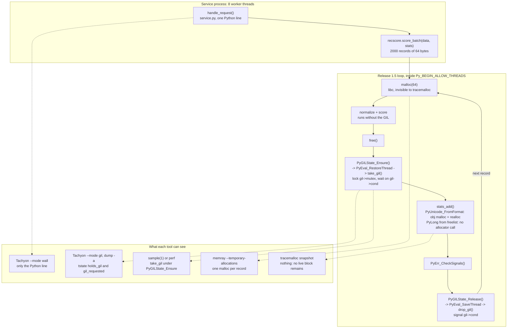

# Drill: Profiling Python-C Extension GIL and Allocation Bottleneck

> [!summary] Scope
> This problem note presents a scenario diagnosing an unexpected 5x throughput slowdown in a high-concurrency Python service using a compiled C extension.
> It tasks the engineer with applying Tachyon sampling and memray tracking to isolate hidden memory allocations and unintended GIL acquisition during hot loops.
> It tests practical proficiency in profiling mixed-language applications under realistic production conditions.

Sampling and tracing profilers for Python, including the `profiling.sampling` command line, are owned by [[Python-cProfile-Tachyon-and-Sampling-Profilers]].
Allocator hooking, flame graph reporters, and leak hunting with memray are owned by [[Python-Memory-Profiling-Memray-and-Line-Profiler]].
The perf trampoline and the way Tachyon walks interpreter frames out of process are owned by [[Python-CPython-perf-Trampoline-and-Tachyon-Internals]].
Thread states and off-CPU reasoning are owned by [[Off-CPU-Analysis-Thread-States-and-Causal-Profiling]].
This drill trains the step those notes leave to practice: a service whose Python profile looks unchanged, whose memory graph is flat, and whose throughput collapses only when threads are added, because a C extension now takes the GIL and allocates once per record inside a loop that was written to run without it.



## 1. Reproduction

The reproduction is a batch scoring service reduced to its hot path.
Each worker thread loops over `handle_request()`, which makes exactly one call into a C extension, `recscore.score_batch(data, stats)`.
The call scores 2000 fixed-size records of 64 bytes and returns a checksum.
All sources are in `code/05-Profiling/drill_python_gil_alloc/`.

The lab builds one C source, `recscore.c`, into five variants selected with `-DVARIANT`:

| Variant | Stands for | GIL around the loop | Per-record work added |
|:---|:---|:---|:---|
| `hold` | first naive version | held for the whole batch | none |
| `base` | release 1.4, the healthy baseline | released once with `Py_BEGIN_ALLOW_THREADS` | none |
| `regr` | release 1.5, the regression | released once, then retaken per record | `malloc(64)`, `PyGILState_Ensure`, `stats_add`, `PyErr_CheckSignals` |
| `gilfix` | 1.5 with only the GIL defect repaired | released once | `malloc(64)` only |
| `fixed` | release 1.6 | released once | none; stats published once per batch |

The files are:

1. `recscore.c`: the extension, with no instrumentation in the source.
2. `probe.h`: counting wrappers that `build.sh` force-includes with `-include probe.h` for a second, "probed" flavor of each variant; it redirects `malloc`, `free`, `PyGILState_Ensure`, and `PyEval_SaveThread` to wrappers that bump an atomic counter and call the real function.
3. `allocspy.c`: a small extension that wraps the three CPython allocator domains with `PyMem_SetAllocator()` and counts calls.
4. `service.py`: the service, runnable on its own as a target for external profilers.
5. `sample_stacks.py`: a parser for the call tree that macOS `sample(1)` prints.
6. `drill.py` and `run.sh`: the harness that runs every phase and prints only facts that do not vary between runs.

The probed flavor is used only for counting.
Every timed phase uses the plain build, so the counters cannot perturb the timings.

Release 1.5 added two features to the loop that release 1.4 ran without the GIL:

```c
Py_BEGIN_ALLOW_THREADS
for (Py_ssize_t i = 0; i < nrec && !failed; i++) {
    const unsigned char *rec = data + i * REC_SIZE;
    unsigned char *tmp = malloc(REC_SIZE); /* hidden: libc, once per record */
    if (tmp == NULL) {
        failed = 2;
        break;
    }
    normalize(rec, tmp);
    total += score(tmp);
    free(tmp);
    if (stats != Py_None) {
        /* hidden: the GIL is taken and dropped once per record */
        PyGILState_STATE g = PyGILState_Ensure();
        if (stats_add(stats, rec[0] % NVENUE, 1) < 0 || PyErr_CheckSignals() < 0) {
            failed = 1;
        }
        PyGILState_Release(g);
    }
}
Py_END_ALLOW_THREADS
```

Run the whole drill with:

```bash
bash code/05-Profiling/drill_python_gil_alloc/run.sh
```

The lab needs `python3` with its development headers (`Python.h`) and a C compiler, and nothing else.
Set `DRILL_RAW=1` to print the raw throughput, core, and context-switch numbers on stderr; they vary by machine and are never part of the recorded output.

To profile the service yourself, build once and start it for as long as the profiler needs:

```bash
bash code/05-Profiling/drill_python_gil_alloc/build.sh /tmp/recscore-build
python3 code/05-Profiling/drill_python_gil_alloc/service.py \
    --build-dir /tmp/recscore-build --variant regr --threads 8 --seconds 60
```

## 2. Observed Symptom

The service was upgraded from recscore 1.4 to 1.5.
The single-threaded benchmark in CI moved a little and was waived as the price of the new per-venue statistics.
In production, with eight worker threads per process, throughput fell by more than five times, CPU utilization per process dropped instead of rising, and the memory graph stayed flat.

The harness produces the following output on `darwin-arm64` (macOS 27.2, Apple M3 Pro, CPython 3.15.2, Apple clang 21, as of 2026-11):

```text
interpreter has a GIL: yes
switch interval: 5 ms

== Phase 1: symptom - throughput against thread count ==
release 1.4 (base): 8 threads at least 2.0x the throughput of 1 thread: yes
release 1.5 (regr): 8 threads at least 1.5x the throughput of 1 thread: no
regr against base, 1 thread: at least 3.0x slower: no
regr against base, 8 threads: at least 5.0x slower: yes

== Phase 2: operating system view, 8 threads ==
base: at least 2.5 cores busy: yes
base: at least 20 context switches per 1000 records: no
base: system time at least 10% of CPU time: no
regr: at least 2.5 cores busy: no
regr: at least 20 context switches per 1000 records: yes
regr: system time at least 10% of CPU time: yes

== Phase 3: call counts in the probed build, 8 threads, 400000 records ==
variant  score_batch  SaveThread  GILState_Ensure  Ensure/record   malloc     free  malloc/record
hold             200           0                0           0.00        0        0           0.00
base             200         200                0           0.00        0        0           0.00
regr             200         200           400000           1.00   400000   400000           1.00
gilfix           200         200                0           0.00   400000   400000           1.00
fixed            200         200                0           0.00        0        0           0.00

== Phase 4: CPython allocator domains, 1 thread, 100000 records ==
variant   obj malloc/record  obj realloc/record  obj free/record  mem calls/record  raw calls/record
hold                   0.00                0.00             0.00              0.00              0.00
base                   0.00                0.00             0.00              0.00              0.00
regr                   1.00                1.00             1.00              0.00              0.00
gilfix                 0.00                0.00             0.00              0.00              0.00
fixed                  0.00                0.00             0.00              0.00              0.00
tracemalloc snapshot diff over 20000 regr records: at least 20000 new live blocks: no
tracemalloc snapshot diff over 20000 regr records: fewer than 1000 new live blocks: yes

== Phase 5: heartbeat thread during one long call ==
hold: heartbeat stalled for at least half of the call: yes
base: heartbeat stalled for at least half of the call: no
regr: heartbeat stalled for at least half of the call: no

== Phase 6: native stacks of the running service, 8 threads ==
regr: worker threads sampled inside score_batch: yes
regr: at least 50% of worker samples are under score_batch -> PyGILState_Ensure: yes
regr: at least 90% of those are inside take_gil: yes
fixed: worker threads sampled inside score_batch: yes
fixed: worker samples under score_batch -> PyGILState_Ensure: 0

== Phase 7: the fix keeps the output and restores scaling ==
checksum identical across all five variants: yes
per-venue stats identical in regr, gilfix, and fixed: yes
per-venue stats count every record: yes
gilfix: 8 threads at least 2.0x the throughput of 1 thread: yes
gilfix: 8-thread throughput at least half of base: yes
fixed: 8 threads at least 2.0x the throughput of 1 thread: yes
fixed: 8-thread throughput at least half of base: yes
```

Phase 1 is the incident in four lines.
The baseline scales with threads, the regressed build does not, the single-thread comparison stays under 3x, and the eight-thread comparison exceeds 5x.
Each configuration is timed in five 0.4 second windows, the variants take turns, and the fastest window of each is kept, so a noisy neighbor on the host cannot manufacture a slowdown.

Phase 2 is the same eight-thread windows seen through `getrusage(2)`.
The baseline keeps at least 2.5 cores busy with almost no context switches and almost no system time.
The regressed build keeps fewer than 2.5 cores busy with eight runnable threads, switches context at least 20 times per 1000 records, and spends at least a tenth of its CPU time in the kernel.
The lab adds `ru_nvcsw` and `ru_nivcsw` because the two systems split them differently: Linux counts a thread that blocks under `ru_nvcsw` (getrusage(2)), while XNU reports `ru_nvcsw` as zero and derives `ru_nivcsw` from the task's total context-switch count (`bsd/kern/kern_resource.c`).

Phase 3 counts calls in the probed build.
Across 200 `score_batch` calls and 400000 records, the regressed build calls `PyGILState_Ensure` 400000 times and `malloc` 400000 times: exactly once per record each.
Every variant except `hold` releases the GIL once per call, which is the `SaveThread` column.

Phase 4 counts calls into CPython's own allocator domains with `allocspy`.
The regressed build makes one object-domain `malloc`, one object-domain `realloc`, and one object-domain `free` per record, and no other variant makes any.
A `tracemalloc` snapshot taken before and after 20000 regressed records gains fewer than 1000 live blocks, although 20000 strings were created and destroyed in between.

Phase 5 runs one long call of 800000 records beside a heartbeat thread that sleeps one millisecond and then needs the GIL for an instant.
Only `hold` starves the heartbeat.
A single caller of the regressed build does not, which is why this defect passes every single-threaded test.

Phase 6 points macOS `sample(1)` at the running service.
In the regressed build at least half of all worker-thread samples sit under `score_batch -> PyGILState_Ensure`, and at least 90% of those are inside `take_gil`.
In the fixed build the count under `PyGILState_Ensure` is zero.
On Linux this phase prints one line saying it was skipped.

## 3. Progressive Hint Ladder

> [!tip]- Hint 1: Sweep the thread count before opening a profiler
> A profile answers "where", and the first question here is "what kind".
> Run the service at 1, 2, 4, and 8 threads and record throughput, CPU seconds per wall second, context switches, and the split between user and system time.
> On Linux, `pidstat -u -w -t -p <PID> 1` reports CPU use and task switching per thread (`cswch/s` and `nvcswch/s`), and `/proc/<PID>/status` carries `voluntary_ctxt_switches` and `nonvoluntary_ctxt_switches`.
> A CPU-bound extension that releases the GIL keeps roughly one core busy per thread.
> A process that has eight runnable threads, keeps fewer cores busy than it has threads, and burns its CPU in the kernel is waiting on a lock, and in a CPython process the first lock to suspect is the GIL.
> Phase 1 and Phase 2 of the lab print exactly this comparison.

> [!tip]- Hint 2: The wall-clock Python profile cannot tell the two builds apart
> Attach Tachyon to the running service with every thread selected:
> `python -m profiling.sampling attach -a --mode wall -d 30 <PID>`.
> The report puts essentially every worker sample on the one Python line that calls `score_batch`, in the healthy build and in the regressed build alike.
> Tachyon walks Python frames, so time inside a C function is attributed to the calling Python line, and `--native` adds only a synthetic `<native>` frame, not C symbols (profiling.sampling documentation, "Special frames").
> A profile that looks the same before and after a 5x regression means you are asking the wrong question of the right tool.
> Change the mode before changing the tool.

> [!tip]- Hint 3: Ask who holds the GIL and who is waiting for it
> `--mode gil` keeps only samples from the thread that holds the GIL at that instant.
> A function that releases the GIL for its whole body should almost vanish from a GIL-mode profile.
> Compare `python -m profiling.sampling attach -a --mode gil -d 30 <PID>` between the two releases.
> Then take a few stack dumps with `python -m profiling.sampling dump -a <PID>`: each thread header names its state, such as `has GIL, on CPU` or `on CPU, waiting for GIL`.
> The flame graph output (`--flamegraph -o out.html`) carries the same facts as thread statistics: GIL Held, GIL Released, and Waiting GIL.
> A worker that is inside a C call and is listed as waiting for the GIL is a contradiction of the extension's design.

> [!tip]- Hint 4: Get native stacks for the waiting threads
> Tachyon tells you that the GIL is contended inside `score_batch`; it cannot tell you which C line asks for it.
> On macOS, `sample <PID> 5 -file /tmp/svc.txt` suspends the process every millisecond and records the native call stack of every thread, with no root needed for your own process.
> On Linux, use `perf record -g -p <PID>` as described in [[Linux-perf-in-Depth-and-perf-c2c]], or count callers with a uprobe on `PyGILState_Ensure` as described in [[eBPF-bpftrace-ftrace-uprobes-and-USDT]].
> Look for `take_gil` in the stacks and read upward: which exported API called it, and which line of the extension called that.
> Build the extension with `-g -fno-omit-frame-pointer` so the answer includes a file and line.

> [!tip]- Hint 5: Count allocations, because nothing here is leaking
> The memory graph is flat, so a peak-memory report has nothing to show.
> Run the service under `memray run --native -o regr.bin service.py ...` and read `memray stats regr.bin`: compare "Total allocations" with the number of records processed.
> Then ask for churn explicitly with `memray flamegraph --temporary-allocations regr.bin` or `memray summary --temporary-allocations regr.bin`.
> A count that is an exact multiple of the record count is a per-record allocation.
> Repeat with `memray run --trace-python-allocators` to see whether Python objects are also being created per record, because creating a Python object requires an attached thread state, and that is a second, independent proof that the loop is taking the GIL.

> [!tip]- Hint 6: Separate the two costs before you ship the fix
> There are two per-record defects, and they are not equally expensive.
> Repair only the GIL reacquisition and measure; then remove the allocation as well and measure again.
> The lab's `gilfix` and `fixed` variants are those two steps.
> Whichever step restores scaling is the bottleneck; the other one is cleanup that you should still do, with an honest note about what it bought.

## 4. Model Solution

> [!success]- Solution: Complete Diagnosis and Remediation
> The regression has two per-record defects in one loop, and one of them causes almost all of the damage.
>
> ### Step 1: Classify the slowdown from scaling, not from a profile
> Phase 1 shows a regression that is under 3x on one thread and over 5x on eight.
> A slowdown that grows with the thread count is contention, not extra work per record.
> Phase 2 names the kind of contention: fewer than 2.5 cores busy with eight threads, at least 20 context switches per 1000 records, and at least 10% of CPU time in the kernel.
> Threads that are neither computing nor sleeping on I/O, and that enter the kernel constantly, are handing a lock back and forth.
>
> ### Step 2: Prove that the lock is the GIL
> The wall-clock Tachyon profile is identical for both releases, because both spend their time under the same Python line.
> `--mode gil` is not identical.
> In a separate run on the Linux container (CPython 3.15.2, linux-aarch64, as of 2026-11; not part of the recorded lab output) the baseline's request line nearly disappeared from the GIL-mode profile, while in the regressed build it was the top entry, and the flame graph's thread statistics moved "Waiting GIL" from a negligible share to a large one.
> `dump -a` printed worker threads stopped on `return mod.score_batch(data, stats)` with the states `has GIL, on CPU` and `on CPU, waiting for GIL`.
> Tachyon reads those states from the target's memory: `take_gil()` sets `tstate->gil_requested = 1` before it waits and `tstate->holds_gil = 1` once it owns the lock, `drop_gil_impl()` clears both, and `Modules/_remote_debugging/threads.c` turns the two fields into `THREAD_STATUS_HAS_GIL` and `THREAD_STATUS_GIL_REQUESTED`.
> The extension was designed to hold the GIL only at entry and exit, so a worker that is waiting for the GIL in the middle of the call is the defect, observed directly.
>
> ### Step 3: Find the C line
> Phase 6 is the native view.
> At least half of the worker samples are under `score_batch -> PyGILState_Ensure`, and at least 90% of those are in `take_gil`.
> In the raw `sample(1)` report the frame under `score_batch` is attributed to the `PyGILState_Ensure()` line of the release 1.5 loop, and the leaf frames are the pthread condition-variable and mutex waits that `take_gil` and `drop_gil` use.
> Phase 3 turns the sample into an exact count: 400000 calls to `PyGILState_Ensure` for 400000 records.
>
> ### Root Cause 1: The GIL is taken and dropped once per record
> `PyGILState_Ensure()` (`Python/pystate.c`) looks up the calling thread's thread state, sees that it does not hold the GIL, and calls `PyEval_RestoreThread()`, which attaches the thread state through `_PyThreadState_Attach()` and `_PyEval_AcquireLock()`, which is `take_gil()`.
> `PyGILState_Release()` calls `PyEval_SaveThread()` when the state it was handed is `PyGILState_UNLOCKED`, and that path ends in `drop_gil()`.
> The implementation notes at the head of `Python/ceval_gil.c` describe the lock: the GIL is a boolean, `locked`, protected by a mutex and signalled by a condition variable.
> One round trip therefore costs, in CPython 3.15.2:
>
> 1. `take_gil()`: lock `gil->mutex`; while `locked` is set, wait on `gil->cond` with a timeout of the switch interval; lock `gil->switch_mutex`; set `locked`; update `last_holder` and `switch_number`; signal `gil->switch_cond`; unlock both mutexes.
> 2. `drop_gil()`: lock `gil->mutex`; clear `locked`; signal `gil->cond`; unlock; and, if another thread had set the drop-request bit, wait on `gil->switch_cond` until a different thread has taken the GIL (the `FORCE_SWITCHING` path).
>
> With one thread these are uncontended user-space operations, which is why the single-thread comparison in Phase 1 stays under 3x and why the heartbeat in Phase 5 is never starved.
> With eight threads doing this once per record, the mutex and the condition variable are contended on every record, each lost race is a sleep in the kernel and a wake-up by another thread, and the eight threads spend their time passing one lock around.
> That is the convoy: Phase 2's context switches and system time are its cost, and Phase 1's missing scaling is its result.
> The 5 ms switch interval plays no part, because every holder gives the GIL up voluntarily after one short critical section; the expense is the handoff itself, not waiting for a timeslice.
>
> The author's reasoning was locally correct, which is what makes this defect common.
> `stats_add()` creates Python objects and `PyErr_CheckSignals()` may run Python code, and both require an attached thread state, so calling them inside `Py_BEGIN_ALLOW_THREADS` without reacquiring would be a crash.
> Reacquiring per record made the code correct and destroyed the property the loop existed to provide.
>
> ### Root Cause 2: Three allocations per record, each visible to a different tool
> The loop allocates in three places, and no single default report shows all three.
>
> | Allocation | Where it comes from | Lab evidence | memray default | memray `--trace-python-allocators` | tracemalloc |
> |:---|:---|:---|:---|:---|:---|
> | 64-byte scratch buffer | `malloc()` in `score_batch` | Phase 3: malloc/record 1.00 | counted as `MALLOC`, one per record | counted | never: libc `malloc` is outside CPython's domains |
> | venue key string | `PyUnicode_FromFormat` in `stats_add` | Phase 4: obj malloc and obj realloc 1.00 each | not counted: pymalloc serves it from an arena it already owns | counted as `PYMALLOC_MALLOC` and `PYMALLOC_REALLOC` | traced while alive, gone before any snapshot |
> | updated count | `PyLong_FromLong` in `stats_add` | Phase 4: no third allocation | not counted | not counted | no new trace |
>
> The scratch buffer goes straight to libc.
> Memray sees it because it patches the symbol pointers of every loaded image so that calls to `malloc`, `free`, `calloc`, `realloc`, `posix_memalign`, `aligned_alloc`, `valloc`, `mmap`, and `munmap` go through its hooks (`hooks.h`, `elf_shenanigans.cpp`, `macho_shenanigans.cpp`).
> In the container run, `memray stats` reported a total allocation count dominated by one location, the `handle_request` line, with a count equal to the number of records processed, while its peak memory figure stayed small.
> The default flame graph, which shows the high-water mark, did not contain that line at all; `--temporary-allocations` did.
>
> The key string is created by `PyUnicode_FromFormatV()`, which builds the text in a `_PyUnicodeWriter`.
> In `Objects/unicode_writer.c`, `_PyUnicodeWriter_PrepareInternal()` allocates the buffer with `PyUnicode_New()` and `_PyUnicodeWriter_Finish()` trims it with `_PyUnicode_ResizeCompact()`, hence one object-domain `malloc` and one `realloc`.
> Requests of 512 bytes or less are served by pymalloc from arenas it has already mapped, so a tool that hooks only the system allocator sees nothing; `memray run --trace-python-allocators` hooks the Python allocators as well and reported one `PYMALLOC_MALLOC` and one `PYMALLOC_REALLOC` per record in the container run, matching Phase 4.
>
> The updated count never reaches an allocator.
> `PyLong_FromLong()` calls `_PyLong_FromMedium()`, which first pops an object from a freelist of up to 100 integers (`Py_ints_MAXFREELIST`) and calls `PyObject_Malloc()` only when the freelist is empty.
> Each iteration frees the previous count object back to the freelist and takes it out again, so no allocator hook fires.
> Freelists are a layer of object churn that no allocation profiler can see; only a CPU profile shows their cost.
>
> `tracemalloc` is the wrong instrument for all three.
> It records a trace for each live block in CPython's domains and reports differences between snapshots, so memory that is allocated and freed inside one C call leaves nothing behind, which is what the two `tracemalloc` lines of Phase 4 assert.
>
> ### Which defect was the bottleneck
> Phase 7 answers with the `gilfix` variant.
> It still calls `malloc` and `free` once per record (Phase 3 shows 400000 of each) and it scales: eight threads deliver at least twice the throughput of one, and at least half of the baseline's eight-thread throughput.
> The lab does not assert any timing difference between `gilfix` and `fixed`, because on the recording host that difference was inside run-to-run noise.
> The allocation that hurt was the one that needed the GIL.
> The libc allocation is worth removing because it is free to remove, because its cost depends on an allocator you do not control, and because the next platform may be less forgiving: glibc's own documentation of `M_ARENA_MAX` says applications "may in some cases exhibit high contention when accessing arenas".
> Allocator scalability itself is owned by [[Cpp-Memory-Profiling-heaptrack-Massif-DHAT-and-Allocators]].
>
> ### The Fix
> Do the per-record work with plain C state, and touch Python once per batch, after the GIL has been taken back by `Py_END_ALLOW_THREADS`:
>
> ```c
> long counts[NVENUE] = {0};
> Py_BEGIN_ALLOW_THREADS
> unsigned char tmp[REC_SIZE];
> for (Py_ssize_t i = 0; i < nrec; i++) {
>     const unsigned char *rec = data + i * REC_SIZE;
>     normalize(rec, tmp);
>     total += score(tmp);
>     counts[rec[0] % NVENUE]++;
> }
> Py_END_ALLOW_THREADS
> if (stats != Py_None) {
>     for (int v = 0; v < NVENUE && !failed; v++) {
>         if (counts[v] != 0 && stats_add(stats, v, counts[v]) < 0) {
>             failed = 1;
>         }
>     }
>     if (!failed && PyErr_CheckSignals() < 0) {
>         failed = 1;
>     }
> }
> ```
>
> Three rules produce this shape.
> First, a region without the GIL accumulates into C variables and publishes once; it never calls an API that needs a thread state.
> Second, scratch memory whose size is known lives on the stack or is allocated once per call, never once per record.
> Third, signals are checked at batch granularity: one batch here is 2000 small records, so a check per batch still satisfies the C API's advice that `PyErr_CheckSignals()` be called "frequently enough so that the response appears immediate to humans".
> If a batch could run for seconds, check every few thousand records with `Py_BLOCK_THREADS` and `Py_UNBLOCK_THREADS`, and accept one GIL round trip per check, not per record.
>
> ### Verification Output
> Phase 7 of the harness on `darwin-arm64` (the block ends at the last line of the recording):
>
> ```text
> == Phase 7: the fix keeps the output and restores scaling ==
> checksum identical across all five variants: yes
> per-venue stats identical in regr, gilfix, and fixed: yes
> per-venue stats count every record: yes
> gilfix: 8 threads at least 2.0x the throughput of 1 thread: yes
> gilfix: 8-thread throughput at least half of base: yes
> fixed: 8 threads at least 2.0x the throughput of 1 thread: yes
> fixed: 8-thread throughput at least half of base: yes
> ```
>
> The first three lines are the correctness gate: a performance fix that changes the checksum or the statistics is a different bug.
> The remaining lines are the performance gate, and the count tables of Phase 3 and Phase 4 are the regression guard: `fixed` makes zero calls to `PyGILState_Ensure`, zero calls to `malloc`, and zero calls into the object domain per record.
> A count of zero is a better CI assertion than any timing threshold, because it does not depend on the machine.

## 5. Core Takeaway

A C extension has two contracts with the interpreter, and a profile of Python frames can verify neither.
The first is where the extension holds the GIL: taking it once per item inside a loop that runs without it converts a parallel loop into a lock convoy that is slower than never releasing the GIL at all on enough threads, while leaving the single-thread benchmark and the wall-clock Python profile almost unchanged.
The second is where it allocates: churn that is freed inside one call never appears in a peak-memory report or a `tracemalloc` snapshot, and the three allocation layers (libc, pymalloc, object freelists) are each visible to a different instrument or to none.

Diagnose in the order the evidence gets more expensive: scaling and operating system counters first, then the GIL view of a sampling profiler, then native stacks, then allocation counts.
The sampling modes and their biases are owned by [[Python-cProfile-Tachyon-and-Sampling-Profilers]], and allocation tracking is owned by [[Python-Memory-Profiling-Memray-and-Line-Profiler]].

## Commands and Numbers to Know

Reference values and commands for GIL and allocation diagnosis in mixed Python and C processes (as of 2026-11):

| Parameter / Tool / Flag | Value / Command | Target Platform | Mechanism and Operational Significance |
|:---|:---|:---|:---|
| GIL switch interval | 5 ms (`DEFAULT_INTERVAL 5000` microseconds in `Python/ceval_gil.c`; `sys.getswitchinterval()`) | Both | How long a waiter lets the holder run before setting the drop request; in effect since Python 3.2; the lab prints it. |
| GIL data structure | `locked` flag, `gil->mutex`, `gil->cond`, `gil->switch_mutex`, `gil->switch_cond` | Both | One take and one drop touch `gil->mutex` twice and signal `gil->cond` once; contention turns each into a kernel sleep and wake. |
| Release the GIL in C | `Py_BEGIN_ALLOW_THREADS` ... `Py_END_ALLOW_THREADS` | Both | Expands to `PyEval_SaveThread()` and `PyEval_RestoreThread(_save)`; no Python API may be called in between. |
| Reacquire inside a released region | `Py_BLOCK_THREADS` / `Py_UNBLOCK_THREADS`, or `PyGILState_Ensure()` / `PyGILState_Release()` | Both | Each pair is one full GIL round trip; the `PyGILState_*` family is soft deprecated in 3.15 in favor of `PyThreadState_Ensure()` (PEP 788). |
| Tachyon, all threads | `python -m profiling.sampling attach -a -d 30 <PID>` | Both | Without `-a` only the main thread is sampled; default rate is 1 kHz; module added in Python 3.15 (PEP 799). |
| Tachyon GIL mode | `--mode gil` | Both | Keeps only samples from the thread whose `holds_gil` is set; a function that releases the GIL should nearly vanish. |
| Tachyon thread states | `python -m profiling.sampling dump -a <PID>` | Both | Prints each thread with `has GIL`, `on CPU`, `waiting for GIL`, or `idle`. |
| Tachyon thread statistics | `--flamegraph -o out.html` | Both | Sidebar reports GIL Held, GIL Released, Waiting GIL, and GC percentages. |
| Tachyon privileges | root, `CAP_SYS_PTRACE`, or `ptrace_scope` 0 on Linux; root or the debugger entitlement on macOS | Both | Reads target memory out of process (`process_vm_readv` or ptrace on Linux, `task_for_pid()` on macOS); an unprivileged run on macOS 27.2 failed with a permission error (observed 2026-11). |
| Native stacks without root | `sample <PID> 5 -file out.txt` | macOS | Suspends the process every 1 ms by default and records every thread's call stack; default duration 10 s. |
| Scheduler counters | `pidstat -u -w -t -p <PID> 1`; `/proc/<PID>/status` | Linux | `cswch/s` and `nvcswch/s` per thread; `voluntary_ctxt_switches` and `nonvoluntary_ctxt_switches` per task. |
| Context switches from inside | `resource.getrusage(RUSAGE_SELF)` | Both | Linux splits `ru_nvcsw` and `ru_nivcsw`; macOS leaves `ru_nvcsw` at 0, so compare the sum. |
| memray native capture | `memray run --native -o out.bin script.py` | Both | Records the native stack of each allocation; moderate overhead; reports must be generated on the same machine. |
| memray churn report | `memray flamegraph --temporary-allocations out.bin` | Both | Same as `--temporary-allocation-threshold=1`: freed after at most one other allocation; also accepted by `summary` and `transform`. |
| memray small objects | `memray run --trace-python-allocators` | Both | Hooks the Python allocators so requests of 512 bytes or less are recorded; much slower and much larger files. |
| memray totals | `memray stats out.bin` | Both | Total allocation count, size histogram, and allocator type distribution; the fastest way to spot a per-record count. |
| pymalloc threshold | 512 bytes (`SMALL_REQUEST_THRESHOLD`) | Both | Larger requests go to the raw allocator and therefore to libc `malloc`. |
| pymalloc arena | 1 MiB on 64-bit, 256 KiB on 32-bit | Both | Mapped once and subdivided, which is why per-object churn is invisible to a hook on `malloc` and `mmap`. |
| Integer freelist | up to 100 objects (`Py_ints_MAXFREELIST`) | Both | `PyLong_FromLong` for a medium integer pops the freelist before calling `PyObject_Malloc`; CPython 3.15.2. |
| tracemalloc scope | PYMEM raw, mem, and obj domains; live blocks only | Both | Blind to libc `malloc` in an extension and to anything freed before the next snapshot. |
| Free-threaded opt-in | `Py_mod_gil` slot or `PyUnstable_Module_SetGIL(m, Py_MOD_GIL_NOT_USED)` | Both | Without it, importing the module on a free-threaded build enables the GIL and emits a `RuntimeWarning`. |

## How Binding Layers Spell the Same Two Operations

Every binding layer has a way to release the GIL around native work and a way to take it back, and the defect in this drill can be written in each of them.

| Layer | Release for native work | Take back inside the released region | What to grep for in a hot loop |
|:---|:---|:---|:---|
| CPython C API | `Py_BEGIN_ALLOW_THREADS` / `Py_END_ALLOW_THREADS` | `Py_BLOCK_THREADS`, `PyGILState_Ensure()`, `PyThreadState_Ensure()` | Any of the three inside a `for` or `while` body. |
| Cython | `with nogil:` block or `nogil` function | `with gil:` block; a `nogil` function with an `except *` specification reacquires after every call to check for an exception | `with gil:` inside a loop; `cdef void f() nogil` without `noexcept`. |
| pybind11 | `py::gil_scoped_release` or `py::call_guard<py::gil_scoped_release>()` | `py::gil_scoped_acquire` | `gil_scoped_acquire` in a callback or virtual override called per element. |
| PyO3 | `Python::detach` (formerly `allow_threads`) | `Python::attach` (formerly `with_gil`) | `Python::attach` inside a closure passed to a parallel iterator. |
| NumPy C API | `NPY_BEGIN_ALLOW_THREADS` / `NPY_END_ALLOW_THREADS`, `NPY_BEGIN_THREADS` | `NPY_ALLOW_C_API` / `NPY_DISABLE_C_API` | `NPY_ALLOW_C_API` inside an inner loop. |

The Cython case deserves attention because nothing in the source says "GIL".
The Cython documentation states that a function with an `except *` specification "will be expensive to call because Cython will need to temporarily reacquire the GIL after every call to check the exception state".
A missing `noexcept` on a helper called per element is this drill's defect with no visible reacquisition in the code.

## Pitfalls

> [!warning] Pitfalls:
> 1. **Trusting the single-threaded benchmark:** A per-item GIL round trip is cheap when nothing contends for the GIL.
>    Phase 1 shows a regression under 3x on one thread and over 5x on eight, and Phase 5 shows that one caller never starves another thread.
>    A benchmark suite for an extension that releases the GIL needs a thread-scaling case, as [[Performance-Regression-Detection-in-CI]] argues for any concurrent code.
> 2. **Reading the wall-clock profile as "nothing changed":** Tachyon attributes native time to the calling Python line, so the wall-clock profile of the regressed build matches the baseline.
>    The modes are different questions: wall asks where threads are, GIL asks who is serializing whom.
> 3. **Expecting CPU mode to expose the convoy:** In the container run, `--mode cpu` kept the request line on top for both builds and did not separate them.
>    Tachyon's CPU mode on Linux classifies a thread from the state character in `/proc/<pid>/task/<tid>/stat` (`get_thread_status` in `threads.c`).
>    UNVERIFIED: why threads that Phase 2 shows are mostly not consuming CPU were still classified as running in most samples was not established; do not rely on CPU mode for this diagnosis.
> 4. **Using `--native` and expecting C symbols:** Tachyon's `--native` adds a synthetic `<native>` frame.
>    For C function names and lines you need a native sampler or the perf trampoline described in [[Python-CPython-perf-Trampoline-and-Tachyon-Internals]].
> 5. **Looking for churn in a peak-memory report:** memray's default flame graph, table, and CSV describe the high-water mark.
>    A per-record allocation that is freed immediately contributes at most one block to the peak, so the report is correct and useless; ask for `--temporary-allocations`.
> 6. **Assuming memray's flame graph will show the C frame:** With `--native`, memray reporters show a hybrid stack that interleaves native and Python frames.
>    In the container run (memray 1.20.0, linux-aarch64, CPython 3.15.2 and 3.14.10, as of 2026-11) the native unwind returned only `score_batch` at the `malloc` line and `cfunction_call`, and the merged stack in the flame graph showed Python frames only; the native frames were still readable through `memray.FileReader(...).get_temporary_allocation_records()` and `native_stack_trace()`.
>    Check the raw records before concluding that an allocation has no native caller.
> 7. **Forgetting that the profiler hooks the function under suspicion:** memray's list of hooked functions includes `PyGILState_Ensure`, and its hook calls `install_trace_function()` after the real call (`hooks.cpp`).
>    A program that calls `PyGILState_Ensure` once per record pays that extra work once per record while memray is attached, so throughput under memray is not the throughput you are diagnosing.
> 8. **Counting on `tracemalloc` for extension memory:** `tracemalloc` hooks CPython's allocator domains.
>    A C or C++ library that calls `malloc` or `operator new` directly is outside its view, and so is everything freed between snapshots; the scope and the leak workflow are covered in [[Python-tracemalloc-gc-and-Memory-Leaks]].
> 9. **Assuming every installed profiler supports the interpreter:** py-spy 0.4.3 failed against CPython 3.15.2 in the container with "Failed to find python version from target process" (linux-aarch64, as of 2026-11), although the README on the master branch lists 3.15.
>    Its `--native` mode is documented for Linux and Windows only, not macOS.
>    Verify the tool against the exact interpreter before an incident, not during one.
> 10. **Fixing the allocation and declaring victory:** The count of allocations says how many, never how expensive.
>     Here the libc allocation is the easiest finding and the least important one; `gilfix` keeps it and still scales.
>     Rank findings by measured time with one change at a time.
> 11. **Calling Python APIs without the GIL to "fix" the convoy:** Removing `PyGILState_Ensure` while leaving `stats_add` in the loop turns a slow program into a crashing one.
>     `PYTHONMALLOC=debug` and debug builds check that an attached thread state exists when the object and mem domains are used (C API memory documentation).

## At Scale: Native Extensions in a Threaded Python Fleet

At the scale of one team, this defect is found by one engineer with a profiler.
At the scale of thousands of services importing hundreds of wheels, the same defect arrives through a dependency upgrade nobody on the team reviewed, so the controls have to be mechanical.

1. **Make thread scaling a release gate for extensions that release the GIL.**
   A benchmark at one thread and at the production thread count, with an assertion on the ratio, would have failed release 1.5 before it shipped.
   The ratio is far more stable across runners than an absolute time, which is the argument of [[Benchmark-Methodology-Noise-and-Environment-Control]].

2. **Assert counts, not times, where a count exists.**
   "Zero calls to `PyGILState_Ensure` per record" and "zero allocations per record" are properties of the code path.
   A probed build, a uprobe counter, or an allocator hook checks them in milliseconds and gives the same answer on every machine, as Phase 3 and Phase 4 do.

3. **Export GIL contention as a fleet metric.**
   A continuous profiler that samples thread state can report the share of thread samples waiting for the GIL per service and per release.
   That one number, tracked across deploys, catches this class of regression without anyone opening a flame graph; fleet collection is owned by [[Continuous-Profiling-GWP-Parca-Pyroscope-and-OTel-Profiles]].

4. **Alert on the operating system signature.**
   A threaded Python service whose CPU use falls while its context-switch rate and system-time share rise is serializing on a lock.
   Those three counters exist on every host and cost nothing to collect, which is the USE method applied to a lock, as described in [[USE-RED-and-Systems-Performance-Methodologies]].

5. **Write the GIL contract into extension review.**
   The review rule is short: no Python API, no GIL reacquisition, and no allocation whose size is known inside a loop that runs without the GIL; accumulate natively and publish once.
   The table in "How Binding Layers Spell the Same Two Operations" is the grep list.

6. **Plan for free threading without assuming it removes the problem.**
   Free-threaded CPython is officially supported from 3.14 (PEP 779), and an extension must declare support with the `Py_mod_gil` slot.
   An extension that does not declare it puts the whole process back under the GIL at import, so one legacy wheel reintroduces every GIL bottleneck in the service.
   Under free threading the convoy on the GIL disappears, but each per-record attach and detach still costs, and code that relied on the GIL to make a read-modify-write atomic is now racy; these bugs are owned by [[Python-Concurrency-Asyncio-Multiprocessing-and-Free-Threading-Bugs]].

Decision rule: a GIL round trip is only worth paying when the work it frees is long compared with a contended handoff, so batch the work until one release covers a meaningful amount of computation, release once per batch, and prove the choice with a thread-scaling measurement.

## Practice Drill

> [!tip] Practice Drill:
> 1. Run `DRILL_RAW=1 bash run.sh` and write down the raw throughput of `base` and `regr` at one and eight threads on your machine; compute the two ratios the lab asserts.
> 2. Add a sixth variant that keeps the per-record `PyGILState_Ensure` but replaces `stats_add` with a bare `PyErr_CheckSignals()`; predict, then measure, whether the convoy needs the allocations to exist.
> 3. Change `stats_add` in the `fixed` variant so that it is called every 256 records with `Py_BLOCK_THREADS` and `Py_UNBLOCK_THREADS`; confirm with the probed build that `SaveThread` rises to the expected count and that scaling survives.
> 4. Start `service.py` with `--variant regr` and capture it with a native sampler for your platform; find the frame that calls `take_gil` and the source line that calls it.
> 5. If you have memray installed for the same interpreter, run the service under `memray run --native` and reproduce the identity "allocations at the request line equals records processed"; then repeat with `--trace-python-allocators` and explain each new allocator type in `memray stats`.
> 6. Rebuild `recscore.c` against a free-threaded interpreter, import it, and read the warning; then add the `PyUnstable_Module_SetGIL` call and explain why the `regr` variant's statistics are no longer trustworthy.

## Interview Questions

### Question 1 (Level 5): What Py_BEGIN_ALLOW_THREADS Promises
A C extension wraps a loop in `Py_BEGIN_ALLOW_THREADS` and `Py_END_ALLOW_THREADS`.
What do the macros expand to, what may the code between them do, and what must it never do?

> [!success]- Answer:
> `Py_BEGIN_ALLOW_THREADS` opens a block, declares `PyThreadState *_save`, and calls `PyEval_SaveThread()`; `Py_END_ALLOW_THREADS` calls `PyEval_RestoreThread(_save)` and closes the block (`Include/ceval.h`).
> `PyEval_SaveThread()` detaches the calling thread's thread state, which on a build with the GIL ends in `drop_gil()`; `PyEval_RestoreThread()` attaches it again, which ends in `take_gil()` and blocks until the GIL is available.
>
> Between the macros the thread has no attached thread state.
> It may do anything that does not touch the interpreter: compute on C data, block in a system call, take its own locks.
> It must not call any Python C API that needs a thread state, which is nearly all of them: creating or destroying objects, changing reference counts, raising exceptions, calling `PyErr_CheckSignals()`.
> It may read memory it obtained before releasing, such as a `Py_buffer`, provided the owner is kept alive and not mutated by another thread.
>
> The two legitimate ways to touch Python again are to end the region, or to reacquire for a moment with `Py_BLOCK_THREADS` and `Py_UNBLOCK_THREADS`.
> Each reacquisition is a full GIL round trip, so it belongs outside the inner loop.

### Question 2 (Level 5): Predict the Output (Heartbeat Beside a C Call)
A Python thread runs `while not stop: time.sleep(0.001); record_gap()`.
The main thread makes one long call into a C function that processes 800000 records.
Predict whether the heartbeat is starved for most of the call in three builds of that function: one that never releases the GIL, one that releases it once around the loop, and one that releases it around the loop and retakes it for a moment on every record.

> [!success]- Answer:
> **Prediction:** starved, not starved, not starved.
> This is Phase 5 of the lab on `darwin-arm64`:
>
> ```text
> == Phase 5: heartbeat thread during one long call ==
> hold: heartbeat stalled for at least half of the call: yes
> base: heartbeat stalled for at least half of the call: no
> regr: heartbeat stalled for at least half of the call: no
> ```
>
> **Mechanism:**
> When `time.sleep()` returns, the heartbeat must take the GIL to run its next bytecode.
> In the first build the caller holds the GIL in C for the whole call.
> The heartbeat waits in `take_gil()`, times out after the 5 ms switch interval, and sets the drop-request bit on the holder, but that bit is examined by the bytecode evaluation loop, and the holder is not executing bytecode.
> The request is honored only when the C function returns, so the largest gap is about the length of the call.
>
> In the second build the GIL is free for the whole loop, so the heartbeat takes it immediately each time.
> In the third build the GIL is free between records and held only for one short critical section per record, so the heartbeat waits at most for that critical section.
>
> **The trap:** the third build is the broken one in production, and this test passes it.
> A starvation test with one caller detects a GIL that is held too long.
> It cannot detect a GIL that is taken too often, because with one caller nobody contends for it; that needs a test with several callers, which is Phase 1.

### Question 3 (Level 5): Why the Snapshot Shows Nothing
A function creates and destroys one temporary string per record for 20000 records.
You take a `tracemalloc` snapshot before and after and diff them.
What do you see, and which tool shows the 20000 allocations?

> [!success]- Answer:
> The diff shows almost nothing.
> `tracemalloc` stores one trace per live memory block and a snapshot is the set of live traces, so a block that is freed before the second snapshot is not in it.
> Phase 4 of the lab asserts this: over 20000 records of the regressed build the snapshot diff gains fewer than 1000 live blocks.
>
> Cumulative counters show the churn.
> `memray run --trace-python-allocators` followed by `memray stats` or a `--temporary-allocations` report counts every request to the Python allocators, including the ones pymalloc serves from an arena it already owns.
> Without `--trace-python-allocators`, memray records only requests that reach the system allocator, so a small string never appears.
> The lab's `allocspy` module shows the same thing with thirty lines of C: it wraps the three allocator domains with `PyMem_SetAllocator()` and counts calls, and it reports one object-domain `malloc`, one `realloc`, and one `free` per record.
>
> If the temporary were allocated with libc `malloc` instead, `tracemalloc` could not see it even while it was alive, because libc is outside CPython's allocator domains.

### Question 4 (Level 6): Debug This (Eight Threads, One Busy Core)
A scoring service runs eight worker threads per process.
After a dependency upgrade, throughput is down by more than five times.
`top` shows the process using between one and two cores where it used to use about eight.
System time is a large share of its CPU time, and its context-switch rate has jumped by two orders of magnitude.
The memory graph is flat.
A wall-clock sampling profile shows every worker on the same line, `return mod.score_batch(data, stats)`, exactly as before the upgrade.
Walk through your diagnosis.

> [!success]- Answer:
> **Step 1: Classify from the counters.**
> Eight runnable threads, fewer than two busy cores, high system time, and a high switch rate mean the threads are blocking on a lock and being woken constantly.
> No I/O changed and memory is flat, so the lock is inside the process, and in CPython the GIL is the first candidate.
>
> **Step 2: Confirm with a thread-count sweep.**
> Run the old and new versions at one thread and at eight.
> If the regression is small at one thread and large at eight, it is contention, and the per-record work did not get five times heavier.
>
> **Step 3: Ask the profiler about the GIL.**
> Rerun the sampler in GIL mode, `python -m profiling.sampling attach -a --mode gil -d 30 <PID>`, on both versions.
> The extension is supposed to release the GIL for its loop, so the request line should be nearly absent in GIL mode.
> If it leads the GIL-mode profile after the upgrade, the extension is holding or retaking the GIL inside the call.
> `python -m profiling.sampling dump -a <PID>` will show workers inside `score_batch` in the state `waiting for GIL`.
>
> **Step 4: Distinguish "held too long" from "taken too often".**
> If one thread held the GIL for the whole call, one core would be fully busy in user mode and the others would sleep quietly: low system time, few switches.
> High system time with a storm of switches means many short acquisitions.
> Native stacks settle it: `sample <PID> 5` on macOS or `perf record -g -p <PID>` on Linux.
> Stacks ending in `take_gil` under `PyGILState_Ensure` or `PyEval_RestoreThread`, called from a line inside the extension's loop, are the defect.
>
> **Step 5: Find out why the loop needs the GIL.**
> Something in the loop is calling the Python API.
> Run under `memray run --native --trace-python-allocators` and look at temporary allocations: Python objects created once per record under the request line show what the code is building, and any libc allocations per record show up in the same report.
>
> **Step 6: Fix and verify.**
> Move the Python work out of the loop: accumulate in C, publish once per batch after the region ends.
> Verify three things: output is identical, scaling is restored at the production thread count, and the per-record counts of GIL acquisitions and allocations are zero.
>
> **Step 7: Close the gap that let it ship.**
> Add a thread-scaling benchmark for the extension and a count-based assertion, and pin or review upgrades of wheels that sit on the hot path.

### Question 5 (Level 6): Why Retaking the GIL per Item Is Worse Than Holding It
Explain, in terms of `take_gil()` and `drop_gil()`, why a loop that retakes the GIL briefly on every item can deliver less total throughput on eight threads than a loop that never releases the GIL.

> [!success]- Answer:
> A loop that never releases the GIL serializes the threads cleanly.
> One thread runs in user mode at full speed; the others sleep in `take_gil()` and wake at most once per switch interval to set a drop request.
> Total throughput is about one thread's worth and almost no CPU is wasted.
>
> A loop that retakes the GIL per item makes every thread pass through the same lock once per item.
> In CPython 3.15.2 the GIL is a `locked` flag guarded by `gil->mutex` with waiters on `gil->cond`.
> `take_gil()` locks the mutex, waits on the condition variable while `locked` is set, then locks `gil->switch_mutex`, sets `locked`, updates `last_holder` and `switch_number`, and signals `gil->switch_cond`.
> `drop_gil()` locks the mutex again, clears `locked`, signals `gil->cond`, and, when another thread has requested a drop, waits on `gil->switch_cond` until a different thread owns the GIL.
>
> Uncontended, all of that stays in user space.
> With eight threads arriving once per record each, many arrivals find the mutex or the flag taken.
> Each such arrival becomes a sleep in the kernel, and each release becomes a wake-up of another thread, which then has to be scheduled onto a core.
> The useful work per item is small compared with a sleep and wake cycle through the kernel.
> So the threads spend most of their time in the handoff, the cores sit partly idle because the threads are blocked, and the kernel accounts for a large share of the CPU that is used.
>
> The lab shows each part: at least 20 context switches per 1000 records and at least 10% system time in Phase 2, at least half of worker samples under `PyGILState_Ensure` in Phase 6, and eight threads delivering less than 1.5 times one thread in Phase 1.
> The historical name is the convoy effect, described for the then-new GIL in CPython issue 52194.

### Question 6 (Level 6): Three Allocations, Three Visibilities
In the regressed loop, each record performs a libc `malloc(64)`, a `PyUnicode_FromFormat("venue-%d", v)`, and a `PyLong_FromLong(n + 1)`.
For each, say which of these see it: memray's default mode, memray with `--trace-python-allocators`, `tracemalloc`, and a hook installed with `PyMem_SetAllocator()`.

> [!success]- Answer:
> **libc `malloc(64)`:**
> memray sees it in every mode, because memray patches calls to `malloc` and its relatives in every loaded image.
> `tracemalloc` and a `PyMem_SetAllocator()` hook never see it: the call does not pass through any CPython allocator domain.
> Lab evidence: malloc/record 1.00 in Phase 3 and raw calls/record 0.00 in Phase 4.
>
> **`PyUnicode_FromFormat`:**
> The string is built in a writer and resized when finished, so it is one object-domain `malloc` and one `realloc`, both small enough for pymalloc.
> memray's default mode does not see it, because pymalloc carves it from an arena that was mapped long ago.
> memray with `--trace-python-allocators` sees both calls.
> A `PyMem_SetAllocator()` hook sees both; that is the `obj malloc/record 1.00` and `obj realloc/record 1.00` of Phase 4.
> `tracemalloc` traces the block while it is alive and forgets it when it is freed, so a snapshot never contains it.
>
> **`PyLong_FromLong`:**
> For a value outside the small-integer cache, CPython 3.15.2 takes the object from a freelist of up to 100 integers and calls `PyObject_Malloc()` only when the freelist is empty.
> The loop frees the previous count and immediately reuses it, so no allocator is called and none of the four instruments sees anything.
> Lab evidence: Phase 4 shows exactly one object-domain `malloc` per record, the string, not two.
>
> **Lesson:** "no allocations reported" is a statement about one layer.
> To claim a loop is allocation-free you need a hook on libc, a hook on the Python allocators, and a CPU profile for what the freelists hide.

### Question 7 (Level 7): Design the Extension API So the Defect Cannot Be Written
The product requirement behind release 1.5 was real: per-venue statistics, prompt response to Ctrl-C, and, next quarter, an optional Python callback for records that fail validation.
Design the extension's internal structure so that all three are supported without per-record GIL traffic, and state how you would enforce it.

> [!success]- Answer:
> **Structure the call as three phases.**
> Phase A, with the GIL: parse arguments, acquire buffers, validate, and allocate every piece of scratch memory the call will need.
> Phase B, without the GIL: a pure C kernel that takes plain pointers and sizes and writes results into a plain C result struct: the checksum, an array of per-venue counters, and a bounded array of failed record indexes.
> Phase C, with the GIL: publish the result struct into Python objects, once.
> The kernel lives in a separate translation unit that does not include `Python.h`, so calling the Python API from it is a compile error, not a code-review finding.
>
> **Statistics** become an array increment in Phase B and one dictionary update per venue in Phase C, which is the lab's `fixed` variant.
>
> **Signals** are checked at chunk granularity.
> The entry point splits a large batch into chunks sized to run for about a millisecond, and between chunks it holds the GIL anyway, so it calls `PyErr_CheckSignals()` there.
> The GIL traffic is one round trip per chunk, independent of the record count.
>
> **The callback** must not be invoked from Phase B.
> The kernel records failed indexes in the result struct, and Phase C invokes the callback for each of them with the GIL held.
> If the callback must be able to stop processing early, chunking bounds how late the stop takes effect.
> If failures are common enough that the array overflows, the kernel stops the chunk early and returns, which again costs one round trip per chunk.
>
> **Enforcement.**
> A probed build in CI asserts that GIL acquisitions and allocations per call do not grow with the record count: run with 1000 and with 100000 records and require identical counts.
> A thread-scaling benchmark asserts the ratio between one thread and the production thread count.
> Both are cheap, deterministic, and fail on the first commit that reintroduces the pattern.
>
> **Trade-off to state.**
> Buffering results makes memory proportional to the chunk, and it delays side effects until the end of the chunk.
> That is the price of parallelism here, and chunk size is the single tuning knob.

### Question 8 (Level 7+): Does Free Threading Make This Bug Disappear?
Your organization plans to move services to free-threaded CPython.
What happens to this exact extension, unchanged, on a free-threaded build, and what changes after it is ported?

> [!success]- Answer:
> **Unchanged, it turns the GIL back on.**
> `recscore` uses single-phase initialization and does not declare that it can run without the GIL.
> Importing it on a free-threaded build emits a `RuntimeWarning` and enables the GIL for the whole process.
> Checked on CPython 3.14.6 free-threading build, darwin-arm64 (as of 2026-11): `sys._is_gil_enabled()` returned `False` before the import and `True` after it, and the warning text named the module and the `PYTHON_GIL=0` override.
> From that point the process behaves like a normal build, convoy included, and every other thread in the service has lost its parallelism because of one wheel.
>
> **Ported, the convoy on the GIL goes away, and two other things take its place.**
> After adding `PyUnstable_Module_SetGIL(m, Py_MOD_GIL_NOT_USED)`, `take_gil()` returns immediately when the GIL is disabled, so the lock that the threads were fighting over is gone.
> First, the per-record `PyGILState_Ensure` and `PyGILState_Release` still attach and detach a thread state each time, and the per-record string still goes through the allocator, so the per-record work remains and the fix from this drill is still the right code.
> Second, correctness: `stats_add()` reads a count from a shared dictionary, adds one, and stores it back.
> Under the GIL that sequence ran with the GIL held and was atomic with respect to other threads.
> Without the GIL, two threads can read the same old value and one increment is lost; individual dictionary operations are safe, the read-modify-write is not.
> The batch-publish design reduces the window but does not close it; the stats update needs a per-object lock or per-thread accumulation merged by the caller.
>
> **What to tell the organization.**
> Free threading removes one global lock; it does not remove per-item overhead and it converts some slow code into wrong code.
> Audit extensions for the `Py_mod_gil` declaration before migration, because a single undeclared module silently re-enables the GIL, and treat "declares support" as a claim to test with a race detector, not as a fact.

### Question 9 (Level 7+): Catching This Class of Regression Across a Fleet
You own performance for a fleet of threaded Python services that depend on about two hundred native wheels.
Design the controls that would have caught this regression before or within minutes of deployment, without anyone having to look at a flame graph.

> [!success]- Answer:
> **Before merge: scaling ratios for hot-path wheels.**
> Maintain a small harness that, for each native entry point on a hot path, measures throughput at one thread and at the production thread count and asserts the ratio against a stored baseline.
> Ratios are robust to runner hardware, so the test can run on shared CI.
> Release 1.5 would have failed it: the lab's ratio for the regressed build is under 1.5 where the baseline's is over 2.
>
> **Before merge: count assertions where we own the source.**
> For first-party extensions, build a probed flavor in CI and assert that GIL acquisitions and allocations per call are constant in the record count.
> This is deterministic and takes milliseconds.
>
> **At deploy: canary on the operating system signature.**
> For each service, compare canary against baseline on three host metrics normalized by request rate: CPU seconds per request, context switches per request, and system-time share.
> A convoy moves all three in a characteristic direction: CPU per request may barely change or fall, switches per request jump, and system share jumps.
> Alert on the combination, because any single one has benign causes.
>
> **Continuously: GIL wait share from the profiler.**
> Run a sampling profiler that records per-thread GIL state on a small fraction of hosts and export "share of thread samples waiting for the GIL" by service and by release.
> Tachyon exposes exactly these states, so the collector is a thin wrapper.
> A step change in that series at a deploy boundary points at the release, and the GIL-mode profile attached to the alert points at the function.
>
> **Dependency hygiene.**
> Treat a native wheel upgrade on a hot path like a code change: it goes through the scaling harness, and its changelog is read for new callbacks, logging, or statistics, which are the features that bring Python calls into native loops.
>
> **What this does not catch.**
> Contention that appears only at a thread count or data shape the harness does not exercise.
> The mitigation is to derive harness parameters from production telemetry and to review them when deployment shapes change.

## Further Reading

- Python Software Foundation, *Python/ceval_gil.c*, CPython 3.15.2 source.
  The implementation notes at the top of the file are the authoritative description of the GIL's mutex, condition variable, switch interval, and forced switching.
- Python Software Foundation, *Thread states and the global interpreter lock*, Python/C API Reference Manual 3.15.
  Defines attached thread states, the allow-threads macros, and the `PyGILState_*` and `PyThreadState_Ensure` families with their soft-deprecation status.
- Python Software Foundation, *profiling.sampling - Statistical profiler*, Python 3.15 documentation.
  The reference for Tachyon's modes, thread selection, privileges, and the thread statistics in the flame graph.
- Python Software Foundation, *Memory Management*, Python/C API Reference Manual 3.15.
  Explains the three allocator domains, the 512-byte pymalloc threshold, and the contract of `PyMem_SetAllocator()`.
- Bloomberg, *Memray documentation: The run subcommand, Temporary allocations, and Python allocators*.
  Explains why small objects are invisible by default and what `--temporary-allocations` and `--trace-python-allocators` each count.
- David Beazley, *Understanding the Python GIL*, PyCon 2010, and CPython issue 52194.
  The original measurements and discussion of GIL convoys that motivated and then critiqued the 3.2 rewrite.
- Sam Gross, *PEP 703 - Making the Global Interpreter Lock Optional in CPython*, with the *C API Extension Support for Free Threading* HOWTO.
  What an extension must declare and change to run without the GIL.
- Cython developers, *Cython and the GIL*.
  Documents the implicit reacquisition after calls to `nogil` functions with an `except *` specification, the least visible form of this defect.

## Related

- Prerequisites: [[Python-cProfile-Tachyon-and-Sampling-Profilers]], [[Python-Memory-Profiling-Memray-and-Line-Profiler]]
- Next: [[Drill-Profiling-Rust-Monomorphization-and-Inlining-Regression]]
- See also: [[Python-CPython-perf-Trampoline-and-Tachyon-Internals]], [[Off-CPU-Analysis-Thread-States-and-Causal-Profiling]], [[Python-Debugging-Hung-Processes-and-C-Extensions]], [[Drill-Profiling-False-Sharing-Cache-Contention]]
- Lab: `code/05-Profiling/drill_python_gil_alloc/`
