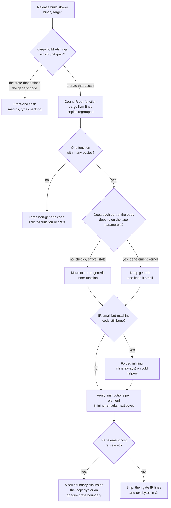

# Drill: Profiling Rust Monomorphization and Inlining Regression

> [!summary] Scenario
> A generic market-data library gained 12 venue decoders and 4 sinks, and the release build of the service that uses it became several times slower while its binary more than doubled.
> The first fix replaced the generics with trait objects, which repaired the build and made every record cost 4.7 times as many instructions.
> Your job is to find where the code is really generated, separate the cost of monomorphization from the cost of forced inlining, and land a fix that keeps the build small and the hot loop inlined.
> Every number in this note that is called measured comes from the lab's recorded output.

The tools this drill uses are owned by other notes.
[[Rust-Compile-Time-and-Binary-Size-Profiling]] owns `cargo build --timings`, `cargo llvm-lines`, and `cargo bloat`.
[[Rust-CPU-Profiling-cargo-flamegraph-samply-and-Frame-Pointers]] owns `samply` and frame pointers.
This note owns the investigation: which tool answers which question, what each tool cannot see, and why the two obvious fixes each trade one regression for another.



## Reproduction

The lab is `code/05-Profiling/drill_rust_bloat/`.
Run it from the `code/` directory:

```sh
python3 -m _harness.verify 05-Profiling/drill_rust_bloat/
# or, to see stdout and the unrecorded stderr lines directly:
bash 05-Profiling/drill_rust_bloat/run.sh
```

It needs a stable Rust toolchain (`cargo`, `rustc`), `c++filt`, `nm`, `size`, and `python3`, and it declares `# requires: macos` because its instruction counter is `proc_pid_rusage(2)`.
It has no external crates and builds with `--offline --locked`.

The workspace is one library API written three ways, plus one driver:

| Crate | Role |
| :--- | :--- |
| `feedcore` | Shared types: `Tick`, the `Decoder` and `Sink` traits, 12 venue decoders generated by one macro, 4 sinks, the frame builder, and the instruction counter. |
| `kit_bloated` | Version 1, the regression: `ingest<D: Decoder, S: Sink>` holds every check, the checksum, the sequence tracking, and all error formatting, with `#[inline(always)]` helpers. |
| `kit_dyn` | Version 2, the tempting fix: `ingest(&dyn DynDecoder, &mut dyn Sink)` with two virtual calls per record. |
| `kit_lean` | Version 3, the fix: non-generic `open_frame` and `close_frame`, a `#[cold]` `reject`, and a three-line generic `ingest` around the per-record kernel. |
| `apps` | `app_bloated`, `app_dyn`, `app_lean`: the same `driver.rs` compiled against each library. |

The driver source is identical for all three binaries.
`kit::ingest(frame, &Venue, sink, stats)` type-checks against the generic signatures directly and against the `dyn` signature through unsizing coercions, so the library is the only variable.
The driver routes 768 valid frames of 32 records each, with the 12 venues interleaved frame by frame, through each of the 4 sink types, which exercises all 48 `(decoder, sink)` pairs.
It then replays five corrupt frames, one frame with an unknown venue, and one wrong-venue call, so that every version must reject the same input for the same reason with a message of the same length.
The `rejects` column counts the six rejections that reach the library; the unknown venue is turned away by the driver.

The story behind the three versions is a sequence of pull requests.
The library started with two venues and one sink, and `ingest` was generic so that `decode` and `push` would inline into the record loop.
Over a year the venue list grew to 12 and the sink list to 4, each addition a one-line macro call.
Somebody marked the hex-dump helper `#[inline(always)]` because "ingest is the hot path".
Then the release build of the service slowed down, and the second pull request reached for `dyn`.

## Observed Symptom

Three things were reported, in this order.

First, the clean release build of the workspace became several times slower, and all of the added time sits in one compiler invocation.
The lab reproduces the shape of that with `cargo build --release --timings` on a cold target directory.
Durations vary from run to run, so the lab records only the structure of the report and one comparison with a very wide margin, and prints the seconds and the noisy ratios on stderr.
The app_bloated to app_lean wall-time ratio was once a recorded `yes` line; a verification run on 2026-11-12 (darwin-arm64, rustc 1.99.0) measured less than 3x, so that comparison was moved to stderr and is not part of the checked output.

Recorded on darwin-arm64 on 2026-11-11; the file is `code/05-Profiling/drill_rust_bloat/expected/darwin-arm64.txt`.
The recording host ran macOS 27.2 on an Apple M3 Pro with rustc 1.99.0 and LLVM 23.1.1, as reported by `sw_vers`, `sysctl`, and `rustc -Vv`; of those, only the rustc minor version is part of the recorded output.

```text
== 6. cargo build --release --timings, cold ==
units compiled: 7
slowest unit: apps app_bloated bin
lib units with a frontend/codegen section split: 4 of 4
bin units with a frontend/codegen section split: 0 of 3
kit_bloated, the crate that defines the generic code, took under a tenth of app_bloated: yes
```

Second, the binary grew.
The same recorded file, darwin-arm64:

```text
== 4. Machine code in the release binaries ==
version    text_bytes   accept_fns accept_bytes  fits 32 KiB L1i
bloated        692092           52       448992  no
dyn            251708           21         6852  yes
lean           267452            6        21668  yes
```

`text_bytes` is the size of the `__TEXT,__text` section.
`accept_bytes` is the machine code of the functions a valid frame passes through: `ingest`, `dispatch`, `open_frame`, `close_frame`, `decode_dyn`, and `push`, in whichever of those forms survive as separate functions.
It leaves out the two one-line `venue` and `record_len` accessors that `kit_dyn` calls once per frame.
In production the growth arrived together with a throughput regression on mixed-venue traffic on x86-64 hosts, where the front-end counters (L1 instruction cache misses and instruction TLB misses) rose while retired instructions did not.
That last sentence is the scenario, not a measurement: the lab cannot record cache misses, and the section "Why Code Size Becomes Time" says exactly what it proves instead.

Third, the fix that restored the build time made the hot loop slower.
The same recorded file, darwin-arm64:

```text
== 1. Same driver, three versions of the library ==
version   digest            rejects  reject_digest     records   insn/record
bloated   d50ebfc667160539  6        025a453e6a5a0048  9830400   14
dyn       d50ebfc667160539  6        025a453e6a5a0048  9830400   66
lean      d50ebfc667160539  6        025a453e6a5a0048  9830400   14
all three versions accept, reject, and compute the same things: yes
dyn retires 4.7x the instructions per record of lean; bloated retires 1.0x
dyn rebuilt with lto = "fat": same results, and still at least 4x lean: yes
```

`insn/record` is retired instructions divided by records, over 9,830,400 records, read from `ri_instructions` before and after the measured loops.
The three digests are equal, so all three versions compute the same answer; they differ only in what it costs to build them and to run them.

The questions to answer:

1. Why is the slow unit the application and not the library that contains the generic code?
2. Which function is responsible, how many copies of it exist, and how much of each copy has anything to do with its type parameters?
3. Why is the machine code so much larger than the intermediate representation suggests?
4. Why did trait objects make each record cost 4.7 times as many instructions, and why did link-time optimization not undo it?
5. What change fixes the build, the binary, and the hot loop together?

## Progressive Hint Ladder

> [!tip]- Hint 1: ask which compiler invocation grew, not which crate you edited
> `cargo build --release --timings` writes `target/cargo-timings/cargo-timing.html`, with one bar per compiler invocation.
> Look at which unit is long, and look at how short the library that defines `ingest` is.
> A generic function has no machine code until somebody names its type arguments.
> Ask yourself which crate names them.

> [!tip]- Hint 2: count what rustc hands to LLVM, per function
> `cargo llvm-lines --release -p apps --bin app_bloated` counts lines of unoptimized LLVM IR per function and how many copies of each function exist.
> Point it at the crate that is slow to build, not at the library: it reports only the root crate, and a generic function is accounted to the crate that instantiates it.
> On Rust 1.97 and later, read the `Copies` column with suspicion (as of 2026-11, cargo-llvm-lines 0.4.48).
> If one function appears 48 times with `Copies` equal to 1, the tool is not grouping, and you have to group by name yourself.

> [!tip]- Hint 3: sort the body of the function by what it depends on
> Read `kit_bloated::ingest` and mark each statement with what it needs: the frame bytes, two integers (`D::VENUE` and `D::RECORD_LEN`), or the types `D` and `S` themselves.
> Code that needs only bytes and integers does not have to be generic.
> `std::fs::read` shows the shape of the fix: a generic shell that converts its argument, and a non-generic inner function that does the work.

> [!tip]- Hint 4: the IR count is taken before LLVM inlines anything
> Compare lines of IR per copy with bytes of machine code per copy.
> If the machine code is far larger than the IR predicts, something is being copied after the count is taken.
> Search the library for `#[inline(always)]` and count the call sites of each function that carries it.
> Then ask whether that function is on the path a valid frame takes.

> [!tip]- Hint 5: before you reach for dyn, find where the call boundary will sit
> A virtual call cannot be inlined unless the compiler can prove which function it reaches, and inside a function that receives a trait object it usually cannot.
> One virtual call per frame is noise.
> Two virtual calls per record sit inside the loop, and the loop is the product.
> Measure instructions per record, and ask LLVM what it inlined with `RUSTFLAGS="-Cremark=inline -Cdebuginfo=1"`.

> [!tip]- Hint 6: a crate boundary is an inlining boundary too
> Cargo's release profile has `lto = false`, so LLVM optimizes one crate at a time.
> A non-generic function compiled in the library is opaque to the application unless rustc decided it was cross-crate inlinable.
> That is the right place for per-frame work and the wrong place for per-record work.
> Check which side of the boundary each piece of the fix lands on.

## Model Solution

> [!success]- Solution
> **Step 1: the slow unit is the instantiating crate.**
> The timing report names `apps app_bloated bin` as the slowest unit, and `kit_bloated`, the crate whose source contains all of the generic code, takes under a tenth of that.
> `kit_bloated` exports `ingest<D, S>` as serialized MIR and compiles almost nothing itself.
> The machine code is generated in `app_bloated`, the first crate that names concrete `D` and `S`.
> The lab's IR count shows it directly (recorded on darwin-arm64):
>
> ```text
> == 2. Unoptimized LLVM IR that rustc hands to LLVM, per crate ==
> version   crate         IR lines  functions
> bloated   kit_bloated          0          0
> bloated   app_bloated      52623        154
> dyn       kit_dyn           2468         39
> dyn       app_dyn           3895        129
> lean      kit_lean          2352         40
> lean      app_lean          8510        144
> library plus application: bloated 52623, dyn 6363, lean 10862 IR lines
> bloated sends LLVM 4.8x the IR of lean and 8.3x the IR of dyn
> ```
>
> `kit_bloated` contributes zero functions and zero IR lines, because it has no non-generic function that is not also marked for inlining.
> A team that owns the library and watches only its own build time sees nothing wrong.
>
> **Step 2: one function, 48 copies, 91.8 percent of the IR.**
> The per-function table for `app_bloated`, with generic arguments folded (recorded on darwin-arm64):
>
> ```text
> == 3. app_bloated by function: IR lines and copies, generic arguments folded ==
>    Lines  Copies  Function name
>    -----  ------  -------------
>    52623     154  (TOTAL)
>    48288      48  kit_bloated::ingest<_>
>      831       4  app_bloated::measure<_>
>      629       1  app_bloated::main
>      292       1  app_bloated::bad_frames
>      252       4  app_bloated::dispatch<_>
>      205       1  kit_bloated::hex_head
> rows cargo-llvm-lines 0.4.48 prints for kit_bloated::ingest under v0 mangling: 48, each with Copies = 1
> ```
>
> `kit_bloated::ingest` exists 48 times, once per `(decoder, sink)` pair, at 1,006 IR lines per copy.
> 48,288 of 52,623 lines is 91.8 percent.
> The final line of that output is the tool trap: `cargo llvm-lines` 0.4.48 on Rust 1.97 or later prints those 48 copies as 48 separate rows, each 1.9 percent of the total, and none of them stands out.
> The lab's `tools/llvm_lines.py` applies the same counting rule and regroups by replacing generic argument lists with `<_>`.
>
> **Step 3: almost none of the body depends on the type parameters.**
> `ingest` does six kinds of work: header and length checks, a checksum, sequence tracking, the record loop, accounting, and error formatting for six rejection reasons.
> Only the record loop, `sink.push(dec.decode(rec))`, needs `D` and `S` as types.
> Everything else needs the frame bytes and two integers, `D::VENUE` and `D::RECORD_LEN`.
> That code was compiled 48 times because it sat inside a generic function, not because it was generic.
>
> **Step 4: the IR count undercounts forced inlining.**
> `hex_head`, the helper that formats the first eight bytes of a rejected frame, is 205 IR lines and exists once in the IR table.
> It is marked `#[inline(always)]` and is called from six places in `ingest`, one per rejection reason.
> LLVM's inliner runs after the IR is counted, and it pastes `hex_head` into all six call sites of all 48 copies: 288 copies of an error-formatting routine that no valid frame ever executes.
> The lab isolates that one attribute (recorded on darwin-arm64):
>
> ```text
> kit_bloated::ingest with #[inline(always)] on hex_head:    48 copies, 447728 bytes
> kit_bloated::ingest without it, nothing else changed: 48 copies, 94360 bytes
> text_bytes without it: 340284
> ```
>
> With the attribute, each copy of `ingest` is about 9,328 bytes of machine code.
> Without it, each copy is about 1,966 bytes.
> One attribute on one cold helper accounts for 353,368 of the 447,728 bytes, 78.9 percent, and `cargo llvm-lines` cannot show it, because the multiplication happens inside LLVM.
> The regression in the title therefore has two factors that multiply: 48 instantiations from monomorphization, times 6 forced copies of a cold helper inside each.
>
> **Step 5: trait objects fix the build and break the loop.**
> `kit_dyn::ingest` is compiled once, in the library, which is why `app_dyn` has the least IR of the three applications (3,895 lines) and the smallest binary.
> Its record loop is `sink.push(dec.decode_dyn(rec))` through two vtables, so each record pays two indirect calls, the record length is a runtime value instead of a constant, and `decode` reads its fields from a slice whose length the optimizer can no longer see.
> The lab counts LLVM's own inlining remarks (recorded on darwin-arm64):
>
> ```text
> == 5. LLVM inlining remarks (-Cremark=inline), counted ==
> lean: decode or push inlined into kit_lean::ingest: 96
> lean: kit_lean::ingest inlined into app_lean::dispatch: 48
> lean: kit_lean::open_frame not inlined, definition unavailable: 48
> dyn:  decode_dyn or push inlined into kit_dyn::ingest: 0
> dyn:  kit_dyn::ingest not inlined into app_dyn::dispatch, definition unavailable: 4
> ```
>
> In the lean build, `decode` and `push` are inlined into `ingest` 96 times (48 copies times 2 callees), and `ingest` is inlined into `dispatch` 48 times.
> In the dyn build LLVM reports zero successful inlines of `decode_dyn` or `push` into `ingest`: inside the one compiled copy of `ingest` the callee of each call is a pointer loaded from a vtable, not a function the inliner can look at.
> The result is 66 instructions per record against 14.
> Turning on `lto = "fat"` does not help, as section 1 of the recorded output shows.
> The lab records that result and not its cause; the reasoning is as follows.
> Each of the 48 call sites in `dispatch` passes a concrete decoder and sink, so each call site knows its vtables, but the loop that uses them is inside the single out-of-line `ingest`.
> Turning the indirect calls into direct ones would require inlining or cloning that whole function, with its six formatting paths, into every call site, which is the bloated design again and which the optimizer does not do for a function of that size.
>
> **Step 6: the fix splits the function by dependency.**
> `kit_lean` keeps the public signature and moves code to where it belongs (an excerpt; the full source is `kit_lean/src/lib.rs` in the lab):
>
> ```rust
> /// Validates the frame and returns its payload.
> /// Non-generic: one copy for every caller.
> pub fn open_frame<'a>(
>     frame: &'a [u8],
>     venue: u8,
>     record_len: usize,
>     stats: &mut Stats,
> ) -> Result<&'a [u8], IngestError> {
>     if frame.len() < HEADER_LEN + TRAILER_LEN {
>         return Err(reject(Fault::Truncated, frame, venue, record_len, stats));
>     }
>     // ... the other four checks, the checksum, and sequence tracking ...
>     Ok(payload)
> }
>
> #[cold]
> #[inline(never)]
> fn reject(fault: Fault, frame: &[u8], venue: u8, record_len: usize, stats: &mut Stats) -> IngestError {
>     // all six format! calls and the hex dump live here, once
> }
>
> #[inline]
> pub fn ingest<D: Decoder, S: Sink>(
>     frame: &[u8],
>     dec: &D,
>     sink: &mut S,
>     stats: &mut Stats,
> ) -> Result<usize, IngestError> {
>     let payload = open_frame(frame, D::VENUE, D::RECORD_LEN, stats)?;
>     let mut count = 0;
>     for rec in payload.chunks_exact(D::RECORD_LEN) {
>         sink.push(dec.decode(rec));
>         count += 1;
>     }
>     close_frame(stats, count, frame.len());
>     Ok(count)
> }
> ```
>
> Three decisions are deliberate.
> `open_frame` and `close_frame` are plain non-generic functions, so they are compiled once in `kit_lean` and called once per frame; the remark "not inlined, definition unavailable" for `open_frame` is the intended outcome, not a problem.
> `reject` is `#[cold]` and `#[inline(never)]`, and `open_frame` passes it a small `Fault` value instead of building a `String` at each check, so the accept path carries no formatting code.
> `ingest` stays generic, because the record loop is the one place where static dispatch pays for itself, and it is `#[inline]` so that the loop lands directly in the caller's dispatch arm.
>
> **Step 7: verify all three symptoms.**
> The same recorded output answers each one.
> Build: the IR sent to LLVM drops from 52,623 lines to 10,862 (wall time is noisy: the first recording saw `app_bloated` take at least three times as long as `app_lean`, a result a later run did not repeat, so the lab no longer checks it).
> Size: `__text` drops from 692,092 to 267,452 bytes, and the accept path from 448,992 to 21,668 bytes.
> Hot loop: 14 instructions per record, the same as the fully generic version, against 66 for trait objects.
> The lean build still has 48 copies of `ingest` in the IR, 4,608 lines in total at 96 lines per copy; after inlining they are 48 specialized loops inside 4 copies of `dispatch`, 20,972 bytes in total, about 437 bytes per pair with the dispatch code included.
> That residue is the price of static dispatch in the loop, and it is the part worth paying for.
>
> **What not to conclude.**
> The lesson is not "generics are slow to compile" and it is not "dyn is slow at run time".
> Generic code costs build time in proportion to instantiations times body size, so the lever is body size.
> Dynamic dispatch costs run time in proportion to how often the call executes, so the lever is granularity: a trait object per frame or per batch is fine, a trait object per record is not.

## Why It Happens

### Where a generic function is compiled

The module documentation of rustc's monomorphization collector states the rule: every non-generic, non-const function maps to one LLVM artifact, and every generic function produces from zero to N artifacts depending on the sets of type arguments it is instantiated with.
It adds that a generic definition in crate X might produce monomorphizations that are compiled into crate Y (`compiler/rustc_monomorphize/src/collector.rs`, Rust 1.99.0).
The collector starts from roots in the current crate and follows uses through MIR until no new items appear, so the copies are created in the crate where the type arguments become concrete.

That is why `cargo build --timings` blames the user and not the author.
The Cargo book describes a unit as a single compiler invocation and notes that the "codegen" portion is highlighted in lavender, but that binary units do not show when code generation starts.
In the report's embedded `UNIT_DATA`, library units carry `frontend` and `codegen` sections and binary units carry none, which is why the lab compares whole-unit durations.
The lab now asserts this split: in the recorded section 6 all 4 library units carry a section split and none of the 3 binary units does (cargo 1.99.0, darwin-arm64, 2026-11).

The same rule decides what `cargo llvm-lines` shows.
Its README says it only shows the contribution of the root crate, and that a generic function is accounted for in the crates that use it rather than in the defining crate.
The README's way to get a whole-program view is `CARGO_PROFILE_RELEASE_LTO=fat cargo llvm-lines --release`, because fat LTO moves all code generation into the root crate.

### How many copies, and with what linkage

Two compiler decisions control how often an instantiation is duplicated beyond "once per distinct type argument list".

The first is the instantiation mode (`MonoItem::instantiation_mode` in `compiler/rustc_middle/src/mono.rs`).
`GloballyShared` means exactly one instance with external linkage.
`LocalCopy` means each codegen unit that references the item gets its own private copy with internal linkage.
The fallthrough case is `LocalCopy` for all optimized builds and `GloballyShared` when optimizations are disabled.
`#[inline(always)]` selects `LocalCopy` even in unoptimized builds, once the exactly-once cases (the entry point, exported symbols, `-Clink-dead-code`) are out of the way; a generic function marked `#[inline(never)]` is moved to `GloballyShared`, and the source comment gives the reason: `LocalCopy` generally increases code size for the benefit of optimizations from inlining.

The second is generic sharing between crates (`Options::share_generics` in `compiler/rustc_session/src/config.rs`).
Its default is on at opt-level 0, 1, `s`, and `z`, and off at opt-level 2 and 3.
With sharing off, `Instance::upstream_monomorphization` returns nothing for an ordinary generic function; its comment says that rustc then does not link to upstream monomorphizations but always instantiates its own internal versions.
The one exception in that function is a generic function marked `#[inline(never)]`, for which reusing an upstream copy is allowed.
In a release build, then, two crates that both use `ingest::<Nyse, Vwap>` each compile their own copy, and without LTO both copies reach the final binary.
A dev build shares instantiations and uses 256 codegen units under incremental compilation, so the bloat profile of a debug build is not the bloat profile of the release build you ship.

Polymorphization, the experimental pass that tried to share instantiations whose bodies did not depend on a type parameter, is gone: Rust 1.85.0 removed the unstable `-Zpolymorphize` flag.
The compiler will not do the split in Step 6 of the model solution for you.

LLVM's MergeFunctions pass is the last line of defense, and it is a weak one for this problem.
rustc enables it at opt-level 2, 3, `s`, and `z` unless the target opts out (`compiler/rustc_codegen_ssa/src/back/write.rs`), and LLVM runs it late in the module pipeline.
It folds functions whose bodies are identical by the time it runs.
It cannot help here, where every venue differs in a constant, and it cannot give back compile time, because each copy has already been generated and optimized when the pass compares them.
The lab does not exercise the pass; its 48 copies survive because no two are identical.

### Three inliners and one boundary

Inlining in a Rust release build happens in three places, each with its own budget.

The MIR inliner runs inside rustc, before monomorphization, on generic bodies.
It is on by default only at opt-level 2 or 3 and only without incremental compilation (`compiler/rustc_mir_transform/src/inline.rs`).
Its thresholds are 50 for an ordinary callee, 100 for a callee that is cross-crate inlinable, and 30 when the caller is itself an inline-marked forwarding function or the inliner is past its depth limit.
Whatever it inlines is duplicated into every instantiation of the caller and shows up in `cargo llvm-lines`.

The LLVM inliner runs after rustc has emitted IR.
Its thresholds in LLVM 23.1.1 are 225 by default, 250 at `-O3` (which is what rustc's opt-level 3 selects), 325 for a callee with an inline hint, and 45 for a cold callee (`llvm/lib/Analysis/InlineCost.cpp` and `InlineCost.h`).
`#[inline(always)]` bypasses the cost model.
`-Cinline-threshold` no longer exists as a knob: it was already a no-op when Rust 1.81.0 deprecated it, and rustc 1.99.0 rejects it with "this option has been removed (consider using `-Cllvm-args=--inline-threshold=...`)".
Whatever LLVM inlines is invisible to `cargo llvm-lines`, which is the gap Step 4 of the model solution fell into.

The third decision is eligibility across crates.
A function body is available to a downstream crate only if rustc marked it cross-crate inlinable (`cross_crate_inlinable` in `compiler/rustc_mir_transform/src/cross_crate_inline.rs`).
A generic function's body is always available downstream, because it has to be instantiated there.
A non-generic function qualifies if it is `#[inline]` or `#[inline(always)]`.
Since Rust 1.75.0 it also qualifies automatically when its optimized MIR contains no calls, no landing pads or unwind resumes, and at most 100 statements; that inference is skipped under incremental compilation, and an explicit `#[inline(never)]` turns it off.
Everything else is compiled once, in its own crate, and a caller in another crate sees only a symbol.

Cargo's release default of `lto = false` makes that symbol an optimization boundary.
The Cargo book calls the default "thin local LTO": thin LTO on the local crate only, across its codegen units.
That is the mechanism behind the remark "will not be inlined ... because its definition is unavailable" in section 5 of the recorded output.
`lto = "thin"` or `"fat"` removes the boundary for direct calls, at a link-time cost that [[Linkers-LTO-PGO-AutoFDO-and-BOLT]] owns.
It did not turn the indirect calls of this lab into direct ones.

The fix in this drill uses the boundary on purpose.
Per-frame work goes behind it, where one call per frame is cheap and one copy serves every caller.
Per-record work stays on the caller's side of it, generic, where both inliners can reach it.

### What each counter counts

The drill needs four different measurements because each one is blind to something.

| Measurement | Taken | Sees | Blind to |
| :--- | :--- | :--- | :--- |
| `cargo build --timings` | Per compiler invocation | Which unit is slow | Which function, and why |
| `cargo llvm-lines` | After MIR optimization, before any LLVM pass | Instantiation count times body size, the input to LLVM | LLVM inlining, MergeFunctions, anything in other crates |
| Symbol sizes (`cargo bloat`, `nm`) | After linking | What survived as machine code | Why it is there; code inlined into a caller is charged to the caller |
| Retired instructions per element | At run time | Work per element: lost inlining, bounds checks, call overhead | Cache and TLB misses, which cost cycles and retire nothing extra |

`cargo llvm-lines` runs `cargo rustc` with `--emit=llvm-ir -Cno-prepopulate-passes -Cpasses=name-anon-globals` (`propagate_opts` in its `src/main.rs`).
The rustc book describes `-Cno-prepopulate-passes` combined with `-O --emit llvm-ir` as the way to see the IR rustc emits before LLVM applies any optimization.
The counting rule is in `src/count.rs`: a function starts at a line beginning with `define `, ends at a line that is exactly `}`, and every line between them that starts with exactly two spaces is one IR line.
The grouping key is the demangled symbol with a trailing `::h` plus 16 hex digits removed.

That key is why the `Copies` column broke.
Under the legacy mangling scheme the generic arguments are not part of the symbol's path; instantiations differ only in the hash, so stripping the hash merges them.
The v0 scheme encodes every generic argument (`generic-args` is `I path {generic-arg} E` in the rustc book's grammar), so each instantiation demangles to a different name.
Rust 1.97.0 made v0 the default on stable, and issue 78 on cargo-llvm-lines, open since 2023-10-06, describes the result: duplicate copies end up as their own single-copy entries.
On Rust 1.99.0, `-Csymbol-mangling-version=legacy` is rejected on the stable channel with "requires `-Z unstable-options`", so the workarounds are a nightly toolchain or your own grouping (as of 2026-11, checked on macOS).

### Why Code Size Becomes Time

Retired instructions are equal to the whole instruction for the bloated and lean builds: 14 per record.
Any runtime cost of the bloated build therefore comes from fetching instructions, not from executing more of them.

The front end of a CPU reads code through the L1 instruction cache and the instruction TLB, and on x86 through a decoded-op cache.
AMD's GDC 2024 optimization slides list a 32 KB L1 instruction cache per core for Zen 2, Zen 3, and Zen 4, with an op cache of 4K ops on Zen 2 and Zen 3 and 6.75K ops on Zen 4 (slide 26).
A 32 KiB cache holds 512 lines of 64 bytes.
The bloated accept path is 448,992 bytes, which is 7,016 such lines and 110 pages of 4 KiB; the lean accept path is 21,668 bytes, 339 lines and 6 pages.
When a consolidated feed interleaves 12 venues and a process runs several sink types, a different copy of `ingest` is entered on almost every frame, and each copy carries six inlined error formatters alongside its accept path.

What the lab proves is the static precondition: the function set a valid frame passes through is 13.7 times the size of a 32 KiB L1i in the bloated build and fits inside it in the lean build.
That figure is an upper bound on the hot set, not the hot set itself, because the processor fetches only the lines the accept path touches.
What the lab does not prove is a miss rate.
macOS gives an unprivileged process retired instructions and cycles through `proc_pid_rusage`, and that interface has no cache-miss counters.
The cycle counts depend on which core type ran the thread, so the lab prints them on stderr and does not record them.
On the recording host the bloated and lean builds were not distinguishable by those stderr cycle counts, which is the expected result on a machine whose `sysctl hw.perflevel0.l1icachesize` is several times the 32 KiB of the x86 parts named here.
A code-size regression is a property of the binary; whether it becomes a time regression is a property of the binary, the traffic mix, and the cache it runs in.

To measure it on Linux hardware with a PMU, count front-end events for both builds under the same traffic.
This command was not run for this note, and its event names vary by CPU:

```sh
# Not run for this note: needs bare-metal Linux with PMU access.
perf stat -e instructions,cycles,L1-icache-load-misses,iTLB-load-misses,branch-misses -- ./app_bloated
perf stat -e instructions,cycles,L1-icache-load-misses,iTLB-load-misses,branch-misses -- ./app_lean
```

Equal instructions with more cycles and more L1 instruction cache misses is the signature.
[[Linux-perf-in-Depth-and-perf-c2c]] owns `perf stat` and event selection, [[Hardware-Performance-Counters-Top-Down-TMA-and-Roofline]] owns the front-end-bound classification, and [[macOS-Instruments-xctrace-and-DTrace]] owns the CPU Counters instrument on macOS.

A sampling profiler shows the same regression as a flat profile.
In a `samply` recording of `app_bloated` on macOS (samply 0.13.1), each instantiation is its own function, named with its full argument list, such as `kit_bloated::ingest::<feedcore::Asx, feedcore::Range>`.
That was observed once for this note and is not part of the lab's recorded output.
No single row is hot, because the time is divided among 48 of them.
Search the call tree for the function name without its arguments to see the group as a whole, and build with debug info (the samply README recommends a `profiling` profile that inherits `release` and sets `debug = true`) so that inlined frames such as `decode` and `push` appear at all.

## Commands and Numbers to Know

| Item | Platform | Value `(as of 2026-11)` | Why it matters |
| :--- | :--- | :--- | :--- |
| `cargo build --release --timings` | Both | Writes `target/cargo-timings/cargo-timing.html` and a timestamped copy | One bar per compiler invocation; binary units do not show where code generation starts. |
| `cargo llvm-lines --release -p CRATE` | Both | cargo-llvm-lines 0.4.48; reports the root crate only | Lines and copies of unoptimized IR per function. |
| `Copies` column under v0 mangling | Both | 1 per instantiation; issue 78 open since 2023-10-06 | Regroup by name, or use nightly. |
| Default symbol mangling | Both | v0 since Rust 1.97.0; `legacy` needs `-Zunstable-options` on 1.99.0 | Changes every tool that groups by symbol name. |
| `-Zdump-mono-stats=DIR` | Both, nightly | Writes `CRATE.mono_items.md` with an instantiation count per item | Grouped counts straight from the collector (`dump_mono_items_stats` in `rustc_monomorphize/src/partitioning.rs`); checked on nightly 1.101.0. |
| Release `codegen-units` | Both | 16; 256 under incremental compilation | A `LocalCopy` item is duplicated per unit that uses it. |
| `lto = false` | Both | Thin local LTO across the crate's own units | The crate boundary stays an inlining boundary. |
| Generic sharing default | Both | On at opt-level 0, 1, s, z; off at 2 and 3 | Release builds re-instantiate per crate. |
| MIR inliner | Both | On at opt-level 2 and 3 without incremental; thresholds 50, 100, 30 | Its work is visible in the IR count. |
| Cross-crate inlinable by inference | Both | Since Rust 1.75.0: no calls, at most 100 MIR statements; off under incremental | Decides whether a non-generic helper is opaque downstream. |
| LLVM inline thresholds | Both | 225 default, 250 at O3, 325 with hint, 45 cold, 50 at Os, 5 at Oz (LLVM 23.1.1) | `#[inline(always)]` ignores all of them. |
| `-Cinline-threshold` | Both | Deprecated in Rust 1.81.0, when it was already a no-op; a hard error on 1.99.0 | Use `-Cllvm-args=--inline-threshold=N`, with no stability guarantee. |
| `-Cremark=inline -Cdebuginfo=1` | Both | One `inline (success)` or `inline (missed)` note per decision | The only direct answer to "why was this not inlined". |
| MergeFunctions | Both | On at opt-level 2, 3, s, z | Folds identical bodies after they are compiled; saves size, not build time. |
| `-Zpolymorphize` | Both | Removed in Rust 1.85.0 | No automatic sharing of type-independent bodies. |
| `proc_pid_rusage`, `RUSAGE_INFO_V4` | macOS | `ri_instructions`, `ri_cycles`, no privilege needed | Deterministic work-per-element counter for the lab. |
| L1 instruction cache, AMD Zen 2 to Zen 4 | Both | 32 KB per core; op cache 4K (Zen 2, Zen 3), 6.75K (Zen 4) | The budget the hot code set competes for. |
| `kit_bloated::ingest` in the lab | macOS | 48 copies, 1,006 IR lines and about 9,328 bytes each | The regression. |
| `kit_lean::ingest` in the lab | macOS | 48 copies, 96 IR lines each; about 437 bytes per pair after inlining into `dispatch` | The residue of static dispatch. |

## Dispatch Choices Compared

The lab measures three of these designs; the other two are stated without numbers because the lab does not build them.

| Design | Copies of the frame logic | Calls per record | Lab result `(as of 2026-11, macOS)` | Use when |
| :--- | :--- | :--- | :--- | :--- |
| Everything generic (`kit_bloated`) | One per `(D, S)` pair: 48 | None, all inlined | 52,623 IR lines, 692,092 text bytes, 14 instructions per record | Two or three instantiations, small body. |
| Trait objects per record (`kit_dyn`) | 1 | 2 indirect | 6,363 IR lines, 251,708 text bytes, 66 instructions per record | The per-record work is large compared with a call. |
| Inner function plus generic kernel (`kit_lean`) | 1, plus one small kernel per pair | None, all inlined | 10,862 IR lines, 267,452 text bytes, 14 instructions per record | The default for a hot generic API. |
| Trait objects per batch | 1 | None; 2 indirect per frame | Not built in the lab | Kernels are too many to instantiate per pair; costs a materialized batch buffer. |
| Enum of decoders with a `match` | 1 | A branch, possibly inlined | Not built in the lab | The set of types is closed and small. |

## Pitfalls

> [!warning] Profiling the library's own build
> `cargo llvm-lines -p kit_bloated` and the library's bar in the timing report both say the library is tiny, because it is.
> A generic library's cost is paid by its dependents, once per dependent in a release build.
> Measure the crate that is slow, and when in doubt measure the final binary's crate.

> [!warning] Trusting the Copies column on a current toolchain
> With v0 mangling, cargo-llvm-lines 0.4.48 prints one row per instantiation.
> A function with 48 copies of 1,006 lines looks like 48 unrelated rows of 1.9 percent, which sorts it among the noise.
> Group by the name with generic arguments removed, or use `-Zdump-mono-stats` on nightly.

> [!warning] Reading IR lines as machine code
> The IR is counted before LLVM runs.
> `#[inline(always)]` on a 205-line helper with six call sites added 353,368 bytes to the 48 copies of `ingest` in this lab (351,808 bytes of `__text`) and zero rows to the IR table.
> Check symbol sizes after every change that the IR table says should have helped.

> [!warning] Marking a function inline(always) because its caller is hot
> The attribute copies the body into every call site, including the ones on error paths.
> Use it for a function that is small and on the hot path.
> For a function that is large or cold, the opposite pair, `#[cold]` with `#[inline(never)]`, is what keeps the hot path short.

> [!warning] Fixing bloat with dyn inside the loop
> A trait object moves the dispatch decision to run time at the granularity of the call.
> At one call per record it removed inlining, constant record lengths, and bounds-check elimination together, for 4.7 times the instructions.
> LTO did not recover it.

> [!warning] Moving a per-element helper across a crate boundary
> The inner-function pattern makes code non-generic, and non-generic code is compiled in its own crate.
> Without LTO, a helper there is opaque to callers unless it is `#[inline]` or small and call-free enough for rustc to infer it.
> Keep per-frame work behind the boundary and per-record work in front of it, and confirm with `-Cremark=inline`.

> [!warning] Diagnosing in a debug build
> At opt-level 0 instantiations are shared between crates, items without `#[inline(always)]` fall through to `GloballyShared`, and neither the MIR inliner nor cross-crate inference runs.
> The copies you count there are not the copies the release build makes.
> Run every tool in this drill with `--release`.

> [!warning] Treating a size regression as a proven time regression
> Equal instruction counts and a larger binary is a hypothesis about the front end, not a result.
> Confirm it with instruction-cache and TLB counters on the hardware that serves production traffic.
> A machine with a large L1i can hide a regression that a 32 KB L1i exposes.

## At Scale

For one developer the cost of this pattern is seconds per build, and the fix is a refactor of one function.
For a workspace of hundreds of crates it compounds along three axes.

- **Instantiation is per crate in release builds.**
  With generic sharing off at opt-level 2 and 3, every crate that calls `ingest::<Nyse, Vwap>` compiles its own copy.
  A widely used generic API with a fat body is paid for once per dependent crate, and the copies survive into the binary unless LTO merges them.
- **The cost lands on teams that did not write the code.**
  The library's own build stays fast, so its owners have no signal.
  Make the signal explicit: a library that exports generic functions should carry an example binary that instantiates them the way real users do, and the budget is measured on that binary.
- **Deterministic metrics gate better than wall time.**
  IR lines, function counts, text bytes, and instructions per element repeat exactly on a pinned toolchain, as this lab's recorded output shows; build seconds do not.
  [[Performance-Regression-Detection-in-CI]] owns the gating mechanics.

Decision rules:

1. A public generic function whose body exceeds a screen is a thin shim over a non-generic inner function, unless a measurement says the body must be specialized.
2. `#[inline(always)]` requires a before-and-after of symbol sizes in the pull request, because no IR-level tool will show its effect.
3. `dyn` is chosen by call frequency: per connection, per frame, or per batch is fine; per element of a hot loop needs a measurement that the element's work dwarfs a call.
4. Track unoptimized IR lines per crate and text bytes per binary in CI, and alert on a step change, not on an absolute.
5. Re-check tool behavior on every toolchain upgrade; the default mangling change in Rust 1.97.0 silently changed what `cargo llvm-lines` prints.
6. Reach for LTO, PGO, or BOLT to recover layout and cross-crate inlining only after the source-level duplication is gone; [[Cpp-PGO-AutoFDO-and-BOLT-Workflow]] covers that pipeline for native code.

The same disease in C++ is template instantiation, and [[Cpp-Compile-Time-Profiling-ftime-trace-and-ClangBuildAnalyzer]] covers its tools.
[[Cargo-Build-Graph-and-Rustc-Pipelining]] explains why a slow leaf unit, such as `app_bloated`, cannot be hidden by parallelism.

## Core Takeaway

A generic function is compiled where its type arguments become concrete, once per distinct argument list, and in a release build once per crate that uses it.
Its build cost is instantiations times body size, so the fix is to shrink the body to the part that depends on the types and move the rest to a non-generic inner function.
Forced inlining multiplies machine code after the point where IR-based tools measure, so check symbol sizes as well as IR lines.
Dynamic dispatch and crate boundaries are both inlining boundaries; put them where calls are rare, and keep the per-element kernel generic, small, and on the caller's side.
The owning concept notes are [[Rust-Compile-Time-and-Binary-Size-Profiling]] for the build-side tools and [[Rust-CPU-Profiling-cargo-flamegraph-samply-and-Frame-Pointers]] for the runtime side.

> [!tip] Practice Drill
> Extend the lab by hand, predicting each result before you run it.
> 1. Remove `#[inline]` from `kit_lean::ingest` and predict whether the count of "ingest inlined into dispatch" remarks changes, given that generic functions are always instantiated downstream.
> 2. Add `#[inline(never)]` to `feedcore::payload_sum` and predict the effect on instructions per record for `app_lean`, where the checksum runs once per frame over the whole payload.
> 3. Write the per-batch trait-object design from the table in "Dispatch Choices Compared" as `kit_batch`, add `app_batch`, and place it between `dyn` and `lean` on all four measurements.
> 4. Double the venue list to 24 and predict the new IR line count for `app_bloated` and for `app_lean` from the per-copy figures in this note.

## Interview Questions

> [!question] L5
> A workspace has a library crate full of generic functions and an application crate that uses them.
> The release build got slow, and `cargo build --timings` shows the library finishing in a fraction of a second.
> Where is the time going, and which tool do you run next, on which crate?
>
> > [!success]- Answer
> > A generic function has no machine code until its type arguments are concrete, so the library exports MIR and the application crate generates and optimizes every instantiation.
> > The slow unit is therefore the application, which is what the timing report shows.
> > Run `cargo llvm-lines --release` on the application crate, not the library: the tool reports only the root crate and accounts a generic function to the crate that uses it.
> > In this note's lab the library contributes 0 IR lines and the application 52,623.

> [!question] L5
> Predict the output.
> On Rust 1.99 with cargo-llvm-lines 0.4.48, a generic `ingest<D, S>` is instantiated for 12 decoders times 4 sinks.
> How many rows does `cargo llvm-lines` print for `ingest`, and what is in the `Copies` column?
>
> > [!success]- Answer
> > 48 rows, each with `Copies` equal to 1.
> > The tool groups by demangled name after stripping a legacy hash suffix, which merged instantiations under legacy mangling because generic arguments were not part of the name.
> > Rust 1.97.0 made v0 mangling the default, and v0 names spell out every generic argument, so each instantiation is a distinct name.
> > The lab's recorded line reads: rows cargo-llvm-lines 0.4.48 prints for `kit_bloated::ingest` under v0 mangling: 48, each with Copies = 1.
> > Regroup by the name with generic arguments removed, or use `-Zdump-mono-stats` on nightly.

> [!question] L5
> What is the inner-function pattern, and how do you decide what goes into the inner function?
>
> > [!success]- Answer
> > The generic function becomes a thin shell that converts its arguments to concrete types and calls a non-generic function that does the work, as `std::fs::read` does with `path.as_ref()` and `inner(&Path)`.
> > The inner function is compiled once, however many types the shell is instantiated with.
> > The test for each statement is what it depends on: code that needs only values, such as bytes and integers taken from associated constants, moves in; code that calls methods on the type parameters in a hot loop stays out.
> > In the lab this took `ingest` from 1,006 IR lines per copy to 96.

> [!question] L6
> Debug this.
> A colleague replaced `fn ingest<D: Decoder, S: Sink>(.., dec: &D, sink: &mut S)` with `fn ingest(.., dec: &dyn DynDecoder, sink: &mut dyn Sink)`.
> The build is fast again and results are identical, but retired instructions per record went from 14 to 66, and enabling `lto = "fat"` changed nothing.
> Explain both observations and propose a fix that keeps the build fast.
>
> > [!success]- Answer
> > The record loop now makes two indirect calls per record, `decode_dyn` and `push`, through vtables.
> > An indirect call has no known callee at compile time, so it is never an inlining candidate; the lab counts zero inlining remarks for those two calls.
> > Losing inlining also loses what inlining enabled: the record length is no longer a constant, and field reads inside `decode` keep their bounds checks.
> > LTO removes the crate boundary for direct calls, but the loop lives in one out-of-line `ingest` that receives its vtables as arguments, so the calls stay indirect unless the optimizer inlines or clones that whole function into every call site, which it does not do for a function this large.
> > The fix is to move the dispatch out of the loop: keep a small generic kernel for the loop and put the per-frame work in non-generic functions, or keep trait objects but make them take a whole batch per call.

> [!question] L6
> `cargo llvm-lines` reports a helper `hex_head` as 205 IR lines with one copy, and `ingest` as 48 copies of 1,006 lines.
> The linked binary has 447,728 bytes in those 48 copies, about 9,328 bytes each.
> Why is the machine code so much larger than the IR suggests, and how do you prove it?
>
> > [!success]- Answer
> > The IR is captured with `-Cno-prepopulate-passes`, before any LLVM pass runs, so LLVM inlining is not in the count.
> > `hex_head` is `#[inline(always)]` and has six call sites in `ingest`, so LLVM pastes it 288 times.
> > Proof is a single-variable experiment: remove that one attribute and compare symbol sizes.
> > In the lab the 48 copies drop from 447,728 to 94,360 bytes with nothing else changed.
> > The general rule is to check machine code after any change, because IR-level tools cannot see forced inlining.

> [!question] L6
> In the fixed library, `open_frame` is non-generic and LLVM reports it as not inlined into `ingest` because its definition is unavailable.
> Is that a regression?
> When would the same remark be a real problem, and what are the ways to make a non-generic function inlinable across crates?
>
> > [!success]- Answer
> > It is intended.
> > `open_frame` runs once per frame, so one call is cheap, and keeping it out of line is what gives one copy instead of 48.
> > The same remark is a problem when the function runs per element of a hot loop.
> > A non-generic function is available downstream if it is marked `#[inline]` or `#[inline(always)]`, if rustc infers it (since 1.75.0: no calls, no landing pads, at most 100 MIR statements, and not under incremental compilation), or if the build uses thin or fat LTO.
> > `#[inline(never)]` overrides the inference.

> [!question] L7
> The bloated and lean builds both retire 14 instructions per record to the whole instruction, and on a laptop their cycle counts are indistinguishable.
> A production engineer says the bloated build is slower on the x86 fleet.
> How do you decide who is right, and what would convince you?
>
> > [!success]- Answer
> > Both can be right, because equal instructions with a larger code footprint is a front-end question that depends on the cache it runs in.
> > The bloated accept path is 448,992 bytes of functions against 21,668; a core with a 32 KB L1 instruction cache holds 512 lines of 64 bytes, and a laptop core with a much larger L1i may hold the entire hot set.
> > I would run both builds on the fleet hardware under recorded production traffic, pinned and with the same environment, and compare instructions, cycles, L1 instruction cache misses, and instruction TLB misses.
> > Equal instructions, higher cycles, and higher front-end misses confirm it; top-down analysis should classify the delta as front-end bound.
> > I would also control for layout noise, since any code change shifts alignment, by repeating across several link orders or builds before attributing a few percent to the cache.

> [!question] L7
> When is dynamic dispatch the right fix for monomorphization bloat, and what do you measure before choosing it?
>
> > [!success]- Answer
> > When the call executes rarely relative to the work behind it: per connection, per request, per frame, or per batch.
> > The costs to weigh are an indirect call, a possible branch misprediction when the target varies, and the loss of every optimization that inlining would have enabled in the caller.
> > Measure work per element with a deterministic counter, such as retired instructions per record, on both designs, and look at inlining remarks for the loop.
> > If the set of types is closed, an enum with a `match` gives a direct branch that can still inline.
> > If the kernel must stay specialized, keep it generic and small and make everything around it non-generic.

> [!question] L7
> Design a CI gate that catches this class of regression in a workspace of 300 crates before a release build becomes slow.
>
> > [!success]- Answer
> > Gate on quantities that repeat exactly on a pinned toolchain: unoptimized IR lines and function counts per crate, text bytes per shipped binary, and for hot paths instructions per element from a counting benchmark.
> > Compute IR lines with the cargo-llvm-lines invocation and regroup instantiations by name, because the stock grouping does not work under v0 mangling.
> > Alert on step changes relative to the merge base, with a per-crate budget and a named owner, not on absolute numbers.
> > Measure generic libraries through a representative dependent, since the library's own build shows nothing.
> > Keep wall-clock build time as a trend on a dashboard, not a gate, because it is noisy.
> > Re-baseline deliberately on every toolchain upgrade, and treat a tool whose output shape changed as a failure, not a pass.

> [!question] L8+
> Your organization's release build duplicates the same generic instantiations in dozens of crates.
> What are the structural options, and what does each cost?
>
> > [!success]- Answer
> > The duplication follows from rustc's defaults: at opt-level 2 and 3 generic sharing is off, so each crate instantiates its own internal copies, and without LTO they all reach the binary.
> > Option one is source-level: make public generic functions thin shims over non-generic inner functions, which removes most of the duplicated body and needs no build changes; it costs review discipline and occasional lost specialization.
> > Option two is to concentrate instantiation: a facade crate that exposes concrete, non-generic entry points for the common type combinations, so dependents call symbols instead of instantiating; it costs flexibility and a wider crate.
> > Option three is whole-program optimization, thin or fat LTO, which lets the linker-time optimizer deduplicate and inline across crates; it costs link time and memory on every release build and does not reduce the per-crate compile work.
> > Option four is dynamic dispatch at coarse boundaries, which removes instantiation entirely at a run-time cost that must be measured per call site.
> > I would set policy on option one, use option two for the few APIs that dominate the IR budget, and decide on LTO from measured link cost, with deterministic IR and size budgets in CI to keep the result from eroding.

## Further Reading

- cargo-llvm-lines README and source, https://github.com/dtolnay/cargo-llvm-lines.
  The exact rustc invocation, the counting rule in `src/count.rs`, and the multi-crate caveats.
- cargo-llvm-lines issue 78, https://github.com/dtolnay/cargo-llvm-lines/issues/78.
  The open report that v0 mangling breaks grouping of copies.
- The Rust Performance Book, Compile Times, https://nnethercote.github.io/perf-book/compile-times.html.
  The inner-function pattern, with links to the standard library changes that applied it.
- The Rust Performance Book, Inlining, https://nnethercote.github.io/perf-book/inlining.html.
  The four inline attributes, the always-inlined and never-inlined split for a function with one hot call site, and outlining with `#[cold]`.
- Rust Compiler Development Guide, Monomorphization, https://rustc-dev-guide.rust-lang.org/backend/monomorph.html.
  Collection, codegen unit partitioning, and where functions from an upstream crate appear downstream.
- rustc source, `compiler/rustc_middle/src/mono.rs` at tag 1.99.0, https://github.com/rust-lang/rust/blob/1.99.0/compiler/rustc_middle/src/mono.rs.
  `InstantiationMode` and the rules that pick `LocalCopy` or `GloballyShared`.
- rustc source, `compiler/rustc_mir_transform/src/cross_crate_inline.rs` at tag 1.99.0, https://github.com/rust-lang/rust/blob/1.99.0/compiler/rustc_mir_transform/src/cross_crate_inline.rs.
  The complete decision procedure for cross-crate inlinability, in about 100 lines.
- Pull request 116505, https://github.com/rust-lang/rust/pull/116505.
  Why small functions became cross-crate inlinable without an attribute, and why the heuristic is conservative.
- The rustc book, v0 Symbol Format, https://doc.rust-lang.org/rustc/symbol-mangling/v0.html.
  The grammar that puts generic arguments and the instantiating crate into the symbol.
- The Cargo Book, Reporting build timings, https://doc.rust-lang.org/cargo/reference/timings.html.
  How to read the unit graph and what the codegen highlight does and does not show.
- The Cargo Book, Profiles, https://doc.rust-lang.org/cargo/reference/profiles.html.
  Release defaults, and the definition of thin local LTO behind `lto = false`.
- The Rust Reference, Code generation attributes, https://doc.rust-lang.org/reference/attributes/codegen.html.
  The normative wording for `inline` and `cold`: both are suggestions.
- LLVM `InlineCost.cpp` at llvmorg-23.1.1, https://github.com/llvm/llvm-project/blob/llvmorg-23.1.1/llvm/lib/Analysis/InlineCost.cpp.
  The thresholds and penalties behind every `cost=` and `threshold=` in an inlining remark.
- samply README, https://github.com/mstange/samply.
  Recording, and why a release build with debug info is needed for inline stacks.
- AMD, Ryzen Processor Software Optimization, GDC 2024, https://gpuopen.com/gdc-presentations/2024/GDC2024_AMD_Ryzen_Processor_Software_Optimization.pdf.
  First-party cache and op-cache sizes for Zen 1 through Zen 4.

## Related

- Prerequisites: [[Rust-CPU-Profiling-cargo-flamegraph-samply-and-Frame-Pointers]], [[Rust-Compile-Time-and-Binary-Size-Profiling]]
- See also: [[Reading-Assembly-and-Optimization-Remarks]], [[Linkers-LTO-PGO-AutoFDO-and-BOLT]], [[Rust-Benchmarking-Criterion-Divan-Gungraun-and-dhat]], [[Hardware-Performance-Counters-Top-Down-TMA-and-Roofline]]
- Lab: `code/05-Profiling/drill_rust_bloat/` (requires: macos)
