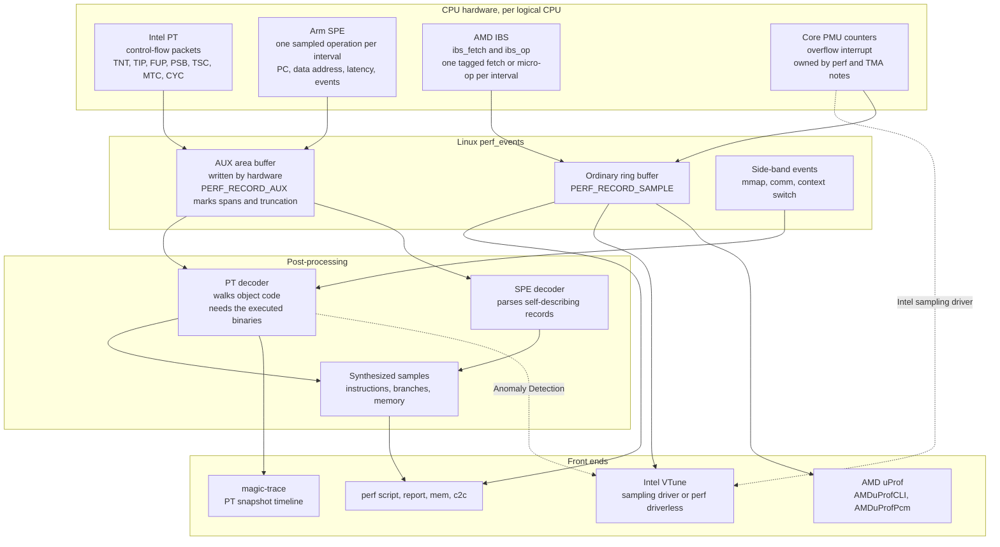

# Intel VTune, AMD uProf, and Hardware Tracing (PT, SPE)

> [!summary] Claim:
> A counter-overflow profiler tells you where an interrupt landed; the three mechanisms in this note make the CPU itself write the evidence into memory.
> Intel Processor Trace (PT) logs control flow as compressed packets (one bit per conditional branch, a target address per indirect branch), so a decoder that has the same binaries can replay every instruction, but it records no data addresses and floods buffers.
> Arm SPE and AMD IBS do the opposite: they pick one operation every N, follow it through the pipeline, and emit a precise record with its PC, data address, latency, and cache or TLB outcome, but they see only a sample, and an SPE record carries no call graph.
> Intel VTune and AMD uProf are collectors and viewers layered on these facilities and on ordinary PMU counters, and on Linux the same hardware is reachable through `perf` as the `intel_pt`, `arm_spe`, `ibs_op`, and `ibs_fetch` PMUs.
> The choice is therefore between completeness of control flow (trace), precision of a single operation (precise sample), and cost.



## The Mechanism

Every kernel fact below is from the Linux v7.3 tree, the latest stable series as of 2026-11, unless another version is named.
[[Linux-perf-in-Depth-and-perf-c2c]] owns `perf_event_open`, ring buffers, and callchains, [[Sampling-vs-Instrumentation-Skid-and-Safepoint-Bias]] owns skid and PEBS, and [[Hardware-Performance-Counters-Top-Down-TMA-and-Roofline]] derives the Top-Down hierarchy; this note uses them and does not re-derive them.

### 1. Three kinds of hardware evidence

A conventional profile programs a counter to overflow every N events and reads the interrupted instruction pointer in the handler.
The VTune guide describes the resulting error directly: skid comes from the delay in propagating the event through the interrupt controller, from the need to complete the current retirement cycle, and from serializing the instruction stream, and at instruction or basic-block granularity it can make "row B" the hotspot when "row A" caused the problem.

The mechanisms in this note remove the interrupt from the measurement path:

- **Tracing (Intel PT, Arm CoreSight ETM):** the CPU emits a packet for every control-flow decision that a decoder could not predict from the binary alone, so the result is exhaustive within the traced window.
- **Precise operation sampling (Arm SPE, AMD IBS):** the CPU selects one operation, records what happened to that operation as it executed, and only then signals software, so the record belongs to exactly one instruction.
- **Branch records (Intel LBR, AMD LBR v2 and BRS, Arm BRBE):** a small ring of recent branches is attached to an ordinary sample; [[Linux-perf-in-Depth-and-perf-c2c]] covers LBR callchains and [[Cpp-PGO-AutoFDO-and-BOLT-Workflow]] covers their use as optimization profiles.

### 2. Intel Processor Trace

`perf-intel-pt(1)` defines Intel PT as an extension that "collects information about software execution such as control flow, execution modes and timings and formats it into highly compressed binary packets".
It is first supported on Broadwell (Intel Core M and 5th generation Core), and the `intel_pt` PMU driver first appears in the Linux v4.1 tree, with the `perf` decoder following in v4.3.
The Intel SDM chapter that specifies it is cited as Chapter 36 by `perf-intel-pt(1)` and as Chapter 35 of Volume 3C by the VTune 2026.1 guide, so cite it by title, not number.

#### What is in the trace

The trace contains only what cannot be inferred from the code bytes.
The packet types below are the ones the v7.3 `perf` packet decoder parses, with sizes taken from `intel-pt-pkt-decoder.c`.

| Packet | What it carries | Encoding |
| :--- | :--- | :--- |
| TNT | Taken or not-taken bits for conditional branches | Short form: 1 byte, up to 6 branches; long form: 8 bytes, up to 47 branches |
| TIP | Target of an indirect branch, or of a return when compression does not apply | 1 header byte plus 0, 2, 4, 6, or 8 address bytes |
| TIP.PGE, TIP.PGD | Tracing enabled or disabled at this address (filter or privilege boundary) | Same as TIP |
| FUP | Address at which an asynchronous event such as an interrupt occurred, or the address bound to another packet | Same as TIP |
| PSB, PSBEND | Synchronization point where a decoder may start | PSB is 16 bytes: `02 82` repeated 8 times |
| TSC, MTC, CYC | Time: full timestamp, crystal-clock ticks, cycle counts | TSC 8 bytes, MTC 2 bytes, CYC variable |
| CBR | Core-to-bus ratio, which indicates CPU frequency | Recorded whenever tracing is enabled |
| MODE, PIP, VMCS | Execution mode, paging, and VM context | State the decoder tracks to pick the right image |
| OVF | The trace overflowed and packets were lost | Decoder logs "Buffer overflow" and restarts from an unknown address |
| PTWRITE | A 64-bit payload written by the `ptwrite` instruction | Enabled by the `ptw` config term |
| CFE, EVD | Event Trace: interrupts, faults, VM entries and exits with vectors | Enabled by the `event` config term |

Three compression rules explain why the trace is small and why decoding is expensive:

1. **Direct branches cost nothing.**
   An unconditional direct `jmp` or `call` has its target in the instruction bytes, so no packet is emitted; the man page's list of what the fast `q` decode mode cannot see starts with "direct calls and jmps".
2. **Conditional branches cost one bit.**
   `intel_pt_get_short_tnt()` finds the highest set bit of the byte (the stop bit) and treats the bits between it and bit 0 as branch outcomes, oldest first, where 1 means taken.
3. **Addresses are deltas.**
   The top three bits of a TIP or FUP header select how many address bytes follow, and `intel_pt_calc_ip()` splices them into the previous address: 2 bytes replace the low 16 bits, 4 bytes the low 32, and 6 bytes either sign-extend or replace the low 48.

Returns get a fourth rule, return compression, which is on by default (`noretcomp=0`).
The decoder keeps its own call stack, and a `ret` that goes back to the matching call site is encoded as a single taken bit in a TNT packet; the decoder fails with "Bad RET compression (TNT=N)" if that bit is not set.
Setting `noretcomp` makes every return emit a TIP, which the man page says "causes more packets to be produced but might make decoding more reliable".

#### Why the decoder needs your binaries

`perf-intel-pt(1)` states the cost plainly: decoding "involves walking the object code and matching the trace data packets", because a TNT packet "only tells whether a conditional branch was taken or not taken, so to make use of that packet the decoder must know precisely which instruction was being executed".
The decoder therefore needs three things besides the trace:

- The exact executable images that ran, which is why the man page calls JIT-compiled and self-modified code "a challenge".
- Side-band events (`mmap`, `comm`, context switches) to know which image was mapped at which address in which thread; `PERF_RECORD_SWITCH`, first defined in the v4.3 uapi header (the man page says v4.2, but `include/uapi/linux/perf_event.h` at v4.2 has no such record), lets unprivileged users record their own context switches.
- For kernel tracing, a copy of `/proc/kcore` taken under the same conditions (`perf record --kcore`), because the kernel patches its own code.

The same man page gives the two numbers that shape every PT design: the trace is "hundreds of megabytes per second per core", and decoding takes "two or three orders of magnitude longer than it took to collect".

#### Timing

PT is a control-flow trace first and a clock second.
Three packet families trade size against resolution:

- `tsc` (default on) emits a full timestamp, including one with each PSB.
- `mtc` (on by default where `caps/mtc` reports support, because `intel_pt_default_config()` in `tools/perf/arch/x86/util/intel-pt.c` appends `mtc,mtc_period=3` and then `psb_period=3`) emits a 2-byte packet from the crystal clock; its rate is the crystal frequency divided by `2 ^ mtc_period`, and the default `mtc_period` is 3 or the nearest lower supported value.
- `cyc` (default off) emits the cycle count since the previous CYC packet, but only alongside another packet, with `cyc_thresh` setting a minimum of `2 ^ (value - 1)` cycles between CYC packets.

Because CYC packets ride on other packets, the man page warns that cycle attribution is "more effective for attributing cycles to functions (and possibly basic blocks) than to individual instructions".
Emitting a PSB can itself delay the CPU slightly, and `perf script --itrace=p` shows PSB events so that a timing bubble caused by PT can be told from one caused by the program.

#### Where the bytes go

The CPU writes packets straight into memory regions listed in ToPA tables (`struct topa` in `pt.c`, enabled with `RTIT_CTL_TOPA`), and `perf` exposes that memory as the AUX area of the event's mmap.
`perf record` supports three mutually exclusive modes:

- **Full trace:** everything is kept, and the driver refuses to overwrite data that `perf` has not copied out; if `perf` falls behind, the span is marked `truncated` in `PERF_RECORD_AUX` and the decoder reports an error.
- **Snapshot (`-S`):** the buffer is a ring that overwrites old data until a `SIGUSR2` or a `snapshot` command on the `--control` FIFO freezes and saves it, which turns PT into a flight recorder.
- **Sample (`--aux-sample`):** a slice of trace (default 4 KiB, at most 60 KiB) is attached to each sample of another event, for example the control flow leading to each `branch-misses` sample.

The default AUX buffer is 4 MiB per CPU for privileged users, or when `perf_event_paranoid` is below 0, and 128 KiB otherwise; `-m,<pages>` sets it.

Volume is controlled at the source:

- **Privilege:** the `u` and `k` modifiers select user or kernel tracing.
- **Address filters:** `--filter 'filter <symbol> @ <file>'` traces only a region, and `start`, `stop`, and `tracestop` filters gate tracing at addresses; the PMU advertises how many it supports in `nr_addr_filters`, which `pt.c` takes from the CPU's reported address-range count.
- **Pause and resume:** on newer kernels another event can carry `aux-action=pause` or `aux-action=resume`, and the PT event can begin with `aux-action=start-paused`.
- **Dropping TNT:** `notnt` removes conditional-branch bits where hardware supports it, leaving only indirect and asynchronous flow, and forces the `q` decode mode.

#### Beyond branches

- `ptw` records `ptwrite` payloads, which gives a hardware-timestamped `printf` of one 64-bit value; the man page also documents an emulation that encodes the value into TNT bits on CPUs without the instruction.
- `pwr_evt` records C-state transitions, and CBR packets give frequency, so a slow iteration can be attributed to a frequency drop instead of to code.
- `event` records interrupt vectors, faults, and VM transitions.
- `aux-output` on a PEBS event redirects its records into the PT stream on hardware that supports it (PEBS via PT).

#### Virtual machines

Guest tracing from the host is limited: the man page documents kernel-only guest decoding with either timeless decoding or a VM Time Correlation step, and lists guest self-modifying code, unknown guest threads, and missing callchains among the caveats.
KVM's `pt_mode` module parameter defaults to system mode (`PT_MODE_SYSTEM`), and guest access to the trace-control MSRs is refused unless it is set to host-guest mode.
magic-trace's README lists "VMs are mostly not supported" first among the constraints that most commonly trip people up.

### 3. Arm Statistical Profiling Extension

SPE is sampling done in hardware.
`perf-arm-spe(1)` gives the pipeline as five stages:

1. **Choose an operation.**
   Sampling happens at a programmable interval over the sample population, which is an implementation-defined choice of all architectural instructions or all micro-ops.
   `perf record -c` sets the interval (written to `PMSIRR.INTERVAL`), and `jitter=1` adds a pseudo-random perturbation (the man page says one is added by default, but at v7.3 `arm_spe_pmu.c` sets `PMSIRR_EL1.RND` only from the `jitter` term, and `perf` does not set it).
2. **Collect data about it.**
   The CPU follows that one operation and records its PC, events, timings, and data addresses.
3. **Filter.**
   The record is discarded unless it matches programmable criteria.
4. **Write the record to memory.**
5. **Interrupt when the buffer is full.**

A record is a sequence of self-describing packets, which the v7.3 decoder header enumerates:

| Packet | Content |
| :--- | :--- |
| Address | Instruction PC, branch target, data virtual address, data physical address, previous branch target |
| Counter | Total latency, issue latency, translation latency, in cycles |
| Events | A bitmask: retired, L1D access and refill, TLB access and walk, not taken, mispredicted, last-level cache access and miss, remote access, misalignment, and later additions |
| Operation type | Class: load, store, or atomic; branch or exception return; other, with SVE and SME subclasses |
| Data source | Which cache level or node served a load; the encoding is implementation defined |
| Context, Timestamp, End | Context used to assign PIDs, a generic-timer timestamp, and the record terminator |

Decoding needs no binary: `perf report` and `perf script` parse the records and synthesize samples grouped by event, such as `l1d-miss`, `tlb-miss`, `branch`, and `memory`.

The properties that follow from the design:

- **No skid and no interrupt per sample.**
  The record names the sampled operation's own PC, and software is interrupted once per buffer, not once per sample.
- **Filtering happens before the write.**
  `load_filter`, `store_filter`, and `branch_filter` select operation types, `event_filter` requires all the named event bits, and `min_latency` keeps only operations at least that slow, so a rare slow load can be collected without storing the fast ones.
- **No call graph.**
  The man page is explicit: "SPE does not provide any call-graph information, and relies on statistical methods".
- **Collisions lose samples.**
  If the interval expires while the previous sampled operation is still in flight, the new sample is dropped; the `SAMPLE_COLLISION` PMU event counts these.
- **Micro-op bias.**
  On an implementation that samples micro-ops, an instruction that always splits into two micro-ops is twice as likely to be chosen, so counts must be weighted.
- **Period only.**
  `arm_spe_pmu_event_init()` returns `-EINVAL` when a frequency is requested, because feedback-directed throttling does not work with a buffer of samples.

Availability is the practical constraint.
The driver first appears in the Linux v4.15 tree and `perf` decoding in v4.16.
The PMU is missing when the module is not built, when the firmware does not describe the SPE interrupt, when the kernel must run with KPTI on that CPU (the fix is `kpti=off`, not needed on CPUs in the kernel's KPTI safe list or with `FEAT_E0PD`), or when running in a VM.
AWS documents SPE as enabled on Graviton 2, 3, 4, and 5 metal instances only (as of 2026-11).
Physical addresses (`pa_enable`) and physical timestamps (`pct_enable`) require the privilege checked by `perf_allow_kernel()`.

### 4. AMD Instruction-Based Sampling

IBS is AMD's precise sampler, and its Linux support is older than SPE's: `perf_event_amd_ibs.c` first appears in the v3.2 tree with only a stub `ibs` PMU, and the `ibs_fetch` and `ibs_op` PMUs register from v3.5.
The uProf guide describes it as a mechanism that lets the processor "select a random instruction fetch or micro-Op after a programmed time interval has expired and record specific performance information about the operation", after which an interrupt lets a handler read the record (uProf 6.0 user guide, section 1.2.2, checked 2026-11).
It has two independent halves, each exposed as its own PMU:

- **`ibs_fetch`** tags an instruction fetch and reports instruction-cache and ITLB hit or miss and fetch latency.
- **`ibs_op`** tags one micro-op and reports data-cache and DTLB behavior, load and store data source, the data linear and physical address, miss latency, and branch outcome.

`perf-amd-ibs(1)` states the trade against the ordinary core PMU: IBS gives an IP with no skid and rich per-sample data, while the core PMU offers many more events, counting mode, up to six parallel counters, grouping, and filtering.
An IBS sample costs an interrupt each, unlike SPE's buffered records.
`perf` forwards `cpu-cycles:p` and `r076:p` to `ibs_op//`, and `r0C1:p` to `ibs_op/cnt_ctl=1/`, so precise cycle profiling on AMD is IBS underneath.

Family-specific controls from the same man page:

| Term | Effect | Applies to |
| :--- | :--- | :--- |
| `cnt_ctl=1` | Count micro-ops instead of cycles between samples | `ibs_op` |
| `rand_en=1` | Add variability to the period so a long loop is not tagged at the same instruction every time | `ibs_fetch` |
| `l3missonly=1` | Keep only samples that missed L3 | Zen 4 onward |
| `ldlat=<128..2048>` | Keep only loads at least this slow | Zen 5 onward |
| `swfilt=1` with `u` or `k` | Software privilege filter | Up to Zen 5 |
| `u` or `k` alone | Hardware privilege filter | Zen 6 onward |

Without a privilege filter the IBS PMUs need `CAP_PERFMON` or `CAP_SYS_ADMIN`, and per-process IBS profiling exists from upstream v6.2.
`perf mem` and `perf c2c` use `ibs_op` on AMD, which makes it the AMD back end for the workflow in [[Drill-Profiling-False-Sharing-Cache-Contention]]; `perf-c2c(1)` notes that `perf c2c` is not supported on Zen 3.

### 5. Branch records and Arm trace, in brief

- AMD Family 19h has Branch Sampling (BRS, `arch/x86/events/amd/brs.c`, in the tree from v5.19), and newer parts have LBR v2 (`arch/x86/events/amd/lbr.c`, from v6.1); uProf documents LBR on Zen 4 as the basis of its branch analysis ("AMD Zen4 processors support Last Branch Record (LBR) CPU feature that is useful for branch analysis"), collected with `AMDuProfCLI collect --branch-filter`, and states that "Branch analysis is supported only on Linux platform" and is not supported for Java applications (uProf 6.0 user guide, sections 7.9.3.4 and 7.9.3.4.4).
LBR sample collection needs a PMC event; if none is passed, uProf enables `PMCX0C0` for it (section 7.9.3.4.1).
- Arm's Branch Record Buffer Extension has a driver from v6.17 and stores records in banks of 32 entries.
- Arm's counterpart to PT is CoreSight ETM, recorded with `perf record -e cs_etm//u` and decoded by the OpenCSD library, which `perf` must be built against.

### 6. Intel VTune Profiler

VTune is a collector, a symbolizer, and a viewer; the current release line is 2026.x, with 2026.6 dated 2026-08-23 on Intel's release notes page (as of 2026-11).
Its analyses sit on two collectors:

- **User-mode sampling and tracing**, the default for Hotspots (`sampling-mode=sw`), which the guide recommends for targets running longer than a few seconds and for Python.
- **Hardware event-based sampling (EBS)**, which uses PMU counter overflow; the guide puts its average overhead at "about 2% on a 1ms sampling interval".

EBS itself has two back ends on Linux.
The Intel sampling driver is a kernel module built from the Sampling Driver Kit at install time.
When it is missing, and by default whenever EBS is collected with stacks, VTune falls back to driverless collection through the kernel's perf subsystem, which the guide says "may have some analysis limitations for a non-root user" and which is governed by `perf_event_paranoid`.

The analyses that matter for this note:

| Analysis (`vtune -collect`) | What it is |
| :--- | :--- |
| `hotspots` | Where time goes; `-knob sampling-mode=hw` switches to EBS |
| `uarch-exploration` | Microarchitecture Exploration, formerly General Exploration: collects the event set for Top-Down metrics and computes them per function |
| `memory-access` | NUMA and bandwidth problems, with events attributed to memory objects |
| `threading` | Threading analysis |
| `anomaly-detection` | Intel PT over marked code regions, a preview feature |

Microarchitecture Exploration is VTune's implementation of the method that [[Hardware-Performance-Counters-Top-Down-TMA-and-Roofline]] derives.
It needs more events than the CPU has counters (the guide says "Usually, it is no more than four events" at once), so VTune either multiplexes event groups round-robin within one run and extrapolates, or runs the target several times.
It collects in detailed mode by default, and `-knob pmu-collection-mode=summary` selects a lighter mode limited to whole-run statistics.
Metric values that rest on too few samples are greyed out as unreliable.

Anomaly Detection is where VTune uses PT.
You mark a region with the ITT API (`__itt_pt_region_create`, `__itt_mark_pt_region_begin`, `__itt_mark_pt_region_end`), VTune records PT for it, and the viewer shows a histogram of region durations so that the control flow of a slow iteration can be compared with a fast one.
Its two knobs bound the cost: `ipt-regions-to-load` (default 1000, range 10 to 5000) and `max-region-duration` (default 100 ms, range 0.001 to 1000 ms).

### 7. AMD uProf

uProf 6.0 was released on 2026-11-05 for Windows, Linux, and FreeBSD, and the product page describes it as providing metrics for AMD "Zen"-based processors and AMD Instinct MI Series accelerators.
It has two command-line tools.

`AMDuProfCLI` is the profiler, with a `collect`, `translate`, `report` workflow and three profile types:

- **TBP**, software timer-based sampling.
- **EBP**, core PMC event-based sampling, the counterpart of VTune's EBS.
- **IBS**, sampling through `ibs_fetch` and `ibs_op`.

Predefined configurations select event sets: `tbp`, `assess`, `assess_ext`, `data_access`, `inst_access`, `branch`, `cpi`, `pipeline_util`, `ibs`, `ibs_op`, `ibs_fetch`, `memory`, `hotspots`, `threading`, and `Overview` (quick reference guide, Appendix D).
The `memory` configuration is cache analysis: the quick reference lists it as an IBS configuration to "Identify the false cache-line sharing issues", and the user guide's shared-data cacheline detail report names the cache lines with potential false sharing, the offsets where accesses occur, and the readers and writers of each offset with PID, TID, function, source file and line, plus load latency (uProf 6.0 user guide, section 7.9.3.3.3, Cache Analysis Using CLI).

`AMDuProfPcm` is the counter monitor, which in 6.0 absorbed the former `AMDuProfSys`.
It reads core, L3, data-fabric (DF), and UMC counters either through AMD's own driver (`--msr`, the default when the driver is installed) or through the kernel's perf subsystem (`-X`, also used automatically when an application is launched or attached with `-p`/`--tid`, or when the driver is absent).
On Zen 4 and later, `-m pipeline_util` reports level-1 metrics (`Total_Dispatch_Slots`, `SMT_Disp_contention`, `Frontend_Bound`, `Bad_Speculation`, `Backend_Bound`, `Retiring`) and level-2 metrics (`Frontend_Bound.Latency` and `.BW`, `Bad_Speculation.Mispredicts` and `.Pipeline_Restarts`, `Backend_Bound.Memory` and `.CPU`, `Retiring.Fastpath` and `.Microcode`).
The guide warns that "Due to multiplexing, the reported metrics may be inconsistent" and advises binding the monitored application to a set of cores with `taskset` and monitoring only those cores; passing `-c` makes core metrics count all activity on the selected cores, including other tasks (uProf 6.0 user guide, section 4.7.1).
Multiplexing in general "usually introduces noise in the collected data", the counts of an event group that is off the counters are extrapolated from the last measurement, and the multiplexing interval `-t` should be kept as low as possible; in perf mode `-t` applies only when `AMDuProfPcm` runs as root (section 4.3.1).

## Commands and Numbers to Know

| Item | Value | Platform and date | Why it matters |
| :--- | :--- | :--- | :--- |
| `perf record -e intel_pt//u -- <cmd>` | Man page: default config is `tsc=1,noretcomp=0`; the tool also adds `mtc,mtc_period=3,psb_period=3,pt,branch` where the CPU supports them | Linux x86-64 Intel (as of 2026-11) | Smallest useful PT recording: user space, full trace |
| PT trace rate | "hundreds of megabytes per second per core" | Linux x86-64 Intel (as of 2026-11) | From `perf-intel-pt(1)`; sizes every buffer decision |
| PT decode time | Two to three orders of magnitude longer than collection | Linux x86-64 Intel (as of 2026-11) | From `perf-intel-pt(1)`; decode a time slice, not the file |
| PT AUX buffer default | 4 MiB privileged or `perf_event_paranoid` < 0; 128 KiB otherwise | Linux x86-64 Intel (as of 2026-11) | `-m,<pages>` overrides; power of two, minimum 2 pages in full trace |
| `psb_period` | About `2 ^ (value + 11)` trace bytes between PSBs; default 3 with MTC, else 0 | Linux x86-64 Intel (as of 2026-11) | 16 KiB or 2 KiB between decoder restart points |
| `mtc_period` | Crystal frequency divided by `2 ^ value`; default 3 | Linux x86-64 Intel (as of 2026-11) | Timestamp granularity without CYC |
| `cyc_thresh` | At least `2 ^ (value - 1)` cycles between CYC packets | Linux x86-64 Intel (as of 2026-11) | Bounds the size cost of cycle-accurate mode |
| TNT packet | 1 byte for up to 6 branches, 8 bytes for up to 47 | Linux x86-64 Intel (as of 2026-11) | Why a hot loop costs a fraction of a bit per instruction |
| `perf script` default | `--itrace=cepwxy` | Linux (as of 2026-11) | Calls, errors, power, ptwrite, transactions, cycles |
| `perf report` default | `--itrace=igxe` | Linux (as of 2026-11) | Instruction samples with callchains; default period 100 us |
| `--itrace=i0ns` | A sample for every instruction | Linux (as of 2026-11) | Full instruction trace; use with `--time` |
| `--itrace=q`, `qq` | Skip TNT and code walking; `qq` decodes PSB+ only | Linux (as of 2026-11) | Fast triage to find the time range worth a full decode |
| `perf record -S`, `kill -USR2 <perf pid>` | Snapshot mode | Linux x86-64 Intel (as of 2026-11) | Flight recorder; `--control fifo:` avoids needing signal permission |
| `--aux-sample[=<bytes>]` | Default 4 KiB, validated at most 60 KiB | Linux x86-64 Intel (as of 2026-11) | Control flow leading to each sample of another event |
| `perf record -e arm_spe// -c <n>` | Period in operations; frequency mode is rejected | Linux arm64 (as of 2026-11) | The default is the minimum interval, so always pass `-c` |
| `arm_spe/load_filter=1,min_latency=<n>/` | Loads with total latency of at least n cycles | Linux arm64 (as of 2026-11) | Tail-latency loads without storing the fast ones |
| `arm_spe/event_filter=0x80/` | Mispredicted branches only | Linux arm64 (as of 2026-11) | Bit 7 of the event mask |
| `SAMPLE_COLLISION` | Core PMU event counting dropped SPE samples | Linux arm64 (as of 2026-11) | Nonzero means the interval is too short |
| `perf record -e ibs_op// -c 100000 -a` | IBS op, cycle-based period | Linux x86-64 AMD (as of 2026-11) | Precise profile; add `cnt_ctl=1` to count micro-ops |
| `ibs_op/ldlat=<n>/` | 128 to 2048; multiples of 128 are cheapest | Linux x86-64 AMD Zen 5+ (as of 2026-11) | Load-latency threshold |
| `/sys/bus/event_source/devices/` | `intel_pt`, `arm_spe_0`, `ibs_op`, `ibs_fetch`, `cs_etm` | Linux (as of 2026-11) | Presence check before any of the above |
| `intel_pt/caps/` | `psb_cyc`, `mtc`, `ptwrite`, `power_event_trace`, `event_trace`, `tnt_disable` | Linux x86-64 Intel (as of 2026-11) | Each file holds 1 when the feature exists |
| `perf_event_paranoid` | `-1` no limits; `>=0` no raw tracepoints; `>=1` no system-wide; `>=2` user space only | Linux (as of 2026-11) | Governs unprivileged use of every tool in this note |
| `vtune -collect hotspots -knob sampling-mode=hw` | EBS hotspots; default mode is `sw` | Linux x86-64 Intel (as of 2026-11) | VTune 2026.1 |
| `vtune -collect uarch-exploration` | Detailed mode by default; `-knob pmu-collection-mode=summary` | Linux x86-64 Intel (as of 2026-11) | Top-Down metrics per function |
| `vtune -collect anomaly-detection` | `ipt-regions-to-load=1000`, `max-region-duration=100` ms defaults | Linux x86-64 Intel (as of 2026-11) | Intel PT over ITT-marked regions; preview |
| VTune EBS overhead | About 2% at a 1 ms sampling interval | Linux x86-64 Intel (as of 2026-11) | Intel's own figure, from the 2026.1 guide |
| `AMDuProfCLI collect --config ibs -g -o <dir> <app>` | IBS fetch and op with call stacks | Linux x86-64 AMD (as of 2026-11) | uProf 6.0; `report -i <session-dir>` renders it |
| `AMDuProfCLI collect --config memory` | IBS-based cache analysis | Linux x86-64 AMD (as of 2026-11) | False-sharing report |
| `AMDuProfPcm -m pipeline_util` | Level-1 and level-2 top-down metrics | Linux x86-64 AMD, Zen 4 and later (as of 2026-11) | Add `-X` to use perf instead of AMD's driver |
| uProf IBS and `perf_event_paranoid` | Launching an application works up to 1; attach and system-wide need 0 or lower | Linux x86-64 AMD (as of 2026-11) | uProf 6.0 user guide, section 7.1; the table also shows IBS for a launched app failing at 2 and core-PMC attach working at every value |
| magic-trace | "2%-10% overhead", about 40 ns resolution, about 10 ms of history by default | Linux x86-64 Intel, Skylake or later (as of 2026-11) | Project's own figures from its README |

## Multi-Language Comparison

The hardware sees machine code, so the language matters only through what the decoder and the symbolizer can recover.

| Concern | C++ | Python (CPython) | Rust |
| :--- | :--- | :--- | :--- |
| What a PT trace or SPE record describes | The program's own compiled code | The interpreter's machine code and any native extensions, not Python-level functions | The program's own compiled code |
| PT decode prerequisite | The exact binaries and shared objects that ran | The same, for the interpreter and extensions; JIT-compiled or self-modifying code is what `perf-intel-pt(1)` calls "a challenge" | The exact binaries that ran |
| Mapping samples to source-level functions | Symbols and DWARF; [[DWARF-Debug-Information-and-Symbol-Bundles\|DWARF]] | Needs interpreter cooperation; [[Python-CPython-perf-Trampoline-and-Tachyon-Internals\|perf trampoline]] | Symbols and DWARF |
| Call stacks with SPE or IBS | Not provided by SPE; IBS samples take an ordinary callchain, so frame pointers or DWARF unwinding still apply | Same limits, plus interpreter frames | Same as C++; [[Rust-CPU-Profiling-cargo-flamegraph-samply-and-Frame-Pointers\|frame pointers]] |
| VTune 2026.1 language list | C/C++ listed | Listed; Hotspots, Threading, and Memory Consumption (Linux only) analyses | Not mentioned in the guide |
| uProf 6.0 language list | C, C++ listed | Listed for the Hotspots configuration only | Not listed |
| Marking PT regions for VTune | ITT API C functions | Not documented in the guide's Anomaly Detection section | Not documented in the guide's Anomaly Detection section |

A Rust binary is native code with standard debug information, so the absence of Rust from both vendor lists is a statement about what the vendors test, not evidence that the tools cannot open it.
That last sentence is an inference from the file formats, not a documented vendor claim.

## Worked Example

The lab is `code/05-Profiling/pt_packet_decoder/`: a pure-Python decoder that follows the v7.3 `perf` packet rules and replays a small packet stream against a toy image.
It runs anywhere and needs no Intel hardware, so it proves the decoding rules and the replay logic, not the behavior of any real CPU, and no output below is a measurement.
Every mechanism that needs specific server silicon (Intel PT recording, AMD IBS, Arm SPE) and direct PMU access is outside it and was not executed.
The example works three decisions from the documented formats, which is the skill the hardware demands.

### Step 1: Decode a packet sequence by hand

Suppose `perf script -D` shows these raw PT bytes after a PSB, and the decoder's last known address is `0x00007f0012345678`:

```text
d4  4d 34 12 40 00
```

Apply the rules from `intel-pt-pkt-decoder.c` at v7.3:

1. `0xd4` is `1101 0100`.
   Bit 0 is clear and the byte is neither `0x00` (PAD) nor `0x02` (extended opcode), so it is a short TNT.
   The highest set bit, bit 7, is the stop bit, which leaves six outcome bits, bits 6 to 1: `1 0 1 0 1 0`.
   Oldest first, the six conditional branches went taken, not taken, taken, not taken, taken, not taken.
2. `0x4d` is `010 01101`.
   The low five bits are `0x0d`, which is TIP, and the top three bits are 2, which means four address bytes follow.
3. The four bytes are little-endian `0x00401234`.
   `intel_pt_calc_ip()` case 2 keeps the upper 32 bits of the last address and replaces the lower 32: `(0x00007f0012345678 & 0xffffffff00000000) | 0x00401234 = 0x00007f0000401234`.

Six bytes therefore describe six conditional branches and one indirect transfer to `0x00007f0000401234`.
What they do not say is which six branches: the decoder must disassemble forward from the previous address, consume one TNT bit at each conditional branch it meets, follow direct jumps and calls from their instruction bytes, and stop at the first indirect branch, whose target is the TIP.
If the binary on disk differs from the one that ran by a single instruction, the bit-to-branch pairing shifts, and the result is either a decoder error or, worse, a plausible but wrong trace.

The lab reproduces the same rules in `pt_decode.py` (a Python transcription of `intel_pt_get_short_tnt()`, `intel_pt_get_ip()`, and `intel_pt_calc_ip()`), not the kernel code itself and not a live trace.
Its recorded output (`expected/darwin-arm64.txt`; the lab is pure Python and prints no platform-dependent values) is:

```text
== packets in the stream ==
0000  02 82 02 82 ..            PSB
0010  19 55 44 33 22 11 00 00   TSC
0018  02 03 14 00               CBR
001c  02 23                     PSBEND
001e  51 00 10 40 00            TIP.PGE ip=0000000000401000 ipbytes_field=2
0023  1c                        TNT T T N
0024  59 07                     MTC
0026  2d 00 20                  TIP ip=0000000000402000 ipbytes_field=1
0029  01                        TIP.PGD

== replay against the binary that ran ==
401000 401004 401000 401004 401000 401004 401008 401020 401024 402000

== replay against a rebuilt binary ==
decode error: TNT underrun at 0000000000401004

== worked example step 1, last address 00007f0012345678 ==
d4 4d 34 12 40 00 -> T N T N T N then TIP ip=00007f0000401234

== practice drill, last address 0000555500001000 ==
06                        -> T
fe 2d 00 20               -> T T T T T T then TIP ip=0000555500002000
1a 6d 78 56 34 12 55 55   -> T N T then TIP ip=0000555512345678

== IP compression forms from last address 0000555500001000 ==
ipbytes_field=1 payload=0000000000002000 -> 0000555500002000
ipbytes_field=2 payload=0000000000401234 -> 0000555500401234
ipbytes_field=3 payload=00007fff12345678 -> 00007fff12345678
ipbytes_field=3 payload=0000800000001000 -> ffff800000001000
ipbytes_field=4 payload=0000112233445566 -> 0000112233445566
ipbytes_field=6 payload=ffffffff80001000 -> ffffffff80001000

== long TNT and malformed streams ==
long TNT of 8 bytes holds 45 branches
truncated TIP: need-more-bytes
PSB with a wrong middle byte: bad-packet
reserved ipbytes field 5: bad-packet
unknown extended opcode: bad-packet
```

The first section decodes a stream of PSB, TSC, CBR, PSBEND, TIP.PGE, TNT, MTC, TIP, and TIP.PGD packets.
The TIP at offset `0026` carries two address bytes, so the decoder keeps the upper 48 bits of the last address `00401000` and replaces the low 16 bits to reach `00402000`.
The second section replays the stream against a toy object-code image, a loop of three iterations followed by a direct `jmp` and an indirect branch, with one TNT bit consumed per conditional branch and the `jmp` costing no packet.
The third section replays it against a rebuild with one extra conditional branch at the loop head, which fails with `TNT underrun`: the bit-to-branch shift described above made concrete.
The fourth section reproduces the Step 1 decode above, and the fifth and sixth are the Practice Drill answers and the IP compression forms, including the sign-extended six-byte form.
The last section checks that a truncated TIP reports `need-more-bytes` and that a corrupted PSB, a reserved IPBytes field, and an unknown extended opcode report `bad-packet`.
### Step 2: Size a snapshot buffer

The question for a flight recorder is how much history a buffer holds.
Take the low end of the man page's "hundreds of megabytes per second per core", 100 MB/s, as a planning figure, not a measurement.

- The default privileged AUX buffer is 4 MiB, which is 4,194,304 bytes, and at 100 MB/s that is about 42 ms of one core's execution.
- At 300 MB/s the same buffer holds about 14 ms.
- A 128 KiB unprivileged buffer at 100 MB/s holds about 1.3 ms.

That order of magnitude is consistent with magic-trace advertising a configurable history of about 10 ms, and it is why a tail-latency investigation that needs 500 ms of history must either raise `-m,<pages>` by an order of magnitude, restrict tracing with an address filter, or pause tracing outside the code of interest.

The decoder's restart granularity is a separate budget: with `psb_period=3` a decoder that lands mid-buffer must skip up to about 16 KiB to the next PSB, which matters for `--aux-sample`, where the man page warns when the sample size is not larger than the PSB period plus 256 bytes and defaults `psb_period` to 0 (2 KiB) in that mode.

### Step 3: Write the collection plan for one question on three vendors

The question: "which load in the order-book update is slow at the tail?"
The commands below are assembled from the three man pages and were not run.

```bash
# Intel: perf mem selects the load-latency and precise-store events.
perf mem record -- ./book_replay
perf mem report

# AMD (Zen 5 or later for ldlat): IBS op, loads at or above 128 cycles.
perf record -e ibs_op/ldlat=128/ -c 100000 -- ./book_replay
perf report

# Arm with SPE: loads only, total latency at or above 128 cycles, every 4096th operation.
perf record -e arm_spe/load_filter=1,min_latency=128/ -c 4096 -- ./book_replay
perf report --mem-mode
```

PT appears nowhere in that plan, because PT has no data addresses and no cache outcomes.
PT answers the adjacent question, "what did the slow iteration execute that the fast one did not?", with a snapshot:

```bash
perf record -e intel_pt/cyc/u -S -m,16M -- ./book_replay &
# when the latency monitor fires:
kill -USR2 "$(pgrep -x perf)"
perf script --call-trace
```

## Pitfalls

> [!warning] Pitfall: Decoding a PT trace against different binaries
> The trace stores branch outcomes, not addresses, so a rebuilt or upgraded binary makes the decoder pair bits with the wrong branches.
> Keep the exact images with the trace: `perf record` stores the build IDs of the executables it saw (`perf buildid-list`), and VTune has `vtune -archive -r <result>` to copy the binaries into the result before it moves to another machine.

> [!warning] Pitfall: Recording PT in full-trace mode on a busy service
> At hundreds of megabytes per second per core, `perf` cannot copy the buffer out fast enough, the driver marks spans `truncated`, and the decoder reports errors where the interesting event was.
> Use snapshot mode, an address filter, user-only tracing, or `aux-action` pause and resume, and start small as the man page's quickstart insists.

> [!warning] Pitfall: Ignoring decoder error events
> `--itrace=e` errors mark places where the decoder lost the trace, and everything between an error and the next PSB is missing.
> A call trace with silent gaps reads as if the program skipped code; the man page says users "must know if what they are seeing is a complete picture or not".

> [!warning] Pitfall: Reading PT timestamps as per-instruction times
> Without `cyc`, time advances only at TSC and MTC packets, and the decoder estimates the rest at one tick per instruction.
> Even with `cyc`, a CYC packet is emitted only alongside another packet, so attribute cycles to functions or blocks, not to single instructions.

> [!warning] Pitfall: Expecting PT to find a cache miss
> PT has no data addresses, no cache or TLB events, and no latencies.
> A slow iteration with identical control flow to a fast one is a memory, frequency, or interrupt problem; check CBR and event-trace packets, then switch to PEBS, IBS, or SPE.

> [!warning] Pitfall: Running SPE at the default interval
> `perf record -e arm_spe//` with no `-c` uses the minimum interval, which produces very large files and raises the collision rate.
> Pass `-c`, add a filter, and check `SAMPLE_COLLISION`.

> [!warning] Pitfall: Counting SPE samples as instruction counts
> On an implementation that samples micro-ops, multi-micro-op instructions are over-represented, and a filter changes the population again.
> Compare like with like, and use `sample_pop` and `inst_retired` to estimate the weighting.

> [!warning] Pitfall: Looking for call stacks in SPE data
> SPE records carry the operation's PC, a branch target, and at most the previous branch target.
> Pair an SPE run with an ordinary callchain profile of the same workload, and join them on the function.

> [!warning] Pitfall: Assuming the PMU exists in the cloud
> `perf-arm-spe(1)` lists running on a VM as a cause of a missing SPE PMU, AWS exposes SPE on metal instances only, and magic-trace reports that VMs are mostly not supported for PT.
> Check `/sys/bus/event_source/devices/` on the instance type you will actually use before you design a workflow around it.

> [!warning] Pitfall: Trusting multiplexed Top-Down numbers on a short run
> VTune and uProf both extrapolate when events outnumber counters, and both vendors warn about it: VTune greys out unreliable metrics, and the uProf guide says multiplexed pipeline metrics "may be inconsistent" (uProf 6.0 user guide, section 4.7.1).
> Lengthen the run, pin the workload, or let VTune run the target several times.

> [!warning] Pitfall: Loosening `perf_event_paranoid` fleet-wide to make a vendor tool work
> Driverless VTune and uProf both document lowering it, but `-1` also removes the per-user locked-memory limit, and `0` exposes system-wide kernel profiling to every user.
> Grant `CAP_PERFMON` to a profiling group or run the collector as a privileged service instead.

## At Scale

For one developer on a workstation, the vendor GUI is the fastest route: VTune or uProf collects, symbolizes, and ranks, and the cost is an install.
The trade-offs change when the tool has to work on thousands of hosts that someone else operates.

- **Kernel modules do not scale.**
  VTune's sampling driver and uProf's driver are out-of-tree modules that must be rebuilt per kernel and loaded with root.
  Both products document a perf-based mode (driverless collection, `AMDuProfPcm -X`), and a fleet should standardize on that mode and on `perf` itself.
- **Hardware is not uniform.**
  A fleet with Intel, AMD, and Arm hosts has PEBS, IBS, and SPE respectively, and PT only on the Intel hosts.
  `perf mem` and `perf c2c` already select the right back end per vendor, so they are the portable interface; vendor tools are the escalation path.
- **PT is a targeted instrument, not a continuous profiler.**
  Its data rate and decode cost rule out always-on fleet collection, and [[Continuous-Profiling-GWP-Parca-Pyroscope-and-OTel-Profiles]] covers what does run continuously.
  PT earns its place as a triggered snapshot on the few hosts where a latency anomaly reproduces.
- **Traces are sensitive.**
  A PT trace plus the binary reveals every branch the program took, which can leak data-dependent control flow, and kernel traces need a copy of `/proc/kcore`.
  Treat traces like core dumps: access-controlled, short retention.
- **Symbols must be findable later.**
  Decoding a snapshot from last week requires last week's binaries, so PT depends on build-ID-indexed artifact retention exactly as crash analysis does.

Decision rules:

- **One engineer, one Intel box, "why is this iteration slow?":** magic-trace or `perf record -S` with PT; no code changes.
- **One engineer, "where is the pipeline stalling?":** `vtune -collect uarch-exploration` on Intel or `AMDuProfPcm -m pipeline_util` on Zen 4 and later, then drill into the dominant category.
- **Hundreds of engineers, mixed hardware:** pave `perf record`, `perf mem`, and `perf c2c` with `CAP_PERFMON`, publish per-vendor recipes, and keep VTune and uProf as optional viewers that import or re-collect.
- **Thousands of engineers, production fleet:** continuous sampling everywhere; SPE or IBS with a latency filter as an opt-in second tier on bare-metal pools; PT snapshots only behind an incident trigger, with address filters defined in advance for each latency-critical service.
- **Low-latency trading or packet processing:** budget for PT on isolated cores during certification runs, record with `cyc` and `noretcomp`, and account for PSB-induced timing bubbles before blaming the code.
- **Flip to a vendor tool when** the question is microarchitectural and the team wants the vendor's own metric formulas, or when it needs the GUI's source-level drill-down more than it needs automation.

[[Profiling-Decision-Records]] holds the organization-level versions of these choices.

## Practice Drill

> [!tip] Practice Drill:
> Part 1 needs no hardware: decode these three PT byte sequences by hand, each starting from a last address of `0x0000555500001000`, and state for each the branch outcomes, the packet type, and the resulting address: `06`, `fe 2d 00 20`, and `1a 6d 78 56 34 12 55 55`.
> The lab prints all three decodes, so check yourself against its output, and against the rules in The Mechanism: `06` is a short TNT with one taken branch, and `fe 2d 00 20` is six taken branches followed by a TIP with two address bytes that yields `0x0000555500002000`.
> Part 2 needs an Intel bare-metal Linux host: record a short user-space trace, list the packets, and confirm that a tight loop is encoded almost entirely as TNT packets.
> Part 3: record the same program with and without `noretcomp` and with and without `cyc`, and compare `perf.data` sizes; predict the direction of each change before running it.
> Part 4, on an Arm host with SPE or an AMD host: collect loads above a latency threshold and find the source line of the slowest sampled load.

```bash
# Part 2 and 3 (Intel bare metal).
ls /sys/bus/event_source/devices/intel_pt/caps/
perf record -o pt.default  -e intel_pt//u            -- ./your_program
perf record -o pt.noret    -e intel_pt/noretcomp/u   -- ./your_program
perf record -o pt.cyc      -e intel_pt/cyc/u         -- ./your_program
ls -l pt.default pt.noret pt.cyc
perf script -i pt.default -D | head -n 200                  # raw packets
perf script -i pt.default --call-trace | head -n 50
perf script -i pt.default --itrace=e                        # decoder errors only

# Part 4 (Arm with SPE).
perf record -e arm_spe/load_filter=1,min_latency=64/ -c 4096 -- ./your_program
perf report --mem-mode

# Part 4 (AMD).
perf mem record -c 100000 -- ./your_program
perf mem report -s mem,snoop
```

## Interview Questions

> [!question] L5: What does an Intel PT trace contain, and why can it not be decoded without the binary?
>
> > [!success]- Answer
> > It contains only the control-flow facts that cannot be derived from the code: one taken or not-taken bit per conditional branch in TNT packets, target addresses of indirect branches in TIP packets, source addresses of asynchronous events in FUP packets, plus synchronization and timing packets.
> > Direct jumps and calls produce nothing, and by default a return that matches the call stack is compressed to a single TNT bit.
> > A decoder must therefore disassemble the executed image, follow direct branches itself, and consume one TNT bit at each conditional branch, which `perf-intel-pt(1)` describes as "walking the object code and matching the trace data packets".
> > Without the exact image there is no way to know which instruction a bit belongs to, which is also why JIT-compiled and self-modifying code are hard.

> [!question] L5: Contrast Intel PT, Arm SPE, and AMD IBS in two sentences each.
>
> > [!success]- Answer
> > Intel PT is a trace: it records all control flow in a window, so it can replay execution exactly, but it has no data addresses or cache events and produces hundreds of megabytes per second per core.
> > Arm SPE is hardware sampling: every N operations it follows one operation and writes a record with PC, data address, latencies, and events to a buffer, interrupting only when the buffer fills, and it provides no call graph.
> > AMD IBS is also precise operation sampling, split into fetch and op halves, and each sample raises an interrupt whose handler reads the record, so it gives a skid-free IP and memory details at ordinary sampling cost.
> > PT answers "what executed", and SPE and IBS answer "what happened to this instruction".

> [!question] L5 (predict the output): A PT dump shows the bytes `d4 4d 34 12 40 00` and the decoder's last address was `0x00007f0012345678`. What does the decoder conclude?
>
> > [!success]- Answer
> > `0xd4` is `1101 0100`: bit 0 is clear, so it is a short TNT; bit 7 is the stop bit, leaving six outcomes `101010`, oldest first: taken, not taken, taken, not taken, taken, not taken.
> > `0x4d` has low five bits `0x0d`, a TIP, and top three bits 2, meaning four address bytes.
> > The bytes are little-endian `0x00401234`, and four bytes replace the low 32 bits of the last address, giving `0x00007f0000401234`.
> > So six conditional branches were executed with alternating outcomes, then an indirect branch went to `0x00007f0000401234`; which instructions those were comes from walking the binary, not from the trace.

> [!question] L6 (debug this): `perf record -e arm_spe// -- ./bench` fails on a Graviton instance with "Cannot find PMU `arm_spe'. Missing kernel support?". What do you check, in order?
>
> > [!success]- Answer
> > First, whether the instance is a VM: `perf-arm-spe(1)` lists running on a VM among the causes, and AWS documents SPE on Graviton metal instances only.
> > Second, whether the driver is present: `CONFIG_ARM_SPE_PMU` must be built, and on some distributions the module is in a separate package and must be loaded with `modprobe arm_spe_pmu`.
> > Third, KPTI: on CPUs where the kernel must keep page-table isolation on, the profiling buffer is inaccessible and the console says to try `kpti=off`; CPUs on the kernel's safe list or with `FEAT_E0PD` do not need it.
> > Fourth, firmware: if ACPI or the device tree does not describe the SPE interrupt, the PMU silently does not appear.
> > The confirmation in each case is whether `/sys/bus/event_source/devices/arm_spe_0` exists.

> [!question] L6: Why does `perf c2c` behave differently on Intel, AMD, and Arm hosts?
>
> > [!success]- Answer
> > It needs samples of loads and stores with data addresses and cache-hit information, and each vendor supplies them differently.
> > On Intel it uses load-latency and precise-store events; on AMD it uses the `ibs_op` PMU; on Arm it uses SPE with load and store filters, timestamps, and physical addresses enabled.
> > The consequences differ: AMD support depends on the Zen generation (the man page says Zen 3 is unsupported and latency thresholds need newer parts), Arm needs SPE to exist at all and needs privilege for physical addresses, and SPE sampling means not every memory operation is seen.
> > The report format is shared, which is why it is the right portable interface for a mixed fleet.

> [!question] L6: A colleague's PT call trace of a production request has gaps.
> Explain the possible causes and how to tell them apart.
>
> > [!success]- Answer
> > There are three distinct losses.
> > Buffer loss: `perf` did not copy the AUX buffer out in time, the driver set `truncated` on the `PERF_RECORD_AUX` event, and the tools report a lost-data error; the fix is a larger `-m,` buffer, snapshot mode, or less traced code.
> > Internal overflow: the trace contains an OVF packet, which the decoder reports as an overflow error before it carries on from an unknown address.
> > Decode failure: the decoder could not find or match the executed image, or lacked side-band data such as context switches and mmaps, which is typical for JIT code, replaced binaries, or kernel text without `--kcore`.
> > `perf script --itrace=e` lists the errors by kind, and `-D` shows the raw packets, including OVF and the PSBs where decoding resumes.

> [!question] L6: VTune offers a sampling driver and a driverless mode on Linux.
> What is the difference and when does each apply?
>
> > [!success]- Answer
> > The sampling driver is Intel's own kernel module, built against the running kernel at install time, that programs the PMU and delivers samples to VTune.
> > Driverless mode uses the kernel's perf subsystem instead, needs no module, and is what VTune uses when the driver is absent and, by default, whenever hardware sampling is collected with stacks.
> > Driverless collection is subject to `perf_event_paranoid`, so a non-root user gets a reduced scope, and the guide notes it may have analysis limitations.
> > For a fleet, driverless is the only mode that survives kernel upgrades without a rebuild; the driver is a workstation convenience.

> [!question] L7: How accurate is timing in a PT trace, and how would you configure it for a latency investigation?
>
> > [!success]- Answer
> > By default `perf` requests TSC packets, emitted with each PSB and at some other events, and, where the CPU supports it, MTC with `mtc_period=3`, so time is coarse between those packets.
> > MTC gives 2-byte crystal-clock ticks at the crystal frequency divided by `2 ^ mtc_period`, and CYC adds cycle counts but only attached to another packet, thresholded by `cyc_thresh`.
> > Between timing packets the decoder estimates one tick per instruction, and the sample timestamp is the last known TSC, not an interpolated value.
> > For a latency investigation I would enable `cyc`, consider `noretcomp` so every return carries a packet and therefore a CYC opportunity, read results at function or block granularity, and check PSB events and CBR packets so that tracing artifacts and frequency changes are not mistaken for slow code.

> [!question] L7: Your team wants to feed PT traces to AutoFDO instead of LBR samples because "a full trace must be better". What do you say?
>
> > [!success]- Answer
> > `perf inject --itrace=i100usle` can synthesize instruction samples with last-branch stacks from PT, and the man page shows the full AutoFDO flow.
> > The same page says there is "currently no advantage to using Intel PT instead of LBR, but that may change in the future if greater use is made of the data": today the optimizer is fed the same kind of branch-stack samples either way.
> > The costs are real: orders of magnitude more data, decode time two to three orders longer than collection, and a hard dependency on having the exact binaries at decode time.
> > LBR rides on an ordinary sampled profile, so I would keep LBR for the profile pipeline and reserve PT for cases where the question is about a specific execution, not an aggregate.

> [!question] L7: Why can SPE filter on latency before a sample is written, and why does that matter for tail analysis?
>
> > [!success]- Answer
> > SPE collects the whole record for the chosen operation and only then decides whether to keep it, comparing against programmable type, event, and minimum-latency filters, so discarded records cost no buffer space.
> > An interrupt-driven sampler must take the interrupt to learn anything, so it pays for the fast majority to find the slow few.
> > With `load_filter=1,min_latency=N`, the buffer fills only with slow loads, so a much shorter interval is affordable and rare events accumulate quickly.
> > The caveats are that the latency is total latency from when sampling began on the instruction, that the interval still sets how many operations are considered, and that collisions before filtering silently reduce coverage.

> [!question] L8+: You run 30,000 hosts across Intel, AMD, and Graviton.
> Define the hardware-profiling policy.
>
> > [!success]- Answer
> > Tier 1 is uniform and always on: frame-pointer or equivalent callchain sampling through perf events on every host, vendor-neutral.
> > Tier 2 is opt-in precise sampling on bare-metal pools: PEBS-based `perf mem` on Intel, IBS on AMD, SPE on Arm, all behind the `perf mem` and `perf c2c` front ends with latency filters and a documented period, and with `CAP_PERFMON` granted to a profiling service account instead of lowering `perf_event_paranoid`.
> > Tier 3 is PT, Intel bare metal only, as an incident-triggered snapshot with pre-registered address filters per latency-critical service, traces stored with build IDs and core-dump-level access control.
> > Vendor GUIs are supported as viewers on engineer workstations but never as a fleet dependency, because their kernel modules do not track kernel upgrades.
> > I would publish which instance types lack each PMU, since SPE on AWS is metal-only and PT in VMs is mostly unsupported, and require that capacity planning keeps a bare-metal pool per architecture for performance work.

> [!question] L8+: A trading system shows a 200 microsecond outlier once per several million messages.
> Design the investigation with the tools in this note.
>
> > [!success]- Answer
> > The event is too rare for sampling to hit and too short for a sampler to resolve, so I would start with control flow: run PT in snapshot mode on the isolated core with user-space tracing, `cyc`, and an address filter on the message handler, and trigger the snapshot from the application's own latency check.
> > The buffer must cover the outlier plus context, so I would size it from an assumed trace rate and verify that the handler's start is inside the snapshot.
> > Comparing the outlier's call trace with a normal one separates the causes: different control flow points to a code path such as a reallocation; identical flow with an interrupt or fault in the event trace points to the kernel; identical flow with a CBR change points to frequency.
> > If the flow is identical and uninterrupted, the cause is in the memory hierarchy, and I would switch to precise load sampling with a latency threshold on the same handler.
> > Throughout I would account for the tracing itself: PSB emission and buffer interrupts can add their own bubbles, so the outlier rate must be compared with and without tracing.

## Further Reading

- `perf-intel-pt(1)` at Linux v7.3: the working manual for PT, covering config terms, the three recording modes, `--itrace`, address filters, PTWRITE, event trace, and VM tracing.
- `perf-arm-spe(1)` at Linux v7.3: the five-stage model, every filter bit, collisions, and the kernel requirements that explain a missing PMU.
- `perf-amd-ibs(1)` at Linux v7.3: IBS versus the core PMU, per-generation filter terms, and a raw register dump to read.
- `tools/perf/util/intel-pt-decoder/` at Linux v7.3: the packet parser and decoder; short enough to read, and the authority on packet encodings when the SDM is not at hand.
- `drivers/perf/arm_spe_pmu.c` at Linux v7.3: what the driver accepts and rejects, and how it reads the CPU's SPE feature register.
- Intel 64 and IA-32 Architectures Software Developer's Manual, Volume 3, chapter "Intel Processor Trace": the normative packet and MSR definitions (not fetched for this note; the kernel sources above were used instead).
- Intel VTune Profiler User Guide 2026.1: analysis types, the EBS mechanism and its stated overhead, driverless collection, and the Anomaly Detection workflow.
- AMD uProf User Guide 6.0 (publication 57368): profile types, IBS-derived metrics, cache analysis, and the `perf_event_paranoid` support table.
- magic-trace README: the best short demonstration of PT as a flight recorder, with its own overhead figures.
- AWS Graviton performance runbook, hardware events section: where SPE is and is not available in a major cloud.

## Related

- Prerequisites: none
- Next: [[Tracy-and-Perfetto-Hybrid-Profilers]]
- See also: [[Linux-perf-in-Depth-and-perf-c2c]], [[Hardware-Performance-Counters-Top-Down-TMA-and-Roofline]], [[Sampling-vs-Instrumentation-Skid-and-Safepoint-Bias]], [[Cpp-PGO-AutoFDO-and-BOLT-Workflow]], [[Playbook-Diagnose-a-Production-Tail-Latency-Spike-with-eBPF-and-perf]]
- Lab: `code/05-Profiling/pt_packet_decoder/` (requires: none)
