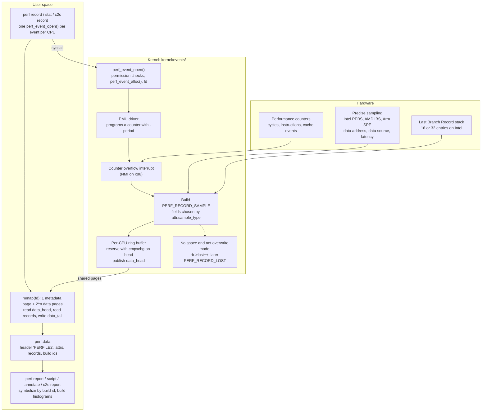

# Linux perf in Depth and perf c2c

> [!summary] Claim:
> Every `perf` subcommand is a client of one system call, `perf_event_open(2)`, which returns a file descriptor for one event on one task or one CPU; reading the descriptor gives a count, and mapping it gives a ring buffer of sample records.
> A sample is written when a counter overflows: the kernel assembles a `PERF_RECORD_SAMPLE` whose fields are chosen by `attr.sample_type`, reserves space in a per-CPU ring buffer, and publishes `data_head`; if the reader is behind, the record is dropped and counted in a later `PERF_RECORD_LOST`.
> User call chains come from one of three sources with different costs: frame pointers walked in the kernel, a copied stack slice unwound later from DWARF CFI, or the hardware Last Branch Record stack.
> `perf c2c` samples memory loads and stores with their data address and data source, and reports the cache lines whose loads hit a line held Modified in another core's cache (HITM), split by offset inside the line, which is what separates false sharing from true sharing.



## The Mechanism

`perf` has two halves that ship together in the kernel source tree: the `perf_events` subsystem in `kernel/events/`, and the `perf` tool in `tools/perf/`.
Every fact in this section is from Linux v7.3 unless another source is named, and every claim about the tool refers to the `perf` built from that tree.
[[Hardware-Performance-Counters-Top-Down-TMA-and-Roofline]] owns what the hardware counters measure, and [[Sampling-vs-Instrumentation-Skid-and-Safepoint-Bias]] owns the statistics of sampling; this note owns the plumbing between the counter and the report.

### 1. One system call

```c
int fd = syscall(SYS_perf_event_open, &attr, pid, cpu, group_fd, flags);
```

`struct perf_event_attr` says what to measure and how to report it.
The `pid` and `cpu` arguments say where, with these combinations from `perf_event_open(2)`:

| `pid` | `cpu` | Meaning |
| :--- | :--- | :--- |
| `0` | `-1` | The calling thread, on any CPU |
| `> 0` | `-1` | That thread, on any CPU |
| `> 0` or `0` | `>= 0` | That thread, only while it runs on that CPU |
| `-1` | `>= 0` | Every thread on that CPU (system-wide; needs privilege) |
| `-1` | `-1` | Invalid |

The fields of `attr` that decide everything else:

- `type` and `config` select the event: `PERF_TYPE_HARDWARE` (0), `PERF_TYPE_SOFTWARE` (1), `PERF_TYPE_TRACEPOINT` (2), `PERF_TYPE_HW_CACHE` (3), `PERF_TYPE_RAW` (4), `PERF_TYPE_BREAKPOINT` (5), or a dynamic PMU type that `perf` reads from `/sys/bus/event_source/devices/<pmu>/`.
- `size` is the size of the structure the caller was compiled against, which is how the ABI grows: `PERF_ATTR_SIZE_VER0` is 64 bytes and `PERF_ATTR_SIZE_VER9` is 144 bytes at v7.3.
- `sample_period` or, when the `freq` bit is set, `sample_freq`.
- `sample_type`, a bit mask that selects the fields of each sample.
- `read_format`, which selects what `read(fd)` returns beyond the count.
- Bit flags such as `disabled`, `inherit`, `exclude_kernel`, `exclude_user`, `mmap`, `comm`, `task`, and the 2-bit `precise_ip`.

`perf_event_open()` in `kernel/events/core.c` applies these checks before it allocates anything:

1. It rejects unknown `flags` and copies `attr` in, using `attr.size` to accept older and newer layouts.
2. It calls the LSM hook `security_perf_event_open()`.
3. If the event can observe the kernel (`exclude_kernel` is clear, or kernel call chains are requested), it calls `perf_allow_kernel()`, which fails with `EACCES` when `perf_event_paranoid` is above 1 and the caller lacks `CAP_PERFMON`.
4. In frequency mode it fails with `EINVAL` when `sample_freq` is above `kernel.perf_event_max_sample_rate`.
5. If `sample_type` includes `PERF_SAMPLE_PHYS_ADDR` it calls `perf_allow_kernel()` again, with the comment "Only privileged users can get physical addresses".

The fifth check matters for this note: `perf c2c record` always asks for physical addresses, so it needs `CAP_PERFMON` or `perf_event_paranoid <= 1` even when it samples only your own user-space process.

### 2. Counting and sampling

A descriptor can be used in two ways.

Counting: `read(fd)` returns the event count, and with `PERF_FORMAT_TOTAL_TIME_ENABLED` and `PERF_FORMAT_TOTAL_TIME_RUNNING` it also returns how long the event was enabled and how long it was actually on a hardware counter.
The two times differ when more events are requested than the PMU has counters, because the kernel then rotates events on and off the hardware.
`perf stat` scales the raw count by enabled over running and can print the share of time the counter was running; `--no-scale` turns the scaling off.
Counting writes nothing to a buffer, so it is the cheapest mode `perf` has.

Sampling: the PMU driver programs the counter so that it overflows after `sample_period` events.
With `attr.freq = 1` the caller gives a target rate instead, and the man page says "The kernel will adjust the sampling period to try and achieve the desired rate" at each timer tick.
`perf record` uses frequency mode at 4000 Hz by default (`.freq = 4000` in `builtin-record.c`) on the `cycles` event (as of 2026-11, Linux).
On overflow the PMU raises an interrupt, which on x86 is a non-maskable interrupt, and the handler builds one sample.

The instruction pointer in a sample can lag the instruction that caused the overflow, which is skid.
The `precise_ip` field asks the hardware to remove it: `perf-list(1)` defines levels 0 to 3, set with the `:p`, `:pp`, `:ppp` modifiers, and `:P` for the highest level the machine supports.
On Intel the precise levels are implemented with PEBS, and on AMD with IBS op sampling, where the manual notes that all precise levels behave the same because IBS is inherently precise.
[[Sampling-vs-Instrumentation-Skid-and-Safepoint-Bias]] owns why skid misattributes cost.

### 3. The sample record

Every record in the buffer starts with an 8-byte `struct perf_event_header`: a 32-bit `type`, a 16-bit `misc`, and a 16-bit `size`.
For `PERF_RECORD_SAMPLE` (type 9) the body is the concatenation of the fields whose `sample_type` bits are set, always in the order the header file lists them:

| `sample_type` bit | Field | `perf record` option that sets it |
| :--- | :--- | :--- |
| `PERF_SAMPLE_IP` | `u64 ip` | default |
| `PERF_SAMPLE_TID` | `u32 pid, tid` | default |
| `PERF_SAMPLE_TIME` | `u64 time` | default; `-T` forces it |
| `PERF_SAMPLE_ADDR` | `u64 addr`, the data address | `-d` |
| `PERF_SAMPLE_CPU` | `u32 cpu, res` | `--sample-cpu` |
| `PERF_SAMPLE_PERIOD` | `u64 period` | `-P`, and frequency mode |
| `PERF_SAMPLE_CALLCHAIN` | `u64 nr; u64 ips[nr]` | `-g` and every `--call-graph` mode |
| `PERF_SAMPLE_BRANCH_STACK` | `u64 nr;` then `from, to, flags` per entry | `-b`, `-j`, `--call-graph lbr` |
| `PERF_SAMPLE_REGS_USER` | `u64 abi; u64 regs[]` | `--call-graph dwarf`, `--user-regs` |
| `PERF_SAMPLE_STACK_USER` | `u64 size; char data[size]; u64 dyn_size` | `--call-graph dwarf` |
| `PERF_SAMPLE_WEIGHT` | `u64`, such as load latency in cycles | `-W`; on x86 `perf` sets `PERF_SAMPLE_WEIGHT_STRUCT` instead, which fills the same slot (`arch/x86/util/evsel.c`) |
| `PERF_SAMPLE_DATA_SRC` | `u64 data_src`, a `union perf_mem_data_src` | `-d`, `--sample-mem-info` |
| `PERF_SAMPLE_PHYS_ADDR` | `u64 phys_addr` | `--phys-data` |

A reader cannot parse a sample without the `attr` that produced it, which is why `perf.data` stores every `attr` in its header.
The sample size is also the per-sample cost: the default record is a few tens of bytes, and a DWARF call-graph record carries 8192 bytes of stack on top.

Samples alone are not enough to name a function.
With `attr.mmap`, `attr.comm`, and `attr.task` set, the kernel also writes sideband records into the same buffer: `PERF_RECORD_MMAP2` for every executable mapping, `PERF_RECORD_COMM` for name changes, and `PERF_RECORD_FORK` and `PERF_RECORD_EXIT` for task lifetime.
At report time `perf` replays them to rebuild each process's address space at the time of each sample.
`perf-record(1)` says recording build ids in the mmap events is "now the default", so a sample can be tied to the exact binary even after the file on disk has been replaced.

### 4. The ring buffer

`mmap()` on the descriptor maps `1 + 2^n` pages: one metadata page, `struct perf_event_mmap_page`, followed by the data pages.
`perf_mmap_rb()` rejects a data-page count that is neither zero nor a power of two (`nr_pages != 0 && !is_power_of_2(nr_pages)`), so a mapping of the metadata page alone is also accepted.
The metadata page holds the self-monitoring fields first, is padded so that the buffer control fields start at byte 1024, and then holds:

- `data_head`: the byte position the kernel has written up to; it only ever increases and is not wrapped, so the reader masks it with `data_size - 1`.
- `data_tail`: the byte position the reader has consumed up to, written by user space.
- `data_offset` and `data_size`: where the data area starts inside the mapping and how large it is.

The kernel is the only writer and it writes from interrupt and NMI context, so the write path in `kernel/events/ring_buffer.c` takes no lock:

1. `__perf_output_begin()` reads `rb->head`, reads the reader's `data_tail`, and checks free space with `CIRC_SPACE(head, tail, data_size) >= size`.
2. It reserves the space with `local_try_cmpxchg(&rb->head, &offset, head)` and retries if an interrupt that arrived in between moved the head.
3. The caller copies the record into the reserved bytes, which may wrap across the end of the data area.
4. `perf_output_put_handle()` publishes the new head to `user_page->data_head`, but only at the outermost nesting level, so that an NMI that interrupted another writer never publishes a head that covers a half-written record.

The comment in `perf_output_put_handle()` gives the ordering contract between the two sides:

```text
   kernel                             user

   if (LOAD ->data_tail) {            LOAD ->data_head
                      (A)             smp_rmb()       (C)
      STORE $data                     LOAD $data
      smp_wmb()       (B)             smp_mb()        (D)
      STORE ->data_head               STORE ->data_tail
   }
```

A reader therefore loads `data_head`, reads the records between its tail and that head, and only then stores the new `data_tail`.

What happens when the reader is behind depends on how the buffer was mapped:

- Mapped with `PROT_WRITE` (the normal case): the kernel honors `data_tail`.
  When a record does not fit, `__perf_output_begin()` increments `rb->lost` and returns `-ENOSPC`, and the record is gone.
  The next record that does fit is preceded by a `PERF_RECORD_LOST` record carrying the count of drops.
- Mapped read-only: `ring_buffer_init()` sets `rb->overwrite = 1`, the space check is skipped, and new records overwrite the oldest ones.
  `perf record --overwrite` uses this mode, also setting `attr.write_backward` so that the kernel writes from the end of the buffer toward the start, and with `--switch-output` it becomes a flight recorder that is snapshotted on `SIGUSR2`.

`CIRC_SPACE(head, tail, size)` is defined in `include/linux/circ_buf.h` as `CIRC_CNT(tail, head + 1, size)`, which keeps one byte free, so a buffer of `data_size` bytes holds at most `data_size - 1` bytes of unread records.

Three more rules decide how `perf record` lays its buffers out:

- `perf_mmap()` refuses to map an inherited per-task event ("This would create a performance issue due to all children writing to the same rb"), which is why `perf record` opens each inherited event once per CPU and reads one buffer per CPU.
- The default buffer size comes from `kernel.perf_event_mlock_kb`, whose default is 512 kB plus one page; `perf` subtracts the page and rounds down to a power of two, giving 128 data pages plus the metadata page per buffer with 4 KiB pages (`perf_event_mlock_kb_in_pages()` in `util/evlist.c`), and `-m` overrides it.
- The reader is woken when unread data passes a watermark, which `ring_buffer_init()` sets to half the buffer when the event did not set one.

### 5. Throttling

Sampling runs in interrupt context, so the kernel protects itself in two ways.

- `kernel.perf_event_max_sample_rate` (default 100000) caps `sample_freq`, and an event that reaches `max_samples_per_tick` overflows in one timer tick is throttled, together with its group, until the next tick, which appears in the stream as `PERF_RECORD_THROTTLE` and `PERF_RECORD_UNTHROTTLE`.
- `perf_sample_event_took()` keeps a running average of how long each sample takes; when it exceeds the budget set by `kernel.perf_cpu_time_max_percent` (default 25), the kernel lowers `perf_event_max_sample_rate` itself and logs "perf: interrupt took too long ... lowering kernel.perf_event_max_sample_rate to N".

The second mechanism is sticky: the sysctl stays lowered until someone raises it, so one expensive session reduces the rate for every later one.
`perf record -F max` asks for the current ceiling; a higher request is lowered to the ceiling with a warning ("Maximum frequency rate ... exceeded, throttling" in `util/record.c`), and `--strict-freq` turns that warning into an error.

### 6. Call chains: frame pointers, DWARF, LBR

`perf record -g` enables call-graph recording, and `--call-graph` picks the method for user space; the default is `fp`.
Kernel stacks are always unwound by the kernel's own unwinder, ORC or frame pointer depending on its configuration.
[[Stack-Unwinding-CFI-and-Exception-ABI]] owns the unwinding formats themselves; the table is what each choice costs `perf`.

| Method | What is recorded per sample | Where unwinding happens | Limits |
| :--- | :--- | :--- | :--- |
| `--call-graph fp` | `PERF_SAMPLE_CALLCHAIN`: up to `kernel.perf_event_max_stack` return addresses (default 127) | In the kernel, at sample time, by following the frame-pointer chain | Needs every frame built with frame pointers, otherwise "bogus call graphs" |
| `--call-graph dwarf[,size]` | `PERF_SAMPLE_CALLCHAIN` for the kernel frames only (`exclude_callchain_user` is set), plus `PERF_SAMPLE_REGS_USER` and `PERF_SAMPLE_STACK_USER`: the registers and a copy of the top of the user stack, 8192 bytes by default, at most 65528 | User frames in `perf report`, from `.eh_frame` or `.debug_frame`, using libunwind or libdw | Large samples; stacks deeper than the copied slice are truncated; the kernel does no user-space unwinding |
| `--call-graph lbr` | `PERF_SAMPLE_BRANCH_STACK` in call-stack mode | In hardware: calls push, returns pop | Intel only ("new Intel platforms, such as Haswell"), user space only, depth is the LBR size, cannot be combined with branch sampling |
| `--call-graph fp,defer` | A deferred marker, then a `PERF_RECORD_CALLCHAIN_DEFERRED` record | In the kernel, when the thread returns to user space | Present from Linux 6.19 in both the UAPI header and `perf-record(1)` |

Notes on each:

- Frame pointers cost one register and a few instructions per function, and nothing extra at sample time beyond a short pointer walk.
- The DWARF mode exists because the kernel has no DWARF unwinder for user space; the Fedora frame-pointer proposal says `perf` therefore "copies the full stack on every event and unwinds in user space", which "has very high overhead".
  At the defaults, 8192 bytes at 4000 samples per second is about 31 MiB of stack per second for each busy CPU before compression, which follows from the two defaults and is not a measurement.
- The LBR depth is the size of the hardware stack: `lbr.c` sets `lbr_nr` to 16 for Haswell and 32 for Skylake, and reads it from CPUID on processors with Architectural LBR.
  `perf report --stitch-lbr` tries to join consecutive samples into deeper stacks and its manual warns that it "is not foolproof".
- [[Intel-VTune-AMD-uProf-and-Hardware-Tracing-PT-SPE]] owns Intel PT and Arm SPE as tracing sources, and [[Cpp-PGO-AutoFDO-and-BOLT-Workflow]] owns the use of branch stacks (`-b`) as compiler feedback.

### 7. From perf.data to a report

`perf record` drains every buffer into `perf.data`.
The file starts with a `perf_header` whose magic is `PERFILE2`, followed by sections for the event attributes and the raw records, then feature sections such as build ids, hostname, CPU topology, and the command line.
The records are stored as the kernel wrote them, so `perf report -D` or `perf script` can show every one.

The consumers:

- `perf report` sorts samples into histograms, by default on `comm,dso,symbol`.
  With call chains recorded it adds a "Children" column that accumulates each callee's samples into its callers; this is on by default and `--no-children` shows self time only.
- `perf annotate` attributes samples to instructions and interleaves source lines when the object has debug information.
- `perf script` prints one line per sample with fields chosen by `-F`; it is the input to flame graph tooling, and `perf script report flamegraph` renders one directly.
  [[Flame-Graphs-Differential-Flame-Graphs-and-Visualizations]] owns reading them.
- `perf top` does record and report live.

### 8. The other subcommands in one table

These are thin front ends over the same events, mostly tracepoints.

| Subcommand | What it records | What it reports |
| :--- | :--- | :--- |
| `perf stat` | Counts only, no samples | Totals, ratios, `-r N` for mean and standard deviation over runs, `-I ms` for interval deltas, `--topdown` and `-M` for metrics |
| `perf sched` | Scheduler tracepoints through `perf sched record` | `latency` for per-task run-queue delay, `map` for a per-CPU switch picture, `timehist` for per-event wait and run times |
| `perf lock` | Lock events through `perf lock record`, or live with BPF | `report` and `contention`; `contention -b` uses a BPF program instead of a recording |
| `perf trace` | `raw_syscalls` tracepoints, optionally page faults (`-F`) | An strace-like stream, or `-s` for a per-thread syscall summary |
| `perf mem` | Memory load and store samples with data source | Access profile by cache level, snoop result, TLB, and lock |
| `perf c2c` | The same memory samples plus physical address and CPU | Cache lines ranked by HITM, with per-offset detail |

[[Off-CPU-Analysis-Thread-States-and-Causal-Profiling]] owns the off-CPU method that `perf sched` and `perf record --off-cpu` feed, and [[eBPF-bpftrace-ftrace-uprobes-and-USDT]] owns the BPF machinery that `perf lock contention -b` and `perf trace --bpf-summary` rely on.

### 9. perf c2c: cache-to-cache transfers

#### What is being measured

A core must own a cache line exclusively before it can write to it, and other cores must drop or downgrade their copies.
When a core then loads from a line that another core holds in the Modified state, the request finds that modified copy, and the data has to come from the other core's cache instead of from a shared cache level or memory.
The hardware reports that load as a snoop "hit modified", HITM, and Joe Mario's write-up of the tool calls it "the key that false sharing has occured".

Two cases produce the same HITM traffic:

- True sharing: several threads read and write the same variable, such as a lock word or a shared counter.
- False sharing: threads touch different variables that sit in the same line, so the line bounces although no data is shared.

The fix differs (reduce sharing in the first case, move a field in the second), so the tool must show which bytes of the line each thread touches.

#### What perf c2c records

`perf c2c record` is `perf record` with a fixed set of options; `perf_c2c__record()` builds the command line.
It adds `-W -d --phys-data --sample-cpu` and the memory events for the platform, from the table in `perf-c2c(1)`:

| Platform | Default events | Hardware facility |
| :--- | :--- | :--- |
| Intel | `cpu/mem-loads,ldlat=30/P` and `cpu/mem-stores/P` | PEBS load latency and precise store |
| Intel with an auxiliary event | `{cpu/mem-loads-aux/,cpu/mem-loads,ldlat=30/}:P` and `cpu/mem-stores/P` | Same, with the extra group leader those cores need |
| AMD | `ibs_op//`, or `ibs_op/ldlat=30/` where the PMU advertises latency filtering | IBS op sampling; the manual says c2c "is not supported on Zen3 cpus", and its `--ldlat` entry gives the supported AMD range as 128 to 2048 with filtering off by default, which does not agree with the 30 in its own table |
| Arm64 | `arm_spe_0/ts_enable=1,pa_enable=1,load_filter=1,store_filter=1,min_latency=30/` | Statistical Profiling Extension |
| PowerPC | `cpu/mem-loads/` and `cpu/mem-stores/` | Random instruction sampling with thresholding |

Each sample carries the data virtual address, the physical address, the CPU, a weight, and a `data_src` word.
Two consequences of the event definitions are easy to miss:

- `ldlat=30` is a latency threshold in cycles (`perf_mem_events__loads_ldlat = 30`): on Intel only loads at or above the threshold are candidates, so most ordinary first-level cache hits are filtered out, although slow ones still appear, which is why the report has a `Load L1D hit` row.
- `perf-mem(1)` notes that on Intel the reported latency is "use-latency", which includes pipeline queuing, not pure memory latency.

`data_src` is a `union perf_mem_data_src`; on a little-endian machine its fields sit at these bit positions:

| Field | Bits | Values that matter here |
| :--- | :--- | :--- |
| `mem_op` | 0-4 | `PERF_MEM_OP_LOAD` 0x02, `PERF_MEM_OP_STORE` 0x04 |
| `mem_lvl` | 5-18 | `HIT` 0x02, `MISS` 0x04, `L1` 0x08, `LFB` 0x10, `L2` 0x20, `L3` 0x40, `REM_CCE1` 0x400, `REM_CCE2` 0x800 |
| `mem_snoop` | 19-23 | `NONE` 0x02, `HIT` 0x04, `MISS` 0x08, `HITM` 0x10 |
| `mem_lock` | 24-25 | `LOCKED` 0x02 |
| `mem_dtlb` | 26-32 | TLB hit or miss level |
| `mem_lvl_num` | 33-36 | Numbered level, the newer encoding |
| `mem_remote` | 37 | Remote node |
| `mem_snoopx` | 38-39 | `FWD` 0x01, `PEER` 0x02 |

`c2c_decode_stats()` in `util/mem-events.c` turns that word into the report's counters.
For a load it counts a local HITM when the level is an L2 or L3 hit and the snoop field has `HITM`, and a remote HITM when the level is a remote cache (or the remote bit is set with no hop count) and the snoop field has `HITM` but not `HIT`, which is tested first and counted as a remote hit.
"Local" and "remote" refer to NUMA nodes: Joe Mario describes local as "loads that hit in a modified cache on the same numa node" and remote HITMs as "the most expensive".
On Arm64 `perf c2c report` defaults to the peer display, which ranks lines by loads supplied from a peer cache (`PERF_MEM_SNOOPX_PEER`) instead of by HITM.

Only loads are classified as HITM.
A store that has to take the line from another core is sampled as a store and counted only as an L1 hit, an L1 miss, uncached, or level not available, so a line whose contended accesses are nearly all stores gives the report little to rank it by.

#### What perf c2c report shows

The report groups samples by cache line, `address & ~(line_size - 1)`, where `cacheline_size()` asks `sysconf(_SC_LEVEL1_DCACHE_LINESIZE)` when the C library defines it and reads `coherency_line_size` from sysfs otherwise.
With `--stdio` it prints four tables, with a short "c2c details" block (events, sort column, grouping) between the second and the third:

1. Trace Event Information: totals over all samples, including `Load Local HITM`, `Load Remote HITM`, and the store counts.
2. Global Shared Cache Line Event Information: the same totals restricted to lines that count as shared.
3. Shared Data Cache Line Table: one row per line, sorted by total HITM by default, with index, line address, NUMA node, share of all HITMs, and load and store breakdowns.
4. Shared Cache Line Distribution Pareto: for each line, one row per offset and code address, with the share of the line's HITMs and stores, the code address and symbol, the source line, the number of CPUs involved, and a pid or tid column when `--coalesce` asks for one.

A line is listed only when it holds at least a minimum share of all HITMs: `DISPLAY_LINE_LIMIT` is 0.001 in `builtin-c2c.c` at v7.3, while the manual's `--show-all` entry gives the limit as 0.0005; `--show-all` removes the filter.

Reading it is a fixed procedure:

1. In the first table, check that HITM counts are not near zero; Joe Mario's rule for multi-socket machines is that if the remote HITM share is "not close to zero, then there's likely worthwhile false sharing to pursue".
2. In the cache line table, take the top one to three lines; they usually hold most of the HITMs.
3. In the Pareto table for such a line, look at the offsets.
   Different offsets written and read by different code addresses on different CPUs is false sharing.
   One offset touched by everyone is true sharing.
4. Turn the code addresses and source lines into fields, and move the written field to its own line or group fields by writer.

Options that change the answer:

- `-c tid,iaddr` or `-c pid,iaddr` (`--coalesce`) chooses how rows inside a line are merged and which identity columns are shown.
  `perf-c2c(1)` gives the default as `pid,iaddr`, but `builtin-c2c.c` at v7.3 sets `coalesce_default = "iaddr"`, so the default report merges every thread and process at a code address and shows neither a pid nor a tid.
- `-d lcl`, `-d rmt`, `-d tot`, `-d peer` chooses the sort column.
- `-N` adds, per NUMA node, the CPU count and the shares of HITMs (or peers) and stores, and passing it twice lists the CPUs instead (`node_info` in `builtin-c2c.c`).
- `--double-cl` groups by pairs of lines, for processors whose adjacent-line prefetcher makes sharing "behave like the cacheline size is doubled".
- `perf c2c record -- -g` adds call chains, and `perf c2c report -g` shows them, which is how a contended line in a shared library is traced to its callers.

The first `builtin-c2c.c` is in Linux 4.10; the file does not exist in the v4.9 tree.

## Commands and Numbers to Know

| Item | Value | Platform and date | Why it matters |
| :--- | :--- | :--- | :--- |
| `kernel.perf_event_paranoid` | default `2`; `-1` (almost) all events for all users, `>= 0` no raw tracepoints, `>= 1` no CPU-wide events, `>= 2` no kernel profiling | Linux (as of 2026-11) | Applies to callers without `CAP_PERFMON`; default has been 2 since Linux 4.6 |
| `CAP_PERFMON` | capability 38 | Linux (as of 2026-11) | Least-privilege replacement for `CAP_SYS_ADMIN` for perf; in the UAPI header from Linux 5.8 |
| `kernel.perf_event_max_sample_rate` | default `100000` | Linux (as of 2026-11) | Ceiling for `-F`; the kernel lowers it by itself when samples take too long |
| `kernel.perf_cpu_time_max_percent` | default `25`; `0` disables | Linux (as of 2026-11) | Budget that triggers the automatic lowering |
| `kernel.perf_event_mlock_kb` | default `516` with 4 KiB pages | Linux (as of 2026-11) | Ring buffer memory not charged to `RLIMIT_MEMLOCK`; the per-user allowance is this value times the number of online CPUs |
| `kernel.perf_event_max_stack` | default `127` | Linux (as of 2026-11) | Deepest frame-pointer call chain the kernel records |
| `perf record -F` | default `4000` Hz | Linux (as of 2026-11) | Frequency mode; `-c N` switches to a fixed period |
| `perf record -m` | default 128 data pages per buffer with 4 KiB pages | Linux (as of 2026-11) | Raise it when the report warns about lost samples |
| `perf record -g` | same as `--call-graph fp` | Linux (as of 2026-11) | Useless on binaries built without frame pointers |
| `--call-graph dwarf` | 8192-byte stack copy per sample, maximum 65528 | Linux (as of 2026-11) | Sample size and file size grow by that much |
| `--call-graph lbr` | 16 entries on Haswell, 32 on Skylake | Linux, Intel (as of 2026-11) | No compiler flags needed; user space only |
| `--call-graph fp,defer` | documented from Linux 6.19 | Linux (as of 2026-11) | User chain collected on return to user space |
| `perf record -d` | adds `PERF_SAMPLE_ADDR` and data source | Linux (as of 2026-11) | Needed for any data-address analysis |
| `perf record -b` | branch stack sampling, any taken branch | Linux (as of 2026-11) | Input for AutoFDO and BOLT, not a call graph |
| `perf record --switch-output` | rotate on `SIGUSR2`, size, or time | Linux (as of 2026-11) | With `--overwrite`, a flight recorder |
| `perf record -z` | compression level 1 by default when given | Linux (as of 2026-11) | Cuts file size for DWARF call graphs |
| `perf stat -r N` | repeat, print mean and stddev, at most 100 | Linux (as of 2026-11) | The quick answer to "is this difference noise" |
| `perf stat -d` | adds L1 and LLC events; up to three `-d` | Linux (as of 2026-11) | Extra events can force multiplexing |
| `perf report --no-children` | self time only | Linux (as of 2026-11) | `--children` is the default and changes the sort order |
| `perf c2c record` | adds `-W -d --phys-data --sample-cpu` | Linux (as of 2026-11) | `--phys-data` is why it needs `CAP_PERFMON` or paranoid `<= 1` |
| `perf c2c record -l` | load latency threshold, default `30` cycles | Linux (as of 2026-11) | Joe Mario suggests 50 or 70 on busy machines with many CPUs, for richer samples and less perf overhead |
| `perf c2c report -c` | `iaddr` in the v7.3 source (`pid,iaddr` per the manual); fields `tid,pid,iaddr,dso` | Linux (as of 2026-11) | Use `tid,iaddr` to see which thread owns each offset |
| `perf c2c report -d` | `tot` by default, `peer` on Arm64 | Linux (as of 2026-11) | `lcl` and `rmt` sort by local or remote HITM |
| `perf c2c report --double-cl` | off by default | Linux (as of 2026-11) | For adjacent-line prefetch effects |
| `perf script -F addr,data_src` | hex address, hex `data_src`, decoded text | Linux (as of 2026-11) | Scriptable view of the same samples; the lab uses it |
| `PERF_CONFIG=/dev/null` | disables config files | Linux (as of 2026-11) | Reproducible runs in scripts and CI |

A minimal session for each rung of use:

```bash
# Count: is the difference real, and is it instructions or cycles per instruction?
perf stat -r 5 -e cycles,instructions,cache-misses -- ./app

# Sample with frame-pointer call chains at a rate that does not align with timers.
perf record -F 999 -g -- ./app
perf report --no-children --stdio | head -50

# No frame pointers in the binary: pay for DWARF, with compression.
perf record -F 999 --call-graph dwarf,16384 -z -- ./app

# Cache line contention, system-wide, user space only, for five seconds.
perf c2c record -F 60000 -a --all-user sleep 5
perf c2c report -NN -c tid,iaddr --stdio > c2c.txt
```

The `perf c2c` pair is Joe Mario's recommended shape: a high sample rate over a short window, because longer runs "may take you from seeing concurrent false sharing to seeing cacheline accesses which are disjoint in time".

## Multi-Language Comparison

`perf` sees machine code, so what differs between languages is how stacks become walkable, how addresses become names, and how a type gets its own cache line.

| Concern | C++ | Python | Rust |
| :--- | :--- | :--- | :--- |
| Frame pointers for `--call-graph fp` | `-fno-omit-frame-pointer`, plus `-mno-omit-leaf-frame-pointer` as Fedora adds | The interpreter itself must be built with them; the 3.15 how-to says CPython builds itself with `-fno-omit-frame-pointer` on supported toolchains | `-C force-frame-pointers=yes`; otherwise the default "depends on the target" |
| Naming frames | ELF symbols and DWARF, located by build id | `-X perf` or `PYTHONPERFSUPPORT=1` since Python 3.12 makes Python functions visible to `perf`; `-X perf_jit` is the DWARF path for interpreters without frame pointers | ELF symbols with Rust mangling, demangled by `perf` |
| Giving a field its own line | `alignas(std::hardware_destructive_interference_size)` from `<new>`, C++17 | Not expressible in the language; contention lives in the extension or the runtime | `#[repr(align(N))]`, or `crossbeam_utils::CachePadded<T>` |
| Padding size chosen by the library | Implementation-defined constant; cppreference guarantees only "at least `alignof(std::max_align_t)`" | n/a | `CachePadded` uses 128 bytes on x86-64, aarch64, and powerpc64, 32 on arm, mips, mips64, sparc, and hexagon, 16 on m68k, 256 on s390x, and 64 on all others; its documentation gives the x86-64 reason as the prefetcher that pulls pairs of lines |
| Owning note | [[Cpp-CPU-Profiling-perf-samply-Callgrind-and-llvm-mca\|Cpp CPU Profiling]] | [[Python-CPython-perf-Trampoline-and-Tachyon-Internals\|CPython perf Trampoline]] | [[Rust-CPU-Profiling-cargo-flamegraph-samply-and-Frame-Pointers\|Rust CPU Profiling]] |

The Rust and C++ padding choices disagree on x86-64 on purpose: 64 bytes separates two lines, and 128 bytes also defeats the prefetcher that the crossbeam documentation describes as "pulling pairs of 64-byte cache lines at a time".
`perf c2c report --double-cl` is the diagnostic for that case.

## Worked Lab Example

The lab is `code/05-Profiling/perf_c2c_false_sharing/`.
It declares `# requires: linux, pmu`, so the harness skips it everywhere except a Linux host with `TOOLCHAIN_LABS_PMU=1`; the pinned lab container cannot run it, because the container VM exposes no hardware counters and the image has no `perf`.

```bash
cd code/05-Profiling/perf_c2c_false_sharing
TOOLCHAIN_LABS_PMU=1 bash run.sh
```

It needs `perf` with memory sampling support, `python3`, a C compiler, two physical cores, and `CAP_PERFMON` or `kernel.perf_event_paranoid <= 1`.

### Stage 1: the ring buffer without the perf tool

`ring_buffer.c` calls `perf_event_open()` directly on a software event, `PERF_COUNT_SW_TASK_CLOCK`, so this stage needs no hardware counter.

1. It opens the event on the calling thread (`pid = 0`, `cpu = -1`) with a 1 ms period, `sample_type = IP | TID | TIME`, and `exclude_kernel = 1`.
2. It maps 1 + 8 pages read-write and checks `data_offset` and `data_size` in the metadata page.
3. It burns 200 ms of thread CPU time, then walks the records from `data_tail` to `data_head`, copying across the wrap, and checks that the record sizes tile the range exactly and that each sample carries its own pid and tid.
4. It opens a second event with a 100 microsecond period and a single data page, and consumes nothing until the buffer stops filling.
5. It checks that the unread records are intact, consumes them, samples for 5 ms more, and checks that the first new record is `PERF_RECORD_LOST` with a nonzero count.

Step 5 is the non-overwrite contract from "The ring buffer" made observable: the kernel dropped new samples instead of overwriting old ones, and reported the drops only once there was room to write the report.

### Stage 2: perf c2c on a false-sharing pair

`false_sharing.c` starts a writer thread that increments `writer_count` and a reader thread that only loads `reader_value`.
`run.sh` reads the line size from sysfs and builds the program twice with `-DLINE=<size>`: `-DPADDED=0` puts the two fields 8 bytes apart in one line, and `-DPADDED=1` gives each field its own line with `alignas(LINE)`.
`c2c_check.py pick-cpus` chooses two CPUs on different physical cores from sysfs topology, and each thread pins itself to one.

For each build the script runs:

```bash
perf c2c record --all-user -- -q -N -o packed.data ./fs_packed packed.info "$CPU_A" "$CPU_B" 3000
perf --no-pager script -i packed.data -F addr,data_src > packed.script
perf --no-pager c2c report -i packed.data --stdio > packed.c2c
```

Options before `--` belong to `perf c2c record`, and options after it are passed to `perf record`.
The program writes the address of its struct and the field offsets to the `.info` file, and `c2c_check.py report` joins that with the two views:

- From `perf script`, it decodes each `data_src` with the bit positions in the table above and counts loads that carry `HITM` or `PEER`, bucketed by data address.
- From `perf c2c report --stdio`, it reads the HITM and peer totals in Trace Event Information and the address in row 0 of the Shared Data Cache Line Table.

Sample counts vary from run to run, so the script prints no raw count.
Each line states a threshold and prints `yes` or `no`:

- `[layout]`: the offsets and `sizeof` of each build, and whether the two fields share a line.
- `packed: contended load samples on the shared line, at least 100`.
- `packed: at least 90% of them load +8, the reader's field`.
- `packed: store samples at +0, the writer's field, at least 100`.
- `padded: contended load samples on the two fields' lines, at most 5% of packed`.
- `snoop flag on the contended loads`: `HITM` on x86, `peer` on Arm SPE.
- `packed: HITM and peer loads in Trace Event Information, at least 100`.
- `packed: row 0 of the Shared Data Cache Line Table is the shared line`.
- `padded: HITM and peer loads in Trace Event Information, at most 20% of packed`.
- `padded build completes at least 1.2x the iterations of the packed build`, measured in a separate run of both programs without `perf`.

Every line can fail.
If the two fields did not share a line, the two `packed` contended-load lines and the two `packed` report lines would print `no`, while the store line would still print `yes`, because the writer stores to its field either way; if padding did not remove the contention, the `padded` lines would print `no`.

### Verification status

No `expected/<platform>.txt` is recorded for this lab, so this note shows no output block.
The drafting host is an Apple silicon Mac, where neither the host nor the lab container has a PMU that `perf c2c` can use.

What was run on 2026-11-10, and is not a harness recording:

- Stage 1 was compiled with the pinned lab image's GCC and run three times in a linux-aarch64 container (kernel 7.2.12) with `--security-opt seccomp=unconfined`; every check line printed its passing value each time.
- The same binary under Docker 29.8.2 with the default seccomp profile and all capabilities dropped failed with `perf_event_open: Operation not permitted`, although `perf_event_paranoid` was 2.
- With Debian's `perf` 6.12.116 in that VM, `run.sh` stopped at `perf c2c record` with perf's own message "failed: no PMU supports the memory events" and exit status 1, which is the intended failure on hardware without memory sampling.
- `perf script -F addr,data_src` on a software-event recording made with `-d` printed the 16-column hex address, the hex `data_src`, and the decoded `|OP ...|SNP ...` text, which is the format the checker parses.
- `c2c_check.py report` was run against synthetic files in the documented formats: a recording with HITM on the shared line printed all `yes`, a peer-snoop recording printed `peer`, and a recording without contention printed `no` on every contention line.

Known limits of stage 2, read from the code and not from a run:

- `perf c2c report` calls `setup_nodes()` in `builtin-c2c.c`, which returns `-EINVAL` when the recording's header has no NUMA topology (`env->numa_nodes` is null), and `perf` then prints "Failed setup nodes".
  A kernel or container that hides `/sys/devices/system/node` therefore fails at the `report` step, not at `record`.
- The `c2c_check.py` row pattern for the Shared Data Cache Line Table (`index`, then `0x<address>`) follows the documented table layout and has only been tested against synthetic files.
- The 1.2x padded-versus-packed throughput threshold was only measured on an Apple silicon VM, which has no PMU, so the threshold is untested on the memory-sampling hardware the lab needs.

Stage 2 has not been run on hardware with memory sampling.
The integrator needs a bare-metal Linux host (or a VM with PEBS, IBS, or SPE passed through) to record it.

## Pitfalls

> [!warning] Pitfall: `perf record -g` on binaries without frame pointers
> `-g` means `--call-graph fp`, and the manual warns that code built with `-fomit-frame-pointer` "will produce bogus call graphs".
> The symptom is stacks one or two frames deep, or callers that never call the callee.
> Rebuild with frame pointers, or switch to `--call-graph dwarf` or `lbr`.

> [!warning] Pitfall: DWARF call graphs with the default stack size
> The default copies 8192 bytes of stack; a deeper stack is cut off at that point and the report shows a truncated chain with no warning per sample.
> Raising the size raises the cost of every sample, so raise it only as far as the deepest stack needs.

> [!warning] Pitfall: reading the Children column as self time
> `perf report` sorts by accumulated children time by default when call chains are present, so `main` and thread entry points sit at the top with nearly 100%.
> Use `--no-children` when the question is which function burns the cycles itself.

> [!warning] Pitfall: ignoring lost samples
> With a writable mapping the kernel drops records when the reader falls behind and reports them in `PERF_RECORD_LOST`.
> Dropped samples are not random: they cluster in the busiest moments, which are the ones under investigation.
> Lower the rate, raise `-m`, or shrink the sample (frame pointers instead of DWARF).

> [!warning] Pitfall: the sample rate that lowers itself
> After "perf: interrupt took too long" the kernel has reduced `kernel.perf_event_max_sample_rate`, and it stays reduced.
> A later `perf record -F 20000` then runs at a lower rate than asked, with only a warning, unless `--strict-freq` is given.
> Check the sysctl before comparing sample counts between sessions.

> [!warning] Pitfall: `perf c2c` on two hardware threads of one core
> Sibling hardware threads share their core's first-level cache, so a line that both touch has no other core's cache to be fetched from.
> This follows from the cache topology and was not measured for this note.
> The lab picks CPUs with different (`physical_package_id`, `core_id`) pairs for this reason, and the Practice Drill asks you to test it.

> [!warning] Pitfall: expecting `perf c2c` to work where plain `perf record` does
> It needs memory sampling hardware and physical addresses.
> A cloud VM without PEBS, IBS, or SPE passed through fails with "no PMU supports the memory events", and an unprivileged user at `perf_event_paranoid = 2` is refused because of `--phys-data`.

> [!warning] Pitfall: reading the default Pareto rows as per-thread
> The default coalescing merges rows by code address (`iaddr` in the v7.3 source, `pid,iaddr` in the manual), so one row can combine every thread that ran that instruction.
> False sharing between threads of one process then shows offsets and code addresses but not who touched what.
> Use `-c tid,iaddr`.

> [!warning] Pitfall: concluding "no false sharing" from a low HITM count
> On Intel the load event has a 30-cycle latency threshold, the classification covers loads only, and Arm SPE reports peer snoops instead of HITM.
> A workload dominated by stores, a threshold raised too far, or the wrong display mode can all hide a contended line.

> [!warning] Pitfall: padding to 64 bytes and stopping
> A 64-byte separation puts two fields on different lines, but an adjacent-line prefetcher can still couple neighbors.
> Check with `--double-cl` before and after, and pad to two lines for the hottest fields if it shows coupling.

> [!warning] Pitfall: profiling inside a container with default settings
> The seccomp profile, not `perf_event_paranoid`, can be what refuses `perf_event_open`, as the lab's container run showed.
> Grant `CAP_PERFMON` and a seccomp profile that allows the system call, or profile from the host.

## At Scale

For one engineer on one machine, `perf` is a tool to run and delete.
At fleet size the questions change from "how do I get a profile" to "who may profile what, what does every binary have to carry, and what does it cost when it is always on".

Frame pointers are the first fleet decision, because they are a property of every binary and not of the profiler.

- Fedora 38 enabled `-fno-omit-frame-pointer -mno-omit-leaf-frame-pointer` distribution-wide; its change page reports a kernel build with GCC 2.4% slower, a Blender render 2% slower, and CPython benchmarks 1 to 10% slower, and no significant effect on Redis or on the compression and crypto libraries it tried.
- Ubuntu 24.04 LTS did the same on 64-bit platforms, estimating the penalty at "between 1-2% in most cases", and kept exceptions for packages with higher impact such as the Python interpreter.
- The alternative is to pay per sample instead of per call, with DWARF copies or LBR, and those costs land on the machines being profiled.

Access is the second decision.

- `perf-security.rst` describes a privileged perf users group: a `perf` binary with `CAP_PERFMON` file capability, executable only by that group, instead of lowering `perf_event_paranoid` for everyone.
- Physical addresses, kernel addresses, and other tenants' samples are information leaks, which is why the kernel gates them, so a multi-tenant host should not run at `perf_event_paranoid <= 0`.
- Containers need both the capability and a seccomp rule; decide once at the platform level.

Cost is the third.

| Mode | Cost driver | Fleet use |
| :--- | :--- | :--- |
| `perf stat` counting | Counter reads at context switch | Always on is acceptable; this is what dashboards read |
| Sampling with frame pointers | Samples per second times a short pointer walk | The basis of continuous profiling at a low rate such as 99 or 100 Hz |
| Sampling with DWARF copies | Samples per second times kilobytes copied and written | On demand, short windows, selected hosts |
| `perf c2c` at high rates | Precise memory samples on every CPU plus physical address lookup | On demand, 3 to 10 seconds, during a reproduced incident |

Decision rules:

- One developer to a small team: build with frame pointers, use `perf record -g`, and fall back to `--call-graph dwarf` only for third-party binaries.
- From about 1,000 engineers: make frame pointers a build-system default with a documented opt-out for measured hot spots, and publish a `CAP_PERFMON` group instead of sudo recipes.
- At 10,000 to 50,000 engineers: stop running `perf` by hand for routine questions; a continuous profiler samples the fleet and `perf` becomes the tool for the last mile, which is hardware events, memory sampling, and `perf c2c`.
  [[Continuous-Profiling-GWP-Parca-Pyroscope-and-OTel-Profiles]] owns that system and [[Profiling-Decision-Records]] owns the recorded choices.
- Run `perf c2c` only when counters point at it: throughput that falls as threads are added, with rising cycles per instruction.
  It is a diagnostic for a suspected line, not a monitor.
- Treat the automatic rate reduction as a signal: if hosts log "interrupt took too long", the standard profile configuration is too expensive for that hardware.

## Practice Drill

> [!tip] Practice Drill:
> On a Linux host with memory sampling, run the lab with `KEEP_WORKDIR=1` and open `packed.c2c`.
> Before reading the Pareto table, predict from `false_sharing.c` which offsets will appear, which one carries the HITM percentage, and which one carries the store percentage; then check.
> Next, change the reader thread so that it also writes its field, rebuild, and predict how the HITM split between the two offsets changes.
> Then rerun `perf c2c report` with `-c tid,iaddr` and with the default, and state which columns the default lacks.
> Finally, run `fs_packed` by hand under `perf c2c record` with both CPU arguments set to sibling hardware threads of one core (`thread_siblings_list` in sysfs) and explain the HITM count you get.
> [[Drill-Profiling-False-Sharing-Cache-Contention]] is the timed version of this exercise on a larger program.

```bash
cd code/05-Profiling/perf_c2c_false_sharing
KEEP_WORKDIR=1 TOOLCHAIN_LABS_PMU=1 bash run.sh 2> kept.txt
WORK="$(sed -n 's/^work directory kept: //p' kept.txt)"

# The four tables, in order.
grep -n 'Trace Event Information\|Global Shared Cache Line\|Shared Data Cache Line Table\|Distribution Pareto' "$WORK/packed.c2c"

# Per-thread rows instead of rows merged by code address.
perf --no-pager c2c report -i "$WORK/packed.data" -c tid,iaddr --stdio | less

# The same samples as plain records.
perf --no-pager script -i "$WORK/packed.data" -F addr,data_src | head

# Which CPUs are siblings of CPU 0.
cat /sys/devices/system/cpu/cpu0/topology/thread_siblings_list
```

## Interview Questions

> [!question] L5: What is the difference between `perf stat` and `perf record`, in terms of what the kernel does?
>
> > [!success]- Answer
> > Both open events with `perf_event_open()`.
> > `perf stat` uses them as counters: the kernel keeps a running total per event and the tool reads it with `read()`, along with enabled and running times so it can scale a count when events had to share hardware counters.
> > `perf record` sets a sampling period or frequency, so the counter overflows periodically, and on each overflow the kernel writes a sample record into a memory-mapped ring buffer that the tool drains into `perf.data`.
> > Counting has no per-event cost beyond saving and restoring counters at context switches, while sampling costs an interrupt and a record per sample.
> > Counting answers how many; sampling answers where.

> [!question] L5 (debug this): `perf record -g ./server` followed by `perf report` shows most samples in stacks that are one frame deep, under `[unknown]`; what is wrong and what are the fixes?
>
> > [!success]- Answer
> > `-g` uses frame-pointer unwinding for user space, and the binary or its libraries were built without frame pointers, so the kernel's walk of the frame-pointer chain ends immediately or follows garbage.
> > `[unknown]` in addition means the addresses did not resolve to a mapped object with symbols.
> > Fix one: rebuild with `-fno-omit-frame-pointer` (and the leaf variant), including the libraries on the hot path.
> > Fix two: record with `--call-graph dwarf`, accepting an 8 KiB stack copy per sample and post-processing cost.
> > Fix three, on Intel: `--call-graph lbr`, which needs no rebuild but is limited to the LBR depth and to user space.
> > For JIT or interpreter frames the runtime must also publish symbols, for example Python's `-X perf`.

> [!question] L5 (predict the output): An event is mapped writable with one 4096-byte data page, produces 32-byte sample records, and its reader never advances `data_tail`; how many samples are in the buffer when the kernel stops writing, and what is the first record written after the reader finally consumes everything?
>
> > [!success]- Answer
> > 127 samples.
> > The kernel checks `CIRC_SPACE(head, tail, data_size) >= size`, and `CIRC_SPACE` leaves one byte unused, so at most 4095 bytes can be unread; 127 records are 4064 bytes, and the 128th would need 32 bytes when only 31 are free.
> > Each later sample increments `rb->lost` and is discarded; nothing is overwritten because the mapping is writable.
> > After the reader stores a new `data_tail`, the next write succeeds and is preceded by a `PERF_RECORD_LOST` record whose `lost` field is the number of dropped records.
> > The count 127 follows from the v7.3 source; the lab checks the behavior (full within one record, then a LOST record) without printing the count, because the page size differs between machines.

> [!question] L6: Compare frame-pointer, DWARF, and LBR call chains: what is recorded, where the unwinding happens, and when each is the right choice.
>
> > [!success]- Answer
> > Frame pointers: the kernel walks the saved frame-pointer chain at sample time and records up to `perf_event_max_stack` addresses; it is cheap and exact but needs every frame compiled with frame pointers.
> > DWARF: the kernel copies the user registers and a slice of the user stack (8192 bytes by default) into each sample and `perf report` unwinds later with CFI; it works on any binary with unwind tables but makes samples kilobytes large and truncates deep stacks.
> > LBR: the CPU keeps a stack of call and return branches and the sample carries it; it needs no rebuild and no stack copy, but it is Intel-only, user-only, and as deep as the hardware stack, 16 or 32 entries.
> > Choose frame pointers when you control the build, DWARF for a binary you cannot rebuild and a short capture, and LBR for a hot Intel workload where even frame pointers are unavailable.
> > Kernel frames are unwound by the kernel's own unwinder in all three cases.

> [!question] L6: Explain the `data_head` and `data_tail` protocol, including why the kernel writer needs no lock.
>
> > [!success]- Answer
> > The buffer has one writer context per CPU and one reader.
> > The writer reserves space by advancing a private head with a compare-and-swap, which also handles an NMI interrupting an interrupt-context write on the same CPU: the inner writer completes first and the outer one retries its reservation.
> > Only the outermost writer publishes the head to the shared page, after a write barrier, so the published `data_head` never covers a partly written record.
> > The reader loads `data_head`, reads records up to it, then stores `data_tail` after a full barrier.
> > With a writable mapping the kernel reads `data_tail` before writing and drops the record if it does not fit; with a read-only mapping it ignores the tail and overwrites.
> > Per-CPU buffers mean two CPUs never write to the same buffer, which is also why the kernel refuses to map an inherited per-task event.

> [!question] L6: In a `perf c2c` Pareto table, how do you tell false sharing from true sharing, and why does HITM appear only on loads?
>
> > [!success]- Answer
> > The Pareto table lists, for one cache line, each offset with the code addresses and CPU counts that touched it, and with `-c tid,iaddr` the threads.
> > False sharing shows two or more offsets, each used by different code on different CPUs, typically stores at one offset and HITM loads at another.
> > True sharing shows the same offset read and written from several CPUs.
> > HITM is a property of a load's data source: the hardware reports where the loaded data came from, and "hit modified" means another cache held the line dirty.
> > Stores carry no HITM classification (on Intel they even come from a separate `mem-stores` event) and are counted only by first-level cache outcome, so `perf c2c` ranks lines by load HITMs and uses stores as supporting evidence of who is dirtying the line.

> [!question] L7 (debug this): A service gets slower beyond 8 threads and `perf stat` shows cycles per instruction rising with thread count, but `perf c2c report` shows almost no HITM; in what ways can the tool miss real contention, and how do you rule each out?
>
> > [!success]- Answer
> > The threads may run on sibling hardware threads, which share first-level caches, so no cache-to-cache transfer occurs; check the affinity and topology.
> > The platform may not report HITM: Arm SPE reports peer snoops, so the report must use `-d peer`, and `perf-c2c(1)` says AMD Zen 3 is unsupported.
> > The recording may have filtered the evidence: a raised `--ldlat`, user-only recording when the contended line is in the kernel, or a line below the display limit, which `--show-all` removes.
> > The contention may be write-write with few loads, in which case look at the store counts per line and at the offsets with `perf mem report`.
> > The capture may have been too long or too slow, mixing phases; use a short window at a high rate.
> > And the cause may not be cache lines at all: lock convoys and scheduler delay are checked with `perf lock contention` and `perf sched latency`, and memory bandwidth with counters.

> [!question] L7: A host logs "perf: interrupt took too long (3500 > 2500), lowering kernel.perf_event_max_sample_rate to 57000"; what happened, what are the consequences for later profiling, and what do you change?
>
> > [!success]- Answer
> > The kernel times each sampling interrupt and compares a running average with a budget derived from `perf_cpu_time_max_percent`, 25% by default.
> > The average exceeded the budget, so the kernel lowered the global sample-rate ceiling and the per-tick sample limit to bring perf's CPU share back down.
> > The new ceiling persists: later sessions asking for a higher `-F` are clamped, and `perf_event_open` with a `sample_freq` above it fails with `EINVAL`, so profiles taken before and after are not comparable in sample count.
> > The cause is usually an expensive sample: DWARF stack copies, deep frame-pointer chains, or many events at once.
> > Reduce the per-sample cost or the rate, use `--strict-freq` in automation so a clamp is an error, and restore the sysctl deliberately instead of setting the budget to 0.

> [!question] L7: Why does `perf c2c record` fail for an unprivileged user who can run `perf record` on the same program, and what is the least privilege that fixes it?
>
> > [!success]- Answer
> > `perf c2c record` adds `--phys-data`, which sets `PERF_SAMPLE_PHYS_ADDR`, and `perf_event_open()` calls `perf_allow_kernel()` for that bit even when the event excludes the kernel.
> > At the default `perf_event_paranoid = 2` that check fails without `CAP_PERFMON`.
> > Physical addresses are gated because they reveal memory layout that helps attacks on the kernel and on other tenants.
> > The least privilege is `CAP_PERFMON` on the `perf` binary restricted to a group, as `perf-security.rst` describes, not `CAP_SYS_ADMIN` and not a host-wide lower paranoid level.
> > In a container the seccomp profile must also allow the system call.

> [!question] L8+: You own profiling for 20,000 engineers; do you mandate frame pointers or rely on DWARF and hardware call chains, and what evidence would change the decision?
>
> > [!success]- Answer
> > Mandate frame pointers by default in the build system, with a reviewed opt-out.
> > The cost is paid per call and has been measured by distributions at low single digits for most workloads, with outliers such as an interpreter loop at up to 10%; the benefit is that every profiler, including in-kernel and BPF-based ones, gets complete stacks at the cost of a pointer walk.
> > DWARF copying moves the cost to the profiled host at sample time and scales with rate and stack size, which rules it out for always-on profiling, and LBR is vendor- and depth-limited.
> > Keep DWARF for third-party binaries and LBR for targeted Intel investigations.
> > Evidence that would change it: a measured regression on a revenue-critical hot path that survives per-function opt-outs, or a kernel-side unwinder for a compact format reaching the kernels and toolchains the fleet actually runs, such as the deferred user unwinding that `--call-graph fp,defer` exposes from Linux 6.19.
> > Record the decision and its revisit condition in a decision record.

> [!question] L8+: Design the policy for using `perf c2c` in production.
>
> > [!success]- Answer
> > Trigger: counters first; use it only when throughput falls with added threads and cycles per instruction rise, or when a profile shows time in code that touches shared structures.
> > Scope: one host that reproduces the problem, a 3 to 10 second window, user space only unless the kernel is suspected, and a latency threshold raised on busy machines with many CPUs, as the tool's author advises.
> > Privilege: a `CAP_PERFMON` group for the on-call role, with the capture command wrapped so that physical addresses never leave the host unredacted.
> > Output: the top lines from the cache line table and their Pareto rows with `-c tid,iaddr`, attached to the incident, plus the data type of each hot offset.
> > Fix verification: the same capture after the change, compared on HITM count for the line and on the service metric, because moving a field can push a different field onto the hot line.
> > Prevention: put the per-thread and per-core hot structures behind a padded wrapper type in the shared libraries, and add a layout assertion on the size and alignment of the structures that were fixed.

## Further Reading

- `perf_event_open(2)` (man-pages 6.19): the reference for every `attr` field, the mmap layout, and the record formats.
- `include/uapi/linux/perf_event.h` at v7.3: the ABI itself, including the comment block that documents the sample layout and the `perf_mem_data_src` encoding.
- `kernel/events/ring_buffer.c` at v7.3: the lock-free write path and the barrier diagram that defines the reader's obligations.
- `perf-record(1)`, `perf-report(1)`, `perf-stat(1)`, `perf-script(1)` at v7.3: the options and defaults quoted in this note.
- `perf-c2c(1)` at v7.3: the per-architecture event table, every report column, and the function view added to the TUI.
- Joe Mario, "C2C - False Sharing Detection in Linux Perf" (2016): the tool's author walking through a real report and giving the capture settings to use.
- `Documentation/admin-guide/perf-security.rst` at v7.3: `CAP_PERFMON`, the paranoid levels, and how to set up a privileged perf users group.
- Brendan Gregg, "perf Examples": the one-liner collection and the argument for frame pointers that most later material repeats.
- Fedora, "Changes/fno-omit-frame-pointer", and Ubuntu, "Performance Engineering with Frame Pointers by Default": the measured costs behind the distribution-wide decisions.

## Related

- Prerequisites: none
- Next: [[eBPF-bpftrace-ftrace-uprobes-and-USDT]]
- See also: [[12-Performance-Engineering/02-Profiling/profiling_guide|profiling_guide]], [[14-Low-Latency-Systems/11 - Participant-Side Systems/Drill - 11 Tick-to-Trade Pipeline Bottleneck Hunting|Drill   11 Tick to Trade Pipeline Bottleneck Hunting]]
- Lab: `code/05-Profiling/perf_c2c_false_sharing/` (requires: linux, pmu)
