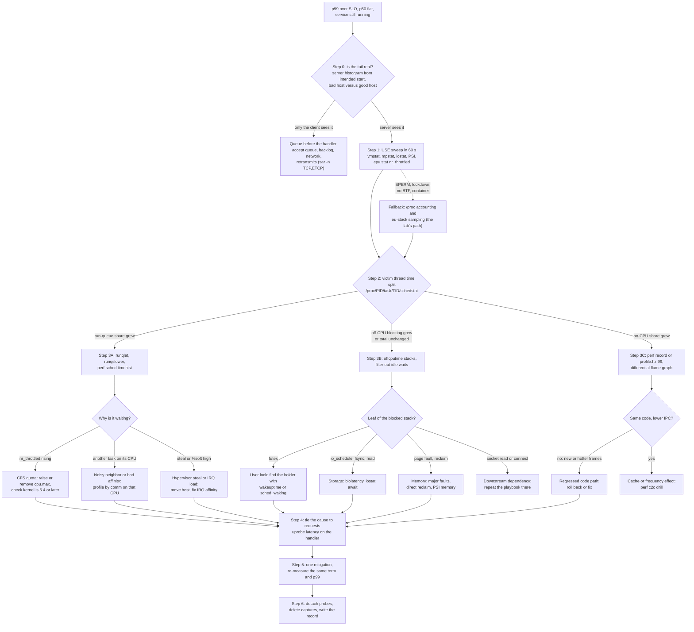

# Playbook: Diagnose a Production Tail Latency Spike With eBPF and perf

> [!summary] Claim:
> The wall time of a request is a sum of four terms: time on a CPU, time runnable but waiting for a CPU, time blocked off the CPU, and time queued before the server looked at it.
> A tail latency spike is one of those terms growing for a small share of requests, and each term has its own instrument: a sampling profiler for on-CPU time, run-queue latency for the wait, off-CPU stacks and wakers for blocking, and a clock that starts at the intended send time for the queue.
> Triage is therefore a decomposition, not a search: prove the tail is real, find which term grew, then name the code path or the neighbor responsible, and stop measuring as soon as a mitigation is justified.
> Every probe in this playbook attaches to a live process without a restart, costs something per event, and is removed at the end.

The perf subsystem itself is owned by [[Linux-perf-in-Depth-and-perf-c2c]].
The BPF verifier, probe types, and bpftrace language are owned by [[eBPF-bpftrace-ftrace-uprobes-and-USDT]].
Flame graph construction is owned by [[Flame-Graphs-Differential-Flame-Graphs-and-Visualizations]], and latency statistics by [[Statistics-for-Benchmarks-Coordinated-Omission-and-HDR-Histograms]].
This playbook owns the incident procedure that uses all four.

## Trigger and Symptoms

Activate this playbook when a service is up and answering, but slowly for some requests.

- An alert fires on p99 or p99.9 latency while p50 and throughput are roughly flat.
  A regression that moves the median as well is usually a plain CPU or capacity problem; start with [[Cpp-CPU-Profiling-perf-samply-Callgrind-and-llvm-mca]] instead.
- The latency histogram grows a second mode.
  The position of that mode is a fingerprint when it matches a kernel constant (as of 2026-11, Linux, kernel master):
  - 200 ms is `TCP_RTO_MIN` (`HZ/5` in `include/net/tcp.h`): one retransmission timeout.
  - 40 ms is `TCP_DELACK_MIN` (`HZ/25`): a delayed ACK interacting with a small write.
  - 1 s is `TCP_TIMEOUT_INIT`: a lost SYN or SYN-ACK.
  - A mode at or just under 100 ms, or at 100 ms minus the group's quota, is CFS bandwidth throttling, whose default period is 100 ms.
- The slow requests come in bursts with a period (every 5 s, every minute, on the hour).
  Periodicity points at a timer: a flush, a compaction, a garbage collection, a cron job, a batch neighbor.
- Clients time out, but the server's own handler-duration metric looks healthy.
  That is not a contradiction; it is the "queued before the server looked at it" term, which a handler timer cannot see.

Do not use this playbook when the process died (use [[Debug-a-Production-Crash-From-a-Core-Dump]]), or when cache-line contention is already confirmed (go straight to [[Drill-Profiling-False-Sharing-Cache-Contention]]).

The decomposition that the rest of the procedure walks:

```text
latency(request) = queued before the handler runs   client, network, accept queue, backlog behind a slow request
                 + on-CPU in the handler            instructions executed, in user and kernel mode
                 + runnable, waiting for a CPU      run-queue latency, cgroup throttling, hypervisor steal
                 + blocked off-CPU                  locks, disk and network I/O, page faults, sleeps
```

Tail latency matters more than its percentile suggests because of fan-out.
If a page needs 100 backend calls and each one has a 1 percent chance of being slow, then 1 - 0.99^100 = 63 percent of pages see at least one slow call.
Dean and Barroso's "The Tail at Scale" is the standard treatment of why rare slow episodes come to dominate a large service.

## Decision Tree



## Prerequisites

### Tools

```bash
command -v perf bpftrace pidstat mpstat iostat sar
ls /usr/sbin/*-bpfcc 2>/dev/null | head -n 3     # Ubuntu and Debian name bcc tools NAME-bpfcc
git clone --depth 1 https://github.com/brendangregg/FlameGraph /opt/FlameGraph
```

On Ubuntu 24.04 these come from `linux-tools-generic` (perf 6.8), `bpftrace` (0.20.2), `bpfcc-tools` (bcc 0.29.1), and `sysstat` (as of 2026-11, Linux).
Ubuntu 26.04 ships bpftrace 0.25.0, and upstream is at bpftrace 0.27.1 and bcc 0.37.0 (as of 2026-11, Linux).
The bpftrace scripts in this playbook are written for the 0.20 to 0.25 range and were not run against every version here; test them on the version your fleet runs.
Install the tools on the host before the incident, or keep them in a debug image; installing a compiler toolchain on a struggling production node is its own incident.

### Kernel features

- `/sys/kernel/btf/vmlinux` must exist for bpftrace and the libbpf-based bcc tools to read kernel types without kernel headers (`CONFIG_DEBUG_INFO_BTF`).
- The Python bcc tools compile C at run time and need kernel headers that match the running kernel; see Failure Modes for what happens when they do not.
- Pressure stall information needs `CONFIG_PSI` (documented since Linux 4.20); a kernel without it has no `/proc/pressure/`.
- Per-thread `schedstat` needs `CONFIG_SCHED_INFO`; without it the file does not exist, because `fs/proc/base.c` registers `schedstat` only under that option (as of 2026-11, Linux, kernel master).

### Permissions

Observability is gated in six independent places, and an `EPERM` can come from any of them.

| Gate | Platform | Rule `(as of 2026-11)` | Check |
| :--- | :--- | :--- | :--- |
| Capabilities | Linux | `CAP_PERFMON` (perf_event_open, BPF tracing) and `CAP_BPF` (privileged BPF) exist since Linux 5.8; `CAP_SYS_ADMIN` still grants both | `capsh --print` or `grep Cap /proc/self/status` |
| `kernel.perf_event_paranoid` | Linux | Mainline default 2: no kernel profiling without `CAP_PERFMON`; 1 also blocks CPU-wide events; -1 allows almost everything | `cat /proc/sys/kernel/perf_event_paranoid` |
| `kernel.kptr_restrict` | Linux | 0 hashes pointers, 1 shows zeros without `CAP_SYSLOG`, 2 always shows zeros | `cat /proc/sys/kernel/kptr_restrict` |
| `kernel.unprivileged_bpf_disabled` | Linux | 0 enabled, 1 disabled until reboot, 2 disabled but changeable | `cat /proc/sys/kernel/unprivileged_bpf_disabled` |
| Kernel lockdown | Linux | When lockdown is in effect, BPF and kprobes are on the list of disabled or restricted features, and debugfs is not permitted | `dmesg \| grep -i lockdown` (the kernel logs `Lockdown: X: Y is restricted`) |
| Container seccomp | Linux | Docker's default profile allows `bpf` only with `CAP_SYS_ADMIN` or `CAP_BPF`, and `perf_event_open` only with `CAP_SYS_ADMIN` or `CAP_PERFMON` | run the verification below inside the container |

Distributions patch `perf_event_paranoid` to stricter defaults than mainline, so read the file instead of assuming 2.
Before Linux 5.9, perf also required a ptrace access check, which `CAP_SYS_PTRACE` satisfied; from 5.9 `CAP_PERFMON` is enough.

The normal production arrangement is to run the tracer on the node, in the host PID namespace, as root or with the three capabilities above.
A tracer inside the application's container usually lacks the capabilities, and when it has them it still sees different process IDs than the kernel does; see Failure Modes.

### Stacks and symbols

Every profile in this playbook is only as good as its stack walk.

- eBPF tools walk user stacks by frame pointer, in the kernel, at the moment of the event.
  A binary built without `-fno-omit-frame-pointer` yields one or two frames and then garbage.
- `perf record -g` also defaults to frame pointers for user space (except on s390, where perf-record(1) says the default is `dwarf`); `--call-graph dwarf` copies 8192 bytes of user stack per sample by default and unwinds later, which works without frame pointers and costs far more per sample.
- Ubuntu builds its archive with frame pointers on 64-bit platforms since 24.04, and Fedora since release 38; your own binaries follow your own flags.
- JIT and interpreter frames need the runtime's cooperation; for CPython see [[Python-CPython-perf-Trampoline-and-Tachyon-Internals]].
- The frame pointer policy for a whole organization is a decision recorded in [[Profiling-Decision-Records]].

### Overhead budget

Scheduler probes fire on every context switch, so their cost scales with the switch rate, not with the duration of the trace.
Measure the rate before attaching anything:

```bash
vmstat 1 5                                           # the cs column, per second
sudo perf stat -e sched:sched_switch -a -- sleep 1   # exact count for one second
```

Brendan Gregg measured an 8-CPU MySQL host at 102,000 context switches per second on Linux 4.15: summarizing off-CPU stacks in the kernel with eBPF cost about 6 percent of throughput while tracing, and dumping every scheduler event with perf cost about 9 percent and wrote 224 MB in 10 seconds.
He describes typical production hosts as doing 20,000 to 50,000 switches per second.
Those numbers are his, on his workload; the rule they support is to prefer in-kernel aggregation, to filter by process or thread in the probe, and to bound every trace with a duration.

**Verification:**

```bash
uname -r
ls /sys/kernel/btf/vmlinux
cat /proc/sys/kernel/perf_event_paranoid /proc/sys/kernel/kptr_restrict
sudo bpftrace -e 'BEGIN { printf("bpf ok\n"); exit(); }'
sudo perf stat -e task-clock -- true
perf version --build-options | grep -E 'bpf_skeletons|dwarf|libunwind'
```

The bpftrace line prints `bpf ok`, and the perf line prints a `task-clock` count.
`bpf_skeletons: [ OFF ]` means this perf binary has no `--off-cpu` and no `perf lock contention -b`; whether a given distribution package has skeletons is a build-time choice that differs between distributions and perf versions, so read this line on the host instead of assuming.

## Commands and Numbers to Know

| Item | Platform | Value `(as of 2026-11)` | Why it matters |
| :--- | :--- | :--- | :--- |
| `/proc/PID/task/TID/schedstat` | Linux | Three fields: on-CPU ns, run-queue wait ns, timeslices (`proc_pid_schedstat` in `fs/proc/base.c`) | The whole time split of Step 2 with two reads and no privileges. |
| `voluntary_ctxt_switches`, `nonvoluntary_ctxt_switches` | Linux | In `/proc/PID/task/TID/status` since Linux 2.6.23 | Voluntary means the thread blocked; involuntary means it was preempted. |
| `/proc/pressure/{cpu,io,memory}` | Linux | `some` and `full` lines with `avg10`, `avg60`, `avg300` in percent and `total` in microseconds | Saturation as lost time instead of a queue length; `total` catches spikes the averages hide. |
| PSI trigger window | Linux | 500 ms to 10 s; unprivileged users may only use multiples of 2 s | Lets an agent `poll()` for a stall instead of sampling. |
| `cpu.max` (cgroup v2) | Linux | Default `max 100000`: no quota, 100 ms period | A quota of `Q` in a period `P` stops the group for the rest of each period once `Q` is used. |
| `cpu.stat` (cgroup v2) | Linux | `nr_periods`, `nr_throttled`, `throttled_usec`, `nr_bursts`, `burst_usec` | `nr_throttled / nr_periods` is the share of periods in which the group was stopped. |
| `cpu.stat` (cgroup v1) | Linux | `nr_periods`, `nr_throttled`, `throttled_time` in nanoseconds | Same meaning, different unit. |
| `kernel.sched_cfs_bandwidth_slice_us` | Linux | 5 ms | Quota is handed to each CPU in slices of this size. |
| `kernel.perf_event_paranoid` | Linux | Mainline default 2 | See Prerequisites. |
| `kernel.perf_event_max_stack` | Linux | 127 frames | Deeper stacks are truncated in `perf record -g`. |
| `perf record --call-graph dwarf` | Linux | 8192 bytes of stack per sample by default | Large samples; lower the size or the frequency on a busy host. |
| `perf record --off-cpu` | Linux | In perf since Linux 5.19; `--off-cpu-thresh` (default 500 ms) since 6.16 | BPF-based off-CPU samples in the same file as on-CPU samples; frame pointers only. |
| `perf lock contention`, `-b` | Linux | Since Linux 6.0 | Kernel lock contention (mutex, rwsem, spinlock), not user futexes. |
| `perf sched timehist` | Linux | Since Linux 4.10 | Per-switch wait time, scheduler delay, and run time. |
| `offcputime -m` / `-M` | Linux | Minimum 1 us, maximum unlimited, by default | Raising the minimum drops short blocks in the kernel and cuts overhead. |
| `offcputime --state` | Linux | Bitmask, for example 2 is `TASK_UNINTERRUPTIBLE` | Separates I/O and fault waits (2) from interruptible sleeps (1). |
| bpftrace `max_map_keys` | Linux | 4096 keys per map | A stack-keyed map on a large process overflows; raise `BPFTRACE_MAX_MAP_KEYS`. |
| bpftrace `pid` and `tid` | Linux | From 0.24.0 they default to bpftrace's own PID namespace; `pid(init)` and `tid(init)` ask for the initial one | Tracepoint fields always carry initial-namespace IDs, so filters can disagree inside a container. |
| `TCP_RTO_MIN` / `TCP_DELACK_MIN` / `TCP_TIMEOUT_INIT` | Linux | `HZ/5` (200 ms) / `HZ/25` (40 ms) / 1 s | Fingerprints for a latency mode at exactly these values. |
| Sampling frequency | Linux | 99 Hz per CPU by convention | Not 100, so the sampler does not run in step with periodic timers. |

## Step-by-Step Execution

Each step ends with a check.
The victim is called `order_gateway` in the examples; `PID` and `TID` are shell variables that later steps reuse.
All commands that attach probes need root or the capabilities from Prerequisites.

### Step 0: Frame the question and keep the evidence

```bash
date -u +%FT%TZ
uptime
PID="$(pidof order_gateway)"
ps -L -o tid,comm,psr,pcpu -p "$PID"
TID="$(ps -L -o tid=,comm= -p "$PID" | awk '$2 == "worker" { print $1 }')"
cat /proc/pressure/cpu /proc/pressure/io /proc/pressure/memory 2>/dev/null
```

Write down four facts before touching a tracer: which percentile of which endpoint moved, from what to what, since when, and on which hosts.
"Since when" is compared against the deploy log, the kernel and package update log, and configuration changes; "which hosts" decides whether you have a healthy host to compare against.
`ps -L` lists threads with the CPU each last ran on (`psr`); pick the thread that serves the slow requests, because every later measurement is per thread.

Then check how the latency you are alarmed about is measured.
A timer that starts when the handler is entered measures service time.
A load generator that sends the next request only after the previous response does the same thing from the outside: Gil Tene named the effect coordinated omission, because the measurer coordinates with the server to avoid sampling during the stall.
wrk2 avoids it by measuring each response from the time the request should have been sent at the configured constant rate.
If the only histogram you have is handler time, treat it as a lower bound and get a client-side or load-balancer view before concluding that the tail is small.

**Verification:** you can state "p99 of endpoint E on hosts H rose from A to B at time T, p50 did not move, and the measurement starts at X", and you have named one bad host and, if any exists, one good host.

### Step 1: Sixty-second USE sweep

For every resource, check utilization, saturation, and errors.
The ten commands of the Netflix checklist cover CPUs, memory, disks, and the network:

```bash
uptime
dmesg | tail
vmstat 1
mpstat -P ALL 1
pidstat 1
iostat -xz 1
free -m
sar -n DEV 1
sar -n TCP,ETCP 1
top
```

Add the two sources the 2015 checklist predates, pressure stall information and cgroup throttling:

```bash
cat /proc/pressure/cpu /proc/pressure/io /proc/pressure/memory
CG="/sys/fs/cgroup$(awk -F: '$1 == "0" { print $3 }' "/proc/${PID}/cgroup")"
cat "${CG}/cpu.max" "${CG}/cpu.stat" "${CG}/cpu.pressure"
sleep 10
grep -E 'nr_periods|nr_throttled|throttled_usec' "${CG}/cpu.stat"
```

How to read them:

| Reading | Resource state | Next |
| :--- | :--- | :--- |
| `vmstat` column `r` above the CPU count, `id` near 0 | CPU saturated | Step 3A |
| `vmstat` or `mpstat` `st` (steal) above a few percent | The hypervisor is running someone else | Step 3A, host branch |
| One CPU in `mpstat -P ALL` with high `%soft` or `%irq` | Interrupt load concentrated on one core | Step 3A, host branch |
| `pidstat` column `%wait` high for the victim | The task is runnable and not running | Step 3A |
| `nr_throttled` grows between the two reads | The cgroup hit its CPU quota | Step 3A, throttle branch |
| `iostat -xz` high `aqu-sz`, `r_await` or `w_await`, `%util` near 100 | Disk saturated | Step 3B, storage branch |
| `/proc/pressure/memory` `full` above 0, `vmstat` `si`/`so` non-zero | Reclaim or swap stalls | Step 3B, memory branch |
| `sar -n TCP,ETCP` `retrans/s` above 0 | Retransmits: expect 200 ms and 1 s modes | Network path, not this host's CPU |
| `dmesg`: OOM kills, hardware errors, dropped-connection warnings | Errors | Fix the error first |

The PSI `some` line is the share of time in which at least one task was stalled on the resource, and `full` is the share in which all non-idle tasks were stalled at once.
The kernel documentation notes that system-level CPU `full` is undefined and has been reported as zero since Linux 5.13.

**Verification:** every resource has a verdict (utilization, saturation, errors), and each resource you exonerated is written down.
An exonerated resource is progress: it removes a branch of the tree.

### Step 2: Split the victim thread's time

Two reads of one file split the thread's wall time into on-CPU, run-queue, and everything else:

```bash
T="/proc/${PID}/task/${TID}/schedstat"
a="$(cat "$T")"; sleep 10; b="$(cat "$T")"
echo "$a $b" | awk '{ printf "on-CPU %.1f%%  run-queue %.1f%%  off-CPU %.1f%%\n",
    ($4-$1)/1e8, ($5-$2)/1e8, 100-($4-$1)/1e8-($5-$2)/1e8 }'
pidstat -w -u -t -p "$PID" 1 10
```

The first field is nanoseconds on a CPU and the second is nanoseconds runnable but waiting, so over a 10-second window a delta divided by 1e8 is a percentage.
The third field counts timeslices.
`pidstat -w` adds voluntary (`cswch/s`) and involuntary (`nvcswch/s`) switches per thread, and `pidstat -u` adds `%wait`, which pidstat(1) defines as the percentage of CPU spent by the task while waiting to run.

Run the same commands on the good host, or compare with a capture from before the regression.
The term that grew decides the branch:

- Run-queue share grew: the thread wants a CPU and does not get one, so go to Step 3A.
- On-CPU share grew: each request executes more instructions, or the same instructions more slowly, so go to Step 3C.
- Neither grew: the time is in blocking, so go to Step 3B.

The third case needs care, because "off-CPU" is the remainder and includes the thread's idle wait for work.
A request-serving thread that blocks on a lock for 60 ms spends 60 ms less waiting for its next request, so the off-CPU total can stay exactly where it was while the tail explodes.
Only stacks, or the syscall the thread is blocked in, separate a wait for work from a wait inside a request.
`/proc/PID/task/TID/syscall` gives the number of the syscall a blocked thread is in (or `running`), and `/proc/PID/task/TID/wchan` names the kernel function it sleeps in; sampling either a few hundred times is a crude off-CPU profile.
`syscall` needs ptrace attach access to the target (`PTRACE_MODE_ATTACH_FSCREDS` in `fs/proc/base.c`) and `wchan` needs read access (it prints `0` without it); the same user has both for its own processes unless a security module such as Yama restricts it, so this works where BPF does not.

**Verification:** three percentages for the bad host and three for the reference, and one sentence naming the term that grew.
If no term grew and the wait sites did not move either, the stall is before the handler: go back to Step 0's question about where the clock starts.

### Step 3A: Run-queue latency

Run-queue latency is the time from "runnable" to "running".
Measure its distribution for the victim:

```bash
sudo runqlat-bpfcc -p "$PID" 10 1          # one 10-second histogram, microseconds
sudo runqlat-bpfcc -m -L -p "$PID" 10 1    # milliseconds, one histogram per thread
sudo runqslower-bpfcc -P 10000             # every wait above 10 ms, with the task that was running before
```

`runqlat` starts its clock in two places: when a task is woken, and when a task is switched out while still runnable.
The second matters under saturation: a thread that used its timeslice goes back on the queue without any wakeup.
`--pidnss` prints one histogram per PID namespace, which is one per container.

When the bcc tools do not load on your kernel, the same measurement for one thread is a short bpftrace script (the lab ships it as `bpf/runqlat_tid.bt`):

```bash
sudo bpftrace -e '
tracepoint:sched:sched_wakeup, tracepoint:sched:sched_wakeup_new /args.pid == $1/ { @runnable_at = nsecs; }
tracepoint:sched:sched_switch {
  if (args.prev_pid == $1 && (args.prev_state & 0xff) == 0) { @runnable_at = nsecs; }
  if (args.next_pid == $1 && @runnable_at != 0) {
    @runq_usecs = hist((nsecs - @runnable_at) / 1000); @runnable_at = 0;
  }
}' "$TID"
```

The mask is there because of how the tracepoint reports the previous task's state.
`__trace_sched_switch_state` in `include/trace/events/sched.h` returns `TASK_REPORT_MAX` (0x100, printed as `R+`) when the switch came from a kernel preemption point, and otherwise a single bit for the reported state (`1 << (__task_state_index() - 1)`), which is 0 (`R`) for a runnable task.
Every blocking state has one of the low eight bits set, so `(prev_state & 0xff) == 0` means "still runnable" in both cases.
By that source, a switch taken because of preemption always reports `TASK_REPORT_MAX`, so the upstream `runqlat.bt` test `args.prev_state == TASK_RUNNING` (with `TASK_RUNNING` defined as 0) does not count those switches; testing `(prev_state & 0xff) == 0` counts both.
I did not measure how many switches of each kind a given workload produces.

A healthy histogram has a single mode in the microseconds.
The header comment of bpftrace's own `tools/runqlat.bt` shows the pathological shapes: two CPU-bound threads bound to one CPU add a second mode between 8 and 16 milliseconds, and ten CPU-bound threads on one CPU move the largest mode to between 32 and 64 milliseconds (upstream example output, not measured here).

Then find out why the thread is waiting.

**Throttling.**
If `nr_throttled` rose in Step 1, compute the share of throttled periods and the stopped time:

```bash
a="$(cat "${CG}/cpu.stat")"; sleep 10; b="$(cat "${CG}/cpu.stat")"
printf '%s\n%s\n' "$a" "$b" | awk '
  $1 == "nr_periods" { p = $2 - p } $1 == "nr_throttled" { t = $2 - t } $1 == "throttled_usec" { u = $2 - u }
  END { printf "throttled in %d of %d periods, stopped for %.0f ms\n", t, p, u / 1000 }'
```

A group with quota `Q` per period `P` that needs more than `Q` in one period is stopped until the period ends, however idle the machine is.
A request that arrives just after the quota is spent waits up to `P - Q`, which is why throttling puts latency modes at tens of milliseconds with a 100 ms period.
The kernel hands quota to each CPU in 5 ms slices, so a process with many threads spread over many CPUs can strand quota on CPUs that no longer need it.
Indeed's engineers traced a tail-latency regression after Linux 4.18 to exactly this: slices that expired at the end of each period left applications throttled while using far less than their quota, and worst-case response time in one application went from over two seconds to 30 milliseconds once it was fixed.
Their fix removed slice expiry (commit `de53fd7aedb1`, in mainline from Linux 5.4, and backported by distributions), so the first question on a throttled host is which kernel it runs.

**A neighbor on the same CPU.**

```bash
CPU="$(ps -L -o tid=,psr= -p "$PID" | awk -v t="$TID" '$1 == t { print $2 }')"
sudo bpftrace -e 'profile:hz:99 /cpu == $1/ { @[comm] = count(); } interval:s:10 { exit(); }' "$CPU"
ps -eLo psr,pcpu,comm --sort=-pcpu | awk -v c="$CPU" '$1 == c' | head
```

The profile counts which task names occupy the CPU the victim runs on.
A batch job, a sidecar, or the service's own background threads pinned to the same core show up by name.

**The scheduler's own record.**

```bash
sudo perf sched record -- sleep 10
sudo perf sched latency --sort max | head -n 20
sudo perf sched timehist -p "$PID" -w | head -n 40
```

`perf sched latency` prints the maximum delay per task with the timestamps where it happened, and `timehist` prints, for every switch, the wait time, the scheduler delay, and the run time.
This path writes every scheduler event to a file, system-wide, so it is the expensive option: keep it to seconds, and prefer the BPF histogram on a host with a high switch rate.

**Verification:** the victim's histogram shows the second mode, and you can name its cause with a number: a throttled-period share, a neighbor's task name and CPU share, or a steal percentage.
If the histogram is clean, the Step 2 reading was wrong or the spike was not active; repeat Step 2 during a spike.

### Step 3B: Off-CPU time

Off-CPU analysis records, for every interval a thread is not running, how long it lasted and the stack that blocked.

```bash
sudo offcputime-bpfcc -df -p "$PID" 30 > off.folded
/opt/FlameGraph/flamegraph.pl --colors=io --countname=us --title="Off-CPU time" < off.folded > off.svg
sudo offcputime-bpfcc -df -p "$PID" -m 1000 30 > off_over_1ms.folded     # only blocks of 1 ms or more
sudo offcputime-bpfcc -df -p "$PID" --state 2 30 > off_uninterruptible.folded
```

`-f` prints folded stacks, `-d` puts a delimiter between the kernel and user parts, and the value is microseconds, not samples.
`-m` drops short blocks inside the kernel probe, which both focuses the profile on the tail and lowers the cost.
`--state 2` keeps only `TASK_UNINTERRUPTIBLE` waits, the state the kernel uses for waits that a signal must not interrupt, such as block I/O; futex waits and timer sleeps are interruptible (state 1), as a `sched_switch` probe on the lab's worker confirmed.

Reading the result is mostly a matter of ignoring the right things.
Gregg's own example of a MySQL server handling zero requests still shows large off-CPU towers: threads waiting for work.
Find the frames of the request path (the handler function and what it calls) and read only the towers above them.

The same measurement for one thread in bpftrace, ending each interval at the wakeup so that time spent waiting for a CPU afterwards is not counted as blocking (the lab ships it as `bpf/offcpu_tid.bt`):

```bash
sudo bpftrace -e '
tracepoint:sched:sched_switch /args.prev_pid == $1 && (args.prev_state & 0xff) != 0/ {
  @blocked_at = nsecs; @blocked_stack = ustack;
}
tracepoint:sched:sched_wakeup /args.pid == $1 && @blocked_at != 0/ {
  @[@blocked_stack] = sum((nsecs - @blocked_at) / 1000);
  @blocked_hist_usecs = hist((nsecs - @blocked_at) / 1000);
  @blocked_at = 0;
}' "$TID" > off.bt
sed -E 's/\+[0-9]+$//' off.bt | /opt/FlameGraph/stackcollapse-bpftrace.pl |
    /opt/FlameGraph/flamegraph.pl --colors=io --countname=us > off.svg
```

`sched_switch` fires in the context of the thread leaving the CPU, so `ustack` there is the stack that blocked.
The `sed` removes the `+offset` bpftrace appends to each symbol, and the map is unnamed with the stack as its first key because that is the shape `stackcollapse-bpftrace.pl` parses.

perf has a built-in equivalent on recent kernels, when the binary was built with BPF skeletons:

```bash
sudo perf record --off-cpu -g -p "$PID" -- sleep 30
sudo perf report --no-children
```

The off-CPU samples appear as a software event named `offcpu-time` whose period is the sleep time in nanoseconds, next to the ordinary on-CPU samples.

Then classify by the leaf of the blocked stack.

| Leaf frames | Meaning | Next command |
| :--- | :--- | :--- |
| `futex_wait`, under `pthread_mutex_lock` or a condition variable | User-space lock or queue | Find the holder with the waker (below) |
| `io_schedule`, block layer, under `fsync`, `read`, `write` | Storage wait | `sudo biolatency-bpfcc 10 1`, `iostat -xz 1` |
| Page fault handler, reclaim, compaction | Memory stall | `sudo perf trace --no-syscalls --pf=maj -p "$PID"`, `/proc/pressure/memory` |
| Socket receive or connect | Waiting on a dependency | Repeat this playbook on the dependency |
| `epoll_wait`, `nanosleep`, accept | Waiting for work | Ignore |
| Kernel `mutex_lock`, `rwsem_down_*` | Kernel lock contention | `sudo perf lock contention -a -b -- sleep 10` |

For a lock, the blocked stack names the victim's code path; the lock holder is whoever wakes the victim.

```bash
sudo wakeuptime-bpfcc -p "$PID" 10
sudo offwaketime-bpfcc -f -p "$PID" 10 > offwake.folded
sudo bpftrace -e '
tracepoint:sched:sched_waking /args.pid == $1/ {
  $task = (struct task_struct *)curtask;
  if ($task->mm != 0) { @wakers[comm, kstack(4), ustack] = count(); }
  else { @kernel_wakers[comm, kstack(4)] = count(); }
}' "$TID"
```

`wakeuptime` sums blocked time by the waker's stack, and `offwaketime` joins the blocked stack with the waker's stack in one folded line.
The bpftrace version uses `sched_waking`, which the kernel source documents as "guaranteed to be called from the waking context".
`sched_wakeup` is the wrong probe for this question: when the sleeper's CPU is not the waker's, the wakeup can be completed by an interrupt on the sleeper's CPU, and the probe then fires in whatever task that interrupt hit.
Which probe attributes the lock-release wakeups to the `flusher` thread in the lab's lock fault is not recorded here: `wakers_tid.bt` uses `sched_waking` for the reason above, and a `sched_wakeup` variant was not compared.
Timer wakeups have no waker thread at all; they show a kernel stack through `hrtimer_wakeup` and are the idle waits.

When stacks are unavailable, a per-thread syscall summary is a coarse substitute:

```bash
sudo perf trace -s -p "$PID" -- sleep 10
sudo perf trace --duration 20 -p "$PID"
```

`-s` prints, per thread and syscall, the call count and the minimum, average, and maximum time; a `futex` line whose maximum equals the stall is the lock, and an `fsync` line is the disk.
`--duration 20` prints only individual syscalls that took longer than 20 ms.

**Verification:** you can write "the request path blocks in `FUNCTION` on `RESOURCE` for up to N ms, and the thread or device that releases it is X".
The histogram of blocked intervals must contain a mode at the size of the stall you are chasing; if it does not, the stall is not blocking.

### Step 3C: On-CPU time

First decide whether the thread executes more instructions or the same instructions more slowly:

```bash
sudo perf stat -e task-clock,context-switches,cpu-migrations,page-faults,cycles,instructions -p "$PID" -- sleep 10
```

More instructions per request means new or hotter code.
The same instruction count with more cycles (lower instructions per cycle) means the hardware is slower on the same code: cache contention, a frequency drop, or a noisy sibling hyperthread.
On a VM without a virtualized PMU, `cycles` and `instructions` print `<not supported>`, and perf falls back to the `task-clock` software event for sampling; you lose the IPC test, not the profile.

Capture a profile during the spike and a reference profile, with the same command:

```bash
sudo perf record -F 99 -g -p "$PID" -o spike.data -- sleep 30
sudo perf script -i spike.data | /opt/FlameGraph/stackcollapse-perf.pl > spike.folded
```

The reference is, in order of preference: the same host before the regression from a continuous profiler ([[Continuous-Profiling-GWP-Parca-Pyroscope-and-OTel-Profiles]]), a healthy host running the same build under the same load, or the same host between spikes.
With bpftrace instead of perf:

```bash
sudo bpftrace -e 'profile:hz:99 { $task = (struct task_struct *)curtask;
  if ($task->tgid == $1) { @[ustack, comm] = count(); } }' "$PID" > spike.bt
sed -E 's/\+[0-9]+$//' spike.bt | /opt/FlameGraph/stackcollapse-bpftrace.pl > spike.folded
```

Then draw both differentials:

```bash
cd /opt/FlameGraph
./difffolded.pl -n base.folded spike.folded | ./flamegraph.pl > diff_after.svg
./difffolded.pl -n spike.folded base.folded | ./flamegraph.pl --negate > diff_before.svg
sudo perf diff base.data spike.data | head -n 30
```

`difffolded.pl` prints each stack with its count in both profiles, and `flamegraph.pl` colors a three-column input red where the second count is larger and blue where it is smaller.
`diff_after.svg` has the widths of the spike profile, so code that exists only in the reference is invisible in it; `diff_before.svg` has the widths of the reference and the hues switched, and shows what vanished.
`-n` scales the first profile so both totals are equal, and `-s` strips hex addresses that would otherwise differ between runs (the 2014 blog post calls that option `-x`; the script's option is `-s`).
`perf diff` gives the same comparison as a table of symbols without a browser.

**Verification:** a frame or a small set of frames accounts for the growth, and the growth matches Step 2: if on-CPU share rose by 20 points, the red frames add up to about that.
If nothing is red but on-CPU time grew and IPC fell, continue with [[Drill-Profiling-False-Sharing-Cache-Contention]].

### Step 4: Tie the cause to the slow requests

Steps 2 and 3 measured a thread; the alert is about requests.
Close the gap by timing the handler itself and capturing detail only for slow calls:

```bash
BIN="$(readlink -f "/proc/${PID}/exe")"
sudo bpftrace -e '
uprobe:'"$BIN"':handle_request { @t[tid] = nsecs; }
uretprobe:'"$BIN"':handle_request /@t[tid] != 0/ {
  $us = (nsecs - @t[tid]) / 1000;
  @service_usecs = hist($us);
  if ($us > 20000) { printf("slow call: %d us in thread %s\n", $us, comm); }
  @t[tid] = 0;
}
END { clear(@t); }'
```

The histogram must show the same second mode as the alert, and the slow calls must line up in time with the events from Step 3 (the throttled periods, the lock holder's schedule, the slow path).
A uprobe costs a trap into the kernel on every call and another on every return, so on a hot function attach it for seconds, not minutes; if the binary has USDT probes at request boundaries, use those instead ([[eBPF-bpftrace-ftrace-uprobes-and-USDT]] owns both mechanisms).
This histogram is service time: it starts when the handler is entered, so it shows one slow call per stall and none of the requests that queued behind it.

**Verification:** the handler histogram has the mode, the count of slow calls per second matches the period of the cause, and when the cause is absent (between bursts, or on the good host) the mode is absent.

### Step 5: Mitigate one thing and re-measure

| Root cause | Mitigation, least risky first | Proof it worked |
| :--- | :--- | :--- |
| CFS throttling | Raise or remove the CPU limit (`cpu.max`), reduce thread count, move to a kernel with the 5.4 fix | `nr_throttled` stops growing; run-queue mode gone |
| Neighbor on the CPU | Move or cap the neighbor, pin the victim elsewhere, fix affinity | Run-queue share back to reference |
| Hypervisor steal | Drain and replace the instance | `st` near 0 on the new host |
| User lock held across slow work | Roll back the change; shorten the critical section; move I/O outside the lock | Blocked-interval mode gone; waker no longer the holder |
| Storage stall under a request | Move the write off the request path, separate the device, fix the fsync pattern | `await` and off-CPU storage tower back to reference |
| Regressed on-CPU path | Roll back the build or disable the feature flag | Differential flame graph has no red tower; on-CPU share back |
| Memory stalls | Raise the memory limit, stop the reclaim source | `/proc/pressure/memory` `full` back to 0 |

Change one thing, wait for at least ten periods of the spike, and repeat the single measurement that showed the term (not the whole playbook).

**Verification:** p99 is back under the SLO from the same clock that raised the alert, and the term from Step 2 is back at its reference value.
If p99 recovered but the term did not, something else changed; you have not found the cause.

### Step 6: Detach, delete, record

Run the Rollback Procedure, then write the record: the four facts from Step 0, the time split from Step 2, the one artifact that names the cause (a histogram, a folded stack, a `cpu.stat` delta), the mitigation, and the measurement after it.

**Verification:** `sudo bpftool prog list` shows no program of yours, and the incident record contains a before and an after for the same measurement.

## Worked Example: Latency Spike Triage Lab

The lab in `code/05-Profiling/latency_spike_triage/` builds a small service, injects three faults one at a time while it runs, and diagnoses each from outside the process.
It runs unprivileged in a container with every capability dropped, so it cannot load BPF or open perf events.
That makes it the playbook's fallback branch: the same decision tree, walked with `/proc` accounting and ptrace-based stack samples.
`trace_privileged.sh` and `bpf/` in the same directory run the eBPF and perf branch against the same service on a host where you have root.

### The service

`spike.c` has one `worker` thread that serves 1000 requests per second on an open-loop schedule: request N is due at start + N ms whether or not request N-1 has finished.
Each request spins in `parse_order` until the thread's own CPU clock has advanced 100 microseconds, then takes a mutex in `book_update`.
Bounding work by CPU time instead of loop iterations keeps the cost of a request the same on a fast core, a slow core, and a VM.
The service records every request's latency twice: from the intended start, and from the actual start.
A line on stdin switches a fault on without a restart:

| Fault | What is injected | Term that should grow |
| :--- | :--- | :--- |
| `runq` | Twelve `hog` threads pinned to the worker's CPU burn it for 80 ms in every 200 ms | Run-queue wait |
| `lock` | A `flusher` thread holds the `book_update` mutex for 60 ms in every 200 ms | Blocked off-CPU, in a futex |
| `oncpu` | One request in 250 calls `revalidate_risk_limits`, which burns 60 ms of CPU | On-CPU |

### The triage

`triage.py` starts the service, finds the thread named `worker` under `/proc/PID/task/`, and runs five phases: baseline, the three faults, and a recovery phase with the fault removed.
In each phase it:

1. Reads `/proc/PID/task/TID/schedstat` before and after a 6-second window, which gives the on-CPU and run-queue shares of wall time (Step 2 of the playbook).
2. Samples `/proc/PID/task/TID/syscall` every 1.5 to 3.5 ms during the window and counts how often the thread is blocked in `futex` or in `clock_nanosleep` (the syscall numbers come from the service's first output line).
3. Asks the service for the window's p50, p99, and the number of requests over the 20 ms SLO by both clocks.
4. For the baseline, `lock`, and `oncpu` phases, takes 200 stack samples of the worker with `eu-stack -1 -p TID` in a separate window, folds them root-first, and diffs each fault against the baseline with the algorithm of `difffolded.pl -n`.
5. For the `runq` phase, sums the CPU time of every other visible thread whose last CPU (field 39 of `/proc/PID/task/TID/stat`) is the worker's CPU.

A component "grew" when its share of wall time rose by at least 10 points over the baseline.
Standard output contains only derived facts; the measured values of the run go to standard error, which the harness shows only on failure.

### Verified output

Recorded by `make record` in the pinned lab image on linux-aarch64 (Ubuntu 24.04 userland, gcc 13.3, elfutils 0.190, kernel 7.2.12-orbstack) on 2026-11-11; the file is `code/05-Profiling/latency_spike_triage/expected/linux-aarch64.txt`.

```text
== Stage 1: confirm the tail (open loop, 1000 requests/s, SLO 20 ms from the intended start) ==
phase      p50 under SLO  p99 under SLO
baseline   yes            yes
runq       yes            no
lock       yes            no
oncpu      yes            no
recovered  yes            yes

== Stage 2: coordinated omission (lock phase) ==
requests over SLO, timed from the intended start, outnumber those timed from the actual start 5 to 1: yes
timing from the actual start still sees some slow requests: yes

== Stage 3: where the worker's wall time went (growth against baseline, in points of wall time) ==
phase      on-CPU  run-queue  futex-wait  verdict
runq       flat    GREW       flat        run-queue delay: the CPU is saturated or the group is throttled
lock       flat    flat       GREW        blocked on a lock: off-CPU in a futex wait
oncpu      GREW    flat       flat        more on-CPU work per request
recovered  flat    flat       flat        no regression in the worker's time split
total off-CPU share (timer sleep plus futex wait) moved by less than 10 points in the lock phase: yes

== Stage 4: name the culprit ==
runq:  busiest other thread name on the worker's CPU: hog (12 threads, more CPU time than the worker: yes)
lock:  stack with the largest growth: worker_main;handle_request;book_update;pthread_mutex_lock
       leaf frame pthread_mutex_lock is library call made by book_update
oncpu: stack with the largest growth: worker_main;handle_request;revalidate_risk_limits
       leaf frame revalidate_risk_limits is application code

== Stage 5: verify the mitigation (fault removed) ==
p99 back under SLO: yes
time split back to baseline: yes
```

What the output proves, stage by stage:

- Stage 1: all three faults are tail regressions.
  The median stays under the SLO in every phase, and p99 breaks it in each fault phase and in neither fault-free phase.
- Stage 2: in the `lock` phase, at least five times as many requests miss the SLO when timed from the intended start as when timed from the actual start.
  The actual-start clock sees one slow request per lock hold (the one that blocked); the intended-start clock also sees the requests that queued behind it.
  That is coordinated omission reproduced inside one process.
- Stage 3: each fault moves exactly one term, and the recovery phase moves none.
  The last line is the trap from Step 2: in the `lock` phase the worker's total off-CPU share is within 10 points of the baseline, because the futex wait replaced idle sleep one for one.
  A time split that lumps all off-CPU time together would have called this phase healthy.
- Stage 4: the run-queue fault is explained by other threads (the `hog` threads used more CPU on the worker's CPU than the worker did), never by the victim's own stack.
  The lock fault is named by the stack that grew, down to the library call it blocks in, and the on-CPU fault by the application function that grew.
- Stage 5: with the fault removed, both the alerting metric and the term return to baseline, which is the Step 5 verification.

What it does not prove:

- No eBPF program and no perf event was used in the recorded run; `eu-stack` stops the thread with ptrace for each sample, which is far more intrusive than a BPF stack walk and is why the stacks are sampled in a window of their own.
- The 200 stack samples are wall-clock samples, so they cannot tell a running thread from a runnable one; that is why Stage 4 does not use them for the `runq` phase.
- The lock holder is not identified in the recorded run; that needs the waker, which `bpf/wakers_tid.bt` provides on a privileged host.

### Noise gate

The lab measures time on a shared machine, so every window passes an environment gate before it is used.
The worker must have served at least 90 percent of its scheduled requests, the accounted CPU per request must be within a fixed range of what the service is known to cost, the worker's run-queue delay must be explained by CPU time of threads the lab can see, and a fault-free window must have p99 under the SLO.
A window that fails is measured again, and after three failures `run.sh` exits non-zero with the reason on standard error and prints no facts.
On the recording host, a VM on a heavily loaded machine, the gate rejected windows, and aborted whole runs while the host was at its most overloaded.
A VM without a steal clock charges stolen time to whatever was running, which showed up there as CPU per request far above the service's fixed cost.
Treat a lab failure that names the gate as "host too noisy", and rerun it on a quieter machine.

### The eBPF and perf branch on the same service

On a Linux host where you have root, BTF, and bpftrace:

```bash
cd code/05-Profiling/latency_spike_triage
sudo bash trace_privileged.sh lock 5      # or runq, oncpu, none
```

It builds the service, switches the fault on, resolves the kernel's IDs for the worker, and runs the five scripts in `bpf/` and, when perf is installed, `perf sched timehist` and `perf record`.
Its output is run-dependent and needs a privileged Linux host, so it is not part of the recorded lab and no output from it is recorded in this note.
The list below is what each fault should show if the scripts and the lab behave as designed; treat it as a prediction to check, not a measurement:

- `runq`: the `runqlat_tid.bt` histogram should gain a second mode in the tens of milliseconds while the `offcpu_tid.bt` histogram does not change, and the on-CPU profile should be dominated by threads named `hog`.
- `lock`: the `offcpu_tid.bt` histogram should gain a mode at the 60 ms hold, the stack under it should show `book_update` calling `pthread_mutex_lock`, and `wakers_tid.bt` should name `flusher` waking the worker through `futex_wake`.
- `oncpu`: `perf report` and `oncpu_pid.bt` should put most samples in `revalidate_risk_limits`, and `reqlat.bt` should show a second mode in the handler's service time.

## Rollback Procedure

The procedure attaches kernel probes, may change sysctls, writes captures that contain sensitive data, and ends with a production change.
Undo each.

1. **Stop the tracers.**
   End every bpftrace, bcc, and perf process with SIGINT, not SIGKILL, so that it detaches its probes and prints its maps.
   **Check:** `pgrep -a 'bpftrace|perf'` prints nothing of yours.
2. **Confirm nothing stayed attached.**
   A killed tracer can leave uprobes or kprobes registered.
   ```bash
   sudo bpftool prog list
   sudo bpftool perf list
   sudo cat /sys/kernel/tracing/kprobe_events /sys/kernel/tracing/uprobe_events
   ```
   **Check:** `bpftool prog list` shows only the programs that were there before the incident (systemd and container runtimes load cgroup programs of their own), and both tracefs files are empty unless another agent owns entries in them.
   Remove a stale entry by writing `-:GROUP/EVENT` to the file it is listed in (the syntax is in the kernel's kprobetrace and uprobetracer documents).
3. **Restore sysctls.**
   If you lowered `kernel.perf_event_paranoid` or `kernel.kptr_restrict`, write back the values you recorded in Prerequisites.
   **Check:** `cat` shows the recorded value.
   `unprivileged_bpf_disabled` cannot be changed back from 1 without a reboot, which is a reason never to touch it during an incident.
4. **Delete the captures.**
   `perf.data` holds command lines, file paths, kernel addresses, and, with `--call-graph dwarf`, raw bytes of user stacks; folded stacks and bpftrace output hold function names and thread names.
   `perf sched record` writes every scheduler event; the event dump in Gregg's test reached 224 MB in 10 seconds.
   Keep the one artifact the record needs, restricted and with an expiry, and delete the rest.
   **Check:** `ls -la perf.data* *.folded *.bt 2>/dev/null` shows only what the record names.
5. **Revert a mitigation that did not help.**
   A mitigation that did not move the measured term is not a fix: restore the previous `cpu.max`, affinity, or build before trying the next one, so that the final state contains exactly one change.
   **Check:** the configuration diff against the pre-incident state lists one item.

## Failure Modes of the Procedure

| Failure | How it shows up | Recovery |
| :--- | :--- | :--- |
| bcc Python tool does not compile | `Failed to compile BPF module` with errors inside kernel headers (the Python bcc tools compile C against the running kernel's headers at start, so a kernel newer than the packaged bcc can break them) | Use bpftrace or the libbpf-based tools, which need only BTF; the scripts in this playbook use tracepoints for that reason. |
| kprobe target does not exist | `Failed to attach BPF program ... not traceable (either non-existing, inlined, or marked as "notrace")`, for example from a tool that attaches a kprobe to `finish_task_switch` when the running kernel inlined or renamed it | Kernel functions are not an API and can be inlined or renamed; prefer `tracepoint:sched:*`, which are stable. |
| Tracer runs in a different PID namespace | TID filters match nothing, and user stacks print as bare hex addresses | Tracepoint fields carry initial-namespace IDs: run the tracer on the node, or resolve the kernel's IDs as `trace_privileged.sh` does (a uprobe that prints `curtask->tgid` and `curtask->pid`). |
| bpftrace version drift | from 0.24 the `pid` and `tid` builtins are namespace-relative (CHANGELOG), so scripts written for older versions can behave differently or warn, and a newer version can reject statements an older one accepted | From 0.24 `pid` and `tid` are namespace-relative; filter on `curtask` fields, and test scripts on the bpftrace version the fleet runs. |
| perf lacks BPF features | `option 'off-cpu' is being ignored because no BUILD_BPF_SKEL=1`; `perf lock contention -b` refuses to run | Check `perf version --build-options`; use the bpftrace script or a perf built with skeletons. |
| No hardware counters | `perf stat` prints `<not supported>` for `cycles` and `instructions` (any VM without a virtual PMU) | Sample with the software clock, which `perf record` falls back to; do the IPC test on bare metal. |
| Broken user stacks | Flame graph towers one or two frames tall, `[unknown]` frames | The binary lacks frame pointers: use `perf record --call-graph dwarf` at a low frequency, or rebuild with `-fno-omit-frame-pointer`. |
| Stack map overflow | A stack-keyed map stops taking new keys at `max_map_keys`, so rare stacks are missing from the output | Raise `BPFTRACE_MAX_MAP_KEYS` above its default of 4096, or filter harder. |
| `EPERM` on attach | Any of the six gates in Prerequisites | Check them in order; inside a container the seccomp profile is usually the one. |
| The probe moves the tail | p99 gets worse while tracing | Stop; measure the context-switch rate; use `-m` to drop short blocks, filter by thread, shorten the window. |
| Spike not active during the capture | Clean histograms from a host that is alerting | Trigger on the symptom: `runqslower` with a threshold, the Step 4 threshold print, or `perf record --switch-output`, which starts a new capture file each time it receives SIGUSR2. |
| Off-CPU profile dominated by idle | The widest towers are `epoll_wait` and thread-pool waits | Read only the towers above request-path frames, or filter with `-m` and by thread. |
| Stacks that make no sense | A blocked stack in the middle of arithmetic | That was a preemption, not a block; filter on the previous state as `offcpu_tid.bt` does, and go to Step 3A. |
| Stolen time looks like CPU time | On-CPU share rises with no code change on a VM, `st` reads 0 | The guest only sees steal if the hypervisor reports it; compare against the host's own metrics or move the instance. |
| Lab aborts with "environment gate" | `run.sh` exits non-zero and names the gate | The machine is too loaded for a timing lab; rerun when it is quieter. |

## Pitfalls

> [!warning] Trusting a clock that starts too late
> A handler-duration histogram and a closed-loop load test both stop measuring while the server is stalled.
> The lab's Stage 2 shows the size of the error: one slow request by the handler's clock for every several that clients saw.
> Before sizing a tail, find a clock that starts at the intended send time, or correct for the known request rate.

> [!warning] Reading the off-CPU total
> Off-CPU time is the remainder after on-CPU and run-queue time, and for a thread that waits for work it is mostly idle.
> A new 60 ms block inside a request subtracts 60 ms of idle, so the total does not move.
> Split off-CPU time by stack or by syscall before deciding that blocking is not the problem.

> [!warning] Reading the victim's stack for a run-queue problem
> A thread that is runnable but not running has a stack, and a wall-clock sampler will happily report it.
> The stack shows where the thread was when it lost the CPU, which has nothing to do with why.
> When the run-queue term grew, look at who else is on the CPU and at the cgroup's quota, not at the victim's code.

> [!warning] Normalizing away the regression
> `difffolded.pl -n` scales the first profile to the second's total.
> If the spike profile gained a new hot path, its total is larger, so every unchanged path is scaled up in the reference and drawn blue as if it had shrunk.
> Use `-n` when the two captures differ in load or duration; when the regression is extra work at equal load, compare unnormalized as well.

> [!warning] Fixing the first anomaly
> A loaded production host always has something that looks wrong: a hot interrupt, a chatty thread, a small throttled share.
> An anomaly is the cause only if its size matches the term from Step 2 and its timing matches the slow requests from Step 4.
> Skip that check and you ship a mitigation for a problem the service has had for a year.

> [!warning] Captures are sensitive
> Profiles and scheduler traces contain command lines, paths, function names, and with DWARF unwinding raw stack bytes that can include keys and customer data.
> Treat `perf.data` like a core dump: restricted, expiring, never attached to a public ticket.

> [!warning] Leaving the probes on
> A uprobe on a hot function and a `sched_switch` probe are both paid on every event until the tracer exits.
> Bound every command with a duration, and finish with the Rollback Procedure even when the incident ended well.

## At Scale

For one engineer on one host, this playbook is a set of commands.
For a fleet, three things have to exist before the incident, because none can be created during one.

### A reference to compare against

Every branch of the tree ends in a comparison with "normal", and during an incident nobody has time to define normal.

- Export the cheap terms always: PSI for CPU, memory, and I/O per cgroup, `nr_throttled` and `throttled_usec`, run-queue share from `schedstat`, and request latency histograms measured from arrival.
  These are files and counters, cost nothing to read, and turn Steps 1 and 2 into a dashboard.
- Run a continuous profiler so that the reference profile for Step 3C is "the same hosts yesterday" instead of "a host that happens to be healthy"; [[Continuous-Profiling-GWP-Parca-Pyroscope-and-OTel-Profiles]] owns the design.
- Compare bad hosts with good hosts of the same build before comparing times: a differential across hosts removes the load pattern, and a differential across time removes the hardware.

### A paved road for privileged access

- The capabilities, lockdown mode, seccomp profile, and PID namespace rules in Prerequisites are fleet policy, not something to negotiate at 3 a.m.
  Provide one supported way in: a node-level debug agent or debug container with `CAP_BPF`, `CAP_PERFMON`, and `CAP_SYS_PTRACE`, in the host PID namespace, with audit logging.
- Ship a reviewed catalog of probes (the scripts in this playbook are a start) with a stated cost each, instead of letting engineers type kprobes from memory on a production kernel.
- Build with frame pointers, or accept that every incident starts with a rebuild; the organizational decision and its cost are recorded in [[Profiling-Decision-Records]].
- Keep tools and kernels in step: the bcc failures in Failure Modes came from a distribution's tool packages running on a much newer kernel.

### Decision rules

- If the cost of a probe is unknown and the host is at its limit, take the unprivileged measurements first (`schedstat`, `cpu.stat`, PSI); they usually answer "which term" on their own.
- Above roughly the context-switch rates Gregg measured, do not trace `sched_switch` system-wide; filter by thread, raise the minimum block time, or sample.
- An intermittent spike that nobody can catch by hand needs a trigger, not a person: a PSI trigger or a latency threshold that starts a bounded capture.
- Mitigate before you fully understand when the mitigation is cheap and reversible (roll back, raise a quota, move a neighbor), and keep one capture so the understanding can follow.
- When the cause is outside the service (a neighbor, the hypervisor, a dependency), the lasting fix is architectural: Dean and Barroso's tail-tolerant techniques, such as hedged requests, accept that some component is always slow.

## Practice Drill

> [!tip] Practice Drill: Break the triage, then outgrow it
> Copy `code/05-Profiling/latency_spike_triage/` to a scratch directory on a quiet Linux host (or run it through the lab harness, which uses a container), run `bash run.sh`, and confirm the output equals `expected/linux-aarch64.txt`.
> Then change one thing at a time, predict the output first, and explain the difference.
> 1. Set `LOCK_HOLD_NS` to `1000ULL` in `spike.c`: the `lock` row of Stage 1 becomes `yes yes`, its Stage 3 row becomes all `flat`, and Stage 4 prints that no stack grew.
> 2. Set `HOG_BURST_NS` to `0ULL`: the `runq` rows change the same way, and Stage 4 reports that the hogs did not use more CPU than the worker.
> 3. Set `SLOW_PATH_EVERY` to a number larger than the request count: predict why the lab now exits non-zero at the environment gate instead of printing a different table, and what that says about a gate that knows the expected cost.
> 4. Change the worker to measure only service time (delete the intended-start array) and rerun Stage 1 by hand: which fault still breaks the SLO at p99, and why does the `lock` fault mostly disappear?
> 5. Remove `-fno-omit-frame-pointer` from `run.sh` and predict whether the lab's output changes, given that `eu-stack` unwinds with DWARF CFI and not with frame pointers.
>    Then do the same in `trace_privileged.sh`, run it with `lock` on a privileged host, and compare the user stacks bpftrace prints with and without the flag.
> 6. On a privileged host, run `trace_privileged.sh runq 5` and write the Step 3A verification sentence from its output alone.
> Target time: 30 minutes for steps 1 to 4, then repeat the full playbook on [[Drill-Profiling-False-Sharing-Cache-Contention]], where the term that grows is on-CPU and no frame is new.

## Interview Questions

> [!question] L5
> You log in to a host whose service has a p99 alert.
> What do you run in the first minute, and what are you looking for?
>
> > [!success]- Answer
> > The USE method: for every resource, utilization, saturation, and errors.
> > Concretely the ten-command checklist: `uptime`, `dmesg | tail`, `vmstat 1`, `mpstat -P ALL 1`, `pidstat 1`, `iostat -xz 1`, `free -m`, `sar -n DEV 1`, `sar -n TCP,ETCP 1`, `top`, plus `/proc/pressure/*` and the cgroup's `cpu.stat`.
> > Saturation and errors first, because they are unambiguous: a run queue longer than the CPU count, a growing `nr_throttled`, non-zero `retrans/s`, a disk with a long queue.
> > The goal of the minute is not the root cause; it is to exonerate resources so that the next ten minutes go to one branch.

> [!question] L5
> A CPU flame graph of the slow service looks identical to last week's.
> Does that rule out a code change as the cause?
>
> > [!success]- Answer
> > No.
> > A CPU profile samples only threads that are running, so it shows nothing about time spent blocked on a lock, on I/O, or waiting for a CPU.
> > A change that added a lock around slow work, an fsync on the request path, or a call to a slow dependency leaves the on-CPU profile untouched.
> > Split the thread's time first (`/proc/PID/task/TID/schedstat`), and if the growth is off-CPU, take an off-CPU profile, which sums blocked time by the stack that blocked.

> [!question] L5 (predict the output)
> Two reads of a worker thread's `schedstat`, ten seconds apart, are `4200000000 150000000 9000` and `5400000000 6150000000 15000`.
> What does the Step 2 one-liner print, and what is wrong with the host?
>
> > [!success]- Answer
> > On-CPU is (5.4e9 - 4.2e9) / 1e8 = 12.0 percent, run-queue is (6.15e9 - 0.15e9) / 1e8 = 60.0 percent, and the remainder is 28.0 percent, so it prints `on-CPU 12.0%  run-queue 60.0%  off-CPU 28.0%`.
> > The thread was runnable and not running for six of the ten seconds, five times longer than it actually ran.
> > That is CPU saturation as this thread sees it: a neighbor on its CPU, a CFS quota that stops the group, or bad affinity.
> > The 6000 extra timeslices say it was scheduled often and briefly, which fits being squeezed between other runnable tasks rather than one long stall.
> > Next: `cpu.stat` for `nr_throttled`, and a per-CPU profile by task name on the CPU it runs on.

> [!question] L6
> The handler's latency histogram has a healthy p99, but clients report timeouts.
> Explain how both can be true and how you would prove it.
>
> > [!success]- Answer
> > The two clocks start at different times.
> > The handler's clock starts when the request is dequeued; the client's starts when it sends.
> > When one request stalls the worker for 60 ms, the handler records one slow request, and the sixty requests that arrived meanwhile wait in a queue that no handler timer covers, then each runs fast.
> > A closed-loop load generator has the same blind spot from the other side, which is coordinated omission.
> > Prove it by measuring from arrival: timestamps at the load balancer or socket accept, queue depth and accept-queue overflow counters, or a load test at constant rate that times from the intended send (wrk2).
> > The lab's Stage 2 shows the two clocks disagreeing inside one process.

> [!question] L6 (debug this)
> This bpftrace script is meant to print one thread's off-CPU time by user stack, and its output blames functions that never block.
> What is wrong?
> ```text
> tracepoint:sched:sched_switch /args.prev_pid == $1/ { @start = nsecs; }
> tracepoint:sched:sched_switch /args.next_pid == $1 && @start/ {
>   @[ustack] = sum(nsecs - @start); @start = 0;
> }
> ```
>
> > [!success]- Answer
> > Three bugs.
> > First, `sched_switch` runs in the context of the task being switched out, so in the second probe `ustack` is the stack of whichever task ran before our thread, not our thread's; the stack must be captured in the first probe, when our thread is the one leaving.
> > Second, the first probe fires for preemptions too, so a thread that was merely descheduled in the middle of a computation is reported as blocked there; filter on the previous state, `(args.prev_state & 0xff) != 0`.
> > Third, the interval ends at switch-in, so it includes the time the thread waited for a CPU after being woken; end it at `sched_wakeup` to measure blocking only, and measure the run-queue part separately.
> > The corrected script is `bpf/offcpu_tid.bt` in the lab.
> > A fourth problem appears in a container: `$1` must be the kernel's thread ID, which is not the one `/proc` shows inside a PID namespace.

> [!question] L6
> A container is throttled in 40 percent of periods while using half of its CPU limit.
> How is that possible, and what do you do?
>
> > [!success]- Answer
> > CFS bandwidth control gives the cgroup a quota per period (100 ms by default) and hands it to per-CPU run queues in slices of 5 ms.
> > A process with many threads on many CPUs can have its quota scattered across CPUs in slices that are only partly used; once the global pool is empty, a thread on another CPU is throttled until the next period even though the group has not used its quota.
> > From Linux 4.18 until the fix in 5.4, unused slices also expired at the period boundary, which made it much worse; Indeed's engineers found and fixed that (commit `de53fd7aedb1`), and saw worst-case latency in one application drop from over two seconds to 30 ms.
> > Detect it with `nr_throttled / nr_periods` and `throttled_usec` in `cpu.stat`, and with a run-queue latency mode in the tens of milliseconds.
> > Mitigate by raising or removing the limit, reducing the number of runnable threads, or configuring a burst; verify the kernel has the fix.

> [!question] L6
> You have a reference profile and a spike profile.
> How do you build a differential flame graph, and what are its two traps?
>
> > [!success]- Answer
> > Fold both with the same collapser, run `difffolded.pl -n base.folded spike.folded | flamegraph.pl`, and read red as growth and blue as reduction, with frame widths from the spike profile.
> > Trap one: a code path that exists only in the reference has zero width in that graph, so also draw the reverse with `--negate`, whose widths come from the reference.
> > Trap two: `-n` scales the reference to the spike's total, so when the regression is added work, every unchanged frame turns blue; without `-n`, a difference in load or capture length turns everything one color.
> > Decide which applies from how the profiles were captured, and check the total of the red frames against the growth measured by `schedstat`.

> [!question] L7
> An off-CPU flame graph of a thread-pool service is 95 percent threads waiting for work.
> How do you find the 5 percent that matters, and how do you find the lock holder?
>
> > [!success]- Answer
> > Restrict by structure, by size, and by state.
> > By structure: search for the request-handling frame and read only the towers above it; idle waits sit under the pool's dequeue function.
> > By size: `offcputime -m` drops blocks shorter than the stall being chased, in the kernel, which also lowers overhead.
> > By state: `--state 2` keeps uninterruptible waits when the suspicion is I/O.
> > For a lock, the blocked stack names only the victim.
> > The holder is the waker: `wakeuptime` or `offwaketime` join blocked time with the waker's stack, and in bpftrace `sched_waking` fires in the waker's context, where `sched_wakeup` may fire in an interrupt on the sleeper's CPU and name the idle task.
> > If the waker is itself woken by someone else, follow the chain until it ends at a timer, a device, or a network packet.

> [!question] L7
> A host does 400,000 context switches per second and is at its latency limit.
> You need its run-queue latency distribution.
> What do you attach?
>
> > [!success]- Answer
> > Start with what costs nothing: `schedstat` deltas for the victim threads give total run-queue time, `cpu.stat` gives throttling, and PSI gives stall time.
> > If a distribution is still needed, every scheduler probe is paid on every switch, so the cost is per event times 400,000; Gregg measured single-digit percent throughput loss at a quarter of that rate for in-kernel aggregation and more for event dumping.
> > So: aggregate in the kernel, never dump events (`perf sched record` is out); filter in the probe to the victim's threads; bound the trace to seconds; prefer a threshold tool such as `runqslower` when only the outliers matter.
> > Watch p99 while the probe is attached and stop if it moves.
> > State the risk to the incident commander before attaching, because the measurement can become the outage.

> [!question] L7
> Design the fleet capability that makes this playbook a ten-minute exercise instead of an afternoon.
>
> > [!success]- Answer
> > Always-on, cheap signals: per-cgroup PSI, throttling counters, per-service run-queue share, and latency histograms measured from arrival, so that "which term" is a dashboard.
> > Continuous profiling with frame pointers fleet-wide, so the reference profile always exists and differentials are a query.
> > A supported privileged path: a node agent with the BPF and perf capabilities in the host PID namespace, audited, with a reviewed probe catalog and stated costs.
> > Triggers: a PSI or latency threshold starts a bounded capture automatically, because the spike that matters happens when nobody is watching.
> > Hygiene: tool versions tested against the kernel in CI, captures stored like core dumps, and a rollback step in every runbook.

> [!question] L8+
> A two-second latency spike occurs about once an hour on one percent of hosts, never the same hosts.
> Lay out an investigation that does not depend on someone being logged in.
>
> > [!success]- Answer
> > Make the fleet a detector and each host a flight recorder.
> > Detector: from the always-on signals, find what separates the affected host-hours from the rest, in the order of the decomposition (throttling counters, PSI by resource, run-queue share, retransmits) and by dimension (kernel, hardware generation, noisy tenants, time since boot).
> > A feature that separates them names the branch without a single trace.
> > Recorder: arm a trigger on the symptom on a sample of hosts: a PSI trigger or a latency threshold that starts a bounded, pre-reviewed capture (run-queue histogram, off-CPU stacks over a minimum block time, a short on-CPU profile) and ships it with the host's counters.
> > Budget the overhead per host and cap the number of armed hosts, so the investigation cannot become a fleet-wide regression.
> > With a handful of captures, differential analysis against the same hosts' quiet periods gives the mechanism; confirm by making it happen on purpose in staging, then fix and watch the detector's rate fall.
> > In parallel, decide whether the service should tolerate it anyway: for a one-percent, two-second, host-local stall, hedged requests may be cheaper than a root cause.

## Further Reading

- Brendan Gregg, The USE Method, https://www.brendangregg.com/usemethod.html.
  The definitions of utilization, saturation, and errors that Step 1 applies.
- Brendan Gregg et al., Linux Performance Analysis in 60,000 Milliseconds, https://www.brendangregg.com/Articles/Netflix_Linux_Perf_Analysis_60s.pdf.
  The ten commands and how to read each one's output.
- Brendan Gregg, Off-CPU Analysis, https://www.brendangregg.com/offcpuanalysis.html.
  The method behind Step 3B, with measured overheads and the caveats on scheduler latency and involuntary switches.
- Brendan Gregg, Differential Flame Graphs, https://www.brendangregg.com/blog/2014-11-09/differential-flame-graphs.html.
  The red and blue differential, the negated variant, and what vanishing code does to it.
- Linux kernel, PSI - Pressure Stall Information, https://github.com/torvalds/linux/blob/master/Documentation/accounting/psi.rst.
  The `some` and `full` lines, the averages, and the trigger interface.
- Linux kernel, CFS Bandwidth Control, https://github.com/torvalds/linux/blob/master/Documentation/scheduler/sched-bwc.rst.
  Quota, period, slices, burst, and the statistics exported per group.
- Linux kernel, Scheduler Statistics, https://github.com/torvalds/linux/blob/master/Documentation/scheduler/sched-stats.rst.
  The three fields of `/proc/PID/schedstat`.
- Linux kernel, Perf events and tool security, https://github.com/torvalds/linux/blob/master/Documentation/admin-guide/perf-security.rst.
  `CAP_PERFMON`, the paranoid levels, and how to grant perf to a group without root.
- perf-sched(1), perf-record(1), perf-lock(1), perf-trace(1) in the kernel tree, https://github.com/torvalds/linux/tree/master/tools/perf/Documentation.
  The exact options used in Steps 3A to 3C.
- bcc man pages: offcputime(8), runqlat(8), offwaketime(8), https://github.com/iovisor/bcc/tree/master/man/man8.
  What each tool traces, its options, and its overhead warning.
- Dave Chiluk, Unthrottled: Fixing CPU Limits in the Cloud, parts 1 and 2, https://engineering.indeedblog.com/blog/2019/12/unthrottled-fixing-cpu-limits-in-the-cloud/.
  A real tail-latency investigation that ended in a kernel fix, with the reproducer.
- Gil Tene, wrk2 README, https://github.com/giltene/wrk2/blob/master/README.md.
  Coordinated omission explained by the person who named it.
- Jeffrey Dean and Luiz Andre Barroso, The Tail at Scale, https://research.google/pubs/the-tail-at-scale/.
  Why tails dominate large services, and how to build services that tolerate them.

## Related

- Prerequisites: [[Linux-perf-in-Depth-and-perf-c2c]], [[eBPF-bpftrace-ftrace-uprobes-and-USDT]]
- Next: [[Drill-Profiling-False-Sharing-Cache-Contention]]
- See also: [[14-Low-Latency-Systems/11 - Participant-Side Systems/Drill - 11 Tick-to-Trade Pipeline Bottleneck Hunting|Drill   11 Tick to Trade Pipeline Bottleneck Hunting]], [[19-Shell-and-Unix-Engineering/20-Observability-and-Incident-Response/bpftrace-One-Liners|bpftrace One Liners]]
- Lab: `code/05-Profiling/latency_spike_triage/` (requires: linux)
