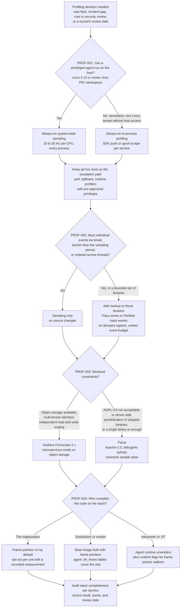
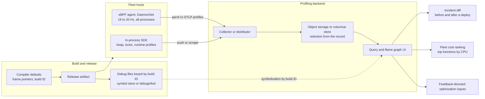

# Profiling Decision Records

> [!summary] Scope
> This playbook owns architectural decision records for profiling technology adoption across an engineering organization.
> It evaluates sampling profilers versus hybrid markup, Parca versus Pyroscope, system-wide continuous profiling versus ad-hoc inspection, and frame pointer deployment policies.
> It provides concrete organizational defaults, conditions that flip them, and operational trade-offs.

The sampling mechanism itself (`perf_event_open`, callchain modes, `perf c2c`) is owned by [[Linux-perf-in-Depth-and-perf-c2c]].
The architecture of fleet profilers (Google-Wide Profiling, agents, storage, the OTLP profiles signal) is owned by [[Continuous-Profiling-GWP-Parca-Pyroscope-and-OTel-Profiles]].
Zone and track-event instrumentation internals are owned by [[Tracy-and-Perfetto-Hybrid-Profilers]].
Compiler flag mechanics for frame pointers, including leaf-function behavior backed by a lab, are owned by [[Program-Execution-Decision-Records]], and the unwind formats by [[Stack-Unwinding-CFI-and-Exception-ABI]].
Sampling bias is owned by [[Sampling-vs-Instrumentation-Skid-and-Safepoint-Bias]].
This playbook owns four records (PROF-001 to PROF-004), the default each one sets, the measurable conditions that flip it, and the procedure for adopting and revisiting them.

Every figure about a tool or a system in this note is quoted from a cited source or is arithmetic on such a figure; nothing was benchmarked for this note.
Procedure parameters such as 20 canary hosts or a 14-day bake-off are choices to adapt, not measurements.

## Trigger and Symptoms

Activate this playbook when profiling stops being one engineer's habit and becomes something the organization has to standardize, pay for, and secure.

- An incident review asks what a service was executing at 03:12, and the only profiles available were taken after someone logged in at 03:40.
- Flame graphs from two teams cannot be compared, because each team picked its own tool, sampling frequency, unwinder, and symbol source.
- A large share of samples end in `[unknown]`, a raw hexadecimal address, or a stack one or two frames deep.
- A team asks to ship Tracy or Perfetto markup in production builds, or to run a second always-on profiler next to the existing one.
- A platform change alters unwinding for everyone: a new base image, a compiler default, a kernel upgrade, or a new language runtime.
- The profiling backend's storage or the agent's memory grows faster than the fleet.
- A security review flags a privileged DaemonSet that runs in the host PID namespace on every node.
- A recorded flip condition fires, or the review date written in an existing record arrives.

One symptom is quantitative and worth stating early.
A sampling profiler at `f` Hz per CPU observes a code path that uses fraction `p` of one CPU about `f * p` times per second.
At 19 Hz and `p` = 1% that is 0.19 samples per second, so a 10-second incident on one host leaves about 2 samples of that path, and collecting 100 samples takes about 526 seconds.
A count of `n` independent samples has a relative standard error near `1 / sqrt(n)`, so 100 samples carry about 10% error and 2 samples carry no usable signal.
Complaints that "the continuous profiler shows nothing for this incident" are usually this arithmetic, not a broken agent.

## Decision Tree



## Prerequisites

Do the audit on one representative host per hardware and kernel generation before deciding anything fleet-wide.

### Linux

```bash
uname -r
ls /sys/kernel/btf/vmlinux
cat /proc/sys/kernel/perf_event_paranoid
cat /proc/sys/kernel/perf_event_max_sample_rate
cat /proc/sys/kernel/perf_event_max_stack
cat /proc/sys/kernel/perf_cpu_time_max_percent
command -v perf bpftrace objdump readelf nm
```

- The OpenTelemetry eBPF profiler requires Linux 5.10 or newer, and its README names the last commits that supported 5.4 and 4.19 (as of 2026-11, Linux).
- The Parca Agent README states "Linux Kernel version 5.3+ with BTF", but its `go.mod` replaces `go.opentelemetry.io/ebpf-profiler` with a Parca fork of that profiler, so test the agent on your oldest kernel instead of trusting either number (as of 2026-11, Linux).
- `/sys/kernel/btf/vmlinux` is the kernel's own BTF type information, documented in the kernel ABI file `sysfs-kernel-btf` for kernel 5.5.
- `kernel.perf_event_paranoid` defaults to 2 in the kernel, which limits users without `CAP_PERFMON` to per-process, user-space-only events.
- `CAP_PERFMON` and `CAP_BPF` exist since Linux 5.8 and `CAP_CHECKPOINT_RESTORE` since 5.9, each split out of `CAP_SYS_ADMIN`.

Privileges for an always-on agent, from the Grafana Alloy `pyroscope.ebpf` reference (as of 2026-11, Linux):
- The agent runs as root inside the host PID namespace; on Kubernetes the simplest setting is `securityContext.privileged: true`.
- The least-privilege alternative is the capability set `BPF`, `PERFMON`, `SYS_PTRACE`, `CHECKPOINT_RESTORE`, `SYS_RESOURCE`, `DAC_READ_SEARCH`, and `SYSLOG`, plus a read-only mount of `/sys/kernel/tracing`.
- The component needs file system storage at `/tmp/symb-cache` for its symbol cache.

**Verification:** `ls /sys/kernel/btf/vmlinux` prints the path, `uname -r` prints a release at or above the agent's minimum, and you can name the person who approved a root agent in the host PID namespace.

### macOS

The eBPF agents are Linux-only; the OpenTelemetry profiler README tells macOS and Windows users to build and run it in a Linux VM.
On macOS the ad hoc tools belong to [[macOS-Instruments-xctrace-and-DTrace]], and always-on profiling of a macOS workload means the in-process option of PROF-001.

### Organization

- A named owner for the profiling platform, and a repository directory where the records live next to the build and deploy configuration they constrain.
- The list of language runtimes and base images in production, because PROF-004 is decided per code class.
- A written CPU, memory, and storage budget for profiling, so "too expensive" is a comparison against a number.

## Commands and Numbers to Know

| Item | Platform | Value `(as of 2026-11)` | Why it matters |
| :--- | :--- | :--- | :--- |
| Parca Agent CPU sampling | Linux | 19 Hz per logical CPU (`--profiling-cpu-sampling-frequency=19`) | The design doc picks a prime so samples do not lock onto periodic work; 100 Hz would hit every 10 ms tick. |
| Alloy `pyroscope.ebpf` `sample_rate` | Linux | 19; `collect_interval` 15s; `off_cpu_threshold` 0 (off-CPU disabled) | Same resolution floor as Parca Agent by default. |
| OTel `profiling` receiver `samples_per_second` | Linux | 20; `reporter_interval` 5s; `probabilistic_threshold` 100 (always on) | Defaults from `collector/factory_linux.go`. |
| OTel eBPF profiler overhead | Linux | 1% CPU and 250 MB memory are the project's upper limits in testing | A project statement, not a measurement on your workload. |
| Parca Agent overhead | Linux | "less than 1% in CPU and less than 200 Mb memory", with a reproducible report still pending | From the Parca FAQ. |
| GWP aggregated overhead | Linux | Less than 0.01%, with profiling active on only a small subset of machines at any moment | Fleet sampling is the scaling knob when always-on everywhere costs too much. |
| OTel eBPF profiler minimum kernel | Linux | 5.10 | Older kernels need an older commit or the in-process option. |
| OpenTelemetry Profiles status | Both | Alpha since 2026-03-26; Collector v0.148.0 or newer; feature gate `service.profilesSupport`; proto package `opentelemetry.proto.profiles.v1development` | The announcement says the signal should not be used for critical production workloads. |
| `perf record --call-graph` default | Linux | `fp` for user space; `dwarf` copies a stack dump of 8192 bytes per sample by default; `lbr` gives user call chains only | Ad hoc tooling walks frame pointers unless told otherwise. |
| `perf record --off-cpu` | Linux | The man page says BPF can collect stack traces using frame pointers only, as of now; `--off-cpu-thresh` default 500 ms | Off-CPU analysis is where missing frame pointers hurt most. |
| `kernel.perf_event_paranoid` | Linux | 2 | At 2 and above, kernel profiling needs `CAP_PERFMON`. |
| `kernel.perf_event_max_stack` | Linux | 127 frames | Deeper stacks are cut; Gregg reports it was added for a workload with stacks over 1000 frames deep. |
| `kernel.perf_cpu_time_max_percent` | Linux | 25 | Above it the kernel lowers the sampling frequency on its own. |
| `kernel.perf_event_max_sample_rate` | Linux | 100000 at boot (`DEFAULT_MAX_SAMPLE_RATE`), lowered dynamically | Read it during an incident before trusting a requested `-F`. |
| bpftrace `ustack` | Linux | Relies on frame pointers; `dw_ustack` unwinds from `.eh_frame`, x86_64 only, in bpftrace master | One-liners inherit the frame pointer policy. |
| Tracy zone cost | Both | 2.25 ns per zone (begin plus end) in the manual's benchmark | Markup cost scales with events per second, not with wall time. |
| Tracy sampling | Linux | 10 kHz by default on Linux and Android (8 kHz on Windows), capped by `perf_event_max_sample_rate` | Tracy is also a sampler, at a rate no fleet agent uses. |
| Tracy limits | Both | Port 8086; a session cannot exceed 1.6 days; without `TRACY_ON_DEMAND` events are buffered in memory until a server connects | It is a session tool, not fleet infrastructure. |
| Parca server storage | Linux | `--storage-active-memory` 536870912 bytes (512 MB); persistence only with `--enable-persistence`; HTTP on `:7070` | Default deployment keeps samples in memory. |
| Parca sizing rule | Linux | 60 bytes of memory per sample; 100 cores at 19 Hz is 114000 bytes per second | Parca's rule of thumb for the active store. |
| Pyroscope retention | Linux | `-retention-period` default 31d; `0` never deletes | Sets the size of the history you can diff against. |
| Pyroscope v2 | Linux | 2.0 makes the v2 write path (`segment-writer`) the default, while `-architecture.storage` defaults to `v1-v2-dual`; metastore runs as 3 or 5 Raft replicas; microservices mode requires object storage; server on port 4040 | The metastore is the only stateful component. |
| Frame pointer cost, Netflix | Linux | Usually less than 1%, one case of 10% with stacks over 1000 frames deep | Gregg's production measurements. |
| Frame pointer cost, Fedora 37 test builds | Linux | Kernel compile 2.4% slower, Blender render 2% slower, CPython benchmarks 1% to 10% slower | The numbers behind the Fedora 38 change. |
| Frame pointer cost, Ubuntu | Linux | 1% to 2% in most cases on 64-bit; not enabled on 32-bit | Canonical's analysis for 24.04. |
| Frame pointer cost, CPython 3.15 | Both | Under 2% geometric mean; 3.3% wall time on a C-call-heavy workload | PEP 831, Final; frame pointers are the default build. |
| Go frame pointers | Both | On since Go 1.7 for x86-64 (about 2% average cost reported then) and Go 1.12 for linux/arm64 | Go services need no policy action. |
| Rust standard library | Both | Compiled with frame pointers since Rust 1.79.0 (2024-06-13) | Your crates still need `-C force-frame-pointers=yes`. |
| SFrame | Linux | Format version 3 is marked under development; mainline at v7.4-rc2 has `kernel/unwind/deferred.c` and `user.c` and no SFrame reader | The v15 kernel patch series was posted on 2026-05-20. |

## Step-by-Step Execution

Steps 1 and 2 prepare evidence and a format.
Steps 3 to 6 each enact one record.
Step 7 makes the records enforceable and schedules their review.
Shell variables set in one step are reused in later ones.

### Step 1: Measure what you can see today

```bash
# Runtime census: which executables are running on this host
ps -eo comm= | sort | uniq -c | sort -rn | head -n 20

# Stack depth of one service through a frame-pointer walker, 10 seconds at 99 Hz
PID="$(pgrep -o -x order_matcher)"
sudo bpftrace -e 'profile:hz:99 /pid == $1/ { @depth = lhist(len(ustack), 0, 64, 4); }
                  interval:s:10 { exit(); }' "$PID"

# The same service through perf's default unwinder
sudo perf record -F 99 -g -p "$PID" -- sleep 10
sudo perf report --stdio --no-children | head -n 60
```

- `profile:hz:99` fires on every CPU at 99 Hz through perf_events, and `interval:s:10` ends the run.
- `ustack` relies on frame pointers, and `len(ustack)` is the depth of the stack in frames, per the bpftrace standard library reference in master; check that your installed release documents `len` for stacks.
- `perf record -g` uses `--call-graph fp` for user space unless told otherwise, so both tools show what a frame-pointer walker sees.

Read the histogram as a completeness signal, not a performance result.
A service whose real call depth is 30 frames and whose histogram piles up in the first bucket has stacks that stop at the first function compiled without a frame pointer.
A JIT or interpreter adds a second failure shape: deep native stacks that never show a function of your own language.

**Verification:** you can fill one row per runtime with three facts: the tool used, whether typical stacks reach a thread entry point, and where they stop when they do not.
That table is the Context section of PROF-004 and the baseline every later claim of improvement is compared to.

### Step 2: Fix the record format

A decision record is useful only if a reader two years later can tell what was decided, why, and what evidence would reverse it.
Nygard's original format has five parts: Title, Context, Decision, Status, and Consequences.
The MADR template adds Decision Drivers, Considered Options, Confirmation, and Pros and Cons of the Options.
Profiling records need two more fields, because the technology under them moves every quarter.

```markdown
# PROF-NNN: Short title naming the problem and the chosen option

- Status: proposed | accepted | superseded by PROF-MMM
- Owner: team or role, not a person's name
- Review date: YYYY-MM-DD

## Context and Problem Statement
## Decision Drivers
## Considered Options
## Decision Outcome
### Consequences
### Confirmation
## Flip Conditions
## More Information
```

- **Confirmation** names a command or query whose output shows the decision is in force.
- **Flip Conditions** names measurable events that reopen the record, such as "the OpenTelemetry profiles signal is declared Stable" or "truncated stacks exceed the recorded budget for a tier-1 service".
- A record without a flip condition is a preference, and a flip condition without a measurement is an argument waiting to happen.

**Verification:** the four records exist in the repository with status `proposed`, and each has a non-empty Confirmation and Flip Conditions section.

### Step 3: Enact PROF-001 - Always-on system-wide profiling with ad hoc escalation

**Context.**
Ad hoc profiling answers a question someone already knows to ask, on a host someone can already reach.
Always-on profiling answers "what changed" after the fact, at a resolution set by its sampling frequency.

| Option | What it gives | What it costs |
| :--- | :--- | :--- |
| A. Ad hoc only (`perf`, `bpftrace`, runtime profilers) | Any frequency, event, and unwinder; zero steady-state cost | No history; evidence starts after the event; needs privileges and a login during an incident |
| B. Always-on system-wide eBPF sampling | Every process on the host, kernel and user stacks, no code changes, history | A root agent on every host; storage; 19 to 20 Hz resolution |
| C. Always-on in-process (SDK push or pprof scrape) | Runtime-specific profiles such as heap, locks, and goroutines; no host privileges | Per-service adoption; blind to the kernel and to other processes |
| D. Fleet sampling: a subset of hosts or of intervals | Lowest cost; GWP reports less than 0.01% aggregated overhead | A given host has no profile for a given interval |

**Decision.**
B is the default on every Linux host that can run the agent.
C is added for profile types B does not produce and for platforms where B cannot run; Grafana's eBPF documentation lists memory and lock contention profiles as unsupported by eBPF collection.
A is kept as the documented escalation path, with privileges approved in advance.
D is the cost control: the OpenTelemetry profiler's `probabilistic_threshold` (1 to 99) turns collection on for a random share of `probabilistic_interval` periods.

**Why B and not A alone.**
With A, the profile that explains a regression is the one nobody took before the regression.
With B at 19 Hz, a 64-CPU host with every CPU busy produces 19 * 64 * 86400 = 105,062,400 samples per day, enough to compare any two days.

**Why A is still required.**
At 19 Hz the sampling period is 52.6 ms, so B cannot resolve a 2-second stall on one host: a path using 1% of a CPU yields about 0.4 samples in that window.
Raising a fleet agent to 999 Hz to fix this multiplies its sample volume by about 53 on every host for a question asked on one.
Ad hoc `perf record -F 999` on the affected process for 30 seconds collects about 300 samples of that 1% path.

**Flip conditions.**
- No root agent is permitted, or the platform has no host (serverless): C becomes the default.
- The fleet's oldest supported kernel is below the agent's minimum: C on those hosts until they are upgraded.
- Agent cost exceeds the written budget: lower the share of profiled intervals with D before lowering the frequency, because D keeps per-host resolution during the intervals it covers.
- A host class cannot tolerate any sampling interrupt (pinned, isolated cores): exempt it by name and profile it in a staging replica.

**Enact with Grafana Alloy**, using the Kubernetes example from the `pyroscope.ebpf` reference, shortened to the two components that matter:

```alloy
pyroscope.ebpf "local_pods" {
  forward_to = [ pyroscope.write.endpoint.receiver ]
  targets    = discovery.relabel.local_pods.output
}

pyroscope.write "endpoint" {
  endpoint {
    url = "http://pyroscope:4040"
  }
}
```

`discovery.relabel.local_pods` is the relabeling block from the same reference page, which drops finished pods and sets `service_name`, `namespace`, `pod`, `node`, and `container`.
The restriction to pods on the agent's own node is in that page's `discovery.kubernetes` block, through a `spec.nodeName` field selector.

**Enact with the OpenTelemetry Collector distribution**, as documented by Pyroscope:

```yaml
receivers:
  profiling:
    samples_per_second: 20
exporters:
  otlp_grpc:
    endpoint: pyroscope:4040
    tls:
      insecure: true
service:
  pipelines:
    profiles:
      receivers: [profiling]
      exporters: [otlp_grpc]
```

Start it with `--feature-gates=service.profilesSupport`.
The Pyroscope page shows `samples_per_second: 97`; the receiver's own default is 20, and the value you choose belongs in the record.
The profiler does not set `service_name`, so Pyroscope needs an ingestion relabeling rule that maps `process.executable.name` to it.

**Escalation commands**, kept in the runbook next to the record:

```bash
sudo perf record -F 999 -g -p "$PID" -- sleep 30
sudo perf record -F 999 --call-graph dwarf -p "$PID" -- sleep 30
```

The second form is for binaries without frame pointers and copies up to 8192 bytes of user stack per sample.
The incident procedure that uses these is [[Playbook-Diagnose-a-Production-Tail-Latency-Spike-with-eBPF-and-perf]], and blocked time is owned by [[Off-CPU-Analysis-Thread-States-and-Causal-Profiling]].

**Verification:**

```bash
kubectl rollout status daemonset/alloy -n profiling
kubectl get daemonset alloy -n profiling
```

- `kubectl rollout status` watches the latest rollout until it is done, and `kubectl get daemonset` shows the desired and ready counts side by side; they must be equal and match the node count you expect.
- On the agent's own metrics endpoint, `pyroscope_ebpf_active_targets` is above zero and `pyroscope_ebpf_profiling_sessions_failing_total` is not increasing.
- `pyroscope_ebpf_pprofs_total` increases for the `service_name` of a canary service.
- The component reports itself unhealthy when the session cannot start, "for example because of missing privileges or an unsupported kernel".

### Step 4: Enact PROF-002 - Sampling by default, markup by exception

**Context.**
A sampler and a markup profiler measure different things.
A sampler estimates where time goes in aggregate, and its cost depends on samples per second, not on how often a function runs.
Markup (Tracy zones, Perfetto track events) records the start and end of each marked region, so it measures individual durations and ordering, and its cost depends on events per second.

| Question | Sampling | Markup |
| :--- | :--- | :--- |
| Which functions consume the fleet's CPU? | Yes, with no code changes | Only inside marked regions |
| How long did this one frame, message, or lock hold take? | No: a sample says "on CPU here", not "for how long" | Yes, per event |
| What ran on other threads during this event? | No ordering between samples | Yes, on a shared timeline |
| Does it work on a binary nobody can rebuild? | Yes | No |
| Can it run always-on across a fleet? | Yes | No: Tracy holds a capture in RAM and limits a session to 1.6 days |

**The numbers that decide it.**
- At 99 Hz the sampling period is 10.1 ms, so a 200-microsecond handler is caught by a sample in about 2% of its executions, and the sample still does not give its duration.
- Tracy's manual derives 2.25 ns per zone from its own benchmark.
  At that cost, 1,000,000 zones per second consume about 2.25 ms of CPU per second (0.2% of a core), and a budget of 1% of a core allows about 4.4 million zones per second; this is arithmetic on the manual's figure, on the manual's hardware.
- With on-demand profiling disabled, which is Tracy's default, events are stored in memory until a server connects, and the manual warns this "can quickly grow up to a couple of gigabytes".
- Perfetto can also sample: its `linux.perf` data source uses `perf_event_open` and unwinds call stacks outside the profiled process.

**Decision.**
Sampling is the organizational default and requires nothing from service owners.
Markup is approved per binary when all four conditions hold:
1. The question is about individual events: frame time, per-message latency, or the distribution of a lock hold time.
2. The binary belongs to one team that owns the markup and its event budget.
3. Markup is compiled out by default (`TRACY_ENABLE` undefined) and any build that can reach production defines `TRACY_ON_DEMAND`.
4. The record states the maximum events per second and the CPU share that implies.

Request-level timing across services is distributed tracing, owned by [[Debugging-Distributed-Systems-with-Traces-and-Correlation]]; zones are not a substitute for spans.

**Flip conditions.**
- A frame-budgeted product (game loop, renderer, audio callback, matching engine hot path) makes markup the default for that binary.
- The measured event rate exceeds the recorded budget: remove zones from the innermost loops first.
- The team needs kernel scheduling and application events on one timeline: choose Perfetto, whose central buffer supports `fill_policy: RING_BUFFER` (overwrite oldest) and `DISCARD` (drop newest).

**Enact**, using the CMake options and macro named in the Tracy manual:

```cmake
option(TRACY_ENABLE "" ON)
option(TRACY_ON_DEMAND "" ON)
```

```cpp
void handle_order(const Order& order) {
    ZoneScoped;
    match(order);
}
```

```bash
tracy-capture -a 127.0.0.1 -o trace
```

`TRACY_ENABLE` defaults to `OFF`, and without it "the instrumentation is compiled out and the client does nothing".
Tracy checks only whether a macro is defined, so `TRACY_ENABLE=0` still enables it.

**Verification:**
- A production build made without `TRACY_ENABLE` should contain no Tracy client symbols: `nm -C order_matcher | grep -c 'tracy::'` is expected to print `0`; this check was not executed for this note, so confirm it once on your own build.
- A build with `TRACY_ON_DEMAND` records nothing until `tracy-capture` connects, and the capture utility's status line shows the time span and its own memory use.
- The record lists the measured events per second from a capture, next to the budget.

### Step 5: Enact PROF-003 - One backend, portable collection

**Context.**
The agents have converged, so the backend is the real decision (as of 2026-11).
Parca Agent's `go.mod` replaces `go.opentelemetry.io/ebpf-profiler` with a Parca fork, Alloy's `pyroscope.ebpf` embeds Grafana's fork of the same profiler, and the OpenTelemetry Collector distribution ships the upstream.
The upstream README describes native unwinding from `.eh_frame` data without frame pointers and unwinders for HotSpot, Python, Ruby, PHP, Node.js, Perl, Erlang, and .NET; each fork documents its own supported list.

| Property `(as of 2026-11)` | Parca | Grafana Pyroscope |
| :--- | :--- | :--- |
| License | Apache-2.0 server; agent user space Apache-2.0, eBPF code GPL-2.0 | AGPL-3.0 |
| Storage | Badger key-value meta store plus FrostDB columnar sample store; in memory by default, `--enable-persistence` to keep data | v2 writes segments and blocks to object storage; no ingester disks |
| Deployment shape | One binary; modes `all`, scraper-only, forwarder, and `otlp-forwarder` | Six components; only the metastore is stateful (Raft, 3 or 5 replicas) |
| Scaling | Sized by `--storage-active-memory` (512 MB default) and 60 bytes per sample | Write and read paths scale independently; microservices mode requires S3, GCS, Azure Blob, or Swift |
| Native symbolization | Agent uploads debug information; server symbolizes asynchronously (every 10 seconds by default) and has upstream debuginfod servers configured | For OTLP ingestion, shows only the symbols included in the received profile; Alloy symbolizes locally and no longer uploads debug information |
| Default retention | No retention flag appears in the `parca` help text in the README | `-retention-period` 31d |
| Ingestion | pprof scrape of HTTP endpoints and writes from Parca Agent | Language SDK push, Alloy pull or push, and OTLP profiles |
| Trace correlation | UNVERIFIED: not established from the Parca sources read for this note | Span profiles: `span_id` and `trace_id` labels per sample, linked from Grafana trace view |
| Query surface | Built-in web UI, Prometheus-style label selectors such as `cpu{node="..."}` | Grafana Profiles Drilldown |

Pyroscope's 2.0.0 release notes add a `profilecli debuginfo upload` subcommand.
UNVERIFIED: whether the Pyroscope server symbolizes native frames from uploaded debug information, because no server documentation page for it was found in the documentation tree on 2026-11-10.

**Decision.**
Run exactly one backend.
The default is Grafana Pyroscope 2.x in microservices mode on object storage, because its durability is delegated to object storage, its stateless read and write paths scale independently, it supports multi-tenancy (`-auth.multitenancy-enabled`, off by default), and its default retention is long enough to compare releases.
Collection stays portable: agents emit pprof or OTLP profiles, and no service links a backend-specific SDK unless PROF-001 option C requires it.

**The downside of the default, stated plainly.**
- Six components, a Raft metastore, and an object store are more to operate than one binary.
- AGPL-3.0 must be acceptable to the organization's legal policy for network services.
- Pyroscope's own page calls OTLP ingestion from the OpenTelemetry eBPF profiler "suitable for development and testing" and warns that breaking protocol changes have occurred and may continue.
- Symbol quality depends on what the agent can resolve on the host, which is weakest for stripped native binaries.

**Flip conditions, any one of which selects Parca.**
- AGPL-3.0 is not acceptable.
- Most hot code is stripped C, C++, or Rust, and symbols must come from debug files uploaded at build time or from debuginfod, keyed by build ID; the symbol pipeline itself is owned by [[Symbol-Servers-and-debuginfod]].
- The deployment is small enough that one binary with persistent storage is cheaper to run than six components.

**Flip condition for a hosted service.**
If nobody is funded to operate a profiling backend, buy one, and write the data residency and retention terms into the record.

**Enact a bake-off before accepting the record.**
1. Pick 20 canary hosts that cover every runtime from Step 1.
2. Run one agent per host with one configured frequency, and forward to both backends; Alloy's `forward_to` takes a list of receivers.
3. After 14 days, fill a fixed checklist: share of native frames symbolized for the three largest stripped binaries, time to render a 7-day flame graph for the busiest service, stored bytes per host-day, pages or restarts caused by the backend itself.
4. Record the numbers in the record's Decision Drivers, whichever backend wins.

Local evaluation of either server takes one command from its README:

```bash
docker run -it -p 4040:4040 grafana/pyroscope
./bin/parca
```

Pyroscope listens on port 4040, and the Parca binary serves its UI on `http://localhost:7070/` and scrapes its own pprof endpoints by default.

**Verification:**
- Exactly one backend receives production profiles: the agent configuration in the repository has one production receiver.
- A query for a canary `service_name` over the last hour returns a flame graph with named functions for native frames, not addresses.
- For Pyroscope 2.x run from the binary, the startup configuration sets `-architecture.storage=v2` with an object storage backend; the default is `v1-v2-dual`, and startup fails when v2 is included without object storage.

### Step 6: Enact PROF-004 - Frame pointers on, with a recorded exemption process

**Context.**
The OpenTelemetry-lineage agents do not need frame pointers for native code, which makes it tempting to drop the policy.
Three facts keep it.
1. The escalation tools of PROF-001 walk frame pointers: `perf record` defaults to `fp`, `perf record --off-cpu` supports frame pointers only, and bpftrace's `ustack` relies on them.
2. `.eh_frame` tables describe compiled code; JIT output and hand-written assembly often have none, and a single frame without unwind information ends the stack.
3. The next format is not deployable yet: SFrame version 3 is marked under development, and mainline Linux at v7.4-rc2 has no SFrame reader in `kernel/unwind/` (as of 2026-11, Linux).

**Decision, by code class.**

| Code class | Policy | Mechanism | Evidence |
| :--- | :--- | :--- | :--- |
| C and C++ compiled in-house | On | `-fno-omit-frame-pointer -mno-omit-leaf-frame-pointer` | Fedora 38 default flags; flag behavior in [[Program-Execution-Decision-Records\|Program Execution Decision Records]] |
| Rust | On | `-C force-frame-pointers=yes`; the standard library has them since 1.79.0 | rustc book, release notes |
| Go | Already on | x86-64 since Go 1.7, linux/arm64 since Go 1.12 | Go release notes |
| CPython | On | Use 3.15 or newer, or a distribution build with frame pointers; never configure `--without-frame-pointers` | PEP 831 |
| JVM | On where a frame-pointer walker must see Java frames | `-XX:+PreserveFramePointer` (JDK 8u60 and later) | Gregg; the eBPF agents unwind HotSpot without it |
| Distribution libraries | On | Base images from Fedora 38 or newer, or Ubuntu 24.04 or newer on 64-bit | Fedora change, Ubuntu announcement |
| Vendor binaries and hand-written assembly | Cannot change | Agent `.eh_frame` tables; list each as a known gap | OpenTelemetry profiler README |

The leaf flag matters.
GCC's manual says `-fno-omit-frame-pointer` "doesn't guarantee the frame pointer is used in all functions" and that several targets always omit it in leaf functions, and the AArch64 options page says omitting the leaf frame pointer is the default.
The lab in [[Program-Execution-Decision-Records]] records that behavior for GCC 13.3 on linux-aarch64.

**Cost, from the sources.**
- Netflix production: usually less than 1%, with one 10% outlier.
- Fedora 37 test builds: 2.4% on a kernel compile, 2% on a Blender render, 1% to 10% on CPython benchmarks.
- Ubuntu: 1% to 2% in most cases on 64-bit.
- CPython 3.15: under 2% geometric mean, 3.3% wall time on a C-call-heavy workload.
- None of these is your workload; the record must contain your own measurement for at least one tier-1 service.

**Exemption process.**
A translation unit or package may opt out only with all three of:
1. A benchmark on production hardware that shows the regression and its size.
2. A named owning team.
3. An expiry date, after which the exemption is re-measured or removed.

Fedora set the precedent: packages opt out by undefining the `%_include_frame_pointers` macro, and the change owners asked for each opt-out to be tracked against one bug.

**Flip conditions.**
- An in-kernel SFrame unwinder is in the kernel your fleet runs, your toolchain emits `.sframe` for every binary, and `perf`, bpftrace, and the agent all use it: reopen the record.
- A tier-1 service shows a regression above the organization's threshold that survives the exemption process: scope the opt-out to that unit, never to the repository.
- A 32-bit target enters the fleet: decide it separately, as Ubuntu did.

**Enact the audit** on a deployed binary:

```bash
BIN=/usr/local/bin/order_matcher

# 1 or more: the function sets up a frame record; 0: it does not
has_frame() {
  objdump -d --no-show-raw-insn --disassemble="$2" "$1" \
    | grep -c -E '(mov|add)\s+x29, sp|mov\s+%rsp,%rbp'
}
has_frame "$BIN" process_order

# Which unwind tables does the binary carry
readelf -S -W "$BIN" | grep -E -o '\.(eh_frame_hdr|eh_frame|sframe|debug_frame)\b' | sort -u

# The identity that symbol lookup is keyed by
readelf -n "$BIN" | grep 'Build ID'
```

- The pattern matches `mov x29, sp` or `add x29, sp, #N` on AArch64 and `mov %rsp,%rbp` on x86-64, and uses GNU grep's `\s`; pass a mangled name for C++.
- `grep -c` exits with status 1 when the count is 0, so guard it in scripts that run under `set -e`.
- The command was syntax-checked on an Ubuntu 24.04 aarch64 container with binutils 2.42; the x86-64 half of the pattern was not run.

**Verification:**
- `has_frame` prints a count of at least 1 for a non-leaf function of every in-house binary.
- For leaf functions the result depends on compiler and target: [[Program-Execution-Decision-Records]] records GCC on AArch64 building the leaf frame only with `-mno-omit-leaf-frame-pointer`, and GCC on x86-64 emitting no frame in a stackless leaf even with both flags, so a 0 on a stackless x86-64 leaf is expected there.
- The Step 1 depth histogram for each tier-1 service moves out of the lowest bucket after the rebuild.
- Fleet-wide, the agent's `UnwindNativeAttempts_total`, `UnwindNativeStackDeltaStop_total` (successful stops), and `UnwindErrStackLengthExceeded_total` give a per-host success ratio to alert on.
- The exemption registry has an owner and an expiry date on every row.

### Step 7: Publish, enforce, and schedule the review

1. Merge the four records with status `accepted` and link each from the build or deploy configuration it constrains.
2. Turn each Confirmation into a CI or deploy check: a compiler-flag check for PROF-004, a single-receiver check for PROF-003, a `TRACY_ENABLE` check on release builds for PROF-002.
3. Put the review date on the platform team's calendar, and list the external events that reopen a record early.

External events to watch (as of 2026-11):
- The OpenTelemetry profiles signal moving from Alpha toward Stable, which removes the protocol-skew risk recorded in PROF-003.
- An SFrame unwinder merged into mainline and shipped by your distribution, which reopens PROF-004.
- A new language runtime in production, which needs a row in PROF-004 and a check that the agent has an unwinder for it.

**Verification:** a deliberately wrong change (a release build with `TRACY_ENABLE` defined, or a second production receiver) fails the check that cites the record number.

## Rollback Procedure

Each record is reversible on its own; none requires reverting the others.

1. **PROF-001 (always-on agent).**
   First reduce instead of removing: lower `sample_rate` or `samples_per_second`, or set `probabilistic_threshold` below 100 so only a share of intervals is profiled.
   To remove it, delete the DaemonSet, then look for leftover pinned maps under the configured `bpf_fs_root` (default `/sys/fs/bpf/`).
   **Check:** `kubectl get daemonset -n profiling` no longer lists the agent, and the backend's ingestion rate for that cluster falls to zero.
2. **PROF-002 (markup).**
   Rebuild without `TRACY_ENABLE`; the macros compile out and no source change is needed.
   **Check:** the release artifact passes the Step 4 symbol check.
3. **PROF-003 (backend).**
   Point the agent's receiver or exporter at the other backend; collection is pprof or OTLP, so no service is rebuilt.
   Stored history does not migrate, so keep the old backend read-only until its retention period has passed (31 days by default for Pyroscope).
   **Check:** new profiles appear in the new backend for the canary `service_name`, and the old backend's newest profile timestamp stops advancing.
4. **PROF-004 (frame pointers).**
   Roll back one unit, not the fleet: remove the two flags for the measured translation unit and add the exemption row.
   For CPython the opt-out is the `--without-frame-pointers` configure flag, and for Fedora packaging it is undefining `%_include_frame_pointers`.
   **Check:** `has_frame` prints 0 for the exempted function and at least 1 for its callers, so stacks above it stay intact.

## Failure Modes of the Procedure

| Failure | How it shows up | Recovery |
| :--- | :--- | :--- |
| Kernel below the agent's minimum | The component is unhealthy at start; the OpenTelemetry profiler needs 5.10 or newer | Upgrade, pin an older agent commit, or use in-process profiling; `no_kernel_version_check` is only for kernels with backported eBPF features. |
| Missing privileges | Profiling session fails to start; `pyroscope_ebpf_profiling_sessions_failing_total` increases | Grant the documented capability set or `privileged: true`, and the host PID namespace. |
| Addresses instead of names | Flame graph shows `0x7f...` frames | Parca's FAQ lists the causes: the process exited before its mappings were read, the binary has no debug information, or asynchronous symbolization has not run yet; upload debug files keyed by build ID. |
| Stacks stop in a library | Depth histogram concentrated in the lowest bucket for a frame-pointer walker | The library was built without frame pointers; change the base image or use `--call-graph dwarf` for that investigation. |
| Stacks cut at a fixed depth | perf stacks end at 127 frames, or the agent's `UnwindErrStackLengthExceeded_total` increases | For perf, raise `kernel.perf_event_max_stack` for the investigation; the write returns `-EBUSY` while callchain events are in use. The agent counts stacks that exceed its own `MAX_FRAME_UNWINDS` limit, so record affected services as a known gap. |
| Requested frequency not honored | Fewer samples than `-F` implies | The kernel lowered the rate after exceeding `perf_cpu_time_max_percent`; read `perf_event_max_sample_rate`, or use `--strict-freq` to fail instead of throttling. |
| Empty span profiles | A span links to a profile with no samples | The span is shorter than the sampling period, or only root spans are labeled, which is the integrations' default. |
| Collector and backend disagree on OTLP profiles | Export errors after an upgrade of one side | The proto package is `v1development`; upgrade profiler, collector, and backend together and pin all three versions in the record. |
| Missing `service_name` | Profiles arrive but are unlabeled in Pyroscope | Add the `labelmap` ingestion relabeling rule from `process.executable.name`. |
| Tracy client memory growth | Resident memory of a marked binary climbs with no viewer attached | Build with `TRACY_ON_DEMAND`; without it events are kept until a server connects. |
| Parca server memory higher than planned | Resident memory tracks the ingested sample rate | Size from the documented 60 bytes per sample, then adjust `--storage-active-memory`, which the documentation calls the easiest way to change the footprint. |

## Pitfalls

> [!warning] Reading a 19 Hz fleet profile like a trace
> A continuous profile is a statistical estimate over many hosts and minutes.
> One host, one process, and a ten-second window at 19 Hz hold a handful of samples, and a handful of samples supports no conclusion.
> Widen the time range or the host set until the function you care about has on the order of 100 samples, or escalate to an ad hoc profile.

> [!warning] Round sampling frequencies
> Sampling at 100 Hz samples every 10 ms, the same period much periodic work uses, so a periodic task can appear to be on CPU all the time or never.
> Parca Agent documents 19 Hz as a deliberate prime, and the Pyroscope collector example uses 97.
> Keep whatever frequency you choose away from round numbers, and record it, because profiles taken at different frequencies need rescaling before comparison.

> [!warning] "The agent unwinds without frame pointers, so we can drop them"
> That is true for the always-on agent and false for the tools used during an incident.
> `perf record --off-cpu` collects stacks with frame pointers only, and bpftrace's `ustack` relies on them.
> Dropping the policy silently breaks the escalation path of PROF-001, and nobody notices until the incident.

> [!warning] Assuming -fno-omit-frame-pointer covers leaf functions
> GCC documents that the flag does not guarantee a frame pointer in every function and that several targets omit it in leaves.
> A sample taken inside such a leaf attributes its time to the wrong caller or loses the caller entirely.
> Add `-mno-omit-leaf-frame-pointer` and audit with the Step 6 command instead of reading the build flags.

> [!warning] Profiles are sensitive data
> Profiles contain function names, file paths, and labels, and agents can be configured to attach more.
> Parca Agent's deprecated `--metadata-enable-process-cmdline` flag is documented as able to "expose sensitive information like secrets", and the OpenTelemetry receiver has an `include_env_vars` option.
> Give the profiling backend the same access review as logs, and keep command lines and environment variables off unless a record says why.

> [!warning] A root agent on every host is a supply-chain decision
> The agent loads eBPF programs and reads every process's memory maps.
> Pin the agent by digest, verify release signatures (Parca Agent publishes sigstore signatures and reproducible builds), and roll it out through the same canary stages as a kernel.

> [!warning] An Alpha protocol in the critical path
> The OpenTelemetry announcement says the profiles signal "should not be used for critical production workloads" while it is Alpha.
> Profiling may depend on it; paging and billing may not.

> [!warning] Two always-on profilers
> Running a second system-wide profiler "to compare" doubles the sampling interrupts and the unwinding work on every host.
> Compare on canary hosts for a fixed period, as in the PROF-003 bake-off, then turn one off.

## At Scale

At 1,000 to 50,000 engineers the question shifts from "which profiler" to "which invariants does every binary and host satisfy so that any profiler works".



### Cost model

- Sample volume is `frequency * busy CPUs * seconds`; the OpenTelemetry receiver does not send idle frames by default (`send_idle_frames: false`), so idle CPUs do not add samples.
- Upper bound for one 64-CPU host at 19 Hz with every CPU busy: 105,062,400 samples per day.
- Parca's sizing rule of 60 bytes per sample puts 1,000 such hosts at 60 * 19 * 64,000 = 72,960,000 bytes per second into the active store, which is why a large fleet either samples hosts and intervals or uses a backend built on object storage.
- GWP's answer was to sample in two dimensions: at any moment profiling runs on only a small subset of machines, and event-based sampling is used on each of those machines, which kept the aggregated overhead under 0.01%.
- GWP also separated collection from symbolization: each running binary has a unique identifier, unstripped copies are stored in a global repository, and symbolization runs on separate machines, distributed across a few hundred of them.

### What the platform team owns

- The four records, their confirmation checks, and the exemption registry.
- One agent configuration per kernel generation, rolled out like a kernel: canary, then percentage stages.
- The symbol pipeline: every release uploads debug files keyed by build ID, and the release fails when the upload fails.
- A paved road so that a new service gets profiling without doing anything; see [[Platform-Engineering-Paved-Roads-and-Deprecation]].
- A migration RFC when a record flips; see [[Playbook-Write-a-Toolchain-Migration-RFC]].

### What profiles feed

- Incident response: a differential flame graph of the hour before and after a deploy; the visualization is owned by [[Flame-Graphs-Differential-Flame-Graphs-and-Visualizations]].
- Fleet cost ranking: GWP found that zlib accounted for nearly 5% of all CPU cycles, a fact no single service's profile would show.
- Compiler feedback: production profiles are the input to [[Cpp-PGO-AutoFDO-and-BOLT-Workflow]].
- Regression gates: a profile diff attached to a failed performance check; see [[Performance-Regression-Detection-in-CI]].

### Decision rules by size

| Organization | PROF-001 | PROF-002 | PROF-003 | PROF-004 |
| :--- | :--- | :--- | :--- | :--- |
| Under 50 engineers, one cluster | Always-on agent if the cluster allows it; otherwise ad hoc with a written runbook | Sampling only | One Parca binary with persistence or a hosted service; Pyroscope's documentation does not recommend its single-node mode for production | Frame pointers in your own builds; pick a base image that has them |
| 50 to 1,000 engineers | Always-on on every Linux host; in-process SDK for heap and lock profiles | Markup for named binaries with an event budget | One backend, bake-off recorded, retention written down | Policy in the shared toolchain; exemptions tracked |
| 1,000 to 50,000 engineers | Always-on plus fleet sampling in time to hold the budget | Same, enforced by a release-build check | Object-storage backend, multi-tenant, symbol upload enforced at release | Compiler defaults in the paved road, CI audit, expiry on every exemption |

## Practice Drill

> [!tip] Practice Drill: Write and defend PROF-001 to PROF-004 for one fleet
> Use a fleet you know, or this one: 800 Linux hosts with 32 CPUs each on kernel 6.8, 60% Go, 25% C++, 15% Python 3.12, plus 40 hosts on kernel 5.4, and a C++ matching engine with a 50-microsecond latency budget.
> 1. Compute the upper bound on samples per day for the 800 hosts at 19 Hz, then at 97 Hz, and state which number you would put in the budget.
> 2. For a function that uses 0.5% of one CPU, compute how long one host must be observed at 19 Hz to collect 100 samples, and how many hosts give 100 samples in one minute.
> 3. Decide what the 40 hosts on kernel 5.4 run, and write the flip condition that retires the exception.
> 4. Decide whether the matching engine gets markup; write its event budget in zones per second for 0.5% of a core at 2.25 ns per zone.
> 5. Write the Python row of PROF-004 for 3.12, given that PEP 831's default starts with 3.15, and name the unwinder each tool in your escalation path uses.
> 6. On any Linux host with GCC, compile a three-function program (a leaf, a caller, and `main`) with `-O2 -fno-omit-frame-pointer`, then again adding `-mno-omit-leaf-frame-pointer`, and run the Step 6 `has_frame` function on the leaf each time; predict both results before running, and explain them from the GCC manual.
> 7. Write one flip condition per record that a script could evaluate.
> Reference answers for the arithmetic: step 1 is 42,024,960,000 and 214,548,480,000 samples per day; step 2 is about 1,053 seconds on one host and 18 hosts for one minute; step 4 is about 2.2 million zones per second.
> Target time: 45 minutes, then continue with [[Rebuild-Lab-Sampling-Profiler-to-Folded-Stacks]] to see what one sample costs to take.

## Interview Questions

> [!question] L5
> Why do continuous profilers sample at 19 or 97 Hz instead of 20 or 100 Hz?
>
> > [!success]- Answer
> > A sampler that fires at the same period as periodic work in the program stays in phase with it.
> > At 100 Hz the period is 10 ms, a common timer and scheduling interval, so a task that wakes every 10 ms is either always or never on CPU when the sample fires.
> > A prime frequency drifts relative to round-number periods, so over time the samples cover all phases.
> > Parca Agent's design document gives exactly this reason for 19 Hz and notes that 19 is close to 20, which keeps overhead low and the arithmetic easy.

> [!question] L5 (predict the output)
> A function `parse()` uses 2% of one CPU on each host.
> The fleet agent samples at 19 Hz per CPU.
> How many samples of `parse()` do you expect in a 60-second window on one host, and across 500 hosts, and how trustworthy is each count?
>
> > [!success]- Answer
> > One host: 19 * 0.02 * 60 = 22.8 samples.
> > 500 hosts: 22.8 * 500 = 11,400 samples.
> > Treating samples as independent, the relative standard error is about `1 / sqrt(n)`: about 21% for 22.8 samples and about 0.9% for 11,400.
> > So the single-host number can distinguish 2% from 4% only roughly, while the fleet number can detect a change of a few percent of the function's own cost.
> > This is why fleet questions suit the always-on profiler and single-host, short-window questions need an ad hoc profile at a higher frequency.

> [!question] L5
> When is an ad hoc profile the right tool even though a continuous profiler is running?
>
> > [!success]- Answer
> > When the question is narrower than the continuous profiler's resolution: one process, a window of seconds, or an event other than CPU time.
> > `perf record -F 999 -p PID` collects about 53 times more samples per CPU-second than a 19 Hz agent.
> > Ad hoc tools also choose the event and unwinder: hardware counters, off-CPU time, or `--call-graph dwarf` for a binary without frame pointers.
> > The continuous profiler still matters in that incident, because it says what normal looked like an hour and a week earlier.

> [!question] L6 (debug this)
> During an incident, `perf record -g -p PID` shows most samples as a single libc frame with no callers, yet the always-on eBPF profiler shows full stacks for the same process.
> What is happening, and what do you change?
>
> > [!success]- Answer
> > The two tools unwind differently.
> > `perf record -g` defaults to `--call-graph fp`, which follows the frame pointer chain; libc in this image was built without frame pointers, so the walk ends at the first libc frame.
> > The eBPF agent derives unwind tables from `.eh_frame`, so it does not need the chain.
> > Immediate fix: `perf record --call-graph dwarf`, which copies up to 8192 bytes of user stack per sample and unwinds afterwards, at a higher cost per sample; `--call-graph lbr` is an option on Intel hardware and gives user call chains only.
> > Durable fix: a base image whose libraries keep frame pointers (Fedora 38 or newer, Ubuntu 24.04 or newer), because `perf record --off-cpu` and bpftrace `ustack` have no table-based fallback.
> > The finding belongs in PROF-004 as evidence, not just in the incident notes.

> [!question] L6
> A team wants Tracy zones around every function in a market-data handler that processes 5 million messages per second, with about 8 zones per message.
> Evaluate the request.
>
> > [!success]- Answer
> > That is 40 million zones per second.
> > At the 2.25 ns per zone the Tracy manual derives from its benchmark, the instrumentation costs about 90 ms of CPU per second, 9% of a core, before cache effects, and the manual's hardware is not theirs.
> > The data volume is also a problem: without on-demand mode events are buffered in memory until a viewer connects, and a capture is held in RAM.
> > Approve one zone per message plus zones around the two or three stages under suspicion, compiled out by default and on-demand in any build that can reach production.
> > Use sampling for "which functions are hot", and reserve zones for "how long did this message take and what else was running".

> [!question] L6
> Why does `perf record --off-cpu` require frame pointers when on-CPU profiling with `--call-graph dwarf` works on the same binary?
>
> > [!success]- Answer
> > They collect stacks in different places.
> > `--call-graph dwarf` has the kernel copy registers and a slice of the user stack into the perf buffer, and the perf tool unwinds later in user space with the binary's unwind tables.
> > `--off-cpu` attaches a BPF program to scheduling events and records the stack inside the kernel, and the man page states that BPF can collect stack traces using frame pointers only for now.
> > So a binary without frame pointers gives usable on-CPU stacks through the slow path and bogus off-CPU stacks.
> > Blocked time is where latency problems usually are, which is the practical argument for the frame pointer policy.

> [!question] L7
> You must choose between Parca and Pyroscope for 20,000 hosts.
> What do you ask, and what would decide it?
>
> > [!success]- Answer
> > First, the non-negotiables: is AGPL-3.0 acceptable for a network service, and is there an object store the team already operates.
> > Second, the workload: what share of hot code is stripped native binaries, because Parca symbolizes on the server from uploaded debug information or debuginfod while Pyroscope shows the symbols it receives.
> > Third, scale and shape: Pyroscope 2.x separates stateless write and read paths around object storage with a Raft metastore, while Parca is one binary whose default store is in memory.
> > Fourth, what must link to it: Pyroscope's span profiles tie samples to trace spans in Grafana.
> > I would not decide on the agent, because Parca Agent, Alloy, and the OpenTelemetry Collector distribution all build on the same eBPF profiler lineage.
> > Then I would run both on the same canary hosts for two weeks, record symbolization rate, query time, stored bytes per host-day, and operational incidents, and keep collection in pprof or OTLP so the loser can be turned off without touching services.

> [!question] L7 (debug this)
> After enabling span profiles, most trace spans link to a profile with zero samples, although the service's aggregate flame graph looks normal.
> Why?
>
> > [!success]- Answer
> > A span gets samples only if the profiler fires while that span is active on a thread.
> > With a sampling period of `1 / f`, a span of duration `d` expects about `d * f` samples per busy CPU, so a 3 ms span at 100 Hz expects 0.3 samples and most such spans get none.
> > Pyroscope's documentation says exactly this: a short span can produce no samples at all, and a span with a handful of samples is not a realistic picture.
> > Second cause: the integrations label only the local root span by default, so child spans have no profile of their own unless every-span labeling is configured where supported.
> > The fix is to aggregate: query the profile for all spans of one operation over a time range, not for one span.

> [!question] L7
> Design the rollout of a frame pointer mandate across 3,000 repositories without a performance incident.
>
> > [!success]- Answer
> > Change the default where builds inherit it: the shared toolchain configuration and the base images, not 3,000 build files.
> > Roll out by tier with a canary: rebuild, deploy to a small share, compare CPU per request against the previous build, then widen.
> > Publish the expected cost from the literature (under 1% typical at Netflix, 1% to 2% for Ubuntu, 2% to 2.4% in Fedora's compile and render tests, larger for call-heavy interpreters) so a 1% change is not treated as a surprise.
> > Provide an exemption process with a benchmark, an owner, and an expiry date, scoped to a translation unit or package.
> > Enforce with a CI audit that disassembles a sample of functions per binary, because flags in a build file do not prove frames in the binary.
> > Report truncated-stack rates per service before and after, since that is the benefit side of the trade.

> [!question] L8+
> Under what evidence would you retire a frame pointer mandate in favor of SFrame or table-based unwinding?
>
> > [!success]- Answer
> > I would require that every consumer of stacks works without frame pointers, not only the always-on agent.
> > Concretely: an in-kernel user-space unwinder for the format is in the kernels the fleet runs, the toolchain emits the section for every binary including distribution libraries, and `perf`, bpftrace, and the agent use it for on-CPU and off-CPU stacks.
> > As of 2026-11 that is not met: the SFrame version 3 specification is marked under development and mainline at v7.4-rc2 has no SFrame reader, with the v15 patch series still under review.
> > I would also want the cost side measured on our workloads: the CPU saved by dropping frame pointers against the memory and startup cost of the tables and the unwinder.
> > JIT and hand-written assembly need an answer too, since they have no compiler-generated tables.
> > Until then the mandate stays and the record lists these conditions as its flip conditions.

> [!question] L8+
> How do you show that a fleet profiling platform pays for itself, and what would make you shut it down?
>
> > [!success]- Answer
> > The cost side is direct: agent CPU and memory per host, backend compute and storage, and the engineers who run it.
> > The benefit side must be attributed: savings from optimizations found only through fleet profiles, such as GWP's finding that zlib used nearly 5% of all CPU cycles, and incident time saved because a before-and-after profile existed.
> > GWP's engineers ended up quoting a dollar amount per performance change, which is the right unit.
> > I would track three ratios: the share of the fleet's CPU that is symbolized and attributed to an owning team, the share of performance regressions whose root cause was found from stored profiles, and platform cost as a share of compute spend.
> > I would shut down or shrink it if attribution stays low after the symbol pipeline is fixed, because unattributed profiles cannot drive action, or if nobody queries it outside incidents, in which case fleet sampling in time gives the same incident value for a fraction of the cost.

## Further Reading

- Ren et al., "Google-Wide Profiling: A Continuous Profiling Infrastructure for Data Centers", IEEE Micro, 2010, https://research.google/pubs/google-wide-profiling-a-continuous-profiling-infrastructure-for-data-centers/.
  The original argument for sampling across machines and time, offline symbolization, and pricing performance changes.
- Brendan Gregg, "The Return of the Frame Pointers", https://www.brendangregg.com/blog/2024-03-17/the-return-of-the-frame-pointers.html.
  The history, the production overhead numbers, and a survey of alternatives from LBR to SFrame.
- Fedora, Changes/fno-omit-frame-pointer, https://fedoraproject.org/wiki/Changes/fno-omit-frame-pointer.
  A distribution-scale decision record with benchmarks, an opt-out macro, and a contingency plan.
- PEP 831, https://peps.python.org/pep-0831/.
  A recent, quantified frame pointer decision for an interpreter, including where the overhead comes from.
- OpenTelemetry eBPF profiler README and internals, https://github.com/open-telemetry/opentelemetry-ebpf-profiler.
  What the shared agent lineage supports, its kernel requirement, and how `.eh_frame` becomes stack deltas.
- "OpenTelemetry Profiles Enters Public Alpha", https://opentelemetry.io/blog/2026/profiles-alpha/.
  The status of the signal and what Alpha means for production use.
- Parca documentation, https://www.parca.dev/docs/overview.
  Storage, symbolization, agent design, and the sizing rule of thumb.
- Grafana Pyroscope v2 architecture, https://grafana.com/docs/pyroscope/latest/reference-pyroscope-v2-architecture/.
  Why v1 was replaced and what each v2 component does.
- Grafana Alloy `pyroscope.ebpf` reference, https://grafana.com/docs/alloy/latest/reference/components/pyroscope/pyroscope.ebpf/.
  Required capabilities, defaults, and the unwinder metrics used for auditing.
- perf-record(1), https://man7.org/linux/man-pages/man1/perf-record.1.html.
  Callchain modes, the dwarf stack dump size, and the off-CPU limitation.
- Kernel perf security documentation, https://github.com/torvalds/linux/blob/master/Documentation/admin-guide/perf-security.rst.
  What each `perf_event_paranoid` level allows and how `CAP_PERFMON` replaces `CAP_SYS_ADMIN`.
- Tracy Profiler User Manual, https://github.com/wolfpld/tracy.
  Zone cost, on-demand mode, memory behavior, and session limits.
- Perfetto documentation, https://perfetto.dev/docs/.
  Track events, buffer fill policies, and callstack sampling through `linux.perf`.
- The SFrame Format, https://sourceware.org/binutils/docs/sframe-spec.html.
  The format that may eventually replace the frame pointer policy.
- MADR template, https://github.com/adr/madr, and Michael Nygard, "Documenting Architecture Decisions", https://cognitect.com/blog/2011/11/15/documenting-architecture-decisions.
  The record formats this playbook extends with flip conditions and review dates.

## Related

- Prerequisites: [[Linux-perf-in-Depth-and-perf-c2c]], [[Continuous-Profiling-GWP-Parca-Pyroscope-and-OTel-Profiles]]
- Next: [[Rebuild-Lab-Sampling-Profiler-to-Folded-Stacks]]
- See also: [[Program-Execution-Decision-Records]], [[Tracy-and-Perfetto-Hybrid-Profilers]], [[Playbook-Diagnose-a-Production-Tail-Latency-Spike-with-eBPF-and-perf]], [[Measurement-Methodology-Decision-Records]]
