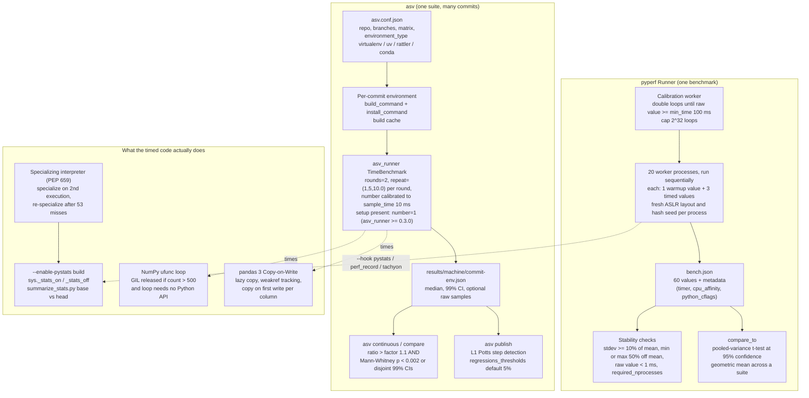

# Python Benchmarking: pyperf, asv, and NumPy/Pandas Profiling

> [!summary] Claim:
> A Python timing is a sample from a distribution shaped by ASLR, hash randomization, the specializing interpreter's warmup, GC, CPU frequency, and core placement, so one process and one number prove nothing.
> pyperf turns a microbenchmark into 20 calibrated worker processes of 3 values each and compares results with a pooled-variance t-test, while asv replays a benchmark suite across commits and flags a regression only when the ratio exceeds a factor (1.1 by default) and a Mann-Whitney U test or a 99% interval agrees.
> CPython's `--enable-pystats` build counts every specialization hit, miss, and deopt, which is the only direct evidence that a slowdown is the adaptive interpreter thrashing rather than the code doing more work.
> In NumPy and pandas the cost lives in hidden copies and in who holds the GIL: a ufunc releases it only above 500 elements, a binary expression allocates a temporary unless elision applies, and pandas 3 Copy-on-Write moves the copy from creation to the first write.



## The Mechanism

### Why a single Python timing is not a measurement

A Python microbenchmark measures an interpreter, an allocator, an operating system scheduler, and a CPU at once, and each contributes variance that a loop inside one process cannot average away.
These sources are fixed for the life of a process and change between processes:
- Address space layout randomization places the stack, heap, and shared libraries at different addresses, which changes cache-set conflicts and alignment.
- String hash randomization changes the collision pattern of every `dict` and `set` keyed by `str`, which is why pyperf's `--fast` mode still keeps at least 3 processes, a minimum its source justifies as benchmarking "3 different (randomized) hash functions" (`pyperf/_runner.py`).
- The size of the environment block shifts the initial stack, an effect that Mytkowicz, Diwan, Hauswirth, and Sweeney showed can bias results as much as a real optimization (ASPLOS 2009).

Other sources vary within one process:
- The specializing interpreter rewrites bytecode as it runs, so the first executions of a function are slower than later ones.
- The cyclic garbage collector runs when allocation counts cross thresholds, so allocation-heavy code pays for collections at points the benchmark does not control.
- CPU frequency scaling, thermal limits, and heterogeneous cores change the speed of the same instruction stream over seconds.

The standard library `timeit` addresses none of the between-process sources.
`python -m timeit` runs one process, repeats the measurement 5 times by default (`default_repeat = 5` in `Lib/timeit.py`), chooses the loop count from the sequence 1, 2, 5, 10, 20, 50, ... until a run takes at least 0.2 s, disables the garbage collector during each run (`gc.disable()` in `Timer.timeit`), and reports the minimum.
The `-t/--target-time` option that sets that 0.2 s is new in Python 3.15.
The minimum is the right statistic for "how fast can this code run", and the wrong one for "how fast does this code run", because it hides exactly the variance that production sees.

### pyperf: the process model

pyperf (2.11.0, released 2026-11-08, requires Python 3.11 or newer) is the PSF benchmark library that pyperformance and CPython's own performance work use.
A benchmark script creates exactly one `pyperf.Runner`; a second instance in the same process raises `RuntimeError("only one Runner instance must be created per process ...")`, because the same script is re-executed as each worker.
The parent process acts as a manager (`pyperf/_manager.py`) and spawns the script again with `--worker`, `--worker-task=N`, `--values`, `--min-time`, and either `--calibrate-loops` or `--loops`, and each worker writes its run back as JSON through an inherited pipe (`--pipe FD`).
Workers run one at a time; pyperf never runs two benchmarks concurrently.

The defaults come from `Runner.__init__` and `doc/runner.rst`:
1. One calibration worker doubles the loop count (`self.loops *= 2`) until one raw value takes at least `min_time`, which defaults to 0.1 s, and fails if the loop count would exceed `MAX_LOOPS = 2 ** 32` (`pyperf/_worker.py`).
2. 20 worker processes then run with that loop count.
3. Each worker computes 1 warmup value, which is stored but excluded from statistics, and 3 timed values, for 60 values in total.
4. `--rigorous` doubles the processes to 40; `--fast` uses `max(processes // 2, 3)` processes and `max(values * 2 // 3, 2)` values, which gives 10 processes and 2 values.
5. With a JIT (`pyperf.python_has_jit()`), the defaults become 6 processes, 10 values, and 10 warmups.

`python_has_jit()` returns true for PyPy with its JIT, GraalPy, Pyston, and, since pyperf 2.10.0, CPython when `sys._jit.is_enabled()` is true, so a CPython built with `--enable-experimental-jit` and the JIT turned on is benchmarked with JIT defaults (`pyperf/_utils.py`).

Each value is `raw_value / (loops * inner_loops)`, where `bench_func` measures a raw value with `time.perf_counter()` around a `for _ in range(loops): func()` loop.
`inner_loops` is for statements duplicated by hand, and `pyperf timeit --duplicate=N` copies the statement N times and multiplies `inner_loops` by N, which amortizes the `for` loop overhead in nanosecond-scale statements.
`pyperf timeit` maps the stdlib options differently: `timeit -n` (number) becomes `-l` (loops) and `timeit -r` (repeat) becomes `-n` (values), and unlike `timeit` it leaves the garbage collector enabled.

Workers inherit a minimal environment: `PATH`, `PYTHONPATH`, `HOME`, `TEMP`, `COMSPEC`, `SystemRoot`, `SystemDrive`, and the locale variables, unless `--inherit-environ=VARS` or `--copy-env` is given, and `--no-locale` drops the locale variables too.
That default is why `OMP_NUM_THREADS=1 python bench.py` does not reach the workers unless you pass `--inherit-environ=OMP_NUM_THREADS`, and it also keeps the environment size, one of the Mytkowicz bias sources, stable between machines.

### pyperf: what it checks and how it compares

`pyperf check`, and the summary after every run, warns "the benchmark result may be unstable" when any of these hold (`format_checks` in `pyperf/_cli.py`):
- The standard deviation is at least 10% of the mean.
- The minimum or maximum is at least 50% away from the mean.
- The shortest raw value took less than 1 ms, which means timer resolution and loop overhead are a visible fraction of the value.
- `Benchmark.required_nprocesses()` is larger than the number of processes, where that estimate takes the per-process means and asks how many processes give 95% certainty of less than 1% variation (the "estimation of a mean" sample-size formula, added in pyperf 2.9.0).

pyperf reports mean and standard deviation by default, and `pyperf stats` adds the median with the median absolute deviation, percentiles, and an outlier count using the interquartile range.
`pyperf hist` prints a text histogram, and `pyperf dump` prints every value per run, including warmups and the calibration run, which is the first place to look when the mean and median disagree.

`pyperf compare_to ref.json changed.json` decides significance with a two-sample, two-tailed Student t-test at 95% confidence (the docs say "alpha equals to 0.95"):
- `pooled_sample_variance` sums squared deviations of both samples and divides by `n1 + n2 - 2`.
- `tscore` divides the difference of means by `sqrt(2 * pooled_variance / n)`.
- `is_significant` compares `abs(t)` with a tabulated 95% critical value for that many degrees of freedom.
- `--min-speed=PCT` additionally marks a result as not significant when the change is smaller than that percentage.
- For several benchmarks, compare_to prints the geometric mean of the normalized means, following Fleming and Wallace (CACM 1986).

Two details of the implementation matter in practice.
First, the test treats all 60 values as independent, but the 3 values from one process share its ASLR layout, hash seed, and core placement, so the effective sample size is closer to the number of processes.
Second, `tscore` raises `ValueError("different number of values")` when the two files hold different numbers of values, and `is_significant_benchs` catches every exception and returns `(True, None)`, with a comment that reads `FIXME: fix the root bug, don't work around it`.
So comparing a `--fast` run (20 values) with a default run (60 values) always reports "Significant", which the hand run in the worked example shows.

### pyperf: hooks, profilers, and memory

Hooks are context managers selected with `--hook NAME` or, since 2.11.0, passed as `Runner(hooks=[...])`.
`_compute_values` in `pyperf/_worker.py` instantiates the selected hooks at the start of each batch of values (the calibration batch, the warmup batch, and the timed batch are separate calls), enters them around every single value, and calls `teardown` at the end of the batch:
- `pystats` calls `sys._stats_off()` and `sys._stats_clear()` when it is instantiated, then `sys._stats_on()` and `sys._stats_off()` around each value; it must be requested explicitly since pyperf 2.8.0, before which stats were collected automatically.
- `perf_record` starts `perf record --pid <worker> --control fifo:ctl,ack` for each batch and writes `enable` and `disable` into the control FIFO around each value, so Linux perf samples only benchmark code; files are named `perf.data.<uuid>`, placed in `PYPERF_PERF_RECORD_DATA_DIR`, and `PYPERF_PERF_RECORD_EXTRA_OPTS` is appended to the command (added in 2.9.0).
- `tachyon` (2.11.0, Python 3.15 or newer, not Windows) runs `python -m profiling.sampling attach <pid>` with `PYPERF_TACHYON_OPTS` for the duration of each value and stops it with `SIGINT`.

Because the timed batch re-instantiates the pystats hook, which clears the counters, a worker's dump at exit holds only its timed values, which matches the documentation's claim that warmups are excluded.
The calibration worker is different: it computes only a calibration batch, so its dump counts every calibration value, contrary to the documentation's claim that calibration is excluded.
In a hand run with a pystats build (2026-11-12), `pyperf timeit --hook pystats -p 2 -n 3 -w 1 -l 1000 -s "a=1; b=2" "{a, b}"` dumped `opcode[BUILD_SET].execution_count : 3000` from each worker, exactly 1000 loops times 3 values with the warmup excluded.
Without `-l`, a one-process run calibrated to 2^22 loops and produced two dumps: 12,582,912 executions (3 x 2^22) from the timed worker and 20,971,519 from the calibration worker, which is the doubling series 1 + 2 + ... + 2^22 plus 3 more values at 2^22.
Pass an explicit `--loops` when collecting pystats, or summarize only the timed workers' dumps.

`--track-memory` records peak memory with lower overhead than `--tracemalloc`: on Linux it sums `Private_Clean` and `Private_Dirty` from `/proc/self/smaps`, on Windows it reads `PeakPagefileUsage`, and on macOS it needs `psutil`.
`--tracemalloc` records `tracemalloc_peak`, which includes NumPy array buffers because NumPy registers them with tracemalloc (see the NumPy section).
`--profile FILE` wraps the benchmark in cProfile, which distorts timings; [[Python-cProfile-Tachyon-and-Sampling-Profilers]] owns the profilers themselves.

### pyperf system tune: what it changes

`python -m pyperf system tune` (run as root) applies a fixed list of operations in order (`OPERATIONS` in `pyperf/_system.py`), each only when its kernel interface exists:
1. Perf event: writes `1` to `/proc/sys/kernel/perf_event_max_sample_rate` (reset writes `100000`), so the kernel's own sampling cannot steal time.
2. ASLR: only checks that `/proc/sys/kernel/randomize_va_space` is `2` (full randomization); the docs say "ASLR must *not* be disabled manually", because pyperf relies on it to sample layouts.
3. Linux scheduler: checks for `isolcpus=` and `rcu_nocbs=` on the kernel command line.
4. CPU frequency: sets `scaling_min_freq` to the maximum frequency for the benchmark CPUs (reset restores the minimum).
5. IRQ affinity: stops `irqbalance` and, when the benchmark CPUs are a subset (isolated CPUs or `--affinity`), writes the remaining CPUs into `/proc/irq/default_smp_affinity` and each `/proc/irq/N/smp_affinity`.
6. Power supply: checks that a laptop is on AC power.
7. CPU scaling governor: sets `performance` (reset sets `powersave`); it runs before the Turbo Boost step because changing the governor resets `no_turbo`.
8. Turbo Boost through `intel_pstate/no_turbo`, then a `nohz_full` with `intel_pstate` incompatibility check, then Turbo Boost through `/dev/cpu/N/msr`, which pyperf 2.7.0 restricted to Intel CPUs.

When isolated CPUs exist (`/sys/devices/system/cpu/isolated`), the Runner pins workers to them with `os.sched_setaffinity` and records `cpu_affinity` in metadata; `--affinity=CPU_LIST` pins without isolation.
Stinner's 2016 measurements of `sum(range(10**7))` show why isolation is the big lever: 229 ms idle, 372 ms under load without isolation, and 230 ms under the same load on CPUs isolated with `isolcpus` and `nohz_full`.
On macOS none of these interfaces exist: `pyperf system show` prints `WARNING: no operation available for your platform`, and `os.sched_setaffinity` does not exist, so pinning is impossible (observed on macOS 27.3, as of 2026-11).

### asv: benchmarking a commit history

Airspeed Velocity (asv 0.6.6, with the timing code in the separate `asv_runner` package, 0.3.2 as of 2026-11) answers a different question from pyperf: not "is A faster than B" but "which commit changed this number".
`asv.conf.json` names the repository (`repo`), the branches, the Python versions (`pythons`), a dependency `matrix` with `exclude` and `include` rules, and an `environment_type`: `virtualenv`, `uv`, `rattler`, `conda`, or `existing` (asv 0.6.6 ships plugins for the first four).
For each commit and environment, asv checks out the commit, runs `build_command` (by default `python setup.py build` followed by `python -m pip wheel -w {build_cache_dir} {build_dir}` since asv 0.6.2, which projects without `setup.py` replace) and `install_command` (`in-dir={env_dir} python -m pip install {wheel_file}`), keeps up to `build_cache_size` built wheels, and runs every benchmark in a fresh process.
Results land in `results/<machine>/<first 8 hex digits of the commit>-<env>.json` (`asv/results.py` `get_filename`); `asv machine` records the machine name and hardware description once, because results are only comparable within one machine.

A benchmark's kind comes from its name prefix:
- `time_*` measures wall time, `timeraw_*` returns code that asv runs in a fresh interpreter per sample (for import time), `mem_*` returns an object whose `asizeof` size is recorded, `peakmem_*` records the process's peak resident size, and `track_*` returns any number.
- `peakmem_*` counts memory used during `setup` too, so heavy fixtures belong in `setup_cache`, which runs once per environment and commit and is pickled to the benchmark processes.
- Each result carries a version, by default a hash of the benchmark source including `setup` and `setup_cache`; editing a benchmark invalidates its history unless you pin `version`.
- `params` and `param_names` produce the Cartesian product of parameters, and `setup_cache` is not parameterized.

The timing loop (`TimeBenchmark.run` and `benchmark_timing` in `asv_runner/benchmarks/time.py`):
1. `rounds` defaults to 2; rounds interleave different benchmarks so slow background drift is spread over all of them, and `asv continuous` turns `--interleave-rounds` on by default when it builds environments.
2. With `repeat = 0` (the default) each round collects between 1 and 10 samples within 20 s; when `rounds > 1`, both limits are halved, to at most 5 samples within 10 s per round.
3. With `number = 0`, asv doubles the inner count until one sample takes at least `sample_time` (default 10 ms), and `warmup_time` (default 0.1 s on CPython, 1.0 s on PyPy, 5.0 s on GraalPy) is spent calling the function before sampling starts.
4. `min_run_count` (default 2) forces at least two calls even for slow benchmarks, and the default timer is `timeit.default_timer`, which is `time.perf_counter`.
5. `timeit.Timer.timeit` disables the garbage collector during each sample, so asv timings, like `timeit` and unlike pyperf, exclude GC pauses that are not triggered explicitly.
6. The reported value is the median of all samples, with a 99% confidence interval from `quantile_ci`, falling back to a Laplace posterior when the nonparametric interval is unbounded (`asv_runner/statistics.py`).

asv_runner 0.3.0 (2026-08-04) changed the meaning of `setup` for timing benchmarks (asv issue 966).
If a benchmark has any `setup` hook, an auto-calibrated `number` now resolves to 1, so every timed call sees freshly set-up state, and an explicit `number > 1` switches to `_SetupInterleavedTimer`, which reruns setup before every call and reads the clock twice per call.
asv_runner 0.2.5 did not have this code; asv 0.6.6 only requires `asv-runner>=0.2.5`, so the same suite can calibrate differently depending on which asv_runner an environment resolved.
For a sub-microsecond benchmark with a `setup` method, one call per sample means each sample is a few hundred nanoseconds measured with a clock whose resolution is 41.7 ns on Apple silicon, as the worked example shows.

### asv: deciding that a commit regressed

`asv continuous base branch` benchmarks two commits (by default `branch` against its parent) and prints only changed results.
It records raw samples by default, unlike `asv run`, so the comparison can use a rank test.
For each benchmark `_is_result_better(a, b, ...)` in `asv/commands/compare.py` declares `a` better only when both conditions hold:
1. The ratio passes the factor: `a < b / factor`, with `--factor` defaulting to 1.1.
2. The difference is statistically supported, unless `--no-stats` is given or either side has only one sample: `asv/_stats.py` `is_different` runs a Mann-Whitney U test at `p < 0.002` when raw samples exist and the sample sizes can reach that p-value at all (`1 / binom(n_a + n_b, min(n_a, n_b)) < 0.002`), and otherwise requires the two 99% confidence intervals not to overlap.

The output marks each row: `+` worsened, `-` improved, `!` newly failing, `*` newly fixed, `x` not comparable because the benchmark version changed, and a `~` prefix on the ratio when the factor was crossed but the statistics did not support it.
`asv continuous` returns a non-zero exit code when anything worsened, which is what CI gates on.

For history, `asv publish` fits each benchmark's series as piecewise constant plus noise, solving a weighted L1 Potts problem with heuristics that avoid its O(n^2) cost and choosing the number of steps with an information criterion (`docs/source/step_detection.rst`, `asv/step_detect.py`).
Each point is weighted by the inverse of its confidence interval, Laplace noise rather than Gaussian makes the fit robust to outliers, and a step is reported as a regression only above `regressions_thresholds`, which defaults to 0.05 (5%).
`asv find A..B benchmark` bisects with about `log2(N)` benchmark runs, compares three points at a time, and reports the commit with the greatest regression, which assumes the range contains one dominant step.

NumPy and pandas both keep asv suites in-tree.
NumPy's `benchmarks/asv.conf.json` uses `virtualenv` and builds a wheel with `python -m build`; pandas 3.1.1's `asv_bench/asv.conf.json` uses `rattler` with conda-forge, sets `regressions_first_commits` to ignore history before commit `0409521665`, and builds with `python -m build -Cbuilddir=builddir --no-isolation`.
The pandas contributor guide runs `asv continuous -f 1.1 upstream/main HEAD -b ^groupby` to check one area before a pull request.

### The specializing interpreter: why the same loop has two speeds

PEP 659 (Mark Shannon, Python 3.11) made CPython's interpreter rewrite instructions in place.
Each specializable instruction has inline cache entries after it, and the first 16-bit entry is a counter.
In the 3.15 sources (`Include/internal/pycore_code.h`), `ADAPTIVE_WARMUP_VALUE` is 1, so an instruction attempts to specialize on its second execution, and a specialized instruction that keeps missing re-specializes after 53 misses (`ADAPTIVE_COOLDOWN_VALUE` 52, chosen prime "for avoiding artifacts if every nth value is a different type").
A failed specialization attempt backs off exponentially through counter values near powers of two that are also one less than a prime, 1, 6, 30, 126, 508, 2052, then 8190 (`pycore_backoff.h`).
For builds with the experimental JIT, a loop becomes a trace candidate after its `JUMP_BACKWARD` counter, initialized to 4000, runs out, and function entry (`RESUME`) uses 8190.

Two consequences matter for benchmarks.
Tier 1 specialization settles within a few executions, so pyperf's single warmup value is enough on a default build, but a `--enable-experimental-jit` build needs thousands of iterations before a loop is traced, which is why pyperf switches to JIT defaults when `sys._jit.is_enabled()` is true.
More importantly, a specialized instruction caches one shape: `LOAD_ATTR_INSTANCE_VALUE` caches one type version, so a loop that sees objects of eight classes in rotation hits on one class, misses on the other seven, and re-specializes about every 60 executions without ever settling.
`dis.dis(f, adaptive=True)` and `python -m dis -S` (3.14 and later) show only the current state of each instruction, so both the monomorphic and the polymorphic loop display `LOAD_ATTR_INSTANCE_VALUE`, as the worked example shows; the miss rate is invisible without counters.

### pystats: counting specializer behavior

`./configure --enable-pystats` defines `Py_STATS` and adds `sys._stats_on()`, `sys._stats_off()`, `sys._stats_clear()`, and `sys._stats_dump()`, plus `-X pystats` and `PYTHONSTATS=1` to turn collection on at startup (`Doc/using/configure.rst`).
Release builds do not enable it: Homebrew's CPython 3.15.2 lists no `--enable-pystats` in its `CONFIG_ARGS`, and pyperf's hook on it fails with `Can not collect pystats because python was not built with --enable-pystats` (observed on macOS, as of 2026-11).
Counting every instruction slows the interpreter, which also makes any timing taken with stats on meaningless.
The counters live in a `PyStats` struct (`Include/cpython/pystats.h`):
- Per opcode: specialization `success`, `failure`, `hit`, `deferred`, `miss`, `deopt`, 60 `failure_kinds`, `execution_count`, and `pair_count[256]` for which opcode follows which.
- Calls, frames pushed, and frame objects created.
- Object increfs and decrefs, allocations bucketed by size, freelist traffic, dict materializations, and type cache hits and misses.
- GC collections per generation, the tier 2 optimizer and JIT (traces created and executed, trace lengths, JIT code size), and rare events such as assigning `__class__` or modifying builtins, which invalidate cached assumptions.
- On free-threaded builds, `mutex_sleeps`, `qsbr_polls`, and `world_stops`.

In 3.15 each thread accumulates into its own `PyStats`, and `stats_merge_all` merges threads into the interpreter's totals when stats are dumped (`Python/pystats.c`).
`sys._stats_dump()` writes to `/tmp/py_stats/` (`c:\temp\py_stats\` on Windows) under a random 160-bit hex file name, or to stderr if that directory does not exist, and clears the counters.
`Tools/scripts/summarize_stats.py` reads a directory of dumps or a previous `--json-output` file; given two inputs it prints a comparison with "Base" and "Head" columns, which is how CPython developers attribute a pyperformance change to the specializer.
Statistics accumulate across runs, so clear `/tmp/py_stats` before each experiment.

Python 3.15's Tachyon sampler can also report bytecodes with `--opcodes`, including specialized forms, without a special build ([[Python-CPython-perf-Trampoline-and-Tachyon-Internals]] owns its internals); pystats remains the only exact count of misses and deopts.

### NumPy: copies, temporaries, and allocation

An `ndarray` is a data buffer plus metadata (dtype, shape, strides, offset), and the NumPy documentation's rule is that basic indexing (slices, integers, `np.newaxis`) always creates a view while advanced indexing (integer or boolean arrays) always creates a copy.
`reshape` returns a view when strides allow it and copies otherwise, `ravel` copies when the array is not contiguous in the requested order, and `flatten` always copies.
`reshape(..., copy=False)` raises `ValueError` when a copy cannot be avoided, which turns a silent copy into an error in hot code.
`np.shares_memory(a, b)` answers exactly whether two arrays overlap and can be expensive, while `np.may_share_memory` only compares memory bounds.
`arr.base` is the owning array for a view and `None` for an array that owns its data.

Every binary operation allocates its result, so `x * 2.0 + 1.0` on a 1,000,000-element float64 array allocates two 8 MB buffers unless NumPy elides the temporary.
Temporary elision (`numpy/_core/src/multiarray/temp_elide.c`) reuses the left operand in place when it is a uniquely referenced temporary of at least 256 KiB (`NPY_MIN_ELIDE_BYTES`), but only after walking the C call stack with `backtrace()` and confirming that every frame up to `_PyEval_EvalFrameDefault` belongs to CPython or NumPy, because a C extension could legitimately pass an array with a reference count of 1.
On CPython 3.14 and later the uniqueness test is `PyUnstable_Object_IsUniqueReferencedTemporary`, because 3.14 changed how temporaries are reference-counted (CPython issue 133164).
Elision applies to operations with an in-place form that do not change dtype, and it is not available where `backtrace()` is missing, such as Windows.

NumPy registers every data buffer it allocates with `tracemalloc` in domain 389047 (`NPY_TRACE_DOMAIN` in `alloc.h`), so `tracemalloc`, pyperf's `--tracemalloc`, and Python-level memory tools see array memory and can attribute it to the Python line that created it ([[Python-Memory-Profiling-Memray-and-Line-Profiler]] owns Memray).
Below the allocator, `alloc.c` keeps a small-block cache: data blocks under 1024 bytes are cached in per-size buckets of up to 7 pointers, so a microbenchmark that creates and frees tiny arrays mostly exercises that cache, not `malloc`.
The cache is compiled out on free-threaded builds, where CPython uses mimalloc, and under AddressSanitizer or MemorySanitizer, so small-array allocation benchmarks are not comparable across those builds.
On Linux, NumPy calls `madvise(MADV_HUGEPAGE)` on allocations of at least 4 MiB (`1u << 22`) when the kernel is 4.6 or newer, and `NUMPY_MADVISE_HUGEPAGE=0` or `=1` overrides the choice at import, which can move large-array benchmarks by changing TLB behavior.

### NumPy: when the GIL is released

The ufunc fast path for contiguous arrays (`ufunc_object.c`) releases the GIL with `NPY_BEGIN_THREADS_THRESHOLDED(count)`, which calls `PyEval_SaveThread()` only when the inner loop count is greater than 500 (`ndarraytypes.h`) and the loop does not set `NPY_METH_REQUIRES_PYAPI`.
Loops over `dtype=object` require the Python API and never release the GIL, and buffered iteration over non-contiguous or casting inputs processes chunks of `NPY_BUFSIZE` (8192) elements by default.
So threads that call ufuncs on small arrays serialize on the GIL, threads on large arrays run their inner loops in parallel, and a loop that is limited by memory bandwidth gains little from parallelism even with the GIL released.
NumPy's thread-safety guide adds the failure mode that releasing the GIL creates: mutating or resizing an array that another thread is reading is a data race and can crash the interpreter, and on free-threaded Python even object arrays lose the GIL's protection.
Linear algebra calls into BLAS, which runs its own thread pool; `threadpoolctl` reports and limits it, and the asv tuning guide recommends `OPENBLAS_NUM_THREADS=1`, `MKL_NUM_THREADS=1`, and `OMP_NUM_THREADS=1` for stable benchmarks.
The NumPy 2.5.4 macOS arm64 wheel reports Accelerate as both BLAS and LAPACK (`np.show_config()`), and `threadpoolctl` 3.8.0 lists no controllable pool for it on the lab host (as of 2026-11).

### pandas 3: Copy-on-Write and the string dtype

PDEP-7 made Copy-on-Write the only behavior in pandas 3.0: every indexing result and every method result behaves as a copy, including a column accessed as a Series.
Under the hood pandas returns views wherever it can and uses weak references to track which objects view the same data; a write into an object whose data is shared copies the affected column first, and only that column.
The pandas 3.0 release notes state the consequences:
- Chained assignment such as `df["b"][mask] = value` never updates `df`, emits `ChainedAssignmentError`, and `SettingWithCopyWarning` is removed.
- The `copy` keyword of methods such as `rename`, `reindex`, `set_axis`, `transpose`, and `merge` has no effect, and the `mode.copy_on_write` option is deprecated.
- Accessing the underlying NumPy array, for example with `to_numpy()`, returns a read-only array when that array shares data with the pandas object, and setting `arr.flags.writeable = True` circumvents Copy-on-Write (migration guide, "Read-only NumPy arrays").

For profiling, Copy-on-Write moves cost from the line that creates a derived object to the line that first writes to it or to its parent, and PDEP-7 itself lists "performance cost of indexing and methods becomes harder to predict" as a drawback.
A memory profile of a pandas 3 pipeline therefore attributes copies to `__setitem__` and `iloc` writes, and keeping an unused reference alive, such as the name of an intermediate DataFrame, is enough to force a copy that would otherwise be skipped.

pandas 3.0 also infers a dedicated `str` dtype for string data (PDEP-14), backed by PyArrow when it is installed and by NumPy `object` arrays otherwise.
`memory_usage()` without `deep=True` counts only the 8-byte pointers of an `object` column, so it under-reports string memory, while `deep=True` asks each Python string for its size.

pandas releases the GIL inside many Cython kernels: the 3.1.1 sources contain 23 `with nogil` blocks in `_libs/groupby.pyx`, 21 in `_libs/algos.pyx`, 17 in `_libs/window/aggregations.pyx`, 15 in `_libs/join.pyx`, and 10 in `_libs/hashtable_class_helper.pxi.in`.
The Python-level orchestration around those kernels, including index alignment, dtype dispatch, and block management, holds the GIL, so threading a pandas pipeline speeds up only the parts that spend their time inside those blocks.
[[Drill-Profiling-Python-C-Extension-GIL-and-Allocation-Bottleneck]] practices finding GIL holders in a native extension.

## Commands and Numbers to Know

| Item | Value | Platform | Notes |
|---|---|---|---|
| pyperf Runner defaults | 20 processes x (1 warmup + 3 values), min_time 0.1 s (as of 2026-11) | Both | pyperf 2.11.0; JIT: 6 processes, 10 values, 10 warmups. |
| `--fast` / `--rigorous` | 10 processes x 2 values / 40 processes x 3 values (as of 2026-11) | Both | `--fast` keeps at least 3 processes for 3 hash seeds. |
| Calibration cap | `MAX_LOOPS = 2 ** 32`, loops doubled per attempt (as of 2026-11) | Both | `pyperf/_worker.py`. |
| Unstable warnings | stdev >= 10% of mean; min or max >= 50% off mean; raw value < 1 ms (as of 2026-11) | Both | `format_checks` in `pyperf/_cli.py`. |
| `pyperf compare_to` test | Student two-sample t-test, 95% confidence, pooled variance (as of 2026-11) | Both | Different value counts always print "Significant". |
| `--hook pystats` / `perf_record` / `tachyon` | pystats needs `--enable-pystats`; tachyon needs 3.15+ (as of 2026-11) | Both / Linux / not Windows | The calibration worker's pystats dump counts every calibration value. |
| `PYPERF_PERF_RECORD_DATA_DIR`, `PYPERF_PERF_RECORD_EXTRA_OPTS`, `PYPERF_TACHYON_OPTS` | output directory and extra options for the profiler hooks (as of 2026-11) | Linux / Both | pyperf 2.9.0 and 2.11.0. |
| `pyperf system tune` | perf sample rate 1, min freq = max, governor performance, irqbalance off, no_turbo (as of 2026-11) | Linux | Prints "no operation available" on macOS. |
| Worker environment | `PATH`, `PYTHONPATH`, `HOME`, `TEMP`, Windows vars, locale; `--inherit-environ`, `--copy-env` (as of 2026-11) | Both | Thread-count variables are dropped by default. |
| `perf_counter` on Apple silicon | `mach_absolute_time()`, resolution 41.7 ns (as of 2026-11) | macOS | `time.get_clock_info`, macOS 27.3 arm64. |
| `python -m timeit` | repeat 5, target 0.2 s, GC disabled, reports min (as of 2026-11) | Both | `-t/--target-time` new in 3.15. |
| asv timing defaults | rounds 2, repeat (1, 5, 10.0) per round, sample_time 10 ms, warmup_time 0.1 s, min_run_count 2 (as of 2026-11) | Both | asv_runner 0.3.2; benchmark timeout 60 s. |
| asv `setup` effect | auto `number` becomes 1 when any setup exists (as of 2026-11) | Both | asv_runner 0.3.0 and later (asv issue 966). |
| `asv continuous` | `--factor 1.1`, raw samples recorded, Mann-Whitney U at p < 0.002 or disjoint 99% CIs (as of 2026-11) | Both | Exit code 1 when any benchmark worsened. |
| `asv publish` threshold | `regressions_thresholds` default 0.05 (as of 2026-11) | Both | Largest matching threshold wins. |
| `asv run -E existing:same` / `--python=same` | run in the current interpreter, no build (as of 2026-11) | Both | The project must already be installed. |
| `asv run --quick` | each benchmark runs once, results not saved (as of 2026-11) | Both | For catching broken benchmarks, not for numbers. |
| Specializer warmup / cooldown | specialize on 2nd execution; re-specialize after 53 misses (as of 2026-11) | Both | CPython 3.15 `pycore_code.h`. |
| JIT trace thresholds | `JUMP_BACKWARD` 4000, `RESUME` 8190 (as of 2026-11) | Both | `pycore_backoff.h`; only `--enable-experimental-jit` builds trace. |
| pystats | `./configure --enable-pystats`; `-X pystats`; `PYTHONSTATS=1`; dumps to `/tmp/py_stats/` or stderr (as of 2026-11) | Both | `summarize_stats.py base head` compares two dumps. |
| `python -m dis -S` | prints specialized bytecode (as of 2026-11) | Both | 3.14 and later; `dis.dis(f, adaptive=True)` since 3.11. |
| NumPy GIL release | inner loop count > 500 and no Python API (as of 2026-11) | Both | `NPY_BEGIN_THREADS_THRESHOLDED`, NumPy 2.5.4. |
| NumPy buffer size | 8192 elements (`NPY_BUFSIZE`) (as of 2026-11) | Both | Buffered (casting or non-contiguous) iteration chunk. |
| NumPy temporary elision | operand >= 256 KiB, unique temporary, call stack checked with `backtrace()` (as of 2026-11) | Linux, macOS | Did not elide on CPython 3.15.2 on the lab host. |
| NumPy tracemalloc domain | 389047 (as of 2026-11) | Both | `tracemalloc.DomainFilter(True, 389047)` isolates array buffers. |
| NumPy small-block cache | blocks < 1024 bytes, 7 per bucket; off on free-threaded and ASan builds (as of 2026-11) | Both | `alloc.c`. |
| NumPy huge pages | `madvise(MADV_HUGEPAGE)` for >= 4 MiB; `NUMPY_MADVISE_HUGEPAGE=0/1` (as of 2026-11) | Linux | Default on for kernel 4.6 and newer. |
| pandas Copy-on-Write | always on in 3.x; `mode.copy_on_write` deprecated (as of 2026-11) | Both | pandas 3.1.1. |
| pandas string dtype | `str`, PyArrow storage when installed (as of 2026-11) | Both | `memory_usage(deep=True)` for real string memory. |
| `sys.getswitchinterval()` | 0.005 s (as of 2026-11) | Both | How long a thread may hold the GIL before being asked to drop it. |

## Multi-Language Comparison

| Concern | C++ ([[Cpp-Google-Benchmark-and-nanobench\|Google Benchmark, nanobench]]) | Python (pyperf, asv) | Rust ([[Rust-Benchmarking-Criterion-Divan-Gungraun-and-dhat\|Criterion, Divan, Gungraun]]) |
|---|---|---|---|
| Unit of repetition | iterations inside one process | pyperf: separate worker processes; asv: a fresh process per benchmark and round | iterations inside one process |
| Dead-code elimination | the compiler can delete unused results, so harnesses provide `DoNotOptimize`-style barriers | the default CPython interpreter does not eliminate unused calls, so the risk is the opposite one: timing the call and loop overhead instead of the work | the optimizer can delete work, so `black_box` is required |
| Warmup source | caches, branch predictors, page faults | the same, plus specializer state and, on JIT builds, trace compilation | caches, branch predictors, page faults |
| Between-run randomness | ASLR, link order | ASLR, hash seed, environment size | ASLR, link order |
| Regression gate | repeated runs and a threshold, or instruction counts | pyperf t-test or asv factor plus rank test | statistical comparison against a saved baseline, or instruction counts with Gungraun |
| Counting instead of timing | PMU counters through perf ([[Linux-perf-in-Depth-and-perf-c2c]]) | pystats for interpreter events, `--hook perf_record` for PMU | Gungraun instruction counts |
| History across commits | external dashboards | asv step detection and `asv find` | external dashboards |

The Python column differs in kind, not just degree: the interpreter's own adaptive state is part of the measured system, so a Python benchmark has a warmup and a polymorphism story that a compiled language's benchmark does not.

## Worked Lab Example

This note has no lab in `code/`; every output below is a hand run made once on 2026-11-12 on an Apple M3 Pro (6 performance and 6 efficiency cores) with macOS 27.3, Homebrew CPython 3.15.2, pyperf 2.11.0, asv 0.6.6 with asv_runner 0.3.2, NumPy 2.5.4, pandas 3.1.1, and pyarrow 26.0.1, installed with `uv` into a fresh virtual environment.
The outputs are copied verbatim, but they are not golden files: timings will differ on any other run, and only the structural facts (counts, flags, booleans) are expected to reproduce.

### 1. An unpinned laptop, read correctly

```sh
python -m pyperf system show
python -m pyperf timeit -q -o full.json "sorted(range(1000, 0, -1))"
python -m pyperf stats full.json
```

```text
WARNING: no operation available for your platform
Mean +- std dev: 7.07 us +- 4.05 us
...
Number of calibration run: 1
Number of run with values: 20
Total number of run: 21

Number of warmup per run: 1
Number of value per run: 3
Loop iterations per value: 2^14
Total number of values: 60

Minimum:         4.54 us
Median +- MAD:   5.14 us +- 0.51 us
Mean +- std dev: 7.07 us +- 4.05 us
Maximum:         20.2 us
...
WARNING: the benchmark result may be unstable
* the standard deviation (4.05 us) is 57% of the mean (7.07 us)
* the maximum (20.2 us) is 186% greater than the mean (7.07 us)
```

The calibration worker settled on 2^14 loops, so each raw value took about 75 to 330 ms, comfortably above the 1 ms floor.
The median (5.14 us) and the mean (7.07 us) disagree by 38%, and the histogram put 32 of 60 values in the lowest bin, so the distribution has a fast mode and a long tail rather than Gaussian noise around one value.
Reading the per-process values with the pyperf API (`pyperf.Benchmark.load("full.json").get_runs()`) showed the tail concentrated in a few workers: runs 6 to 8 and 16 to 20 stayed between 4.54 and 4.80 us, while run 11 measured 18.92, 19.45, and 11.98 us.
Whole-process slowness is what core placement or a background burst produces, but this run cannot say which: macOS offers no `sched_setaffinity` and pyperf records no core identifier, so the cause is UNVERIFIED.
The honest summary of this run is "median 5.14 us, unstable", not "7.07 us".

### 2. The compare_to sample-count trap

```sh
python -m pyperf timeit -q --fast -o fast.json "sorted(range(1000, 0, -1))"
python -m pyperf timeit -q -o full2.json "sorted(range(1000, 0, -1))"
python -m pyperf compare_to full.json fast.json -v
python -m pyperf compare_to full.json full2.json -v
```

```text
Mean +- std dev: [full] 7.07 us +- 4.05 us -> [fast] 8.41 us +- 4.34 us: 1.19x slower
ERROR when testing if values are significant
Significant
---
Mean +- std dev: [full] 7.07 us +- 4.05 us -> [full2] 7.37 us +- 4.45 us: 1.04x slower
Not significant!
```

All three files time the same statement.
The first comparison pits 60 values against 20, `tscore` raises `ValueError`, `is_significant_benchs` swallows it and returns `(True, None)`, and the verbose output prints the error line and then "Significant".
Without `-v` only the "1.19x slower" line appears, which is how an A/B result built from mismatched run settings reaches a pull request.
The second comparison has equal counts, and the t-test correctly finds a 1.04x difference not significant.

### 3. The specializer: timing, counters, and bytecode

`bench_attr.py` times one loop over 8,000 objects whose attribute `v` is set in `__init__`, once with all objects of one class and once with eight classes in rotation:

```python
import pyperf

def make_class(i):
    def __init__(self):
        self.v = i
    return type(f"K{i}", (), {"__init__": __init__})

CLASSES = [make_class(i) for i in range(8)]
MONO = [CLASSES[0]() for _ in range(8_000)]
POLY = [CLASSES[i % 8]() for i in range(8_000)]

def total(objs):
    s = 0
    for o in objs:
        s += o.v
    return s

runner = pyperf.Runner()
runner.bench_func("attr_mono", total, MONO)
runner.bench_func("attr_poly", total, POLY)
```

```text
attr_mono  Median +- MAD: 62.2 us +- 3.1 us   Mean +- std dev: 67.8 us +- 11.1 us
attr_poly  Median +- MAD: 165 us +- 5 us      Mean +- std dev: 170 us +- 16 us
```

These two lines condense `pyperf stats bench_attr.json`; the mono benchmark also printed the 16% standard deviation warning.
The polymorphic loop is about 2.65 times slower by median while executing exactly the same bytecode.
To show why, the same loop ran under a CPython 3.15.2 built from the python.org tarball with `./configure --enable-pystats`, with 80,000 objects, 10 calls between `sys._stats_on()` and `sys._stats_off()`, and `/tmp/py_stats` absent so `sys._stats_dump()` printed to stderr.
The relevant raw counters:

```text
mono:
    opcode[LOAD_ATTR].specialization.success : 1
    opcode[LOAD_ATTR].specialization.hit : 799999
    opcode[LOAD_ATTR_INSTANCE_VALUE].execution_count : 799999
poly:
    opcode[LOAD_ATTR].specialization.success : 13334
    opcode[LOAD_ATTR].specialization.hit : 106667
    opcode[LOAD_ATTR].specialization.miss : 706665
    opcode[LOAD_ATTR_INSTANCE_VALUE].specialization.miss : 706665
    opcode[LOAD_ATTR_INSTANCE_VALUE].execution_count : 813332
```

The monomorphic loop specialized once and hit 799,999 times.
The polymorphic loop re-specialized 13,334 times, and 800,000 executions divided by 13,334 is 60.0: each specialization survives 53 misses (the cooldown) plus the roughly 7 hits that one class in eight earns in that window.
Each miss runs the generic attribute lookup, which is the 2.65x.
`summarize_stats.py` turns the same dumps into a comparison table; with the mono directory as base and the poly directory as head, its "Tier 1 instructions executed" section reported "Specialized hits" falling from 57.1% to 44.7% of instructions and "Specialized misses" rising from 0 to 706,665 (12.6%).

The bytecode view hides all of this.
After one call of `total`, `dis.get_instructions(total, adaptive=True)` printed the same specialized sequence for both inputs on Homebrew 3.15.2:

```text
mono FOR_ITER_LIST to L2
mono LOAD_FAST_BORROW_LOAD_FAST_BORROW s, o
mono LOAD_ATTR_INSTANCE_VALUE v
mono BINARY_OP_ADD_INT +=
poly FOR_ITER_LIST to L2
poly LOAD_FAST_BORROW_LOAD_FAST_BORROW s, o
poly LOAD_ATTR_INSTANCE_VALUE v
poly BINARY_OP_ADD_INT +=
```

Without pystats, the hint is in the code: give the eight classes a common base class that sets `v`, or use `__slots__` so that one shape dominates.

### 4. asv_runner and the setup rule

`asv_number.py` drives `asv_runner.benchmarks.time.TimeBenchmark` directly on two benchmarks with the same body, `sum(self.data)` over 100 integers, one storing `data` in `setup()` and one in a class attribute:

```text
asv_runner 0.3.2
WithSetup: number=1, samples=5
NoSetup: number=41979, samples=5
```

Without setup, calibration grew `number` until a sample took 10 ms, so each sample averages 41,979 calls.
With setup, every sample is a single call of a few hundred nanoseconds, read with a 41.7 ns clock and including the timer call overhead, so the result is dominated by quantization and per-call overhead.
Benchmarks whose setup produces read-only data should move it to a class attribute or `setup_cache`, or set an explicit `number` and accept the interleaved timer's two clock reads per call.

### 5. NumPy temporaries and the GIL

`elide.py` measures the traced peak of three expressions on a 1,000,000-element float64 array `x` (8 MB), after one untraced call:

```text
3.15.2 numpy 2.5.4 x*2.0 + 1.0: peak 2.00 x input
3.15.2 numpy 2.5.4 y = x*2.0; y + 1.0: peak 2.00 x input
3.15.2 numpy 2.5.4 (x*2)*(x*3) + 1: peak 3.00 x input
3.14.10 numpy 2.5.4 x*2.0 + 1.0: peak 1.00 x input
3.14.10 numpy 2.5.4 y = x*2.0; y + 1.0: peak 2.00 x input
3.14.10 numpy 2.5.4 (x*2)*(x*3) + 1: peak 2.00 x input
```

On Homebrew CPython 3.14.10, NumPy 2.5.4 elided the temporary in `x*2.0 + 1.0` (peak 1x) and in `(x*2)*(x*3) + 1` (peak 2x instead of 3x), and the named intermediate `y` correctly blocked elision.
On Homebrew CPython 3.15.2 the same NumPy release never elided, and NumPy 2.5.1 on 3.15.2 gave the same 2.00, 2.00, and 3.00, so the difference follows the interpreter, not the NumPy version.
Why elision fails on 3.15.2 is UNVERIFIED: the candidates are the 3.15 semantics of `PyUnstable_Object_IsUniqueReferencedTemporary` and the call-stack check against the framework build's symbols, and this run did not separate them.
The defensive pattern works on every version: `out = x * 2.0; out += 1.0` peaked at 1.00 times the input on 3.15.2.

`gil_threads.py` runs `np.sin(a, out=out)` over a fixed total of 200,000,000 elements, split across 1 or 4 threads, each with its own arrays:

```text
3.15.2 numpy 2.5.4 GIL enabled: True
n=    400: 1 thread 0.74 s, 4 threads 0.76 s, speedup 0.97x
n=   4000: 1 thread 0.59 s, 4 threads 0.22 s, speedup 2.70x
n= 400000: 1 thread 0.85 s, 4 threads 0.24 s, speedup 3.48x
```

At 400 elements the loop count is below the 500-element threshold, NumPy keeps the GIL, and four threads finish no faster than one.
At 4,000 and 400,000 elements the inner loop runs without the GIL and four threads give 2.70x and 3.48x.
A first version of the script used `np.add`, which is limited by memory bandwidth rather than arithmetic, and it showed 1.10x at 400,000 elements and 0.25x at 4,000 elements, where four threads handing the GIL back and forth around a 1 us loop took four times longer than one thread; releasing the GIL is necessary for scaling, not sufficient.

### 6. pandas 3 Copy-on-Write

`copies.py` checks views and copies without timing anything:

```text
numpy 2.5.4 pandas 3.1.1
basic slice shares memory: True
fancy index shares memory: False
reshape of contiguous is view: True
reshape(copy=False) of transpose: ValueError
ravel of transpose shares memory: False
x*2+1: traced peak 2.00 x the 8 MB input
x*2; out+=1: traced peak 1.00 x the 8 MB input
column shares memory before write: True
to_numpy writeable: False
after col write, df a[0] = 0 shares: False
chained assignment changed df: False
inferred string dtype: str storage: pyarrow
object memory_usage shallow: 800000
object memory_usage deep:    5900000
str memory_usage deep:       1800000
```

`col = df["a"]` shares the parent's buffer until `col.iloc[0] = 100`, at which point pandas copies the column, leaves `df` unchanged, and stops sharing.
`df["b"][df["a"] > 2] = -1.0` emitted `ChainedAssignmentError` on stderr and did not modify `df`.
For 100,000 ten-character strings, the shallow `object` estimate is 800,000 bytes, exactly one 8-byte pointer per row, the deep `object` figure is 5,900,000 bytes, and the PyArrow-backed `str` column is 1,800,000 bytes.

## Pitfalls

> [!warning] Pitfall 1: Comparing runs with different sample counts
> pyperf 2.11.0 cannot run its t-test on samples of different sizes, catches the `ValueError`, and reports the comparison as significant.
> A `--fast` baseline compared with a default candidate, or a file with one benchmark appended twice, produces a confident "1.19x slower" for identical code, as the worked example shows.
> Use the same runner options on both sides, check with `pyperf compare_to -v`, and treat "ERROR when testing if values are significant" as a failed comparison.

> [!warning] Pitfall 2: Reporting the mean of a bimodal distribution
> On an unpinned machine, a few slow processes pull the mean far from the typical value: the worked example's mean of 7.07 us sits above the 75th percentile.
> Run `pyperf stats` and `pyperf hist` before quoting a number, report the median with MAD when they disagree, and fix the environment with `pyperf system tune` and isolated CPUs on Linux rather than adding processes.

> [!warning] Pitfall 3: Expecting environment variables to reach pyperf workers
> Workers inherit only `PATH`, `PYTHONPATH`, `HOME`, a few Windows variables, and the locale, so `OMP_NUM_THREADS`, `PYTHON_JIT`, or `PYTHON_GIL` set in the shell silently do not apply.
> Pass `--inherit-environ=OMP_NUM_THREADS,PYTHON_JIT` and confirm it in `pyperf metadata`.

> [!warning] Pitfall 4: asv benchmarks with setup after upgrading asv_runner
> From asv_runner 0.3.0, any `setup` hook forces an auto-calibrated `number` of 1, so a fast benchmark becomes one timer-resolution-limited call per sample.
> History recorded before and after the upgrade is not comparable, even though the benchmark source and therefore its version hash did not change.
> Pin `asv_runner` in the benchmark environment, move read-only fixtures to class attributes or `setup_cache`, and check calibrated `number` values in the results JSON after any upgrade.

> [!warning] Pitfall 5: Reading timings from a pystats build
> pystats counts every instruction and reference-count operation, so its timings are meaningless.
> With `--hook pystats`, pyperf's calibration worker dumps counts for every calibration value, which in the hand run above was more than the timed worker's own counts.
> Use the pystats build to count with an explicit `--loops`, the release build to time, and compare counts between two pystats runs of the same build, not across builds.

> [!warning] Pitfall 6: Trusting dis to show specialization health
> `python -m dis -S` and `dis.dis(adaptive=True)` show the current specialized form, which looks the same for a loop that hits every time and a loop that misses seven times in eight.
> Only pystats miss and deopt counters, or Tachyon's `--opcodes` sampling, reveal thrashing.

> [!warning] Pitfall 7: Assuming NumPy expressions do not allocate
> Each binary operation allocates a result, and temporary elision is a heuristic that needs at least 256 KiB, a unique temporary, a call stack inside CPython and NumPy, and an interpreter on which the check succeeds; it did not fire on CPython 3.15.2 on the lab host.
> Write `out = a * b; out += c` or use `out=` arguments in hot paths, and measure with `tracemalloc` domain 389047.

> [!warning] Pitfall 8: Threading small NumPy calls
> Ufunc loops of 500 elements or fewer keep the GIL, object-dtype loops always do, and bandwidth-bound loops do not scale even without the GIL.
> Batch work into larger arrays before reaching for threads, and measure with a compute-bound and a bandwidth-bound kernel separately.

> [!warning] Pitfall 9: Benchmarking pandas 3 with stray references
> Under Copy-on-Write, a write copies a column whenever another live object shares it, so an intermediate DataFrame kept for debugging turns an in-place update into a full column copy.
> Profiles then blame the write, not the line that created the reference; drop intermediates, reassign to the same name, and avoid chained assignment, which never works in pandas 3.

> [!warning] Pitfall 10: Library thread pools inside benchmarks
> BLAS, OpenMP, and Arrow use their own threads, so a benchmark can measure core count and scheduler contention rather than code.
> Pin them with `threadpoolctl` or `OPENBLAS_NUM_THREADS=1`, `MKL_NUM_THREADS=1`, and `OMP_NUM_THREADS=1`, and pass those variables to pyperf workers explicitly.

## At Scale

For one developer, pyperf on a laptop answers "is this change worth pursuing", and only with the median, a histogram, and equal run options on both sides.
Laptops cannot be tuned: macOS has no CPU affinity API, and heterogeneous cores, thermal limits, and background work make standard deviations of 16% to 57% of the mean ordinary, as the worked example measured.

For a team owning one library, asv in CI on dedicated hardware is the paved road.
`asv continuous -f 1.1 main HEAD` with raw samples gives a gate that ignores changes under 10% and requires a rank test to agree above it.
A shared CI runner is not dedicated hardware: neighbours change the machine under the benchmark, so either reserve a bare-metal machine with isolated CPUs or gate only on large factors.

For 1,000 to 50,000 engineers, the problem becomes multiple comparisons and drift.
A suite of 500 benchmarks tested at p < 0.002 expects up to one benchmark per run to pass the rank test by chance, and only the factor filter stands between that and a false alarm, so treat a single flagged benchmark as a candidate and confirm it with a rerun or `asv find`.
Machine baselines move with OS and microcode updates, which asv's per-machine results and step detection expose as steps that hit every benchmark at once.

Decision rules:
1. Use pyperf for A/B questions about one change and asv for history and CI gates; do not use `timeit` minimums for either.
2. Gate CI only on dedicated, tuned Linux machines with isolated CPUs, `pyperf system tune`, pinned dependency versions including `asv_runner`, and pinned thread-pool sizes.
3. Require equal run settings for any comparison, reject pyperf comparisons that print "ERROR when testing", and report median and MAD alongside mean and standard deviation.
4. Explain interpreter-level regressions with counts, not timings: a pystats build for specializer behavior, `--hook perf_record` for PMU events on Linux, and [[Continuous-Profiling-GWP-Parca-Pyroscope-and-OTel-Profiles]] for production confirmation.
5. Treat NumPy and pandas upgrades as performance events: rerun the suite when the interpreter, NumPy, or pandas changes, because elision, allocation caching, and Copy-on-Write move costs between lines.
6. Record decisions about benchmark infrastructure in [[Profiling-Decision-Records]].

> [!tip] Practice Drill: Make a benchmark tell the truth
> Write a pyperf benchmark for a function that loops over a list of objects of four classes and reads one attribute.
> Run it with default settings and with `--fast`, and show with `pyperf compare_to -v` why the comparison claims significance.
> Rerun both with default settings and report median and MAD from `pyperf stats`.
> Build CPython with `./configure --enable-pystats`, collect counters for one and four classes with `sys._stats_on()` and `sys._stats_off()`, and explain the miss count from the cooldown of 53.
> Fix the code so that one shape dominates, and confirm the fix with both pystats counts and pyperf medians.
> Finally, wrap the same function in an asv `time_` benchmark with a `setup` method, read the calibrated `number` from the results JSON, and move the fixture so that calibration is restored.

## Interview Questions

> [!question] L5: Why does pyperf spawn 20 processes instead of looping longer in one?
> > [!success]- Answer
> > Some variance is fixed for the life of a process: ASLR layout, the string hash seed, environment size, and on a laptop the core the process lands on.
> > Looping longer in one process only measures one draw of those factors very precisely.
> > pyperf runs one calibration worker and then 20 workers with 1 warmup and 3 values each, so its 60 values sample many layouts and seeds.
> > `--fast` keeps at least 3 processes for exactly this reason.

> [!question] L5: Predict the output on pandas 3.1.1.
> ```python
> import pandas as pd
> df = pd.DataFrame({"a": [0, 1, 2, 3, 4]})
> col = df["a"]
> col.iloc[0] = 100
> print(df["a"].iloc[0], df["a"].to_numpy().flags.writeable)
> ```
> > [!success]- Answer
> > It prints `0 False`.
> > Under Copy-on-Write, `col` behaves as a copy, so the write copies the column inside `col` and leaves `df` unchanged.
> > `to_numpy()` returns a read-only array because the new Series `df["a"]` is a lazy view of `df`'s column, so writing through the array would modify `df` behind the copy semantics (verified on pandas 3.1.1, 2026-11-12).
> > The cost of the copy appears at `col.iloc[0] = 100`, not at `df["a"]`.

> [!question] L6: Debug this: `pyperf compare_to base.json new.json` says "1.19x slower, Significant", but both files time the same commit.
> > [!success]- Answer
> > Run it with `-v` and look for "ERROR when testing if values are significant".
> > In pyperf 2.11.0 `tscore` raises `ValueError` when the two samples have different sizes, and `is_significant_benchs` catches it and returns significant.
> > The usual cause is different run settings, such as `--fast` (20 values) on one side and defaults (60 values) on the other, or a JSON file appended with `--append`.
> > Rerun both sides with identical options; on equal counts the same data gives "Not significant!".

> [!question] L6: After upgrading the benchmark environment, every asv benchmark with a `setup` method became noisier and slower although no benchmark changed: why?
> > [!success]- Answer
> > asv_runner 0.3.0 made any `setup` hook force an auto-calibrated `number` of 1 (asv issue 966), so each sample is one call instead of enough calls to fill 10 ms.
> > A sub-microsecond call measured once includes the timer overhead and is quantized by the clock resolution, 41.7 ns on Apple silicon.
> > The version hash only covers benchmark source, so asv treats old and new results as comparable even though the method changed.
> > Pin `asv_runner`, move read-only fixtures to class attributes or `setup_cache`, or set an explicit `number`, and verify `number` in the results JSON.

> [!question] L6: How does `asv continuous` decide that a benchmark regressed?
> > [!success]- Answer
> > It runs the base and head commits, recording raw samples, and compares medians.
> > A benchmark is marked `+` only if the head is slower than the base by more than `--factor`, 1.1 by default, and the difference is statistically supported.
> > The statistics are a Mann-Whitney U test at p < 0.002 when the sample sizes can reach that p-value, otherwise a check that the 99% confidence intervals do not overlap.
> > A crossed factor without statistical support is printed with a `~`, and the command exits non-zero when anything worsened.

> [!question] L7: A loop over a list of objects is 2.6x slower than a similar loop, yet `python -m dis -S` shows `LOAD_ATTR_INSTANCE_VALUE` in both: how do you prove the cause?
> > [!success]- Answer
> > `dis` shows the current specialized form, not how often it misses.
> > Build CPython with `--enable-pystats`, bracket the loop with `sys._stats_on()` and `sys._stats_off()`, dump, and compare with `summarize_stats.py`.
> > A polymorphic receiver shows many `LOAD_ATTR` misses and repeated specialization successes; in the worked example 8 classes gave 706,665 misses and 13,334 re-specializations over 800,000 executions, one per about 60, which is the 53-miss cooldown plus the hits in between.
> > The fix is to make one shape dominate, for example a common base class or `__slots__`, then confirm with counts and a release-build timing.

> [!question] L7: A service parallelizes NumPy work across 8 threads and gets no speedup: walk through the diagnosis.
> > [!success]- Answer
> > First check array sizes: the ufunc fast path releases the GIL only when the loop count exceeds 500, and object-dtype loops never release it.
> > Second check whether the kernel is bandwidth-bound: an `np.add` over large arrays already saturates memory with one or two threads, while `np.sin` scales.
> > Third check for many short calls: threads that release and reacquire the GIL around microsecond loops can be slower than one thread, as the worked example's 0.25x at 4,000 elements showed.
> > Fourth check hidden thread pools in BLAS or OpenMP that oversubscribe cores, with `threadpoolctl`.
> > Then batch work into fewer, larger calls, or move the loop into a single native call that releases the GIL once.

> [!question] L7: Design a performance regression gate for a widely used numerical Python library.
> > [!success]- Answer
> > Use asv with the suite in-tree, pinned `asv` and `asv_runner`, and environments built from a lockfile, run on a dedicated bare-metal Linux machine with isolated CPUs and `pyperf system tune`.
> > Gate pull requests with `asv continuous -f 1.1` against the merge base on the affected benchmark groups, with thread pools pinned to one thread.
> > Run the full suite on main nightly and publish step detection with a per-benchmark `regressions_thresholds` tuned to each benchmark's noise.
> > Treat a single flagged benchmark as a candidate, confirm it with a rerun and `asv find`, and attach pystats or perf evidence to the issue.

> [!question] L8+: You own Python performance for 500 services and 5,000 engineers: what do you standardize?
> > [!success]- Answer
> > One measurement stack: pyperf for A/B experiments, asv for libraries with history, and continuous profiling for production truth, with `timeit` minimums banned from design documents.
> > One hardware policy: a pool of dedicated, tuned Linux benchmark machines with isolated CPUs, recorded in machine metadata, and no gating on shared CI runners.
> > One statistics policy: equal run settings, median and MAD reported, rank tests with a minimum effect size, and multiple-comparison awareness when hundreds of benchmarks run.
> > One upgrade policy: interpreter, NumPy, and pandas upgrades rerun the benchmark suites, because specializer, elision, and Copy-on-Write changes move costs without changing source.

> [!question] L8+: The free-threaded build is proposed as the fleet default for data pipelines: what do you measure before agreeing?
> > [!success]- Answer
> > Single-thread cost first: Python 3.14 documents roughly 5 to 10% single-threaded overhead for free-threaded mode, and NumPy's small-block allocation cache is compiled out in that build, so small-array code may slow down further.
> > Then scaling: measure pipelines whose Python-level orchestration was serialized by the GIL, since NumPy and pandas kernels that already released it gain nothing new.
> > Then correctness: object arrays and shared mutable arrays lose the GIL's accidental protection, so data races become possible.
> > Run the same pyperf and asv suites on both builds, compare with equal settings, and add pystats `FTStats` counters such as `mutex_sleeps` and `world_stops` to explain contention.

## Further Reading

- pyperf documentation, "Run a benchmark", "Tune the system for benchmarks", and "Analyze benchmark results": the process model, `system tune` operations, and statistics this note relies on.
- pyperf source, `pyperf/_utils.py` and `pyperf/_compare.py`: the exact t-test and the exception handling behind the sample-count trap.
- Victor Stinner, "My journey to stable benchmark, part 1 (system)": measured effect of CPU isolation on a loaded machine.
- asv documentation, "Writing benchmarks", "Benchmark types and attributes", "Tuning timing measurements", and "Step Detection": the timing loop, benchmark kinds, and regression model.
- asv_runner source, `asv_runner/benchmarks/time.py`: the calibration loop and the setup-isolation change of 0.3.0.
- PEP 659, Specializing Adaptive Interpreter: the design of quickening, inline caches, and deoptimization.
- CPython `Include/internal/pycore_code.h`, `pycore_backoff.h`, and `Include/cpython/pystats.h`: the counter values and statistics the specializer actually uses.
- CPython `Tools/scripts/summarize_stats.py`: how pystats dumps become comparison tables.
- NumPy "Copies and views" and "Thread Safety" guides, plus `temp_elide.c` and `alloc.c`: the rules and the allocator behavior behind hidden copies.
- PDEP-7 and the pandas 3.0 release notes: Copy-on-Write semantics, its drawbacks, and the migration rules.
- Mytkowicz et al., "Producing Wrong Data Without Doing Anything Obviously Wrong!": why environment size and link order bias measurements.
- Barrett et al., "Virtual Machine Warmup Blows Hot and Cold": why warmup cannot be assumed to reach a steady state on JIT runtimes.
- Fleming and Wallace, "How Not to Lie with Statistics": why suite summaries use the geometric mean.

## Related

- Prerequisites: none
- See also: [[02-Programming-Languages/Python/Python-Backend-Interview-Prep/10-Testing-Debugging-Production|10 Testing Debugging Production]], [[Python-cProfile-Tachyon-and-Sampling-Profilers]], [[Python-CPython-perf-Trampoline-and-Tachyon-Internals]], [[Python-Memory-Profiling-Memray-and-Line-Profiler]], [[Drill-Profiling-Python-C-Extension-GIL-and-Allocation-Bottleneck]], [[Cpp-Google-Benchmark-and-nanobench]], [[Rust-Benchmarking-Criterion-Divan-Gungraun-and-dhat]], [[Linux-perf-in-Depth-and-perf-c2c]], [[Continuous-Profiling-GWP-Parca-Pyroscope-and-OTel-Profiles]], [[Profiling-Decision-Records]], [[Python-Free-Threaded-Wheels-and-Wheel-Variants]]
