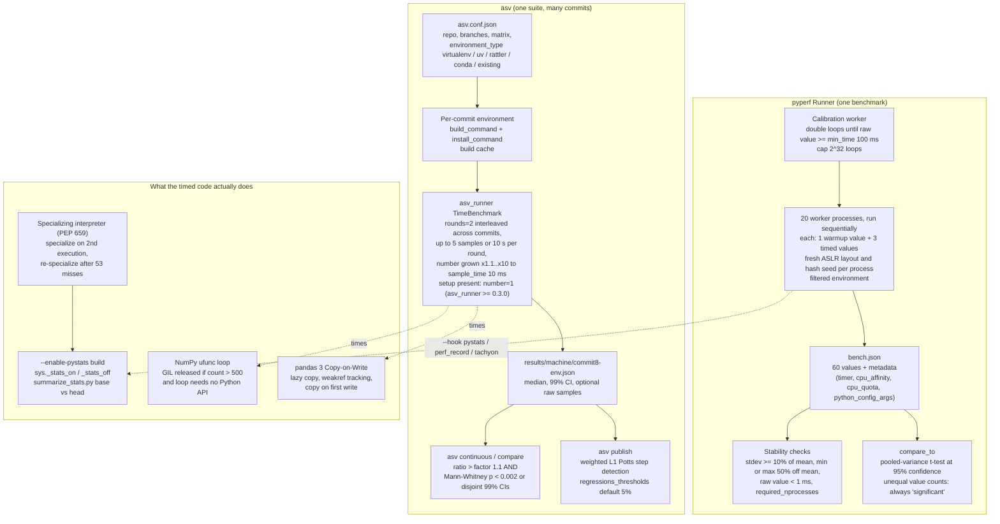

# Python Benchmarking: pyperf, asv, and NumPy/Pandas Profiling

> [!summary] Claim:
> A Python timing is one draw from a distribution shaped by ASLR, hash randomization, the specializing interpreter's warmup, GC, CPU frequency, and core placement, so one process and one number prove nothing.
> pyperf turns a microbenchmark into 20 calibrated worker processes of 3 values each and compares results with a pooled-variance t-test, while asv replays a suite across commits and flags a regression only when the ratio exceeds a factor (1.1 by default) and a Mann-Whitney U test or disjoint 99% intervals agree.
> A CPython built with `--enable-pystats` counts every specialization hit, miss, and deopt, which is the only direct evidence that a slowdown is the adaptive interpreter thrashing rather than the code doing more work.
> In NumPy and pandas the cost hides in copies and in who holds the GIL: a ufunc releases it only above 500 elements, a binary expression allocates a temporary unless a fragile elision heuristic fires, and pandas 3 Copy-on-Write moves each copy from creation to the first write.



## The Mechanism

### Why a single Python timing is not a measurement

A Python microbenchmark measures an interpreter, an allocator, an operating system scheduler, and a CPU at once, and each contributes variance that a loop inside one process cannot average away.
These sources are fixed for the life of a process and change between processes:
- Address space layout randomization places the stack, heap, and shared libraries at different addresses, which changes cache-set conflicts and alignment.
- String hash randomization changes the collision pattern of every `dict` and `set` keyed by `str`, which is why pyperf's `--fast` mode still keeps at least 3 processes, a minimum its source justifies as benchmarking "3 different (randomized) hash functions" (`Runner.parse_args` in `pyperf/_runner.py`).
- The size of the environment block shifts the initial stack, an effect that Mytkowicz, Diwan, Hauswirth, and Sweeney showed can bias results as much as a real optimization (ASPLOS 2009); [[Drill-Measurement-Methodology-Environment-Size-Bias]] reproduces it.

Other sources vary within one process:
- The specializing interpreter rewrites bytecode as it runs, so the first executions of a function are slower than later ones.
- The cyclic garbage collector runs when allocation counts cross thresholds, so allocation-heavy code pays for collections at points the benchmark does not control.
- CPU frequency scaling, thermal limits, and heterogeneous cores change the speed of the same instruction stream over seconds.

The language-neutral treatment of noise, isolation, and statistics lives in [[Benchmark-Methodology-Noise-and-Environment-Control]] and [[Statistics-for-Benchmarks-Coordinated-Omission-and-HDR-Histograms]]; this note covers what the Python tools do about them.

The standard library `timeit` addresses none of the between-process sources.
In CPython 3.15.2, `python -m timeit` runs one process, repeats the measurement 5 times (`default_repeat = 5` in `Lib/timeit.py`), picks the loop count from the sequence 1, 2, 5, 10, 20, 50, ... until one run takes at least 0.2 s (`autorange`, `default_target_time = 0.2`), disables the garbage collector during each run (`gc.disable()` in `Timer.timeit`), and prints "best of 5", the minimum.
The `-t/--target-time` option that sets that 0.2 s is new in Python 3.15.
The minimum is the right statistic for "how fast can this code run", and the wrong one for "how fast does this code run", because it hides exactly the variance that production sees.

### pyperf: the process model

pyperf (2.11.0, released 2026-11-08, requires Python 3.11 or newer) is the benchmark library behind pyperformance and CPython's own performance work.
A benchmark script creates exactly one `pyperf.Runner`; a second instance raises `RuntimeError("only one Runner instance must be created per process: use the same instance to run all benchmarks")`, because the same script is re-executed as each worker.
The parent process is a manager (`pyperf/_manager.py`) that spawns the script again with `--worker`, `--worker-task=N`, `--values`, `--min-time`, and either `--calibrate-loops` or `--loops`, and each worker writes its run back as JSON through an inherited pipe (`--pipe FD`).
Workers run one at a time; with `--timeout` (disabled by default, added in 2.8.0) the manager stops waiting for a worker's result after that many seconds, and its `popen_killer` context kills the worker.
Because the main script also runs in every worker, code that post-processes results should be guarded with `Runner.is_worker()`, new in 2.11.0.

The defaults come from `Runner.__init__` and `Runner.parse_args`:
1. One calibration worker doubles the loop count (`self.loops *= 2`) until one raw value takes at least `min_time`, which defaults to 0.1 s, and fails if the count would exceed `MAX_LOOPS = 2 ** 32` (`pyperf/_worker.py`).
2. 20 worker processes then run with that loop count.
3. Each worker computes 1 warmup value, which is stored but excluded from statistics, and 3 timed values, for 60 values in total.
4. `--rigorous` doubles the processes to 40; `--fast` uses `max(processes // 2, 3)` processes and `max(values * 2 // 3, 2)` values, which gives 10 processes and 2 values.
5. With a JIT (`pyperf.python_has_jit()`), the defaults become 6 processes and 10 values, and the warmup count is left unset, so the manager spawns warmup-calibration workers instead of using a fixed number.

`doc/runner.rst` says the JIT default is "10 warmups", but the code calibrates: `calibrate_warmups` in `_worker.py` starts at 1 warmup, compares two samples of 20 values (`WARMUP_SAMPLE_SIZE = 20`) taken after the candidate warmups, and accepts once the second sample's mean is within -50% to +10% of the first, its MAD within 10%, and its Q1 and Q3 within 5%, with at most 5 calibration processes (`MAX_CALIBRATION` in `_manager.py`).
`python_has_jit()` returns true for PyPy with its JIT, GraalPy, Pyston, and, since pyperf 2.10.0, CPython when `sys._jit.is_enabled()` is true, so a CPython built with `--enable-experimental-jit` and the JIT switched on gets JIT defaults (`pyperf/_utils.py`).

Each value is `raw_value / (loops * inner_loops)`, where `bench_func` measures a raw value with `time.perf_counter()` around a `for _ in range(loops): func()` loop.
`inner_loops` is for statements duplicated by hand, and `pyperf timeit --duplicate=N` copies the statement N times and multiplies `inner_loops` by N, which amortizes the `for` loop overhead in nanosecond-scale statements.
`pyperf timeit` maps the stdlib options differently: `timeit -n` (number) becomes `-l` (loops) and `timeit -r` (repeat) becomes `-n` (values), and unlike `timeit` it leaves the garbage collector enabled (`doc/cli.rst`).

Workers do not inherit the parent's environment.
`create_environ` in `pyperf/_utils.py` copies only `PATH`, `HOME`, `TEMP`, `COMSPEC`, `SystemRoot`, `SystemDrive`, `PYTHONPATH`, `PYTHON_CPU_COUNT`, `PYTHON_GIL`, the three `PYPERF_*` hook variables, and the 14 `LANG` and `LC_*` locale variables, unless `--inherit-environ=VARS` adds names or `--copy-env` copies everything; `--no-locale` drops the locale variables.
So `OMP_NUM_THREADS=1 python bench.py` does not reach the workers, and neither does `PYTHON_JIT` or the CPython 3.15 `PYTHON_SPECIALIZATION_OFF` switch, as the worked example shows; the filter also keeps the environment size, one of the Mytkowicz bias sources, stable between machines.

pyperf 2.11.0 adds `--in-process`, which runs the benchmark in the current process through `_inprocess_manager.InProcessManager` for platforms that cannot spawn subprocesses, such as WebAssembly.
It gives up exactly the between-process sampling described above (one ASLR layout, one hash seed), and `bench_command()` refuses to run with it.
2.11.0 also records `cpu_quota` metadata on Linux, the cgroup CPU bandwidth limit as a number of CPUs (for example `docker run --cpus=2`), taking the smallest `cpu.max` along the cgroup v2 hierarchy, or `cpu.cfs_quota_us` over `cpu.cfs_period_us` on cgroup v1 (`get_cgroup_cpu_quota` in `_collect_metadata.py`), which explains a container benchmark that is slower than the host for no code reason.

### pyperf: what it checks and how it compares

`format_checks` in `pyperf/_cli.py` prints "WARNING: the benchmark result may be unstable" after a run and in `pyperf check` when any of these hold:
- The standard deviation is at least 10% of the mean.
- Only when the standard deviation is below 10%: `Benchmark.required_nprocesses()` exceeds the number of runs, which prints "Not enough samples to get a stable result (95% certainty of less than 1% variation)"; the estimate uses per-process means and the "estimation of a mean" sample-size formula (added in 2.9.0).
- The minimum or maximum is at least 50% away from the mean.
- The shortest raw value took less than 1 ms, which means timer resolution and loop overhead are a visible fraction of the value.

pyperf reports mean and standard deviation by default; `pyperf stats` adds the median with the median absolute deviation, percentiles, and an outlier count using the interquartile range.
`pyperf hist` prints a text histogram, and `pyperf dump` prints every value per run, including warmups and calibration values, which is the first place to look when the mean and median disagree.

`pyperf compare_to ref.json changed.json` decides significance with a two-sample, two-tailed Student t-test (`is_significant` in `pyperf/_utils.py`, whose docstring says "alpha=0.95", meaning a 95% confidence level):
- `pooled_sample_variance` sums squared deviations of both samples and divides by `n1 + n2 - 2`.
- `tscore` divides the difference of means by `sqrt(2 * pooled_variance / n)`.
- The result is significant when `abs(t)` reaches a tabulated 95% critical value for `n1 + n2 - 2` degrees of freedom.
- `--min-speed=PCT` additionally marks a result as not significant when the change is smaller than that percentage.
- For several benchmarks, `compare_to` prints the geometric mean of the normalized means, following Fleming and Wallace (CACM 1986), and hides insignificant benchmarks behind one "Benchmark hidden because not significant (N): ..." line.

Two details of the implementation matter in practice.
First, the test treats all 60 values as independent, but the 3 values from one process share its ASLR layout, hash seed, and core placement, so the effective sample size is closer to the number of processes.
Second, `tscore` raises `ValueError("different number of values")` when the two files hold different numbers of values, and `is_significant_benchs` in `pyperf/_compare.py` catches every exception and returns `(True, None)` under the comment `FIXME: fix the root bug, don't work around it`; two single-value benchmarks are also declared significant outright.
In the per-benchmark output this prints "ERROR when testing if values are significant", with "Significant" added under `-v`; in `--table` output and in the suite's geometric mean no error appears at all, and no benchmark is hidden, so every row reads as a real change.

### pyperf: hooks, profilers, and memory

Hooks are context managers selected with `--hook NAME` or, since 2.11.0, passed as `Runner(hooks=[...])`.
`_compute_values` in `pyperf/_worker.py` instantiates the selected hooks at the start of each batch of values (calibration, warmup, and timed values are separate batches), enters them around every single value through a `contextlib.ExitStack`, and calls `teardown` at the end of the batch:
- `pystats` calls `sys._stats_off()` and `sys._stats_clear()` when it is instantiated, then `sys._stats_on()` and `sys._stats_off()` around each value, and raises "Can not collect pystats because python was not built with --enable-pystats" otherwise; it must be requested explicitly since pyperf 2.8.0, before which stats were collected automatically.
- `perf_record` starts `perf record --pid <worker> --control fifo:ctl,ack` per batch and writes `enable` and `disable` into the control FIFO around each value, so Linux perf samples only benchmark code; files are named `perf.data.<uuid4>`, placed in `PYPERF_PERF_RECORD_DATA_DIR`, and `PYPERF_PERF_RECORD_EXTRA_OPTS` is appended to the command (the hook itself was added in 2.9.0); [[Linux-perf-in-Depth-and-perf-c2c]] owns the perf side.
- `tachyon` (2.11.0, Python 3.15 or newer, not Windows) starts a fresh `python -m profiling.sampling attach <pid>` subprocess, with `PYPERF_TACHYON_OPTS` appended, when each value begins and stops it with `SIGINT` when the value ends, so each value pays one attach and the profile starts only once the attach completes; [[Python-cProfile-Tachyon-and-Sampling-Profilers]] owns the sampler.

Because the timed batch re-instantiates the `pystats` hook, which clears the counters, a timed worker's dump at exit holds only its timed values, matching the documentation's claim that warmups are excluded.
The calibration worker is different: it computes only a calibration batch, so its dump counts every calibration value, contrary to the documentation's claim that calibration is excluded; the worked example measures both.

`--track-memory` and `--tracemalloc` replace the benchmark's timing values with a memory peak ("drop timings, replace them with the memory peak" in `WorkerProcessTask.compute`), so they answer a memory question, not a timing one:
- `--track-memory` starts a thread that polls every 10 ms; on Linux it sums the `Private_Clean` and `Private_Dirty` lines of `/proc/self/smaps`, on Windows it reads `PeakPagefileUsage`, and elsewhere it reads psutil's USS (RSS on BSD), so a peak shorter than 10 ms can be missed.
- `--tracemalloc` records `tracemalloc.get_traced_memory()[1]` across all domains, which includes NumPy array buffers because NumPy registers them with tracemalloc.
- `--profile FILE` wraps the benchmark in cProfile, which distorts timings.

### pyperf system tune: what it changes

`python -m pyperf system tune` (as root) applies the `OPERATIONS` list in `pyperf/_system.py` in order, each only when its kernel interface exists:
1. Perf event: writes `1` to `/proc/sys/kernel/perf_event_max_sample_rate` (`BENCHMARK_RATE = 1`), so the kernel's own sampling cannot steal time.
2. ASLR: only checks that `/proc/sys/kernel/randomize_va_space` is `2` (full randomization); pyperf relies on ASLR to sample layouts and does not disable it.
3. Linux scheduler: checks for `isolcpus=` and `rcu_nocbs=` on the kernel command line.
4. CPU frequency: sets `scaling_min_freq` to the maximum frequency for the benchmark CPUs.
5. IRQ affinity: stops `irqbalance` and, when the benchmark CPUs are a subset (isolated CPUs or `--affinity`), writes the remaining CPUs into `/proc/irq/default_smp_affinity` and each `/proc/irq/N/smp_affinity`.
6. Power supply: checks that a laptop is on AC power.
7. CPU scaling governor: sets `performance` (reset sets `powersave`); the source orders it before Turbo Boost because "Setting the CPU scaling governor resets no_turbo".
8. Turbo Boost through `intel_pstate/no_turbo`, a `nohz_full` with `intel_pstate` incompatibility check, then Turbo Boost through `/dev/cpu/N/msr`, which `TurboBoostMSR.available()` restricts to x86 Linux without `intel_pstate` (pyperf 2.7.0 "Disable tuning TurboBoost setting on non-Intel device").

When isolated CPUs exist (`/sys/devices/system/cpu/isolated`), the Runner pins workers to them and prints "Pin process to isolated CPUs"; `--affinity=CPU_LIST` pins without isolation.
Stinner's 2016 measurements of `sum(range(10**7))` show why isolation is the big lever: 229 ms on an idle system, 372 ms under load, and 230 ms under the same load when pinned with `taskset` to CPUs isolated with `isolcpus` and `nohz_full`.
On macOS none of these interfaces exist: `pyperf system show` prints `WARNING: no operation available for your platform` and nothing can be pinned (observed on macOS 27.3, as of 2026-11).

### asv: benchmarking a commit history

Airspeed Velocity (asv 0.6.6, with the timing code in the separate `asv_runner` package, 0.3.2 as of 2026-11) answers a different question from pyperf: not "is A faster than B" but "which commit changed this number".
`asv.conf.json` names the repository (`repo`), the branches, the Python versions (`pythons`), a dependency `matrix` with `exclude` and `include` rules, and an `environment_type`: `virtualenv`, `uv`, `rattler`, `conda`, or `existing`.
For each commit and environment, asv checks out the commit, runs `build_command` (by default `python setup.py build` then `python -m pip wheel -w {build_cache_dir} {build_dir}` since asv 0.6.2, which `pyproject.toml` projects override) and `install_command` (`in-dir={env_dir} python -m pip install {wheel_file}`), caches built wheels, and runs each benchmark in a separate process.
`-E existing:same` (the default for `asv run --python=same`) skips building and benchmarks the interpreter that runs asv, which is what `asv run --python=same --quick` uses to smoke-test a suite; `--quick` runs each benchmark once and does not save results.
Results land in `results/<machine>/<first 8 hex digits of the commit>-<env>.json` (`get_filename` in `asv/results.py`, with an MD5 name when the environment name reaches 128 characters); `asv machine` records the machine once, because results are only comparable within one machine.

A benchmark's kind comes from its name prefix:
- `time_*` measures wall time, and `timeraw_*` returns code that asv runs in a fresh interpreter per sample, which is how import time is measured.
- `mem_*` returns an object and records `asizeof([obj, copy.copy(obj)]) - asizeof([obj, obj])` (`asv_runner/benchmarks/mem.py`), the size of one shallow copy, so objects shared with the copy are not counted.
- `peakmem_*` records `ru_maxrss` (bytes on macOS, kilobytes times 1024 elsewhere, `_maxrss.py`), and the documentation warns that it "also counts memory usage during the `setup` routine", so heavy fixtures belong in `setup_cache`, which runs once per environment and commit, is not parameterized, and is pickled to the benchmark processes.
- `track_*` returns any number.
- Each result carries a `version`, by default a hash of the source of the benchmark, `setup`, and `setup_cache`; editing any of them invalidates the history unless `version` is pinned, while a change in asv_runner itself changes nothing in the hash.

The timing loop (`TimeBenchmark.run` and `benchmark_timing` in `asv_runner/benchmarks/time.py`):
1. `rounds` defaults to 2; with `--interleave-rounds`, which `asv run` and `asv continuous` enable whenever they build environments (`interleave_rounds = not (dry_run or has_existing_env)` in `asv/commands/run.py`), rounds are run commit by commit and even rounds visit the commits in reverse order, so slow drift is spread over both sides of a comparison.
2. With `repeat = 0` (the default) a round collects 1 to 10 samples within 20 s; when `rounds > 1` both limits are halved, to at most 5 samples within 10 s per round.
3. With `number = 0`, calibration multiplies the inner count by `min(10.0, max(1.1, sample_time / elapsed))` until one sample takes at least `sample_time` (default 10 ms) and `warmup_time` has passed, so calibration and warmup are one loop; `warmup_time` defaults to 0.1 s on CPython, 1.0 s on PyPy, and 5.0 s on GraalPy.
4. `min_run_count` (default 2) forces at least two calls even for slow benchmarks, and the default timer is `timeit.default_timer`, which is `time.perf_counter`.
5. Samples go through `timeit.Timer.timeit`, which disables the garbage collector, so asv timings, like `timeit` and unlike pyperf, exclude GC pauses that the benchmark does not trigger explicitly.
6. `compute_stats` in `asv_runner/statistics.py` reports the median with a 99% confidence interval from `quantile_ci`, falling back to a `LaplacePosterior` interval "assuming exponential noise" when the nonparametric interval is unbounded.

asv_runner 0.3.0 (uploaded 2026-08-04) changed what `setup` means for timing benchmarks (asv issue 966).
If a benchmark has any `setup` hook, an auto-calibrated `number` now resolves to 1, so every timed call sees freshly set-up state, and an explicit `number > 1` switches to `_SetupInterleavedTimer`, which reruns setup before every call, times each call separately, and prints "setup hooks re-run between the N individually timed calls of each sample" to stderr.
`timeraw_*` benchmarks are exempt (`_setup_isolates_timed_calls = False` in `asv_runner/benchmarks/timeraw.py`).
The asv_runner 0.2.5 wheel contains none of this code, and asv 0.6.6 requires only `asv-runner>=0.2.5`, so the same suite calibrates differently depending on which asv_runner an environment resolved.
For a sub-microsecond benchmark with a `setup` method, one call per sample means each sample is a few hundred nanoseconds read from a clock whose resolution is 41.7 ns on Apple silicon, plus the cost of reading the clock.

### asv: deciding that a commit regressed

`asv continuous base branch` benchmarks two commits (by default `branch` against its parent) and prints only changed results.
It records raw samples by default, unlike `asv run`, so the comparison can use a rank test.
`_is_result_better(a, b, ...)` in `asv/commands/compare.py` declares `a` better only when both conditions hold:
1. The difference is statistically supported, unless `--no-stats` is given or either side has `repeat == 1`: `is_different` in `asv/_stats.py` runs a Mann-Whitney U test at `p < 0.002` when raw samples exist and the sample sizes can reach that p-value at all (`p_min = 1 / binom(n_a + n_b, min(n_a, n_b)) < 0.002`), and otherwise requires the two 99% confidence intervals not to overlap.
2. The ratio passes the factor: `a < b / factor`, with `--factor` defaulting to 1.1.

With the default 2 rounds of up to 5 samples, each side has up to 10 samples and `p_min = 1 / binom(20, 10)`, about 5.4e-6, so the rank test is reachable; with 3 samples a side `p_min = 1 / 20 = 0.05` and asv silently falls back to the interval check.
The output marks each row: `+` worsened, `-` improved, `!` newly failing, `*` newly fixed, `x` not comparable because the benchmark version changed, and a `~` on the ratio when the factor was crossed but the statistics did not support it.
`asv continuous` returns a non-zero exit code when anything worsened, which is what CI gates on; [[Performance-Regression-Detection-in-CI]] owns the CI design around it.

For history, `asv publish` models each benchmark's series as piecewise constant plus noise and solves a weighted L1 Potts problem, `argmin gamma k + sum w_i |y_i - mu_r|`, with heuristics that avoid its O(n^2) cost (`docs/source/step_detection.rst`, `solve_potts_approx` in `asv/step_detect.py`).
Each point's weight is the inverse of its 99% confidence interval, the L1 cost makes the fit robust to outliers, and a step is reported as a regression only above `regressions_thresholds`, which defaults to 0.05 (5%), the largest matching regex winning (`_get_threshold` in `asv/plugins/regressions.py`).
`asv find A..B benchmark` bisects with about `log2(N)` benchmark runs and reports the largest regression, which assumes the range contains one dominant step.

NumPy and pandas both keep asv suites in-tree.
pandas 3.1.1's `asv_bench/asv.conf.json` uses `rattler` with conda-forge, ignores history before commit `0409521665` through `regressions_first_commits`, and builds with `python -m build -Cbuilddir=builddir --no-isolation --wheel --outdir {build_cache_dir} {build_dir}`.
The pandas contributor guide runs `asv continuous -f 1.1 upstream/main HEAD -b ^groupby` to check one area before a pull request.

### The specializing interpreter: why the same loop has two speeds

PEP 659 (Mark Shannon, Python 3.11) made CPython rewrite instructions in place.
Each specializable instruction has inline cache entries after it, and the first 16-bit entry is a counter with a 13-bit value and a 3-bit backoff exponent (`pycore_backoff.h`).
In 3.15.2 (`Include/internal/pycore_code.h`), `ADAPTIVE_WARMUP_VALUE` is 1, so an instruction attempts to specialize on its second execution, and a specialized instruction that keeps missing re-specializes after 53 misses (`ADAPTIVE_COOLDOWN_VALUE` 52, "a prime number" chosen "for avoiding artifacts if every nth value is a different type").
A failed attempt backs off through the `value_and_backoff_next` table, 1, 6, 30, 126, 508, 2052, then 8190, values whose successor is a prime near a power of two.
With the experimental JIT, a loop becomes a trace candidate when its `JUMP_BACKWARD` counter, initialized to 4000, runs out, and function entry (`RESUME`) starts at 8190.

In 3.15 those thresholds are runtime policy, not constants: `Python/pystate.c` reads `PYTHON_JIT_JUMP_BACKWARD_INITIAL_VALUE`, `PYTHON_JIT_RESUME_INITIAL_VALUE`, `PYTHON_JIT_SIDE_EXIT_INITIAL_VALUE` and their `_BACKOFF` variants, `PYTHON_JIT_STRESS` (63 and 127), `PYTHON_JIT_FITNESS_INITIAL`, `PYTHON_UOPS_OPTIMIZE`, and `PYTHON_SPECIALIZATION_OFF`, which makes `_PyCode_Quicken` leave every instruction unspecialized.
None of these appear in the 3.15.2 `Doc/` tree, so treat them as internal knobs (as of 2026-11).
They are read with `Py_GETENV`, so `-E` and `-I` ignore them, and pyperf's environment filter drops them unless they are passed with `--inherit-environ`.
`PYTHON_SPECIALIZATION_OFF=1` is the cleanest A/B for "how much of this benchmark is the specializer": the worked example measures it.

Two consequences matter for benchmarks.
Tier 1 specialization settles within a few executions, so pyperf's single warmup value is enough on a default build, but a JIT build needs thousands of iterations before a loop is traced, which is why pyperf calibrates warmups when `sys._jit.is_enabled()` is true.
More importantly, a specialized instruction caches one shape: `LOAD_ATTR_INSTANCE_VALUE` caches one type version, so a loop that sees objects of eight classes in rotation hits on one class, misses on the other seven, and re-specializes about every 60 executions without ever settling.
`dis.dis(f, adaptive=True)` and `python -m dis -S` (the `-S` option is new in 3.14) show only the current form of each instruction, so the monomorphic and the polymorphic loop both display `LOAD_ATTR_INSTANCE_VALUE`; the miss rate is invisible without counters.

### pystats: counting specializer behavior

`./configure --enable-pystats` defines `Py_STATS` and adds `sys._stats_on()`, `sys._stats_off()`, `sys._stats_clear()`, and `sys._stats_dump()`, plus `-X pystats` and `PYTHONSTATS=1` to turn collection on at startup (`Doc/using/configure.rst`).
Release builds do not enable it: Homebrew's CPython 3.15.2 lacks `sys._stats_on`, so pyperf's hook fails on it (observed on macOS, as of 2026-11).
A pystats build does extra work for every counted event, so its timings are not comparable with a release build's.
The counters live in a `PyStats` struct (`Include/cpython/pystats.h`):
- Per opcode: specialization `success`, `failure`, `hit`, `deferred`, `miss`, `deopt`, 60 `failure_kinds` (`SPECIALIZATION_FAILURE_KINDS`), `execution_count`, and `pair_count[256]` for which opcode follows which.
- Calls, frames pushed, and frame objects created.
- Object increfs and decrefs, allocations bucketed by size, freelist traffic, dict materializations, and type cache hits and misses.
- GC collections per generation, the tier 2 optimizer and JIT (traces created and executed, trace lengths), and rare events such as assigning `__class__` or modifying builtins, which invalidate cached assumptions.
- On free-threaded builds, `mutex_sleeps`, `qsbr_polls`, and `world_stops`.

In 3.15 each thread accumulates into its own `PyStats`, and `stats_merge_all` merges them when stats are dumped (`Python/pystats.c`).
`sys._stats_dump()` writes to `/tmp/py_stats/` (`c:\temp\py_stats\` on Windows) under a random 160-bit hex file name, or to stderr if that directory does not exist, and clears the counters.
`Tools/scripts/summarize_stats.py` reads a directory of dumps or a previous `--json-output` file; given two inputs it prints Markdown tables with "Base" and "Head" columns, which is how CPython developers attribute a pyperformance change to the specializer.
Its execution-count table notes that when a specialized instruction deoptimizes, "the base unspecialized instruction is not counted", so misses show up against the specialized form.
Statistics accumulate across runs into one directory, so clear `/tmp/py_stats` before each experiment.

Python 3.15's Tachyon sampler (`profiling.sampling`) can annotate each sample with the executing opcode through `--opcodes`, including the specialization the adaptive interpreter chose, without a special build ([[Python-CPython-perf-Trampoline-and-Tachyon-Internals]] owns its internals); pystats remains the only exact count of misses and deopts.

### NumPy: copies, temporaries, and allocation

An `ndarray` is a data buffer plus metadata (dtype, shape, strides, offset), and NumPy's "Copies and views" guide states the rule: basic indexing (slices, integers, `np.newaxis`) always creates a view and advanced indexing (integer or boolean arrays) always creates a copy.
`reshape` returns a view when strides allow it and copies otherwise, `ravel` copies when the array is not contiguous in the requested order, and `flatten` always copies.
`reshape(..., copy=False)` raises `ValueError` when a copy cannot be avoided, which turns a silent copy into an error in hot code.
`np.shares_memory(a, b)` answers exactly whether two arrays overlap and can be expensive, while `np.may_share_memory` only compares memory bounds; `arr.base` is the owning array for a view and `None` for an array that owns its data.

Every binary operation allocates its result, so `x * 2.0 + 1.0` on a 1,000,000-element float64 array allocates two 8 MB buffers unless NumPy elides the temporary.
`try_binary_elide` and `can_elide_temp` in `numpy/_core/src/multiarray/temp_elide.c` reuse the left operand in place only when every condition holds:
1. `check_unique_temporary` succeeds: on CPython 3.14 and later it calls `PyUnstable_Object_IsUniqueReferencedTemporary`, which requires a reference count of 1 and finds the object on the current frame's evaluation stack, because 3.14 changed how temporaries are reference-counted (CPython issue 133164).
2. The operand is an exact, numeric, writeable `ndarray` that owns its data and is at least `NPY_MIN_ELIDE_BYTES`, 256 KiB (32 bytes in a `Py_DEBUG` build); the source comment says the 10-frame backtrace pays for itself around 100 KiB and that 256 KiB was chosen conservatively, near where the L2 cache spills.
3. The other operand is an array or scalar that does not change the result dtype.
4. `check_callers` calls `backtrace()` for at most 10 frames (`NPY_MAX_STACKSIZE`), requires every frame to lie in libpython or NumPy's `_multiarray_umath` module, and succeeds only when `dladdr` names one of them `_PyEval_EvalFrameDefault` (`PYFRAMEEVAL_FUNC`); a third-party C extension in between could hold a borrowed reference that the reference count does not show.
Elision is compiled out where `backtrace()` or `dlfcn.h` is missing, such as Windows, and for commutative operations (addition, multiplication, and similar) the code swaps operands to try the right-hand side when the left fails.

Condition 4 depends on how the interpreter was compiled, not on the Python code.
On Homebrew CPython 3.15.2 for macOS arm64 the return address above `_TAIL_CALL_BINARY_OP` symbolizes as `_PyEval_Vector`, so the walk never matches `_PyEval_EvalFrameDefault` and `check_callers` returns 0, while on Homebrew 3.14.10, built with the same `--enable-optimizations --with-lto --with-tail-call-interp` flags, the same frame is `_PyEval_EvalFrameDefault` and elision fires (lldb trace in the worked example, as of 2026-11; the breakpoints on `check_callers` and `PyUnstable_Object_IsUniqueReferencedTemporary` were rerun on both interpreters at finish and reproduced the return values and the frame names).
Expression-level memory therefore differs between interpreter builds with identical NumPy, which is a reason to measure peaks on the build you deploy.

NumPy registers every data buffer it allocates with `tracemalloc` in domain 389047 (`NPY_TRACE_DOMAIN`, used by `PyTraceMalloc_Track` in `alloc.c`), so `tracemalloc` and pyperf's `--tracemalloc` see array memory and can attribute it to the Python line that created it ([[Python-Memory-Profiling-Memray-and-Line-Profiler]] owns Memray).
Below the allocator, `alloc.c` keeps a small-block cache: data blocks under 1024 bytes (`NBUCKETS`) are cached in per-size buckets of up to 7 pointers (`NCACHE`), so a microbenchmark that creates and frees tiny arrays mostly exercises that cache, not `malloc`.
The cache is compiled out on free-threaded builds, where the source comment says CPython's mimalloc caches better, and under AddressSanitizer or MemorySanitizer (`USE_ALLOC_CACHE 0`), so small-array allocation benchmarks are not comparable across those builds.
On Linux, `indicate_hugepages` calls `madvise(MADV_HUGEPAGE)` on allocations of at least 4 MiB (`1u << 22`), enabled at import for kernels 4.6 and newer, and `NUMPY_MADVISE_HUGEPAGE=0` or `=1` overrides it (`hugepage_setup` in `numpy/__init__.py`), which can move large-array benchmarks by changing TLB behavior.

### NumPy: when the GIL is released

The ufunc loops release the GIL with `NPY_BEGIN_THREADS_THRESHOLDED(loop_size)`, which calls `PyEval_SaveThread()` only when the loop size is greater than 500 (`numpy/_core/include/numpy/ndarraytypes.h`), and only for loops that do not set `NPY_METH_REQUIRES_PYAPI`.
Loops over `dtype=object` require the Python API and never release the GIL, and buffered iteration over non-contiguous or casting inputs processes chunks of `NPY_BUFSIZE` (8192) elements.
So threads that call ufuncs on small arrays serialize on the GIL, threads on large arrays run their inner loops in parallel, and a cheap kernel such as `np.add`, one addition per element loaded, is limited by fixed per-call costs and data movement rather than arithmetic, so it gains little from releasing the GIL.
NumPy's thread-safety guide adds the failure mode that releasing the GIL creates: mutating or resizing an array that another thread is reading is a data race and can crash the interpreter, and on free-threaded Python "arrays with `dtype=np.object_` are not protected by the GIL".
Linear algebra calls into BLAS, which may run its own thread pool; the asv tuning guide recommends `OPENBLAS_NUM_THREADS=1`, `MKL_NUM_THREADS=1`, and `OMP_NUM_THREADS=1` for stable benchmarks, and `threadpoolctl` reports and limits the pools it recognizes.
The NumPy 2.5.4 macOS arm64 wheel reports `accelerate` as both BLAS and LAPACK (`np.show_config()`), and `threadpoolctl` 3.8.0 lists no pool for it (`threadpool_info()` returns `[]` on the lab host, as of 2026-11).

### pandas 3: Copy-on-Write and the string dtype

PDEP-7 made Copy-on-Write the only behavior in pandas 3.0: the result of any indexing operation, including a column accessed as a Series, and of any method returning a new object "always behaves as if it were a copy".
Under the hood pandas returns views wherever it can and, in PDEP-7's words, "uses weakrefs to keep track of whether the data of a Dataframe/Series are viewing the data of another (pandas) object or are being viewed by another object"; a write into shared data copies first.
The pandas 3.0 release notes and migration guide state the consequences:
- Chained assignment such as `df["b"][mask] = value` never updates `df` and raises a `ChainedAssignmentError` warning, and `SettingWithCopyWarning` is removed.
- The `copy` keyword of `rename`, `reindex`, `set_axis`, `transpose`, `merge`, `astype`, and nine other methods is deprecated and "has no effect starting with 3.0", and setting `mode.copy_on_write` "no longer has any impact".
- Accessing the NumPy array of a Series or single-block DataFrame, for example with `to_numpy()`, returns a read-only array when it shares data with the pandas object, and setting `arr.flags.writeable = True` "circumvents Copy-on-Write rules".

For profiling, Copy-on-Write moves cost from the line that creates a derived object to the line that first writes to it or its parent, and PDEP-7 lists "Performance cost of indexing and methods becomes harder to predict" among its disadvantages.
A memory profile of a pandas 3 pipeline therefore attributes copies to `__setitem__` and `iloc` writes, and keeping an unused reference alive, such as an intermediate DataFrame kept for debugging, is enough to force a copy that would otherwise be skipped.

pandas 3.0 also infers a dedicated `str` dtype for string data, backed by PyArrow when it is installed and by NumPy `object` arrays otherwise.
`memory_usage()` without `deep=True` counts only the 8-byte pointers of an `object` column, so it under-reports string memory, while `deep=True` adds each Python string's size; the PyArrow-backed column stores the bytes plus an offset per row.

pandas releases the GIL inside many Cython kernels: the 3.1.1 sources contain 23 `with nogil` blocks in `_libs/groupby.pyx`, 21 in `_libs/algos.pyx`, 17 in `_libs/window/aggregations.pyx`, 15 in `_libs/join.pyx`, and 10 in `_libs/hashtable_class_helper.pxi.in`.
The Python-level orchestration around those kernels, including index alignment, dtype dispatch, and block management, holds the GIL, so threading a pandas pipeline speeds up only the time spent inside those blocks.
[[Drill-Profiling-Python-C-Extension-GIL-and-Allocation-Bottleneck]] practices finding GIL holders in a native extension, and [[Python-Free-Threaded-Wheels-and-Wheel-Variants]] covers the free-threaded builds where the question changes.

## Commands and Numbers to Know

| Item | Value | Platform | Notes |
|---|---|---|---|
| pyperf Runner defaults | 20 processes x (1 warmup + 3 values), min_time 0.1 s (as of 2026-11) | Both | pyperf 2.11.0; JIT: 6 processes, 10 values, calibrated warmups. |
| `--fast` / `--rigorous` | 10 processes x 2 values / 40 processes x 3 values (as of 2026-11) | Both | `--fast` keeps at least 3 processes for 3 hash seeds. |
| Calibration cap | `MAX_LOOPS = 2 ** 32`, loops doubled per attempt (as of 2026-11) | Both | `pyperf/_worker.py`. |
| Unstable warnings | stdev >= 10% of mean; min or max >= 50% off mean; raw value < 1 ms (as of 2026-11) | Both | `format_checks` in `pyperf/_cli.py`. |
| `pyperf compare_to` test | Student two-sample t-test, 95% confidence, pooled variance (as of 2026-11) | Both | Unequal value counts are always "significant". |
| Worker environment | `PATH`, `HOME`, `TEMP`, `PYTHONPATH`, `PYTHON_CPU_COUNT`, `PYTHON_GIL`, `PYPERF_*`, locale (as of 2026-11) | Both | `--inherit-environ=VARS`, `--copy-env`, `--no-locale`. |
| `--hook pystats` / `perf_record` / `tachyon` | needs `--enable-pystats` / Linux perf / Python 3.15+ (as of 2026-11) | Both / Linux / not Windows | The calibration worker's pystats dump counts every calibration value. |
| `PYPERF_PERF_RECORD_DATA_DIR`, `PYPERF_PERF_RECORD_EXTRA_OPTS`, `PYPERF_TACHYON_OPTS` | profiler hook output and options (as of 2026-11) | Linux / Both | pyperf 2.9.0 and 2.11.0. |
| `--track-memory` / `--tracemalloc` | 10 ms polling of private memory or USS / tracemalloc peak; replaces timings (as of 2026-11) | Both | Linux smaps, Windows `PeakPagefileUsage`, psutil elsewhere. |
| `--in-process` | one process, no workers (as of 2026-11) | Both | pyperf 2.11.0, for WebAssembly; loses ASLR and hash sampling. |
| `cpu_quota` metadata | cgroup `cpu.max` as CPUs (as of 2026-11) | Linux | pyperf 2.11.0. |
| `pyperf system tune` | perf sample rate 1, min freq = max, governor performance, irqbalance off, no_turbo (as of 2026-11) | Linux | Prints "no operation available" on macOS. |
| `perf_counter` on Apple silicon | `mach_absolute_time()`, resolution 41.7 ns (as of 2026-11) | macOS | `time.get_clock_info`, macOS 27.3 arm64. |
| `python -m timeit` | repeat 5, target 0.2 s, GC disabled, reports min (as of 2026-11) | Both | `-t/--target-time` new in 3.15. |
| asv timing defaults | rounds 2, up to 5 samples or 10 s per round, sample_time 10 ms, warmup_time 0.1 s, min_run_count 2 (as of 2026-11) | Both | asv_runner 0.3.2; `number` grows by x1.1 to x10 per step. |
| asv `setup` effect | auto `number` becomes 1 when any setup exists (as of 2026-11) | Both | asv_runner 0.3.0 and later (asv issue 966); not `timeraw_*`. |
| `asv continuous` | `--factor 1.1`, raw samples recorded, Mann-Whitney U at p < 0.002 or disjoint 99% CIs (as of 2026-11) | Both | Non-zero exit when any benchmark worsened. |
| `asv publish` threshold | `regressions_thresholds` default 0.05 (as of 2026-11) | Both | Largest matching regex wins. |
| `asv run -E existing:same` / `--python=same` | run in the current interpreter, no build (as of 2026-11) | Both | The project must already be installed. |
| `asv run --quick` | each benchmark once, results not saved (as of 2026-11) | Both | For catching broken benchmarks, not for numbers. |
| Specializer warmup / cooldown | specialize on 2nd execution; re-specialize after 53 misses (as of 2026-11) | Both | CPython 3.15.2 `pycore_code.h`. |
| JIT trace thresholds | `JUMP_BACKWARD` 4000, `RESUME` 8190, `SIDE_EXIT` 4000 (as of 2026-11) | Both | `pycore_backoff.h`; overridable with `PYTHON_JIT_*_INITIAL_VALUE`. |
| `PYTHON_SPECIALIZATION_OFF=1` | disables tier 1 specialization (as of 2026-11) | Both | CPython 3.15 `pystate.c`; undocumented; ignored under `-E`. |
| pystats | `./configure --enable-pystats`; `-X pystats`; `PYTHONSTATS=1`; dumps to `/tmp/py_stats/` or stderr (as of 2026-11) | Both | `summarize_stats.py base head` compares two dumps. |
| `python -m dis -S` | prints specialized bytecode (as of 2026-11) | Both | 3.14 and later; `dis.dis(f, adaptive=True)` since 3.11. |
| NumPy GIL release | loop size > 500 and no Python API (as of 2026-11) | Both | `NPY_BEGIN_THREADS_THRESHOLDED`, NumPy 2.5.4. |
| NumPy buffer size | 8192 elements (`NPY_BUFSIZE`) (as of 2026-11) | Both | Buffered (casting or non-contiguous) iteration chunk. |
| NumPy temporary elision | operand >= 256 KiB, unique temporary, 10-frame `backtrace()` must reach `_PyEval_EvalFrameDefault` (as of 2026-11) | Linux, macOS | Fires on Homebrew 3.14.10, not on Homebrew 3.15.2 (macOS arm64). |
| NumPy tracemalloc domain | 389047 (as of 2026-11) | Both | `tracemalloc.DomainFilter(True, 389047)` isolates array buffers. |
| NumPy small-block cache | blocks < 1024 bytes, 7 per bucket; off on free-threaded and ASan or MSan builds (as of 2026-11) | Both | `alloc.c`. |
| NumPy huge pages | `madvise(MADV_HUGEPAGE)` for >= 4 MiB; `NUMPY_MADVISE_HUGEPAGE=0/1` (as of 2026-11) | Linux | Default on for kernel 4.6 and newer. |
| pandas Copy-on-Write | always on in 3.x; `mode.copy_on_write` has no effect (as of 2026-11) | Both | pandas 3.1.1. |
| pandas string dtype | `str`, PyArrow storage when installed (as of 2026-11) | Both | `memory_usage(deep=True)` for real string memory. |
| `sys.getswitchinterval()` | 0.005 s (as of 2026-11) | Both | How long a thread may hold the GIL before being asked to drop it. |

## Multi-Language Comparison

| Concern | C++ ([[Cpp-Google-Benchmark-and-nanobench\|Google Benchmark, nanobench]]) | Python (pyperf, asv) | Rust ([[Rust-Benchmarking-Criterion-Divan-Gungraun-and-dhat\|Criterion, Divan, Gungraun]]) |
|---|---|---|---|
| Unit of repetition | iterations inside one process | pyperf: separate worker processes; asv: a separate process per benchmark and round | iterations inside one process |
| Dead-code elimination | the compiler can delete unused results, so harnesses provide `DoNotOptimize`-style barriers | the default CPython interpreter does not eliminate unused calls, so the risk is the opposite one: timing the call and loop overhead instead of the work | the optimizer can delete work, so `black_box` is required |
| Warmup source | caches, branch predictors, page faults | the same, plus specializer state and, on JIT builds, trace compilation | caches, branch predictors, page faults |
| Between-run randomness | ASLR, link order | ASLR, hash seed, environment size | ASLR, link order |
| Regression gate | repeated runs and a threshold, or instruction counts | pyperf t-test or asv factor plus rank test | statistical comparison against a saved baseline, or instruction counts with Gungraun |
| Counting instead of timing | PMU counters through perf ([[Linux-perf-in-Depth-and-perf-c2c\|perf]]) | pystats for interpreter events, `--hook perf_record` for PMU | Gungraun instruction counts |
| History across commits | external dashboards | asv step detection and `asv find` | external dashboards |

The Python column differs in kind, not just degree: the interpreter's own adaptive state is part of the measured system, so a Python benchmark has a warmup and a polymorphism story that a compiled language's benchmark does not.

## Worked Lab Example

This note has no lab in `code/`.
Every output below is a hand run made once on 2026-11-15 on an Apple M3 Pro (6 performance and 6 efficiency cores) with macOS 27.3 arm64, Homebrew CPython 3.15.2 and 3.14.10, pyperf 2.11.0, asv 0.6.6 with asv_runner 0.3.2, NumPy 2.5.4, pandas 3.1.1, pyarrow 26.0.1, and threadpoolctl 3.8.0, installed with `uv` into fresh virtual environments, plus a CPython 3.15.2 built from the python.org tarball with `./configure --enable-pystats`.
Outputs are copied verbatim (long ones trimmed with `...`), but they are not golden files: timings will differ on any other run, and only the structural facts (counts, flags, booleans, which side wins) are expected to reproduce.

### 1. An unpinned laptop, read correctly

```sh
python -m pyperf system show
python -m pyperf timeit -q -o full.json "sorted(range(1000, 0, -1))"
python -m pyperf stats full.json
```

```text
WARNING: no operation available for your platform
Mean +- std dev: 4.86 us +- 0.86 us
...
Raw value minimum: 147 ms
Raw value maximum: 322 ms

Number of calibration run: 1
Number of run with values: 20
Total number of run: 21

Number of warmup per run: 1
Number of value per run: 3
Loop iterations per value: 2^15
Total number of values: 60

Minimum:         4.50 us
Median +- MAD:   4.61 us +- 0.02 us
Mean +- std dev: 4.86 us +- 0.86 us
Maximum:         9.84 us
...
 75th percentile: 4.66 us (-4% of the mean) -- Q3
 95th percentile: 5.43 us (+12% of the mean)
100th percentile: 9.84 us (+103% of the mean) -- maximum

Number of outlier (out of 4.49 us..4.77 us): 13

WARNING: the benchmark result may be unstable
* the standard deviation (857 ns) is 18% of the mean (4.86 us)
* the maximum (9.84 us) is 103% greater than the mean (4.86 us)
```

The calibration worker settled on 2^15 loops, so every raw value took 147 to 322 ms, far above the 1 ms floor.
The mean (4.86 us) sits above the 75th percentile (4.66 us): 13 of 60 values are outliers, and they drag the mean while the median and MAD (4.61 us +- 0.02 us) describe the typical value.
Reading the per-process values with the pyperf API (`pyperf.Benchmark.load("full.json").get_runs()`) shows where the outliers are: processes 1 to 11 stayed between 4.50 and 4.86 us, and the spikes are single values in later processes, such as 9.84 us in process 14 and 8.57 us in process 18, next to normal values from the same process.
This run cannot say what caused them, because macOS offers no CPU pinning and pyperf records no core identifier per value.
The honest summary of this run is "median 4.61 us, unstable", not "4.86 us".

### 2. The compare_to sample-count trap

```sh
python -m pyperf timeit -q --fast -o fast.json "sorted(range(1000, 0, -1))"
python -m pyperf timeit -q -o full2.json "sorted(range(1000, 0, -1))"
python -m pyperf compare_to full.json fast.json -v
python -m pyperf compare_to full.json full2.json -v
```

```text
Mean +- std dev: [full] 4.86 us +- 0.86 us -> [fast] 4.53 us +- 0.04 us: 1.07x faster
ERROR when testing if values are significant
Significant
---
Mean +- std dev: [full] 4.86 us +- 0.86 us -> [full2] 4.77 us +- 0.87 us: 1.02x faster
Not significant!
```

All three files time the same statement.
The first comparison pits 60 values against 20, `tscore` raises `ValueError`, `is_significant_benchs` swallows it and returns `(True, None)`, and pyperf prints the error line and then "Significant"; without `-v` the error line still appears, but "Significant" does not.
The second comparison has equal counts, and the t-test finds the 1.02x difference not significant.

In a suite, the trap disappears from view.
Two statements appended to `sa.json` with `-p 6` and to `sb.json` with `-p 4` (18 values against 12), then the same two statements appended to `sc.json` with `-p 6`:

```sh
python -m pyperf compare_to --table sa.json sb.json
python -m pyperf compare_to --table sa.json sc.json
```

```text
+--------------------------+---------+-----------------------+
| Benchmark                | sa      | sb                    |
+==========================+=========+=======================+
| sorted(range(1000,0,-1)) | 4.66 us | 4.99 us: 1.07x slower |
+--------------------------+---------+-----------------------+
| list(range(1000))        | 2.54 us | 2.54 us: 1.00x faster |
+--------------------------+---------+-----------------------+
| Geometric mean           | (ref)   | 1.04x slower          |
+--------------------------+---------+-----------------------+
---
+-------------------+---------+-----------------------+
| Benchmark         | sa      | sc                    |
+===================+=========+=======================+
| list(range(1000)) | 2.54 us | 2.58 us: 1.02x slower |
+-------------------+---------+-----------------------+
| Geometric mean    | (ref)   | 1.01x faster          |
+-------------------+---------+-----------------------+

Benchmark hidden because not significant (1): sorted(range(1000,0,-1))
```

With mismatched counts the table prints no error, hides nothing, and reports a 1.04x geometric-mean slowdown; with equal counts pyperf hides the benchmark it cannot distinguish.

### 3. The specializer: timing, counters, and bytecode

`attr_common.py` builds 8 classes whose `__init__` sets `self.v`, and `total(objs)` sums `o.v` over a list; `bench_attr.py` times it over 8,000 objects of one class (`attr_mono`) and of eight classes in rotation (`attr_poly`):

```python
import os, sys
sys.path.insert(0, os.path.dirname(os.path.abspath(__file__)))
import pyperf
import attr_common as ac  # make_class(i), objs(n, k), total(objs)

runner = pyperf.Runner()
runner.metadata["spec_off_env"] = os.environ.get("PYTHON_SPECIALIZATION_OFF", "unset")
runner.bench_func("attr_mono", ac.total, ac.objs(8000, 1))
runner.bench_func("attr_poly", ac.total, ac.objs(8000, 8))
```

The script ran three times: plainly, with `PYTHON_SPECIALIZATION_OFF=1` in the shell, and with the same variable plus `--inherit-environ=PYTHON_SPECIALIZATION_OFF`.
These lines condense `pyperf stats` and `pyperf metadata` for each output file:

```text
attr attr_mono: Median +- MAD:   57.1 us +- 0.6 us Mean +- std dev: 58.3 us +- 4.6 us
attr attr_poly: Median +- MAD:   156 us +- 2 us Mean +- std dev: 157 us +- 3 us
- spec_off_env: unset
attr_off_dropped attr_mono: Median +- MAD:   57.5 us +- 1.0 us Mean +- std dev: 62.9 us +- 22.5 us
attr_off_dropped attr_poly: Median +- MAD:   155 us +- 1 us Mean +- std dev: 155 us +- 2 us
- spec_off_env: unset
attr_off attr_mono: Median +- MAD:   152 us +- 1 us Mean +- std dev: 153 us +- 2 us
attr_off attr_poly: Median +- MAD:   187 us +- 3 us Mean +- std dev: 190 us +- 11 us
- spec_off_env: 1
```

The polymorphic loop is 2.73 times slower by median than the monomorphic one while executing the same bytecode.
In the second run the variable never reached the workers: the metadata recorded inside each worker says `unset`, and the medians match the first run.
In the third run every instruction stayed generic, the monomorphic loop slowed from 57.1 to 152 us, a 2.66x specialization benefit on this loop, and the polymorphic loop became slower still (187 us), because its `FOR_ITER_LIST` and `BINARY_OP_ADD_INT`, which do specialize successfully, were turned off too.

To see why the polymorphic loop is slow, `pystats_attr.py` ran the same `total` on the pystats build with 80,000 objects, 10 calls between `sys._stats_on()` and `sys._stats_off()`, and `/tmp/py_stats` absent so `sys._stats_dump()` printed to stderr:

```text
mono:
    opcode[LOAD_ATTR].specialization.success : 1
    opcode[LOAD_ATTR].specialization.hit : 799999
    opcode[LOAD_ATTR].execution_count : 3
    opcode[LOAD_ATTR_INSTANCE_VALUE].execution_count : 799999
poly:
    opcode[LOAD_ATTR].specialization.success : 13334
    opcode[LOAD_ATTR].specialization.hit : 106667
    opcode[LOAD_ATTR].specialization.miss : 706665
    opcode[LOAD_ATTR].execution_count : 3
    opcode[LOAD_ATTR_INSTANCE_VALUE].specialization.miss : 706665
    opcode[LOAD_ATTR_INSTANCE_VALUE].execution_count : 813332
```

The monomorphic loop specialized once and hit 799,999 times out of 800,000 attribute loads.
The polymorphic loop re-specialized 13,334 times, once per 60.0 loads, and each cycle recorded 53.0 misses (the cooldown of 52 plus the triggering miss) and 8.0 hits on average.
Each miss runs the generic attribute lookup, which is where the 2.73x goes.
`summarize_stats.py stats/mono_d stats/poly_d` turns the same dumps into a Base and Head table, whose "Tier 1 instructions executed" section reports specialized hits falling from 3,200,045 (57.1%) to 2,506,713 (44.7%) and specialized misses rising from 0 to 706,665 (12.6%).

The bytecode view hides all of this.
After one call of a fresh copy of `total` per input, `dis.get_instructions(f, adaptive=True)` on Homebrew 3.15.2 printed the same specialized sequence for both:

```text
mono FOR_ITER_LIST to L2
mono LOAD_FAST_BORROW_LOAD_FAST_BORROW s, o
mono LOAD_ATTR_INSTANCE_VALUE v
mono BINARY_OP_ADD_INT +=
poly FOR_ITER_LIST to L2
poly LOAD_FAST_BORROW_LOAD_FAST_BORROW s, o
poly LOAD_ATTR_INSTANCE_VALUE v
poly BINARY_OP_ADD_INT +=
```

The fix is in the code: give the eight classes a common base class whose `__init__` sets `v`, or otherwise make one shape dominate the hot loop.

### 4. pyperf's pystats hook and calibration

On the pystats build, with pyperf installed in a virtual environment on top of it:

```sh
python -m pyperf timeit --hook pystats -p 2 -n 3 -w 1 -l 1000 -s "a=1; b=2" "{a, b}" 2> hook_l.txt
python -m pyperf timeit --hook pystats -p 1 -n 3 -w 1 -s "a=1; b=2" "{a, b}" -o cal.json 2> hook_cal.txt
python -m pyperf dump cal.json
```

```text
hook_l.txt:
    opcode[BUILD_SET].execution_count : 3000
    opcode[BUILD_SET].execution_count : 3000
hook_cal.txt:
    opcode[BUILD_SET].execution_count : 20971519
    opcode[BUILD_SET].execution_count : 12582912
cal.json:
Run 1: calibrate the number of loops: 2^22
- calibrate 1: 875 ns (loops: 1, raw: 875 ns)
...
- calibrate 23: 40.7 ns (loops: 2^22, raw: 171 ms)
- calibrate 24: 40.7 ns (loops: 2^22, raw: 171 ms)
- calibrate 25: 39.8 ns (loops: 2^22, raw: 167 ms)
- calibrate 26: 40.6 ns (loops: 2^22, raw: 170 ms)
Run 2: 1 warmup, 3 values, 2^22 loops
```

With explicit loops, each worker dumped exactly 1000 loops times 3 values, with the warmup excluded.
With calibration, the timed worker dumped 12,582,912 executions (3 x 2^22), while the calibration worker dumped 20,971,519: the doubling series 1 + 2 + ... + 2^22 = 2^23 - 1, plus the 3 confirmation values at 2^22 that `pyperf dump` lists as calibrate 24 to 26.
Pass `--loops` when collecting pystats, or summarize only the timed workers' dumps.

### 5. asv_runner and the setup rule

`asv_number.py` drives `asv_runner.benchmarks.time.TimeBenchmark` directly on two benchmarks with the same body, `sum(self.data)` over 100 integers, one building `data` in `setup()` and one holding it in a class attribute:

```text
asv_runner 0.3.2
WithSetup: number=1, samples=5
NoSetup: number=38396, samples=5
```

Without setup, calibration grew `number` until a sample took 10 ms, so each sample averages 38,396 calls.
With setup, every sample is a single call of well under a microsecond, read with a 41.7 ns clock and including the cost of reading it, so quantization and per-call overhead dominate.
Benchmarks whose setup produces read-only data should move it to a class attribute or `setup_cache`, or set an explicit `number` and accept the interleaved timer's two clock reads per call.

### 6. NumPy temporaries: the same code, two interpreters

`elide.py` measures the traced peak of four expressions on a 1,000,000-element float64 array `x` (8 MB), after one untraced call, in identical NumPy 2.5.4 environments:

```text
3.14.10 numpy 2.5.4 x*2.0 + 1.0: peak 1.00 x input
3.14.10 numpy 2.5.4 y = x*2.0; y + 1.0: peak 2.00 x input
3.14.10 numpy 2.5.4 (x*2)*(x*3) + 1: peak 2.00 x input
3.14.10 numpy 2.5.4 out = x*2.0; out += 1.0: peak 1.00 x input
3.15.2 numpy 2.5.4 x*2.0 + 1.0: peak 2.00 x input
3.15.2 numpy 2.5.4 y = x*2.0; y + 1.0: peak 2.00 x input
3.15.2 numpy 2.5.4 (x*2)*(x*3) + 1: peak 3.00 x input
3.15.2 numpy 2.5.4 out = x*2.0; out += 1.0: peak 1.00 x input
```

On 3.14.10 NumPy elided the temporary in `x*2.0 + 1.0` and in `(x*2)*(x*3) + 1`, and the named intermediate `y` correctly blocked elision; on 3.15.2 it never elided.
To find which condition failed, `one.py` computed `x * 2.0 + 1.0` once after an `os.getppid()` sentinel, and lldb, with breakpoints armed at `getppid`, stopped in `PyUnstable_Object_IsUniqueReferencedTemporary`, `check_callers`, and `backtrace`:

```text
3.14.10: PyUnstable_Object_IsUniqueReferencedTemporary for array_add: w0 = 0x00000001
3.14.10: check_callers returned:                                    w0 = 0x00000001
     frame #4: Python`binary_op1 + 92
     frame #5: Python`PyNumber_Add + 40
     frame #6: Python`_TAIL_CALL_BINARY_OP + 64
     frame #7: Python`_PyEval_EvalFrameDefault + 196
3.15.2:  PyUnstable_Object_IsUniqueReferencedTemporary for array_add: w0 = 0x00000001
3.15.2:  check_callers returned:                                    w0 = 0x00000000
     frame #4: Python`binary_op1 + 92
     frame #5: Python`PyNumber_Add + 40
     frame #6: Python`_TAIL_CALL_BINARY_OP + 64
     frame #7: Python`_PyEval_Vector + 384
```

This block condenses the lldb sessions: frames 1 to 3 (`check_callers`, `try_binary_elide`, `array_add`) are identical in both, and the `w0` lines are `register read w0` after `finish`.
The temporary was uniquely referenced on both interpreters, and `PyUnstable_Object_IsUniqueReferencedTemporary` is the same code in the 3.14 and 3.15 `Objects/object.c`.
The difference is the frame NumPy's walk is looking for: on 3.15.2 the caller of `_TAIL_CALL_BINARY_OP` symbolizes as `_PyEval_Vector`, never as `_PyEval_EvalFrameDefault`, so `check_callers` returns 0.
The defensive pattern works on both: `out = x * 2.0; out += 1.0` peaked at 1.00 times the input everywhere.

### 7. NumPy and the GIL threshold

`gil_threads.py` runs a ufunc with `out=` over a fixed total of 200,000,000 elements, split across 1 or 4 threads, each with its own arrays, first for `np.sin` and then for `np.add(a, a, out=out)`:

```text
3.15.2 numpy 2.5.4 GIL enabled: True func: sin
n=    400: 1 thread 0.52 s, 4 threads 0.50 s, speedup 1.05x
n=   4000: 1 thread 0.46 s, 4 threads 0.15 s, speedup 3.02x
n= 400000: 1 thread 0.66 s, 4 threads 0.17 s, speedup 3.87x
3.15.2 numpy 2.5.4 GIL enabled: True func: add
n=    400: 1 thread 0.12 s, 4 threads 0.12 s, speedup 0.99x
n=   4000: 1 thread 0.03 s, 4 threads 0.12 s, speedup 0.28x
n= 400000: 1 thread 0.03 s, 4 threads 0.02 s, speedup 1.80x
```

At 400 elements the loop size is below the 500-element threshold, NumPy keeps the GIL, and four threads finish no faster than one for either function.
`np.sin` does enough arithmetic per element that 4,000 and 400,000 elements scale to 3.02x and 3.87x once the inner loop runs without the GIL.
`np.add` costs about 0.6 us per 4,000-element call in one thread, and four threads took four times longer than one at that size; this run does not show where that time goes, so treat a short GIL-releasing call as a candidate for slowdown, not speedup, and measure.

### 8. Copies, views, and pandas 3 Copy-on-Write

`copies.py` checks views and copies without timing anything:

```text
numpy 2.5.4 pandas 3.1.1
basic slice shares memory: True
fancy index shares memory: False
reshape of contiguous is view: True
reshape(copy=False) of transpose: ValueError
ravel of transpose shares memory: False
tracemalloc domain 389047 bytes for np.ones(1000): 8000
column shares memory before write: True
to_numpy writeable: False
after col write, df a[0] = 0 shares: False
chained assignment changed df: False warning: ChainedAssignmentError
inferred string dtype: str storage: pyarrow
object memory_usage shallow: 800000
object memory_usage deep:    5900000
str memory_usage deep:       1800000
```

`col = df["a"]` shares the parent's buffer until `col.iloc[0] = 100`, at which point pandas copies, leaves `df` unchanged, and stops sharing.
`df["b"][df["a"] > 2] = -1.0` raised a `ChainedAssignmentError` warning and did not modify `df`.
For 100,000 ten-character strings, the shallow `object` estimate is 800,000 bytes, one 8-byte pointer per row; the deep figure adds a 51-byte `str` object per row for 5,900,000; and the PyArrow-backed `str` column is 1,800,000 bytes, 10 bytes of data plus an 8-byte offset per row.

## Pitfalls

> [!warning] Pitfall 1: Comparing runs with different sample counts
> pyperf 2.11.0 cannot run its t-test on samples of different sizes, catches the `ValueError`, and reports the comparison as significant.
> In `--table` output and suite geometric means it shows no error at all, so a `--fast` baseline, a different `-p`, or a file with a benchmark appended twice produces confident speedups for identical code.
> Use the same runner options on both sides, check `pyperf compare_to` without `--table` for "ERROR when testing if values are significant", and treat that line as a failed comparison.

> [!warning] Pitfall 2: Reporting the mean of a skewed distribution
> On an unpinned machine, a few slow values pull the mean away from the typical value: the worked example's mean of 4.86 us sits above its 75th percentile.
> Run `pyperf stats` and `pyperf hist` before quoting a number, report the median with MAD when they disagree, and fix the environment with `pyperf system tune` and isolated CPUs on Linux rather than adding processes.

> [!warning] Pitfall 3: Expecting environment variables to reach pyperf workers
> Workers inherit only `PATH`, `HOME`, `TEMP`, `PYTHONPATH`, `PYTHON_CPU_COUNT`, `PYTHON_GIL`, the `PYPERF_*` hook variables, a few Windows variables, and the locale, so `OMP_NUM_THREADS`, `PYTHON_JIT`, or `PYTHON_SPECIALIZATION_OFF` set in the shell silently do not apply.
> Pass `--inherit-environ=OMP_NUM_THREADS,PYTHON_JIT` and record the value from inside the worker, as the worked example does with `runner.metadata`.

> [!warning] Pitfall 4: asv benchmarks with setup after upgrading asv_runner
> From asv_runner 0.3.0, any `setup` hook forces an auto-calibrated `number` of 1, so a fast benchmark becomes one clock-resolution-limited call per sample.
> History recorded before and after the upgrade is not comparable, even though the benchmark source and therefore its version hash did not change.
> Pin `asv_runner` in the benchmark environment, move read-only fixtures to class attributes or `setup_cache`, and check calibrated `number` values in the results JSON after any upgrade.

> [!warning] Pitfall 5: Reading timings from a pystats build
> A pystats build does extra work for every counted event, so its timings say nothing about a release build.
> With `--hook pystats`, pyperf's calibration worker dumps counts for every calibration value, which in the worked example exceeded the timed worker's own counts.
> Count on the pystats build with an explicit `--loops`, time on the release build, and compare counts between two pystats runs of the same build.

> [!warning] Pitfall 6: Trusting dis to show specialization health
> `python -m dis -S` and `dis.dis(adaptive=True)` show the current specialized form, which looks the same for a loop that hits every time and a loop that misses seven times in eight.
> Only pystats miss and deopt counters, Tachyon's `--opcodes` samples, or an A/B run with `PYTHON_SPECIALIZATION_OFF=1` reveal how much the specializer is doing.

> [!warning] Pitfall 7: Assuming NumPy expressions do not allocate
> Each binary operation allocates a result, and temporary elision needs at least 256 KiB, a unique temporary, and a 10-frame call stack that reaches a symbol named `_PyEval_EvalFrameDefault`; it did not fire on Homebrew CPython 3.15.2 for macOS arm64.
> Write `out = a * b; out += c` or use `out=` arguments in hot paths, and measure on the interpreter build you deploy with `tracemalloc` domain 389047.

> [!warning] Pitfall 8: Threading small NumPy calls
> Ufunc loops of 500 elements or fewer keep the GIL, object-dtype loops always do, and cheap kernels such as `np.add` can get slower with threads even above the threshold.
> Batch work into larger arrays before reaching for threads, and measure an arithmetic-heavy kernel and a cheap kernel separately.

> [!warning] Pitfall 9: Benchmarking pandas 3 with stray references
> Under Copy-on-Write, a write copies whenever another live object shares the data, so an intermediate DataFrame kept for debugging turns an in-place update into a copy.
> Profiles then blame the write, not the line that created the reference; drop intermediates, reassign to the same name, and avoid chained assignment, which never works in pandas 3.

> [!warning] Pitfall 10: Library thread pools inside benchmarks
> BLAS, OpenMP, and Arrow may use their own threads, so a benchmark can measure core count and scheduler contention rather than code.
> Pin them with `threadpoolctl` or `OPENBLAS_NUM_THREADS=1`, `MKL_NUM_THREADS=1`, and `OMP_NUM_THREADS=1`, pass those variables to pyperf workers explicitly, and check `threadpool_info()`, which lists nothing for Apple Accelerate.

> [!warning] Pitfall 11: Memory flags that silently change the metric
> `--track-memory` and `--tracemalloc` replace pyperf's timing values with a memory peak, and `--track-memory` polls every 10 ms, so short peaks can be missed.
> Run memory and timing as separate benchmarks, and use `--tracemalloc` when the peak is shorter than the polling interval.

## At Scale

For one developer, pyperf on a laptop answers "is this change worth pursuing", and only with the median, a histogram, and equal run options on both sides.
Laptops cannot be tuned: macOS has no CPU pinning, and heterogeneous cores, thermal limits, and background work make a standard deviation of 18% of the mean ordinary on a 4.6 us statement, as the worked example measured.

For a team owning one library, asv in CI on dedicated hardware is the paved road.
`asv continuous -f 1.1 main HEAD` with raw samples gives a gate that ignores changes under 10% and requires a rank test to agree above it, as long as each side keeps enough samples for `p < 0.002` to be reachable.
A shared CI runner is not dedicated hardware: neighbours change the machine under the benchmark, and pyperf's `cpu_quota` metadata shows when a container limit is in play, so either reserve a bare-metal machine with isolated CPUs or gate only on large factors.

For 1,000 to 50,000 engineers, the problem becomes multiple comparisons and drift.
A suite of 500 benchmarks tested at p < 0.002 expects about one benchmark per run to pass the rank test by chance, and only the factor filter stands between that and a false alarm, so treat a single flagged benchmark as a candidate and confirm it with a rerun or `asv find`.
Machine baselines move with OS, compiler, and interpreter build changes, which asv's per-machine results expose as steps that hit many benchmarks at once; the NumPy elision difference between two Homebrew interpreters is that kind of step.

Decision rules:
1. Use pyperf for A/B questions about one change and asv for history and CI gates; do not use `timeit` minimums for either.
2. Gate CI only on dedicated, tuned Linux machines with isolated CPUs, `pyperf system tune`, pinned dependency versions including `asv_runner`, and pinned thread-pool sizes.
3. Require equal run settings for any comparison, reject pyperf comparisons that print "ERROR when testing", and report median and MAD alongside mean and standard deviation.
4. Explain interpreter-level regressions with counts, not timings: a pystats build or `PYTHON_SPECIALIZATION_OFF` for specializer behavior, `--hook perf_record` for PMU events on Linux, and [[Continuous-Profiling-GWP-Parca-Pyroscope-and-OTel-Profiles]] for production confirmation.
5. Treat interpreter, NumPy, and pandas upgrades, including a rebuilt interpreter with the same version number, as performance events: rerun the suites, because specialization, elision, allocation caching, and Copy-on-Write move costs between lines.
6. Record decisions about benchmark infrastructure in [[Profiling-Decision-Records]].

> [!tip] Practice Drill: Make a benchmark tell the truth
> Write a pyperf benchmark for a function that loops over a list of objects of four classes and reads one attribute.
> Run it with default settings and with `--fast`, and show with `pyperf compare_to` and with `pyperf compare_to --table` why the comparison claims significance.
> Rerun both with default settings and report median and MAD from `pyperf stats`.
> Rerun with `PYTHON_SPECIALIZATION_OFF=1` once without and once with `--inherit-environ`, and confirm from metadata recorded inside the worker which run actually turned specialization off.
> Build CPython with `./configure --enable-pystats`, collect counters for one and four classes with `sys._stats_on()` and `sys._stats_off()`, and explain the miss count from the cooldown of 52.
> Fix the code so that one shape dominates, and confirm the fix with both pystats counts and pyperf medians.
> Finally, wrap the same function in an asv `time_` benchmark with a `setup` method, read the calibrated `number` from the results JSON, and move the fixture so that calibration is restored.

## Interview Questions

> [!question] L5: Why does pyperf spawn 20 processes instead of looping longer in one?
> > [!success]- Answer
> > Some variance is fixed for the life of a process: ASLR layout, the string hash seed, environment size, and on a laptop the core the process lands on.
> > Looping longer in one process measures one draw of those factors very precisely.
> > pyperf runs one calibration worker and then 20 workers with 1 warmup and 3 values each, so its 60 values sample many layouts and seeds.
> > `--fast` keeps at least 3 processes for exactly this reason, and `--in-process` gives all of it up.

> [!question] L5: Predict the output on pandas 3.1.1.
> ```python
> import pandas as pd
> df = pd.DataFrame({"a": [0, 1, 2, 3, 4]})
> col = df["a"]
> col.iloc[0] = 100
> print(df["a"].iloc[0], df["a"].to_numpy().flags.writeable)
> ```
> > [!success]- Answer
> > It prints `0 False`.
> > Under Copy-on-Write, `col` behaves as a copy, so the write copies the data inside `col` and leaves `df` unchanged.
> > `to_numpy()` returns a read-only array because the array shares data with the pandas object, and writing through it would modify `df` behind the copy semantics.
> > The cost of the copy appears at `col.iloc[0] = 100`, not at `df["a"]`, which is where a memory profiler will attribute it.

> [!question] L6: Debug this: `pyperf compare_to --table base.json new.json` shows a 1.04x geometric-mean slowdown, but both files time the same commit.
> > [!success]- Answer
> > Run it again without `--table` and look for "ERROR when testing if values are significant".
> > In pyperf 2.11.0 `tscore` raises `ValueError` when the two samples have different sizes, and `is_significant_benchs` catches it and returns significant, so no benchmark is hidden and the table and geometric mean show noise as change.
> > The usual cause is different run settings, such as `--fast` or a different `-p` on one side, or a JSON file appended twice with `--append`.
> > Rerun both sides with identical options; with equal counts pyperf hides the benchmarks it cannot distinguish.

> [!question] L6: After upgrading the benchmark environment, every asv benchmark with a `setup` method became noisier although no benchmark changed: why?
> > [!success]- Answer
> > asv_runner 0.3.0 made any `setup` hook force an auto-calibrated `number` of 1 (asv issue 966), so each sample is one call instead of enough calls to fill 10 ms.
> > A sub-microsecond call measured once includes the cost of reading the clock and is quantized by its resolution, 41.7 ns on Apple silicon.
> > The version hash covers only benchmark source, so asv treats old and new results as comparable even though the method changed.
> > Pin `asv_runner`, move read-only fixtures to class attributes or `setup_cache`, or set an explicit `number`, and verify `number` in the results JSON.

> [!question] L6: How does `asv continuous` decide that a benchmark regressed, and when does the rank test silently not run?
> > [!success]- Answer
> > It benchmarks the base and head commits with interleaved rounds, recording raw samples, and compares medians.
> > A benchmark is marked `+` only if the head is slower than the base by more than `--factor`, 1.1 by default, and the difference is statistically supported.
> > The statistics are a Mann-Whitney U test at p < 0.002, but only when `1 / binom(n_a + n_b, min(n_a, n_b))` is below 0.002; with 3 samples a side that minimum p is 0.05, so asv falls back to checking that the 99% confidence intervals do not overlap.
> > A crossed factor without statistical support is printed with a `~`, and the command exits non-zero when anything worsened.

> [!question] L7: A loop over a list of objects is 2.7x slower than a similar loop, yet `python -m dis -S` shows `LOAD_ATTR_INSTANCE_VALUE` in both: how do you prove the cause?
> > [!success]- Answer
> > `dis` shows the current specialized form, not how often it misses.
> > Build CPython with `--enable-pystats`, bracket the loop with `sys._stats_on()` and `sys._stats_off()`, dump, and compare with `summarize_stats.py`.
> > A polymorphic receiver shows many `LOAD_ATTR` misses and repeated specialization successes; in the worked example 8 classes gave 706,665 misses and 13,334 re-specializations over 800,000 loads, one per 60 loads, which is 53 misses before the counter fires plus the hits in between.
> > On a release build, an A/B with `PYTHON_SPECIALIZATION_OFF=1` (passed to pyperf workers with `--inherit-environ`) shows how much the specializer contributes; the fix is to make one shape dominate, then confirm with counts and a release-build timing.

> [!question] L7: The same NumPy release uses twice the peak memory for `x * 2.0 + 1.0` after an interpreter upgrade: walk through the diagnosis.
> > [!success]- Answer
> > The expression allocates one temporary for `x * 2.0`, and NumPy normally reuses it for `+ 1.0` through temporary elision, so the peak doubling means elision stopped firing.
> > Elision requires a uniquely referenced temporary of at least 256 KiB and a `backtrace()` of at most 10 frames that stays in libpython and NumPy until it reaches a symbol named `_PyEval_EvalFrameDefault`.
> > Break in lldb or gdb on `PyUnstable_Object_IsUniqueReferencedTemporary` and `check_callers` and read their return values; on Homebrew 3.15.2 the first returned 1 and the second 0, because the interpreter frame symbolized as `_PyEval_Vector`.
> > The durable fix is to stop relying on the heuristic in hot code: `out = x * 2.0; out += 1.0` or explicit `out=` arguments peak at one temporary on every build.

> [!question] L7: A service parallelizes NumPy work across 8 threads and gets no speedup: walk through the diagnosis.
> > [!success]- Answer
> > First check array sizes: ufunc loops release the GIL only when the loop size exceeds 500, and object-dtype loops never release it.
> > Second check how much work each element costs: `np.sin` scaled to 3.87x on four threads in the worked example, while `np.add` at 4,000 elements ran four times slower on four threads than on one.
> > Third check hidden thread pools in BLAS or OpenMP that oversubscribe cores, with `threadpoolctl`, remembering that it cannot see every pool.
> > Then batch work into fewer, larger calls, or move the loop into a single native call that releases the GIL once.

> [!question] L7: Design a performance regression gate for a widely used numerical Python library.
> > [!success]- Answer
> > Use asv with the suite in-tree, pinned `asv` and `asv_runner`, and environments built from a lockfile, run on a dedicated bare-metal Linux machine with isolated CPUs and `pyperf system tune`.
> > Gate pull requests with `asv continuous -f 1.1` against the merge base on the affected benchmark groups, with thread pools pinned to one thread and enough samples per side for the rank test to be reachable.
> > Run the full suite on main nightly and publish step detection with per-benchmark `regressions_thresholds` tuned to each benchmark's noise.
> > Treat a single flagged benchmark as a candidate, confirm it with a rerun and `asv find`, and attach pystats or perf evidence to the issue.

> [!question] L8+: You own Python performance for 500 services and 5,000 engineers: what do you standardize?
> > [!success]- Answer
> > One measurement stack: pyperf for A/B experiments, asv for libraries with history, and continuous profiling for production truth, with `timeit` minimums banned from design documents.
> > One hardware policy: a pool of dedicated, tuned Linux benchmark machines with isolated CPUs, recorded in machine metadata, and no gating on shared CI runners.
> > One statistics policy: equal run settings, median and MAD reported, rank tests with a minimum effect size, and multiple-comparison awareness when hundreds of benchmarks run.
> > One upgrade policy: interpreter builds, NumPy, and pandas upgrades rerun the suites, because specializer, elision, and Copy-on-Write changes move costs without changing source.

> [!question] L8+: The free-threaded build is proposed as the fleet default for data pipelines: what do you measure before agreeing?
> > [!success]- Answer
> > Single-thread cost first: What's New in Python 3.14 puts the free-threaded single-thread penalty at "roughly 5-10%", and NumPy's small-block allocation cache is compiled out in that build, so small-array code may slow down further.
> > Then scaling: measure pipelines whose Python-level orchestration was serialized by the GIL, since NumPy and pandas kernels that already released it gain nothing new.
> > Then correctness: object arrays and shared mutable arrays lose the GIL's protection, so data races become possible.
> > Run the same pyperf and asv suites on both builds with equal settings, and use pystats free-threading counters such as `mutex_sleeps` and `world_stops` to explain contention.

## Further Reading

- pyperf documentation, "Run a benchmark", "Tune the system for benchmarks", and "Analyze benchmark results": the process model, `system tune` operations, and statistics this note relies on.
- pyperf source, `pyperf/_utils.py` (`create_environ`, `tscore`) and `pyperf/_compare.py`: the environment filter, the exact t-test, and the exception handling behind the sample-count trap.
- Victor Stinner, "My journey to stable benchmark, part 1 (system)": the measured effect of CPU isolation on a loaded machine.
- asv documentation, "Writing benchmarks", "Benchmark types and attributes", "Tuning timing measurements", and "Step Detection": the timing loop, benchmark kinds, and regression model.
- asv_runner source, `asv_runner/benchmarks/time.py`: the calibration loop and the setup-isolation change of 0.3.0.
- PEP 659, Specializing Adaptive Interpreter: the design of quickening, inline caches, and deoptimization.
- CPython `Include/internal/pycore_code.h`, `pycore_backoff.h`, `Python/pystate.c`, and `Include/cpython/pystats.h`: the counter values, runtime knobs, and statistics the specializer actually uses.
- CPython `Tools/scripts/summarize_stats.py`: how pystats dumps become comparison tables.
- NumPy "Copies and views" and "Thread Safety" guides, plus `temp_elide.c` and `alloc.c`: the rules and the allocator behavior behind hidden copies.
- PDEP-7 and the pandas 3.0 release notes and migration guide: Copy-on-Write semantics, its drawbacks, and the migration rules.
- Mytkowicz et al., "Producing Wrong Data Without Doing Anything Obviously Wrong!": why environment size and link order bias measurements.
- Barrett et al., "Virtual Machine Warmup Blows Hot and Cold": why warmup cannot be assumed to reach a steady state on JIT runtimes.
- Fleming and Wallace, "How Not to Lie with Statistics": why suite summaries use the geometric mean.

## Related

- Prerequisites: none
- See also: [[02-Programming-Languages/Python/Python-Backend-Interview-Prep/10-Testing-Debugging-Production|10 Testing Debugging Production]], [[Benchmark-Methodology-Noise-and-Environment-Control]], [[Statistics-for-Benchmarks-Coordinated-Omission-and-HDR-Histograms]], [[Performance-Regression-Detection-in-CI]], [[Drill-Measurement-Methodology-Environment-Size-Bias]], [[Python-cProfile-Tachyon-and-Sampling-Profilers]], [[Python-CPython-perf-Trampoline-and-Tachyon-Internals]], [[Python-Memory-Profiling-Memray-and-Line-Profiler]], [[Drill-Profiling-Python-C-Extension-GIL-and-Allocation-Bottleneck]], [[Cpp-Google-Benchmark-and-nanobench]], [[Rust-Benchmarking-Criterion-Divan-Gungraun-and-dhat]], [[Linux-perf-in-Depth-and-perf-c2c]], [[Continuous-Profiling-GWP-Parca-Pyroscope-and-OTel-Profiles]], [[Profiling-Decision-Records]], [[Python-Free-Threaded-Wheels-and-Wheel-Variants]]
