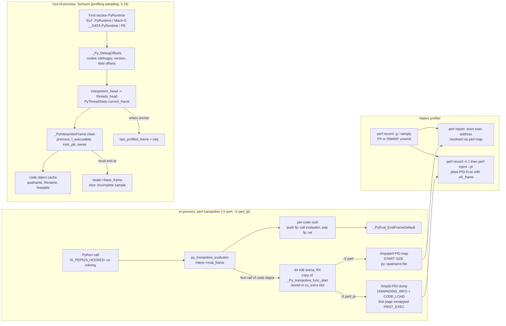

# Python CPython perf Trampoline and Tachyon Internals

> [!summary] Claim:
> CPython runs every Python function through the same C function, `_PyEval_EvalFrameDefault`, so a native profiler that only sees the C stack cannot tell one Python frame from another.
> The perf trampoline (`-X perf`, 3.12+) fixes that from inside the process: a PEP 523 eval-frame hook gives each code object its own 20-byte copy of a call stub in an executable arena and writes `START SIZE py::qualname:file` to `/tmp/perf-<pid>.map`, so `perf` or `samply` symbolizes the stub's return address as the Python function.
> `-X perf_jit` (3.13+) emits the same stubs as jitdump records with DWARF CFI so `perf inject --jit` can unwind them without frame pointers, which is also why 3.15 now builds with frame pointers by default (PEP 831).
> Tachyon (`profiling.sampling`, 3.15) solves the problem from outside the process instead: it finds `_PyRuntime` through a named binary section that starts with `_Py_DebugOffsets`, then walks `PyThreadState.current_frame` and `_PyInterpreterFrame.previous` with `process_vm_readv` or `mach_vm_read_overwrite`, and sees Python frames only.



## The Mechanism

### 1. Why native profilers lose Python frames

A native sampling profiler records a program counter and a chain of return addresses, then maps each address to a symbol from the ELF or Mach-O symbol table.
Every Python function is executed by `_PyEval_EvalFrameDefault`, so every interpreted frame symbolizes to that one name.
The comment block at the top of `Python/perf_trampoline.c` (v3.15.2) shows the result: a `foo -> bar -> baz` program profiles as three identical `_PyEval_EvalFrameDefault` activations with only C call glue between them.

It is worse than one name per frame.
When no eval-frame hook is installed, a Python-to-Python call does not recurse in C at all: the `CALL` family in `Python/bytecodes.c` pushes the callee's `_PyInterpreterFrame` with `_PyEvalFramePushAndInit()` and continues in the same C activation through `DISPATCH_INLINED()`.
A deep Python call chain can therefore occupy a single `_PyEval_EvalFrameDefault` frame on the C stack, and the native profiler sees fewer C frames than there are Python frames.

There are two ways out, and CPython ships both:

- Make each Python frame look like a distinct native function to the native profiler (the perf trampoline, in-process, needs a native profiler).
- Ignore the C stack and read the interpreter's own frame list from another process (Tachyon, py-spy, and Austin take this route).

[[Stack-Unwinding-CFI-and-Exception-ABI]] owns frame-pointer and CFI unwinding in general, and [[Linux-perf-in-Depth-and-perf-c2c]] owns `perf record` call-graph modes; this note owns how CPython plugs into both.

### 2. The perf trampoline (`-X perf`, Python 3.12+)

#### Turning it on

`config_init_perf_profiling()` in `Python/initconfig.c` sets `PyConfig.perf_profiling` from four inputs, read in this order, each later one overriding the earlier:

1. `PYTHONPERFSUPPORT` set to a nonzero integer gives `1`.
2. `-X perf` gives `1`.
3. `PYTHON_PERF_JIT_SUPPORT` set to a nonzero integer gives `2`.
4. `-X perf_jit` gives `2`.

So `PYTHONPERFSUPPORT=1 python -X perf_jit` runs in jitdump mode.
`init_interp_main()` in `Python/pylifecycle.c` installs the backend only for the main interpreter, after signal handlers and `tracemalloc`: value `1` selects `_Py_perfmap_callbacks` and value `2` selects `_Py_perfmap_jit_callbacks`, and a failure aborts startup with "can't initialize the perf trampoline".

At run time `sys.activate_stack_trampoline("perf")` or `("perf_jit")` swaps the callbacks and calls `_PyPerfTrampoline_Init(1)`; `sys.deactivate_stack_trampoline()` calls `_PyPerfTrampoline_Init(0)`; `sys.is_stack_trampoline_active()` compares the interpreter's `eval_frame` pointer with `py_trampoline_evaluator`.
The howto states the precedence: the `sys` functions win over `-X`, which wins over the environment variable.
On a build without `PY_HAVE_PERF_TRAMPOLINE`, `activate_stack_trampoline()` raises `ValueError: perf trampoline not available`, but `-X perf` is accepted and silently does nothing; Homebrew Python 3.14.10 on darwin-arm64 behaves exactly that way (as of 2026-11, macOS).

#### The PEP 523 hook and its cost

`_PyPerfTrampoline_Init(1)` saves the current eval function in `prev_eval_frame` and installs `py_trampoline_evaluator` with `_PyInterpreterState_SetEvalFrameFunc()`, the PEP 523 frame-evaluation API.
Installing any eval-frame function makes `IS_PEP523_HOOKED(tstate)` true (`tstate->interp->eval_frame != NULL` in `Python/ceval_macros.h`), which has two effects in `Python/bytecodes.c` at v3.15.2:

- The inlined-call path is skipped, so every Python call goes back through `_PyEval_EvalFrame()` and gets its own C activation.
  This is required: a per-function stub can only appear on the C stack if each Python frame owns a C frame.
- The `_CHECK_PEP_523` micro-op deoptimizes every specialized instruction that would push a Python frame without a C call: `CALL_PY_EXACT_ARGS`, `CALL_PY_GENERAL`, `CALL_BOUND_METHOD_EXACT_ARGS`, `CALL_BOUND_METHOD_GENERAL`, `BINARY_OP_SUBSCR_GETITEM`, `SEND_GEN`, `FOR_ITER_GEN`, `LOAD_ATTR_PROPERTY`, and `LOAD_ATTR_GETATTRIBUTE_OVERRIDDEN`.

The trampoline's cost is therefore not just the stub; it is the loss of frame-pushing specializations and call inlining for the whole interpreter.
Measure it on your workload with [[Python-Benchmarking-pyperf-asv-and-NumPy-Pandas-Profiling]] before enabling it permanently.

#### One stub per code object

`py_trampoline_evaluator()` looks up the frame's code object in a `co_extra` slot obtained once with `_PyEval_RequestCodeExtraIndex(NULL)`.
On the first execution of a code object it calls `compile_trampoline()`, reports the new stub through `trampoline_api.write_state()`, stores the stub pointer with `_PyCode_SetExtra()`, and increments `trampoline_refcount`.
It then calls the stub as `f(ts, frame, throw, evaluator)`, where `evaluator` is `prev_eval_frame` or `_PyEval_EvalFrameDefault`.
If anything fails (arena exhausted and `mmap` refused, `perf_status` not OK), it falls back to the previous evaluator, so a broken trampoline costs symbol information, not correctness.

The stub is a copy of an assembly template between `_Py_trampoline_func_start` and `_Py_trampoline_func_end` in `Python/asm_trampoline.S`.
The evaluator is passed as the fourth argument precisely so that the stub can forward the first three registers untouched and call through the fourth: `%rcx` on x86-64 System V, `x3` on AArch64, `a3` on RISC-V.

| Architecture (v3.15.2) | Template body | Bytes |
| :--- | :--- | :--- |
| x86-64 | optional `endbr64` (when `__CET__ & 1`), `push %rbp`, `mov %rsp,%rbp`, `call *%rcx`, `pop %rbp`, `ret` | 8, or 12 with `endbr64` (instruction sizes from the comments in `Python/jit_unwind.c`) |
| AArch64 | `SIGN_LR` (`paciasp`/`pacibsp` under PAC, `bti c` under BTI, else empty), `stp x29, x30, [sp, -16]!`, `mov x29, sp`, `blr x3`, `ldp x29, x30, [sp], 16`, `VERIFY_LR`, `ret` | 20 measured on darwin-arm64 (5 instructions, no PAC or BTI) |
| RISC-V | `addi sp,sp,-16`, `sd ra,8(sp)`, `jalr a3`, `ld ra,8(sp)`, `addi sp,sp,16`, `jr ra` | 24 (6 instructions); RISC-V is not in the `configure.ac` allowlist at v3.15.2 |

Two version differences matter:

- At v3.12.12 the x86-64 template was `sub $8,%rsp; call *%rcx; add $8,%rsp; ret`, which aligns the stack but builds no frame record; v3.13.9 and later push `%rbp`, so a frame-pointer walk passes through the stub as a real frame.
- From v3.15 the template sits in `.rodata` on ELF (it is only ever copied, never executed in place), the AArch64 version carries PAC/BTI/GCS hints and a `.note.gnu.property` note from `asm_trampoline_aarch64.h`, and the x86-64 version carries a CET `.note.gnu.property` note, so linking it does not strip IBT or BTI enforcement from `libpython`.

#### Arenas

`new_code_arena()` maps `4096 * 16` bytes (64 KiB, with the source comment "non-trivial programs typically need 64 to 256 kiB") as `PROT_READ | PROT_WRITE`, `MAP_PRIVATE | MAP_ANONYMOUS`.
It fills the whole arena with copies of the template at a stride of `round_up(code_size + code_padding, code_alignment)`, then calls `mprotect(PROT_READ | PROT_EXEC)`, so the arena is never writable and executable at once.
On ARM it then calls `__clear_cache()` over the arena, because AArch64 instruction caches are not coherent with data writes.
Filling the arena up front means no per-stub cache maintenance later: handing out a stub is just a pointer bump in `code_arena_new_code()`.
Arenas form a linked list through `prev`, and on Linux 5.17+ `_PyAnnotateMemoryMap()` names them `cpython:perf_trampoline` in `/proc/<pid>/maps` when `-X dev` or a debug build enables annotation (What's New in 3.15).
If a system forbids the `mprotect` to `PROT_EXEC`, the arena is unmapped and an unraisable `OSError` "Failed to set mmap for perf trampoline to PROT_READ | PROT_EXEC" is reported.

With the perf-map backend the padding is 0 and the alignment is 32, so a 20-byte AArch64 stub occupies a 32-byte slot and one arena holds 65,536 / 32 = 2,048 stubs.
With the jitdump backend the padding is the unwind data size rounded to 16 (80 bytes measured on darwin-arm64), so a slot is `round_up(20 + 80, 32)` = 128 bytes and one arena holds 512 stubs.
The padding keeps the address ranges that `perf inject` later assigns to each synthetic DSO from overlapping, which the long comment at the top of `perf_jit_trampoline.c` explains.

#### The perf map file

`perf_map_write_entry()` formats the name as `py::%s:%s` from `co_qualname` and `co_filename` (an encoding failure gives an empty string, not an error) and calls `PyUnstable_WritePerfMapEntry()` in `Python/sysmodule.c`.
That function writes one line with `fprintf("%" PRIxPTR " %zx %s\n")`, under a `PyThread` lock, followed by `fflush()` for every entry.
The file is opened by `PyUnstable_PerfMapState_Init()` as `/tmp/perf-<pid>.map` with `O_WRONLY | O_CREAT | O_APPEND | O_NOFOLLOW | O_CLOEXEC` and mode `0600`; `O_NOFOLLOW` defeats a symlink planted in `/tmp` by another user.
The format is perf's own JIT interface (`tools/perf/Documentation/jit-interface.txt`): `START SIZE symbolname`, hex without `0x`, and the symbol name is the rest of the line, so names may contain spaces and colons.
The path is fixed: the trampoline source says "name and location not configurable", and perf builds the same `/tmp/perf-%d.map` name in `tools/perf/util/symbol.c`.

On the perf side the map is read at report time, not at record time.
`dso__find_perf_map()` first tries `/tmp/perf-<nstgid>.map` inside the target's mount namespace (the PID as the process itself saw it, which is what CPython's `getpid()` wrote), then falls back to the host-side PID in the host namespace.
CPython never deletes the file, so `/tmp` accumulates one map per profiled process, and a later process that reuses the PID appends to a stale map.

The C API in `Doc/c-api/perfmaps.rst` lets other code generators write into the same file: `PyUnstable_PerfMapState_Init()`, `PyUnstable_WritePerfMapEntry()`, and `PyUnstable_PerfMapState_Fini()` date from 3.12 (when `code_size` was `unsigned int`; it is `size_t` at v3.15.2), and `PyUnstable_CopyPerfMapFile()`, `PyUnstable_PerfTrampoline_CompileCode()`, and `PyUnstable_PerfTrampoline_SetPersistAfterFork()` were added in 3.13.

#### Lifetime: code watchers, deactivation, and finalization

A stub must stay mapped while any C frame can still return into it, which includes frames that were already executing when the trampoline was deactivated.
At v3.15.2 the lifetime is reference-counted:

- `_PyPerfTrampoline_Init(1)` registers `perf_trampoline_code_watcher` with `PyCode_AddWatcher()` and sets `trampoline_refcount = 1`, the base reference held by the system.
- Each compiled stub adds one reference; the watcher drops one on `PY_CODE_EVENT_DESTROY` for a code object that has a stub.
- `sys.deactivate_stack_trampoline()` (`Init(0)`) only restores `prev_eval_frame` and sets `perf_status = PERF_STATUS_NO_INIT`; it frees nothing.
- `_PyPerfTrampoline_Fini()`, called from interpreter finalization, closes the backend and drops the base reference; when the count reaches zero `perf_trampoline_reset_state()` unmaps every arena and clears the watcher.

Because the watcher fires from `code_dealloc()` through `notify_code_watchers()`, which iterates over a snapshot of the active-watcher bitmask and calls each slot's callback, a callback that clears another watcher during the iteration leaves a set bit pointing at a NULL slot.
That interaction is observable on Homebrew Python 3.15.2, darwin-arm64 (as of 2026-11): a function compiled under `-X perf`, called again after `sys.deactivate_stack_trampoline()` and `sys.activate_stack_trampoline("perf")`, followed by any new function, makes the process exit with SIGSEGV (exit status 139) during `finalize_modules`, with `frame #0: 0x0000000000000000` called from `code_dealloc + 2008` under lldb.
The source is consistent with this explanation: `Init(1)` after `Init(0)` registers a second watcher and overwrites `code_watcher_id` without clearing the first, both watchers decrement the same `trampoline_refcount`, the count reaches zero early inside the first watcher, `reset_state()` clears the second watcher's slot, and `notify_code_watchers()` then calls that NULL slot.
UNVERIFIED: the double-registration explanation is from source reading plus the backtrace; it was not single-stepped, and no upstream issue was located.
Until it is fixed, activate the trampoline once per process and do not toggle it.

#### Fork

`PyOS_AfterFork_Child()` reaches `_PyPerfTrampoline_AfterFork_Child()`, which has two behaviors selected by `PyUnstable_PerfTrampoline_SetPersistAfterFork()` (default off):

- Off: the child calls `Fini`, clears the old code watcher but keeps the old arenas mapped (the child may still return through stubs that were on the C stack at `fork()`), and re-runs `Init(1)`, which opens a new, empty `/tmp/perf-<childpid>.map` and compiles fresh stubs as code runs in the child.
- On: allowed only for the perf-map backend; the child calls `Fini` and appends the parent's map to its own with `PyUnstable_CopyPerfMapFile()`, and the trampoline stays inactive in the child.

Measured on darwin-arm64 with Python 3.15.2 under `-X perf`: with persistence off, the child was active and its map had 7 lines including the child-only function; with persistence on, the child was inactive and its map had the parent's 283 lines and no child-only function.
Persistence fits pre-fork servers whose workers run code compiled in the parent; the default fits everything else.

#### Platform gating and the JIT

| Version | Where `PY_HAVE_PERF_TRAMPOLINE` is defined (`configure.ac`) | Notes |
| :--- | :--- | :--- |
| 3.12, 3.13, 3.14 | `x86_64-linux-gnu`, `aarch64-linux-gnu` | 3.14 adds `-fno-omit-frame-pointer -mno-omit-leaf-frame-pointer` to debug builds only |
| 3.15 | adds `x86_64-linux-musl`, `aarch64-linux-musl`, and `darwin` unless `MACOSX_DEPLOYMENT_TARGET` is 10.0 to 10.11 | samply support on macOS starts in 3.15 (howto); frame pointers on by default (PEP 831) |

Check a given interpreter with `python -m sysconfig | grep HAVE_PERF_TRAMPOLINE`; Homebrew 3.15.2 reports `PY_HAVE_PERF_TRAMPOLINE = 1` on darwin-arm64 and 3.14.10 reports `0` (as of 2026-11, macOS).

The experimental JIT and the trampoline exclude each other at v3.15.2.
With `perf_profiling > 0`, `init_interp_main()` refuses to enable the JIT and warns "JIT deactivated as perf profiling support is active"; with the JIT active in the main interpreter, `sys.activate_stack_trampoline()` raises `ValueError: Cannot activate the perf trampoline if the JIT is active` (gh-157247).
The 3.15 tree separately adds GDB JIT-interface registration for JIT executor code (`PY_HAVE_JIT_GDB_UNWIND` in `pycore_jit_unwind.h`, Linux ELF only), which is a debugger feature, not a perf one.

### 3. Frame pointers decide whether the stub is reachable

In perf-map mode the stub has a symbol but no unwind information.
A frame-pointer unwinder does not need any: on x86-64 the stub's `push %rbp; mov %rsp,%rbp` creates a frame record, `_PyEval_EvalFrameDefault`'s record links to it, and the saved return address inside the stub symbolizes through the map.
A DWARF unwinder (`perf record --call-graph dwarf`) needs CFI for every PC on the stack, finds none for the anonymous arena, and stops at the stub.
So `-X perf` requires frame-pointer call graphs (`perf record -g`, which defaults to `fp`), and it requires that the interpreter and every native frame below the stub keep frame pointers.

PEP 831 (Final, Python 3.15) makes that the default: CPython is configured with `-fno-omit-frame-pointer -mno-omit-leaf-frame-pointer`, `--without-frame-pointers` opts out, and the flags are in `sysconfig` `CFLAGS`, so extensions built from Python's configuration inherit them.
The PEP reports under 2% geometric-mean overhead for typical workloads, and a 64-frame frame-pointer unwind on x86-64 Linux in 116 ns, about 210 times faster than the DWARF unwinders it tested (libunwind, glibc `backtrace()`, framehop).
The PEP also warns that a single native component built without frame pointers breaks the chain for the whole process, which is why build systems that do not consume `sysconfig` (CMake, Cargo, Bazel) must add the flags themselves.
On Apple Silicon the ARM64 ABI already mandates frame pointers; Homebrew 3.15.2's `BASECFLAGS` nonetheless show both flags (as of 2026-11, macOS).
On Windows x64 unwinding uses `.pdata`/`.xdata`, so frame pointers are not the mechanism there.

### 4. `-X perf_jit`: jitdump records with DWARF CFI (Python 3.13+)

`-X perf_jit` keeps the same stubs and arenas but swaps the backend for `_Py_perfmap_jit_callbacks` in `Python/perf_jit_trampoline.c`, so stacks unwind even when frame pointers are missing or the user records with `--call-graph dwarf`.

#### The file and how perf finds it

`perf_map_jit_init()` creates `/tmp/jit-<pid>.dump` with `O_CREAT | O_TRUNC | O_RDWR` and mode `0666` (the umask applies), wraps it in a `FILE*` with a 2 MiB `setvbuf` buffer, and writes the 40-byte header.
On Linux it then maps the first page of the file `PROT_READ | PROT_EXEC`, `MAP_PRIVATE`.
That mapping does no work for CPython; it exists so that the kernel emits a `PERF_RECORD_MMAP` event naming the file, which `jit_detect()` in `tools/perf/util/jitdump.c` matches against the pattern `.../jit-<pid>.dump`.
On macOS the mapping is skipped ("samply uses a preload to find jitdumps and this mmap can be slow").
No `/tmp/perf-<pid>.map` is written in this mode, which the darwin-arm64 run confirmed.

#### Records

The file follows `jitdump-specification.txt`:

| Structure | Fields as written by CPython v3.15.2 |
| :--- | :--- |
| Header, 40 bytes | magic `0x4A695444` ("JiTD"), version 1, header size, ELF `e_machine` (62 x86-64, 183 AArch64), reserved 0, pid, wall-clock time in microseconds, flags 0 |
| Record header | `uint32 id`, `uint32 total_size`, `uint64 timestamp` |
| `JIT_CODE_UNWINDING_INFO` (id 4) | `unwind_data_size`, `eh_frame_hdr_size` (20), `mapped_size` (unwind size rounded to 16), then `.eh_frame` (one CIE, one FDE), the `.eh_frame_hdr`, and padding to 8 bytes |
| `JIT_CODE_LOAD` (id 0) | pid, tid, `vma`, `code_addr` (both the stub address), `code_size`, `code_index` (1, 2, 3, ...), NUL-terminated `py::qualname:file`, then the stub's bytes |

Each stub gets an `UNWINDING_INFO` record immediately followed by its `CODE_LOAD` record, both written under one `PyMutex` so concurrent threads cannot interleave records or reuse a `code_index`.
The unwind record comes first because, in the source's words, it "must be written before the code load event to ensure perf has the unwinding information available when it processes the code region".
The last 8 bytes of the copied code are replaced in the file (never in memory) by a marker derived from a per-process salt, the `code_index`, and the size: perf merges synthetic DSOs that share a build-id, and identical stubs would otherwise all resolve to the first name perf ever saw, including names from earlier runs in the build-id cache.

The CFI is generated by `elf_init_ehframe_perf()` in `Python/jit_unwind.c` and describes the stub instruction by instruction.
On x86-64: at entry the CFA is `rsp+8`; after `push %rbp` it is offset 16 with `rbp` saved at CFA-16; after `mov %rsp,%rbp` the CFA register becomes `rbp`; after `call` and `pop` it returns to `rsp+8`.
On AArch64: after `stp` the CFA is `sp+16` with `x29` at CFA-16 and `x30` at CFA-8, restored after the `ldp`, with `DW_CFA_AARCH64_negate_ra_state` when PAC signs the link register.
The `.eh_frame_hdr` uses PC-relative and data-relative `sdata4` encodings so the synthesized DSO is self-contained.

#### The perf side

```bash
perf record -F 9999 -g -k 1 --call-graph dwarf -o perf.data python -X perf_jit app.py
perf inject -i perf.data --jit --output perf.jit.data
perf report -g -i perf.jit.data
```

- `-k 1` is mandatory: CPython timestamps records with `CLOCK_MONOTONIC` on Linux, and `jit_open()` in `tools/perf/util/jitdump.c` rejects the dump with "jitted code must be sampled with perf record -k 1" unless every event uses `CLOCK_MONOTONIC` (clock id 1).
- `perf inject --jit` writes one ELF image per `CODE_LOAD`, named `jitted-<pid>-<code_index>.so`, containing the code and the `.eh_frame`, and injects synthetic `MMAP` records pointing at them.
- On macOS the same records carry `mach_absolute_time()` converted to nanoseconds, because samply timestamps its samples in that clock domain.
- The howto says only perf newer than v6.8 (or the v6.7.2 backport) works with this mode, and warns that distribution version strings such as `6.7-3` are not `6.7.3`.
- `--call-graph dwarf` copies 8,192 bytes of user stack per sample by default; the howto suggests up to 65,528 (`--call-graph dwarf,65528`) for `-O0` builds with large frames, at the cost of sampling rate and file size.

Measured on darwin-arm64 with Python 3.15.2: a `-c` program that defines and calls one function produced a 50,180-byte dump with 206 `CODE_LOAD` and 206 `UNWINDING_INFO` records, a 120-byte unwind record holding 76 bytes of unwind data (20-byte header plus 56-byte `.eh_frame`) with `mapped_size` 80, and 20-byte stubs for `py::<module>:<string>` and `py::foo:<string>` as `code_index` 205 and 206.

### 5. Tachyon: walking `_PyInterpreterFrame` from another process (Python 3.15)

Tachyon is the sampling profiler in `profiling.sampling`; PEP 799 (Final, 3.15) created the `profiling` package with `profiling.tracing` (the relocated cProfile) and `profiling.sampling`, and keeps "tachyon" as an internal codename.
The Python layer in `Lib/profiling/sampling/` schedules samples and formats output; the stack walk is C in `Modules/_remote_debugging/`, exposed as `_remote_debugging.RemoteUnwinder`.
[[Python-cProfile-Tachyon-and-Sampling-Profilers]] owns the CLI, modes, and output formats; this section owns how a sample is taken.

#### Step 1: find `_PyRuntime` without symbols

`Python/pylifecycle.c` defines the runtime as `GENERATE_DEBUG_SECTION(PyRuntime, _PyRuntimeState _PyRuntime)`, which places it in a named section: `.PyRuntime` on Linux, `__DATA,PyRuntime` on macOS, and a `PyRuntime` PE section on Windows (section names are truncated to 8 bytes there).
`struct pyruntimestate` in `pycore_runtime_structs.h` must begin with `_Py_DebugOffsets debug_offsets`, whose first 8 bytes are the cookie `xdebugpy`.

`_Py_RemoteDebug_GetPyRuntimeAddress()` in `Python/remote_debug.h` then resolves the address per OS:

- Linux: parse `/proc/<pid>/maps`, take mappings whose file name contains `python`, read that ELF file's section headers to find `.PyRuntime`, and relocate `sh_addr` by the mapping start minus the first `PT_LOAD` segment's aligned `p_vaddr`.
  When the mapped file shows as `(deleted)` (the binary was replaced on disk, as in a container image upgrade or a package update), it instead scans the read-write mapping in 1 MiB chunks for the cookie.
- macOS: enumerate regions with `mach_vm_region()`, name each with `proc_regionfilename()`, try candidates `libpython`, `python`, and `Python`, and parse the Mach-O for the section; this needs a task port from `task_for_pid()`.
- Windows: enumerate modules and parse the PE section table.

Every candidate must pass `_Py_RemoteDebug_ValidatePyRuntimeCookie()`, which rejects stale or duplicate mappings such as a second `libpython` loaded through `ctypes`.
No symbol table is used, so stripped interpreters work, and ASLR is handled by the relocation; py-spy, by contrast, generates per-version struct layouts with bindgen and scans BSS for a plausible `PyInterpreterState` when symbols are missing (py-spy README).

Measured on Homebrew Python 3.15.2, darwin-arm64: `otool -l` shows `sectname PyRuntime` in segment `__DATA`, size 346,096 bytes, and the section's first bytes decode as cookie `xdebugpy`, version `0x030f02f0`, `free_threaded=0`, and `runtime_state.size=346096`.

#### Step 2: trust the offsets, not the headers

`_Py_DebugOffsets` holds `PY_VERSION_HEX`, a free-threading flag, and `sizeof`/`offsetof` values for the runtime, interpreter, thread state, frame, code object, and common object types, plus the PEP 768 debugger-support fields.
`validate_debug_offsets()` in `module.c` refuses to attach when the cookie is wrong ("Can't determine the Python version of the remote process"), when the major or minor versions differ, when either side is a pre-release and the versions are not identical (a release level other than `0xF` in the low byte), or when exactly one side is free-threaded, and then validates the layout against the profiler's own build.
The header comment states the contract: the struct is stable across patch versions of one minor version only.

The frame offsets read from the darwin-arm64 3.15.2 binary match `struct _PyInterpreterFrame` field by field:

| Field | Offset | Meaning for the walker |
| :--- | :--- | :--- |
| `f_executable` | 0 | `_PyStackRef` to the code object; low tag bits (`Py_TAG_BITS` = 3) are masked off |
| `previous` | 8 | Next frame toward the caller |
| `instr_ptr` | 56 | Current or next instruction; minus `co_code_adaptive`, in 2-byte code units, gives the line-table offset |
| `stackpointer` | 64 | Top of the value stack |
| `owner` | 74 | `FRAME_OWNED_BY_THREAD` 0, `GENERATOR` 1, `FRAME_OBJECT` 2, `INTERPRETER` 3 |
| `localsplus` | 80 | Start of locals; `sizeof(_PyInterpreterFrame)` is 88 |

The same binary gives `sizeof(PyThreadState)` 888 with `current_frame` at 72, `base_frame` at 80, `last_profiled_frame` at 88, `last_profiled_frame_seq` at 96, and `datastack_chunk` at 256 (as of 2026-11, macOS, 3.15.2 only; other builds differ, which is the point of the offsets table).

#### Step 3: read memory cheaply

`_Py_RemoteDebug_ReadRemoteMemory()` uses `process_vm_readv()` on Linux (falling back to `preadv()` on `/proc/<pid>/mem` when the syscall returns `ENOSYS`), `mach_vm_read_overwrite()` on macOS, and `ReadProcessMemory()` on Windows.
`_Py_RemoteDebug_PagedReadRemoteMemory()` serves small reads from a per-sample cache of up to 1,024 whole pages, cleared between samples, and `_Py_RemoteDebug_BatchedReadRemoteMemory()` gathers up to 4 regions in one `process_vm_readv()` call.
The unit of cost is a syscall, not a byte, so the walker reads whole frames (88 bytes), whole data-stack chunks (16 KiB `_PY_DATA_STACK_CHUNK_SIZE` by default, rejected above 16 MiB, at most 4,096 chunks), and whole pages.

#### Step 4: walk threads and frames

For each interpreter from `interpreters_head` and each `PyThreadState` from `threads_head`, `threads.c` reads the thread state, derives status flags, and walks from `current_frame`:

1. Read the frame from a copied data-stack chunk when one covers the address, else from remote memory.
2. Skip frames whose `owner` is `FRAME_OWNED_BY_INTERPRETER`: the shim frames that mark C entry points and the per-thread base frame.
   With `--native` a skipped frame between two Python frames becomes a synthetic `<native>` entry; with GC frames enabled, the frame recorded in `gc.frame` becomes `<GC>`.
3. Resolve the code object through a cache keyed by its remote address, which stores `co_qualname`, `co_filename`, `co_firstlineno`, and `co_linetable`.
   The cache is invalidated when the interpreter's `_code_object_generation` changes; `code_dealloc()` increments that counter atomically, so a new code object at a recycled address cannot inherit a dead one's name.
4. Decode the line from the location table, the same format `code.co_positions()` reads, and repeat with `previous`.
5. Stop after 1,536 frames (`MAX_FRAME_CHAIN_DEPTH`) with "Too many stack frames (possible infinite loop)".
6. Require that the walk ends at `tstate->base_frame`; otherwise the sample is discarded with "Incomplete sample: did not reach base frame", as `InternalDocs/frames.md` instructs external profilers to do.

Generator and coroutine frames live inside the generator object (`gi_iframe`), not in the data stack, so async-aware modes follow task and awaiter links instead (`asyncio.c`).
On free-threaded builds each frame also carries a `tlbc_index` into the code object's thread-local bytecode copies, which the walker resolves through a separate TLBC cache.

#### Step 5: the frame cache writes into the target

`Lib/profiling/sampling/sample.py` always constructs the unwinder with `cache_frames=True`.
With caching on, after each walk the profiler writes the current frame address into the target's `PyThreadState.last_profiled_frame` with `_Py_RemoteDebug_WriteRemoteMemory()`.
The interpreter maintains that anchor: when the anchored frame is popped (`_PyEval_FrameClearAndPop()` and generator returns), `_PyThreadState_UpdateLastProfiledFrame()` moves the anchor to the parent and increments `last_profiled_frame_seq`, and it does nothing for any other frame.
On the next sample the walker stops when it reaches the anchor and splices in the cached callers, but only if the stored sequence plus the observed pops equals the target's sequence, so a new frame that reuses the same address is not mistaken for the old one.
Deep, stable stacks then cost a few frame reads per sample instead of the whole chain.
The consequence for reviewers: default Tachyon sampling is not read-only; it writes one pointer per thread when the anchor changes, and the target's eval loop pays one compare per frame pop.

#### Step 6: thread status, modes, and consistency

| Flag (`_remote_debugging.h`) | Bit | Source |
| :--- | :--- | :--- |
| `THREAD_STATUS_HAS_GIL` | 1 | GIL holder in the interpreter's GIL state |
| `THREAD_STATUS_ON_CPU` | 2 | Linux: state `R` in `/proc/<pid>/task/<tid>/stat`; macOS: `proc_pidinfo(PROC_PIDTHREADINFO)` reports `TH_STATE_RUNNING`; Windows: `NtQuerySystemInformation` |
| `THREAD_STATUS_UNKNOWN` | 4 | CPU state not queried or not available; CPU state is only queried in `cpu` and `all` modes because it is expensive |
| `THREAD_STATUS_GIL_REQUESTED` | 8 | Thread is waiting for the GIL |
| `THREAD_STATUS_HAS_EXCEPTION` | 16 | An exception is being handled |
| `THREAD_STATUS_MAIN_THREAD` | 32 | Main thread state |

By default sampling does not stop the target, so a stack can be torn: frames pushed or popped between the first and last read.
The base-frame check rejects truncated chains, but a chain can still mix two moments; the documentation names generator- and coroutine-heavy code as the main risk.
`--blocking` suspends the target around each sample: Linux attaches each thread with `PTRACE_SEIZE` and stops it with `PTRACE_INTERRUPT`, macOS calls `task_suspend()`, and Windows calls `NtSuspendProcess()`; the docs recommend intervals of 1 ms or more in this mode.
The sampler loop in `sample.py` schedules with `time.perf_counter()`, sleeps 90% of the remaining gap, and counts failed reads (`RuntimeError`, `OSError`, `MemoryError`, `UnicodeDecodeError`) as failed samples rather than aborting; the default rate is 1 kHz (`-r 1khz` in `cli.py`).

#### Permissions and gating

| Platform | What Tachyon needs (Doc/library/profiling.sampling.rst) |
| :--- | :--- |
| Linux | Root, `CAP_SYS_PTRACE`, or Yama `ptrace_scope` 0 for same-user targets (default 1 allows only descendants); in Docker, `--cap-add SYS_PTRACE` (py-spy README, same syscall) |
| macOS | Root, the `com.apple.security.cs.debugger` entitlement, or SIP disabled; non-root `run` on darwin-arm64 printed "Tachyon needs elevated permissions to profile processes" |
| Windows | Administrator or `SeDebugPrivilege` |

Attaching to its own PID needs no privilege on macOS: a `RemoteUnwinder(os.getpid(), all_threads=True)` on Homebrew 3.15.2 returned the worker thread's `foo -> bar -> worker -> Thread.run -> ...` stack with status 12 (`UNKNOWN | GIL_REQUESTED`, because the sampling thread held the GIL) and the main thread with status 37 (`HAS_GIL | UNKNOWN | MAIN_THREAD`).

PEP 768 (3.14) uses the same `_Py_DebugOffsets` to let `sys.remote_exec()` write a script path (at most 512 bytes) into `_PyRemoteDebuggerSupport`, set `debugger_pending_call`, and set the eval-breaker bit so the target runs the script at its next safe point.
`PYTHON_DISABLE_REMOTE_DEBUG`, `-X disable-remote-debug`, and `--without-remote-debug` gate that code-execution path; at v3.15.2 nothing in `Modules/_remote_debugging/` reads `remote_debugging_enabled`, so they do not stop Tachyon from reading stacks (source reading).
The OS permission check is the only control over who may sample.

### 6. Trampoline versus Tachyon

| Property | `-X perf` / `-X perf_jit` | Tachyon |
| :--- | :--- | :--- |
| Where it runs | In the target; needs `perf`, `samply`, or another perf-map consumer | Separate process, same CPython minor version |
| Needs a restart | Yes, unless the code calls `sys.activate_stack_trampoline()` | No, `attach <pid>` |
| Native frames | Yes, real C, C++, and Rust symbols interleaved with `py::` frames | No; `--native` adds only synthetic `<native>` markers |
| Line numbers | No, function granularity (one stub per code object) | Yes, from `instr_ptr` and the location table, plus opcodes with `--opcodes` |
| Kernel frames, off-CPU | Whatever the native profiler records | Wall, CPU, GIL, and exception modes |
| Target cost | PEP 523 hook disables call inlining and call specialization; stub per call | Remote reads; one pointer write per thread per changed anchor |
| Failure mode | Missing frames when frame pointers or `-k 1` are missing; stale maps | Torn or rejected samples; permission and version errors |

Use the trampoline when the question crosses the native boundary (a NumPy kernel, a C++ extension, a lock in `libc`), and Tachyon when it does not; [[Drill-Profiling-Python-C-Extension-GIL-and-Allocation-Bottleneck]] exercises the mixed case.

## Commands and Numbers to Know

| Item | Value | Platform and date | What it controls |
| :--- | :--- | :--- | :--- |
| `-X perf`, `PYTHONPERFSUPPORT=1` | `perf_profiling=1` | Linux; macOS from 3.15 (as of 2026-11) | Perf-map backend; 3.12+ |
| `-X perf_jit`, `PYTHON_PERF_JIT_SUPPORT=1` | `perf_profiling=2` | Linux; macOS from 3.15 (as of 2026-11) | Jitdump backend; 3.13+; overrides `-X perf` |
| `sys.activate_stack_trampoline(backend)` | `"perf"` or `"perf_jit"` | Both (as of 2026-11) | Runtime activation; `ValueError` if unavailable or JIT active |
| Perf map path and mode | `/tmp/perf-<pid>.map`, `0600`, `O_NOFOLLOW` | Both (as of 2026-11) | Read by `perf report` and samply; never deleted |
| Jitdump path and mode | `/tmp/jit-<pid>.dump`, `0666` minus umask | Both (as of 2026-11) | Read by `perf inject --jit` and samply |
| Symbol format | `py::<co_qualname>:<co_filename>` | Both (as of 2026-11) | Same in both backends |
| Trampoline arena | 64 KiB, RW then RX | Both (as of 2026-11) | 2,048 stubs (perf map) or 512 (jitdump) per arena on arm64 |
| Stub size | 20 bytes arm64 (measured); 8 or 12 bytes x86-64 | Both (as of 2026-11) | Slot alignment 32 bytes |
| Jitdump unwind padding | 80 bytes (`mapped_size`) on arm64, measured | macOS (as of 2026-11) | Keeps synthetic DSOs non-overlapping |
| `perf record -k 1` | `CLOCK_MONOTONIC` | Linux (as of 2026-11) | Required by `perf inject --jit` |
| `--call-graph dwarf` stack copy | 8,192 bytes default (perf-record man page), 65,528 maximum (per the 3.15 howto) | Linux (as of 2026-11) | Unwind depth vs sampling overhead |
| perf version for `perf_jit` | newer than 6.8, or 6.7.2 | Linux (as of 2026-11) | Per the 3.15 howto |
| Frame pointers | on by default; `--without-frame-pointers` | Both, 3.15+ (as of 2026-11) | PEP 831: under 2% geomean |
| `PyRuntime` section | `.PyRuntime`, `__DATA,PyRuntime`, `PyRuntime` | Both (as of 2026-11) | 346,096 bytes on Homebrew 3.15.2 arm64 |
| Debug cookie | `xdebugpy` | Both (as of 2026-11) | First 8 bytes of `_PyRuntime` |
| Tachyon sampling rate | 1 kHz default (`-r`) | Both (as of 2026-11) | `--blocking` wants 1 ms or more |
| `MAX_FRAME_CHAIN_DEPTH` | 1,536 frames | Both (as of 2026-11) | Deeper stacks fail the sample |
| Page cache | 1,024 pages per sample | Both (as of 2026-11) | Cleared between samples |
| Data stack chunk | 16 KiB default, 16 MiB rejection limit | Both (as of 2026-11) | Copied whole when not caching |
| Remote script path (PEP 768) | 512 bytes | Both, 3.14+ (as of 2026-11) | `sys.remote_exec()` only |

## Multi-Language Comparison: C++ / Python / Rust

| Concern | C++ | Python (CPython 3.15) | Rust |
| :--- | :--- | :--- | :--- |
| Where frame names come from | ELF or Mach-O symbol table and DWARF | Interpreted frames: perf map or jitdump stubs, or Tachyon reading `co_qualname`; C frames: `libpython` symbols | Symbol table and DWARF, v0 or legacy mangling |
| Unwinding a sample | FP if built with `-fno-omit-frame-pointer`, else DWARF CFI | FP through the stub (`-X perf`), DWARF via synthesized `.eh_frame` (`-X perf_jit`), or no native unwind at all (Tachyon) | FP with `-C force-frame-pointers=yes`, else DWARF |
| Frame-pointer default | Compiler default omits them at `-O1`+ | On by default since 3.15 (PEP 831) and inherited by `sysconfig` builds | Off by default for most targets; see [[Rust-CPU-Profiling-cargo-flamegraph-samply-and-Frame-Pointers]] |
| Extension modules | n/a | Must keep frame pointers or the chain breaks below them | PyO3 extensions built with Cargo do not read Python's `CFLAGS` and must set frame pointers themselves |
| Out-of-process interpreter-aware sampler | n/a | Tachyon (C, stdlib), using `_Py_DebugOffsets` | py-spy (Rust), using bindgen-generated layouts per CPython version |
| JIT symbol interface | n/a for AOT code | Perf map and jitdump, both perf-defined formats | n/a for AOT code; the same formats are what any Rust-written JIT would emit |

[[Cpp-CPU-Profiling-perf-samply-Callgrind-and-llvm-mca]] owns native C++ profiling with perf and samply.

## Worked Example

This note has no lab; the outputs below come from single runs on darwin-arm64 (macOS 27.3, Homebrew Python 3.15.2 and 3.14.10) on 2026-11-12, recorded verbatim in the job's `research/captured-output.txt`.
Linux `perf` runs were not possible on this host, so no `perf report` output is shown; the commands in section 4 are the documented ones.

### The perf map, written live

The script calls `Box().baz -> bar -> foo`, prints its own map's entries for `demo.py`, then deactivates, defines and calls `late()`, reactivates, and calls `late()` again.

```bash
python3.15 -X perf demo.py
```

```text
active at start: True
entries after first calls: 209 after repeat calls: 209
size=0x14 name=py::<module>:./demo.py addr_mod32=0
size=0x14 name=py::Box:./demo.py addr_mod32=0
size=0x14 name=py::Box.baz:./demo.py addr_mod32=0
size=0x14 name=py::bar:./demo.py addr_mod32=0
size=0x14 name=py::foo:./demo.py addr_mod32=0
size=0x14 name=py::lines:./demo.py addr_mod32=0
active after deactivate: False
late() in map: False
late() in map after reactivate: True
```

Reading the result:

- 209 entries exist before the script's own code is profiled: every code object run during startup (`site`, `encodings`, and the like) got a stub.
- Calling the same functions again adds nothing, because the stub lives in the code object's `co_extra` slot.
- Every stub is `0x14` = 20 bytes and 32-byte aligned, which is the AArch64 template in a 32-byte slot.
- `py::Box` is the class body, a code object of its own, and `py::Box.baz` shows that the name is `co_qualname`, not `co_name`.
- While deactivated, `late()` ran without a stub; after reactivation it got one.
- The same run then exited with status 139 at finalization, which is the toggle crash described in section 2.

### The jitdump, parsed

A short parser (in `research/scratch/jitdump_read.py`) runs `python3.15 -X perf_jit -c ...` and walks the dump with `struct`:

```text
header: magic=0x4a695444 version=1 size=40 e_machine=183 pid_matches=True
first UNWINDING_INFO: record=120 unwind_data_size=76 eh_frame_hdr_size=20 mapped_size=80
records by type: {0: 206, 4: 206} (0=CODE_LOAD, 4=UNWINDING_INFO)
CODE_LOAD code_id=205 code_size=20 name=py::<module>:<string>
CODE_LOAD code_id=206 code_size=20 name=py::foo:<string>
bytes: 50180 parsed to end: True
```

The pairs of records, the 80-byte padding, and `e_machine` 183 (`EM_AARCH64`) all match `perf_jit_trampoline.c`, and the parser consuming exactly 50,180 bytes shows every record's `total_size` is self-consistent.

### The `PyRuntime` section, decoded from the binary

```text
segname=__DATA sectname=PyRuntime size=346096
cookie=b'xdebugpy' version=0x030f02f0 free_threaded=0
runtime_state: size=346096 finalizing_off=912 interpreters_head_off=936
thread_state: size=888, current_frame=72, base_frame=80, last_profiled_frame=88, last_profiled_frame_seq=96, datastack_chunk=256
interpreter_frame: size=88, previous=8, executable=0, instr_ptr=56, localsplus=80, owner=74, stackpointer=64, tlbc_index=0
```

The section is exactly `sizeof(_PyRuntimeState)`, the version is 3.15.2 final (`0xf0`), and `tlbc_index` is 0 because this is not a free-threaded build; this is everything Tachyon needs to start a walk, read from a file without symbols.

## Pitfalls

> [!warning] Pitfall: recording with DWARF call graphs in `-X perf` mode
> The perf-map stubs have no CFI, so `--call-graph dwarf` stops at the first stub and Python frames vanish.
> Use `perf record -g` (frame pointers) with `-X perf`, or switch to `-X perf_jit` plus `perf inject --jit` when DWARF unwinding is needed.

> [!warning] Pitfall: forgetting `-k 1` with `-X perf_jit`
> `perf inject --jit` refuses a recording whose events are not on `CLOCK_MONOTONIC` and prints "jitted code must be sampled with perf record -k 1".
> The 3.15 howto's environment-variable example omits `-k 1`, so copying it fails.

> [!warning] Pitfall: running `perf report` without the map
> The map is read at report time from `/tmp/perf-<pid>.map`.
> Reporting on another machine, after `/tmp` is cleaned, or outside the container's mount namespace leaves `py::` frames as raw addresses; copy the map next to `perf.data` or report where the process ran.

> [!warning] Pitfall: one extension without frame pointers
> A C, C++, or Rust extension built with omitted frame pointers breaks the `rbp` chain, and every frame above it disappears from frame-pointer profiles, Python frames included.
> PEP 831 propagates the flags only through `sysconfig`; Cargo, CMake, and vendored libraries need their own flags.

> [!warning] Pitfall: toggling the trampoline at run time
> On 3.15.2 (darwin-arm64, as of 2026-11) deactivating and reactivating with the `sys` functions, then running more code, crashed the process at exit with SIGSEGV in `code_dealloc`.
> Activate once, early, and keep it on for the process lifetime.

> [!warning] Pitfall: expecting the trampoline to be free
> The PEP 523 hook disables inlined Python-to-Python calls and call specialization interpreter-wide, not just for profiled functions.
> Benchmark it before turning it on fleet-wide, and compare against an out-of-process sampler that leaves the interpreter untouched.

> [!warning] Pitfall: treating Tachyon as read-only
> With the default `cache_frames=True` the profiler writes `last_profiled_frame` into the target.
> In a security review this is a memory-write capability, and it is not gated by `PYTHON_DISABLE_REMOTE_DEBUG`.

> [!warning] Pitfall: mismatched interpreter versions
> Tachyon refuses a different minor version, any differing pre-release, or a free-threaded/GIL mismatch.
> Run the profiler from the same Python image as the target, ideally the same binary.

> [!warning] Pitfall: reading `<native>` as a native profile
> Tachyon's `--native` inserts a marker where the walk skipped an interpreter-owned frame; it never unwinds or symbolizes C code.
> For native hot spots, use the trampoline with perf or samply.

> [!warning] Pitfall: `/tmp` hygiene and PID reuse
> Neither backend deletes its file, and the perf map is opened with `O_APPEND`, so a recycled PID appends to an old map whose addresses describe a dead process.
> Clean `/tmp/perf-*.map` and `/tmp/jit-*.dump` between profiling sessions on long-lived hosts.

## At Scale

For one developer the decision is local: `python -X perf` with `perf record -g` on Linux, `samply record PYTHONPERFSUPPORT=1 python app.py` on macOS with 3.15, or `python -m profiling.sampling attach <pid>` when restarting is not an option.
At 1,000 to 50,000 engineers the costs move: profiling becomes continuous, runs on every host, and must survive images nobody on the profiling team built.

- Frame pointers become a platform policy.
  PEP 831 cites Fedora 38, Ubuntu 24.04 LTS, and Arch Linux building with them, and python-build-standalone measuring 1-3% overhead across Python 3.11 to 3.15; enforce `-fno-omit-frame-pointer -mno-omit-leaf-frame-pointer` in the base images and in every native build rule, and audit with `python -m sysconfig | grep no-omit-frame-pointer`.
- An always-on perf-map trampoline turns every Python process into a writer of `/tmp` files and disables call inlining everywhere, so it needs an owner, a `/tmp` cleanup job, and a measured overhead budget.
- Out-of-process sampling needs `CAP_SYS_PTRACE` or an equivalent on every node and exact interpreter-version matching, so the profiler should ship inside the same image as the target, or the agent must select the matching interpreter per process.
- eBPF continuous profilers that walk frame pointers in the kernel benefit from PEP 831 directly, and their Python support depends on the same interpreter structures Tachyon reads; [[Continuous-Profiling-GWP-Parca-Pyroscope-and-OTel-Profiles]] owns that design.

Decision rules:

- Default to an out-of-process sampler (Tachyon on 3.15, py-spy before it) for Python-only questions; it needs no restart and leaves the interpreter's specialization intact.
- Enable `-X perf` only where a question crosses into native code, and only on interpreters built with frame pointers; record with `-g`, never `--call-graph dwarf`.
- Use `-X perf_jit` only for interpreters or extensions you cannot rebuild with frame pointers, and budget for `perf inject` time and `jitted-*.so` disk churn.
- Never toggle the trampoline per request on 3.15.2; activate once per process.
- Treat attach rights as production access: the same permission that lets Tachyon read stacks lets it write the frame anchor and lets PEP 768 inject code; record [[Profiling-Decision-Records]] for who holds it.

## Practice Drill

> [!tip] Practice Drill:
> On Linux with Python 3.15, run a three-function CPU-bound script four ways and predict, before each run, whether `py::foo` appears in `perf report --stdio`: `perf record -g python app.py`, `perf record -g python -X perf app.py`, `perf record --call-graph dwarf python -X perf app.py`, and `perf record -k 1 --call-graph dwarf python -X perf_jit app.py` followed by `perf inject --jit`.
> Then delete `/tmp/perf-<pid>.map` and rerun `perf report` on the second recording to see the raw stub addresses.
> Next, attach `python -m profiling.sampling attach --collapsed <pid>` to the same script and confirm that its stacks have line numbers but no C frames, and that `--native` adds only `<native>` markers.
> Stretch: write a 60-line Python reader that finds `.PyRuntime` with `pyelftools` or by hand-parsing section headers, reads `_Py_DebugOffsets` with `os.preadv()` on `/proc/<pid>/mem` as root, and prints the current frame's `co_qualname`; compare your stack with Tachyon's `dump` output and with [[Rebuild-Lab-Sampling-Profiler-to-Folded-Stacks]].

## Interview Questions

> [!question] L5: Why does a `perf` profile of a Python program show `_PyEval_EvalFrameDefault` instead of Python function names, and what does `-X perf` change?
>
> > [!success]- Answer
> > Every Python frame is executed by the same C function, so every sample in interpreted code symbolizes to it, and without an eval-frame hook Python-to-Python calls are inlined into one C activation, so the C stack may not even have one frame per Python frame.
> > `-X perf` installs a PEP 523 eval-frame hook, which forces one C activation per Python call, and gives each code object a private copy of a tiny stub that calls the evaluator.
> > The stub's address range is written to `/tmp/perf-<pid>.map` as `py::qualname:filename`, so when `perf report` sees a return address in the anonymous executable arena it names the Python function.
> > It needs frame-pointer call graphs, because the stub has no DWARF unwind information.

> [!question] L5: Predict the output of toggling the trampoline around a new function.
>
> Under `python3.15 -X perf`, a script calls `sys.deactivate_stack_trampoline()`, defines and calls `late()`, and checks whether `late:` appears in its own perf map.
> It then calls `sys.activate_stack_trampoline("perf")`, calls `late()` again, and checks again.
> What do the two checks print?
>
> > [!success]- Answer
> > `False`, then `True`.
> > Deactivation restores the default evaluator, so `late()` runs with no stub and no map entry; the stubs already written for earlier functions stay in the file.
> > After reactivation the first execution of `late` compiles a stub and appends `py::late:<file>`; this is the measured darwin-arm64 result.
> > The bonus answer: on 3.15.2 that same toggle pattern then crashed the process at exit with SIGSEGV, so in production you activate once and never toggle.

> [!question] L6: Walk through what `-X perf_jit` writes and what `perf` does with it.
>
> > [!success]- Answer
> > CPython creates `/tmp/jit-<pid>.dump`, writes the 40-byte `JiTD` header, and on Linux maps the file's first page executable so the kernel emits an `MMAP` event that perf can match by name.
> > For each new stub it writes a `JIT_CODE_UNWINDING_INFO` record carrying a generated `.eh_frame` and `.eh_frame_hdr` that describe the stub's prologue and epilogue, then a `JIT_CODE_LOAD` record with the address, size, a monotonically increasing code index, the `py::` name, and the code bytes, with the last 8 bytes patched in the file to make each synthetic build-id unique.
> > After `perf record -k 1 --call-graph dwarf`, `perf inject --jit` turns each load record into a `jitted-<pid>-<index>.so` ELF with that CFI and injects mmap records, so DWARF unwinding walks through the stubs.
> > `-k 1` matters because the records use `CLOCK_MONOTONIC` and perf refuses to correlate them otherwise.

> [!question] L6: Debug this failing `perf inject --jit` pipeline.
>
> A team runs `PYTHON_PERF_JIT_SUPPORT=1 perf record -F 9999 -g --call-graph dwarf -o perf.data python app.py` and then `perf inject -i perf.data --jit -o perf.jit.data`, and inject fails.
> What is wrong, and what else would you check?
>
> > [!success]- Answer
> > The recording is missing `-k 1`, so its events are not timestamped with `CLOCK_MONOTONIC`, and `jit_open()` in perf rejects the jitdump with "jitted code must be sampled with perf record -k 1"; add `-k 1` and record again.
> > Next check the perf version: the CPython howto requires a perf newer than 6.8 or the 6.7.2 backport, and distro strings like `6.7-3` are not `6.7.3`.
> > Then check that `/tmp/jit-<pid>.dump` exists where perf inject runs, which matters across containers and hosts.
> > If frames are still truncated, raise the DWARF stack copy with `--call-graph dwarf,65528`, especially for `-O0` builds.

> [!question] L6: How does Tachyon find the interpreter's state in a stripped binary loaded at a random address?
>
> > [!success]- Answer
> > CPython places `_PyRuntime` in a dedicated section, `.PyRuntime` on ELF, `__DATA,PyRuntime` on Mach-O, and `PyRuntime` on PE, and requires its first field to be `_Py_DebugOffsets`, starting with the cookie `xdebugpy`.
> > On Linux the profiler reads `/proc/<pid>/maps`, opens the mapped `python` or `libpython` file, finds the section in the section headers, and relocates it by the mapping start minus the first `PT_LOAD` segment's aligned virtual address, which cancels ASLR; if the file was deleted on disk it scans the writable mapping for the cookie instead.
> > It validates the cookie at the computed address, then reads the offsets table and checks version and free-threading compatibility before trusting any field.
> > Section headers survive normal stripping, so no symbols or debug info are needed.

> [!question] L7: How does Tachyon avoid reporting impossible stacks while the target keeps running, and why does its frame cache need a sequence number?
>
> > [!success]- Answer
> > Each thread state has an embedded base frame owned by the interpreter, and `InternalDocs/frames.md` tells profilers to read `base_frame` first and discard any walk that does not end there, which catches chains broken mid-update; a depth cap of 1,536 catches cycles.
> > That cannot catch every mixed snapshot, so `--blocking` suspends the target with `PTRACE_INTERRUPT`, `task_suspend()`, or `NtSuspendProcess()` at a throughput cost.
> > The frame cache writes an anchor, `last_profiled_frame`, into the target, and the eval loop moves it to the parent only when that exact frame pops, incrementing a sequence.
> > Frames live in a reusable per-thread data stack, so a later frame can occupy the same address; the profiler accepts cached callers only when its stored sequence plus the pops it observed equals the target's sequence, otherwise it walks the full chain.

> [!question] L7: Debug this SIGSEGV at interpreter exit after per-request trampoline toggling.
>
> A service calls `sys.activate_stack_trampoline("perf")` before each request and `sys.deactivate_stack_trampoline()` after it.
> On 3.15.2 it now exits with SIGSEGV, and the core shows a call to address 0 from `code_dealloc`.
> Explain the failure.
>
> > [!success]- Answer
> > Deactivation does not tear anything down: it restores the old evaluator and leaves the arenas, the extra-index slot, and the code watcher alive, because frames on the C stack may still return through stubs.
> > Reactivation calls `_PyPerfTrampoline_Init(1)` again, which requests a new `co_extra` index, maps a new arena, registers a second code watcher, overwrites `code_watcher_id`, and resets `trampoline_refcount` to 1.
> > At finalization each destroyed code object notifies both watchers, the shared count reaches zero early, `perf_trampoline_reset_state()` clears the second watcher's slot while `notify_code_watchers()` is iterating over a bitmask snapshot, and the loop calls the now-NULL callback.
> > That chain is consistent with the backtrace and the v3.15.2 source but was not single-stepped; the fix on the application side is to activate once at startup and never toggle.

> [!question] L7: With Python in a container and `perf` on the host, which files does each mechanism need, and where?
>
> > [!success]- Answer
> > CPython writes `/tmp/perf-<pid>.map` using the PID it sees inside its PID namespace, into the container's `/tmp`.
> > perf's `dso__find_perf_map()` first looks for `/tmp/perf-<nstgid>.map` inside the target's mount namespace, then falls back to the host PID path, so a live container works but a report after the container is gone does not unless the map was copied out.
> > For `-X perf_jit`, `perf inject` must be able to open `/tmp/jit-<pid>.dump` from the recorded mmap event, so run inject while the namespace exists or with the file copied to the matching path.
> > For Tachyon inside a container the requirement is different: `process_vm_readv` needs `CAP_SYS_PTRACE`, which Docker withholds by default, and the profiler must be the same CPython minor version as the target.

> [!question] L8+: Design the default profiling setup and escalation path for a fleet of Python services with C++ and Rust extensions.
>
> > [!success]- Answer
> > Make frame pointers a build invariant: Python 3.15 builds have them by default under PEP 831, and every extension and vendored library must add `-fno-omit-frame-pointer -mno-omit-leaf-frame-pointer` or `-C force-frame-pointers=yes`, verified in CI by inspecting `sysconfig` and spot-checking prologues.
> > The always-on layer is a frame-pointer-based continuous profiler for native stacks plus an interpreter-aware Python view, because an always-on `-X perf` costs call inlining and specialization on every process and writes `/tmp` files forever.
> > Escalation for native-boundary questions is `-X perf` on the affected service, activated once at startup, recorded with `perf record -g`, with the map preserved alongside `perf.data`; `-X perf_jit` is reserved for binaries that cannot be rebuilt.
> > Escalation for Python-only questions is Tachyon attach from the same image, with `CAP_SYS_PTRACE` granted through an audited break-glass path because attach can also write target memory.
> > The decision, the overhead measurements, and the access policy go into a decision record so each team does not relitigate them.

> [!question] L8+: The documentation calls Tachyon zero-overhead and says the target is unaware of it; what would you tell a security and reliability review?
>
> > [!success]- Answer
> > The interpreter executes no profiler code, so CPU overhead in the target is close to nothing, but it is not literally zero: with the default frame cache the profiler writes `last_profiled_frame` into each sampled thread state, and the eval loop compares that pointer on every frame pop.
> > `--blocking` mode stops the process for each sample, which is real latency, and the docs recommend at least 1 ms intervals for that reason.
> > The capability needed to sample (ptrace rights, `task_for_pid`, or `SeDebugPrivilege`) is the same capability that permits arbitrary memory writes, and `PYTHON_DISABLE_REMOTE_DEBUG` only disables PEP 768 script injection, not stack reading.
> > So the review should treat attach permission as production write access, scope it per host or per pod, log every attach, and pin profiler and target to the same interpreter build.

## Further Reading

- `Python/perf_trampoline.c` and `Python/asm_trampoline.S` at v3.15.2: the arena allocator, the eval-frame hook, the code-watcher lifetime, and fork handling, with the original design comment.
- `Python/perf_jit_trampoline.c` and `Python/jit_unwind.c` at v3.15.2: the jitdump writer, the build-id marker, and the generated CFI, with the address-layout diagram for synthetic DSOs.
- "Python support for the perf map compatible profilers" (3.15 howto): the official usage for perf and samply, perf version caveats, and DWARF stack-size guidance.
- `tools/perf/Documentation/jit-interface.txt` and `jitdump-specification.txt`: the two formats CPython emits, defined by perf.
- PEP 831: the measured case for frame pointers, per-platform overhead numbers, and the propagation rules for extensions.
- PEP 799 and the `profiling.sampling` documentation: Tachyon's placement, modes, permissions, version rules, and blocking mode.
- `Python/remote_debug.h`, `Modules/_remote_debugging/`, and `Include/internal/pycore_debug_offsets.h` at v3.15.2: section discovery, remote reads, the frame walker, and the offsets contract.
- `InternalDocs/frames.md` at v3.15.2: frame allocation, the base frame, and the remote profiling frame cache, written for external profiler authors.
- PEP 768: how `sys.remote_exec()` reuses the debug offsets to inject code at safe points, and its security controls.
- PEP 523: the frame-evaluation API that the trampoline is built on.

## See Also

- [[Linux-perf-in-Depth-and-perf-c2c]]: `perf record` call-graph modes, `perf inject`, and report options.
- [[Stack-Unwinding-CFI-and-Exception-ABI]]: frame records, `.eh_frame`, and CFA rules that the jitdump CFI reuses.
- [[ELF-Mach-O-and-PE-Object-Formats]]: section headers and load segments used to locate `.PyRuntime`.
- [[How-Debuggers-Work-ptrace-Mach-and-Breakpoints]]: `ptrace`, `task_for_pid`, and Yama, the permissions behind remote reads.
- [[DWARF-Debug-Information-and-Symbol-Bundles]]: why DWARF unwinding is slower than frame-pointer walking.
- [[macOS-Instruments-xctrace-and-DTrace]]: the macOS-native alternatives when samply cannot attach.
- [[eBPF-bpftrace-ftrace-uprobes-and-USDT]]: kernel-side stack collection that benefits from PEP 831.

## Related

- Prerequisites: [[Python-cProfile-Tachyon-and-Sampling-Profilers]]
- Next: [[Python-Memory-Profiling-Memray-and-Line-Profiler]]
