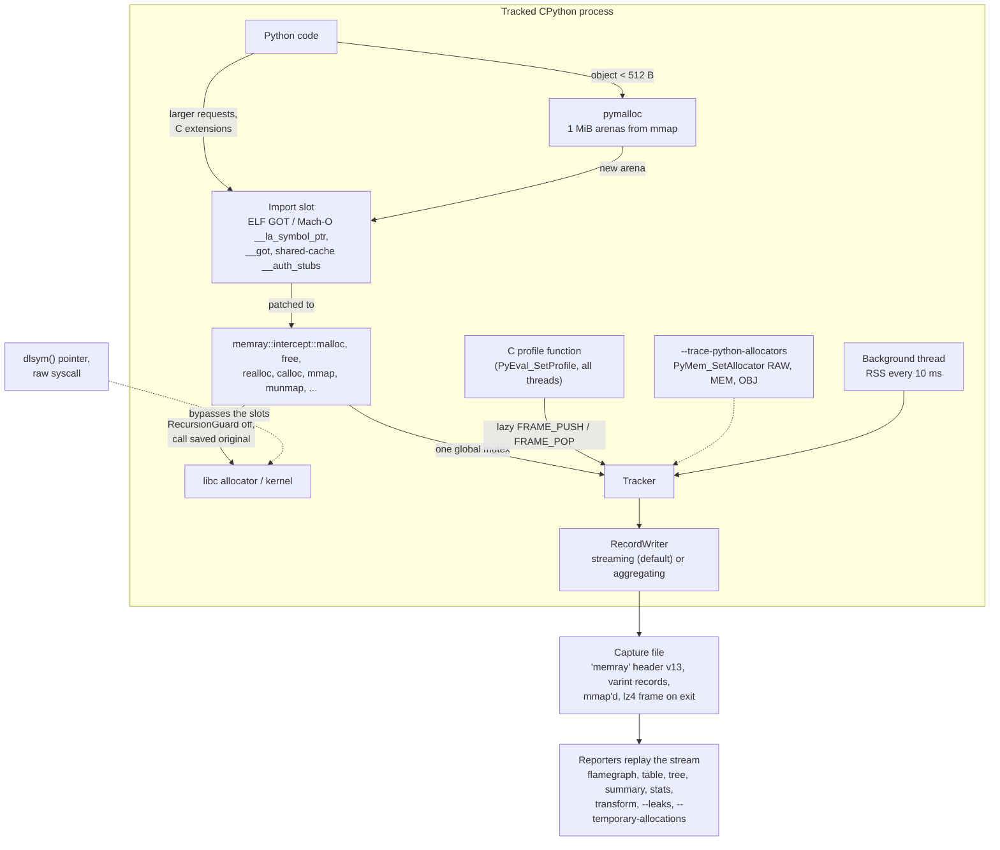

# Python Memory Profiling: Memray and Line-Profiler

> [!summary] Claim:
> Memray finds where a Python process gets its memory by overwriting the import slots (the ELF GOT or the Mach-O symbol pointers) of every loaded image so that `malloc`, `free`, `realloc`, `calloc`, `mmap`, `munmap`, and their relatives jump into its own hooks, while a C profile function keeps a lazily emitted shadow of the Python stack.
> By default it sees only what CPython asks of the system allocator, so the 512-byte-and-smaller objects that pymalloc serves appear only as 1 MiB arena maps; `--trace-python-allocators` wraps the three `PyMem` domains to see each object.
> Its reports are replays of one ordered event stream: the high-water mark is the moment the sum of live allocations peaked, leaks are what was live when tracking stopped, and a temporary allocation is one freed while it was still among the last N+1 allocations of its thread.
> line_profiler answers a different question, time per source line: from Python 3.12 it claims `sys.monitoring` tool id 2, turns on LINE events process-wide, and charges each line the monotonic-clock interval until the next event of the same frame, so a line's time includes everything it calls.



## The Mechanism

The two tools in this note answer the two questions that a tight Python loop raises once a sampling profiler has pointed at it: which line spends the time, and which line asks for the memory.
[[Python-cProfile-Tachyon-and-Sampling-Profilers]] owns function-level CPU profiling, and [[Python-tracemalloc-gc-and-Memory-Leaks]] owns `tracemalloc`, the garbage collector, and pymalloc's arena, pool, and free-path internals; this note uses those facts and links to them.
Source facts below come from the memray 1.20.0 and line_profiler 5.1.0 source distributions on PyPI unless another source is named.

### 1. Memray's hook list

`hooks.h` declares every function memray intercepts through one X-macro, `MEMRAY_HOOKED_FUNCTIONS`:

- On every platform: `malloc`, `free`, `calloc`, `realloc`, `valloc`, `posix_memalign`, `aligned_alloc`, `mmap`, `munmap`, `dlopen`, `dlclose`, `PyGILState_Ensure`, `free_sized`, and `free_aligned_sized`.
- On glibc, in addition: `memalign`, `prctl`, `pvalloc`, and `mmap64`.
- On other Linux libcs such as musl: `memalign` and `prctl`.
- On macOS: nothing more.

`free_sized` and `free_aligned_sized` are the C23 deallocators; they are declared weak (`weak_import` on macOS) so that memray still loads on a libc that lacks them, and both hooks forward to memray's `free` hook (support added in 1.20.0, as of 2026-11).
The non-allocator entries are there for bookkeeping: `dlopen` and `dlclose` trigger re-patching and cache invalidation, `prctl(PR_SET_NAME)` records thread names, and `PyGILState_Ensure` installs the profile function on threads that C code created and that enter Python later.

Each allocator gets an `Allocator` code.
Codes 1 to 7 (`PYMALLOC_FREE`, `PYMALLOC_MALLOC`, `PYMALLOC_CALLOC`, `PYMALLOC_REALLOC`, `FREE`, `MALLOC`, `REALLOC`) fit in the 3-bit field of a compact record; `CALLOC` through `MUNMAP` (8 to 15) need an extra byte.
`allocatorKind()` sorts them into simple allocators, simple deallocators (`FREE`, `PYMALLOC_FREE`), a ranged allocator (`MMAP`), and a ranged deallocator (`MUNMAP`), and the reports treat the two kinds of range differently.

### 2. Installing the hooks: patching import slots, not preloading

A call from a shared object to `malloc` in another image does not jump to `malloc` directly.
It goes through an import slot that the dynamic loader filled in, as [[Dynamic-Linking-PLT-GOT-and-Loaders]] explains; memray rewrites those slots in every loaded image when a `Tracker` starts and writes the saved originals back when it stops.

On Linux, `SymbolPatcher::overwrite_symbols()` in `elf_shenanigans.cpp` calls `dl_iterate_phdr()` and, for each image:

1. Skips the dynamic loader (`/ld-linux`, `/ld-musl`), `linux-vdso.so.1`, and memray's own extension module, "to avoid chaos".
2. Finds the `PT_DYNAMIC` program header and builds a symbol table from it.
3. Walks the `DT_REL` and `DT_RELA` relocation tables and the jump-slot table, whose entry type it reads from `DT_PLTREL` at run time.
4. For each relocation whose symbol name matches a hooked function, calls `mprotect()` to make the page holding `r_offset + base` readable and writable, then stores the address of the intercept function there.

On macOS, `macho_shenanigans.cpp` walks `_dyld_image_count()` images, skipping `libdyld.dylib`, everything under `/usr/lib/system/`, `/dyld`, and memray itself:

1. For ordinary images it rewrites entries of `S_LAZY_SYMBOL_POINTERS` and `S_NON_LAZY_SYMBOL_POINTERS` sections, after `vm_protect(..., VM_PROT_READ | VM_PROT_WRITE | VM_PROT_COPY)` on the slot.
2. For images in the dyld shared cache (`_dyld_shared_cache_contains_path()`), the slots are not reachable from the image's data sections, so memray decodes the machine code of each `__stubs` or `__auth_stubs` entry to find the slot: on arm64 it checks for `adrp x17` then `add x17` (then `ldr x16, [x17]` and `braa x16, x17`) and rebuilds the page-relative address from the two immediates, and on x86-64 it checks for the 6-byte `jmpq *OFFSET(%rip)` (`0x25ff`).
3. It strips a `_malloc_type` prefix from symbol names before matching, because, per the source comment, "In macOS 15 (Sequoia)+, the symbols in the shared cache have a prefix".
4. It refuses to patch shared-cache images whose name contains `MallocStackLogging`, because, in the source's words, those interposition libraries "can make us crash (via stackoverflow when initializing TLS variables)".

Patching instead of `LD_PRELOAD` or `DYLD_INSERT_LIBRARIES` buys three properties.
Tracking can start and stop inside a running process, which is what the `memray.Tracker` context manager, pytest-memray, and `memray attach` need.
Nothing has to be set in the environment of the process, so child processes started with `exec` are not affected.
And `restore_symbols()` writes the saved originals back, so a process can be tracked for one test or one request and then run untracked.

The cost of the design is a visibility rule: memray sees an allocation only if the call goes through a slot it patched.
- A `dlsym()` result is the function's real address, so a C extension or a `ctypes` caller that calls `malloc` through it is invisible; the lab allocates 7,777,777 bytes that way and memray records nothing, while a `bytearray` of the same size is recorded.
- A library that brings its own allocator (a statically linked arena allocator) is visible only where that allocator asks the kernel for pages through a patched `mmap` slot.
- An image loaded after tracking starts is covered because the `dlopen` hook calls `invalidate_module_cache()`, which runs `overwrite_symbols()` again.

On glibc the `dlopen` hook has one more job: glibc resolves a bare library name against the `RUNPATH` of the caller, and memray's hook would otherwise be that caller, so the hook finds its real caller with `__builtin_return_address(0)` and `dladdr()`, reads the caller's search path with `dlinfo(RTLD_DI_SERINFO)`, and tries each directory itself.

### 3. The interception fast path

Every hook in `hooks.cpp` has the same shape, shown here for `malloc`:

```cpp
void* malloc(size_t size) noexcept {
    void* ptr;
    {
        tracking_api::RecursionGuard guard;   // per-thread flag: allocations below us are memray's own
        ptr = MEMRAY_ORIG(malloc)(size);      // the saved original from the import slot
    }
    if (ptr) {
        tracking_api::Tracker::trackAllocation(ptr, size, hooks::Allocator::MALLOC);
    }
    return ptr;
}
```

`free` reverses the order and records the deallocation before calling the real `free`, "to make sure that the pointer is not reused in-between" by another thread.
`realloc` records two events when it succeeds: a `FREE` of the old pointer, then a `REALLOC` of the new one, even when the block grew in place.
`calloc` records `num * size`, and `mmap` and `munmap` record ranges, so a partial `munmap` of a larger map is matched by address and length.

`Tracker::trackAllocation()` in `tracking_api.h` then:

1. Returns immediately if the per-thread `RecursionGuard` is set or no tracker is active, which is how memray ignores the allocations its own bookkeeping makes.
2. With `--native`, fills a per-thread buffer of return addresses with `unw_backtrace()` from libunwind on Linux or `backtrace()` on macOS.
3. Takes one process-wide `std::mutex` (`Tracker::s_mutex`) and calls `trackAllocationImpl()`, which flushes pending Python frame pushes and pops, deduplicates the native trace into a trace tree, and writes the record.

The single mutex means that in a program where many threads allocate at once, every allocation and free in every thread serializes on one lock while tracking is on; the free-threaded build (supported since 1.18.0) removes the GIL, but not this lock.

#### The Python stack is a shadow, not a walk

Memray does not walk the Python stack on every allocation.
`PythonStackTracker` installs a C-level profile function in every thread (`compat::setprofileAllThreads(PyTraceFunction, nullptr)`) and keeps a thread-local vector of `LazilyEmittedFrame` objects that mirrors the interpreter's call stack.
A call pushes a frame into the vector without writing anything; only when an allocation happens are the not-yet-emitted frames written as `FRAME_PUSH` records, and returns are batched into `FRAME_POP` records.
Each pushed frame carries a code object id and the frame's current bytecode offset, which the reader turns into a line number through the code object's line table, so two allocations on different lines of one function get different stacks without any per-line event.
The performance documentation names the two sources of overhead that follow from this design: the profile function, which costs something on every Python call and return, and the allocation recording, which it calls "the main source of the overhead".

Edge cases the source handles explicitly:
- Threads already running when tracking starts: `recordAllStacks()` captures each thread's existing stack under the GIL (or under a stop-the-world in free-threaded builds) and those frames are frozen, because memray will never see them return.
- Code object lifetime: memray registers a `PyCode_AddWatcher` callback (CPython 3.12 and later; `_PyEval_RequestCodeExtraIndex` before) so that a destroyed code object's id is forgotten before its address is reused.
- Greenlets: when `greenlet._greenlet` is loaded, memray installs a switch hook and gives each greenlet its own thread id; the supported-environments page still calls this support experimental (as of 2026-11).
- Cython functions do not appear in Python stacks even when built with profiling; `--native` shows them as C frames.

#### What pymalloc hides, and three ways to see through it

CPython serves requests of at most 512 bytes in the `PYMEM_DOMAIN_MEM` and `PYMEM_DOMAIN_OBJ` domains from pymalloc, which carves 1 MiB arenas on 64-bit builds (256 KiB on 32-bit, 2 MiB with `--with-pymalloc-hugepages`) obtained with `mmap()` where available; [[Python-tracemalloc-gc-and-Memory-Leaks]] owns pools, size classes, and when an arena goes back to the kernel.
Memray's default view therefore contains each arena `mmap`, never the objects inside it: the lab builds 50,000 small tuples and memray records exactly five `MMAP` records of 1,048,576 bytes for that function, plus one `MALLOC` and 52 `REALLOC` records for the growing list that holds them.
The `memray` documentation states the consequences: small requests that fit in an existing arena never appear, and a leak report blames whichever line happened to create the arena, with the arena's size rather than the object's.

Three ways to see individual objects:

| Mode | Mechanism | What the lab's 50,000 tuples look like | Trade-off |
| :--- | :--- | :--- | :--- |
| default | slot patching only | 5 `MMAP` records, every one 1,048,576 bytes | Fast, matches production allocation behavior, blind to objects |
| `--trace-python-allocators` | `PyMem_GetAllocator` saves, then `PyMem_SetAllocator` wraps, the RAW, MEM, and OBJ domains with `pymalloc_malloc`, `pymalloc_free`, and friends | at least 99,000 `PYMALLOC_MALLOC` records, no `MMAP` | Each object is a record, much larger files, slower; allocator codes stay distinguishable from direct `malloc` |
| `PYTHONMALLOC=malloc` | CPython routes all three domains to `malloc` | `python_allocator=malloc`, at least 99,000 `MALLOC` records | Changes the allocator under test, so peak RSS and fragmentation no longer match production |

The pymalloc wrappers also run under a `RecursionGuard`, so when pymalloc forwards a request above 512 bytes to the raw domain, the inner `malloc` hook stays silent and the request is recorded once, as a `PYMALLOC_*` event.
That is why the lab's list growth shows up as 52 `REALLOC` records in the default run and as 61 `PYMALLOC_REALLOC` records with pymalloc tracing: in the second run the list's early reallocations below 512 bytes are visible too.
The lab prints these counts only as "at least 99,000" rather than 100,000, because CPython serves some tuples and integers from its own free lists, and those never reach any allocator.

#### Object lifetimes (memray 1.19 and later)

`Tracker(..., track_object_lifetimes=True)` requires CPython 3.13.3 or newer and registers a `PyRefTracer` (`PyRefTracer_SetTracer`, added in CPython 3.13) that reports every object creation and destruction.
At tracker exit the surviving set is turned into strong references (`Py_INCREF` in `getSurvivingObjects()`) and returned by `Tracker.get_surviving_objects()`, which pytest-memray's `limit_leaked_objects` marker consumes; the strong references keep those objects alive until the caller drops the list.

### 4. The capture file

The `RecordWriter` comes in two forms, chosen by `FileFormat`.

`ALL_ALLOCATIONS` (the default, `StreamingRecordWriter`) writes every event:

- A header starting with the 7-byte magic `memray\0` and an `int` version, `CURRENT_HEADER_VERSION = 13` in 1.20.0, followed by the CPython version, flags, and statistics; at shutdown the writer appends a trailer and then seeks back and rewrites the header with final counts (`writeHeader(true)`).
- Allocation records with a one-byte token `1ppppaaa`: `aaa` is an allocator code from 1 to 7, or 0 when a full allocator byte follows; `pppp` indexes a 15-entry cache of recent addresses, and 15 means a miss, followed by the pointer shifted right by 3 and written as a varint delta from the previous such value (`writeIntegralDelta(&d_last.data_pointer, record.address >> 3)`).
- A size varint for allocators only; a simple deallocator carries neither a size nor a stack, which is why asking a `FREE` record for its stack raises `NotImplementedError: Stack traces for deallocations aren't captured.`
- `FRAME_PUSH` tokens `01uuuuue` (bit `e` marks an interpreter entry frame for native unwinding) followed by the code object id and a signed instruction offset, and `FRAME_POP` tokens `0001nnnn` that pop `n + 1` frames, at most 16 per token.
- A `CONTEXT_SWITCH` record whenever the writing thread changes, so per-thread records need no thread id of their own.
- A `MEMORY_RECORD` holding RSS and milliseconds since start, written by a background thread every `memory_interval_ms` (default 10); it reads `VmRSS:` from `/proc/self/status` on Linux and `resident_size` from `task_info(MACH_TASK_BASIC_INFO)` on macOS, and an RSS of 0 deactivates tracking.

`AGGREGATED_ALLOCATIONS` (`--aggregate`, since 1.7.0) runs the high-water-mark and leak computations inside the tracked process and writes, per location, the allocation counts and bytes live at the high-water mark and at the end.
The lab's aggregated and full captures of the same leak give identical leak and peak numbers, but the aggregated one cannot answer the temporary-allocation question, cannot feed `memray stats` or the live TUI, and is useless if the process is killed before it finishes, because the statistics are written only at the end.

The file sink maps the capture file into memory and grows it with `posix_fallocate`, which keeps most of the data when the process is killed; `--buffered-file-io` (1.20.0) uses ordinary `write` calls for file systems that lack shared writable `mmap`.
After tracking, `memray run` compresses the file into an lz4 frame by default (`--no-compress` skips it), which is why the lab's default capture starts `04 22 4d 18`, the lz4 frame magic, and the uncompressed one starts `memray\0`.
Native frames are stored as raw instruction pointers plus the image mappings and resolved only when a report is generated, using DWARF when present and the symbol table otherwise; reports with native frames must therefore be generated on the machine that ran the program, and on macOS they are usually poor unless a `dSYM` exists, while on Linux memray can fetch debug information through debuginfod (`DEBUGINFOD_URLS`).

### 5. How the reports are computed

Every report replays the ordered stream; none of them samples.

- **High-water mark** (the default for `flamegraph`, `table`, `tree`, and `summary`): `HighWatermarkFinder` tracks the running sum of live allocation sizes and remembers the record index where it peaked, and the report shows the allocations live at that index, grouped by stack.
  The peak is heap bytes requested, not RSS; `numpy.empty()` raises it before the pages are touched, and the memory overview documentation says no allocation profiler can tell you what makes resident size grow.
- **Leaks** (`--leaks`): allocations still live when tracking stopped.
  Under pymalloc this blames arenas, so the documentation recommends `PYTHONMALLOC=malloc` or `--trace-python-allocators` for leak hunts.
- **Temporary allocations** (`--temporary-allocation-threshold=N`, with `--temporary-allocations` meaning N=1; both arrived in 1.4.0 (2022-10-31): NEWS.rst lists `--temporary-allocations` there, and `commands/flamegraph.py` at the `v1.4.0` tag defines `--temporary-allocation-threshold` while the `v1.3.1` tag does not): `TemporaryAllocationsAggregator` keeps, per thread, a deque of that thread's last N+1 allocations; a deallocation whose address matches an entry (and whose length matches too, for `munmap`) makes that entry a temporary allocation.
- **Temporal** (`flamegraph --temporal`): the full history, so a range of time can be chosen in the HTML report.
- **stats**: total allocations and bytes, a logarithmic size histogram, the distribution of allocator types, the top `-n` locations by size and by count (default 5), and since 1.20.0 the top non-stdlib modules; `--json` writes it to a file.
- **transform**: `gprof2dot`, `csv`, and since 1.20.0 `speedscope` output.

The temporary-allocation definition has three consequences that the lab makes visible:

1. Because `realloc` is recorded as `FREE` then `REALLOC`, the old buffer of every reallocation is freed with zero allocations in between, so threshold 0 already flags list growth by `append`: the lab's one million appends give 77 temporary buffers totaling 67,558,848 bytes at threshold 0 and at threshold 1, and `[None] * n` gives none.
2. The documentation's argument for threshold 1, that growth allocates the new buffer before freeing the old one, describes malloc-copy-free code; the lab's `bytes(100_000) + bytes([i])` is that shape, and its eight intermediate objects are temporary at threshold 1 but not at threshold 0.
3. The window is per thread and counts allocations, not time: a buffer freed by another thread is never temporary, and a buffer freed after N+1 other allocations is never temporary, however short its life.

The 77 is predictable from CPython: `list_resize()` in 3.14.6 grows capacity to `(newsize + (newsize >> 3) + 6) & ~3` slots, which for one million appends is 86 resizes, 78 of them above pymalloc's 512-byte limit; the first of those 78 is a `MALLOC` (pymalloc moving the block to the raw allocator) and each later one is a `REALLOC` that frees its predecessor, and the final buffer of 1,056,084 slots (8,448,672 bytes) is still live.
The temporary-allocations documentation shows 78 allocations and "72.486MB" for the same loop because its list is discarded, so the last buffer is freed too, and its figures predate 1.18.0's switch from binary to SI units: 76,007,520 bytes is 72.486 MiB.

### 6. Attaching to a running process

`memray attach <pid>` injects the tracker into a process that is already running, and it sees only allocations made after the attach.
The `--method` choices are `auto`, `sys.remote_exec`, `gdb`, and `lldb`; `auto` tries `sys.remote_exec` first on every platform (default since 1.18.0), then gdb before lldb on Linux and lldb before gdb elsewhere.
- `sys.remote_exec(pid, script)` (CPython 3.14, PEP 768) asks the target's main thread to run a script "at the next available opportunity, similarly to how signals are handled"; it needs the same major and minor CPython version on both sides, the exact same version for pre-releases, and raises the `sys.remote_exec` and `cpython.remote_debugger_script` audit events. [[Python-pdb-debugpy-and-Remote-Attach]] owns the protocol.
- The debugger methods run `_attach.gdb` or `_attach.lldb`, which call `dlopen()` on memray's extension inside the target.
- All methods need permission to trace the target: the debuggers use ptrace, and PEP 768 writes into the target with `process_vm_writev()` on Linux (`mach_vm_write()` on macOS) under ptrace access mode checks, "the same ones that govern debugger attachment", which typically means root or `CAP_SYS_PTRACE`; the attach documentation adds that security settings on modern Linux systems "typically prevent a regular user from attaching even to their own processes", loosened by writing `0` to Yama's `ptrace_scope`.
- memray must be importable in the target's environment, because the injected code runs `import memray`.
- With `-o`, the target keeps writing the capture after `memray attach` exits; `--duration` stops it after a number of seconds, and `memray detach` stops it early.

The attach documentation warns that injection "might crash or deadlock the process" and advises using it on development machines.

### 7. line_profiler: how a line gets its time

line_profiler is a deterministic, line-granularity CPU profiler: it receives an event for every line executed, not samples.
Its user interface is `kernprof -l`, which puts `profile` into builtins so that `@profile` marks functions, or the `LineProfiler` class, or since 4.1.0 `from line_profiler import profile`, which does nothing unless `LINE_PROFILE=1` is set or the script is run with `--line-profile` (the 5.1.0 defaults in `rc/line_profiler.toml`).

#### Registering a function: padding the bytecode

`LineProfiler.add_function()` keys every line by `compute_line_hash(hash(co_code), lineno)`, which is `block_hash ^ lineno`, so two functions whose bytecode is identical would share keys.
Since 5.1.0 (#425) it always appends `NOP` instructions (2 bytes each) to a profiled function's bytecode, one more for each further function with the same base bytecode, and installs the result with `code.replace(co_code=...)`, so a profiled function never collides with an unprofiled twin or with another profiled twin.
The lab's two identical one-line functions grow by 2 and by 4 bytes, and their hit counts stay separate.
A consequence is that anything holding the old code object (another profiler, a cached reference) keeps running unprofiled bytecode, which the source comments as the reason all padding is computed across every instance that refers to the same base bytecode.

#### The event source: `sys.monitoring` or the legacy trace hook

On CPython 3.12 and later line_profiler 5.x uses `sys.monitoring` (added in 5.0.0); `LINE_PROFILER_CORE=legacy` (also `old`, `ctrace`) selects `PyEval_SetTrace` instead.
`_SysMonitoringState.register()` claims tool id 2 (`sys.monitoring.PROFILER_ID`) under the name `line_profiler` if it is free (if another tool already holds it, line_profiler adds its events to that tool's instead of failing) and calls `set_events()` with `LINE | PY_RETURN | PY_YIELD | RAISE | RERAISE`.
Those are global events, not local ones: while a profile is enabled, every line of every function the interpreter runs dispatches to line_profiler's callback, which looks the line's hash up and returns without returning `DISABLE`.
The source comment explains the choice: enabling local events only on profiled code objects added complexity and measured "< 2%" faster in its tests.
[[Python-sys-monitoring-and-Tracing]] owns the event model, and also records that `cProfile` and line_profiler both want tool 2, so `cProfile` cannot start while a line_profiler profile is enabled.

A profile is enabled by count: the wrapper that `@profile` or `LineProfiler.__call__` puts around each function calls `enable_by_count()` on entry and `disable_by_count()` on exit, with a thread-local count, so tracing is on only while at least one profiled call is on the current thread's stack.
Unprofiled functions called from a profiled one run with LINE events on, and pay the callback dispatch on each of their lines.

#### The timing algorithm

`inner_trace_callback()` in `_line_profiler.pyx` runs for every LINE, return, yield, and raise event:

1. Compute the line hash; if no active profiler has it, return.
2. Read `hpTimer()`, which is `clock_gettime(CLOCK_MONOTONIC)` in nanoseconds on POSIX (the timer code "comes from Python 2.5.2's `_lsprof.c`"), so the internal unit is 1e-9 seconds.
3. Look up the per-thread `LastTime` record for this frame: since 5.1.0 (#444) the key is the frame's address, so recursive calls no longer overwrite each other's records; before that it was the code block.
4. If a record exists for the same code block, add `now - old.time` to the line `old.f_lineno` and increment its hit count.
5. On a LINE event, store a new record for this line with a second `hpTimer()` read, so the callback's own work is mostly not charged to the next line; on a return or yield, erase the record.

The consequences are the rules for reading the output:
- A line is charged from its start until the next event in the same frame, so its time includes every call it makes, profiled or not; the lab's `time.sleep(0.02)` line is charged at least the 0.1 seconds its five calls slept, and more than 95% of its function.
- Hits are counted when the line ends, so a `for` header that runs `n` iterations is hit `n + 1` times, the last for the check that ends the loop.
- A generator's time while suspended is not charged, because `PY_YIELD` closes the open line.
- Time spent in line_profiler's callbacks between the two clock reads is outside any line, so `Total time` understates the wall time of the profiled run.

The 4.0.0 changelog reports that rewriting the callback in C++ cut "between 0.3 and 1 microseconds per line hit" and gave "a speedup of up to 4x" for code with many cheap lines; the 5.0.1 changelog records fixes that "mitigate speed regressions introduced in 5.0.0", the release that added the `sys.monitoring` backend.
This note did not measure overhead on this machine; treat a cheap line's absolute time as inflated by the event dispatch, and compare lines only to each other.

#### Output and files

`kernprof -l script.py` saves statistics to `<script_or_module_name>.lprof` by default (`-o` changes it), `-v` also prints them, and `python -m line_profiler file.lprof` prints a saved file.
The report shows `Timer unit`, `Total time`, and the columns `Line #`, `Hits`, `Time`, `Per Hit`, `% Time`, and `Line Contents`; the default display unit is 1e-6 seconds (`-u` changes it).
`-p` (autoprofile) names modules, functions, or classes to profile without decorators, `--prof-imports` extends that to a profiled script's imports, `-z` hides functions that were never called, `-i N` rewrites the output file every N seconds from a thread for long runs, and defaults can live in `[tool.line_profiler]` tables in `pyproject.toml`.

### 8. Version and platform facts (as of 2026-11)

| Fact | Value | Source |
| :--- | :--- | :--- |
| Current releases | memray 1.20.0 (2026-08-07), line_profiler 5.1.0 (2026-10-18), pytest-memray 1.11.0 (2026-09-17) | PyPI |
| memray Python support | 3.9 and later on PyPI metadata; 1.20.0 adds 3.15 and drops 3.7 and 3.8; free-threaded builds since 1.18.0 | NEWS.rst |
| line_profiler Python support | 3.10 and later; 5.1.0 adds 3.15 and drops 3.8 and 3.9 | CHANGELOG.rst |
| memray platforms | Linux (glibc and musl) and macOS 11 or newer; no Windows; 1.20.0 wheels are manylinux2014 (x86-64, i686), manylinux_2_28 (x86-64, aarch64), and musllinux_1_2 (x86-64 only) | supported_environments.rst, PyPI file list for 1.20.0 |
| line_profiler platforms | wheels for Linux (x86-64, aarch64), macOS (x86-64, arm64), and Windows (amd64) | PyPI file list for 5.1.0 |
| memray on macOS | fully supported since 1.5.0; native stacks usually poor without `dSYM` files | NEWS.rst, native_mode.rst |
| `memray attach` default | `sys.remote_exec` since 1.18.0 on CPython 3.14 and later | NEWS.rst |

## Commands and Numbers to Know

| Item | Value | Platform and date | What it controls |
| :--- | :--- | :--- | :--- |
| `memray run -o FILE script.py` | default output `memray-<script>.<pid>.bin` | Both (as of 2026-11) | Starts tracking before the script runs |
| `memray run --native` | libunwind (Linux) or `backtrace()` (macOS) per allocation | Both (as of 2026-11) | C frames in every report; symbolize on the same machine |
| `memray run --trace-python-allocators` | wraps the RAW, MEM, OBJ domains | Both (as of 2026-11) | Each pymalloc object becomes a record |
| `memray run --follow-fork` | new capture per child, the child's PID appended to the file name | Both (as of 2026-11) | Needs an output file; cannot follow `exec`, so not the `spawn` start method, the macOS default |
| `memray run --aggregate` | in-process per-location peak and leak totals | Both (as of 2026-11) | No temporary, stats, or live reports; lost on kill |
| `memray run --live` / `--live-remote` | TUI now, or wait for `memray live <port>` | Both (as of 2026-11) | Live view; incompatible with `--follow-fork` and `--aggregate` |
| `--no-compress`, `--buffered-file-io` | lz4 on exit by default; `mmap` sink by default | Both (as of 2026-11) | File size versus post-run CPU; file-system compatibility |
| `Tracker(memory_interval_ms=...)` | 10 ms | Both (as of 2026-11) | RSS sample period for the memory-over-time chart |
| `--temporary-allocation-threshold=N` | default off; `--temporary-allocations` is N=1 | Both (as of 2026-11) | Window of N other allocations, per thread |
| `memray flamegraph --leaks` / `--temporal` / `--split-threads` / `--inverted` | high-water mark by default | Both (as of 2026-11) | What the flame graph shows |
| `memray flamegraph --confidential-files=all\|none` | heuristic by default (1.20.0) | Both (as of 2026-11) | Whether source lines are embedded in the HTML |
| `memray transform FORMAT` | `gprof2dot`, `csv`, `speedscope` | Both (as of 2026-11) | Export to other viewers |
| `memray attach --method` | `auto`, `sys.remote_exec`, `gdb`, `lldb` | Both (as of 2026-11) | Injection mechanism |
| Capture header | `memray\0`, version 13 | Both (as of 2026-11) | Reader compatibility |
| pymalloc arena seen by memray | 1,048,576-byte `MMAP` | macOS, measured (as of 2026-11) | Default-mode granularity on 64-bit builds |
| `kernprof -l -v script.py` | output unit 1e-6 s (`-u`) | Both (as of 2026-11) | Line profiling plus a printed report |
| `kernprof -p TARGET` / `--prof-imports` / `-z` / `-i N` | see section 7 | Both (as of 2026-11) | Autoprofile, imports, zero-hit hiding, periodic dumps |
| `LINE_PROFILE=1` | enables `line_profiler.profile` | Both (as of 2026-11) | Decorator that is a no-op otherwise |
| `LINE_PROFILER_CORE=legacy` | `PyEval_SetTrace` backend | Both (as of 2026-11) | Escape hatch from `sys.monitoring` on 3.12 and later |
| line_profiler tool id | 2, name `line_profiler` | Both (as of 2026-11) | Collides with `cProfile` |
| pytest-memray markers | `limit_memory("24 MB")`, `limit_leaks("1 KB", filter_fn=...)`, `limit_leaked_objects()` | Both (as of 2026-11) | Per-test peak, per-location leak, and surviving-object gates |
| pytest-memray flags | `--memray`, `--native`, `--trace-python-allocators`, `--most-allocations=N`, `--stacks=N`, `--fail-on-increase` | Both (as of 2026-11) | Enables tracking and shapes failures |

pytest-memray's `parse_memory_string()` maps `KB`, `MB`, and `GB` to powers of 1024, while memray's own reports have used SI kilobytes since 1.18.0, so a `limit_memory("10 MB")` marker allows 10,485,760 bytes while a report prints the same allocation as about 10.5 MB.

## Multi-Language Comparison: C++ / Python / Rust

| Concern | C++ | Python | Rust |
| :--- | :--- | :--- | :--- |
| Allocation interception | heaptrack starts the program under its tracker or injects into a running one through GDB; Massif and DHAT are tools of Valgrind, "an instrumentation framework for building dynamic analysis tools"; see [[Cpp-Memory-Profiling-heaptrack-Massif-DHAT-and-Allocators]] | memray rewrites import slots at run time; tracemalloc uses PEP 445 domain hooks and sees only CPython's allocators | dhat-rs replaces the global allocator (`#[global_allocator] static ALLOC: dhat::Alloc`), so it sees only Rust allocations; see [[Rust-Benchmarking-Criterion-Divan-Gungraun-and-dhat]] |
| Stack attribution | native unwinding per allocation | shadow Python stack from a profile function, native frames optional with `--native` | backtrace per allocation, trimmed |
| Temporary allocation report | heaptrack counts temporary allocations in its summary | memray `--temporary-allocations`, per-thread window of N+1 | dhat-rs reports heap usage per allocation site, and its documentation says it "cannot track memory accesses the way DHAT does" |
| Line-level CPU time | sampling plus `perf annotate`; no common deterministic per-line timer | line_profiler, deterministic per-line events | sampling; [[Rust-CPU-Profiling-cargo-flamegraph-samply-and-Frame-Pointers]] |
| Mixed native and interpreted code | not applicable | memray `--native` merges C frames with Python frames | not applicable |

The dhat-rs documentation says it "typically causes a smaller slowdown than DHAT" and should be used only in release builds; heaptrack's README shows `heaptrack --pid` "injecting heaptrack into application via GDB".

## Worked Lab Example

The lab is `code/05-Profiling/memray_tracking/`.
`run.sh` declares `# requires: network` because it creates a throwaway virtualenv with uv on uv's managed CPython 3.14.6 and installs memray 1.20.0 and line_profiler 5.1.0 from `requirements.txt` with `--require-hashes`.
The interpreter is pinned to the patch release because list growth, object sizes, and free lists decide the printed counts.
Every Python process runs under `env -i` with `LC_ALL=C` and `PYTHONHASHSEED=0`, so an inherited `PYTHONMALLOC` or `PYTHONDEVMODE` cannot change the result.

The steps:

1. `workload.py` holds one function per allocation pattern; `run.sh` runs `python -m memray run -q -f -o <capture> workload.py <section>` nine times: the small-object section three ways (default, `--trace-python-allocators`, and `PYTHONMALLOC=malloc`), and the churn, peak, leak, and dlsym sections once each, plus the leak section with `--no-compress` and with `--aggregate`.
2. `analyze.py` reads each capture with `memray.FileReader` and groups records by the innermost Python function; it prints only counts and sizes that the workload fixes, never addresses, PIDs, timestamps, or RSS.
3. It counts records by allocator for the small tuples, sums live-at-peak, leaked, and temporary allocations at thresholds 0, 1, and 2 for the other sections, checks that the aggregated capture refuses the temporary query, and prints the capture headers.
4. `lineprof_demo.py` registers five functions with a `LineProfiler`, prints the bytecode padding and the `sys.monitoring` state, runs them, and prints hit counts plus timing facts phrased as inequalities.
5. Both scripts exit non-zero if a mechanism stops behaving as this note says: for example if default mode starts seeing pymalloc objects, if an arena is not 1 MiB, if `[None] * n` is not one 8,000,000-byte allocation, if the `dlsym` allocation becomes visible, or if a `for` line is not hit `n + 1` times.

```bash
cd code/05-Profiling/memray_tracking
TOOLCHAIN_LABS_NETWORK=1 bash run.sh
```

### Verified output

Recorded by `python3 -m _harness.verify --record` on darwin-arm64 in 2026-11, passed by a separate `python3 -m _harness.verify` run, and reproduced byte for byte by an independent `run.sh` run during fact-checking (2026-11); the file is `code/05-Profiling/memray_tracking/expected/darwin-arm64.txt`.

```text
memray 1.20.0, line_profiler 5.1.0, CPython 3.14.6
== memray: what the hooks see for 50,000 small tuples ==
  default (pymalloc): python_allocator=pymalloc trace_python_allocators=False
    MALLOC           records: 1, every size 608
    MMAP             records: 5, every size 1048576
    REALLOC          records: 52
  --trace-python-allocators: python_allocator=pymalloc trace_python_allocators=True
    PYMALLOC_MALLOC  records: >= 99000
    PYMALLOC_REALLOC records: 61
  PYTHONMALLOC=malloc: python_allocator=malloc trace_python_allocators=False
    MALLOC           records: >= 99000
    REALLOC          records: 61
== memray: temporary allocations from list growth ==
  grow_by_append: live at peak 1 allocation(s), 8448672 bytes
  preallocate: live at peak 1 allocation(s), 8000000 bytes
  threshold=0 grow_by_append: 77 temporary, 67558848 bytes
  threshold=0 preallocate: 0 temporary, 0 bytes
  threshold=1 grow_by_append: 77 temporary, 67558848 bytes
  threshold=1 preallocate: 0 temporary, 0 bytes
== memray: high-water mark versus the threshold window ==
  at the high-water mark, peak_sequential: 0 allocation(s), 0 bytes
  at the high-water mark, peak_together: 3 allocation(s), 30000003 bytes
  threshold=0: peak_sequential 3, peak_together 1 temporary
  threshold=1: peak_sequential 3, peak_together 2 temporary
  threshold=2: peak_sequential 3, peak_together 3 temporary
  leaked: 0 allocation(s)
== memray: leaks versus temporaries in one function ==
  full capture (ALL_ALLOCATIONS): leaked 8 allocation(s), 800272 bytes; live at peak 9, 900305 bytes
    threshold=0: 0 temporary, 0 bytes
    threshold=1: 8 temporary, 800264 bytes
  --aggregate capture (AGGREGATED_ALLOCATIONS): leaked 8 allocation(s), 800272 bytes; live at peak 9, 900305 bytes
    temporary allocations: NotImplementedError: Can't find temporary allocations using a pre-aggregated capture file.
== memray: an allocation that bypasses the patched stubs ==
  malloc_through_dlsym: 0 leaked allocation(s) recorded, 0 bytes
  bytearray_same_size: 1 leaked allocation(s) recorded, 7777778 bytes
== memray: capture file headers ==
  default (lz4 on exit): first 7 bytes 04 22 4d 18 40 40 c0
  --no-compress: first 7 bytes 6d 65 6d 72 61 79 00
  --no-compress magic 'memray', header version byte 13
== line_profiler: bytecode padding ==
  twin_a co_code grew by 2 bytes, twin_b by 4 bytes
  twins still identical after add_function: False
== line_profiler: sys.monitoring state ==
  before enable: tool 2 = None
  while enabled: tool 2 = 'line_profiler'
  global LINE events on: True
  global PY_RETURN events on: True
  sys.gettrace() is None: True
  after disable: tool 2 = None
== line_profiler: timer unit 1e-09 s (internal clock) ==
== line_profiler: hit counts ==
  hot: line offset, hits, source
    +0      0  def hot(n):
    +1      1      total = 0
    +2   1001      for i in range(n):
    +3   1000          total += i
    +4   1000          if i % 100 == 0:
    +5     10              total += sum(range(50_000))
    +6      1      return total
  sleeper: line offset, hits, source
    +0      0  def sleeper():
    +1      6      for _ in range(SLEEPS):
    +2      5          time.sleep(SLEEP_S)
  fact: line offset, hits, source
    +0      0  def fact(k):
    +1      5      if k <= 1:
    +2      1          return 1
    +3      4      return k * fact(k - 1)
  twin_a: line offset, hits, source
    +0      0  def twin_a(x):
    +1      1      return x + 1
  twin_b: line offset, hits, source
    +0      0  def twin_b(x):
    +1      2      return x + 1
== line_profiler: where time is charged ==
  sleep line total >= 0.1 s: True
  sleep line share of sleeper() > 95%: True
  hottest line in hot(): +5 (the sum(range(50_000)) line is +5)
```

### Reading the result

- **Small tuples.** The default run has no `PYMALLOC_MALLOC` records at all: the 50,000 tuples and their integers live in five 1 MiB arenas, and the only `malloc`-level traffic from that function is the list that holds them (one 608-byte `MALLOC` when it outgrows pymalloc, then 52 `REALLOC`s).
  Both object-level modes see at least 99,000 allocations, roughly one tuple and one integer per element, minus free-list reuse.
- **List growth.** `grow_by_append` ends with one live buffer of 8,448,672 bytes (1,056,084 slots of 8 bytes) after 77 temporary buffers totaling 67,558,848 bytes, the exact sum that `list_resize()`'s formula predicts; `[None] * n` allocates 8,000,000 bytes once.
  The threshold makes no difference here because realloc growth frees its old buffer with zero allocations in between.
- **High-water mark.** Three 10,000,001-byte `bytearray` buffers (the extra byte is the NUL terminator CPython keeps) appear at the high-water mark only for `peak_together`; `peak_sequential` used the same bytes in total but never held two at once, so it is absent from the peak report and present only among the temporaries.
- **The threshold window.** `del held` drops a list whose deallocator releases items from the last to the first, so the third buffer is freed with 0 later allocations, the second with 1, and the first with 2, and thresholds 0, 1, and 2 report 1, 2, and 3 temporaries.
- **Leaks versus temporaries.** Each of the eight cached `bytes` objects holds 100,001 bytes plus a 33-byte object header (100,034 bytes, 800,272 in total), and each intermediate `bytes(100_000)` (100,033 bytes) dies right after the concatenation allocates the result, so it is temporary at threshold 1 but not 0; the ninth allocation live at the peak is one such intermediate.
- **The dlsym bypass.** `ctypes` resolved `malloc` with `dlsym` and called it through a pointer, so no patched slot was involved and the 7,777,777 bytes are invisible; the same size through `bytearray` (7,777,778 bytes) is recorded.
- **Headers.** `04 22 4d 18` is the little-endian lz4 frame magic `0x184D2204`, and the uncompressed file starts with `memray\0` and version 13.
  The lab prints 7 bytes because the 8th starts the first lz4 block's size, which changes with the PID and timestamps inside the capture.
- **line_profiler padding and tool.** The twins differ only by their padding after `add_function`; while enabled, tool 2 belongs to `line_profiler`, global LINE and PY_RETURN events are on, and `sys.gettrace()` is unset because the legacy hook is not used.
- **Hit counts.** `for i in range(n)` is hit 1,001 times for 1,000 iterations; `fact(5)` shows five `if` hits, four recursive returns, and one base case, kept apart per frame.
  The `sum(range(50_000))` line runs 10 times, 1% of the iterations, and is still the most expensive line.

## Pitfalls

> [!warning] Pitfall: reading a default-mode leak report as an object leak
> Under pymalloc a "leak" of 1,048,576 bytes is an arena, attributed to whichever line first needed it, and one surviving 72-byte object can keep it alive.
> Hunt leaks with `--trace-python-allocators` or `PYTHONMALLOC=malloc`, and use `track_object_lifetimes` on CPython 3.13.3 or newer when the question is which objects survived.

> [!warning] Pitfall: expecting memray to see every native allocation
> Allocations through a `dlsym` pointer, a raw `syscall`, or a statically linked allocator's internal free lists never pass through a patched slot.
> If RSS grows while memray's heap line stays flat, check how the extension obtains its allocator before blaming the kernel, and fall back to a native tool from [[Cpp-Memory-Profiling-heaptrack-Massif-DHAT-and-Allocators]].

> [!warning] Pitfall: comparing memray's peak with the RSS chart
> The high-water mark is the peak of requested heap bytes; RSS counts touched pages, allocator caches, arenas that cannot be returned, shared libraries, and memray's own buffers.
> `numpy.empty()` moves the heap line immediately and the RSS line only when the array is written, and freed memory may never leave RSS.

> [!warning] Pitfall: symbolizing native captures somewhere else
> `--native` stores raw instruction pointers and resolves them when the report runs, against the libraries on that machine.
> Generate reports on the host that ran the program, or in the same container image, and expect `<unknown>` file names on macOS without `dSYM` bundles.

> [!warning] Pitfall: tracking forked workers that were spawned
> `--follow-fork` follows `fork()` only; a `spawn` worker starts a new interpreter with `exec` and is not tracked, and the supported-environments page notes that `spawn` is the default `multiprocessing` start method on macOS.
> Track such workers by starting a `memray.Tracker` inside each worker, or by running the worker command under `memray run`.

> [!warning] Pitfall: trusting a temporary-allocation count across threads
> The window is per thread and counts allocations, not time; a producer-consumer pipeline that allocates in one thread and frees in another reports no temporaries at all.
> Run the reports with `--split-threads` and read the leak and peak views as well before concluding that churn is absent.

> [!warning] Pitfall: reading line_profiler time as self time
> A line is charged until the next event in its frame, so a call line carries its callee's whole cost, including unprofiled library code and sleeps.
> Profile the callee too, or switch to a sampling profiler from [[Python-cProfile-Tachyon-and-Sampling-Profilers]] when the question is which function, not which line.

> [!warning] Pitfall: leaving `@profile` decorators or global LINE events in production paths
> Under `kernprof -l` every line executed while any profiled call is on the stack dispatches a callback, including lines in unprofiled callees.
> Use `line_profiler.profile`, which is a no-op unless `LINE_PROFILE=1` is set, and never ship code that needs `kernprof` to define `profile`.

> [!warning] Pitfall: running line_profiler and cProfile together
> Both claim `sys.monitoring` tool id 2, so starting `cProfile` while a line profile is enabled raises `ValueError: tool 2 is already in use`.
> Run them in separate passes, or use a sampling profiler that needs no tool id.

## At Scale

A single developer uses both tools interactively: `memray run` and a flame graph for a memory question, `kernprof -l -v` for a slow loop.
The trade-offs change when many teams depend on the answers.

- **Overhead is workload-shaped.** Memray's cost grows with the allocation rate and the Python call rate, and every allocation in every thread takes one global lock, so an allocation-heavy multithreaded service slows far more than a single-threaded batch job; the project publishes its overhead only as violin plots from memray 1.5.0 on CPython 3.10.9, so measure on the real workload before budgeting.
- **File size is the second budget.** A full capture is proportional to the number of allocation events, so long runs and `--trace-python-allocators` make large files; `--aggregate` keeps files small but loses the temporary and stats views and is lost entirely on an OOM kill, while the default mmap'd stream survives most kills.
- **OOM forensics needs a wrapper.** In Kubernetes the container file system disappears with the killed process, so the documented pattern is a wrapper script that runs `memray run --output /tmp/capture.bin`, then post-processes and ships the report before the wrapper exits.
- **Attach is a privileged, risky operation.** `memray attach` needs ptrace rights or `sys.remote_exec`, requires memray in the target's environment, and the documentation warns of possible crashes or deadlocks; at fleet scale, gate it behind an on-call procedure, log the audit events, and prefer reproducing in staging.
- **CI gates belong on heap, not RSS.** pytest-memray's `limit_memory` measures the high-water mark of tracked allocations, which is far more repeatable than RSS; `--fail-on-increase` compares against the previous run stored in pytest's cache, so it needs a persistent cache directory to mean anything in CI.
- **Continuous memory profiling is a different tool.** Memray records every event for one process; fleet-wide, always-on heap profiles come from sampling profilers, as [[Continuous-Profiling-GWP-Parca-Pyroscope-and-OTel-Profiles]] describes.

Decision rules:

- One engineer, one slow function: `kernprof -l -v` with `@profile` on the function and its suspicious callees; read hits first, then relative time.
- One engineer, one memory question: `memray run` then `memray flamegraph` (peak), `--leaks` with `--trace-python-allocators` (leak), or `--temporary-allocations` (churn); add `--native` on Linux when an extension is involved.
- A team guarding a memory budget: pytest-memray `limit_memory` on the tests that build large structures, with thresholds in power-of-1024 units and headroom of a few percent, run in a dedicated CI job because tracking slows every test.
- An organization of 1,000 to 50,000 engineers: provide a paved road for memray captures from staging (a container image with memray, debug symbols, and debuginfod configured), a runbook for `memray attach`, and a continuous sampling profiler for production; do not promote `memory_profiler`, whose PyPI page says it "is no longer actively maintained" (0.61.0, uploaded 2022-11-15).
- When a regression appears only in production and only under load, capture with `memray attach -o --duration` on one replica behind an approved change, never fleet-wide.

## Practice Drill

> [!tip] Practice Drill:
> Copy `workload.py` and add a function that builds a 10,000-row CSV string with `+=` in a loop; before running, predict whether memray's temporary report at threshold 0 flags it, given that CPython may resize the string in place with `realloc`.
> Run `memray run -o drill.bin workload.py <your section>` and then `memray summary drill.bin --temporary-allocation-threshold=0` and `=1`, and explain the difference from the `bytes` concatenation in the leak section.
> Replace the loop with `"".join(rows)` and confirm that the temporary count collapses.
> Then put `@profile` on the function, run `kernprof -l -v`, and predict the hit count of the loop header and which line is charged the string copies.
> Finally, start a `LineProfiler` in one test and `cProfile` in the same process and read the error; then rerun with `LINE_PROFILER_CORE=legacy` and explain why the conflict disappears.

## Interview Questions

> [!question] L5: memray's flame graph shows only five 1 MiB `mmap` calls under a line that builds 50,000 small tuples; where did the tuples go?
>
> > [!success]- Answer
> > The tuples are allocated by pymalloc, which serves requests of at most 512 bytes from 1 MiB arenas on 64-bit builds and calls `mmap` only when it needs a new arena.
> > Memray's default hooks sit on the system allocator, so it sees the five arena maps and none of the objects inside them.
> > Rerun with `--trace-python-allocators`, which wraps CPython's allocator domains, or with `PYTHONMALLOC=malloc`; either shows on the order of 100,000 object allocations, one tuple and one integer per element, minus free-list reuse.
> > Keep the default for peak-memory questions, because it reflects how the program really obtains memory.

> [!question] L5: line_profiler reports 1,001 hits on `for i in range(n):` for `n = 1000`; is that a bug?
>
> > [!success]- Answer
> > No.
> > The header line executes once per iteration to fetch the next item and once more to discover that the iterator is exhausted, and line_profiler counts a hit each time a line's execution ends.
> > The body lines show exactly 1,000 hits, and the `return` line one.
> > The same rule explains why the time of a line includes everything it calls: the line stays open until the next event in its frame.

> [!question] L5: Predict the output: a function allocates three 10 MB `bytearray` objects into a list, then deletes the list; how many temporary allocations does memray report at thresholds 0, 1, and 2?
>
> > [!success]- Answer
> > One, two, and three.
> > A list's deallocator releases its items from the last to the first, so the third buffer is freed with no allocations after it, the second with one (the third), and the first with two.
> > Memray keeps, per thread, the last N+1 allocations, and a free that matches one of them makes it temporary, so threshold N catches buffers with at most N later allocations.
> > The small list object itself comes from pymalloc and is invisible in default mode, so it does not occupy a slot in the window.

> [!question] L6: Debug this: a service's RSS grows by 2 GB overnight while memray's heap line is flat and `--leaks` shows nothing, and the hot path calls a vendor C library through `ctypes`; what do you check?
>
> > [!success]- Answer
> > First, how the library obtains its allocator: memray sees a call only if it goes through an import slot it patched, and a function pointer from `dlsym` (which is how `ctypes` binds functions) or a statically linked allocator bypasses the slots.
> > A quick test is a small `ctypes` call to `malloc` of a known size inside a tracker, which memray will not report.
> > Second, whether the growth is heap at all: compare RSS with memray's heap line, look for `mmap` records from the library, and check for pages that were freed but not returned.
> > Then switch to a native tool that intercepts at a lower level, such as heaptrack or Valgrind, or make the library allocate through an imported `malloc`, and confirm with an end-to-end run that reproduces the growth.

> [!question] L6: Why does memray record a successful `realloc` as two events, and how does that change the temporary-allocation report?
>
> > [!success]- Answer
> > `realloc` may move the block, so the old address must stop being live and the new one must start; memray writes a `FREE` for the old pointer and then a `REALLOC` for the new one, even when the address did not change.
> > Because the free comes first, the old buffer is freed with zero allocations in between, so threshold 0 already marks every realloc-driven growth step as temporary.
> > The documentation's case for threshold 1 is growth written as malloc-new, copy, free-old, where one allocation sits between the old buffer's birth and its death; a `bytes` concatenation behaves that way.
> > A one-million-element `append` loop on CPython 3.14.6 produces 77 temporary buffers totaling 67,558,848 bytes at either threshold, while `[None] * n` produces none.

> [!question] L6: A teammate runs `cProfile` inside a test that already uses `line_profiler` and gets `ValueError: tool 2 is already in use`; explain and fix.
>
> > [!success]- Answer
> > On CPython 3.12 and later both profilers use `sys.monitoring`, and both claim tool id 2, `PROFILER_ID`; line_profiler holds it under the name `line_profiler` while a profile is enabled.
> > Only one tool can own an id, so `cProfile` refuses to start.
> > Run the profilers in separate passes; if both are truly needed at once, line_profiler can fall back to `PyEval_SetTrace` with `LINE_PROFILER_CORE=legacy`, at the cost of the older, slower trace path.

> [!question] L7: Why does memray patch import slots at run time instead of using `LD_PRELOAD`, and what does that design cost?
>
> > [!success]- Answer
> > Patching lets tracking start and stop inside a live process, which `memray.Tracker`, pytest-memray's per-test tracking, and `memray attach` require; it leaves child environments untouched, and the originals can be written back when tracking stops.
> > The costs are complexity and blind spots: memray must walk ELF relocation tables on Linux and Mach-O pointer sections or decoded shared-cache stubs on macOS, re-patch on every `dlopen`, special-case the glibc `RUNPATH` behavior of `dlopen`, and skip the loader and certain macOS libraries to avoid crashes.
> > Calls that do not go through a slot, such as a function pointer from `dlsym` or a raw syscall, are invisible; the lab shows a 7,777,777-byte `malloc` made through `ctypes` that memray never records.

> [!question] L7: Your team wants a CI gate that fails when a data-loading test's memory grows; design it with pytest-memray and list the traps.
>
> > [!success]- Answer
> > Mark the test with `@pytest.mark.limit_memory("...")`, which sums the sizes of allocations live at the test's high-water mark, a heap measure far more stable than RSS.
> > Units are powers of 1024 in pytest-memray but SI in memray's reports since 1.18.0, so write limits from measured byte counts, not from a report's MB figure.
> > `--fail-on-increase` compares with the value the previous run stored in pytest's cache under `memray/<test id>`, so persist `.pytest_cache` between CI runs or the comparison never happens.
> > pymalloc reuse, free lists, and import-time caches move small numbers, so leave headroom, isolate allocation-heavy tests in a dedicated job, and add `limit_leaks` with a `filter_fn` for location-specific leak checks.
> > Pin the CPython patch version, because container growth and object sizes change between releases, as list growth did in this note's comparison with older documentation.

> [!question] L8+: A latency-sensitive, multithreaded service shows a memory regression only under production load; how do you decide whether and how to use memray, and what are the risks?
>
> > [!success]- Answer
> > Start with what is cheap and always on: RSS and allocator metrics, and continuous sampling heap profiles if the fleet has them, to bound which component grows.
> > Memray records every allocation and serializes them on one global lock, so under multithreaded production load it changes timing and throughput; use it on one replica, for a bounded `--duration`, behind an approved change.
> > Attach with `sys.remote_exec` on CPython 3.14 or later, which needs matching versions and memray installed in the target environment and raises audit events, or with a debugger, which needs ptrace rights; both can crash or deadlock the target, which is why staging reproduction is preferred.
> > Write to a file with `-o` rather than the live TUI, keep `--native` off unless an extension is suspected, generate reports on the same host or image so native frames symbolize, and make the procedure a runbook with an owner rather than an ad hoc privilege.

> [!question] L8+: Set the organization's Python memory-profiling policy: which tools are paved roads, and why?
>
> > [!success]- Answer
> > Use memray as the paved road for deep, single-process investigations in development, staging, and CI (with pytest-memray), because it is the only tool among these that sees native and Python allocations in one stack and reports peak, leaks, and churn from one recording.
> > Keep tracemalloc for cheap, in-process Python-only snapshots and diffs, and continuous sampling profilers for production fleets, since memray's event-complete recording does not scale to always-on use.
> > Use line_profiler for targeted CPU work on loops once a sampling profiler has found the function, and never in production code paths; ship `line_profiler.profile`, which does nothing unless enabled.
> > Retire unmaintained tools such as `memory_profiler`, standardize container images with debug symbols or debuginfod for native reports, and document the platform limits: no Windows for memray, weak native stacks on macOS, no tracking across `exec`.

## Further Reading

- Memray documentation, "The run subcommand" (1.20.0): native mode, Python allocator tracking, `--follow-fork`, aggregated captures, buffered I/O, and the OOM wrapper pattern.
- Memray documentation, "Python allocators": why pymalloc hides objects and how it distorts leak reports.
- Memray documentation, "Temporary allocations" and "Memory overview": the threshold definition and why heap and resident memory diverge.
- Memray documentation, "Symbolic information in native mode": deferred symbolization, `dSYM` bundles on macOS, and debuginfod.
- Memray source, `hooks.cpp`, `elf_shenanigans.cpp`, `macho_shenanigans.cpp`, `tracking_api.cpp`, and `record_writer.cpp` (1.20.0): the hooks, the slot patching on both platforms, the shadow stack, and the record encoding.
- Memray `NEWS.rst`: the version history behind every "since" claim in this note.
- line_profiler `_line_profiler.pyx` and `CHANGELOG.rst` (5.1.0): the timing algorithm, the bytecode padding, the `sys.monitoring` backend, and the 5.1.0 per-frame recursion fix.
- PEP 445, PEP 669, and PEP 768: the allocator-domain API memray wraps, the monitoring API line_profiler uses, and the remote execution interface `memray attach` prefers.
- CPython `Objects/listobject.c` (`list_resize`): the growth formula that predicts memray's temporary count for `append` loops.

## See Also

- [[Python-tracemalloc-gc-and-Memory-Leaks]]: tracemalloc, the garbage collector, and pymalloc's arena release rules.
- [[Python-sys-monitoring-and-Tracing]]: tool ids, events, and the cost model that line_profiler inherits.
- [[Python-pdb-debugpy-and-Remote-Attach]]: PEP 768 remote execution, which `memray attach` uses by default.
- [[Dynamic-Linking-PLT-GOT-and-Loaders]]: the import slots that memray rewrites.
- [[Cpp-Memory-Profiling-heaptrack-Massif-DHAT-and-Allocators]]: native heap profilers for what memray cannot see.
- [[Drill-Profiling-Python-C-Extension-GIL-and-Allocation-Bottleneck]]: a drill that applies memray `--native` to a C extension.
- [[Python-CPython-perf-Trampoline-and-Tachyon-Internals]]: mixed Python and native CPU profiles.

## Related

- Prerequisites: [[Python-cProfile-Tachyon-and-Sampling-Profilers]]
- Next: [[Python-Benchmarking-pyperf-asv-and-NumPy-Pandas-Profiling]]
- See also: [[02-Programming-Languages/Python/Python-Backend-Interview-Prep/10-Testing-Debugging-Production|10 Testing Debugging Production]]
- Lab: `code/05-Profiling/memray_tracking/` (requires: network)
