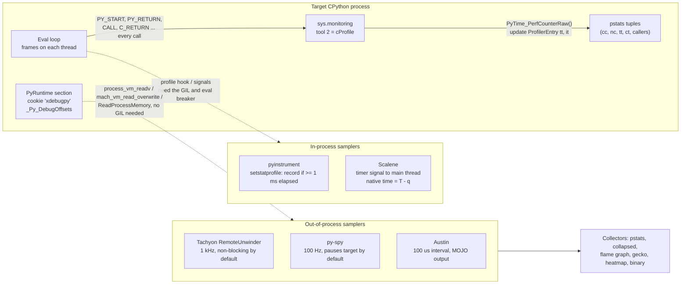

# Python cProfile, Tachyon, and Sampling Profilers

> [!summary] Claim:
> `cProfile` (named `profiling.tracing` since Python 3.15) is a deterministic profiler: since Python 3.12 it registers `sys.monitoring` callbacks as tool 2 for every Python start, resume, return, yield, and unwind and every C call and return, reads a monotonic clock at each one, and so pays a fixed cost per call that inflates call-heavy code relative to loop-heavy code.
> A sampling profiler instead records the whole stack at intervals, so cost is per sample, not per call, and a function's share of samples estimates its share of time with a binomial error of about `1.96 * sqrt(p(1-p)/n)`.
> Tachyon (`profiling.sampling`, new in 3.15) samples out of process: it finds the target's `PyRuntime` section, checks the `xdebugpy` cookie, reads `_Py_DebugOffsets`, and walks interpreter, thread, and frame structures with `process_vm_readv`, `mach_vm_read_overwrite`, or `ReadProcessMemory`, at 1 kHz by default and without pausing the target unless `--blocking` is given.
> py-spy and Austin use the same out-of-process idea, while pyinstrument and Scalene sample from inside the process, which is why they see the GIL, signals, and the eval loop's check points as part of what they measure.



## The Mechanism

A CPU profiler answers one question: of the time this program spent, how much belongs to each function, line, or call stack.
There are two ways to answer it, and they fail in opposite directions.
A tracing profiler observes every call and return, so its counts are exact, but the act of observing costs time per event, and that cost lands unevenly on the program.
A sampling profiler observes the stack at intervals, so its cost is independent of how many calls the program makes, but its answer is an estimate with a statistical error that shrinks only as the square root of the sample count.
Python 3.15 puts both in one package, `profiling`, with `profiling.tracing` and `profiling.sampling` as its two submodules (PEP 799, status Final, by Pablo Galindo Salgado and Laszlo Kiss Kollar).
The interpreter-level internals of Tachyon's frame walking and the `-X perf` trampolines belong to [[Python-CPython-perf-Trampoline-and-Tachyon-Internals]]; this note owns how the profilers work as tools, what their numbers mean, and how to choose between them.

### 1. The `profiling` package and the `profile` deprecation

PEP 799 was created on 2025-07-21 and accepted for Python 3.15.
It moves `cProfile` to `profiling.tracing`, adds the sampling profiler as `profiling.sampling`, and keeps `cProfile` as an alias; the `profiling.tracing` documentation says "The `cProfile` name will continue to work in all future Python versions."
The lab confirms the alias is the same class, not a wrapper: `profiling.tracing.Profile is cProfile.Profile` prints `True` on CPython 3.15.2.
The pure-Python `profile` module is deprecated: importing it in 3.15 emits a `DeprecationWarning` (the lab checks it fires), PEP 799 schedules a warning on every use in 3.16, and the module is removed in 3.17.
"Tachyon" is the codename of the sampling profiler; PEP 799 rejected a separate `profiling.tachyon` module name to avoid two names for one thing.

### 2. How `cProfile` measures

`cProfile` is the C extension `Modules/_lsprof.c`.
Before Python 3.12 it installed itself with `PyEval_SetProfile`, the C form of `sys.setprofile`.
gh-103533 (Tian Gao) moved it onto PEP 669's `sys.monitoring` API, and a direct check across interpreters shows the switch landed in 3.12: with a `cProfile.Profile` enabled, `sys.getprofile()` returns the profiler on 3.11.15 and `None` on 3.12.13, 3.13.18, 3.14.6, and 3.15.0b3, where `sys.monitoring.get_tool(2)` returns `'cProfile'` instead (one-off check on darwin-arm64 with uv-managed builds, as of 2026-11; the lab records only the 3.15 side).

In the 3.15 branch, `_lsprof_Profiler_enable_impl` calls `use_tool_id(PY_MONITORING_PROFILER_ID, "cProfile")` and registers these callbacks:

| `sys.monitoring` event | `_lsprof.c` callback | Meaning for the profile |
| :--- | :--- | :--- |
| `PY_START`, `PY_RESUME` | `_pystart_callback` | A Python frame begins or resumes; push a context, record `t0` |
| `PY_THROW` | `_pythrow_callback` | A generator or coroutine resumed with an exception |
| `PY_RETURN`, `PY_YIELD`, `PY_UNWIND` | `_pyreturn_callback` | The frame leaves; pop and charge time |
| `CALL` | `_ccall_callback` | A call to a C function (only C callables are timed here) |
| `C_RETURN`, `C_RAISE` | `_creturn_callback` | The C call ends |

`PY_YIELD` and `PY_RESUME` mean a generator or coroutine is charged only for time it is actually running, and each resume counts as a new call; the lab's coroutine that awaits ten times shows `ncalls 11`.
`sys.monitoring` events are process-wide, so on 3.12 and later one enabled `Profile` also records calls made on other threads: the lab sees all 100 calls a worker thread makes; on 3.11, whose `PyEval_SetProfile` hook is per thread, the same check records none of them (one-off check with a uv-managed 3.11.15, not part of the lab's recorded output).
Whether the per-profiler context stack attributes time correctly when several threads run Python concurrently is UNVERIFIED; treat cross-thread `tottime` with suspicion and trust the counts.

Each callback reads the clock.
With no custom timer, `call_timer()` uses `PyTime_PerfCounterRaw()`, the clock behind `time.perf_counter()`.
A custom timer is accepted as `Profile(timer, timeunit)`: with `timeunit > 0` the timer must return an integer count of that unit, otherwise it returns seconds as a float.
`time.process_time` is the usual choice when you want CPU time instead of wall time; the documentation lists `perf_counter`, `process_time`, and `monotonic`.

Per function, `ProfilerEntry` keeps `tt` ("total time in this entry"), `it` ("inline time in this entry (not in subcalls)"), `callcount`, `recursivecallcount`, and `recursionLevel`; `ProfilerSubEntry` keeps the same per caller-callee edge.
On return, `Stop()` does:

```c
if (--entry->recursionLevel == 0)
    entry->tt += tt;
else
    ++entry->recursivecallcount;
entry->it += it;
entry->callcount++;
```

Cumulative time is added only when the outermost activation of a recursive function returns, so recursion is never double counted, and every activation counts toward the call total.
`pstats` turns these into the classic tuple `(cc, nc, tt, ct, callers)`: `cc` is primitive calls (calls not induced by recursion), `nc` all calls, `tt` the inline time (`tottime`), and `ct` the cumulative time (`cumtime`).
It prints `ncalls` as `nc/cc` when they differ; the 3.15 `profiling` page defines `3/1` as "three total calls, one primitive".
The lab profiles `fib(15)` and gets `1973/1`, which is exactly `2 * F(16) - 1` activations, and the same count on a second run: tracing counts are deterministic.

#### Why tracing distorts the profile

`cProfile`'s cost is a fixed amount of work per call: at least two callbacks, two clock reads, a lookup of the entry for the code object, and a caller-edge update.
Code that does the same work in fewer calls pays less of it, so tracing does not just slow the program down, it changes the relative cost of functions.
The `profiling.tracing` documentation says it directly: latency between an event and the timestamp "can make them appear slower than they actually are", and this error "can become significant for functions called many times".
The lab calibrates two functions to take the same time unprofiled, `call_heavy` (300,000 calls to a one-line `add`) and `loop_heavy` (the same arithmetic inline, no calls), and on CPython 3.15.2 darwin-arm64 `cProfile` slows `call_heavy` by 2.5x to 6x and `loop_heavy` by under 1.5x, so it reports `call_heavy` as 65% to 90% of the time when the truth is 50%.
A sampler of the same run puts `call_heavy` at 35% to 65% and slows the run by under 1.5x.
The PEP 799 rationale summarizes the same effect: tracing profilers "introduce significant runtime overhead" and can disable interpreter optimizations.

Two more consequences follow from the design:
- Only one tool can hold `sys.monitoring` tool 2, so a second `Profile().enable()` while one is active raises `ValueError: tool 2 is already in use` (lab section 1); you cannot nest `cProfile`, and any other tool that claims the profiler ID collides with it.
- Every call is counted, including calls too short for any sampler to see, which is the one job a sampler cannot do: proving that an optimization removed calls.

### 3. Sampling as statistics

A sampling profiler stops time at regular instants and asks what each thread is doing.
If a function is on top of the stack for a fraction `p` of the program's time and `n` samples are taken, the observed count `k` is approximately binomial, so the estimate `k / n` has standard error `sqrt(p(1-p)/n)`.
The lab prints the bands for the cases the Tachyon documentation discusses:

| Share `p` | Samples `n` | 95% band (1.96 SE) | 3 SE band |
| :--- | :--- | :--- | :--- |
| 5% | 1,000 | +/-1.35 points | +/-2.07 points |
| 5% | 100,000 | +/-0.14 points | +/-0.21 points |
| 50% | 1,000 | +/-3.10 points | +/-4.74 points |

The documentation's own example says a 5% function measured from 1,000 samples "could actually represent anywhere from 3% to 7%"; that range matches the 3 SE band, and its "+/-0.5%" for 100,000 samples is more conservative than the formula.
The practical rules:
- At Tachyon's default 1 kHz, one second of runtime gives about 1,000 samples, which resolves 50% versus 45% but not 5% versus 6%; the documentation warns that scripts under about one second "may yield too few samples".
- Two runs of the same program differ by sampling noise alone, so a 1 to 2 point difference between two profiles is not a regression until you have enough samples to make it one.
- A function that always finishes between two samples can vanish entirely; sampling estimates time, never call counts.
- The independence assumption breaks when the program's own period matches the sampling period (a loop that does one unit of work every millisecond); there the samples are correlated and the error is larger than the formula says.

Sampling cost is set by the rate and the stack depth, not by the program's call rate, which is why a sampler can run in production and a tracer usually cannot.

### 4. Tachyon: `profiling.sampling`

Tachyon is the sampling profiler that ships with CPython 3.15.
Its driver is pure Python (`Lib/profiling/sampling/`), and the memory reading is the C module `_remote_debugging`.

#### Subcommands

| Command | What it does |
| :--- | :--- |
| `python -m profiling.sampling run [-m] target [args]` | Starts the target as a child and samples it |
| `python -m profiling.sampling attach PID` | Samples an existing process |
| `python -m profiling.sampling dump PID` | Prints one stack snapshot, like a `py-spy dump` |
| `python -m profiling.sampling replay FILE` | Converts a `--binary` capture to any other format |
| `run --live` / `attach --live` | A curses TUI, top-like; not available on Windows |

`run` does not profile in-process.
`_run_with_sync()` binds a TCP socket on `127.0.0.1` with an OS-chosen port, starts `sys.executable -m profiling.sampling._sync_coordinator <port> <cwd> target...`, and waits up to 5 seconds (`_SYNC_TIMEOUT_SEC`) for the child to send `b"ready"` before it starts sampling; the coordinator's own frames are filtered from the output (`_INTERNAL_FRAME_SUFFIXES`).
Because the target is a child, `run` is also the only form that works on Linux under the default Yama `ptrace_scope` of 1, which allows ptrace-mode access only to descendants.

#### Finding the interpreter in another process

`RemoteUnwinder(pid)` locates the target's `_PyRuntime` structure without symbols (`Python/remote_debug.h`):
- On Linux it parses `/proc/<pid>/maps` for a mapping whose path contains `python`, opens that ELF file, and finds the `PyRuntime` section; deleted mappings are scanned in memory for the cookie.
- On macOS it tries mappings named `libpython`, `python`, and `Python`, parses the Mach-O (including fat binaries), and finds section `PyRuntime` in segment `__DATA`.
- On Windows it enumerates modules with `CreateToolhelp32Snapshot` and finds the PE section.

Every candidate must start with `_Py_Debug_Cookie`, the 8 bytes `xdebugpy`.
The runtime begins with `struct _Py_DebugOffsets`, which records `PY_VERSION_HEX`, a `free_threaded` flag, and the offsets of the fields a profiler needs in the runtime, interpreter, thread state, interpreter frame, code object, GC, and generator structures; the header says these sections exist so "out-of-process profilers can locate them easily".
That version field is why the documentation requires the profiler and target to run the same minor version (and the exact same version for pre-releases), and why a free-threaded profiler cannot attach to a GIL build or the reverse.

Memory is then read with:

| Platform | Read call | Permission needed (documented) |
| :--- | :--- | :--- |
| Linux | `process_vm_readv()`, falling back to `preadv()` on `/proc/<pid>/mem` on `ENOSYS` | root, `CAP_SYS_PTRACE`, or Yama `ptrace_scope` 0 (`run` works at the default 1) |
| macOS | `task_for_pid()` then `mach_vm_read_overwrite()` | root, the `com.apple.security.cs.debugger` entitlement, or SIP disabled |
| Windows | `OpenProcess()` then `ReadProcessMemory()` | administrator or `SeDebugPrivilege` |

The permission check on Linux is the ptrace access check: `process_vm_readv(2)` says access is "governed by a ptrace access mode PTRACE_MODE_ATTACH_REALCREDS check".
On macOS even a child of the profiler is off limits to an unprivileged user: the lab's `run` of a one-second child exits with status 1 and a permission error on darwin-arm64 as a normal user (as of 2026-11, macOS).

The building blocks arrived in steps, which matters when you read older tools: CPython 3.13 shipped the remote reader only as `_testexternalinspection`, 3.14 renamed it `_remote_debugging` (it backs `python -m asyncio ps` and `pstree`, new in 3.14) and added `sys.remote_exec`, and 3.15 added `profiling.sampling` on top (module availability from a one-off check on 3.12.13, 3.13.18, 3.14.6, and 3.15.0b3, darwin-arm64, not part of the lab's recorded output).

#### The sampling loop

`SampleProfiler.sample()` in `sample.py` is a simple timed loop in the profiler process:
- It keeps `next_time` on `time.perf_counter()`; when early, it sleeps 90% of the remaining gap if that is more than 100 microseconds and otherwise spins.
- When late, it takes a sample immediately and advances `next_time` by one interval, so after a stall it catches up with back-to-back samples.
- A `ProcessLookupError` ends sampling (the target exited); `RuntimeError`, `UnicodeDecodeError`, `MemoryError`, and `OSError` count as failed samples, because a non-atomic read of a running process can catch structures mid-update.
- At the end it prints `Captured N samples in S seconds`, `Sample rate`, and `Error rate`, and warns `missed K samples from the expected total` when the loop fell behind.

For aggregating collectors such as pstats, consecutive identical stacks are run-length batched (up to `MAX_PENDING_SAMPLES = 8192`) before they reach the collector, so a program parked in one place costs almost nothing to record.

The default rate is 1 kHz (`-r 1khz`, parsed by `_parse_sampling_rate`, which accepts `10000`, `10khz`, or `10k`); the rate is converted to an integer interval in microseconds, and any rate above 1 MHz is rejected as "too high".
The target is not stopped: reads race with the running program, which is cheap but can produce a torn stack in code whose stack changes quickly (generators, coroutines).
`--blocking` suspends every thread around each read, using `thread_suspend` on macOS and `ptrace` on Linux per the CLI help, and the CLI warns when it is combined with an interval under 100 microseconds; the documentation recommends 1 ms or more in blocking mode.

#### Threads, modes, and the GIL

By default only the main thread is sampled; `-a` samples all threads.
Each sampled thread carries status bits from `_remote_debugging`: `THREAD_STATUS_HAS_GIL` (1), `ON_CPU` (2), `UNKNOWN` (4), `GIL_REQUESTED` (8), `HAS_EXCEPTION` (16), and `MAIN_THREAD` (32).
`--mode` selects which samples count:

| Mode | Keeps a sample when | Use it for |
| :--- | :--- | :--- |
| `wall` (default) | always, including sleep, I/O, and lock waits | latency: where does a request's elapsed time go |
| `cpu` | the thread is on a CPU core | throughput: what burns cycles |
| `gil` | the thread holds the GIL | which Python code serializes the others |
| `exception` | the thread has an active exception | the cost of exceptions used for control flow |

For `cpu`, `gil`, and `exception`, the CLI also sets `skip_idle`, and the collectors drop any thread that neither holds the GIL nor is on CPU.
The flame graph sidebar reports GIL Held, GIL Released, Waiting GIL, and GC percentages, and `--gecko` output carries GIL, CPU, GC, and code-type markers for the Firefox Profiler; `--mode` is rejected with `--gecko` because Gecko always records everything (`PROFILING_MODE_ALL`).
Diagnosing GIL contention is then a comparison, not a guess: run the same workload in `wall`, `cpu`, and `gil` modes with `-a`; a thread whose wall profile is far larger than its CPU profile is waiting, and the Waiting GIL share says how much of that wait is for the GIL rather than for I/O.
[[Drill-Profiling-Python-C-Extension-GIL-and-Allocation-Bottleneck]] works through a C extension that forgets to release the GIL.

`--native` adds `<native>` frames where Python called into C, and `<GC>` frames appear during garbage collection unless `--no-gc` is given.
`--opcodes` records the bytecode instruction, including specialized forms, and works only with `--live`, `--flamegraph`, `--heatmap`, `--gecko`, `--diff-flamegraph`, and `--binary`.

#### Async-aware stacks

When an asyncio task is suspended, its coroutine frames are not on any thread's stack, so a plain stack sample of a busy event loop shows the loop and the selector, not the code that is waiting.
The lab shows this: with three tasks parked in `asyncio.sleep`, the main thread's stack tops out at `KqueueSelector.select` and contains none of the user's coroutines.
`--async-aware` switches the unwinder to `get_async_stack_trace()` (default `--async-mode running`, only the task currently running) or `get_all_awaited_by()` (`--async-mode all`, every task including waiting ones; the default for `dump`).
`iter_async_frames()` in `collector.py` then rebuilds a linear stack per leaf task: a leaf is a task that no other task awaits, each task's coroutine frames are followed by a synthetic `<task>` frame with the task's name, and the walk follows `awaited_by` to the parent; when a task has several awaiters, it picks the smallest parent ID and labels the frame `name (N parents)`.
It requires `asyncio` to be loaded in the target and is incompatible with `--native`, `--no-gc`, `--all-threads`, `--binary`, and any mode but `wall`.
The task graph is read from an `AsyncioDebug` section; on the Homebrew build of CPython 3.15.2 for darwin-arm64 the lab's `get_all_awaited_by()` raises `RuntimeError: AsyncioDebug section not available` (as of 2026-11, macOS); the cause is UNVERIFIED (the same call worked on a python-build-standalone 3.15.0b3 build in a one-off check, which suggests a build-configuration difference, not a Tachyon limit).

For latency inside an event loop, pair the sampler with asyncio's own debug mode (`PYTHONASYNCIODEBUG=1`, Development Mode, `asyncio.run(..., debug=True)`, or `loop.set_debug(True)`), which logs any callback that runs longer than `loop.slow_callback_duration`, 100 ms by default: the debug log says which step blocked the loop, and an `--async-aware` profile says what that step was doing.

#### Output formats

| Flag | Collector | Output |
| :--- | :--- | :--- |
| `--pstats` (default) | `PstatsCollector` | Table on stdout; with `-o`, a marshal file `pstats` can load |
| `--collapsed` | `CollapsedStackCollector` | One `tid:N;file:func:line;... count` line per stack, for `flamegraph.pl` |
| `--flamegraph` | `FlamegraphCollector` | Self-contained HTML |
| `--diff-flamegraph BASELINE` | `DiffFlamegraphCollector` | HTML coloring changes against a `--binary` baseline |
| `--gecko` | `GeckoCollector` | Firefox Profiler JSON |
| `--heatmap` | `HeatmapCollector` | Directory `heatmap_<PID>` of per-file HTML with line counts |
| `--jsonl` | `JsonlCollector` | Newline-delimited JSON |
| `--binary` | `BinaryCollector` | Compact file with a 64-byte header (the CLI recognizes magics `TACH` and `HCAT`), zstd when available; convert with `replay` |

The pstats collector is where most misreadings start.
`create_stats()` sets `tottime = direct_samples * interval` and `cumtime = cumulative_samples * interval`, which the lab checks for every row; the times are sample counts scaled by the nominal interval, not measured durations, so a profile that missed 20% of its samples also under-reports time by 20%.
The "calls" columns are sample counts too, and the file carries a `("__sampled__",)` marker so `pstats.Stats` switches to `SampledStats`, whose header reads `nsamples tottime persample cumtime persample`.
Rows are keyed by `(filename, sampled line, function)`, not by the function's `def` line as in `cProfile`: the lab's `two_line_work`, which has two loops, appears as two Tachyon rows (`def + 3` and `def + 5`) and one `cProfile` row.
Sort with `--sort nsamples` (default), `tottime`, `cumtime`, `sample-pct`, `cumul-pct`, `nsamples-cumul`, or `name`, and cut with `-l` (default 15 rows).

`--subprocesses` starts a profiler per child Python process, each with its own output file (`profile_<pid>.pstats` and so on); the documentation caps this at 100 concurrent profilers.

### 5. py-spy

py-spy is a Rust program by Ben Frederickson and the tool that made out-of-process Python sampling common; Tachyon follows its design.
Per its README it reads memory with `process_vm_readv` on Linux, `vm_read` on macOS, and `ReadProcessMemory` on Windows, finds the interpreter from the global `PyInterpreterState`, and on stripped binaries scans the BSS section for "addresses that look like they may point to a valid PyInterpreterState".
It supports CPython 2.3 to 2.7 and 3.3 to 3.15 per the README (as of 2026-11, Both).
The defaults of v0.4.3 (`py-spy record --help`, as of 2026-11, macOS) differ from Tachyon's in two ways that matter:
- `-r, --rate` defaults to 100 samples per second, a tenth of Tachyon's default.
- py-spy pauses the target for each sample unless `--nonblocking` is given ("Setting this option will reduce the performance impact of sampling, but may lead to inaccurate results"); Tachyon is non-blocking unless `--blocking` is given.

Its subcommands are `record` (formats `flamegraph`, `raw`, `speedscope`, `chrometrace`), `top`, and `dump` (with `--locals` to show local variables); `--gil` keeps only samples that hold the GIL, `--idle` keeps idle threads, `--native` unwinds C and C++ frames, and `-F` aggregates by function instead of line.
On macOS it "always requires running as root"; in Docker and Kubernetes it needs `SYS_PTRACE` (as of 2026-11, Both).
Unlike Tachyon, one py-spy binary profiles many CPython versions, because it carries its own per-version structure layouts.

### 6. Austin

Austin, by Gabriele N. Tornetta, is a frame stack sampler for CPython written in C with "Zero instrumentation".
The austin 3.7.0 manual page (Debian trixie) lists a default interval of 100 microseconds (`-i`, units `s`, `ms`, or `us`), `-s, --sleepless` to drop idle samples and estimate CPU time, `-m, --memory` for memory deltas between samples, `-f, --full` for time and memory together, `-C, --children`, `-x, --exposure` to sample for a fixed number of seconds, `-w, --where PID` to dump stacks, `-g, --gc` to sample GC state, and `-b, --binary` for its compact MOJO format.
Austin prints raw samples and leaves aggregation to tools such as `austin-python`, which converts MOJO to collapsed stacks or Speedscope.
Debian unstable carries Austin 4.1.0 (as of 2026-11, Linux); the version-specific feature set and supported Python versions are on the project's compatibility page, which this note did not verify.

### 7. pyinstrument

pyinstrument, by Joe Rickerby, samples from inside the process.
Its C extension installs a profile function through `PyEval_SetProfile`, but takes a reading only when at least `interval` seconds have passed since the last one; `Profiler(interval=0.001, async_mode="enabled", use_timing_thread=None)` is the 5.x signature (as of 2026-11, Both).
So it still runs a cheap check on every call and return event, but it records a stack about once per millisecond, which is why its own benchmark (a Django template render) shows 30% overhead against 84% for `cProfile` and 2057% for `profile`.
A long-running C call produces no events until it returns, so its samples are "bunched up" at the end, attributed correctly but timed coarsely.
The timer is selectable: `walltime`, `walltime_coarse` when the coarse clock's resolution is at most the interval, `walltime_thread` when `use_timing_thread=True` (a background thread keeps time, for systems where reading the clock is slow), or a custom `timer_func`.
Its async support is its distinguishing feature: the profiler binds to a `contextvars` context, and when the context switches out on an `await`, the time until it resumes is attributed to that `await`, so an async request profile shows where the request waited, not just where the loop spent CPU; `async_mode="strict"` puts time spent outside the context in an `<out-of-context>` frame.

### 8. Scalene

Scalene, from Emery Berger's PLASMA lab at UMass Amherst, combines CPU, memory, and GPU profiling and was published at OSDI 2023 ("Triangulating Python Performance Issues with Scalene").
Its CPU profiler turns a CPython limitation into a measurement.
CPython delivers signals only to the main thread, and only when the eval loop regains control; during a long C call no timer signal is handled.
Scalene asks for a CPU timer signal every `q` seconds of virtual time (measured with `time.process_time()`); when the handler finally runs after elapsed virtual time `T`, it credits `q` to Python time and `T - q` to native time for the current line.
For other threads, which never receive signals, it monkey-patches blocking calls such as `threading.join` to use timeouts equal to `sys.getswitchinterval()`, so the main thread wakes regularly, and then walks every thread with `sys._current_frames()`, classifying a thread stuck on a `CALL` bytecode as running native code.
Its memory profiler interposes on the allocator and uses threshold-based sampling: a sample is taken when the absolute difference between bytes allocated and freed crosses a prime threshold "slightly above 10MB", which records footprint changes rather than allocation rate.
The paper's evaluation section reports median overhead of 2% for CPU and GPU profiling and 30% with memory profiling on ten long pyperformance benchmarks under CPython 3.10.9 (its abstract states 0% and 32%), and the README says overhead is "typically no more than 10-20% (and often less)".
The current CLI is `scalene run prog.py`, with `--cpu-only` to skip memory and GPU and `--use-virtual-time` to count only CPU time; the local install is Scalene 2.3.0 (as of 2026-11, macOS).
[[Python-Memory-Profiling-Memray-and-Line-Profiler]] owns allocator-level memory profiling.

### 9. In-process versus out-of-process: what the GIL does to the observer

An in-process sampler is a thread or a signal handler, and in a GIL build both need the GIL to run Python code.
The lab demonstrates both effects with Tachyon's own `RemoteUnwinder` pointed at its own PID, which needs no privilege:
- The sampler thread asked for 1,000 samples per second and got under 400, because each time it wakes from `sleep` it must wait for the main thread to drop the GIL at a check point, which the main thread does after `sys.getswitchinterval()`, 5 ms by default.
- The main thread had `THREAD_STATUS_HAS_GIL` in 0 of its samples, because the sampler holds the GIL while it reads; an in-process sampler can never see the sampled thread holding the GIL, and every sample lands at a point where the eval loop chose to release it.

An out-of-process sampler needs no GIL and no cooperation, samples at its own rate, and sees the true GIL state, which is why Tachyon's `gil` mode is meaningful and an in-process equivalent would not be.
The price is privilege (root or a capability) and an exact-version dependency on the target's structure layout.

## Commands and Numbers to Know

| Item | Value | Platform and date | Notes |
| :--- | :--- | :--- | :--- |
| `python -m profiling.tracing [-o out] [-s key] (-m mod \| script)` | `-s` only without `-o` | Both (as of 2026-11) | Same CLI as `python -m cProfile` |
| `cProfile` hook | `sys.monitoring` tool 2 (`PROFILER_ID`) since 3.12 | Both (as of 2026-11) | Second enable: `ValueError: tool 2 is already in use` |
| `cProfile` default timer | `PyTime_PerfCounterRaw()` | Both (as of 2026-11) | Wall clock; pass `time.process_time` for CPU time |
| `pstats` tuple | `(cc, nc, tt, ct, callers)` | Both (as of 2026-11) | `ncalls` printed `nc/cc` under recursion |
| `profile` module | deprecated 3.15, removed 3.17 | Both (as of 2026-11) | Import warns in 3.15 |
| Tachyon rate | `-r 1khz` (1,000 Hz) | Both (as of 2026-11) | Accepts `10000`, `10khz`, `10k`; above 1 MHz rejected |
| Tachyon threads | main thread; `-a` for all | Both (as of 2026-11) | |
| Tachyon modes | `wall` (default), `cpu`, `gil`, `exception` | Both (as of 2026-11) | Gecko always records all |
| Tachyon blocking | off; `--blocking` suspends threads | Both (as of 2026-11) | Warns below a 100 us interval |
| Tachyon `run` sync timeout | 5 s | Both (as of 2026-11) | Child must send `ready` |
| Tachyon pstats rows | `-l 15`, `--sort nsamples` | Both (as of 2026-11) | Rows keyed by sampled line |
| Tachyon RLE batch | 8,192 identical samples | Both (as of 2026-11) | `MAX_PENDING_SAMPLES` |
| Tachyon live TUI | at least 60 x 12 terminal | Linux, macOS (as of 2026-11) | Not on Windows |
| Tachyon `--subprocesses` | up to 100 profilers | Both (as of 2026-11) | Incompatible with `--live` |
| Version rule | profiler and target same minor version | Both (as of 2026-11) | Exact version for pre-releases |
| Linux permission | root, `CAP_SYS_PTRACE`, or `kernel.yama.ptrace_scope=0` | Linux (as of 2026-11) | Default scope 1 allows descendants only |
| macOS permission | root or `com.apple.security.cs.debugger` | macOS (as of 2026-11) | Applies to `run` children too |
| py-spy rate | `-r 100` | Both (as of 2026-11, v0.4.3) | Pauses target unless `--nonblocking` |
| py-spy formats | `flamegraph`, `raw`, `speedscope`, `chrometrace` | Both (as of 2026-11, v0.4.3) | |
| Austin interval | `-i 100` us | Both (as of 2026-11, 3.7.0 man page) | `-s` CPU only, `-m` memory, `-b` MOJO |
| pyinstrument interval | `0.001` s | Both (as of 2026-11, 5.x) | `async_mode="enabled"` |
| Scalene memory threshold | prime slightly above 10 MB | Both (OSDI 2023 paper) | Footprint change, not allocation rate |
| GIL switch interval | `sys.getswitchinterval()` = 0.005 s | Both (as of 2026-11) | Bounds in-process samplers |
| asyncio slow callback | `loop.slow_callback_duration` = 0.1 s | Both (as of 2026-11) | Logged only in debug mode |
| Sample error | `1.96 * sqrt(p(1-p)/n)` | Both | 5% at n=1,000: +/-1.35 points |

## Multi-Language Comparison: C++ / Python / Rust

| Concern | C++ | Python | Rust |
| :--- | :--- | :--- | :--- |
| Deterministic tracing | `-finstrument-functions`, Callgrind (exact counts under emulation) | `cProfile` / `profiling.tracing` on `sys.monitoring` | `-Z instrument-mcount` (nightly), Callgrind |
| Statistical sampling | `perf record`, samply, Instruments | Tachyon, py-spy, Austin (out of process); pyinstrument, Scalene (in process) | `perf record`, samply, cargo flamegraph |
| What a sample reads | Machine stack via frame pointers, DWARF CFI, or LBR | Interpreter frame structures through `_Py_DebugOffsets`, not the machine stack | Machine stack, as in C++ |
| Symbols come from | ELF symbol tables and DWARF | Code objects' `co_qualname`, `co_filename`, and line tables | ELF and DWARF, with demangling |
| Rate control | `perf record -F`, samply `--rate` | Tachyon `-r` (1 kHz default), py-spy `-r` (100 default) | Same as the native tool |
| Runtime lock in the profile | None | GIL state per thread (`gil` mode, `--gil`) | None |
| Owning notes | [[Cpp-CPU-Profiling-perf-samply-Callgrind-and-llvm-mca]] | this note | [[Rust-CPU-Profiling-cargo-flamegraph-samply-and-Frame-Pointers]] |

A native profiler sees `_PyEval_EvalFrameDefault` where Python code runs; [[Python-CPython-perf-Trampoline-and-Tachyon-Internals]] covers `-X perf` and `-X perf_jit`, which give `perf` Python names, and [[Linux-perf-in-Depth-and-perf-c2c]] owns `perf` itself.

## Worked Lab Example

The lab is `code/05-Profiling/tachyon_sampling/`; it needs only `python3`, and the Tachyon sections need Python 3.15.
It runs without sudo: the sampler sections point Tachyon's `_remote_debugging.RemoteUnwinder` at the lab's own process, which macOS and Linux allow without privilege, and feed the samples into Tachyon's real `PstatsCollector` and `CollapsedStackCollector`.
Every printed value is a count, a pass/fail property, or a bucketed ratio, so the output is stable across runs.

```bash
cd code/05-Profiling/tachyon_sampling
bash run.sh                      # or PYTHON=/path/to/python3.15 bash run.sh
```

What each section does:
1. Enables a `cProfile.Profile` and reads `sys.monitoring.get_tool(2)` and `sys.getprofile()`, tries a second `enable()`, and imports `profile` with warnings recorded.
2. Profiles `fib(15)`, 1,000 calls to `add`, a coroutine with ten awaits, and a worker thread, and reads the raw `pstats` tuples.
3. Calibrates `call_heavy` and `loop_heavy` to equal unprofiled time, profiles both with `cProfile`, and samples 100 rounds of both with a 1 kHz in-process sampler.
4. Feeds those samples, plus a run of `two_line_work`, into Tachyon's collectors and checks the time formula, the row keys, and the collapsed format.
5. Reads the main thread's GIL status bits from the same samples.
6. Parks three asyncio tasks and takes a plain stack and a task-graph snapshot.
7. Runs `python -m profiling.sampling run -d 2` on `target.py`, a real out-of-process attach.
8. Prints the binomial error bands.

### Verified output

Recorded with `python3 -m _harness.verify --record` on darwin-arm64 (CPython 3.15.2 from Homebrew, non-root) on 2026-11-12 and checked with `python3 -m _harness.verify`, which reported PASS; the file is `code/05-Profiling/tachyon_sampling/expected/darwin-arm64.txt`.

```text

[1 tracing hook]
  interpreter: CPython 3.15 (GIL build)
  profiling.tracing.Profile is cProfile.Profile: True
  sys.monitoring tool 2 while enabled: 'cProfile'
  sys.setprofile hook while enabled: NoneType
  second Profile().enable() while one is active: ValueError: tool 2 is already in use
  import profile raises DeprecationWarning: True

[2 exact counts]
  fib(15): ncalls 1973/1 (total/primitive); 2*F(16)-1 = 1973
  add called 1000 times, all from call_heavy: ['call_heavy']
  re-running gives identical counts: True
  coroutine with 10 awaits: ncalls 11 (first start + one per PY_RESUME)
  calls made by another thread recorded: 1 worker, 100 add

[3 observer effect]
  calibrated: call_heavy and loop_heavy take equal time unprofiled (ratio 0.67 to 1.5)
  cProfile slowdown, call_heavy (300000 calls to add): 2.5 to 6.0x
  cProfile slowdown, loop_heavy (no calls):        < 1.5x
  cProfile cumtime share of call_heavy (truth 50%): 65 to 90%
  sampler share of call_heavy (truth 50%):          35 to 65%
  sampler slowdown of the whole run:                < 1.5x
  samples in window: >= 200; requested 1000 Hz, achieved < 400 Hz

[4 Tachyon collectors]
  every row: tottime == direct samples * interval and cumtime == cumulative samples * interval: True
  Tachyon pstats rows for two_line_work: 2, keyed by sampled line (def + [3, 5])
  cProfile rows for two_line_work: 1, keyed by the def line (def + 0)
  collapsed lines all match 'tid:N;file:func:line;... count': True
  stack through add: tid:<TID>;lab.py:<module>:453;lab.py:main:444;lab.py:section_observer_effect:268;lab.py:call_heavy:62;lab.py:add:55 <COUNT>

[5 in-process GIL view]
  main thread had THREAD_STATUS_HAS_GIL in 0 samples (the sampler held it every time)
  main thread had THREAD_STATUS_GIL_REQUESTED in some samples: True
  sampler holds GIL during its own read: True

[6 async-aware stacks]
  plain thread stack top frame: KqueueSelector.select; user coroutine frames in it: 0
  task graph: unavailable on this build (RuntimeError: AsyncioDebug section not available)

[7 out-of-process attach]
  profiling.sampling run as uid non-root: denied, exit status 1
  reason: reading another task's memory (task_for_pid / ptrace access mode) needs privilege

[8 samples needed]
  p=0.05 n=   1000: 1.96*SE = +/-1.35 points, 3*SE = +/-2.07 points
  p=0.05 n= 100000: 1.96*SE = +/-0.14 points, 3*SE = +/-0.21 points
  p=0.50 n=   1000: 1.96*SE = +/-3.10 points, 3*SE = +/-4.74 points
```

### Reading the result

- Section 1 is the version boundary in one place: on 3.15 `cProfile` is `profiling.tracing`, it lives on `sys.monitoring`, not `sys.setprofile`, and it is exclusive.
- Section 2 shows what only tracing gives you: 1,973 activations of `fib`, one of them primitive, an exact caller edge for `add`, one call per coroutine resume, and the calls of a thread that never enabled the profiler.
- Section 3 is the core lesson: equal work, unequal blame. `cProfile` charges per call, so the call-heavy half looks like most of the program; the sampler, whose cost does not depend on call count, recovers the 50/50 split.
- Section 4 shows Tachyon's pstats are counts times an interval, and that a function with two hot lines shows up twice.
- Section 5 is why the real Tachyon samples from another process: in-process, the sampler reached under 400 Hz of the 1,000 Hz it asked for and never saw the main thread holding the GIL.
- Section 6 shows why `--async-aware` exists, and section 7 shows the price of out-of-process sampling on macOS: privilege, even for a child.
- Run as root on macOS, or on Linux where `run` samples its own child, section 7 instead reports a sampled child with `busy` in the top rows; that branch was not recorded here.

## Pitfalls

> [!warning] Pitfall: optimizing what `cProfile` blames
> `cProfile` adds a fixed cost per call, so small, frequently called functions look worse than they are and inline loops look better.
> Before refactoring a hot helper found with `cProfile`, confirm the ranking with a sampler; the lab's call-heavy function took 50% of the time and `cProfile` reported 65% to 90%.

> [!warning] Pitfall: reading Tachyon's `tottime` as a measurement
> Tachyon's `tottime` and `cumtime` are sample counts multiplied by the nominal interval.
> If the profiler missed samples (the `missed K samples` warning) or was rate-limited, the times are too small by the same fraction; compare percentages, and check `Sample rate` and `Error rate` before trusting absolute seconds.

> [!warning] Pitfall: summing Tachyon pstats rows by function
> Rows are keyed by the sampled line, so one function can appear several times, and a row's "calls" column is a sample count.
> Group by `(filename, funcname)` yourself, or use the flame graph or `--heatmap`, which are built for line-level data.

> [!warning] Pitfall: profiling a script that finishes in under a second
> At 1 kHz a 300 ms script yields about 300 samples, enough to see a 50% hotspot and not enough to rank three 5% functions.
> Loop the workload, raise the rate, or use `cProfile` when you need exact counts for a short run.

> [!warning] Pitfall: a wall-clock profile of an idle server
> `wall` mode, Tachyon's default, counts a thread blocked in `select`, `recv`, or a lock exactly like a thread doing work.
> For "what burns CPU" use `--mode cpu`; for "why is this request slow" stay in `wall` and read the waits.

> [!warning] Pitfall: a version mismatch between profiler and target
> Tachyon reads `_Py_DebugOffsets` from the target, and the documentation requires the same minor version on both sides, and the exact version for pre-releases; free-threaded and GIL builds cannot attach to each other.
> Run Tachyon with the target's own interpreter, for example `/proc/<pid>/exe -m profiling.sampling attach <pid>` on Linux.

> [!warning] Pitfall: sampling an event loop without `--async-aware`
> Suspended coroutines are not on the thread stack, so a busy loop's profile shows `select` and `_run_once`, as the lab's plain snapshot did.
> Use `--async-aware` for task-level stacks, and asyncio debug mode's slow-callback log to find the step that blocked the loop.

> [!warning] Pitfall: trusting a non-blocking stack in generator-heavy code
> Tachyon and `py-spy --nonblocking` read memory while the target runs, and `process_vm_readv(2)` says transfers are "not guaranteed to be atomic in any way".
> A stack that looks impossible may be torn; repeat with `--blocking` at 1 ms or slower before acting on it.

> [!warning] Pitfall: two profilers at once
> `cProfile` holds `sys.monitoring` tool 2, so a second `cProfile` raises `ValueError`, and other tools that want the profiler ID will also fail.
> Out-of-process samplers do not conflict with it, but they will faithfully record `cProfile`'s own overhead.

## At Scale

For one developer the choice is simple: `cProfile` for exact counts on a short, reproducible run, and Tachyon (or py-spy before 3.15) for everything else.
At 1,000 to 50,000 engineers the questions become privilege, version skew, and data volume.

- **Privilege is the gate:** Out-of-process sampling needs `CAP_SYS_PTRACE` or a relaxed `ptrace_scope` on Linux and root on macOS; on shared hosts that is a security review, not a flag.
  Decide once, in a policy record ([[Profiling-Decision-Records]]): which roles may attach, through which wrapper, and with which audit log.
  `run` under the default Yama scope 1 needs no privilege on Linux, so CI profiling there can use it freely.
- **Version skew is the second gate:** Tachyon must match the target's minor version, so a fleet on 3.12, 3.13, and 3.15 needs a profiler per version or py-spy, which carries layouts for many versions.
  Ship the profiler with the interpreter image, not as a separate tool.
- **Rate is a budget:** Tachyon's documentation notes that "The profiler itself consumes some CPU on the machine where it runs", and its loop spins for the last 100 microseconds before each sample; py-spy defaults to 100 Hz.
  For always-on fleet profiling use a continuous profiler that aggregates centrally ([[Continuous-Profiling-GWP-Parca-Pyroscope-and-OTel-Profiles]]), and keep Tachyon for targeted 30 to 60 second captures.
- **Store binaries, render later:** `--binary` captures are compact and `replay` turns them into any format; `--diff-flamegraph` against a stored baseline is the regression check for a performance-sensitive service.
- **Tracing belongs in tests, not production:** Use `cProfile` call counts as assertions ("this endpoint makes at most N database calls") in CI, where its overhead does not matter and its determinism does.
- **Decision rules:** exact counts or a short CI run, `cProfile`; latency of a live process, Tachyon `attach` in `wall` mode with `-a`; CPU cost, `--mode cpu`; GIL contention, compare `wall`, `cpu`, and `gil`; asyncio, `--async-aware` plus asyncio debug mode; Python-versus-native split and memory together, Scalene; native frames from a C extension on many Python versions, `py-spy --native`; whole-system views with kernel frames, [[Linux-perf-in-Depth-and-perf-c2c]] with `-X perf`.

## Practice Drill

> [!tip] Practice Drill:
> Write a script with three threads: one doing pure-Python arithmetic, one calling `hashlib.sha256` on 64 MiB buffers in a loop (which releases the GIL for large inputs), and one sleeping in `time.sleep(0.01)`.
> Predict, before running, how each thread's share changes between `--mode wall`, `--mode cpu`, and `--mode gil` with `-a`.
> Then run `sudo -E python3 -m profiling.sampling run -a --mode gil --flamegraph -o gil.html drill.py` (and the other modes) on macOS, or without `sudo` on Linux, and compare the GIL Held and Waiting GIL percentages in the sidebar.
> Finally run the same script under `cProfile` and explain why its view of the arithmetic thread differs from all three sampled views (hint: on 3.12 and later `cProfile` records calls from every thread, but its per-call overhead lands hardest on the thread making the most Python calls, and it has no notion of GIL or CPU state).

## Interview Questions

> [!question] L5: What is the difference between `tottime` and `cumtime`, and what does `ncalls 3/1` mean?
>
> > [!success]- Answer
> > `tottime` is time spent in the function's own code, excluding the functions it called; `cumtime` includes the whole subtree.
> > `3/1` means three total calls and one primitive call, so the function was entered once from outside and recursed twice.
> > `cProfile` adds cumulative time only when the outermost activation returns, so recursion is not double counted in `cumtime`.
> > In Tachyon's pstats output the same columns are sample counts times the interval, and the count column is samples, not calls.

> [!question] L5: Why is a sampling profiler usually safe to run in production when `cProfile` is not?
>
> > [!success]- Answer
> > `cProfile` runs callbacks and reads the clock on every call and return, so its cost grows with the program's call rate and can multiply the runtime of call-heavy code.
> > A sampler's cost depends on its own rate and the stack depth, so at 100 Hz to 1 kHz it is bounded no matter what the program does.
> > Out-of-process samplers such as Tachyon and py-spy also need no code change or restart and run their work on another process.
> > The catch is privilege: attaching to another process needs root or `CAP_SYS_PTRACE` on Linux and root on macOS.

> [!question] L5 (predict the output): With `cProfile` enabled, what does `sys.getprofile()` return on Python 3.11 and on 3.12, and what happens if you call `enable()` on a second `cProfile.Profile` in 3.15?
>
> > [!success]- Answer
> > On 3.11 it returns the `Profile` object, because `cProfile` installs itself with `PyEval_SetProfile`.
> > On 3.12 and later it returns `None`, because `cProfile` registers as `sys.monitoring` tool 2 instead, and `sys.monitoring.get_tool(2)` returns `'cProfile'`.
> > The second `enable()` raises `ValueError: tool 2 is already in use`, since only one tool can hold an ID.
> > The lab prints the 3.15.2 lines; the 3.11 behavior comes from a one-off check with a uv-managed 3.11.15.

> [!question] L6: A function is 5% of 1,000 samples in one profile and 6% in the next; is that a regression?
>
> > [!success]- Answer
> > No evidence of one: the sample share is a binomial estimate with standard error `sqrt(0.05 * 0.95 / 1000)`, about 0.69 points, so the 95% band is about +/-1.35 points and both readings are inside each other's noise.
> > To resolve a 1-point change you need roughly 20 times more samples, for example 20 seconds at 1 kHz instead of one.
> > Also check that both profiles used the same mode, threads, and rate, and that neither printed a missed-samples warning.
> > If you need a definitive answer about call counts, a `cProfile` run gives exact counts for the same input.

> [!question] L6 (debug this): An asyncio service profiled with Tachyon in default mode during a latency incident shows 90% of samples in `KqueueSelector.select`, so the engineer concludes the service is idle; what went wrong?
>
> > [!success]- Answer
> > Suspended coroutines are not on the thread's stack, so a plain stack sample of an event loop shows only the loop and the selector, whether the tasks are waiting on a slow database or on nothing.
> > `wall` mode also counts the time the thread is blocked in `select`, so "90% in select" means "the loop is waiting", not "the service has no work".
> > Re-capture with `--async-aware --async-mode all` to see which tasks are waiting on which awaits, and turn on asyncio debug mode to log any callback that blocks the loop for more than `slow_callback_duration` (100 ms by default).
> > If the latency is caused by CPU inside a callback, `--mode cpu` and `--async-mode running` show the running task.

> [!question] L6: Why does Tachyon require the profiler and the target to run the same Python minor version, while one py-spy binary works across many versions?
>
> > [!success]- Answer
> > Tachyon reads the target's `_Py_DebugOffsets`, located through the `PyRuntime` section and validated by the `xdebugpy` cookie, and the struct records `PY_VERSION_HEX`; its reader is the `_remote_debugging` module compiled for one version's layout.
> > So the documentation requires the same minor version (and the exact version for pre-releases), and free-threaded and GIL builds cannot attach to each other.
> > py-spy is a separate Rust program that carries structure layouts for each supported CPython version (2.3 to 2.7 and 3.3 to 3.15 per its README) and detects which one the target runs.
> > The trade-off is that Tachyon is always current for the interpreter it ships with, while py-spy must be updated for each new CPython.

> [!question] L7: Explain how Scalene separates Python time from native time, and why the same trick fails for threads.
>
> > [!success]- Answer
> > CPython handles signals only in the main thread and only when the eval loop regains control, so during a long C call a pending timer signal waits.
> > Scalene sets a virtual-time timer with quantum `q`; when the handler finally runs after elapsed virtual time `T`, it credits `q` to Python and `T - q` to native code for the current line.
> > Other threads never receive signals, so Scalene patches blocking calls such as `threading.join` to use timeouts equal to the switch interval, keeping the main thread waking regularly, then walks all threads with `sys._current_frames()` and treats a thread stuck on a `CALL` bytecode as running native code.
> > The OSDI 2023 paper reports median overhead of 2% for CPU and GPU profiling and 30% with memory profiling on its benchmarks.

> [!question] L7: You must prove that a refactor removed half the ORM calls from a request path and that it made the request faster; which profiler gives which evidence?
>
> > [!success]- Answer
> > Call counts are a tracing question: run the request under `cProfile` before and after and compare `ncalls` for the ORM entry points, which are exact and deterministic; this can become a CI assertion.
> > Speed is a sampling question: `cProfile`'s per-call overhead falls more on the version with more calls, so it exaggerates the improvement.
> > Measure elapsed time with a benchmark harness ([[Python-Benchmarking-pyperf-asv-and-NumPy-Pandas-Profiling]]) and explain where the remaining time goes with Tachyon, ideally a `--diff-flamegraph` against a `--binary` baseline.
> > Report both, and never quote `cProfile` times as the speedup.

> [!question] L7: Why does an in-process thread sampler in a GIL build misreport GIL contention, and how does Tachyon avoid it?
>
> > [!success]- Answer
> > A sampler thread must hold the GIL to run Python, so when it samples, the thread it samples has necessarily released the GIL; the lab saw `THREAD_STATUS_HAS_GIL` in 0 samples of the main thread.
> > It also only wakes when the running thread drops the GIL, after the 5 ms switch interval, so it samples at check points the eval loop chose and achieved under 400 Hz of a requested 1,000 Hz.
> > Tachyon reads the target from a separate process with `process_vm_readv` or `mach_vm_read_overwrite`, which needs no GIL and no cooperation, so it sees which thread really holds the GIL and samples at its own rate.
> > That is what makes Tachyon's `gil` mode and the Waiting GIL share meaningful.

> [!question] L8+: Design the Python profiling policy for a company with 5,000 services on three CPython versions.
>
> > [!success]- Answer
> > Separate three uses: always-on fleet profiling through a continuous profiler that aggregates centrally, on-demand captures for incidents, and deterministic call-count checks in CI.
> > For on-demand captures, ship the matching profiler inside each interpreter image (Tachyon for 3.15 services, py-spy for older ones) so version skew cannot break an incident, and grant `CAP_SYS_PTRACE` only through an audited debug wrapper rather than to every container.
> > Standardize defaults: `wall` mode, all threads, 30 to 60 seconds, `--binary` output stored with the deploy version, and `--diff-flamegraph` against the previous release.
> > Put `cProfile` call-count budgets in CI for critical paths, never in production.
> > Record these choices as decision records, and revisit them as Tachyon reaches every service's interpreter version.

## Further Reading

- PEP 799: why the `profiling` package exists, the `profile` deprecation schedule, and the Tachyon name.
- `profiling.sampling` documentation (Python 3.15): modes, permissions per platform, statistical accuracy, async-aware profiling, and every output format.
- `profiling.tracing` and `profiling` documentation (Python 3.15): the deterministic profiler's API and the official comparison of the two approaches.
- `Lib/profiling/sampling/sample.py`, `cli.py`, and `pstats_collector.py` in CPython 3.15: the sampling loop, defaults, and how sample counts become pstats rows.
- `Modules/_lsprof.c` in CPython 3.15: the `sys.monitoring` events, timer, and recursion accounting behind every `cProfile` number.
- `Python/remote_debug.h` and `Include/internal/pycore_debug_offsets.h`: how an out-of-process tool finds and reads an interpreter.
- py-spy README: the out-of-process design Tachyon follows, and its platform permission notes.
- Berger, Stern, and Altmayer Pizzorno, "Triangulating Python Performance Issues with Scalene" (OSDI 2023): signal-delay attribution and threshold-based memory sampling.
- pyinstrument "How it works": statistical sampling on top of the profile hook, and async attribution through context variables.
- `process_vm_readv(2)` and the kernel's Yama documentation: the permission and atomicity rules every Linux out-of-process sampler lives under.

## Related

- Prerequisites: none
- Next: [[Python-CPython-perf-Trampoline-and-Tachyon-Internals]]
- See also: [[02-Programming-Languages/Python/Python-Backend-Interview-Prep/10-Testing-Debugging-Production|10 Testing Debugging Production]], [[02-Programming-Languages/Python/Python_Zero_to_Godhood/Chapter_29_PROFILING_BENCHMARKING_AND_DIAGNOSTICS|Chapter_29_PROFILING_BENCHMARKING_AND_DIAGNOSTICS]], [[Python-Memory-Profiling-Memray-and-Line-Profiler]], [[Python-Benchmarking-pyperf-asv-and-NumPy-Pandas-Profiling]], [[Drill-Profiling-Python-C-Extension-GIL-and-Allocation-Bottleneck]], [[Rebuild-Lab-Sampling-Profiler-to-Folded-Stacks]], [[Continuous-Profiling-GWP-Parca-Pyroscope-and-OTel-Profiles]]
- Lab: `code/05-Profiling/tachyon_sampling/`
