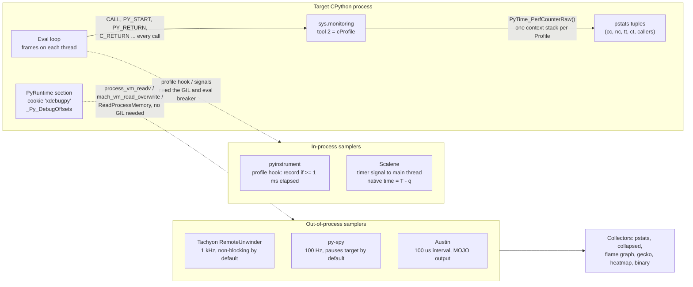

# Python cProfile, Tachyon, and Sampling Profilers

> [!summary] Claim:
> `cProfile` (named `profiling.tracing` since Python 3.15) is a deterministic profiler: since Python 3.12 it registers `sys.monitoring` callbacks as tool 2 for every call, Python start, resume, return, yield, and unwind, and every C return, reads a monotonic clock at each frame entry and exit, and so pays a fixed cost per call that inflates call-heavy code relative to loop-heavy code.
> Its counts are exact, but it keeps one context stack per profiler rather than per thread, so with several threads running its caller edges and times mix threads.
> A sampling profiler instead records whole stacks at intervals, so its cost is per sample, not per call, and a function's share of samples estimates its share of time with a binomial error of about `1.96 * sqrt(p(1-p)/n)`.
> Tachyon (`profiling.sampling`, new in 3.15) samples out of process: it finds the target's `PyRuntime` section, checks the `xdebugpy` cookie, reads `_Py_DebugOffsets`, and walks interpreter, thread, and frame structures with `process_vm_readv`, `mach_vm_read_overwrite`, or `ReadProcessMemory`, at 1 kHz by default and without pausing the target unless `--blocking` is given.
> py-spy and Austin use the same out-of-process idea, while pyinstrument and Scalene sample from inside the process, which is why they see the GIL, signals, and the eval loop's check points as part of what they measure.



## The Mechanism

A CPU profiler answers one question: of the time this program spent, how much belongs to each function, line, or call stack.
There are two ways to answer it, and they fail in opposite directions.
A tracing profiler observes every call and return, so its counts are exact, but the act of observing costs time per event, and that cost lands unevenly on the program.
A sampling profiler observes the stack at intervals, so its cost is independent of how many calls the program makes, but its answer is an estimate with a statistical error that shrinks only as the square root of the sample count.
Python 3.15 puts both in one package, `profiling`, with `profiling.tracing` and `profiling.sampling` as its two submodules (PEP 799, status Final, by Pablo Galindo Salgado and Laszlo Kiss Kollar).
The interpreter-level internals of Tachyon's frame walking (the frame cache, `last_profiled_frame`, code-object caching) and the `-X perf` trampolines belong to [[Python-CPython-perf-Trampoline-and-Tachyon-Internals]]; this note owns how the profilers work as tools, what their numbers mean, and how to choose between them.

### 1. The `profiling` package and the `profile` deprecation

PEP 799 was created on 2025-07-21, resolved on 2025-08-21, and targets Python 3.15.
It moves `cProfile` to `profiling.tracing`, adds the sampling profiler as `profiling.sampling`, and keeps `cProfile` as an alias; the `profiling.tracing` documentation says "The `cProfile` name will continue to work in all future Python versions."
The lab confirms the alias is the same class, not a wrapper: `profiling.tracing.Profile is cProfile.Profile` prints `True` on CPython 3.15.2.
The pure-Python `profile` module is deprecated: per PEP 799, importing it in 3.15 emits a `DeprecationWarning` (the lab checks it fires), every use warns in 3.16, and the module is removed in 3.17; What's New in 3.15 credits the deprecation to gh-138122.
"Tachyon" is the codename of the sampling profiler; PEP 799 rejected both a `profiling.tachyon` submodule and a top-level `tachyon` module, so the name describes the method, not the brand.
What's New in 3.15 credits Austin, py-spy, Pyflame, and rbspy as prior art, which is the lineage this note follows.

### 2. How `cProfile` measures

`cProfile` is the C extension `Modules/_lsprof.c`.
Before Python 3.12 it installed itself with `PyEval_SetProfile`, the C form of `sys.setprofile`.
gh-103533 (Tian Gao) moved it onto PEP 669's `sys.monitoring` API, and a direct check across interpreters shows the switch landed in 3.12: with a `cProfile.Profile` enabled, `sys.getprofile()` returns the profiler on 3.11.15 and `None` on 3.12.13, 3.13.18, 3.14.6, and 3.15.0b3, where `sys.monitoring.get_tool(2)` returns `'cProfile'` instead (one-off check on darwin-arm64 with uv-managed builds, as of 2026-11; the lab records only the 3.15 side).

The constructor is `Profile(timer=None, timeunit=0.0, subcalls=True, builtins=True)`.
In the 3.15 branch, `_lsprof_Profiler_enable_impl` calls `sys.monitoring.use_tool_id(PROFILER_ID, "cProfile")` (`PROFILER_ID` is 2), registers one bound method per event from a `callback_table`, and turns all of them on globally with `set_events`:

| `sys.monitoring` event | `_lsprof.c` callback | Meaning for the profile |
| :--- | :--- | :--- |
| `PY_START`, `PY_RESUME` | `_pystart_callback` | A Python frame begins or resumes; push a context, record `t0` |
| `PY_THROW` | `_pythrow_callback` | A generator or coroutine resumed with an exception |
| `PY_RETURN`, `PY_YIELD`, `PY_UNWIND` | `_pyreturn_callback` | The frame leaves; pop and charge time |
| `CALL` | `_ccall_callback` | Any call; the callback times it only if the callable resolves to a C function |
| `C_RETURN`, `C_RAISE` | `_creturn_callback` | The C call ends |

`sys.monitoring` defines `CALL` as "A call in Python code (event occurs before the call)", so it fires for Python callees too; `_ccall_callback` asks `get_cfunc_from_callable()` and does nothing when the callee is Python code.
A Python-to-Python call therefore dispatches three callbacks (`CALL`, `PY_START`, `PY_RETURN`), each a call into a Python-visible bound method, and reads the clock twice.
`builtins=False` only clears a flag the C callbacks test; the `CALL` event stays registered, so it removes the C-function entries from the report but not the per-call dispatch.
The callbacks always return `None`, never `sys.monitoring.DISABLE`, so no call site is ever de-instrumented while the profiler is on.
The callbacks are declared `@critical_section` in Argument Clinic, which on a free-threaded build serializes them on the profiler object.

`PY_YIELD` and `PY_RESUME` mean a generator or coroutine is charged only for time it is actually running, and each resume counts as a new call; the lab's coroutine that awaits ten times shows `ncalls 11`.

#### Threads: exact counts, shared context stack

`sys.monitoring` events are process-wide, so on 3.12 and later one enabled `Profile` also records calls made on other threads: the lab sees all 100 calls a worker thread makes.
On 3.11, whose `PyEval_SetProfile` hook is per thread, the same check records none of them (one-off check with uv-managed 3.11.15 through 3.15.0b3, darwin-arm64, as of 2026-11).
Recording other threads is not the same as attributing them correctly.
`ProfilerObject` holds a single `currentProfilerContext` pointer: `initContext()` pushes the new context on top of whatever context is current, whichever thread pushed it, and `ptrace_leave_call()` pops `pObj->currentProfilerContext` and charges it to the entry looked up from the returning function's key.
Nothing in either function is keyed by thread.
When two threads interleave, a function entered on thread B is recorded as a callee of whatever thread A had on top of the stack, and a return on one thread can close a context the other thread opened, so caller edges, `tottime`, and `cumtime` all mix threads.
Per-function call counts survive, because every entry and exit is still counted once.
The lab runs `worker_a` calling `leaf_a` and `worker_b` calling `leaf_b`, 20,000 times each, on two threads with a 0.5 ms switch interval: both counts come out exactly 20,000, and `leaf_b` is recorded with callers other than `worker_b`, its only real caller.
In a one-off run of the same workload on Homebrew 3.15.2, `leaf_b`'s recorded callers were `leaf_a`, `join`, `wait`, and `worker_b`, and `leaf_a` appeared to call itself, so the report also invented recursion (darwin-arm64, as of 2026-11; the lab prints only the derived True/False lines).
The rule: under threads, trust `cProfile`'s `ncalls`, distrust its callers and times, and profile one thread per `Profile` only when the others are idle.

#### The clock and the timer argument

Each frame entry and exit reads the clock.
With no custom timer, `call_timer()` calls `PyTime_PerfCounterRaw()`, the clock behind `time.perf_counter()`.
A custom timer is accepted as `Profile(timer, timeunit)`: `CallExternalTimer()` reads an integer count of `timeunit` seconds when `timeunit > 0`, and otherwise converts a float number of seconds with `_PyTime_FromSecondsObject`.
The `profiling.tracing` documentation lists `time.perf_counter()` for wall-clock time, `time.process_time()` for CPU time excluding sleep, and `time.monotonic()`.
While a custom timer runs, `activeTimers` is non-zero and every event is ignored ("Events raised by the external timer must be ignored"), so a Python timer does not profile itself, but it does add a Python call to every event, which makes the overhead problem worse.

#### Recursion accounting

Per function, `ProfilerEntry` keeps `tt` ("total time in this entry"), `it` ("inline time in this entry (not in subcalls)"), `callcount`, `recursivecallcount`, and `recursionLevel`; `ProfilerSubEntry` keeps the same per caller-callee edge.
On return, `Stop()` does:

```c
if (--entry->recursionLevel == 0)
    entry->tt += tt;
else
    ++entry->recursivecallcount;
entry->it += it;
entry->callcount++;
```

Cumulative time is added only when the outermost activation of a recursive function returns, so recursion is never double counted, and every activation counts toward the call total.
`pstats` turns these into the classic tuple `(cc, nc, tt, ct, callers)`: `cc` is primitive calls (calls not induced by recursion), `nc` all calls, `tt` the inline time (`tottime`), and `ct` the cumulative time (`cumtime`).
It prints `ncalls` as `nc/cc` when they differ; the 3.15 `profiling` page defines `3/1` as "three total calls, one primitive".
The lab profiles `fib(15)` and gets `1973/1`, which is exactly `2 * F(16) - 1` activations, and the same count on a second run: tracing counts are deterministic.
On `disable()`, `flush_unmatched()` stops every context still open, so functions that were running when profiling stopped are charged up to that instant rather than dropped.

#### Why tracing distorts the profile

`cProfile`'s cost is a fixed amount of work per call: three callback dispatches, two clock reads, a hash lookup of the entry for the code object, and a caller-edge update.
Code that does the same work in fewer calls pays less of it, so tracing does not just slow the program down, it changes the relative cost of functions.
The `profiling.tracing` documentation says it directly: latency between an event and the timestamp "can make them appear slower than they actually are", and this error "can become significant for functions called many times".
The lab calibrates two functions to take the same time unprofiled, `call_heavy` (300,000 calls to a one-line `add`) and `loop_heavy` (the same arithmetic inline, no calls), and on CPython 3.15.2 darwin-arm64 `cProfile` slows `call_heavy` by 2.5x to 6x and `loop_heavy` by under 1.5x, so it reports `call_heavy` as 65% to 90% of the time when the truth is 50%.
A sampler of the same run puts `call_heavy` at 35% to 65% and slows the run by under 1.5x.
pyinstrument's own documentation shows the same effect from the other side: 4,000 Django template renders that take 0.33 s run in 0.61 s under `cProfile` (84% overhead) and 6.79 s under the pure-Python `profile` (2057%).
The PEP 799 rationale summarizes it: tracing "introduces significant runtime overhead and can disable certain interpreter optimizations".

Two more consequences follow from the design:
- Only one tool can hold `sys.monitoring` tool 2, so a second `Profile().enable()` while one is active raises `ValueError: tool 2 is already in use` (lab section 1); you cannot nest `cProfile`, and any other tool that claims the profiler ID collides with it.
- Every call is counted, including calls too short for any sampler to see, which is the one job a sampler cannot do: proving that an optimization removed calls.

### 3. Sampling as statistics

A sampling profiler stops time at regular instants and asks what each thread is doing.
If a function is on top of the stack for a fraction `p` of the program's time and `n` samples are taken, the observed count `k` is approximately binomial, so the estimate `k / n` has standard error `sqrt(p(1-p)/n)`.
The lab prints the bands for the cases the Tachyon documentation discusses:

| Share `p` | Samples `n` | 95% band (1.96 SE) | 3 SE band |
| :--- | :--- | :--- | :--- |
| 5% | 1,000 | +/-1.35 points | +/-2.07 points |
| 5% | 100,000 | +/-0.14 points | +/-0.21 points |
| 50% | 1,000 | +/-3.10 points | +/-4.74 points |

The documentation's own example says a 5% function measured from 1,000 samples "could actually represent anywhere from 3% to 7% of real time"; that range matches the 3 SE band, and its "+/-0.5%" for 100,000 samples is more conservative than the formula.
The practical rules:
- At Tachyon's default 1 kHz, one second of runtime gives about 1,000 samples, which resolves 50% versus 45% but not 5% versus 6%; the documentation warns that scripts that "complete in under one second" may not yield enough samples and suggests `profiling.tracing` or a loop.
- Two runs of the same program differ by sampling noise alone; the documentation's example is a function at 12% in one run and 11% or 13% in the next.
- A function that always finishes between two samples can vanish entirely; sampling estimates time, never call counts.
- The independence assumption breaks when the program's own period matches the sampling period (a loop that does one unit of work every millisecond); there the samples are correlated and the error is larger than the formula says.
- The formula bounds sampling noise only; it says nothing about bias from the observer, which is what sections 2 and 9 are about.

Sampling cost is set by the rate and the stack depth, not by the program's call rate, which is why a sampler can run in production and a tracer usually cannot.

### 4. Tachyon: `profiling.sampling`

Tachyon is the sampling profiler that ships with CPython 3.15.
Its driver is pure Python (`Lib/profiling/sampling/`), and the memory reading is the C module `_remote_debugging` (`Modules/_remote_debugging/`).
What's New in 3.15 describes it as "virtually zero overhead" with "sampling rates of up to 1,000,000 Hz"; both are claims about the target when the profiler does not block it, and the profiler process itself still burns a CPU core in its spin loop, so read them as an upper bound on what is possible, not a default.

#### Subcommands

| Command | What it does |
| :--- | :--- |
| `python -m profiling.sampling run [-m] target [args]` | Starts the target as a child and samples it |
| `python -m profiling.sampling attach PID` | Samples an existing process |
| `python -m profiling.sampling dump PID` | Prints one stack snapshot of every thread (or every asyncio task with `--async-aware`), like a `py-spy dump` |
| `python -m profiling.sampling replay FILE` | Converts a `--binary` capture to any other format |
| `run --live` / `attach --live` | A curses TUI, top-like; not available on Windows; if the target exits with fewer than 200 samples (`MIN_SAMPLES_FOR_TUI`), it prints a message instead of the TUI |

`run` does not profile in-process.
`_run_with_sync()` binds a TCP socket on `127.0.0.1` with an OS-chosen port, starts `sys.executable -m profiling.sampling._sync_coordinator <port> <cwd> target...`, and waits up to 5 seconds (`_SYNC_TIMEOUT_SEC = 5.0`) for the child to send `b"ready"` before it starts sampling; the coordinator's own frames are filtered from the output (`_INTERNAL_FRAME_SUFFIXES`).
Because the target is a child, `run` is also the form that works on Linux under the default Yama `ptrace_scope` of 1, which restricts ptrace-mode access to descendants.
On Windows inside a virtual environment, `_resolve_python_pid()` replaces the PID of the `venvlauncher` with the PID of its single Python child, because the launcher is not the interpreter.

#### Finding the interpreter in another process

`RemoteUnwinder(pid)` locates the target's `_PyRuntime` structure without symbols (`Python/remote_debug.h`, `_Py_RemoteDebug_GetPyRuntimeAddress()`):
- On Linux, `search_linux_map_for_section()` walks `/proc/<pid>/maps`, takes each mapping whose file basename contains `python` (`strstr`), opens that ELF file, and looks up the `.PyRuntime` section; a read-write mapping whose path ends in ` (deleted)` (an interpreter upgraded under a running process) is scanned in memory for the cookie instead, and a deleted mapping without read-write permissions is skipped.
- On macOS, `search_map_for_section()` walks regions with `mach_vm_region()`, considers only regions that are both readable and executable, gets each region's file with `proc_regionfilename()`, and accepts it when the basename starts with (`strncmp`) `libpython`, `python`, or `Python`, tried in that order; it then parses the Mach-O, including fat binaries, and finds section `PyRuntime` in segment `__DATA`.
- On Windows it enumerates modules with `CreateToolhelp32Snapshot` and finds the PE section; PE section names are truncated to eight bytes, which is why the asyncio section is looked up there as `AsyncioD`.

Every candidate must start with `_Py_Debug_Cookie`, the 8 bytes `xdebugpy`.
The runtime begins with `struct _Py_DebugOffsets`: the cookie, `version` (`PY_VERSION_HEX`), a `free_threaded` flag, and the offsets of the fields a profiler needs in the runtime, interpreter, thread state, interpreter frame, code object, GC, and generator structures (thread-state fields include `holds_gil`, `gil_requested`, `current_frame`, and `native_thread_id`); the header says these sections exist so "out-of-process profilers can locate them easily".
The sections are emitted by `GENERATE_DEBUG_SECTION`, which expands to `__attribute__((section(SEG_DATA ",name")))` on Apple, a `.name` ELF section on Linux, and `__declspec(allocate)` on Windows.
That version field is why the documentation requires the profiler and target to run the same minor version (and the exact same version for pre-releases), and why a free-threaded profiler cannot attach to a GIL build or the reverse.

Memory is then read with:

| Platform | Read call (source) | Permission needed (documentation) |
| :--- | :--- | :--- |
| Linux | `process_vm_readv()`, falling back to `preadv()` on `/proc/<pid>/mem` when it fails with `ENOSYS` | root, `CAP_SYS_PTRACE`, or Yama `ptrace_scope` 0 (`run` works at the default 1) |
| macOS | `task_for_pid()` then `mach_vm_read_overwrite()` | root, the `com.apple.security.cs.debugger` entitlement, or SIP disabled |
| Windows | `OpenProcess()` then `ReadProcessMemory()` | administrator or `SeDebugPrivilege` |

The permission check on Linux is the ptrace access check: `process_vm_readv(2)` says access is "governed by a ptrace access mode PTRACE_MODE_ATTACH_REALCREDS check".
On macOS the source's own error message for a failed `task_for_pid()` names a different entitlement from the documentation: "This typically requires running as root or having the 'com.apple.system-task-ports' entitlement."
On macOS even a child of the profiler is off limits to an unprivileged user: the lab's `run` of a two-second child exits with status 1 and a permission error on darwin-arm64 as a normal user (as of 2026-11, macOS).
Reading one's own process needs no privilege on either OS, which is how the lab samples without `sudo`.

The building blocks arrived in steps, which matters when you read older tools: CPython 3.13 shipped the remote reader only as the test module `_testexternalinspection`, 3.14 renamed it `_remote_debugging` (it backs `python -m asyncio ps` and `pstree`, new in 3.14) and added `sys.remote_exec` (PEP 768), and 3.15 added `profiling.sampling` on top (module availability from a one-off check on uv-managed 3.12.13, 3.13.18, 3.14.6, and 3.15.0b3, darwin-arm64, as of 2026-11; not part of the lab's recorded output).

#### The sampling loop

`SampleProfiler.sample()` in `sample.py` is a timed loop in the profiler process:
- It keeps `next_time` on `time.perf_counter()`; when early, it sleeps 90% of the remaining gap if that is more than 100 microseconds (`sleep_time > 0.0001`) and otherwise spins.
- When late, it takes a sample immediately and advances `next_time` by one interval, so after a stall it catches up with back-to-back samples.
- A `ProcessLookupError` ends sampling (the target exited); `RuntimeError`, `UnicodeDecodeError`, `MemoryError`, and `OSError` count as failed samples (`collect_failed_sample()`), because a non-atomic read of a running process can catch structures mid-update.
- At the end it prints `Captured N samples in S seconds`, the sample rate, and the error rate, and warns about missed samples when the loop fell behind its expected count.

For aggregating collectors such as pstats, consecutive identical stacks are run-length batched (up to `MAX_PENDING_SAMPLES = 8192`) and handed over with their timestamps in one `collect()` call, so a program parked in one place costs almost nothing to record.
The unwinder is created with `cache_frames=True`, so frames unchanged since the previous sample are reused rather than re-read; how that cache works belongs to [[Python-CPython-perf-Trampoline-and-Tachyon-Internals]].

The default rate is 1 kHz (`-r 1khz`, parsed by `_parse_sampling_rate`, which accepts a number with an optional `hz`, `khz`, or `k` suffix, such as `10000`, `10khz`, or `10k`); the rate is converted to an integer interval in microseconds, and a rate above 1 MHz is rejected as "Sampling rate too high".

#### Non-blocking and `--blocking`

By default the target is not stopped: reads race with the running program, which is cheap but can produce a torn stack in code whose stack changes quickly (generators, coroutines).
`process_vm_readv(2)` is explicit that transfers are "not guaranteed to be atomic in any way".
`--blocking` wraps every read in `pause_threads()` and `resume_threads()`; in the 3.15 source (`Modules/_remote_debugging/threads.c`) that is:
- macOS: `task_suspend()` and `task_resume()` on the whole task (the CLI help says "thread_suspend"; the code calls `task_suspend`).
- Linux: `PTRACE_SEIZE` and `PTRACE_INTERRUPT` on each thread, falling back to `PTRACE_ATTACH` on kernels that reject `PTRACE_SEIZE` with `EINVAL` or `EIO`; threads that vanish (`ESRCH`) or refuse (`EPERM`) are skipped rather than retried.
- Windows: `NtSuspendProcess()`, looked up from `ntdll`.

So blocking mode on Linux is a real ptrace attach, with the same permission rules, and it stops the target for the duration of each read; the documentation recommends intervals of 1 ms or more, and the CLI warns when `--blocking` is combined with an interval under 100 microseconds.

#### Threads, modes, and the GIL

By default only the main thread of each interpreter is sampled; `-a` (`--all-threads`) samples all threads.
Each sampled thread carries status bits from `_remote_debugging`: `THREAD_STATUS_HAS_GIL` (1), `ON_CPU` (2), `UNKNOWN` (4), `GIL_REQUESTED` (8), `HAS_EXCEPTION` (16), and `MAIN_THREAD` (32), and the lab reads the same values from the 3.15.2 module.
How each bit is computed (`threads.c`, 3.15 branch):
- `HAS_GIL` is the target thread state's own `holds_gil` field, read through `_Py_DebugOffsets`; on a free-threaded build it is the thread's `active` (attached) status instead, and `GIL_REQUESTED` is never set.
- `GIL_REQUESTED` is the thread state's `gil_requested` field, set only when the thread does not hold the GIL.
- `HAS_EXCEPTION` is set when `current_exception` is non-null or any entry in the `exc_info` chain holds an exception, so code inside an `except` block counts, not only code that is unwinding.
- `ON_CPU` is computed only in `cpu` mode (and for Gecko, which records everything), because it costs a system call per thread per sample: on Linux it reads `/proc/<pid>/task/<tid>/stat` and treats state `R` as running, which includes threads that are runnable but waiting on a run queue; on macOS it calls `proc_pidinfo(PROC_PIDTHREADINFO)` and tests `TH_STATE_RUNNING`.

`--mode` selects which samples count, and the unwinder drops non-matching threads before it reads their frames (`skip_non_matching_threads`):

| Mode | Keeps a thread's sample when | Use it for |
| :--- | :--- | :--- |
| `wall` (default) | always, including sleep, I/O, and lock waits | latency: where does a request's elapsed time go |
| `cpu` | the thread is on a CPU core (`ON_CPU`) | throughput: what burns cycles |
| `gil` | the thread holds the GIL | which Python code serializes the others |
| `exception` | the thread has an active exception | the cost of exceptions used for control flow |

For every mode but `wall`, the CLI also sets `skip_idle` on the collector.
The flame graph sidebar reports GIL Held, GIL Released, Waiting GIL, and GC percentages, and `--gecko` output carries GIL, CPU, GC, and code-type markers for the Firefox Profiler; any `--mode` other than `wall` is rejected with `--gecko` because Gecko always records everything (`PROFILING_MODE_ALL`).
The documentation's own GIL example makes the difference concrete: a script that hashes with `hashlib.sha256` (which releases the GIL) and then runs pure-Python arithmetic shows `hash_work ~42%, python_work ~38%` in `cpu` mode and `hash_work ~5%, python_work ~60%` in `gil` mode.
Diagnosing GIL contention is then a comparison, not a guess: run the same workload in `wall`, `cpu`, and `gil` modes with `-a`; a thread whose wall profile is far larger than its CPU profile is waiting, and the Waiting GIL share says how much of that wait is for the GIL rather than for I/O.
[[Drill-Profiling-Python-C-Extension-GIL-and-Allocation-Bottleneck]] works through a C extension that forgets to release the GIL.

`--native` adds `<native>` frames where Python called into C, and `<GC>` frames appear during garbage collection unless `--no-gc` is given.
`--opcodes` records the bytecode instruction, including specialized forms from the adaptive interpreter, and the CLI accepts it only with `--live`, `--gecko`, `--flamegraph`, `--diff-flamegraph`, `--heatmap`, and `--binary`.

#### Async-aware stacks

When an asyncio task is suspended, its coroutine frames are not on any thread's stack, so a plain stack sample of a busy event loop shows the loop and the selector, not the code that is waiting.
The lab shows this: with three tasks parked in `asyncio.sleep`, the main thread's stack tops out at `KqueueSelector.select` and contains none of the user's coroutines.
`--async-aware` switches the unwinder to `get_async_stack_trace()` (default `--async-mode running`, only the task currently running) or `get_all_awaited_by()` (`--async-mode all`, every task including waiting ones; the default for `dump`).
`iter_async_frames()` in `collector.py` then rebuilds a linear stack per leaf task: a leaf is a task that no other task awaits, each task's coroutine frames are followed by a synthetic `<task>` frame with the task's name, and the walk follows `awaited_by` to the parent; when a task has several awaiters, it picks the smallest parent ID and labels the frame `name (N parents)`.
The CLI rejects `--async-aware` together with `--native`, `--no-gc`, `--all-threads`, `--binary`, or any mode but `wall` ("Async-aware profiling uses task-based stack reconstruction"), and `--async-mode` without `--async-aware`.

The task graph is read from a second debug section, `AsyncioDebug`, which `Modules/_asynciomodule.c` emits with `GENERATE_DEBUG_SECTION(AsyncioDebug, Py_AsyncioModuleDebugOffsets _Py_AsyncioDebug)`.
`ensure_async_debug_offsets()` retries the lookup on each call, because the target may import asyncio after the profiler attached, and on failure raises `RuntimeError: AsyncioDebug section not available`.
On macOS, `_Py_RemoteDebug_GetAsyncioDebugAddress()` in `Modules/_remote_debugging/asyncio.c` tries only images whose basename starts with `libpython` or `python`, not the third candidate, `Python`, that the `PyRuntime` lookup also tries.
A macOS framework build, which is how Homebrew ships CPython, links the interpreter as `Python.framework/Versions/3.15/Python`; `otool -l` on that image in Homebrew 3.15.2 shows both `PyRuntime` and `AsyncioDebug` sections in `__DATA`, so the section exists and only the name filter misses it.
The lab records the result: `get_all_awaited_by()` raises `RuntimeError: AsyncioDebug section not available` on Homebrew CPython 3.15.2, which reports `PYTHONFRAMEWORK` as `'Python'` (as of 2026-11, macOS).
A one-off check with the same probe on a uv-managed python-build-standalone 3.15.0b3, whose `bin/python3.15` is a statically linked executable with a basename starting with `python`, returned the task graph; the same `asyncio.c` lookup is unchanged on CPython `main` as fetched on 2026-11-15.
The practical consequence: on macOS, `--async-aware` against a framework-build target (Homebrew, the python.org installer) fails; on Linux, whose lookup accepts any basename containing `python`, the issue does not arise.

For latency inside an event loop, pair the sampler with asyncio's own debug mode (`PYTHONASYNCIODEBUG=1`, Python Development Mode, `asyncio.run(..., debug=True)`, or `loop.set_debug(True)`), which logs any callback that runs longer than `loop.slow_callback_duration`, 100 milliseconds by default: the debug log says which step blocked the loop, and an `--async-aware` profile says what that step was doing.

#### Output formats

| Flag | Collector | Output |
| :--- | :--- | :--- |
| `--pstats` (default) | `PstatsCollector` | Table on stdout; with `-o`, a marshal file `pstats` can load |
| `--collapsed` | `CollapsedStackCollector` | One `tid:N;file:func:line;... count` line per stack, for `flamegraph.pl` or speedscope |
| `--flamegraph` | `FlamegraphCollector` | Self-contained HTML (D3.js) |
| `--diff-flamegraph BASELINE` | `DiffFlamegraphCollector` | HTML coloring changes against a `--binary` baseline |
| `--gecko` | `GeckoCollector` | Firefox Profiler JSON |
| `--heatmap` | `HeatmapCollector` | Directory of per-file HTML with line counts |
| `--jsonl` | `JsonlCollector` | Newline-delimited JSON |
| `--binary` | `BinaryCollector` | Compact file with a 64-byte header (`_BINARY_PROFILE_HEADER_SIZE`; the CLI recognizes magics `HCAT` and `TACH`), compression `auto`, `zstd`, or `none`; convert with `replay` |

The pstats collector is where most misreadings start.
`create_stats()` sets `tottime = direct_samples * interval` and `cumtime = cumulative_samples * interval`, which the lab checks for every row; the times are sample counts scaled by the nominal interval, not measured durations, so a profile that missed 20% of its samples also under-reports time by 20%.
A frame's cumulative count is incremented once per sample per `(filename, line, function)` location (`_seen_locations`), so a recursive function that appears many times in one stack still adds one cumulative sample.
The "calls" columns are sample counts too, and the file carries a `("__sampled__",)` marker so `pstats.Stats` switches to `SampledStats`, whose header reads `nsamples tottime persample cumtime persample`.
Rows are keyed by `(filename, sampled line, function)`, not by the function's `def` line as in `cProfile`: the lab's `two_line_work`, which has two loops, appears as two Tachyon rows (`def + 3` and `def + 5`) and one `cProfile` row.
Sort with `--sort nsamples` (default), `tottime`, `cumtime`, `sample-pct`, `cumul-pct`, `nsamples-cumul`, or `name`, and cut with `-l` (default 15 rows).

`--subprocesses` starts a profiler per child Python process, found by periodically scanning for new descendants, each with its own output file named from the parent's output path plus the child's PID (for example `profile_12345.html`); the documentation caps this at 100 concurrent profilers and rejects it with `--live`.

### 5. py-spy

py-spy is a Rust program by Ben Frederickson and the tool that made out-of-process Python sampling common; Tachyon follows its design.
Per its README it reads memory with `process_vm_readv` on Linux, `vm_read` on macOS, and `ReadProcessMemory` on Windows, finds the interpreter from the global `PyInterpreterState`, and on binaries without symbols scans the BSS section for "addresses that look like they may point to a valid PyInterpreterState".
Because the Python ABI changes between versions, it generates Rust structures for each interpreter version with bindgen, so one py-spy binary profiles CPython 2.3 to 2.7 and 3.3 to 3.15 per the README (as of 2026-11, Both); Tachyon instead reads the layout the target publishes and so works only within one minor version.
The defaults of v0.4.3, the current PyPI release (`py-spy record --help`, as of 2026-11, macOS), differ from Tachyon's in two ways that matter:
- `-r, --rate` defaults to 100 samples per second, a tenth of Tachyon's default.
- py-spy pauses the target for each sample unless `--nonblocking` is given ("Setting this option will reduce the performance impact of sampling, but may lead to inaccurate results"); Tachyon is non-blocking unless `--blocking` is given.

Its subcommands are `record` (formats `flamegraph`, `raw`, `speedscope`, `chrometrace`), `top`, and `dump` (with `-l, --locals` to show local variables); `--gil` keeps only samples that hold the GIL, `-i, --idle` keeps idle threads, `-s, --subprocesses` follows children, and `-F, --function` aggregates by a function's first line instead of the current line.
`--native` unwinds C, C++, and Cython frames only where the README's support table says yes: Linux on x86-64, ARM, and Aarch64, and Windows on x86-64; the macOS build of v0.4.3 does not offer the flag (as of 2026-11, macOS).
The README warns that `--gil` "will miss activity in extensions that release the GIL while still active", and that resolving the GIL holder needs symbols that some distributions strip.
On macOS it "always requires running as root", and SIP blocks it from the system `/usr/bin/python3` even as root; in Docker and Kubernetes it needs `SYS_PTRACE` (as of 2026-11, Both).

### 6. Austin

Austin, by Gabriele N. Tornetta, is a Python frame stack sampler for CPython written in pure C, with "Zero instrumentation" and no dependencies beyond the C library.
The austin 3.7.0 manual page (Debian trixie) lists a default interval of 100 microseconds (`-i`, units `s`, `ms`, or `us`), `-s, --sleepless` to suppress idle samples and estimate CPU time, `-m, --memory` for memory profiling, `-f, --full` for time and memory together, `-C, --children`, `-x, --exposure` to sample for a fixed number of seconds, `-w, --where PID` to dump stacks, `-g, --gc` to sample GC state, and `-b, --binary` for its compact MOJO format.
Austin prints raw samples and leaves aggregation to other tools: the `austin-python` package, the VS Code extension, FlameGraph, or Speedscope.
Debian sid carries Austin 4.1.0 and PyPI's `austin-dist` is at 4.1.0 (as of 2026-11, Both); supported Python versions per release are listed on the project's compatibility page.

### 7. pyinstrument

pyinstrument, by Joe Rickerby, samples from inside the process.
Its C extension installs a profile function through `PyEval_SetProfile`, but takes a reading only when at least `interval` seconds have passed since the last one; `Profiler(interval=0.001, async_mode="enabled", use_timing_thread=None)` is the signature in 5.1.3, the current PyPI release (as of 2026-11, Both).
So it still runs a cheap check on every call and return event, but it records a stack about once per millisecond, which is why its benchmark shows 30% overhead against 84% for `cProfile`.
A long-running C call produces no events until it returns, so its samples are "bunched up" and recorded at the end of the call, attributed correctly but timed coarsely.
The timer is selectable in `stack_sampler.py`: `walltime`, `walltime_coarse` when the coarse clock's resolution is at most the interval, `walltime_thread` when `use_timing_thread=True` (a background thread keeps time, for systems where reading the clock is slow), or a custom `timer_func`.
Its async support is its distinguishing feature: the profiler binds to a `contextvars` context, and when the context exits on an `await`, the time until it resumes is attributed to that `await`, so an async request profile shows where the request waited, not just where the loop spent CPU; `async_mode="strict"` puts time spent outside the context in an `<out-of-context>` frame, which also makes it usable with greenlets.

### 8. Scalene

Scalene, from Emery Berger's PLASMA lab at UMass Amherst, combines CPU, memory, and GPU profiling and was published at OSDI 2023 ("Triangulating Python Performance Issues with Scalene").
Its CPU profiler turns a CPython limitation into a measurement.
CPython delivers signals only to the main thread, and only when the eval loop regains control; during a long C call no timer signal is handled.
Scalene asks for a CPU timer signal every `q` seconds of virtual time (measured with `time.process_time()`); when the handler finally runs after elapsed virtual time `T`, it credits `q` to Python time and `T - q` to native time for the current line.
For other threads, which never receive signals, it monkey-patches blocking calls such as `threading.join` to use timeouts equal to `sys.getswitchinterval()`, so the main thread wakes regularly, marks threads blocked in those calls as sleeping, and then walks every running thread with `sys._current_frames()`, using bytecode disassembly to classify a thread stopped at a call into native code.
Its memory profiler interposes on the allocator and uses threshold-based sampling: a sample is taken when the absolute difference between bytes allocated and freed crosses a prime threshold "slightly above 10MB", which records footprint changes rather than allocation rate.
The paper's evaluation summary reports median overhead of 2% for CPU and GPU profiling and 30% for full functionality on the ten longest-running pyperformance benchmarks under CPython 3.10.9 (its introduction states 0% and 32%), and the README says overhead is "typically no more than 10-20% (and often less)".
The current CLI is `scalene run prog.py`, with `--cpu-only` to skip memory and GPU, `--use-virtual-time` to count only CPU time, and async profiling on by default (`--no-async` turns it off), which per the README attributes wall-clock `await` time to the suspending line using `sys.monitoring` callbacks.
The local install is Scalene 2.3.0, and PyPI's latest is 2.4.0, released 2026-10-23 (as of 2026-11, Both).
[[Python-Memory-Profiling-Memray-and-Line-Profiler]] owns allocator-level memory profiling.

### 9. In-process versus out-of-process: what the GIL does to the observer

An in-process sampler is a thread or a signal handler, and in a GIL build both need the GIL to run Python code.
The lab demonstrates both effects with Tachyon's own `RemoteUnwinder` pointed at its own PID, which needs no privilege:
- The sampler thread asked for 1,000 samples per second and got under 400, because each time it wakes from `sleep` it must wait for the main thread to drop the GIL at a check point, which the main thread does after `sys.getswitchinterval()`, 5 ms by default.
- The main thread had `THREAD_STATUS_HAS_GIL` in 0 of its samples, because the sampler holds the GIL while it reads; an in-process sampler can never see the sampled thread holding the GIL, and every sample lands at a point where the eval loop chose to release it.

An out-of-process sampler needs no GIL and no cooperation, samples at its own rate, and sees the true GIL state, which is why Tachyon's `gil` mode is meaningful and an in-process equivalent would not be.
The price is privilege (root or a capability) and an exact-version dependency on the target's structure layout.

## Commands and Numbers to Know

| Item | Value | Platform and date | Notes |
| :--- | :--- | :--- | :--- |
| `python -m profiling.tracing [-o out] [-s key] (-m mod \| script)` | `-s` only without `-o` | Both (as of 2026-11) | Same CLI as `python -m cProfile` |
| `cProfile.Profile` signature | `(timer=None, timeunit=0.0, subcalls=True, builtins=True)` | Both (as of 2026-11) | `builtins=False` keeps the `CALL` event registered |
| `cProfile` hook | `sys.monitoring` tool 2 (`PROFILER_ID`) since 3.12 | Both (as of 2026-11) | Second enable: `ValueError: tool 2 is already in use` |
| `cProfile` events per Python call | 3 callbacks (`CALL`, `PY_START`, `PY_RETURN`), 2 clock reads | Both (as of 2026-11) | Never returns `DISABLE` |
| `cProfile` default timer | `PyTime_PerfCounterRaw()` | Both (as of 2026-11) | Wall clock; pass `time.process_time` for CPU time |
| `cProfile` and threads | one context stack per `Profile` | Both (3.12 and later, as of 2026-11) | Counts exact, callers and times mixed |
| `pstats` tuple | `(cc, nc, tt, ct, callers)` | Both (as of 2026-11) | `ncalls` printed `nc/cc` under recursion |
| `profile` module | deprecated 3.15, removed 3.17 | Both (as of 2026-11) | Import warns in 3.15, every use in 3.16 |
| Tachyon rate | `-r 1khz` (1,000 Hz) | Both (as of 2026-11) | Suffix `hz`, `khz`, or `k`; above 1 MHz rejected |
| Tachyon sleep/spin threshold | sleep 90% of gap if > 100 us, else spin | Both (as of 2026-11) | `sample.py` |
| Tachyon threads | main thread; `-a` for all | Both (as of 2026-11) | |
| Tachyon modes | `wall` (default), `cpu`, `gil`, `exception` | Both (as of 2026-11) | Gecko always records all |
| Tachyon thread status bits | `HAS_GIL` 1, `ON_CPU` 2, `UNKNOWN` 4, `GIL_REQUESTED` 8, `HAS_EXCEPTION` 16, `MAIN_THREAD` 32 | Both (as of 2026-11) | `ON_CPU` computed only in `cpu` mode |
| Tachyon blocking | off; `--blocking` pauses the target per read | Both (as of 2026-11) | `task_suspend` (macOS), `PTRACE_SEIZE` + `PTRACE_INTERRUPT` (Linux), `NtSuspendProcess` (Windows) |
| Tachyon `run` sync timeout | 5 s | Both (as of 2026-11) | Child must send `ready` |
| Tachyon pstats rows | `-l 15`, `--sort nsamples` | Both (as of 2026-11) | Rows keyed by sampled line |
| Tachyon RLE batch | 8,192 identical samples | Both (as of 2026-11) | `MAX_PENDING_SAMPLES` |
| Tachyon binary header | 64 bytes, magic `TACH` or `HCAT` | Both (as of 2026-11) | Compression `auto`, `zstd`, `none` |
| Tachyon live TUI | at least 60 x 12 terminal; 200-sample minimum | Linux, macOS (as of 2026-11) | Not on Windows |
| Tachyon `--subprocesses` | up to 100 profilers | Both (as of 2026-11) | Incompatible with `--live` |
| Version rule | profiler and target same minor version | Both (as of 2026-11) | Exact version for pre-releases; FT and GIL builds do not mix |
| Debug cookie | `xdebugpy` (8 bytes) at the start of `_Py_DebugOffsets` | Both (as of 2026-11) | Section `PyRuntime`; asyncio section `AsyncioDebug` |
| Linux permission | root, `CAP_SYS_PTRACE`, or `kernel.yama.ptrace_scope=0` | Linux (as of 2026-11) | Default scope 1 allows descendants only |
| macOS permission | root, `com.apple.security.cs.debugger`, or SIP off | macOS (as of 2026-11) | Applies to `run` children too |
| macOS `--async-aware` | fails against framework builds | macOS (as of 2026-11) | Lookup tries `libpython*`, `python*` only |
| py-spy rate | `-r 100` | Both (as of 2026-11, v0.4.3) | Pauses target unless `--nonblocking` |
| py-spy formats | `flamegraph`, `raw`, `speedscope`, `chrometrace` | Both (as of 2026-11, v0.4.3) | `--native` not on macOS |
| Austin interval | `-i 100` us | Both (as of 2026-11, 3.7.0 man page) | `-s` CPU only, `-m` memory, `-b` MOJO |
| pyinstrument interval | `0.001` s | Both (as of 2026-11, 5.1.3) | `async_mode="enabled"` |
| Scalene memory threshold | prime slightly above 10 MB | Both (OSDI 2023 paper) | Footprint change, not allocation rate |
| GIL switch interval | `sys.getswitchinterval()` = 0.005 s | Both (as of 2026-11) | Bounds in-process samplers |
| asyncio slow callback | `loop.slow_callback_duration` = 0.1 s | Both (as of 2026-11) | Logged only in debug mode |
| Sample error | `1.96 * sqrt(p(1-p)/n)` | Both | 5% at n=1,000: +/-1.35 points |

## Multi-Language Comparison: C++ / Python / Rust

| Concern | C++ | Python | Rust |
| :--- | :--- | :--- | :--- |
| Deterministic tracing | `-finstrument-functions`, Callgrind (exact counts under emulation) | `cProfile` / `profiling.tracing` on `sys.monitoring` | `-Z instrument-mcount` (nightly), Callgrind |
| Statistical sampling | `perf record`, samply, Instruments | Tachyon, py-spy, Austin (out of process); pyinstrument, Scalene (in process) | `perf record`, samply, cargo flamegraph |
| What a sample reads | Machine stack via frame pointers, DWARF CFI, or LBR | Interpreter frame structures through `_Py_DebugOffsets`, not the machine stack | Machine stack, as in C++ |
| Symbols come from | ELF symbol tables and DWARF | Code objects' `co_qualname`, `co_filename`, and line tables | ELF and DWARF, with demangling |
| Rate control | `perf record -F`, samply `--rate` | Tachyon `-r` (1 kHz default), py-spy `-r` (100 default) | Same as the native tool |
| Runtime lock in the profile | None | GIL state per thread (`gil` mode, `--gil`) | None |
| Owning notes | [[Cpp-CPU-Profiling-perf-samply-Callgrind-and-llvm-mca\|C++ CPU profiling]] | this note | [[Rust-CPU-Profiling-cargo-flamegraph-samply-and-Frame-Pointers\|Rust CPU profiling]] |

A native profiler sees `_PyEval_EvalFrameDefault` where Python code runs; [[Python-CPython-perf-Trampoline-and-Tachyon-Internals]] covers `-X perf` and `-X perf_jit`, which give `perf` Python names, and [[Linux-perf-in-Depth-and-perf-c2c]] owns `perf` itself.

## Worked Lab Example

The lab is `code/05-Profiling/tachyon_sampling/`; it needs only `python3`, and the Tachyon sections need Python 3.15.
It runs without sudo: the sampler sections point Tachyon's `_remote_debugging.RemoteUnwinder` at the lab's own process, which macOS and Linux allow without privilege, and feed the samples into Tachyon's real `PstatsCollector` and `CollapsedStackCollector`.
Every printed value is a count, a pass/fail property, or a bucketed ratio, and every unprofiled and `cProfile` timing is a median of five runs; the sampler pass is a single 100-round run whose ratios are bucketed, so the output is stable across runs on an unloaded host.

```bash
cd code/05-Profiling/tachyon_sampling
bash run.sh                      # or PYTHON=/path/to/python3.15 bash run.sh
```

What each section does:
1. Enables a `cProfile.Profile` and reads `sys.monitoring.get_tool(2)` and `sys.getprofile()`, tries a second `enable()`, and imports `profile` with warnings recorded.
2. Profiles `fib(15)`, 1,000 calls to `add`, a coroutine with ten awaits, and a worker thread, reads the raw `pstats` tuples, then runs two interleaving threads with a 0.5 ms switch interval and checks their counts and caller edges.
3. Calibrates `call_heavy` and `loop_heavy` to equal unprofiled time, profiles both with `cProfile`, and samples 100 rounds of both with a 1 kHz in-process sampler.
4. Feeds those samples, plus a run of `two_line_work`, into Tachyon's collectors and checks the time formula, the row keys, and the collapsed format.
5. Reads the main thread's GIL status bits from the same samples.
6. Parks three asyncio tasks and takes a plain stack and a task-graph snapshot; when the task graph is unavailable, it reports whether the interpreter is a framework build.
7. Runs `python -m profiling.sampling run -d 2` on `target.py`, a real out-of-process attach.
8. Prints the binomial error bands.

### Verified output

Recorded with `python3 -m _harness.verify --record 05-Profiling/tachyon_sampling/` on darwin-arm64 (CPython 3.15.2 from Homebrew, non-root) on 2026-11-15; the file is `code/05-Profiling/tachyon_sampling/expected/darwin-arm64.txt`.

```text

[1 tracing hook]
  interpreter: CPython 3.15 (GIL build)
  profiling.tracing.Profile is cProfile.Profile: True
  sys.monitoring tool 2 while enabled: 'cProfile'
  sys.setprofile hook while enabled: NoneType
  second Profile().enable() while one is active: ValueError: tool 2 is already in use
  import profile raises DeprecationWarning: True

[2 exact counts]
  fib(15): ncalls 1973/1 (total/primitive); 2*F(16)-1 = 1973
  add called 1000 times, all from call_heavy: ['call_heavy']
  re-running gives identical counts: True
  coroutine with 10 awaits: ncalls 11 (first start + one per PY_RESUME)
  calls made by another thread recorded: 1 worker, 100 add
  two threads interleaving: ncalls leaf_a and leaf_b exact (20000 each): True
  leaf_b recorded with callers other than worker_b (its only real caller): True

[3 observer effect]
  calibrated: call_heavy and loop_heavy take equal time unprofiled (ratio 0.67 to 1.5)
  cProfile slowdown, call_heavy (300000 calls to add): 2.5 to 6.0x
  cProfile slowdown, loop_heavy (no calls):        < 1.5x
  cProfile cumtime share of call_heavy (truth 50%): 65 to 90%
  sampler share of call_heavy (truth 50%):          35 to 65%
  sampler slowdown of the whole run:                < 1.5x
  samples in window: >= 200; requested 1000 Hz, achieved < 400 Hz

[4 Tachyon collectors]
  every row: tottime == direct samples * interval and cumtime == cumulative samples * interval: True
  Tachyon pstats rows for two_line_work: 2, keyed by sampled line (def + [3, 5])
  cProfile rows for two_line_work: 1, keyed by the def line (def + 0)
  collapsed lines all match 'tid:N;file:func:line;... count': True
  stack through add: tid:<TID>;lab.py:<module>:506;lab.py:main:497;lab.py:section_observer_effect:316;lab.py:call_heavy:62;lab.py:add:55 <COUNT>

[5 in-process GIL view]
  main thread had THREAD_STATUS_HAS_GIL in 0 samples (the sampler held it every time)
  main thread had THREAD_STATUS_GIL_REQUESTED in some samples: True
  sampler holds GIL during its own read: True

[6 async-aware stacks]
  plain thread stack top frame: KqueueSelector.select; user coroutine frames in it: 0
  task graph: unavailable on this build (RuntimeError: AsyncioDebug section not available)
  framework build, interpreter image basename 'Python': True

[7 out-of-process attach]
  profiling.sampling run as uid non-root: denied, exit status 1
  reason: reading another task's memory (task_for_pid / ptrace access mode) needs privilege

[8 samples needed]
  p=0.05 n=   1000: 1.96*SE = +/-1.35 points, 3*SE = +/-2.07 points
  p=0.05 n= 100000: 1.96*SE = +/-0.14 points, 3*SE = +/-0.21 points
  p=0.50 n=   1000: 1.96*SE = +/-3.10 points, 3*SE = +/-4.74 points
```

### Reading the result

- Section 1 is the version boundary in one place: on 3.15 `cProfile` is `profiling.tracing`, it lives on `sys.monitoring`, not `sys.setprofile`, and it is exclusive.
- Section 2 shows what only tracing gives you: 1,973 activations of `fib`, one of them primitive, an exact caller edge for `add`, one call per coroutine resume, and the calls of a thread that never enabled the profiler; its last two lines show the limit, exact counts with caller edges that cross threads.
- Section 3 is the core lesson, equal work and unequal blame: `cProfile` charges per call, so the call-heavy half looks like most of the program; the sampler, whose cost does not depend on call count, recovers the 50/50 split.
- Section 4 shows Tachyon's pstats are counts times an interval, and that a function with two hot lines shows up twice.
- Section 5 is why the real Tachyon samples from another process: in-process, the sampler reached under 400 Hz of the 1,000 Hz it asked for and never saw the main thread holding the GIL.
- Section 6 shows why `--async-aware` exists, and that on a macOS framework build the task graph is out of reach; section 7 shows the price of out-of-process sampling on macOS: privilege, even for a child.
- Run as root on macOS, or on Linux where `run` samples its own child, section 7 instead reports a sampled child with `busy` in the top rows; that branch was not recorded here.

## Pitfalls

> [!warning] Pitfall: optimizing what `cProfile` blames
> `cProfile` adds a fixed cost per call, so small, frequently called functions look worse than they are and inline loops look better.
> Before refactoring a hot helper found with `cProfile`, confirm the ranking with a sampler; the lab's call-heavy function took 50% of the time and `cProfile` reported 65% to 90%.

> [!warning] Pitfall: reading `cProfile` callers in a threaded program
> On 3.12 and later one `Profile` sees every thread but keeps one context stack, so a function called on one thread is recorded as a callee of whatever another thread was running.
> The lab's `leaf_b`, called only by `worker_b`, was recorded with other callers while its count stayed exact; trust `ncalls`, and use Tachyon with `-a` for per-thread stacks and times.

> [!warning] Pitfall: reading Tachyon's `tottime` as a measurement
> Tachyon's `tottime` and `cumtime` are sample counts multiplied by the nominal interval.
> If the profiler missed samples (the missed-samples warning) or was rate-limited, the times are too small by the same fraction; compare percentages, and check the sample rate and error rate before trusting absolute seconds.

> [!warning] Pitfall: summing Tachyon pstats rows by function
> Rows are keyed by the sampled line, so one function can appear several times, and a row's "calls" column is a sample count.
> Group by `(filename, funcname)` yourself, or use the flame graph or `--heatmap`, which are built for line-level data.

> [!warning] Pitfall: profiling a script that finishes in under a second
> At 1 kHz a 300 ms script yields about 300 samples, enough to see a 50% hotspot and not enough to rank three 5% functions.
> Loop the workload, raise the rate, or use `cProfile` when you need exact counts for a short run.

> [!warning] Pitfall: a wall-clock profile of an idle server
> `wall` mode, Tachyon's default, counts a thread blocked in `select`, `recv`, or a lock exactly like a thread doing work.
> For "what burns CPU" use `--mode cpu`; for "why is this request slow" stay in `wall` and read the waits.
> On Linux, `cpu` mode's `ON_CPU` means state `R` in `/proc/<pid>/task/<tid>/stat`, which also includes runnable threads waiting for a core, so an oversubscribed host inflates it.

> [!warning] Pitfall: a version mismatch between profiler and target
> Tachyon reads `_Py_DebugOffsets` from the target, and the documentation requires the same minor version on both sides, and the exact version for pre-releases; free-threaded and GIL builds cannot attach to each other.
> Run Tachyon with the target's own interpreter, for example `/proc/<pid>/exe -m profiling.sampling attach <pid>` on Linux.

> [!warning] Pitfall: sampling an event loop without `--async-aware`
> Suspended coroutines are not on the thread stack, so a busy loop's profile shows `select` and `_run_once`, as the lab's plain snapshot did.
> Use `--async-aware` for task-level stacks, and asyncio debug mode's slow-callback log to find the step that blocked the loop.
> On macOS, a framework-build target (Homebrew, the python.org installer) fails with `AsyncioDebug section not available` because of the image-name filter; profile async code on Linux, or against a non-framework build.

> [!warning] Pitfall: trusting a non-blocking stack in generator-heavy code
> Tachyon and `py-spy --nonblocking` read memory while the target runs, and `process_vm_readv(2)` says transfers are "not guaranteed to be atomic in any way".
> A stack that looks impossible may be torn; repeat with `--blocking` at 1 ms or slower before acting on it, remembering that on Linux blocking mode is a ptrace attach per thread.

> [!warning] Pitfall: two profilers at once
> `cProfile` holds `sys.monitoring` tool 2, so a second `cProfile` raises `ValueError`, and other tools that want the profiler ID will also fail.
> Out-of-process samplers do not conflict with it, but they will faithfully record `cProfile`'s own overhead.

## At Scale

For one developer the choice is simple: `cProfile` for exact counts on a short, reproducible, single-threaded run, and Tachyon (or py-spy before 3.15) for everything else.
At 1,000 to 50,000 engineers the questions become privilege, version skew, and data volume.

- **Privilege is the gate:** Out-of-process sampling needs `CAP_SYS_PTRACE` or a relaxed `ptrace_scope` on Linux and root or a debugger entitlement on macOS; on shared hosts that is a security review, not a flag.
  Decide once, in a policy record ([[Profiling-Decision-Records]]): which roles may attach, through which wrapper, and with which audit log.
  `run` under the default Yama scope 1 needs no privilege on Linux, so CI profiling there can use it freely.
- **Version skew is the second gate:** Tachyon must match the target's minor version, so a fleet on 3.12, 3.13, and 3.15 needs a profiler per version or py-spy, which carries layouts for many versions.
  Ship the profiler with the interpreter image, not as a separate tool.
- **Build flavor is a third:** framework builds on macOS lose `--async-aware`, and free-threaded and GIL builds need their own profiler; record which build each service image uses.
- **Rate is a budget:** Tachyon's documentation notes that "The profiler itself consumes some CPU on the machine where it runs", and its loop spins for the last 100 microseconds before each sample; py-spy defaults to 100 Hz.
  For always-on fleet profiling use a continuous profiler that aggregates centrally ([[Continuous-Profiling-GWP-Parca-Pyroscope-and-OTel-Profiles]]), and keep Tachyon for targeted 30 to 60 second captures.
- **Store binaries, render later:** `--binary` captures are compact and `replay` turns them into any format; `--diff-flamegraph` against a stored baseline is the regression check for a performance-sensitive service.
- **Tracing belongs in tests, not production:** Use `cProfile` call counts as assertions ("this endpoint makes at most N database calls") in CI, where its overhead does not matter and its determinism does; run those checks single-threaded, because counts survive threads but caller edges do not.
- **Decision rules:** exact counts or a short CI run, `cProfile`; latency of a live process, Tachyon `attach` in `wall` mode with `-a`; CPU cost, `--mode cpu`; GIL contention, compare `wall`, `cpu`, and `gil`; asyncio, `--async-aware` plus asyncio debug mode; Python-versus-native split and memory together, Scalene; native frames from a C extension on many Python versions on Linux, `py-spy --native`; whole-system views with kernel frames, [[Linux-perf-in-Depth-and-perf-c2c]] with `-X perf`.

## Practice Drill

> [!tip] Practice Drill:
> Write a script with three threads: one doing pure-Python arithmetic, one calling `hashlib.sha256` on 64 MiB buffers in a loop (which releases the GIL for large inputs), and one sleeping in `time.sleep(0.01)`.
> Predict, before running, how each thread's share changes between `--mode wall`, `--mode cpu`, and `--mode gil` with `-a`.
> Then run `sudo -E python3 -m profiling.sampling run -a --mode gil --flamegraph -o gil.html drill.py` (and the other modes) on macOS, or without `sudo` on Linux, and compare the GIL Held and Waiting GIL percentages in the sidebar.
> Finally run the same script under `cProfile`, print `pstats.Stats(...).print_callers("sha256")`, and explain why some of its callers are functions that never call it (hint: one context stack per `Profile`, shared by all three threads).
> To build the sampler yourself, continue with [[Rebuild-Lab-Sampling-Profiler-to-Folded-Stacks]].

## Interview Questions

> [!question] L5: What is the difference between `tottime` and `cumtime`, and what does `ncalls 3/1` mean?
>
> > [!success]- Answer
> > `tottime` is time spent in the function's own code, excluding the functions it called; `cumtime` includes the whole subtree.
> > `3/1` means three total calls and one primitive call, so the function was entered once from outside and recursed twice.
> > `cProfile` adds cumulative time only when the outermost activation returns, so recursion is not double counted in `cumtime`.
> > In Tachyon's pstats output the same columns are sample counts times the interval, and the count column is samples, not calls.

> [!question] L5: Why is a sampling profiler usually safe to run in production when `cProfile` is not?
>
> > [!success]- Answer
> > `cProfile` dispatches three callbacks and reads the clock twice on every Python call, so its cost grows with the program's call rate and can multiply the runtime of call-heavy code.
> > A sampler's cost depends on its own rate and the stack depth, so at 100 Hz to 1 kHz it is bounded no matter what the program does.
> > Out-of-process samplers such as Tachyon and py-spy also need no code change or restart and run their work in another process.
> > The catch is privilege: attaching to another process needs root or `CAP_SYS_PTRACE` on Linux and root or a debugger entitlement on macOS.

> [!question] L5 (predict the output): With `cProfile` enabled, what does `sys.getprofile()` return on Python 3.11 and on 3.12, and what happens if you call `enable()` on a second `cProfile.Profile` in 3.15?
>
> > [!success]- Answer
> > On 3.11 it returns the `Profile` object, because `cProfile` installs itself with `PyEval_SetProfile`.
> > On 3.12 and later it returns `None`, because `cProfile` registers as `sys.monitoring` tool 2 instead, and `sys.monitoring.get_tool(2)` returns `'cProfile'`.
> > The second `enable()` raises `ValueError: tool 2 is already in use`, since only one tool can hold an ID.
> > The lab prints the 3.15.2 lines; the 3.11 behavior comes from a one-off check with a uv-managed 3.11.15.

> [!question] L6: A function is 5% of 1,000 samples in one profile and 6% in the next; is that a regression?
>
> > [!success]- Answer
> > No evidence of one: the sample share is a binomial estimate with standard error `sqrt(0.05 * 0.95 / 1000)`, about 0.69 points, so the 95% band is about +/-1.35 points and both readings are inside each other's noise.
> > Halving the error takes four times the samples, so resolving a 1-point change with a 95% band of about +/-0.3 points takes roughly 20 times more samples, for example 20 seconds at 1 kHz instead of one.
> > Also check that both profiles used the same mode, threads, and rate, and that neither printed a missed-samples warning.
> > If you need a definitive answer about call counts, a `cProfile` run gives exact counts for the same input.

> [!question] L6 (debug this): An asyncio service profiled with Tachyon in default mode during a latency incident shows 90% of samples in `KqueueSelector.select`, so the engineer concludes the service is idle; what went wrong?
>
> > [!success]- Answer
> > Suspended coroutines are not on the thread's stack, so a plain stack sample of an event loop shows only the loop and the selector, whether the tasks are waiting on a slow database or on nothing.
> > `wall` mode also counts the time the thread is blocked in `select`, so "90% in select" means "the loop is waiting", not "the service has no work".
> > Re-capture with `--async-aware --async-mode all` to see which tasks are waiting on which awaits, and turn on asyncio debug mode to log any callback that blocks the loop for more than `slow_callback_duration` (100 ms by default).
> > `KqueueSelector` means macOS; if the target is a Homebrew or python.org framework build, `--async-aware` will fail with `AsyncioDebug section not available`, so reproduce on Linux or a non-framework build.

> [!question] L6 (debug this): A `cProfile` report of a two-thread worker shows `parse_row` called 13,000 times from `send_batch`, which never calls it, yet the counts for both functions match the logs exactly; why?
>
> > [!success]- Answer
> > Since 3.12 `cProfile` uses process-wide `sys.monitoring` events, so it records both threads, but `_lsprof.c` keeps one `currentProfilerContext` stack per profiler, not per thread.
> > When thread B enters `parse_row` while thread A is inside `send_batch`, the new context is pushed on top of A's, so the caller edge reads `send_batch -> parse_row`, and returns can close the other thread's context, mixing `tottime` and `cumtime`.
> > Counts stay exact because each entry and exit is still counted once, which is what the lab shows with `leaf_a` and `leaf_b`.
> > Use the counts, and get per-thread attribution from Tachyon with `-a`, or profile with only one thread active.

> [!question] L6: Why does Tachyon require the profiler and the target to run the same Python minor version, while one py-spy binary works across many versions?
>
> > [!success]- Answer
> > Tachyon reads the target's `_Py_DebugOffsets`, located through the `PyRuntime` section and validated by the `xdebugpy` cookie, and the struct records `PY_VERSION_HEX`; its reader is the `_remote_debugging` module compiled against one version's layout of that struct.
> > So the documentation requires the same minor version (and the exact version for pre-releases), and free-threaded and GIL builds cannot attach to each other.
> > py-spy is a separate Rust program that carries bindgen-generated structure layouts for each supported CPython version (2.3 to 2.7 and 3.3 to 3.15 per its README) and detects which one the target runs.
> > The trade-off is that Tachyon is always current for the interpreter it ships with, while py-spy must be updated for each new CPython.

> [!question] L7: Explain how Scalene separates Python time from native time, and why the same trick fails for threads.
>
> > [!success]- Answer
> > CPython handles signals only in the main thread and only when the eval loop regains control, so during a long C call a pending timer signal waits.
> > Scalene sets a virtual-time timer with quantum `q`; when the handler finally runs after elapsed virtual time `T`, it credits `q` to Python and `T - q` to native code for the current line.
> > Other threads never receive signals, so Scalene patches blocking calls such as `threading.join` to use timeouts equal to the switch interval, keeping the main thread waking regularly, then walks all running threads with `sys._current_frames()` and uses bytecode disassembly to treat a thread stopped at a call into native code as running native code.
> > The OSDI 2023 paper's evaluation reports median overhead of 2% for CPU and GPU profiling and 30% with memory profiling on its benchmarks.

> [!question] L7: You must prove that a refactor removed half the ORM calls from a request path and that it made the request faster; which profiler gives which evidence?
>
> > [!success]- Answer
> > Call counts are a tracing question: run the request under `cProfile` before and after and compare `ncalls` for the ORM entry points, which are exact and deterministic; this can become a CI assertion.
> > Speed is a sampling question: `cProfile`'s per-call overhead falls more on the version with more calls, so it exaggerates the improvement.
> > Measure elapsed time with a benchmark harness ([[Python-Benchmarking-pyperf-asv-and-NumPy-Pandas-Profiling]]) and explain where the remaining time goes with Tachyon, ideally a `--diff-flamegraph` against a `--binary` baseline.
> > Report both, and never quote `cProfile` times as the speedup.

> [!question] L7: Why does an in-process thread sampler in a GIL build misreport GIL contention, and how does Tachyon avoid it?
>
> > [!success]- Answer
> > A sampler thread must hold the GIL to run Python, so when it samples, the thread it samples has necessarily released the GIL; the lab saw `THREAD_STATUS_HAS_GIL` in 0 samples of the main thread.
> > It also only wakes when the running thread drops the GIL, after the 5 ms switch interval, so it samples at check points the eval loop chose and achieved under 400 Hz of a requested 1,000 Hz.
> > Tachyon reads the target from a separate process with `process_vm_readv` or `mach_vm_read_overwrite`, which needs no GIL and no cooperation, and reads each thread state's `holds_gil` field directly, so it sees which thread really holds the GIL and samples at its own rate.
> > That is what makes Tachyon's `gil` mode and the Waiting GIL share meaningful.

> [!question] L8+: Design the Python profiling policy for a company with 5,000 services on three CPython versions.
>
> > [!success]- Answer
> > Separate three uses: always-on fleet profiling through a continuous profiler that aggregates centrally, on-demand captures for incidents, and deterministic call-count checks in CI.
> > For on-demand captures, ship the matching profiler inside each interpreter image (Tachyon for 3.15 services, py-spy for older ones) so version skew cannot break an incident, and grant `CAP_SYS_PTRACE` only through an audited debug wrapper rather than to every container.
> > Standardize defaults: `wall` mode, all threads, 30 to 60 seconds, non-blocking, `--binary` output stored with the deploy version, and `--diff-flamegraph` against the previous release.
> > Put `cProfile` call-count budgets in CI for critical paths, single-threaded, never in production.
> > Record these choices as decision records, including which build flavor (GIL, free-threaded, macOS framework) each image uses, and revisit them as Tachyon reaches every service's interpreter version.

## Further Reading

- PEP 799: why the `profiling` package exists, the `profile` deprecation schedule, and the Tachyon name.
- What's New in Python 3.15: the official summary of Tachyon's modes and formats, and the prior art it credits.
- `profiling.sampling` documentation (Python 3.15): modes, permissions per platform, statistical accuracy, async-aware profiling, and every output format.
- `profiling.tracing` and `profiling` documentation (Python 3.15): the deterministic profiler's API and the official comparison of the two approaches.
- `sys.monitoring` documentation: the event model `cProfile` runs on, including which events fire for which calls.
- `Lib/profiling/sampling/sample.py`, `cli.py`, and `pstats_collector.py` in CPython 3.15: the sampling loop, defaults, and how sample counts become pstats rows.
- `Modules/_lsprof.c` in CPython 3.15: the `sys.monitoring` events, timer, recursion accounting, and the single context stack behind every `cProfile` number.
- `Python/remote_debug.h`, `Modules/_remote_debugging/threads.c` and `asyncio.c`, and `Include/internal/pycore_debug_offsets.h`: how an out-of-process tool finds, pauses, and reads an interpreter.
- py-spy README: the out-of-process design Tachyon follows, its native-unwinding support table, and its platform permission notes.
- Berger, Stern, and Altmayer Pizzorno, "Triangulating Python Performance Issues with Scalene" (OSDI 2023): signal-delay attribution and threshold-based memory sampling.
- pyinstrument "How it works": statistical sampling on top of the profile hook, and async attribution through context variables.
- `process_vm_readv(2)` and the kernel's Yama documentation: the permission and atomicity rules every Linux out-of-process sampler lives under.

## Related

- Prerequisites: none
- Next: [[Python-CPython-perf-Trampoline-and-Tachyon-Internals]]
- See also: [[02-Programming-Languages/Python/Python-Backend-Interview-Prep/10-Testing-Debugging-Production|10 Testing Debugging Production]], [[02-Programming-Languages/Python/Python_Zero_to_Godhood/Chapter_29_PROFILING_BENCHMARKING_AND_DIAGNOSTICS|Chapter_29_PROFILING_BENCHMARKING_AND_DIAGNOSTICS]], [[Python-Memory-Profiling-Memray-and-Line-Profiler]], [[Python-Benchmarking-pyperf-asv-and-NumPy-Pandas-Profiling]], [[Drill-Profiling-Python-C-Extension-GIL-and-Allocation-Bottleneck]], [[Rebuild-Lab-Sampling-Profiler-to-Folded-Stacks]], [[Continuous-Profiling-GWP-Parca-Pyroscope-and-OTel-Profiles]]
- Lab: `code/05-Profiling/tachyon_sampling/`
