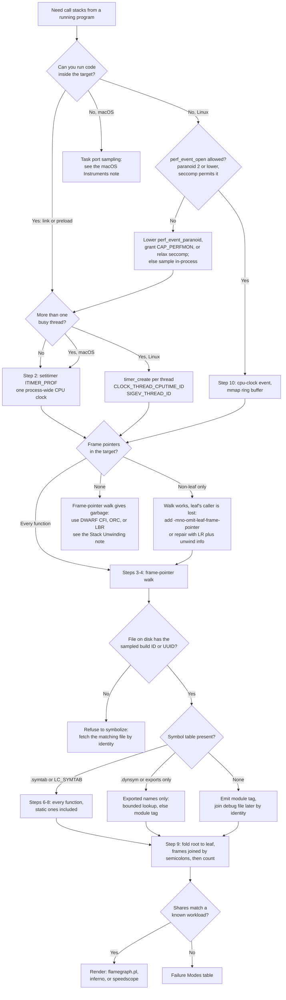
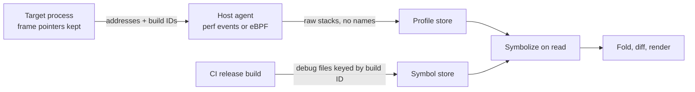

# Rebuild Lab: Sampling Profiler to Folded Stacks

> [!summary] Scope
> This playbook builds a complete sampling profiler in about 1,800 lines of C++17, Python, and shell, with nothing borrowed from `perf`, `libunwind`, or `libbfd`.
> It reaches the Rebuild rung in four stages: sample a process on a timer signal or through `perf_event_open`, walk the frame-pointer chain, resolve addresses against the ELF or Mach-O symbol table, and emit folded stacks for a flame graph.
> Every stage is checked against a workload whose correct profile is known in advance, so a wrong profile fails the lab instead of looking plausible.
> It turns the sampling concepts of Pillar 04 into software that runs on macOS and Linux.

The statistics of sampling, skid, and safepoint bias are owned by [[Sampling-vs-Instrumentation-Skid-and-Safepoint-Bias]].
Unwinding without frame pointers (DWARF CFI, `.eh_frame`, compact unwind) is owned by [[Stack-Unwinding-CFI-and-Exception-ABI]].
The object formats themselves are owned by [[ELF-Mach-O-and-PE-Object-Formats]], and rendering folded stacks is owned by [[Flame-Graphs-Differential-Flame-Graphs-and-Visualizations]].
Using the production tool that this lab imitates is owned by [[Linux-perf-in-Depth-and-perf-c2c]].
This playbook owns the implementation: what each stage must do, in what order, and how to prove each one works.

## Trigger and Symptoms

Activate this playbook when you must build or repair a profiler, or when a profile you were handed cannot be trusted and you need to know which stage lied.

- A flame graph has one wide tower of `[unknown]` frames, or every frame is named after the same function plus a large offset.
- A hot leaf function sits directly on a grandparent: the function that actually called it is missing from every stack.
- The profile accounts for far less CPU time than `time` or `top` reports for the same run.
- A service starts failing system calls with `EINTR`, or crashes inside `malloc`, only while a profiler is attached.
- A profile symbolized on a build machine names functions that are not in the deployed binary.
- You need stacks from a process where `perf` is unavailable: a container whose seccomp profile refuses `perf_event_open`, or macOS.
- You are embedding a profiler in a runtime, an agent, or a test harness and must decide where to sample, unwind, and symbolize.

Most of these are failures of one specific stage, and the lab reproduces three of them on demand: the unnamed or misnamed frames, the missing caller, and the wrong binary.

## Decision Tree



## Prerequisites

The lab needs a C++17 compiler, Python 3, and the platform's `nm` and `strip`, and nothing else.

```bash
command -v c++ python3 nm strip
```

On macOS these come with the Command Line Tools; on Ubuntu 24.04 with `g++`, `python3`, and `binutils` (as of 2026-11, Both).
The recordings used Apple clang 21.0.0 on macOS 27.2 (arm64) and g++ 13.2.0 with binutils 2.42 on Ubuntu 24.04 (aarch64) in the pinned lab image.

Build requirements for the target, which are the real prerequisites of any frame-pointer profiler:

- `-fno-omit-frame-pointer`, because GCC enables `-fomit-frame-pointer` at `-O1` and higher.
- `-mno-omit-leaf-frame-pointer`, because the first flag alone does not cover leaf functions.
  The GCC manual says `-fno-omit-frame-pointer` "doesn't guarantee the frame pointer is used in all functions" and that omitting it in leaf functions is the default on AArch64.
- A symbol table in the file you symbolize against, and an identity in it: `-Wl,--build-id` on Linux, while the Mach-O linker writes `LC_UUID` without being asked.

Permission checks, by front end:

| Front end | Platform | What must be true `(as of 2026-11)` |
| :--- | :--- | :--- |
| `setitimer` plus `SIGPROF`, in-process | Both | Nothing: a process may always time and signal itself. The target must not already use `SIGPROF` or `ITIMER_PROF`. |
| `perf_event_open` on a child | Linux | `kernel.perf_event_paranoid` at 2 or lower, with `exclude_kernel` set and, when callchains are requested, `exclude_callchain_kernel` set. |
| `perf_event_open` in a container | Linux | Additionally a seccomp profile that allows the syscall. Docker's default profile allows it only with `CAP_PERFMON` or `CAP_SYS_ADMIN`. |
| Sampling another process | macOS | The target's task port, which this lab does not use; see [[macOS-Instruments-xctrace-and-DTrace\|the macOS note]]. |

**Verification:**

```bash
cat /proc/sys/kernel/perf_event_paranoid   # Linux only
```

The pinned lab container printed `2` on 2026-11-11 (kernel 7.2.12 in an OrbStack VM).
In that container `perf_event_open` failed with `EPERM` under Docker's default seccomp profile and worked with `--security-opt seccomp=unconfined`, still unprivileged and with all capabilities dropped.

## Commands and Numbers to Know

| Item | Platform | Value `(as of 2026-11)` | Why it matters |
| :--- | :--- | :--- | :--- |
| `SIGPROF` | Both | 27 on x86 and Arm Linux and on macOS; default action terminates the process | Arm the timer before installing the handler and the first tick kills the target. |
| `ITIMER_PROF` | Both | Counts user plus system CPU time of all threads in the process | No samples while the process is blocked, so this is an on-CPU profiler. |
| `setitimer` status | Both | Obsolete in POSIX.1-2008, removed in POSIX.1-2024; still present on Linux and macOS | New Linux code should prefer `timer_create`; macOS has no `timer_create`. |
| CPU-timer granularity | Linux | CPU timers are checked from the timer interrupt, so the tick (`HZ` of 100, 250, 300, or 1000) bounds the rate | Asking for 10 kHz does not give 10 kHz. |
| Frame record | Both | Two machine words at the frame pointer: caller's frame pointer, then return address | The whole unwinder is a loop over this pair. |
| `-fomit-frame-pointer` | Linux | Enabled by default at `-O1` and higher (GCC manual) | An ordinary optimized GCC build has no frame chain. |
| Frame pointers on Apple arm64 | macOS | The platform ABI requires x29 to address a valid frame record; only leaf functions and tail calls may skip one | Non-leaf frames are always walkable; the leaf case still needs the leaf flag. |
| `-momit-leaf-frame-pointer` | Linux | Default on AArch64 (GCC manual; `gcc -Q --help=target` in the lab image shows `[enabled]`) | Leaf functions have no frame record, so their caller is skipped. |
| Distro defaults | Linux | Ubuntu 24.04 builds 64-bit packages with frame pointers; Fedora 38 adds both flags to default C and C++ flags | System libraries may or may not carry a chain; check your base image. |
| `kernel.perf_event_paranoid` | Linux | Default 2 since Linux 4.6: user-space measurements only | 2 still requires `exclude_callchain_kernel` when asking for callchains. |
| `kernel.perf_event_max_sample_rate` | Linux | 100000 samples per second | The kernel lowers it when sampling takes more than `perf_cpu_time_max_percent` (default 25) of CPU. |
| `kernel.perf_event_max_stack` | Linux | 127 frames (`PERF_MAX_STACK_DEPTH`) | Deeper stacks are cut by the kernel, not by your reader. |
| `kernel.perf_event_mlock_kb` | Linux | 512 plus one page in KiB: 516 with 4 KiB pages | Bounds the ring buffer an unprivileged user can map. |
| Ring buffer size | Linux | `1 + 2^n` pages: one metadata page, then the data area | A data area that is not a power-of-two number of pages fails with `EINVAL`. |
| `PERF_CONTEXT_USER` | Linux | `(__u64)-512`; every value at or above `PERF_CONTEXT_MAX` (`(__u64)-4095`) is a marker | Markers are interleaved with addresses in the callchain and must be skipped. |
| `Elf64_Sym` | Linux | 24 bytes; `st_size` is 0 when unknown | Sizes let a lookup reject an address that is past the end of a function. |
| `nlist_64` | macOS | 16 bytes; no size field | The end of a function must come from the next symbol or from `LC_FUNCTION_STARTS`. |
| Mach-O magic | macOS | `0xfeedfacf` thin 64-bit; `0xcafebabe` and `0xcafebabf` universal, stored big-endian | A universal file holds one image per architecture, each with its own UUID. |
| Folded format | Both | `frame;frame;frame count`, root first, one stack per line | The input of `flamegraph.pl`, `inferno-flamegraph`, and speedscope. |
| Lab limits | Both | 64 frames per sample, 8192 samples, 1000 us requested interval | Fixed before the timer starts so the handler never allocates. |

## Step-by-Step Implementation

The lab is `code/05-Profiling/mini_profiler/`.
It is built as two front ends and one back end around a text file of raw addresses, which is the same split `perf record` and `perf script` use.

| File | Role |
| :--- | :--- |
| `workload.cpp` | The target: three call paths with a fixed 5 : 3 : 2 split of CPU time, plus a tail call and an inlined helper. |
| `sampler.cpp`, `sampler.hpp` | In-process front end: `setitimer`, `SIGPROF` handler, frame-pointer walk, module table. |
| `perf_ring/perf_sampler.cpp` | Linux out-of-process front end: `perf_event_open`, ring buffer, record decoding. |
| `image.hpp` | ELF64 and Mach-O 64 readers written from the format definitions, with no system object-format header. |
| `symbolize.cpp` | Back end: raw addresses to names, then folded stacks. |
| `report.py` | Compares the folded output with the workload's known answer. |

Do the steps in order, and do not go past a failed verification.

### Step 1: Build a target with a known answer

A profiler is tested the way any measuring instrument is: against a reference whose true value is known.
`workload.cpp` spends all its CPU time in one leaf, `burn()`, reached through three callers with unit counts of 5, 3, and 2.

```cpp
MINIPROF_NOINLINE static std::uint64_t run_round(bool pitfalls) {
    static unsigned round = 0;
    const unsigned scale = 1 + round++ % 3;
    std::uint64_t acc = 0;
    if (pitfalls) {
        acc += pipeline::via_tailcall(6 * scale);
        acc += pipeline::via_inline(4 * scale);
    } else {
        acc += pipeline::decode(5 * scale);
        acc += pipeline::match(3 * scale);
        acc += pipeline::report(3, 2 * scale);
    }
    g_sink = g_sink + acc;
    return acc;
}
```

Four properties make this a usable reference.

- **The split is exact.** `burn(units)` runs `units * 200000` iterations of the same loop, and the target runs whole rounds only, so the CPU ratio between callers is 5 : 3 : 2 whatever the machine speed or the timer rate.
- **The leaf is shared.** A flat profile can only say "`burn`: 100%", so the test fails unless the stack walk and the fold both work.
- **The stages are interleaved.** One round takes all three paths in turn, so frequency scaling and migration between core types affect them equally.
- **Rounds vary in length.** The scale cycles through 1, 2, and 3, which changes how long a round lasts without changing the ratio inside it, so a sampling period cannot stay in step with the rounds (see lockstep sampling in Step 2).

Every function is `noinline` (and `noclone` on GCC, which would otherwise be free to emit specialized copies with suffixed names), and each stage uses the result after its call so the call cannot become a jump.

```bash
c++ -std=c++17 -O2 -g -fno-omit-frame-pointer -mno-omit-leaf-frame-pointer \
    workload.cpp sampler.cpp -o target
```

**Verification:** `nm target` lists `burn`, `decode`, `match`, `report`, `via_tailcall`, `via_inline`, `run_round`, and `main` as text symbols; the lab counts them and requires eight.

### Step 2: Arm the sampling clock

`setitimer(ITIMER_PROF, ...)` starts a timer that counts down against the CPU time the process consumes, user and system, across all its threads, and delivers `SIGPROF` at each expiry.
Because the clock is CPU time, a busy host does not distort the profile: a descheduled process consumes no CPU time and gets no samples.
For the same reason the profile says nothing about time spent blocked, which belongs to [[Off-CPU-Analysis-Thread-States-and-Causal-Profiling]].

```cpp
struct sigaction sa;
std::memset(&sa, 0, sizeof(sa));
sa.sa_sigaction = on_sigprof;
// SA_SIGINFO: the handler receives the interrupted register state.
// SA_RESTART: a system call interrupted by the profiler is restarted instead of failing with EINTR.
sa.sa_flags = SA_SIGINFO | SA_RESTART;
sigemptyset(&sa.sa_mask);
if (sigaction(SIGPROF, &sa, nullptr) != 0) {
    return false;
}

struct itimerval timer;
timer.it_interval.tv_sec = opts.interval_us / 1000000;
timer.it_interval.tv_usec = opts.interval_us % 1000000;
timer.it_value = timer.it_interval;
if (setitimer(ITIMER_PROF, &timer, nullptr) != 0) {
    const int saved_errno = errno;
    sigaction(SIGPROF, &g_old_action, nullptr);
    errno = saved_errno;
    return false;
}
return true;
```

The order and the flags each prevent a specific failure.

- **Handler first, timer second.** The default action of `SIGPROF` is to terminate the process, so a tick that arrives before `sigaction` kills the target.
- **`SA_SIGINFO`.** Only the three-argument handler form receives the `ucontext_t` that holds the interrupted program counter and frame pointer.
- **`SA_RESTART`.** Without it, every blocking system call the profiler interrupts returns `EINTR`, and a target that does not retry starts failing only while it is profiled.
  `SA_RESTART` is not complete: signal(7) lists calls that fail with `EINTR` regardless, including `poll`, `select`, `epoll_wait`, `nanosleep`, and socket calls with a timeout set.
- **Preallocation before arming.** The sample buffer and the stack bounds are set up in `start()` before `setitimer`, because nothing may be allocated once ticks can arrive.
- **No `SA_ONSTACK`.** The handler runs on the interrupted thread's own stack, which is fine for ordinary threads and wrong for runtimes with small stacks.
  Go's `os/signal` documentation requires non-Go code that installs a handler to use `SA_ONSTACK`, because "Go programs routinely run with a limited stack", and warns that failing to do so "is likely to cause the program to crash".
- **A zero interval disarms.** `setitimer` with a zero value turns the timer off, so `start()` rejects an interval of 0 with `EINVAL` instead of reporting success and never sampling.
- **One owner.** A process has one `ITIMER_PROF` and one `SIGPROF` action.
  Before changing any state, `start()` reads both with `sigaction(SIGPROF, nullptr, ...)` and `getitimer`, and fails with `EBUSY` if a handler is installed or the timer is running, because taking them over would silently break another profiler.
  The check comes before the sample buffer is touched, so a second `start()` during a live session cannot reallocate memory the handler is writing to.

The requested interval is a request, not a guarantee.
On Linux, CPU timers are evaluated in `run_posix_cpu_timers`, which the kernel source describes as "called from the timer interrupt handler", so no CPU timer fires more often than the tick.
The lab therefore never asserts a rate: the target runs until it holds the requested number of samples, and the achieved CPU time per sample goes to stderr, outside the compared output.

Pick a rate that does not share a period with the workload.
Brendan Gregg's CPU flame graph page uses 99 Hz and 199 Hz and gives the reason: odd rates "avoid sampling in lockstep with other activity and producing misleading results".
A sampler in lockstep with a periodic workload lands on the same phase of every period and reports one stage at 100%.

**Verification:** the first section of the lab output shows the requested number of samples captured, none dropped, and no stack cut at the depth limit.

### Step 3: Write an async-signal-safe handler

The handler interrupts the target at an arbitrary instruction, possibly inside `malloc` with the heap lock held, or inside `printf` with a half-updated buffer.
signal-safety(7) defines the rule: a handler may call only async-signal-safe functions, and it must leave `errno` as it found it.

```cpp
// Async-signal-safe: no allocation, no locks, no stdio, errno preserved.
void on_sigprof(int, siginfo_t*, void* context) {
    const int saved_errno = errno;
    const unsigned slot = g_next.fetch_add(1, std::memory_order_relaxed);
    if (slot < g_capacity) {
        Sample& s = g_samples[slot];
        s.depth = walk(regs_from_ucontext(context), s.pc, &s.truncated);
    } else {
        g_dropped.fetch_add(1, std::memory_order_relaxed);
    }
    errno = saved_errno;
}
```

The design follows from four constraints.

1. **No allocation.** Samples go into an array sized before the timer started; a full array increments a drop counter instead of growing.
2. **No lock.** The slot is claimed with one atomic `fetch_add`, and the source asserts `std::atomic<unsigned>::is_always_lock_free` at compile time, because a lock-based atomic would deadlock when the handler interrupts its own lock holder.
3. **No symbolization.** The handler stores raw addresses only; names need file I/O and memory, so they are resolved after sampling stops.
4. **No container calls.** A `std::vector` owns the storage, but the handler reads a plain pointer taken from it once in `start()`.

The interrupted registers come from the third handler argument, and their names are the only architecture-specific code in the front end.

| Platform | Program counter | Frame pointer | Stack pointer |
| :--- | :--- | :--- | :--- |
| macOS arm64 | `arm_thread_state64_get_pc(uc->uc_mcontext->__ss)` | `arm_thread_state64_get_fp(...)` | `arm_thread_state64_get_sp(...)` |
| macOS x86-64 | `uc->uc_mcontext->__ss.__rip` | `__ss.__rbp` | `__ss.__rsp` |
| Linux aarch64 | `uc->uc_mcontext.pc` | `uc->uc_mcontext.regs[29]` | `uc->uc_mcontext.sp` |
| Linux x86-64 | `uc->uc_mcontext.gregs[REG_RIP]` | `gregs[REG_RBP]` | `gregs[REG_RSP]` |

The macOS arm64 and Linux aarch64 rows produced the recorded output.
The macOS x86-64 row was exercised by building with `-arch x86_64` and running under Rosetta on 2026-11-11, which produced the same three stacks; the Linux x86-64 row compiles from the same pattern but was not run for this note.

**Verification:** stopping is part of the contract, and its order matters.

```cpp
setitimer(ITIMER_PROF, &off, nullptr);
// A SIGPROF generated just before the timer was disarmed may still be pending. Restoring the
// default action first would let it terminate the process; ignoring the signal discards it.
signal(SIGPROF, SIG_IGN);
sigaction(SIGPROF, &g_old_action, nullptr);
```

POSIX (section 2.4.3, Signal Actions) guarantees the middle step: "Setting a signal action to SIG_IGN for a signal that is pending shall cause the pending signal to be discarded".
Only after that is it safe to put back the previous action, which for an unprofiled process is the default, terminate.

### Step 4: Walk the frame-pointer chain

On AArch64 the procedure call standard defines the chain.
AAPCS64 (release 2026Q3, section "The Frame Pointer") requires conforming code to "construct a linked list of stack-frames", each linked by "a frame record of two 64-bit values on the stack", with the frame pointer register addressing the innermost record, the lower word pointing to the previous record, the higher word holding the link register value on entry, and address zero ending the chain.
x86-64 code built with frame pointers has the same shape: the kernel's own walker reads a `struct stack_frame` of `next_frame` and `return_address` from the address in `rbp`.

```cpp
inline unsigned walk(const Regs& r, std::uintptr_t* out, std::uint32_t* truncated) {
    constexpr std::uintptr_t kRecord = 2 * sizeof(std::uintptr_t);
    unsigned n = 0;
    out[n++] = r.pc;
    std::uintptr_t fp = r.fp;
    std::uintptr_t lo = r.sp; // live frame records sit above the interrupted stack pointer
    *truncated = 0;
    for (;;) {
        if (fp < lo || fp > g_stack_hi - kRecord || (fp & (sizeof(std::uintptr_t) - 1)) != 0) {
            break;
        }
        const auto* record = reinterpret_cast<const std::uintptr_t*>(fp);
        const std::uintptr_t caller_fp = record[0];
        const std::uintptr_t return_address = strip_pac(record[1]);
        if (return_address == 0) {
            break;
        }
        if (n == kMaxDepth) {
            *truncated = 1;
            break;
        }
        out[n++] = return_address;
        if (caller_fp <= fp) {
            break; // 0 ends the chain; anything not strictly higher would loop
        }
        lo = fp + kRecord;
        fp = caller_fp;
    }
    return n;
}
```

The first entry is the interrupted program counter; every later entry is a return address read from a record.
Each guard exists because the frame pointer register is untrusted input.

- **Bounds.** A record is read only if it lies between the interrupted stack pointer and the top of the thread's stack, which `start()` obtains from `pthread_get_stackaddr_np` on macOS and `pthread_getattr_np` on Linux.
  In code built without frame pointers the register holds arbitrary data, and a blind load from it faults inside the handler.
- **Alignment.** A record address that is not word-aligned is not a record.
- **Monotonic progress.** Each record must be strictly above the previous one, which makes the loop terminate on a corrupted or cyclic chain.
- **Depth cap.** 64 frames per sample bounds both the time in the handler and the buffer size.

The kernel's arm64 walker applies the same checks in the same order.
`arch_stack_walk_user` in `arch/arm64/kernel/stacktrace.c` reports `regs->pc`, then loops while the frame pointer is non-null and 8-byte aligned; `unwind_user_frame` copies the record with page faults disabled, strips the pointer authentication code from the saved link register, and stops on any record that is not above the previous one, under the comment "Frame pointers should strictly progress back up the stack".
The difference is how each side survives a bad pointer: the kernel uses a fault-tolerant user copy, while an in-process walker has only the bounds check.

Three artifacts of a correct frame-pointer walk must be understood before trusting any profile, and the lab reproduces all three.

- **A leaf without a record hides its caller.**
  AAPCS64 lets a platform allow small subroutines to skip the record, and Apple's ARM64 guide says leaf functions "may opt not to create an entry in this list".
  When a sample lands in such a leaf, the frame pointer still addresses the caller's record, whose saved return address points into the caller's caller, so the direct caller is skipped.
  Apple clang 21.0.0 on macOS 27.2 emitted no record for `burn` with `-fno-omit-frame-pointer` alone, and did with `-mno-omit-leaf-frame-pointer` (checked with `c++ -S` on 2026-11-11).
- **A tail call removes a frame.**
  `return burn(units);` compiles to a jump, the callee reuses the caller's frame, and the caller is on no stack.
- **An inlined function never had a frame.**
  It has no call, no record, and no symbol table entry; only debug information can name it, which is the province of [[DWARF-Debug-Information-and-Symbol-Bundles]].

The same loss occurs for the few instructions of every prologue and epilogue.
AAPCS64 notes that "there will always be a short period during construction or destruction of each frame record during which the frame pointer will point to the caller's record", and the x86 kernel walker carries a special case for a probe at function entry because otherwise "we'll skip immediate caller as %rbp is not yet setup".

Pointer authentication changes what a record holds.
AAPCS64 says that when return-address signing is in use, "the value in LR must be signed before storing it in the frame record", so a walker reads signed addresses and must strip them.
The lab uses the `xpaclri` instruction on register x30.
GCC's manual entry for `__builtin_return_address` describes the same problem at the source level: on AArch64 "the stored address may be mangled with return address signing", and it points to `__builtin_extract_return_addr` for post-processing.
`xpaclri` is one of the pointer authentication instructions encoded in the HINT space, which the kernel's AArch64 pointer authentication document says behave as NOPs where the feature is absent.
UNVERIFIED: the stripping of a signed address was not observed, because neither compiler signed return addresses in the lab build.
The instruction ran on both recorded platforms: as a NOP in the Linux VM, whose `/proc/cpuinfo` lists no `paca` feature, and as a real strip on Apple silicon, where the lab's unsigned addresses passed through unchanged.
The ABI side of this is owned by [[Hardware-Security-ABIs-PAC-BTI-CET-and-RELRO]].

**Verification:** section 1 of the lab output requires at least 99% of stacks to contain `main`, which fails if the chain is not followed to the root, and sections 4 and 5 show the three artifacts.

### Step 5: Record the module table and the image identity

A sampled address is meaningless once the process is gone: address space layout randomization gives every run a different load address.
The profile must therefore record, for each loaded module, where it was mapped and which exact build it was.
`stop_and_write()` does this after the timer is off, where allocation and I/O are legal, and writes one line per module that a sample touched, plus the main executable always.

```text
miniprof-raw 1
source itimer-prof
interval_us 1000
cpu_us CPU_TIME_USED
dropped SAMPLES_DROPPED
map START END FILE_OFFSET IDENTITY main|lib PATH
sample TRUNCATED PC RETURN_ADDRESS RETURN_ADDRESS ...
```

The block shows the layout of the in-process front end's file with field names in place of values; addresses in a real file change on every run.

| Platform | Module list | Mapping recorded | Identity |
| :--- | :--- | :--- | :--- |
| Linux | `dl_iterate_phdr`, which reports the executable first | Each `PT_LOAD` with `PF_X`: `dlpi_addr + p_vaddr`, its `p_memsz`, and its `p_offset` | Descriptor of the `NT_GNU_BUILD_ID` note found through `PT_NOTE` in memory |
| macOS | `_dyld_image_count`, `_dyld_get_image_header`, `_dyld_get_image_vmaddr_slide` | The `__TEXT` segment: `vmaddr + slide` and `vmsize` | The 16 bytes of `LC_UUID`, read from the load commands in memory |

Two macOS details cost time if unknown.

- `dyld` itself is not in the `_dyld_image_*` list, yet every stack is rooted in it.
  The lab asks the kernel with `task_info(TASK_DYLD_INFO)` and reads `dyldImageLoadAddress` and `dyldPath` from `dyld_all_image_infos`.
- System libraries have had no files on disk since macOS 11.
  Apple's Big Sur release notes say the system "ships with a built-in dynamic linker cache of all system-provided libraries" and that "copies of dynamic libraries are no longer present on the filesystem", so a file-based symbolizer cannot open them and must fall back to a module tag.

The identity is what makes offline symbolization safe.
It is read from the running image, not from the file, so it describes the code that was actually sampled even if the file on disk was replaced mid-run.

**Verification:** section 2 of the lab output reports the identity of the sampled process and of the file as `match`, and section 6 shows the symbolizer exiting with status 3 for a different build of the same source.

### Step 6: Read the ELF symbol table

`image.hpp` declares the ELF structures itself, so the symbolizer builds on macOS and can symbolize a Linux profile there.
The parts that matter are three program header types and one section.

```cpp
struct Elf64_Sym {
    std::uint32_t st_name;
    unsigned char st_info, st_other;
    std::uint16_t st_shndx;
    std::uint64_t st_value, st_size;
};
```

The reader does four things.

1. **Collect `PT_LOAD` segments** as `(p_vaddr, p_offset, p_filesz)`, which is the map between file offsets and link-time addresses.
2. **Find the build ID** by scanning `PT_NOTE` for a note of type 3 named `GNU`; a note is three 4-byte words (`namesz`, `descsz`, `type`) followed by the name and the descriptor, each padded to 4 bytes.
3. **Pick a symbol table**: the section of type `SHT_SYMTAB` if present, else `SHT_DYNSYM`.
   The `sh_link` field of a symbol table section is the index of its string table, and `st_name` is an offset into that table.
4. **Keep function symbols**: type `STT_FUNC` or `STT_GNU_IFUNC` (the low four bits of `st_info`) whose section index is not `SHN_UNDEF`, sorted by `st_value`.

The choice in item 3 is the difference between a complete and an empty profile.
`.symtab` holds every function, including `static` ones, but elf(5) describes it as allocated only "if the file has a loadable segment that includes the symbol table"; in an ordinary link it is not loaded, so it exists only in the file and `strip` can remove it.
`.dynsym` is always allocated because the dynamic linker needs it, and it holds only what the object exports or imports.
An executable exports almost nothing, so a stripped executable symbolizes to nothing.

**Verification:** the lab compares its parser with `nm` for the eight workload symbols and requires all eight addresses to agree, then repeats the symbolization against a stripped copy, where the symbol source falls back to `.dynsym` and no frame inside the executable gets a name.

### Step 7: Read the Mach-O symbol table

A Mach-O image is a header, a list of load commands, and the data they point to.
The reader walks the commands once and keeps four.

| Load command | Value | What the reader takes |
| :--- | :--- | :--- |
| `LC_SEGMENT_64` | `0x19` | `vmaddr`, `fileoff`, `filesize` of each segment; the one named `__TEXT` anchors address translation. |
| `LC_SYMTAB` | `0x2` | `symoff` and `nsyms` (an array of `nlist_64`), `stroff` and `strsize` (the string table). |
| `LC_UUID` | `0x1b` | The 16-byte identity. |
| `LC_FUNCTION_STARTS` | `0x26` | `dataoff` and `datasize` of a compressed list of function start addresses. |

```cpp
if ((nl.n_type & kNStab) != 0 || (nl.n_type & kNType) != kNSect) {
    continue; // debugger (stab) entries and undefined, absolute, or indirect symbols
}
// Keep code symbols only. When the image lists its function starts, a symbol is code if
// it sits on one; otherwise any symbol defined in a section is kept.
if (!img->function_starts.empty() &&
    !std::binary_search(img->function_starts.begin(), img->function_starts.end(), nl.n_value)) {
    continue;
}
```

Four differences from ELF shape the code.

- **No sizes.** `nlist_64` has a string index, a type byte, a section number, a descriptor, and a value, and nothing that says where a function ends.
- **Debugger entries share the table.** Any entry with a bit of `N_STAB` (`0xe0`) set is a debugging record, not a symbol, and its value is not a function address.
- **A leading underscore.** C-level names are stored with one `_` prefix, so `main` is `_main` and a C++ mangled name starts `__Z`; the symbolizer removes one underscore before demangling.
- **Function starts survive stripping.** `LC_FUNCTION_STARTS` is a list of ULEB128 numbers: the first is the offset of the first function from the start of `__TEXT`, each later one is the distance from the previous function, and zero ends the list.
  LLVM's reader, `MachOObjectFile::ReadULEB128s`, accumulates exactly these deltas.

A universal file adds one layer: a big-endian header with magic `0xcafebabe` (or `0xcafebabf` for 64-bit offsets) followed by one `fat_arch` entry per image.
The lab does not pick a slice by CPU type.
It parses each slice and takes the one whose `LC_UUID` equals the identity recorded at sample time, which is how the `start` frame gets its name: `/usr/lib/dyld` on macOS 27.2 is a universal file, and only one of its slices is the image that was running.

**Verification:** the same `nm` comparison as on ELF, eight of eight, which also checks the function-start decoder, because a symbol that does not sit on a decoded function start is dropped before the comparison.

### Step 8: Resolve addresses to names

Resolution is three translations and one lookup.

```cpp
std::optional<std::uint64_t> to_vaddr(const Module& m, std::uint64_t addr) {
    const image::Image& img = *m.img;
    if (img.format == image::Format::macho64) {
        // The map line describes __TEXT, so the distance from its start is the same in memory
        // and in the file, whatever the ASLR slide and whatever the shared cache did to fileoff.
        return img.text_vmaddr + (addr - m.start);
    }
    // ELF: mapping -> file offset -> the PT_LOAD segment that holds that offset -> p_vaddr.
    const std::uint64_t file_offset = addr - m.start + m.file_offset;
    for (const image::Segment& seg : img.segments) {
        if (file_offset >= seg.fileoff && file_offset - seg.fileoff < seg.filesize) {
            return seg.vmaddr + (file_offset - seg.fileoff);
        }
    }
    return std::nullopt;
}
```

1. **Runtime address to module.** Find the `map` line whose range contains the address.
2. **Module to link-time address.** For ELF, go through the file offset, because a position-independent executable is mapped at an arbitrary base and its symbol values are link-time addresses.
   For Mach-O, anchor on the start of `__TEXT`; the in-memory header of `dyld` reported a nonzero file offset for `__TEXT` on macOS 27.2 that its on-disk slice does not have, so file offsets are not a safe anchor there.
3. **Return address to call site.** Every entry after the first is a return address, which points one instruction past the call.
   The symbolizer looks up `address - 1` for those entries, so a call that is the last instruction of a function is still attributed to that function and not to the next symbol.
4. **Address to symbol.** Binary-search for the last symbol that starts at or before the address, then decide whether to believe it.

The fourth step is where symbolizers silently lie.
"Nearest preceding symbol" always returns an answer, and after a strip that answer is often wrong: the function that contained the address is gone, and the nearest surviving symbol belongs to a different function.

```cpp
if (lookup == Lookup::bounded) {
    // ELF records each function's size, so an address past the end is not that function.
    if (it->size != 0 && *vaddr - it->addr >= it->size) {
        return unresolved;
    }
    // Mach-O records no sizes, but LC_FUNCTION_STARTS survives stripping: if another
    // function starts between the symbol and the address, the symbol is the wrong one.
    const std::vector<std::uint64_t>& starts = m.img->function_starts;
    auto fs = std::upper_bound(starts.begin(), starts.end(), *vaddr);
    if (fs != starts.begin() && *(fs - 1) > it->addr) {
        return unresolved;
    }
}
```

An address the lookup cannot justify becomes a module tag such as `[target]` or `[libc.so.6]`, which is what `stackcollapse-perf.pl` does with perf's `[unknown]` frames when the module is known.
A tag is honest: it says which file to fetch symbols for.
A wrong name sends an engineer to optimize a function that is not hot.

Names are then made presentable: `abi::__cxa_demangle` turns `_ZN8pipeline6decodeEj` into `pipeline::decode(unsigned int)`, and any `;` inside a name is replaced by `:`, because `;` is the frame separator of the output format.

Before any of this, the symbolizer compares the identity in the `map` line with the identity in the file and exits with status 3 on a mismatch for the main executable.
A different build has different code at the same addresses, and its symbol table would produce confident, wrong names; the long form of that rule is in [[Symbol-Servers-and-debuginfod]].

**Verification:** section 6 of the lab output: against a `strip -x` copy the bounded lookup names the hot leaf `[target]`, while the nearest-symbol lookup names it after another function.

### Step 9: Fold the stacks

The folded format is defined in the header comment of `flamegraph.pl`: "Each frame in the stack is semicolon separated, with a space and count at the end of the line."
The example there is `swapper;start_kernel;rest_init;cpu_idle;default_idle;native_safe_halt 1`.

```cpp
// Fold: one line per distinct stack, root first, frames joined by ';', then the sample count.
std::map<std::string, std::uint64_t> folded;
for (const std::vector<std::uint64_t>& pcs : samples) {
    ++stats.samples;
    std::string stack;
    for (std::size_t i = pcs.size(); i-- > 0;) {
        const std::uint64_t addr = i == 0 ? pcs[i] : pcs[i] - 1;
        if (!stack.empty()) {
            stack.push_back(';');
        }
        stack += resolve(modules, addr, lookup, &stats);
    }
    ++folded[stack];
}
```

The excerpt omits one comment from the source.
Folding is a group-by on the whole stack, and three choices in it are deliberate.

- **Root first.** Samples store the leaf first because that is the order of the walk; the fold reverses it, because a flame graph merges stacks from the root.
- **Symbolize, then merge.** Two addresses in the same function are the same frame, so merging on names collapses them; merging on raw addresses would keep one line per instruction.
- **Sorted output.** A `std::map` gives sorted lines, as `stackcollapse-perf.pl` does with a sort over its keys, so two profiles of the same program diff cleanly.

The format is a deliberate intermediate.
The FlameGraph README explains that keeping the folded file separate from the renderer means "you can use grep for functions of interest".
It is also the lowest common denominator of renderers: `flamegraph.pl` reads it, inferno is a Rust port of the same toolkit that reads and writes it, and speedscope imports it as the "collapsed stack format".
What it cannot carry is anything per sample: no timestamps, no thread identifiers unless you add a frame for them, no addresses, and no build identities.
Formats that keep those belong to [[Continuous-Profiling-GWP-Parca-Pyroscope-and-OTel-Profiles]].

**Verification:** section 3 of the lab output: three stacks, each within 6 percentage points of 50%, 30%, and 20%, and no expected stack missing.

```bash
./target pipeline profile.raw 1200
./symbolize profile.raw > profile.folded
flamegraph.pl profile.folded > profile.svg   # or: inferno-flamegraph < profile.folded
```

The lab stops at the folded file; the last line needs the FlameGraph scripts or inferno, which the lab does not install.

### Step 10: Swap the front end for perf_event_open

On Linux the kernel can do the sampling and the walk, from outside the target, with no code in it.
`perf_ring/perf_sampler.cpp` opens one event on a child process and writes the same raw format, so Steps 6 to 9 are reused unchanged.

```cpp
attr.type = PERF_TYPE_SOFTWARE;
attr.config = PERF_COUNT_SW_CPU_CLOCK;
attr.sample_period = kPeriodNs;
attr.sample_type = PERF_SAMPLE_IP | PERF_SAMPLE_TID | PERF_SAMPLE_CALLCHAIN;
attr.disabled = 1;
attr.enable_on_exec = 1; // counting starts at the child's execve
attr.exclude_kernel = 1; // required for an unprivileged caller at perf_event_paranoid 2
attr.exclude_hv = 1;
attr.exclude_callchain_kernel = 1; // and so is this: no kernel frames in the callchain
attr.mmap = 1;                     // executable mappings ...
attr.mmap2 = 1;                    // ... as PERF_RECORD_MMAP2
attr.build_id = 1;                 // with the build ID instead of device and inode, when the kernel has it
attr.task = 1;                     // PERF_RECORD_FORK and PERF_RECORD_EXIT
attr.watermark = 1;
```

Each field answers one of the questions the in-process sampler answered in code.

- **Clock.** `PERF_COUNT_SW_CPU_CLOCK` is a software event driven by a high-resolution timer, so no hardware counter is needed.
  Its period is in nanoseconds: the kernel arms the timer with `ns_to_ktime(period)` after raising the period to at least 10,000 (kernel/events/core.c), so 1,000,000 is one sample per millisecond of CPU and the event cannot exceed 100,000 samples per second.
- **Start.** The child blocks on a pipe until the event exists, and `enable_on_exec` starts counting at its `execve`, so neither the wait nor the profiler's own setup is sampled.
- **Stack walk.** `PERF_SAMPLE_CALLCHAIN` asks the kernel for the frame-pointer walk described in Step 4.
- **Module table.** `mmap` and `mmap2` produce a `PERF_RECORD_MMAP2` for every executable mapping, with its address, length, file offset, and path.
- **Identity.** `build_id` (Linux 5.12 and later) replaces the device and inode numbers in that record with the build ID, flagged by `PERF_RECORD_MISC_MMAP_BUILD_ID` in the record header.
- **Permissions.** At `perf_event_paranoid` 2 an unprivileged caller must exclude the kernel twice: from the event and from the callchain.
  The kernel's check in `perf_event_open` (kernel/events/core.c) calls `perf_allow_kernel()` when `exclude_kernel` is clear, and also when `PERF_SAMPLE_CALLCHAIN` is requested without `exclude_callchain_kernel`.
  In the lab VM the call failed with `EACCES` until `exclude_callchain_kernel` was set, although `exclude_kernel` was already 1.

The ring buffer is a single-producer, single-consumer queue shared between the kernel and the reader.
The mapping is one metadata page (`struct perf_event_mmap_page`) followed by a data area of a power-of-two number of pages.

```cpp
void drain(perf_event_mmap_page* meta, Capture* cap) {
    const auto* data = reinterpret_cast<const unsigned char*>(meta) + meta->data_offset;
    const std::uint64_t size = meta->data_size; // a power of two
    const std::uint64_t head = __atomic_load_n(&meta->data_head, __ATOMIC_ACQUIRE);
    std::uint64_t tail = meta->data_tail;
    std::vector<unsigned char> record;
    while (tail < head) {
        perf_event_header header;
        for (std::size_t i = 0; i < sizeof(header); ++i) {
            reinterpret_cast<unsigned char*>(&header)[i] = data[(tail + i) & (size - 1)];
        }
        if (header.size < sizeof(header) || tail + header.size > head) {
            break;
        }
        record.resize(header.size + 1u);
        for (std::size_t i = 0; i < header.size; ++i) {
            record[i] = data[(tail + i) & (size - 1)];
        }
        record[header.size] = 0; // terminates a filename that fills the record
        decode(header, record.data() + sizeof(header), cap);
        tail += header.size;
    }
    __atomic_store_n(&meta->data_tail, tail, __ATOMIC_RELEASE);
}
```

The protocol has four rules, all from perf_event_open(2).

1. **`data_head` only grows.** The man page says it "continuously increases, it does not wrap" and must be wrapped by the buffer size before use, which is the `& (size - 1)` above.
2. **Read `data_head` with a barrier.** The man page asks for an `rmb()` after reading it; the acquire load is the C++ spelling.
3. **Publish `data_tail`.** With a writable mapping, the reader writes back how far it has read, and then "the kernel will not overwrite unread data"; it drops new records instead and reports them in a `PERF_RECORD_LOST`.
4. **Records wrap.** A record can start near the end of the data area and finish at its beginning, so the reader copies it out before decoding.

A `PERF_RECORD_SAMPLE` has no self-describing fields.
Its layout is the fixed order in the man page, restricted to the bits set in `sample_type`: for `IP | TID | CALLCHAIN` that is a 64-bit instruction pointer, 32-bit pid and tid, a 64-bit count `nr`, and `nr` 64-bit entries.
The entries are not all addresses: the callchain interleaves context markers such as `PERF_CONTEXT_USER`, and the decoder drops every value at or above `PERF_CONTEXT_MAX`.
A reader that changes `sample_type` without changing the decoder reads garbage without any error.

**Verification:** the nested lab's output, shown in the next section: samples read, an `MMAP2` record for the target, a `PERF_RECORD_EXIT`, the build ID from the kernel matching the file, and the same three stacks at 50%, 30%, and 20%.

## Complete Verification and Golden Output

Run the lab through the harness:

```bash
cd code
python3 -m _harness.verify 05-Profiling/mini_profiler/
```

`run.sh` builds the symbolizer and three variants of the target, samples three runs, symbolizes one of them four more times against altered copies of the executable, and hands everything to `report.py`.

| Section | What ran | What a pass proves | What would fail it |
| :--- | :--- | :--- | :--- |
| 1 | `target pipeline`, 1200 samples | The timer fires, the handler stores samples, the walk reaches `main` | A handler that never runs, a walk that stops early, a full buffer |
| 2 | `symbolize`, `nm` | The lab's own parser reads the right table and agrees with `nm`; the sampled image is the file on disk | A wrong struct layout, a missed slide or load bias, a wrong function-start decoder |
| 3 | Fold of the same run | Stack attribution is right: 50, 30, 20 by caller | Any error in walk order, call-site adjustment, or folding |
| 4 | `target pitfalls`, 600 samples | Tail-called and inlined functions have no frame | A compiler that stops emitting the tail call changes the output |
| 5 | `target_leafless pipeline`, 600 samples | A leaf without a frame record hides its caller | A walker that secretly repaired the leaf case would change the output |
| 6 | Symbolize against `strip -x`, `strip`, and another build | Identity survives stripping; bounded lookup refuses; nearest lookup lies; a wrong build is rejected | A symbolizer that guesses, or that skips the identity check |

No line prints a raw sample count, because counts differ on every run.
Each line is a derived fact: a share inside a tolerance band, a frame that must or must not exist, an address that must equal the one `nm` prints.
The bands are 6 percentage points for the 1200-sample run and 8 for the 600-sample runs.
The gprof manual's rule is that for n samples "the expected error is the square-root of n", and the bands are several times that for the smallest share checked.

### Verified output, macOS

Recorded with `python3 -m _harness.verify --record` on darwin-arm64 (macOS 27.2, Apple clang 21.0.0) on 2026-11-11.
The recording predates the last review fixes to the sources; the final sources reproduce it, with three consecutive `PASS` runs.
The file is `code/05-Profiling/mini_profiler/expected/darwin-arm64.txt`.

```text
== 1. Sample: ITIMER_PROF, SIGPROF, frame-pointer walk ==
samples requested: 1200
samples captured, at least the number requested: yes
samples dropped because the buffer was full: 0
stacks cut at the depth limit: 0
stacks that reach main, at least 99%: yes

== 2. Symbolize: the executable's own symbol table ==
image format: Mach-O 64
symbol source: LC_SYMTAB
identity checked: LC_UUID, sampled process and file on disk: match
workload symbols at the address nm reports: 8 of 8
frames inside the executable resolved to a symbol name, at least 99%: yes

== 3. Fold: stacks holding at least 3% of samples, heaviest first ==
  start;main;run_round(bool);pipeline::decode(unsigned int);(anonymous namespace)::burn(unsigned int)
    expected 50% of samples, measured within 6 points: yes
  start;main;run_round(bool);pipeline::match(unsigned int);(anonymous namespace)::burn(unsigned int)
    expected 30% of samples, measured within 6 points: yes
  start;main;run_round(bool);pipeline::report(unsigned int, unsigned int);pipeline::report(unsigned int, unsigned int);pipeline::report(unsigned int, unsigned int);(anonymous namespace)::burn(unsigned int)
    expected 20% of samples, measured within 6 points: yes
  expected stacks missing: 0
flat view, samples whose leaf frame is burn, at least 99%: yes

== 4. Frames that never existed: tail call and inlining ==
  start;main;run_round(bool);(anonymous namespace)::burn(unsigned int)
    expected 60% of samples, measured within 8 points: yes
  start;main;run_round(bool);pipeline::via_inline(unsigned int);(anonymous namespace)::burn(unsigned int)
    expected 40% of samples, measured within 8 points: yes
  expected stacks missing: 0
  samples with a via_tailcall frame, fewer than 1%: yes
  samples with an inlined_helper frame: 0

== 5. Leaf without a frame record: the caller disappears ==
  start;main;run_round(bool);(anonymous namespace)::burn(unsigned int)
    expected 80% of samples, measured within 8 points: yes
  start;main;run_round(bool);pipeline::report(unsigned int, unsigned int);pipeline::report(unsigned int, unsigned int);(anonymous namespace)::burn(unsigned int)
    expected 20% of samples, measured within 8 points: yes
  expected stacks missing: 0
  samples with a decode or match frame, fewer than 1%: yes

== 6. Damaged or wrong symbol tables ==
strip -x copy, identity still equals the sampled build: yes
  bounded lookup names the hot leaf: [target]
  nearest-symbol lookup names the hot leaf: pipeline::decode(unsigned int)
fully stripped copy, symbol source: LC_SYMTAB
  frames inside the executable resolved to a symbol name: none
different build of the same source, symbolizer exit status: 3
```

Read sections 3 to 6 as four separate lessons.

- **Section 3** is the profile a flame graph should show: three towers on `run_round`, widths 50, 30, and 20, with three `report` frames for the recursion.
  The last line is the flat view of the same samples, in which `burn` holds at least 99% and the three callers are indistinguishable.
- **Section 4** has no `via_tailcall` frame in 60% of the samples that passed through it, and no `inlined_helper` frame anywhere.
  The profiler is correct; the frames did not exist at run time.
- **Section 5** is the same program and the same sampler with one flag changed.
  `decode` and `match` vanish, their 80% moves to `run_round;burn`, and the recursion loses one level, because each `burn` sample skips exactly one frame: its caller.
- **Section 6** removes local symbols with `strip -x`.
  `burn` is in an anonymous namespace, so its symbol is local and is removed.
  The nearest-symbol lookup then blames `pipeline::decode`, the global function placed just before it: the caller is charged with all of the callee's time, which looks entirely believable.
  The bounded lookup sees a function start between `decode` and the address and prints `[target]` instead.

### Verified output, Linux

Recorded on linux-aarch64 on 2026-11-11 by running the same harness command inside the pinned lab image (Ubuntu 24.04, g++ 13.2.0, binutils 2.42) as its unprivileged user, with all capabilities dropped and no network; the final sources reproduce it in three consecutive runs.
The file is `code/05-Profiling/mini_profiler/expected/linux-aarch64.txt`.
It differs from the macOS file only in the format lines, the frames above `main`, the name the nearest-symbol lookup invents, and the symbol source of the fully stripped copy:

```text
image format: ELF64
symbol source: .symtab
identity checked: GNU build ID, sampled process and file on disk: match
```

```text
  _start;__libc_start_main;[libc.so.6];main;run_round(bool);pipeline::decode(unsigned int);(anonymous namespace)::burn(unsigned int)
    expected 50% of samples, measured within 6 points: yes
```

```text
strip -x copy, identity still equals the sampled build: yes
  bounded lookup names the hot leaf: [target]
  nearest-symbol lookup names the hot leaf: _start
fully stripped copy, symbol source: .dynsym
  frames inside the executable resolved to a symbol name: none
```

The root of every Linux stack shows three symbolization outcomes side by side.
`_start` comes from the executable's `.symtab`, `__libc_start_main` from the symbol table of `libc.so.6` on disk, and `[libc.so.6]` is an address in libc that no function symbol in that table covers, so the bounded lookup prints the module tag.
The chain can pass through libc to `_start` only if libc maintains frame records, which is consistent with Ubuntu 24.04 building its packages with frame pointers.

The wrong name in the last block depends on the order in which the compiler laid out functions.
With g++ 13 the nearest surviving symbol before `burn` is `_start`, so `_start` takes the blame; building the same lab with clang 18 in the same image gave `pipeline::decode(unsigned int)`, as on macOS.
The specific wrong answer is arbitrary, which is the reason not to accept one.

### Verified output, perf_event_open front end

The nested lab `code/05-Profiling/mini_profiler/perf_ring/` declares `# requires: linux, pmu`.
It uses the software `cpu-clock` event and needs no hardware counter; the `pmu` tag is there because the harness container runs under Docker's default seccomp profile, which refuses `perf_event_open`, and `pmu` is the tag that keeps the lab from being dispatched there.
The harness therefore reports it as skipped on macOS.

It was recorded on linux-aarch64 on 2026-11-11 by running the harness inside the pinned image with `--security-opt seccomp=unconfined` and `TOOLCHAIN_LABS_PMU=1`, as the unprivileged user with all capabilities dropped; the final sources reproduce it in three consecutive runs.
The file is `code/05-Profiling/mini_profiler/perf_ring/expected/linux-aarch64.txt`.

```text
== perf_event_open front end: cpu-clock samples with kernel-built callchains ==
samples read from the ring buffer, at least 500: yes
PERF_RECORD_MMAP2 records that map the target executable, at least 1: yes
PERF_RECORD_EXIT seen for the target: yes
image format: ELF64
symbol source: .symtab
identity checked: GNU build ID from PERF_RECORD_MMAP2 and file on disk: match
stacks that reach main, at least 99%: yes
stacks holding at least 3% of samples, heaviest first:
  _start;__libc_start_main;[libc.so.6];main;run_round(bool);pipeline::decode(unsigned int);(anonymous namespace)::burn(unsigned int)
    expected 50% of samples, measured within 8 points: yes
  _start;__libc_start_main;[libc.so.6];main;run_round(bool);pipeline::match(unsigned int);(anonymous namespace)::burn(unsigned int)
    expected 30% of samples, measured within 8 points: yes
  _start;__libc_start_main;[libc.so.6];main;run_round(bool);pipeline::report(unsigned int, unsigned int);pipeline::report(unsigned int, unsigned int);pipeline::report(unsigned int, unsigned int);(anonymous namespace)::burn(unsigned int)
    expected 20% of samples, measured within 8 points: yes
  expected stacks missing: 0
```

Two independent front ends, a signal handler in the target and the kernel's sampler outside it, produce the same stacks with the same shares through the same symbolizer.
That agreement is the strongest evidence in the lab: a bug common to both would have to be in the shared back end, which sections 2 and 6 test separately.

What the lab does not prove:

- Nothing about multi-threaded targets; the workload has one thread.
- Nothing about pointer authentication stripping, as stated in Step 4.
- Nothing about the bounds check in the walker, because every build here keeps a valid chain; it is exercised only by a target without frame pointers.
- Nothing about Linux x86-64, which was not run.
- Nothing about the achieved sampling rate, which is printed to stderr and never compared.

## Rollback Procedure

An in-process profiler changes process-wide state, and an out-of-process one changes host settings; both must be undone.

1. **Restore the signal disposition and the timer.**
   Save the previous action when installing yours, and restore in this order: disarm the timer, set `SIGPROF` to `SIG_IGN` to discard a pending tick, then restore the saved action.
   The lab's `stop_and_write()` does exactly this, as shown in Step 3.
   Restoring the saved action before the pending tick is discarded is the classic bug: the default action terminates the process.
   **Check:** `sigaction(SIGPROF, nullptr, &now)` returns the saved handler and flags, and `getitimer(ITIMER_PROF, &t)` returns a zero `it_value`.
2. **Do not start if the target already uses the profiling timer.**
   If `getitimer(ITIMER_PROF, ...)` shows a running timer, or the current `SIGPROF` action is not the default, another profiler (gperftools, a language runtime) owns them.
   The lab's `start()` returns `EBUSY` in that case and changes nothing, so there is nothing to roll back.
3. **Restore host settings changed for `perf_event_open`.**
   Record the value first with `cat /proc/sys/kernel/perf_event_paranoid`, and write it back with `sudo sysctl -w kernel.perf_event_paranoid=<saved>`.
   **Check:** the file prints the saved value.
4. **Remove a relaxed seccomp profile.**
   A container started with `seccomp=unconfined` for profiling should not stay in service; restart it with its normal profile.
5. **Delete raw profiles.**
   A raw profile holds the load address of every module of a real process, which is the information address space layout randomization exists to hide, together with file paths.
   Keep the folded output and delete the raw file, or store raw files with the access controls of a core dump.
6. **Rebuild without profiling flags only if you measured a cost.**
   The frame pointer flags are not a rollback item by default; see At Scale.

## Failure Modes

| Failure | How it shows up | Cause and recovery |
| :--- | :--- | :--- |
| Process dies with `Profiling timer expired` | The target is killed by `SIGPROF` right after profiling starts, and the shell reports status 155 (128 + 27) | The timer was armed before the handler was installed, or the default action was restored while a tick was still pending. Install first; on stop, disarm, ignore, then restore. |
| No samples | Zero samples, or the hard stop in the lab's run loop triggers | `SIGPROF` is blocked in the thread's signal mask, or the process consumes no CPU time. Check the mask, and remember that `ITIMER_PROF` does not tick while blocked. |
| Far fewer samples than CPU time implies | Profile total is a fraction of what `time` reports | A process-wide timer on many busy threads: a signal that is already pending is not queued again. Use per-thread timers; see the Go incident under At Scale. |
| Crash inside the handler | `SIGSEGV` with the handler on the stack | Unchecked frame-pointer load in code built without frame pointers, or a handler running on a stack too small for a signal frame. Bounds-check every load. |
| Deadlock while profiled | The target hangs with the handler above `malloc` or a stdio function | The handler called something that is not async-signal-safe. Store addresses only. |
| `EINTR` from system calls | Errors that appear only under the profiler | `SA_RESTART` missing, or a call that is never restarted. Set the flag, and make the target retry the calls signal(7) lists. |
| Stacks of depth one or two | Every stack is the leaf plus one frame | No frame-pointer chain in the target: an optimized build without `-fno-omit-frame-pointer`. Rebuild, or unwind with CFI. |
| Leaf's caller missing | A hot leaf sits on its grandparent, as in lab section 5 | Leaf functions without frame records. Add `-mno-omit-leaf-frame-pointer`, or repair as `perf` does on arm64. |
| A frame you expect is absent, everything else is right | As in lab section 4 | Tail call or inlining. Confirm in the disassembly; use debug information for inlined frames. |
| Every frame is `[module]` | Module tags instead of names | The file has no usable symbol table (stripped), or cannot be opened (dyld shared cache). Fetch the unstripped file or debug file by identity. |
| Plausible but wrong names | Functions that cannot be on that path | Nearest-symbol lookup on a stripped file, or symbolization against a different build. Use a bounded lookup and compare identities. |
| Symbolizer exits 3 | `identity mismatch` on stderr | The file on disk is not the build that ran. Find the file whose build ID or UUID equals the recorded one. |
| `perf_event_open`: `EPERM` | Fails at once inside a container | The seccomp profile denies the syscall. Docker's default allows it only with `CAP_PERFMON` or `CAP_SYS_ADMIN`. |
| `perf_event_open`: `EACCES` | Fails on the host or in an unconfined container | `perf_event_paranoid` forbids what the event asks for. At 2, set `exclude_kernel` and `exclude_callchain_kernel`. |
| `mmap` of the ring fails | `EINVAL` or `EPERM` | Size is not `1 + 2^n` pages, or it exceeds the `perf_event_mlock_kb` allowance. |
| Lost samples | `PERF_RECORD_LOST` records, lab stderr reports a count | The reader fell behind and the ring filled. Drain more often, enlarge the ring, or lower the rate. |
| Garbage after changing `sample_type` | Addresses that are not in any module | The decoder's field order no longer matches the bits set. Decode in man-page order, every time. |

## Pitfalls

> [!warning] Running anything but address capture in the handler
> A handler that symbolizes, logs, or allocates works in every test and deadlocks in production, on the one sample that interrupts the allocator or the dynamic loader.
> Capture addresses into preallocated memory and do everything else after the timer is off.
> Save and restore `errno`, or the target sees failures it did not cause.

> [!warning] Believing a profile because it looks reasonable
> Lab section 6 charges all of the leaf's time to its caller, and lab section 5 moves 80% of the samples to the wrong parent.
> Both outputs are well-formed flame graphs.
> Validate a profiler, or a new platform for an existing one, against a workload with a known split before reading real profiles with it.

> [!warning] Assuming -fno-omit-frame-pointer means every function
> The flag covers functions that make calls.
> Leaf functions keep no record unless `-mno-omit-leaf-frame-pointer` is also given, and the leaf is exactly where a CPU profile spends its samples.
> Fedora adds both flags for that reason.

> [!warning] Symbolizing with whatever binary is at that path
> Deployments replace files while processes run, and build machines hold newer builds under the same name.
> Record the build ID or UUID from the running image at sample time and refuse a file that does not carry it.
> The identity survives `strip`, as lab section 6 shows, so there is no excuse for skipping the check.

> [!warning] Nearest-symbol lookup on Mach-O
> Mach-O symbols have no size, so "the last symbol before the address" is the only lookup the symbol table supports, and it is wrong for every function whose symbol was stripped.
> Bound it with `LC_FUNCTION_STARTS`, which stripping leaves in place.

> [!warning] Sampling in lockstep
> A timer whose period divides the workload's period samples the same phase forever.
> Use a rate that is not a round number, and distrust a profile in which a periodic program shows a single hot stage.

> [!warning] Treating a process-wide timer as a per-thread sample
> `ITIMER_PROF` counts the CPU time of all threads together and sends one signal to the process.
> Which thread handles it is the kernel's choice, and on a busy many-core process most expirations are lost.
> The lab is single-threaded and its sampler caches one thread's stack bounds; do not link it into a threaded program unchanged.

## At Scale

For one developer the questions are whether the stacks are right; for a fleet they are where each stage runs and what it costs.



### Where to sample

- **In-process** (gperftools, Go's `runtime/pprof`, this lab's `sampler.cpp`) needs no privilege and knows the runtime's own stacks, but shares the target's signal state, timer, and fate.
  gperftools samples 100 times per second by default with `ITIMER_PROF`, and offers `ITIMER_REAL` only with a warning that it "interacts badly with use of alarm()".
- **Out-of-process** (`perf`, samply on Linux, eBPF agents) needs `perf_event_open` or more, and in exchange cannot deadlock or corrupt the target.
  samply's README states it "uses perf events" on Linux and samples at 1000 Hz by default; on macOS it obtains the target's Mach port by injecting a library with `DYLD_INSERT_LIBRARIES`, which signed system executables block, so it cannot profile them.
- **The process-wide timer does not scale with cores.**
  Go issue 35057 measured a test using 96 hardware threads for 10 seconds at the runtime's 100 Hz rate: the kernel generated 95,690 signals and delivered 9,688, so the profile showed about a tenth of the CPU time actually used.
  Go 1.18 fixed it: "The CPU profiler now uses per-thread timers on Linux", implemented in `setThreadCPUProfiler` with `timer_create(CLOCK_THREAD_CPUTIME_ID)`, `SIGEV_THREAD_ID`, and `SIGPROF`.

### Where to unwind

- Frame pointers make the walk a few loads per frame, cheap enough to run in a signal handler, in the kernel's sampling interrupt, or in an eBPF program.
- The cost is one register and a few instructions per call.
  Canonical's analysis for Ubuntu 24.04 put the penalty "between 1-2% in most cases" on 64-bit architectures, and Fedora's change proposal records a Blender render 2% slower.
- Both distributions decided that a fleet that can always be profiled is worth that: Ubuntu 24.04 builds its 64-bit packages with frame pointers, and Fedora 38 adds `-fno-omit-frame-pointer` and `-mno-omit-leaf-frame-pointer` to its default flags.
- Without frame pointers the alternatives are heavier.
  `perf record --call-graph dwarf` copies stack memory with every sample and unwinds it later, and `--call-graph lbr` needs hardware support; both are covered in [[Linux-perf-in-Depth-and-perf-c2c]].
- The leaf problem has a tooling answer on arm64.
  `perf` adds the link register to the sampled registers (`add_leaf_frame_caller_opts_aarch64`) and uses unwind information for only the leaf frame to decide whether the link register holds the missing caller (`get_leaf_frame_caller_aarch64`).

### Where to symbolize

- Never on the target host in the sampling path: it costs memory and I/O, and production hosts run stripped binaries.
- Ship addresses with module identities, as the raw format in Step 5 does, and symbolize centrally against files fetched by build ID.
- Symbolize on read, not on write, so a profile taken before its debug files were uploaded becomes readable later.
- The folded format is a rendering input, not a storage format: it has already thrown away addresses and identities.
  The storage and query side is owned by [[Continuous-Profiling-GWP-Parca-Pyroscope-and-OTel-Profiles]].

### Decision rules

- Build everything you own with `-fno-omit-frame-pointer -mno-omit-leaf-frame-pointer`, and turn it off per binary only with a measurement that shows the cost matters there.
- Prefer an out-of-process sampler wherever `perf_event_open` can be allowed; use in-process sampling for runtimes that must see their own frames, or where the platform offers nothing else.
- Use per-thread CPU timers for in-process sampling on Linux as soon as the target can use more than a couple of cores.
- Record a build identity for every module in every profile, and make the symbolizer refuse a mismatch instead of guessing.
- Gate a profiler, like any measuring tool, on a known-answer workload in CI; the lab's `report.py` is that gate in miniature.
- Record such choices where the organization keeps them: [[Profiling-Decision-Records]].

## Practice Drill

> [!tip] Practice Drill: Break each stage and predict the output
> Copy `code/05-Profiling/mini_profiler/` to a scratch directory, run `bash run.sh`, and confirm the output equals the expected file for your platform.
> Then make one change at a time, write down the prediction first, and explain any difference.
> 1. In `symbolize.cpp`, look up `pcs[i]` instead of `pcs[i] - 1` for return addresses.
>    Predict whether the lab output changes, then explain why this workload hides the bug and write a three-line function for which it would not.
> 2. In `sampler.cpp`, remove `SA_RESTART`, and add a `read()` from a pipe that nothing writes to for one second inside the workload loop.
>    Predict what `read()` returns.
> 3. Delete the `fp < lo || fp > g_stack_hi - kRecord` test, build the target with `-fomit-frame-pointer` on Linux x86-64, and run it.
>    Predict the failure, then restore the test and predict the stacks.
> 4. Change the workload so one round takes a whole multiple of the sampling interval of CPU time, and compare the shares over several runs.
>    This one is not deterministic; explain what you would have to control to make it so.
> 5. In `image.hpp`, drop the `N_STAB` test (macOS) or accept every symbol type (Linux), and predict which check in section 2 fails first.
> 6. On Linux with `perf_event_open` available, set `exclude_callchain_kernel` to 0 in `perf_sampler.cpp` and run it as an unprivileged user.
>    Predict the `errno`.
> 7. Stretch: add a second thread to the workload that burns CPU in a fourth function.
>    Make the sampler correct for it: per-thread stack bounds without calling a non-async-signal-safe function in the handler, and on Linux per-thread timers.
> Target time: 45 minutes for items 1 to 6.
> Then profile a real program with `perf` and with this lab's sampler and reconcile the two folded files, using [[Playbook-Diagnose-a-Production-Tail-Latency-Spike-with-eBPF-and-perf]] for the `perf` side.

## Interview Questions

> [!question] L5
> A sampling profiler's signal handler calls `backtrace_symbols()` and writes the result with `fprintf`.
> It works in testing.
> What is wrong with it?
>
> > [!success]- Answer
> > Both functions allocate memory and `fprintf` takes the stream's lock, and none of that is async-signal-safe.
> > The handler runs at an arbitrary instruction of the interrupted thread, so sooner or later it interrupts `malloc` while the heap lock is held, or `fprintf` on the same stream, and then waits for a lock its own thread holds.
> > The process deadlocks, typically under load, because that is when the thread is most often inside the allocator.
> > The fix is structural: the handler copies raw return addresses into memory allocated before the timer started, claims a slot with a lock-free atomic, saves and restores `errno`, and returns.
> > Symbolization and output happen after sampling stops, or in another process.

> [!question] L5
> Why does a symbolizer subtract one from every address in a stack except the first?
>
> > [!success]- Answer
> > The first address is the interrupted program counter, which points at the instruction that was about to execute.
> > Every other address is a return address, which points at the instruction after a call.
> > If the call is the last instruction of its function, as with a call to a function that does not return, the return address is the first byte of whatever follows, usually the next function.
> > Looking up `address - 1` lands inside the call instruction, which is always in the calling function.
> > For source lines the adjustment matters on every frame, because the instruction after a call often belongs to the next line.

> [!question] L5
> Predict the output.
> A program spends 60% of its CPU time in `burn` called from `via_tailcall`, whose body is `return burn(units);`, and 40% in `burn` called from `via_inline` through an `always_inline` helper.
> Both are called from `run_round`, compiled at `-O2` with frame pointers in every function.
> List the folded stacks below `main` and their shares.
>
> > [!success]- Answer
> > `run_round;burn` at about 60% and `run_round;via_inline;burn` at about 40%.
> > `via_tailcall` appears on no stack: the tail call is a jump, `burn` returns directly to `run_round`, and no frame for `via_tailcall` exists while `burn` runs.
> > The helper appears on no stack either: it was inlined, so it has no frame record and no symbol.
> > This is lab section 4.
> > Frame pointers do not help in either case, because the frames were never created; inlined frames can be recovered from debug information, and a tail-called frame cannot be recovered by a stack walk at all.

> [!question] L6
> Debug this.
> A flame graph of a service built with `-O2 -fno-omit-frame-pointer` shows the hot function `checksum` directly on top of `handle_request`.
> The source says `handle_request` calls `parse`, which calls `checksum` in a loop and then uses the result.
> `parse` is not inlined: `nm` lists it, and it appears in other stacks.
> What happened, and how do you prove it?
>
> > [!success]- Answer
> > `checksum` is a leaf, and `-fno-omit-frame-pointer` does not make leaf functions keep a frame record.
> > While `checksum` runs, the frame pointer still addresses `parse`'s record, and the return address saved there points into `handle_request`.
> > The walker reports the program counter in `checksum` and then that return address, so `parse` is skipped.
> > A tail call is ruled out because `parse` uses the result after the call.
> > Proof: disassemble `checksum` and observe that it has no prologue that saves the frame pointer and link register; then rebuild with `-mno-omit-leaf-frame-pointer` and watch `parse` reappear.
> > Lab section 5 reproduces it: the 50% and 30% callers disappear and their samples move to the parent.
> > `parse` appears in other stacks because samples that land in `parse` itself, or in non-leaf callees, walk correctly.

> [!question] L6
> You have a runtime address from a position-independent Linux executable and the file on disk.
> Describe every step from the address to a function name, and say which step differs for a shared library.
>
> > [!success]- Answer
> > Find the mapping that contains the address, with its start and the file offset mapped there, from `dl_iterate_phdr`, `/proc/PID/maps`, or a `PERF_RECORD_MMAP2`.
> > Compute the file offset as address minus mapping start plus the mapping's file offset.
> > Find the `PT_LOAD` segment whose file range contains that offset, and compute the link-time address as `p_vaddr` plus the distance into the segment.
> > Binary-search the function symbols of `.symtab`, or `.dynsym` if the file is stripped, for the last `st_value` at or below that address.
> > Accept it only if the address is below `st_value + st_size` when the size is non-zero.
> > Demangle the name.
> > Nothing differs for a shared library: a position-independent executable is loaded like one, with symbol values that are offsets from an arbitrary load base, which is why going through file offsets and `PT_LOAD` is right for both.
> > What differs in practice is the symbol table: a stripped library still exports its API through `.dynsym`, while a stripped executable has almost nothing there.

> [!question] L6
> A colleague's Mach-O symbolizer returns the nearest preceding symbol.
> After the release pipeline starts running `strip -x`, the top function in every profile is a small accessor that cannot be hot.
> Explain, and give a fix that needs no debug information.
>
> > [!success]- Answer
> > `strip -x` removes local symbols, which includes every `static` function and everything in an anonymous namespace.
> > Mach-O symbols carry no size, so a nearest-preceding lookup cannot tell that an address is past the end of the symbol it found.
> > Every address in a stripped function is therefore attributed to the nearest surviving global symbol before it, and the accessor happens to precede the real hot function in the text section.
> > The fix is `LC_FUNCTION_STARTS`: it lists the start of every function and is not removed by stripping.
> > If a function start lies between the symbol and the address, the symbol is the wrong function, and the symbolizer should print the module and offset instead.
> > Then fetch the unstripped binary or dSYM by `LC_UUID`, which stripping also leaves intact, to get the real name.
> > Lab section 6 shows both behaviors on the same samples.

> [!question] L6
> `perf_event_open` returns `EPERM` inside your container and `EACCES` on the host for the same unprivileged program.
> What are the two causes?
>
> > [!success]- Answer
> > `EPERM` in the container is seccomp: Docker's default profile allows `perf_event_open` only when the container has `CAP_PERFMON` or `CAP_SYS_ADMIN`, so the syscall is refused before the kernel's perf code runs.
> > `EACCES` on the host is the perf permission model: with `perf_event_paranoid` at 2, the default since Linux 4.6, an unprivileged caller may measure only user space.
> > The event must set `exclude_kernel`, and if it asks for `PERF_SAMPLE_CALLCHAIN` it must also set `exclude_callchain_kernel`, because the kernel treats a callchain that could contain kernel frames as kernel profiling.
> > Monitoring another user's process or all processes on a CPU also returns `EACCES`.
> > Fix the event first; lower `perf_event_paranoid` or grant `CAP_PERFMON` only if kernel frames are actually needed.

> [!question] L7
> A Go service uses 20 cores according to `top`, and its CPU profile accounts for about 2.4.
> Explain the mechanism and design the fix.
>
> > [!success]- Answer
> > The profiler used one process-wide `ITIMER_PROF`, which expires once per interval of total process CPU time, so 20 busy cores generate 20 times the nominal signal rate.
> > `SIGPROF` is a standard signal: while one instance is pending for the process, further instances are not queued.
> > Go issue 35057 measured it with tracepoints: generated and delivered counts agreed only below about 250 signals per second, and on 96 hardware threads the kernel generated 95,690 signals and delivered 9,688.
> > The lost signals are not uniformly distributed, so the profile is biased as well as short.
> > The fix is one timer per thread: `timer_create` with `CLOCK_THREAD_CPUTIME_ID` and `SIGEV_THREAD_ID`, so each thread is signalled for its own CPU time at the nominal rate and nothing has to queue behind another thread's signal.
> > Go 1.18 did this and kept the process-wide timer for threads the runtime does not manage, with a check in the handler so that a thread with its own timer ignores the process-wide signal and is not counted twice.
> > An out-of-process sampler avoids the problem entirely, because perf events are per task or per CPU and do not go through signal delivery.

> [!question] L7
> Describe the perf ring buffer protocol precisely enough to implement a reader, and name two ways a reader silently produces wrong data.
>
> > [!success]- Answer
> > The mapping is one metadata page followed by a data area of a power-of-two number of pages.
> > The kernel appends records at `data_head`, a counter that only increases; the reader masks it with the data size to get an offset.
> > The reader loads `data_head` with a read barrier, consumes whole records from `data_tail` up to it, and stores the new `data_tail` so the kernel knows the space is free.
> > With a writable mapping the kernel never overwrites unread data; it drops records and emits `PERF_RECORD_LOST` with a count.
> > Each record starts with a header giving type and size, and may wrap around the end of the data area, so it is copied out before decoding.
> > Silent error one: decoding `PERF_RECORD_SAMPLE` with a field order that does not match `sample_type`, since the record carries no field tags.
> > Silent error two: treating every callchain entry as an address, when values at or above `PERF_CONTEXT_MAX` are context markers.
> > A third is ignoring `PERF_RECORD_LOST`, which turns a truncated profile into one that merely looks short.

> [!question] L8+
> Your organization runs 30,000 hosts with a mix of C++, Rust, and Go services.
> Decide where sampling, unwinding, and symbolization happen, and what you require of every build.
>
> > [!success]- Answer
> > Sampling runs out of process in a host agent using perf events or eBPF, so no service links profiler code, shares signal state with it, or can be deadlocked by it.
> > Unwinding uses frame pointers, so every build must pass `-fno-omit-frame-pointer` and `-mno-omit-leaf-frame-pointer`, with exceptions granted per binary on a measured regression; the published costs are in the low single percents, and the leaf flag matters because the leaf is where samples land.
> > Base images come from distributions that build their libraries the same way, or stacks end at the first system library.
> > Runtimes that manage their own stacks keep in-process profilers for their own frames, with per-thread timers.
> > The agent ships addresses with a build ID per mapping and never names anything.
> > CI uploads unstripped binaries or debug files keyed by build ID and fails the release if the upload fails.
> > Symbolization happens on read in the profile store, with a bounded lookup that prints module and offset when it cannot justify a name, and a hard refusal on identity mismatch.
> > The profiler itself is gated in CI by a known-answer workload on every platform it supports, because every failure in this note produces a well-formed profile.
> > Folded stacks are an export format for flame graphs and diffs, not what is stored.

## Further Reading

- perf_event_open(2), Linux man-pages project, https://man7.org/linux/man-pages/man2/perf_event_open.2.html.
  The attribute fields, the ring buffer layout, and the exact field order of every record type.
- signal-safety(7) and signal(7), Linux man-pages project, https://man7.org/linux/man-pages/man7/signal-safety.7.html.
  What a handler may call, and which system calls `SA_RESTART` does not restart.
- AAPCS64, section "The Frame Pointer", https://github.com/ARM-software/abi-aa/blob/main/aapcs64/aapcs64.rst.
  The definition of the frame record, the four conformance levels a platform may choose, and the rule about signed return addresses.
- `arch/arm64/kernel/stacktrace.c` and `arch/x86/events/core.c`, Linux kernel, https://github.com/torvalds/linux/blob/master/arch/arm64/kernel/stacktrace.c.
  The kernel's user-space frame-pointer walkers, about forty lines each, and the reference to compare your own against.
- `tools/perf/util/arm64-frame-pointer-unwind-support.c`, Linux kernel, https://github.com/torvalds/linux/blob/master/tools/perf/util/arm64-frame-pointer-unwind-support.c.
  How perf recovers the caller of a frameless leaf.
- System V gABI, Chapter 4, Symbol Table, https://www.sco.com/developers/gabi/latest/ch4.symtab.html.
  `Elf64_Sym`, `st_info`, and `st_size` from the specification.
- Apple `mach-o/loader.h` and `mach-o/nlist.h`, in the macOS SDK.
  The only complete description of the load commands and `nlist_64`; read them next to `image.hpp`.
- Brendan Gregg, FlameGraph, https://github.com/brendangregg/FlameGraph.
  The folded format, the stackcollapse converters, and the reasoning for a separate folded step.
- Brendan Gregg, CPU Flame Graphs, https://www.brendangregg.com/FlameGraphs/cpuflamegraphs.html.
  Sampling rates, lockstep sampling, and the frame pointer problem from the person who named it.
- Go issue 35057, https://github.com/golang/go/issues/35057.
  A measured case of a process-wide profiling timer losing nine signals in ten.
- Gperftools CPU Profiler, https://gperftools.github.io/gperftools/cpuprofile.html.
  A production in-process `SIGPROF` profiler and its controls.
- Canonical, frame pointers by default in Ubuntu 24.04 LTS, https://ubuntu.com/blog/ubuntu-performance-engineering-with-frame-pointers-by-default.
  The cost estimate and the argument a distribution made in public.
- GNU gprof, Statistical Sampling Error, https://sourceware.org/binutils/docs/gprof/Sampling-Error.html.
  The square-root rule for how much a sampled figure can be trusted.

## Related

- Prerequisites: [[Linux-perf-in-Depth-and-perf-c2c]]
- Next: [[Playbook-Diagnose-a-Production-Tail-Latency-Spike-with-eBPF-and-perf]]
- See also: [[Stack-Unwinding-CFI-and-Exception-ABI]], [[ELF-Mach-O-and-PE-Object-Formats]], [[Flame-Graphs-Differential-Flame-Graphs-and-Visualizations]], [[Sampling-vs-Instrumentation-Skid-and-Safepoint-Bias]], [[Signals-Process-Groups-Sessions-and-Job-Control]], [[Rust-CPU-Profiling-cargo-flamegraph-samply-and-Frame-Pointers]], [[Cpp-CPU-Profiling-perf-samply-Callgrind-and-llvm-mca]]
- Lab: `code/05-Profiling/mini_profiler/`
- Lab: `code/05-Profiling/mini_profiler/perf_ring/` (requires: linux, pmu)
